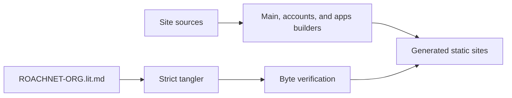
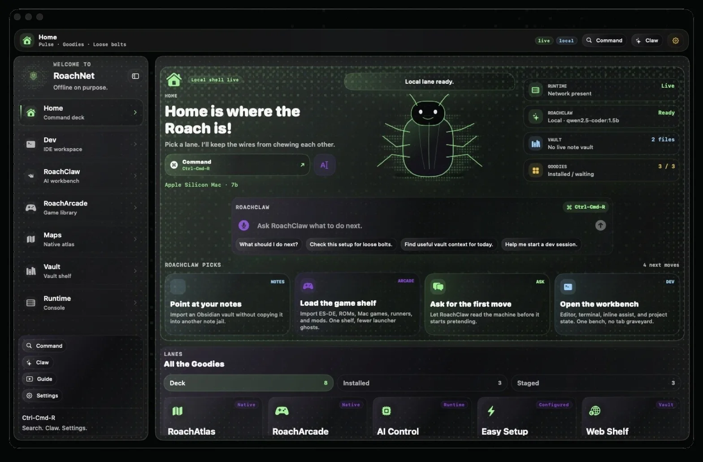

# RoachNet.org Site Code

This literate source records the current site roots. Run `node scripts/tangle.mjs --verify` before writing generated roots; `--output-dir` stages a checked output tree without changing the repository. Additive chunks use double-angle references; duplicate roots, missing references, cycles, and unsafe paths are rejected.



## 404.html

This root is reconciled byte-for-byte from the current production source.

```text {chunk="404-html" file="404.html"}
<!doctype html>
<html lang="en" class="nx">
  <head>
    <meta charset="UTF-8" />
    <meta name="viewport" content="width=device-width, initial-scale=1.0" />
    <title>Page not found · RoachNet</title>
    <meta name="robots" content="noindex" />
    <meta name="theme-color" content="#05060a" />
    <link rel="icon" href="/favicon.ico" sizes="any" />
    <link rel="icon" type="image/png" sizes="32x32" href="/favicon-32x32.png" />
    <link rel="apple-touch-icon" sizes="180x180" href="/apple-touch-icon.png" />
    <link rel="stylesheet" href="/nx.css" />
    <script src="/nx-halloween.js"></script>
  </head>
  <body data-page="404">
    <a class="rn-skip-link" href="#top">Skip to main content</a>
    <div class="nx-atmos" aria-hidden="true">
      <span class="nx-atmos__blob nx-atmos__blob--purple"></span>
      <span class="nx-atmos__blob nx-atmos__blob--blue"></span>
      <span class="nx-atmos__grain"></span>
      <span class="nx-atmos__vignette"></span>
    </div>
    <header class="nx-nav">
      <div class="nx-nav__bar">
        <a class="nx-nav__brand" href="https://roachnet.org/" aria-label="RoachNet landing page">
          <span class="nx-nav__dot" aria-hidden="true"></span>
          <span>RoachNet</span>
          <span class="nx-nav__sub">404</span>
        </a>
        <button class="nx-nav__burger" type="button" aria-expanded="false" aria-controls="nx-primary-nav" aria-label="Open menu">
          <span aria-hidden="true"></span>
        </button>
        <nav class="nx-nav__links" id="nx-primary-nav" aria-label="Primary">
          <a class="nx-nav__link" href="https://roachnet.org/">Mission</a>
          <a class="nx-nav__link" href="https://roachnet.org/home/">Home</a>
          <a class="nx-nav__link" href="https://apps.roachnet.org/">Apps</a>
          <a class="nx-nav__link" href="https://roachnet.org/roachclaw/">Claw</a>
          <a class="nx-nav__link" href="https://roachnet.org/brew/">Brew</a>
          <a class="nx-nav__link" href="https://roachnet.org/ios/">iOS</a>
        </nav>
        <div class="nx-nav__actions" aria-label="Utility links">
          <a class="nx-nav__ghost" href="https://accounts.roachnet.org/">Account</a>
          <a class="nx-nav__ghost" href="https://roachnet.org/api/">API</a>
          <a class="nx-nav__cta" href="https://roachnet.org/sitemap/">Sitemap</a>
        </div>
      </div>
    </header>
    <main id="top" class="nx-main nx-404" tabindex="-1">
      <div>
        <span class="nx-404__code" aria-hidden="true">404</span>
        <p class="nx-overline nx-overline--amber">Not on this machine</p>
        <h1 class="nx-h2 nx-mt-16">That page isn't here.</h1>
        <p class="nx-lede nx-mt-16 nx-content">It may have moved, or it never existed. Everything that does exist is one page away.</p>
        <div class="nx-actions nx-actions--center nx-mt-32">
          <a class="nx-btn nx-btn--primary" href="https://roachnet.org/home/">Go Home</a>
          <a class="nx-btn" href="https://roachnet.org/sitemap/">Open the sitemap</a>
          <a class="nx-btn" href="https://apps.roachnet.org/">Browse Apps</a>
        </div>
      </div>
    </main>
    <footer class="nx-foot">
      <div class="nx-foot__meta">
        <div class="nx-foot__meta-group">
          <span>© 2026 RoachWares LLC</span>
          <a class="nx-link" href="https://roachnet.org/sitemap/">Sitemap</a>
          <a class="nx-link" href="https://www.roachwares.org/">RoachWares</a>
        </div>
        <span>Offline on purpose.</span>
      </div>
    </footer>
    <script src="/nx.js" type="module"></script>
  </body>
</html>
```

## account.js

This root is reconciled byte-for-byte from the current production source.

```text {chunk="account-js" file="account.js"}
import {
  clearCachedAuthState,
  getSiteAuthState,
  refreshSiteSession,
  sessionLabel,
} from './site-account.js'

const browserDeviceStorageKey = 'RoachNetAccountBrowserDeviceID'
const turnstileScriptId = 'roachnet-turnstile-script'
const minimumPasswordLength = 10

const authCard = document.querySelector('#account-auth')
const dashboard = document.querySelector('#account-dashboard')
const statusTitle = document.querySelector('#account-status-title')
const statusBody = document.querySelector('#account-status-body')
const statusBadge = document.querySelector('#account-status-badge')
const feedback = document.querySelector('#account-feedback')
const refreshButton = document.querySelector('#account-refresh')
const signOutButton = document.querySelector('#account-signout')
const submitButton = document.querySelector('#account-submit')
const submitLabel = submitButton?.querySelector('.ac-submit__label') || submitButton
const form = document.querySelector('#account-form')
const formNote = document.querySelector('#account-form-note')
const emailInput = document.querySelector('#account-email')
const passwordInput = document.querySelector('#account-password')
const displayNameInput = document.querySelector('#account-display-name')
const displayNameField = document.querySelector('#account-name-field')
const startedAtInput = document.querySelector('#account-started-at')
const honeypotInput = document.querySelector('#account-company')
const tablist = document.querySelector('.ac-tabs')
const tabs = [...document.querySelectorAll('[data-account-mode]')]
const emailHint = document.querySelector('[data-hint="email"]')
const passwordHint = document.querySelector('[data-hint="password"]')
const snapshotTitle = document.querySelector('#account-snapshot-title')
const snapshotBody = document.querySelector('#account-snapshot-body')
const deviceCount = document.querySelector('#account-device-count')
const appCount = document.querySelector('#account-app-count')
const threadCount = document.querySelector('#account-thread-count')
const settingsState = document.querySelector('#account-settings-state')
const accountMini = document.querySelector('#account-mini')
const deviceList = document.querySelector('#account-device-list')
const appList = document.querySelector('#account-app-list')
const turnstileShell = document.querySelector('#account-turnstile-shell')
const turnstileMount = document.querySelector('#account-turnstile')
const turnstileNote = document.querySelector('#account-turnstile-note')

let accountMode = 'signin'
let authState = null
let authSubscription = null
let activeRequest = null
let turnstileWidgetId = null
let captchaToken = ''
let snapshotRun = null

function friendlyAuthError(error, fallback) {
  const message = String(error?.message || '')
  if (/failed to fetch|networkerror|load failed|network request failed/i.test(message)) {
    return 'Could not reach the sign-in service. Check your connection and try again.'
  }
  if (/invalid login credentials/i.test(message)) return "That email and password don't match an account."
  if (/email not confirmed/i.test(message)) return 'Confirm your email first. The link is in your inbox.'
  return message || fallback
}

function setAuthView(state) {
  if (authCard) authCard.dataset.authState = state
  if (dashboard) dashboard.dataset.authState = state
}

function setFeedback(message, tone = 'muted') {
  if (!feedback) return
  feedback.textContent = message || ''
  feedback.dataset.tone = tone
}

let toastElement = null
function toast(message) {
  if (!toastElement) {
    toastElement = document.createElement('div')
    toastElement.className = 'nx-toast'
    toastElement.setAttribute('role', 'status')
    toastElement.setAttribute('aria-live', 'polite')
    document.body.append(toastElement)
  }
  toastElement.textContent = message
  toastElement.classList.add('is-on')
  window.clearTimeout(toastElement.timer)
  toastElement.timer = window.setTimeout(() => toastElement.classList.remove('is-on'), 2600)
}

function formatRelativeTime(value) {
  if (!value) return ''
  const diff = new Date(value).getTime() - Date.now()
  if (!Number.isFinite(diff)) return ''
  const formatter = new Intl.RelativeTimeFormat('en', { numeric: 'auto' })
  const minutes = Math.round(diff / 60000)
  if (Math.abs(minutes) < 1) return 'just now'
  if (Math.abs(minutes) < 60) return formatter.format(minutes, 'minute')
  const hours = Math.round(minutes / 60)
  if (Math.abs(hours) < 48) return formatter.format(hours, 'hour')
  return formatter.format(Math.round(hours / 24), 'day')
}

function platformLabel(platform) {
  const value = String(platform || '').toLowerCase()
  const base = value.replace(/-web$/, '')
  const names = { macos: 'Mac', ios: 'iPhone', ipados: 'iPad', windows: 'Windows', linux: 'Linux', web: 'Browser' }
  const name = names[base] || (base ? base.charAt(0).toUpperCase() + base.slice(1) : 'Device')
  return value.endsWith('-web') && base !== 'web' ? `${name} browser` : name
}

function rowsEmpty(list, message) {
  if (!list) return
  const item = document.createElement('li')
  item.className = 'ac-rows__empty'
  item.textContent = message
  list.replaceChildren(item)
}

function rowsLoading(list) {
  if (!list) return
  list.replaceChildren(
    ...[0, 1].map(() => {
      const item = document.createElement('li')
      item.className = 'ac-rows__skeleton'
      item.setAttribute('aria-hidden', 'true')
      return item
    })
  )
}

function renderRow({ title, detail, meta, tag }) {
  const item = document.createElement('li')
  item.className = 'ac-row'
  const copy = document.createElement('div')
  copy.className = 'ac-row__copy'
  const strong = document.createElement('strong')
  strong.textContent = title
  copy.append(strong)
  if (detail) {
    const span = document.createElement('span')
    span.textContent = detail
    copy.append(span)
  }
  item.append(copy)
  const side = document.createElement('div')
  side.className = 'ac-row__side'
  if (tag) {
    const pill = document.createElement('span')
    pill.className = 'ac-row__tag'
    pill.textContent = tag
    side.append(pill)
  }
  if (meta) {
    const time = document.createElement('span')
    time.className = 'ac-row__meta'
    time.textContent = meta
    side.append(time)
  }
  item.append(side)
  return item
}

function setSnapshot({
  title,
  body,
  devices = '—',
  apps = '—',
  threads = '—',
  settings = '—',
}) {
  if (snapshotTitle) snapshotTitle.textContent = title
  if (snapshotBody) snapshotBody.textContent = body
  if (deviceCount) deviceCount.textContent = devices
  if (appCount) appCount.textContent = apps
  if (threadCount) threadCount.textContent = threads
  if (settingsState) settingsState.textContent = settings
}

function getBrowserDeviceID() {
  try {
    const existing = window.localStorage.getItem(browserDeviceStorageKey)
    if (existing) return existing
    const next = `account-web-${window.crypto.randomUUID()}`
    window.localStorage.setItem(browserDeviceStorageKey, next)
    return next
  } catch {
    return `account-web-${window.crypto.randomUUID()}`
  }
}

function inferPlatform() {
  const userAgent = window.navigator.userAgent.toLowerCase()
  if (userAgent.includes('iphone')) return 'ios-web'
  if (userAgent.includes('ipad')) return 'ipados-web'
  if (userAgent.includes('mac os')) return 'macos-web'
  if (userAgent.includes('windows')) return 'windows-web'
  if (userAgent.includes('linux')) return 'linux-web'
  return 'web'
}

function displayNameFor(profile, session) {
  if (profile?.display_name && profile.display_name.trim()) {
    return profile.display_name.trim()
  }

  const email = session?.user?.email || ''
  return email ? email.split('@')[0] : 'Your account'
}

function setFormBusy(isBusy, label) {
  activeRequest = isBusy
  const disabled = Boolean(isBusy)

  for (const field of [emailInput, passwordInput, displayNameInput, submitButton, refreshButton, signOutButton, ...tabs]) {
    if (field) field.disabled = disabled
  }

  if (submitButton) {
    submitButton.classList.toggle('is-loading', disabled && Boolean(label))
    submitButton.setAttribute('aria-busy', disabled && label ? 'true' : 'false')
  }
  if (submitLabel) {
    submitLabel.textContent = label || (accountMode === 'signup' ? 'Create account' : 'Sign in')
  }
}

function resetTurnstileIfPresent() {
  if (typeof window.turnstile?.reset === 'function' && turnstileWidgetId !== null) {
    window.turnstile.reset(turnstileWidgetId)
  }
}

function setTurnstileState(message, tone = 'muted') {
  if (!turnstileNote) return
  turnstileNote.textContent = message
  turnstileNote.dataset.tone = tone
}

function validateEmail({ quiet = false } = {}) {
  const value = String(emailInput?.value || '').trim()
  const valid = Boolean(value) && emailInput?.checkValidity() !== false
  if (!quiet || value) {
    emailInput?.closest('.ac-field')?.classList.toggle('is-invalid', !valid)
    emailInput?.setAttribute('aria-invalid', valid ? 'false' : 'true')
    if (emailHint) {
      emailHint.textContent = valid ? '' : value ? 'That email looks incomplete.' : 'Enter your email.'
      emailHint.dataset.tone = valid ? 'muted' : 'error'
    }
  }
  return valid
}

function validatePassword({ quiet = false } = {}) {
  const value = String(passwordInput?.value || '')
  const field = passwordInput?.closest('.ac-field')
  if (accountMode !== 'signup') {
    const valid = value.length > 0
    if (!quiet) {
      field?.classList.toggle('is-invalid', !valid)
      passwordInput?.setAttribute('aria-invalid', valid ? 'false' : 'true')
      if (passwordHint) {
        passwordHint.textContent = valid ? '' : 'Enter your password.'
        passwordHint.dataset.tone = 'error'
      }
    } else {
      field?.classList.remove('is-invalid', 'is-valid')
      if (passwordHint) passwordHint.textContent = ''
    }
    return valid
  }

  const remaining = minimumPasswordLength - value.length
  const valid = remaining <= 0
  field?.classList.toggle('is-valid', valid)
  field?.classList.toggle('is-invalid', !valid && !quiet)
  passwordInput?.setAttribute('aria-invalid', !valid && !quiet ? 'true' : 'false')
  if (passwordHint) {
    passwordHint.textContent = valid
      ? 'Long enough.'
      : value.length
        ? `At least ${minimumPasswordLength} characters. ${remaining} to go.`
        : `At least ${minimumPasswordLength} characters.`
    passwordHint.dataset.tone = valid ? 'live' : quiet ? 'muted' : 'error'
  }
  return valid
}

function setMode(nextMode, { focus = false } = {}) {
  accountMode = nextMode === 'signup' ? 'signup' : 'signin'

  if (tablist) tablist.dataset.mode = accountMode
  tabs.forEach((tab) => {
    const isActive = tab.dataset.accountMode === accountMode
    tab.classList.toggle('is-active', isActive)
    tab.setAttribute('role', 'tab')
    tab.setAttribute('aria-selected', isActive ? 'true' : 'false')
    tab.tabIndex = isActive ? 0 : -1
    if (isActive && focus) tab.focus()
  })
  form?.setAttribute('aria-labelledby', accountMode === 'signup' ? 'account-tab-signup' : 'account-tab-signin')

  if (displayNameField) {
    displayNameField.hidden = accountMode !== 'signup'
  }

  if (passwordInput) {
    passwordInput.autocomplete = accountMode === 'signup' ? 'new-password' : 'current-password'
    passwordInput.placeholder = accountMode === 'signup' ? `${minimumPasswordLength} characters or more` : 'Your password'
  }

  if (submitLabel && !activeRequest) {
    submitLabel.textContent = accountMode === 'signup' ? 'Create account' : 'Sign in'
  }

  if (formNote) {
    formNote.textContent =
      accountMode === 'signup'
        ? 'You get a confirmation link before the account works. Use an inbox you can open.'
        : 'Signing in only links this browser to your account. The vault stays out of it.'
  }

  if (turnstileShell) {
    turnstileShell.hidden = accountMode !== 'signup' || !authState?.config?.turnstile?.enabled
  }

  emailInput?.closest('.ac-field')?.classList.remove('is-invalid')
  if (emailHint) emailHint.textContent = ''
  validatePassword({ quiet: true })
  setFeedback('')
}

function renderStatus() {
  if (!authState) return

  const enabled = authState.enabled === true
  const session = authState.session

  if (!enabled) {
    setAuthView('disabled')
    statusTitle.textContent = "Sign-in isn't available here."
    statusBody.textContent = authState.reason
    statusBadge.textContent = 'Off'
    statusBadge.dataset.state = 'disabled'
    signOutButton.hidden = true
    form?.setAttribute('aria-disabled', 'true')
    setFormBusy(true)
    setSnapshot({
      title: 'Nothing to show here.',
      body: "There's no account to read until sign-in is available.",
    })
    rowsEmpty(deviceList, 'Sign-in is off here.')
    rowsEmpty(appList, 'Sign-in is off here.')
    setFeedback('Sign-in is not switched on for this site yet.', 'error')
    return
  }

  form?.removeAttribute('aria-disabled')
  setFormBusy(false)

  if (session?.user) {
    setAuthView('signed-in')
    statusTitle.textContent = 'Signed in.'
    statusBody.textContent = `This browser is linked to ${sessionLabel(session)}.`
    statusBadge.textContent = 'Live'
    statusBadge.dataset.state = 'live'
    signOutButton.hidden = false
    return
  }

  setAuthView('signed-out')
  statusTitle.textContent = 'Not signed in.'
  statusBody.textContent = 'Sign in to see your devices and RoachClaw threads, or make an account in a minute.'
  statusBadge.textContent = 'Ready'
  statusBadge.dataset.state = 'ready'
  signOutButton.hidden = true
  setSnapshot({
    title: "Sign in to see what's here.",
    body: 'Your devices and RoachClaw threads show up here once you sign in.',
  })
  rowsEmpty(deviceList, 'Nothing to show until you sign in.')
  rowsEmpty(appList, 'Nothing to show until you sign in.')
}

async function syncSnapshot() {
  if (!authState?.client || !authState?.session?.user) {
    return
  }
  if (snapshotRun) return snapshotRun
  snapshotRun = loadSnapshot().finally(() => {
    snapshotRun = null
  })
  return snapshotRun
}

async function loadSnapshot() {
  const client = authState.client
  const browserDeviceID = getBrowserDeviceID()
  const currentOrigin = window.location.origin
  const userId = authState.session.user.id

  dashboard?.classList.add('is-syncing')
  rowsLoading(deviceList)
  rowsLoading(appList)

  const [touchResult, profileResult, settingsResult, devicesResult, appsResult, threadsResult] = await Promise.all([
    client.rpc('touch_device_link', {
      p_device_id: browserDeviceID,
      p_device_name: 'Accounts Web',
      p_platform: inferPlatform(),
      p_runtime_lane: 'account-web',
      p_metadata: {
        surface: 'accounts',
        origin: currentOrigin,
      },
    }),
    client
      .from('profiles')
      .select('display_name, email, plan, account_state, last_seen_at')
      .eq('id', userId)
      .maybeSingle(),
    client
      .from('user_settings')
      .select('updated_at, favorite_apps, settings')
      .eq('user_id', userId)
      .maybeSingle(),
    client
      .from('device_links')
      .select('id, device_id, device_name, platform, runtime_lane, roachtail_status, last_seen_at', { count: 'exact' })
      .order('last_seen_at', { ascending: false })
      .limit(8),
    client
      .from('saved_apps')
      .select('id, app_id, title, category, updated_at', { count: 'exact' })
      .order('updated_at', { ascending: false })
      .limit(8),
    // The thread count is a nice-to-have; a failure here never blocks the snapshot.
    Promise.resolve(client.from('chat_threads').select('id', { count: 'exact', head: true })).catch((error) => ({ error })),
  ])

  dashboard?.classList.remove('is-syncing')

  const errors = [
    touchResult.error,
    profileResult.error,
    settingsResult.error,
    devicesResult.error,
    appsResult.error,
  ].filter(Boolean)

  if (errors.length > 0) {
    setFeedback(errors[0].message || 'Could not load your account details.', 'error')
    setSnapshot({
      title: 'Your account needs a second try.',
      body: 'You are signed in, but this browser could not load your account details. Refresh to try again.',
      settings: 'Error',
    })
    if (accountMini) accountMini.textContent = 'Your account details did not load. Try Refresh.'
    rowsEmpty(deviceList, 'Could not load devices.')
    rowsEmpty(appList, 'Could not load saved apps.')
    return
  }

  const profile = profileResult.data
  const settings = settingsResult.data
  const deviceRows = Array.isArray(devicesResult.data) ? devicesResult.data : []
  const appRows = Array.isArray(appsResult.data) ? appsResult.data : []
  const devices = devicesResult.count ?? deviceRows.length
  const apps = appsResult.count ?? appRows.length
  const threads = threadsResult?.error ? '—' : String(threadsResult?.count ?? 0)
  const settingsCount =
    (settings?.favorite_apps?.length || 0) + Object.keys(settings?.settings || {}).length

  setSnapshot({
    title: `Hello, ${displayNameFor(profile, authState.session)}.`,
    body:
      devices > 1
        ? 'Here is what your account holds right now. Nothing below came from your vault.'
        : 'A fresh account. Sign in from another device or save an app and it shows up here.',
    devices: String(devices),
    apps: String(apps),
    threads,
    settings: settingsCount > 0 ? 'Saved' : 'Default',
  })

  if (accountMini) {
    const plural = (count, word) => `${count} ${word}${String(count) === '1' ? '' : 's'}`
    accountMini.textContent = `${plural(devices, 'device')} · ${plural(apps, 'saved app')}${threads === '—' ? '' : ` · ${plural(threads, 'RoachClaw thread')}`}. `
    const link = document.createElement('a')
    link.className = 'nx-link nx-link--arrow'
    link.href = '#account-dashboard'
    link.textContent = 'See the details'
    accountMini.append(link)
  }

  if (deviceList) {
    if (!deviceRows.length) {
      rowsEmpty(deviceList, 'No devices yet.')
    } else {
      deviceList.replaceChildren(
        ...deviceRows.map((device) =>
          renderRow({
            title: device.device_name || 'Unnamed device',
            detail: platformLabel(device.platform),
            tag: device.device_id === browserDeviceID ? 'This browser' : device.roachtail_status === 'paired' ? 'Paired' : '',
            meta: formatRelativeTime(device.last_seen_at),
          })
        )
      )
    }
  }

  if (appList) {
    if (!appRows.length) {
      rowsEmpty(appList, "Nothing here yet. The store can't save picks today, so this list stays empty.")
    } else {
      appList.replaceChildren(
        ...appRows.map((app) =>
          renderRow({
            title: app.title || app.app_id,
            detail: app.category || '',
            meta: formatRelativeTime(app.updated_at),
          })
        )
      )
    }
  }
}

function loadTurnstileScript() {
  return new Promise((resolve, reject) => {
    if (window.turnstile) {
      resolve(window.turnstile)
      return
    }

    const existing = document.querySelector(`#${turnstileScriptId}`)
    if (existing) {
      existing.addEventListener('load', () => resolve(window.turnstile), { once: true })
      existing.addEventListener('error', reject, { once: true })
      return
    }

    const script = document.createElement('script')
    script.id = turnstileScriptId
    script.src = 'https://challenges.cloudflare.com/turnstile/v0/api.js?render=explicit'
    script.async = true
    script.defer = true
    script.addEventListener('load', () => resolve(window.turnstile), { once: true })
    script.addEventListener('error', reject, { once: true })
    document.head.append(script)
  })
}

async function ensureTurnstile() {
  const turnstileConfig = authState?.config?.turnstile
  // setMode() can run before the auth state arrives, so the shell's visibility is
  // settled again here; otherwise the widget renders inside a hidden shell and
  // nobody can finish the check.
  if (turnstileShell) {
    turnstileShell.hidden = accountMode !== 'signup' || !turnstileConfig?.enabled
  }
  if (!turnstileConfig?.enabled || !turnstileConfig?.siteKey || !turnstileMount || turnstileWidgetId !== null) {
    return
  }

  setTurnstileState('Loading the human check…')

  try {
    await loadTurnstileScript()
    turnstileWidgetId = window.turnstile.render(turnstileMount, {
      sitekey: turnstileConfig.siteKey,
      theme: 'dark',
      callback: (token) => {
        captchaToken = token
        setTurnstileState('Human check done.', 'live')
      },
      'expired-callback': () => {
        captchaToken = ''
        setTurnstileState('The human check expired. Run it again.', 'error')
      },
      'error-callback': () => {
        captchaToken = ''
        setTurnstileState("The human check didn't load. Reload the page to try again. Signing in doesn't need it.", 'error')
      },
    })
    setTurnstileState('Finish the human check to create the account.')
  } catch {
    setTurnstileState("The human check couldn't load. Reload the page to try again. Signing in doesn't need it.", 'error')
  }
}

async function registerAccount({ email, password, displayName }) {
  const registerUrl =
    authState?.config?.auth?.registerUrl || 'https://roachnet.org/.netlify/functions/register-account'
  const response = await fetch(registerUrl, {
    method: 'POST',
    headers: {
      'content-type': 'application/json',
    },
    body: JSON.stringify({
      email,
      password,
      displayName,
      captchaToken,
      company: honeypotInput?.value || '',
      startedAt: startedAtInput?.value || '',
    }),
  })

  const result = await response.json().catch(() => ({
    ok: false,
    message: 'The account service sent back something unreadable. Try again in a minute.',
  }))

  if (!response.ok || result.ok !== true) {
    throw new Error(result.message || "Sign-up didn't go through. Try again in a minute.")
  }

  return result
}

async function loadAuthState() {
  authSubscription?.unsubscribe?.()
  authSubscription = null

  try {
    authState = await getSiteAuthState()
  } catch (error) {
    authState = { enabled: false, client: null, session: null, reason: error?.message || 'The sign-in library did not load.' }
  }
  renderStatus()

  if (authState?.client) {
    const { data } = authState.client.auth.onAuthStateChange((_event, session) => {
      authState = {
        ...authState,
        session,
      }
      renderStatus()
      void syncSnapshot()
    })
    authSubscription = data?.subscription || null
  }

  await ensureTurnstile()
  await syncSnapshot()
}

tabs.forEach((tab) => {
  tab.addEventListener('click', () => {
    if (activeRequest) return
    setMode(tab.dataset.accountMode)
  })
  tab.addEventListener('keydown', (event) => {
    if (activeRequest) return
    if (['ArrowLeft', 'ArrowRight', 'Home', 'End'].includes(event.key)) {
      event.preventDefault()
      const next = event.key === 'Home' ? 'signin' : event.key === 'End' ? 'signup' : accountMode === 'signin' ? 'signup' : 'signin'
      setMode(next, { focus: true })
    }
  })
})

emailInput?.addEventListener('blur', () => validateEmail({ quiet: true }))
emailInput?.addEventListener('input', () => {
  if (emailInput.closest('.ac-field')?.classList.contains('is-invalid')) validateEmail({ quiet: true })
})
passwordInput?.addEventListener('input', () => validatePassword({ quiet: true }))

refreshButton?.addEventListener('click', async () => {
  setFeedback('')
  refreshButton.classList.add('is-loading')
  const session = await refreshSiteSession()
  if (authState) {
    authState = {
      ...authState,
      session,
    }
  }
  renderStatus()
  await syncSnapshot()
  refreshButton.classList.remove('is-loading')
  if (session?.user) toast('Account refreshed')
})

signOutButton?.addEventListener('click', async () => {
  if (!authState?.client) return
  setFormBusy(true)
  await authState.client.auth.signOut()
  clearCachedAuthState()
  authState = null
  await loadAuthState()
  toast('Signed out')
})

form?.addEventListener('submit', async (event) => {
  event.preventDefault()

  if (!authState?.client) {
    setFeedback('Sign-in is not switched on for this site yet.', 'error')
    return
  }

  const email = emailInput?.value?.trim() || ''
  const password = passwordInput?.value || ''
  const displayName = displayNameInput?.value?.trim() || ''

  const emailOK = validateEmail()
  const passwordOK = validatePassword()
  if (!email || !password || !emailOK || !passwordOK) {
    setFeedback(
      accountMode === 'signup' && password && !passwordOK
        ? `Use a password with at least ${minimumPasswordLength} characters.`
        : 'Enter both email and password.',
      'error'
    )
    ;(!emailOK ? emailInput : passwordInput)?.focus()
    return
  }

  if (accountMode === 'signup' && authState?.config?.turnstile?.enabled && !captchaToken) {
    setFeedback('Finish the human check first.', 'error')
    return
  }

  setFormBusy(true, accountMode === 'signup' ? 'Creating account…' : 'Signing in…')
  setFeedback('')

  try {
    if (accountMode === 'signup') {
      const registration = await registerAccount({ email, password, displayName })
      form.reset()
      startedAtInput.value = String(Date.now())
      captchaToken = ''
      resetTurnstileIfPresent()
      setMode('signin')
      if (emailInput) emailInput.value = email
      setFeedback(
        registration.message || 'Check your email to confirm your account, then sign in.',
        'confirm'
      )
      toast('Check your inbox')
      return
    }

    const result = await authState.client.auth.signInWithPassword({ email, password })
    if (result.error) {
      throw result.error
    }

    authState = {
      ...authState,
      session: result.data?.session || authState.session,
    }

    form.reset()
    renderStatus()
    toast(`Signed in as ${sessionLabel(authState.session)}`)
    await syncSnapshot()
  } catch (error) {
    setFeedback(friendlyAuthError(error, 'That did not go through. Try again.'), 'error')
    captchaToken = ''
    resetTurnstileIfPresent()
  } finally {
    setFormBusy(false)
  }
})

startedAtInput.value = String(Date.now())
const requestedMode = new URLSearchParams(window.location.search).get('mode')
setMode(requestedMode === 'signup' || window.location.hash === '#create' ? 'signup' : accountMode)
loadAuthState()
```

## account/index.html

This root is reconciled byte-for-byte from the current production source.

```text {chunk="account-index-html" file="account/index.html"}
<!doctype html>
<html lang="en" class="nx ac-page">
  <head>
    <meta charset="UTF-8" />
    <meta name="viewport" content="width=device-width, initial-scale=1.0" />
    <title>RoachNet Account</title>
    <meta
      name="description"
      content="An optional RoachNet account for RoachClaw web conversations and a short list of your devices. Your models, vault and files stay on your Mac."
    />
    <meta name="theme-color" content="#05060a" />
    <link rel="canonical" href="https://accounts.roachnet.org/" />
    <link rel="icon" href="/favicon.ico" sizes="any" />
    <link rel="icon" type="image/png" sizes="32x32" href="/favicon-32x32.png" />
    <link rel="icon" type="image/png" sizes="16x16" href="/favicon-16x16.png" />
    <link rel="apple-touch-icon" sizes="180x180" href="/apple-touch-icon.png" />
    <meta property="og:type" content="website" />
    <meta property="og:title" content="RoachNet Account" />
    <meta
      property="og:description"
      content="The small stuff travels: RoachClaw web threads and a device list. The heavy stuff stays on your Mac."
    />
    <meta property="og:url" content="https://accounts.roachnet.org/" />
    <meta property="og:image" content="https://roachnet.org/assets/screens/roachnet-native-roachclaw.webp" />
    <meta name="twitter:card" content="summary_large_image" />
    <meta name="twitter:title" content="RoachNet Account" />
    <meta
      name="twitter:description"
      content="The small stuff travels: RoachClaw web threads and a device list. The heavy stuff stays on your Mac."
    />
    <meta name="twitter:image" content="https://roachnet.org/assets/screens/roachnet-native-roachclaw.webp" />
    <link rel="preload" as="font" type="font/woff2" href="/fonts/inter-var.v1.woff2" crossorigin />
    <link rel="stylesheet" href="/nx.css" />
    <script src="/nx-halloween.js"></script>
    <link rel="stylesheet" href="/nx-account.css" />
  </head>
  <body data-page="account">
    <a class="rn-skip-link" href="#account-main">Skip to main content</a>
    <div class="nx-atmos" aria-hidden="true">
      <span class="nx-atmos__blob nx-atmos__blob--purple"></span>
      <span class="nx-atmos__blob nx-atmos__blob--blue"></span>
      <span class="nx-atmos__blob nx-atmos__blob--signal"></span>
      <span class="nx-atmos__grain"></span>
      <span class="nx-atmos__vignette"></span>
    </div>

    <header class="nx-nav">
      <div class="nx-nav__bar">
        <a class="nx-nav__brand" href="https://roachnet.org/" aria-label="RoachNet landing page">
          <span class="nx-nav__dot" aria-hidden="true"></span>
          <span>RoachNet</span>
          <span class="nx-nav__sub">Account</span>
        </a>
        <button class="nx-nav__burger" type="button" aria-expanded="false" aria-controls="nx-primary-nav" aria-label="Open menu">
          <span aria-hidden="true"></span>
        </button>
        <nav class="nx-nav__links" id="nx-primary-nav" aria-label="Primary">
          <a class="nx-nav__link" href="https://roachnet.org/">Mission</a>
          <a class="nx-nav__link" href="https://roachnet.org/home/">Home</a>
          <a class="nx-nav__link" href="https://apps.roachnet.org/">Apps</a>
          <a class="nx-nav__link" href="https://roachnet.org/roachclaw/">Claw</a>
          <a class="nx-nav__link" href="https://roachnet.org/brew/">Brew</a>
          <a class="nx-nav__link" href="https://roachnet.org/ios/">iOS</a>
        </nav>
        <div class="nx-nav__actions" aria-label="Utility links">
          <a class="nx-nav__ghost is-current" href="#account-main" aria-current="page">Account</a>
          <a class="nx-nav__ghost" href="https://roachnet.org/api/">API</a>
          <a class="nx-nav__cta" href="https://github.com/RoachWares/RoachNet" target="_blank" rel="noreferrer">GitHub</a>
        </div>
      </div>
    </header>

    <main class="nx-main ac-main" id="account-main" tabindex="-1">
      <section class="ac-hero" aria-labelledby="account-title">
        <div class="ac-hero__copy">
          <p class="nx-overline">RoachNet Account · optional</p>
          <h1 class="nx-display ac-title" id="account-title">The small stuff travels. <span class="nx-accent">The rest stays home.</span></h1>
          <p class="nx-lede">
            You don't need an account to use RoachNet. Make one and it keeps your RoachClaw web conversations and a short list of the devices you signed in from. Your models, vault and files never leave your Mac.
          </p>
          <div class="nx-actions">
            <a class="nx-btn nx-btn--primary" href="https://roachnet.org/roachclaw/">Open RoachClaw on the web</a>
            <a class="nx-btn" href="https://roachnet.org/ios/">Get RoachNet for iOS</a>
          </div>
          <ul class="nx-links" aria-label="More">
            <li><a class="nx-link nx-link--arrow" href="https://roachnet.org/api/">Read the API</a></li>
            <li><a class="nx-link nx-link--arrow" href="https://roachnet.org/home/">Download RoachNet for macOS</a></li>
          </ul>
        </div>

        <section class="ac-auth" id="account-auth" data-auth-state="loading" aria-labelledby="account-status-title">
          <div class="ac-auth__status">
            <div class="ac-auth__status-copy">
              <p class="ac-label">This browser</p>
              <h2 class="ac-auth__title" id="account-status-title">Checking for a session…</h2>
              <p class="ac-auth__body" id="account-status-body">Looking for a signed-in account in this browser.</p>
            </div>
            <p class="ac-badge" id="account-status-badge" data-state="loading">Loading</p>
          </div>

          <div class="ac-auth__signed-in">
            <p class="ac-auth__mini" id="account-mini">Loading what your account holds…</p>
            <div class="nx-actions">
              <a class="nx-btn nx-btn--primary nx-btn--sm" href="https://roachnet.org/roachclaw/">Open RoachClaw</a>
              <button class="nx-btn nx-btn--sm" id="account-refresh" type="button">Refresh</button>
              <button class="nx-btn nx-btn--sm" id="account-signout" type="button" hidden>Sign out</button>
            </div>
            <p class="ac-form__note">Signing out only ends this browser's session. Nothing on your Mac changes.</p>
          </div>

          <div class="ac-auth__signed-out">
            <div class="ac-tabs" role="tablist" aria-label="Account mode" data-mode="signin">
              <span class="ac-tabs__ind" aria-hidden="true"></span>
              <button class="ac-tab is-active" id="account-tab-signin" data-account-mode="signin" type="button" role="tab" aria-selected="true" aria-controls="account-form">Sign in</button>
              <button class="ac-tab" id="account-tab-signup" data-account-mode="signup" type="button" role="tab" aria-selected="false" aria-controls="account-form" tabindex="-1">Create account</button>
            </div>

            <form class="ac-form" id="account-form" novalidate>
              <div class="ac-field" id="account-name-field" hidden>
                <label for="account-display-name">Name <span class="ac-field__opt">optional</span></label>
                <input id="account-display-name" type="text" autocomplete="nickname" maxlength="60" placeholder="A name, a handle, whatever fits" />
              </div>

              <div class="ac-field">
                <label for="account-email">Email</label>
                <input id="account-email" type="email" autocomplete="email" inputmode="email" placeholder="you@example.com" aria-describedby="account-email-hint" required />
                <p class="ac-field__hint" id="account-email-hint" data-hint="email"></p>
              </div>

              <div class="ac-field">
                <label for="account-password">Password</label>
                <input id="account-password" type="password" autocomplete="current-password" placeholder="Your password" aria-describedby="account-password-hint" required />
                <p class="ac-field__hint" id="account-password-hint" data-hint="password"></p>
              </div>

              <input id="account-started-at" type="hidden" />
              <div class="account-honeypot" aria-hidden="true">
                <label for="account-company">Leave this blank</label>
                <input id="account-company" type="text" tabindex="-1" autocomplete="off" />
              </div>

              <div class="account-turnstile" id="account-turnstile-shell" hidden>
                <div id="account-turnstile"></div>
                <p class="ac-form__note" id="account-turnstile-note">Loading the human check…</p>
              </div>

              <button class="nx-btn nx-btn--primary ac-submit" id="account-submit" type="submit"><span class="ac-submit__label">Sign in</span></button>
              <p class="ac-form__note" id="account-form-note">Signing in only links this browser to your account. The vault stays out of it.</p>
              <p class="ac-form__feedback" id="account-feedback" role="status" aria-live="polite"></p>
            </form>
          </div>
        </section>
      </section>

      <section class="nx-section ac-ledger" aria-labelledby="ledger-title">
        <div class="nx-section__head">
          <p class="nx-overline nx-overline--purple">What goes where</p>
          <h2 class="nx-h2" id="ledger-title">A short list leaves the house. A long list doesn't.</h2>
          <p class="nx-lede">Accounts run on Supabase. They hold the few things that are useful on more than one device, and nothing that belongs in your vault.</p>
        </div>
        <div class="ac-ledger__grid">
          <article class="nx-card ac-ledger__card ac-ledger__card--syncs">
            <p class="nx-card__eyebrow nx-card__eyebrow--cyan">Syncs with your account</p>
            <ul class="ac-list">
              <li><strong>RoachClaw web conversations</strong><span>The threads and replies you send from a browser.</span></li>
              <li><strong>Saved app picks</strong><span>Not yet. The store can't save picks today, so nothing goes here.</span></li>
              <li><strong>Your device list</strong><span>A name, a platform and a last-seen time for each device you sign in from.</span></li>
              <li><strong>A few web settings</strong><span>Small preferences for the website.</span></li>
            </ul>
          </article>
          <article class="nx-card ac-ledger__card ac-ledger__card--home">
            <p class="nx-card__eyebrow">Stays on your Mac</p>
            <ul class="ac-list">
              <li><strong>Your models</strong><span>In the Mac app, RoachClaw runs local models on your own machine.</span></li>
              <li><strong>Your vault and files</strong><span>Everything in <code>~/RoachNet</code>. This account never sees it.</span></li>
              <li><strong>Paths and secrets</strong><span>Where things live on disk and the keys your runtime uses.</span></li>
              <li><strong>The runtime</strong><span>The native Swift runtime that does the work on your Mac.</span></li>
            </ul>
          </article>
        </div>
      </section>

      <section class="nx-section ac-dash" id="account-dashboard" aria-labelledby="account-snapshot-title" data-auth-state="loading">
        <div class="ac-dash__head">
          <div>
            <p class="nx-overline">Your account</p>
            <h2 class="nx-h2" id="account-snapshot-title">Sign in to see what's here.</h2>
            <p class="nx-lede" id="account-snapshot-body">Your devices and RoachClaw threads show up here once you sign in.</p>
          </div>
        </div>

        <ul class="ac-metrics" aria-label="Account totals">
          <li class="ac-metric"><strong id="account-device-count">—</strong><span>Devices</span></li>
          <li class="ac-metric"><strong id="account-app-count">—</strong><span>Saved apps</span></li>
          <li class="ac-metric"><strong id="account-thread-count">—</strong><span>RoachClaw threads</span></li>
          <li class="ac-metric"><strong id="account-settings-state">—</strong><span>Web settings</span></li>
        </ul>

        <div class="ac-dash__grid">
          <article class="nx-card ac-panel">
            <div class="ac-panel__head">
              <h3 class="nx-h3">Devices</h3>
              <p class="ac-panel__meta">Most recent first</p>
            </div>
            <ul class="ac-rows" id="account-device-list">
              <li class="ac-rows__empty">Nothing to show until you sign in.</li>
            </ul>
          </article>
          <article class="nx-card ac-panel">
            <div class="ac-panel__head">
              <h3 class="nx-h3">Saved apps</h3>
              <p class="ac-panel__meta">Not in use yet</p>
            </div>
            <ul class="ac-rows" id="account-app-list">
              <li class="ac-rows__empty">Nothing to show until you sign in.</li>
            </ul>
          </article>
        </div>
      </section>

      <section class="nx-section ac-next" aria-labelledby="next-title">
        <div class="nx-section__head">
          <p class="nx-overline nx-overline--cyan">Next stops</p>
          <h2 class="nx-h2" id="next-title">Where to go from here.</h2>
        </div>
        <div class="nx-grid nx-grid--3">
          <a class="nx-card nx-card--clickable nx-card--icon" href="https://roachnet.org/roachclaw/">
            <span class="nx-card__icon" aria-hidden="true">
              <svg viewBox="0 0 24 24" fill="none"><path d="M5 6.5A2.5 2.5 0 0 1 7.5 4h9A2.5 2.5 0 0 1 19 6.5v7a2.5 2.5 0 0 1-2.5 2.5H11l-4 3.5V16h0A2 2 0 0 1 5 14V6.5z" stroke="currentColor" stroke-width="1.6" stroke-linejoin="round"/></svg>
            </span>
            <p class="nx-card__eyebrow">Uses this account</p>
            <h3 class="nx-card__title">RoachClaw on the web</h3>
            <p class="nx-card__body">Chat from any browser with a hosted model. Sign in there with the same email and your threads follow.</p>
          </a>
          <a class="nx-card nx-card--clickable nx-card--icon" href="https://roachnet.org/ios/">
            <span class="nx-card__icon" aria-hidden="true">
              <svg viewBox="0 0 24 24" fill="none"><rect x="7" y="3" width="10" height="18" rx="2.5" stroke="currentColor" stroke-width="1.6"/><path d="M11 17.5h2" stroke="currentColor" stroke-width="1.6" stroke-linecap="round"/></svg>
            </span>
            <p class="nx-card__eyebrow nx-card__eyebrow--purple">Pairs with your Mac</p>
            <h3 class="nx-card__title">RoachNet for iOS</h3>
            <p class="nx-card__body">Version 0.2.0 for iPhone and iPad on iOS 17 or later. It pairs with your Mac over RoachTail, with a key for each device.</p>
          </a>
          <a class="nx-card nx-card--clickable nx-card--icon" href="https://roachnet.org/api/">
            <span class="nx-card__icon" aria-hidden="true">
              <svg viewBox="0 0 24 24" fill="none"><path d="M9 7l-5 5 5 5M15 7l5 5-5 5" stroke="currentColor" stroke-width="1.6" stroke-linecap="round" stroke-linejoin="round"/></svg>
            </span>
            <p class="nx-card__eyebrow nx-card__eyebrow--cyan">For builders</p>
            <h3 class="nx-card__title">The RoachNet API</h3>
            <p class="nx-card__body">Every route your Mac answers, plus the two roachnet.org functions behind web chat and sign-up.</p>
          </a>
        </div>
      </section>
    </main>

    <footer class="nx-foot">
      <div class="nx-foot__mark" aria-hidden="true">
        <span class="nx-foot__word">RoachNet</span>
        <span class="nx-foot__tag">Your data, your machine</span>
      </div>
      <div class="nx-foot__grid">
        <div class="nx-foot__brand">
          <strong>RoachNet Account</strong>
          <span>Optional. It carries RoachClaw web threads and your device list. The heavy lifting stays on your Mac.</span>
          <span>Made by <a class="nx-link" href="https://www.roachwares.org/">RoachWares LLC</a>.</span>
        </div>
        <div class="nx-foot__col">
          <h2>Product</h2>
          <nav aria-label="Footer: product">
            <a href="https://roachnet.org/">Mission</a>
            <a href="https://roachnet.org/home/">Home</a>
            <a href="https://apps.roachnet.org/">Apps</a>
            <a href="https://roachnet.org/roachclaw/">RoachClaw</a>
            <a href="https://roachnet.org/ios/">iOS</a>
          </nav>
        </div>
        <div class="nx-foot__col">
          <h2>Install</h2>
          <nav aria-label="Footer: install">
            <a href="https://roachnet.org/home/#downloads">Downloads</a>
            <a href="https://roachnet.org/brew/">Homebrew</a>
            <a href="https://roachnet.org/api/">API</a>
            <a href="https://github.com/RoachWares/RoachNet/releases/latest" target="_blank" rel="noreferrer">Changelog</a>
            <a href="https://github.com/RoachWares/RoachNet" target="_blank" rel="noreferrer">GitHub</a>
          </nav>
        </div>
        <div class="nx-foot__col">
          <h2>Company</h2>
          <nav aria-label="Footer: company">
            <a href="https://www.roachwares.org/">RoachWares</a>
            <a href="#account-main">Account</a>
            <a href="https://roachnet.org/home/#support">Support</a>
            <a href="https://roachnet.org/sitemap/">Sitemap</a>
            <a href="mailto:contact@roachwares.org">contact<wbr>@roachwares.org</a>
          </nav>
        </div>
      </div>
      <div class="nx-foot__meta">
        <div class="nx-foot__meta-group">
          <a
            class="nx-release"
            href="https://github.com/RoachWares/RoachNet/releases/latest"
            target="_blank"
            rel="noreferrer"
            aria-label="Latest RoachNet release v1.0.6"
          >v1.0.6</a>
          <span>© 2026 RoachWares LLC</span>
        </div>
        <a class="nx-netlify" href="https://www.netlify.com" target="_blank" rel="noreferrer" aria-label="Proudly powered by Netlify">
          <span>Hosted on</span>
          
        </a>
      </div>
    </footer>

    <script src="/site-config.js"></script>
    <script src="/router.js"></script>
    <script src="/account.js" type="module"></script>
    <script src="/nx.js" type="module"></script>
  </body>
</html>
```

## api.js

This root is reconciled byte-for-byte from the current production source.

```text {chunk="api-js" file="api.js"}
// RoachNet API reference (roachnet.org/api/).
// The route data below is reconciled against the RoachNet 1.0.6 Mac release
// (tag v1.0.6): native/macos/Sources/RoachNetRuntime/Router.swift and friends.
// `source` on each route points at the line that answers it.
// Text fields support `code` spans written with backticks; everything else is
// escaped before it reaches innerHTML.

const surfaces = {
  setup: {
    label: 'Setup service',
    base: '$SETUP',
    where: '127.0.0.1, ephemeral port (set `ROACHNET_SETUP_PORT` to pin it)',
    auth: 'No token. Loopback Host header only; JSON bodies must be sent as `application/json`.',
  },
  runtime: {
    label: 'Loopback API',
    base: '$ROACHNET',
    where: '127.0.0.1, ephemeral port (read `baseUrl` from the runtime state file)',
    auth: 'No token. Loopback Host header only; JSON bodies must be sent as `application/json`, or you get a 415.',
  },
  companion: {
    label: 'Companion bridge',
    base: '$BRIDGE',
    where: '127.0.0.1:38111 by default, or your RoachTail relay host',
    auth: '`authorization: Bearer <companion token>` or a paired device’s `rtp_` token. The same routes also answer on the loopback API without one.',
  },
  web: {
    label: 'roachnet.org',
    base: 'https://roachnet.org',
    where: 'Netlify functions on roachnet.org',
    auth: 'Origin must be roachnet.org or accounts.roachnet.org. Chat needs a Supabase session token.',
  },
}

const apiGroups = [
  {
    id: 'setup',
    label: 'Setup service',
    scope: 'setup',
    summary: 'The installer backend RoachNet Setup.app talks to before anything is installed.',
    stack: 'RoachNet Setup.app → roachnet-runtime --setup → SetupEngine.handle',
    callers: ['RoachNet Setup.app (RoachNetSetup/main.swift)'],
    endpoints: [
      {
        id: 'setup-state',
        method: 'GET',
        path: '/api/state',
        title: 'Installer state',
        summary: 'Machine checks, saved choices and the current or last install task, in one read.',
        handler: 'SetupEngine.state',
        source: 'SetupEngine.swift:915',
        request: [
          'Query, all optional: `installPath`, `installedAppPath`, `storagePath`, `installProfile`, `roachClawDefaultModel`, `releaseChannel`, `updateBaseUrl` and the companion settings.',
          'Boolean flags count as true only when the value is the string `true`: `installRoachClaw`, `companionEnabled`, `autoLaunch`, `autoCheckUpdates`, `launchAtLogin`, `dryRun`.',
        ],
        response: [
          '`system`: chip, macOS version, memory, recommended starter model, `runtime: "native-swift"`.',
          '`config`: saved choices merged with any query overrides.',
          '`dependencies`: preflight checks for Apple Silicon, macOS 14 or later, free space, a writable install folder and memory.',
          '`nativeApp`, `installLooksReady`, `activeTask`, `lastCompletedTask`, `sourceModes`.',
          '`containerRuntime` is always unavailable. RoachNet does not use containers.',
        ],
        implementation:
          'Query overrides are previewed, not saved. The install needs 2 GiB free, or 5 GiB with RoachClaw. The reply carries the saved config, companion token included, which is one reason the service only answers a loopback Host.',
        usedBy: ['Setup overview and preflight cards', 'Install-path and storage choosers'],
      },
      {
        id: 'setup-config',
        method: 'POST',
        path: '/api/config',
        title: 'Save installer choices',
        summary: 'Normalizes and saves setup choices without installing anything.',
        handler: 'SetupEngine.defaultConfig + saveConfig',
        source: 'SetupEngine.swift:917',
        body: { installPath: '~/RoachNet', installRoachClaw: true, autoLaunch: true },
        request: [
          'JSON body: any subset of the installer config, for example `installPath`, `storagePath`, `installRoachClaw`, `roachClawDefaultModel`, `autoLaunch`, `releaseChannel` (`stable`, `beta` or `alpha`).',
        ],
        response: ['`{ ok: true, config }` with every default filled in.'],
        implementation:
          'Saved to `~/Library/Application Support/roachnet/roachnet-installer.json`. Two fields are pinned whatever you send: `sourceMode` is always `bundled` and `useDockerContainerization` is always false.',
        usedBy: ['Install-path chooser', 'Storage-path chooser', 'RoachClaw toggle'],
      },
      {
        id: 'setup-install',
        method: 'POST',
        path: '/api/install',
        title: 'Start the install',
        summary: 'Starts the staged install and returns at once. Poll /api/state for progress.',
        handler: 'SetupEngine.startInstall → runInstall',
        source: 'SetupEngine.swift:921 (workflow at :467)',
        body: { installPath: '~/RoachNet', installRoachClaw: true, dryRun: true },
        request: [
          'JSON body: the installer config, same fields as /api/config.',
          '`dryRun: true` returns a finished preview task and changes nothing.',
        ],
        response: [
          '`{ ok: true }` once the task starts.',
          '`{ ok: true, task }` in dry-run mode.',
          '409 if an install is already running.',
        ],
        implementation:
          'Phases, with the progress each starts at: inspect (5), validate (12), stage beside the target (24), contained Ollama (38, skipped without RoachClaw), manifest (52), copy RoachNet.app (64), boot the staged runtime until /api/health answers (76), swap the root and carry `storage/` across (88), point the `RoachNet` hostname at loopback (94), launch (98). A failure removes the staging folder and leaves the previous install alone.',
        usedBy: ['Install button in RoachNet Setup.app', 'roachnet-runtime --install runs the same workflow without HTTP'],
      },
      {
        id: 'setup-launch',
        method: 'POST',
        path: '/api/launch',
        title: 'Open RoachNet',
        summary: 'Opens the installed native app.',
        handler: 'SetupEngine.launch',
        source: 'SetupEngine.swift:923 (launch at :877)',
        body: { installPath: '~/RoachNet' },
        request: ['JSON body: `installPath`, optional `installedAppPath`.'],
        response: [
          '`{ ok: true, launched: "native-app", installedAppPath }`.',
          '400 if the app is not at that path yet.',
        ],
        implementation:
          'Records `lastOpenedMode: "app"` and `preferredShell: "native"`. There is no fallback launcher anymore, so a missing app means a 400.',
        usedBy: ['Finish step in RoachNet Setup.app'],
      },
      {
        id: 'setup-container-runtime-start',
        method: 'POST',
        path: '/api/container-runtime/start',
        title: 'Container runtime (retired)',
        summary: 'Still routed so a client that asks gets a clear no. Always a 400.',
        handler: 'SetupEngine.handle',
        source: 'SetupEngine.swift:925',
        request: ['No body needed.'],
        response: ['400 `{ ok: false, error: "RoachNet runs natively and does not use a container runtime." }`'],
        implementation:
          'Docker support left with the Node runtime. The route stays so older setup flows get an answer instead of a 404.',
        usedBy: ['RoachNet Setup.app keeps the call for compatibility'],
      },
      {
        id: 'setup-health',
        method: 'GET',
        path: '/api/health',
        title: 'Setup health',
        summary: 'Liveness for the setup service. `/health` answers too.',
        handler: 'SetupEngine.handle',
        source: 'SetupEngine.swift:927',
        request: ['None.'],
        response: ['`{ status: "ok", runtime: "native-swift", mode: "setup" }`'],
        implementation: 'Same answer on `/health` and `/api/health`.',
        usedBy: ['RoachNet Setup.app while it waits for its backend'],
      },
    ],
  },
  {
    id: 'system',
    label: 'System',
    scope: 'runtime',
    summary: 'Health, hardware, services and updates for the Mac you are on.',
    stack: 'RoachNet.app → roachnet-runtime (loopback) → NativeRuntime.route',
    callers: ['RoachNet.app (RoachNetCore/ManagedAppRuntime.swift)'],
    endpoints: [
      {
        id: 'health',
        method: 'GET',
        path: '/api/health',
        title: 'Runtime health',
        summary: 'Liveness check. The cheapest call the runtime answers.',
        handler: 'NativeRuntime.route',
        source: 'Router.swift:100',
        request: ['None.'],
        response: ['`{ status: "ok" }`'],
        implementation:
          'The runtime writes this URL as `healthUrl` in its server-info file. Setup polls it to verify a fresh install; the app polls it before trusting the runtime.',
        usedBy: ['RoachNet.app runtime supervisor', 'Setup verification phase'],
      },
      {
        id: 'system-internet-status',
        method: 'GET',
        path: '/api/system/internet-status',
        title: 'Internet check',
        summary: 'A bare boolean: whether github.com resolves.',
        handler: 'DNS.resolves',
        source: 'Router.swift:101',
        request: ['None.'],
        response: ['`true` or `false`, not wrapped in an object.'],
        implementation: 'A DNS lookup with a three-second timeout. No request is sent to GitHub.',
      },
      {
        id: 'system-info',
        method: 'GET',
        path: '/api/system/info',
        title: 'Hardware profile',
        summary: 'CPU, memory, OS and the model size this Mac can carry.',
        handler: 'NativeRuntime.systemInfo',
        source: 'Router.swift:102 (RoachClawStatus.swift:111)',
        request: ['None.'],
        response: [
          '`cpu`: brand and core counts.',
          '`mem`: total and available bytes.',
          '`os`: hostname, arch, kernel.',
          '`hardwareProfile`: `memoryTier` (`compact` under 16 GB, `balanced`, `creator` from 32 GB) and `recommendedModelClass` (`1.5b`, `7b`, `14b`).',
        ],
        implementation: 'Read from the OS on every call. Nothing is cached or sent anywhere.',
      },
      {
        id: 'system-services',
        method: 'GET',
        path: '/api/system/services',
        title: 'Service list',
        summary: 'The six services the command grid shows, with install state.',
        handler: 'NativeRuntime.systemServices',
        source: 'Router.swift:103 (RoachClawStatus.swift:905)',
        request: ['None.'],
        response: [
          'Array of services: Library (Kiwix), Academy (Kolibri), Chat (Ollama), RoachSync, Notes, Data Lab.',
          'Each has `service_name`, `friendly_name`, `description`, `installed`, `installation_status`, `status`, `ui_location`.',
        ],
        implementation:
          'Only Chat reflects a live probe (whether Ollama answers). Notes and Data Lab are built in and always report `running`. The rest report `available`.',
      },
      {
        id: 'system-services-install',
        method: 'POST',
        path: '/api/system/services/install',
        title: 'Install a service',
        summary: 'Starts Ollama for `roachnet_ollama`. Acknowledges everything else.',
        handler: 'NativeRuntime.ensureOllama',
        source: 'Router.swift:151',
        body: { service_name: 'roachnet_ollama' },
        request: ['JSON body: `service_name`.'],
        response: ['`{ success: true, ok: true, message }`'],
        implementation:
          'Native services have nothing to install, so any name other than `roachnet_ollama` gets a success reply and no action.',
      },
      {
        id: 'system-services-affect',
        method: 'POST',
        path: '/api/system/services/affect',
        title: 'Start or stop a service',
        summary: 'Only `roachnet_ollama` with `start` does anything.',
        handler: 'NativeRuntime.route',
        source: 'Router.swift:158',
        body: { service_name: 'roachnet_ollama', action: 'start' },
        request: ['JSON body: `service_name`, `action`.'],
        response: ['`{ success: true, ok: true, message: "<action> request recorded." }`'],
        implementation:
          'Starting Ollama launches the contained runner with `OLLAMA_MODELS` pointed at `storage/models/ollama` and none of RoachNet’s own credentials in its environment. Any other combination gets the same reply and changes nothing.',
      },
      {
        id: 'system-ai-providers',
        method: 'GET',
        path: '/api/system/ai/providers',
        title: 'AI providers',
        summary: 'Whether the local model server is up, and which cloud keys exist.',
        handler: 'NativeRuntime.providerStatus',
        source: 'Router.swift:104',
        request: ['None.'],
        response: [
          '`providers.ollama` and `providers.openclaw`: `available`, `source`, `baseUrl`, `error`.',
          '`cloudProviders`: OpenAI, Anthropic and OpenRouter key status. Never the keys.',
        ],
        implementation:
          'Ollama is probed at `127.0.0.1:36434/api/version`, OpenClaw at `127.0.0.1:13001/health`. Probe results are cached for one second.',
      },
      {
        id: 'system-latest-version',
        method: 'GET',
        path: '/api/system/latest-version',
        title: 'Check for an update',
        summary: 'Compares this build with the newest GitHub release.',
        handler: 'NativeRuntime.latestVersionResponse',
        source: 'Router.swift:112 (RoachClawStatus.swift:1187)',
        query: 'force=1',
        request: ['Query: `force=1` skips the ten-minute cache.'],
        response: [
          '`{ success, updateAvailable, currentVersion, latestVersion, message, releaseUrl, assetUrl }`',
          'On failure: `success: false`, and `latestVersion` equals the current version.',
        ],
        implementation:
          'Reads the RoachWares/RoachNet releases list, skips drafts, and on the stable channel skips pre-releases. This and the update download are the only calls here that reach the internet on their own.',
      },
      {
        id: 'system-update',
        method: 'POST',
        path: '/api/system/update',
        title: 'Download the update',
        summary: 'Queues the verified installer DMG. Returns 202.',
        handler: 'NativeRuntime.requestUpdateDownload',
        source: 'Router.swift:114 (Downloads.swift:343)',
        request: ['No body needed.'],
        response: [
          '202 with `{ success, message, note }`.',
          '`success: false` when the release has no installer asset or no `.sha256` sidecar.',
        ],
        implementation:
          'Fetches the release’s `.sha256` sidecar first; the download refuses to finish unless the bytes match. The DMG lands in `storage/updates` and is opened for you. It does not install itself: run Setup over the existing install.',
      },
      {
        id: 'system-update-status',
        method: 'GET',
        path: '/api/system/update/status',
        title: 'Update progress',
        summary: 'Where the update download is.',
        handler: 'NativeRuntime.systemUpdateStatus',
        source: 'Router.swift:113',
        request: ['None.'],
        response: ['`{ stage, progress, message, timestamp }` where `stage` is `idle`, `checking`, `downloading`, `ready` or `error`.'],
        implementation: 'Mirrors the download job every 750 ms. In memory only.',
      },
    ],
  },
  {
    id: 'models',
    label: 'Models and chat',
    scope: 'runtime',
    summary: 'Local model inventory, chat and pulls through the bundled Ollama.',
    stack: 'RoachNet.app → roachnet-runtime → Ollama on 127.0.0.1:36434',
    callers: ['RoachNet.app (RoachNetCore/ManagedAppRuntime.swift)'],
    endpoints: [
      {
        id: 'ollama-installed-models',
        method: 'GET',
        path: '/api/ollama/installed-models',
        title: 'Installed models',
        summary: 'What Ollama has on disk.',
        handler: 'NativeRuntime.installedModels',
        source: 'Router.swift:162 (RoachClawStatus.swift:55)',
        request: ['None.'],
        response: ['Array of `{ name, size }` from Ollama `/api/tags`. Empty when Ollama cannot answer.'],
        implementation: 'Starts the contained Ollama first if it is not running. Cached for about a second.',
      },
      {
        id: 'ollama-chat',
        method: 'POST',
        path: '/api/ollama/chat',
        title: 'Chat with a local model',
        summary: 'Passes your body to Ollama /api/chat and returns its answer.',
        handler: 'NativeRuntime.handleChat',
        source: 'Router.swift:163 (Downloads.swift:697)',
        body: { model: 'qwen2.5-coder:1.5b', messages: [{ role: 'user', content: 'Say hello in five words.' }], stream: false },
        request: ['JSON body, forwarded as is: `model`, `messages`, `stream`, and any other Ollama chat option.'],
        response: [
          'Ollama’s chat response.',
          'If Ollama is unreachable: still a 200, with `message.content` starting “Local model route is not ready”.',
        ],
        implementation:
          'Two-minute timeout. Streaming is not relayed, so send `stream: false` and get one JSON body back.',
      },
      {
        id: 'roachclaw-apply',
        method: 'POST',
        path: '/api/roachclaw/apply',
        title: 'Pull a model',
        summary: 'Queues an Ollama pull and returns before it finishes.',
        handler: 'NativeRuntime.pullModel',
        source: 'Router.swift:147 (Downloads.swift:706)',
        body: { model: 'qwen2.5-coder:7b' },
        request: ['JSON body: `model`. Defaults to `qwen2.5-coder:1.5b`.'],
        response: ['`{ success: true, ok: true, message: "Local model pull queued." }`'],
        implementation:
          'The pull runs in the background against Ollama `/api/pull` with a ten-minute timeout. The reply does not wait for it; a failed pull only shows up in the runtime log.',
      },
      {
        id: 'openclaw-skills-installed',
        method: 'GET',
        path: '/api/openclaw/skills/installed',
        title: 'OpenClaw skills',
        summary: 'Always an empty list in 1.0.6.',
        handler: 'NativeRuntime.route',
        source: 'Router.swift:164',
        request: ['None.'],
        response: ['`{ workspacePath, skills: [] }`'],
        implementation:
          'OpenClaw is a migration reference in 1.0.6, not a bundled runtime (RoachClawAgent.swift:110). The workspace path defaults to `storage/RoachClaw`.',
      },
    ],
  },
  {
    id: 'roachclaw',
    label: 'RoachClaw agent',
    scope: 'runtime',
    summary: 'Status, readiness, the plan-only agent and the guardrails around it.',
    stack: 'Loopback API → NativeRuntime (RoachClawStatus, RoachClawAgent, RoachClawStores)',
    callers: ['RoachNet.app reads status; the rest is open to local tools on this Mac'],
    endpoints: [
      {
        id: 'roachclaw-status',
        method: 'GET',
        path: '/api/roachclaw/status',
        title: 'RoachClaw status',
        summary: 'Everything RoachClaw knows about itself, in one heavy read.',
        handler: 'NativeRuntime.roachClawStatus',
        source: 'Router.swift:115 (RoachClawStatus.swift:151)',
        request: ['None.'],
        response: [
          '`ready` (true when Ollama answers), `defaultModel`, `resolvedDefaultModel`, `installedModels`, `modelRecords`.',
          '`ollama`, `openclaw`, `agent`, `operations`, `playbook`, `workspacePath`.',
        ],
        implementation:
          'Probes Ollama, OpenClaw and the model list in parallel, then summarizes every store. Good for a status screen, heavy for a loop.',
        usedBy: ['RoachNet.app (RoachNetCore/ManagedAppRuntime.swift)'],
      },
      {
        id: 'roachclaw-readiness',
        method: 'GET',
        path: '/api/roachclaw/readiness',
        title: 'Readiness',
        summary: 'Whether RoachClaw can write where it needs to.',
        handler: 'NativeRuntime.roachClawReadinessState',
        source: 'Router.swift:142',
        request: ['None.'],
        response: ['`{ ready, localFirst, version, checks, timestamp }`'],
        implementation:
          'Writes and deletes a probe file in the storage root, the runtime state root and `storage/Vault`. `localFirst` is false only if storage is a URL or a relative path.',
      },
      {
        id: 'roachclaw-agent-status',
        method: 'GET',
        path: '/api/roachclaw/agent/status',
        title: 'Agent status',
        summary: 'The agent block: skills, policy, budgets, memory location.',
        handler: 'RoachClawAgent.status',
        source: 'Router.swift:143',
        request: ['None.'],
        response: [
          '`runtime: "roachclaw-native-agent"`, `skills`, `policy.defaultExecutionMode: "plan-only"`, `budgets`, `memory`.',
        ],
        implementation:
          'Its `ready` flag is always false in 1.0.6, because the status is built without model state (RoachClawStatus.swift:171). Read `ready` from /api/roachclaw/status instead.',
      },
      {
        id: 'roachclaw-agent-run',
        method: 'POST',
        path: '/api/roachclaw/agent/run',
        title: 'Plan an agent run',
        summary: 'Builds the permissioned prompt packet and a plan. Runs nothing.',
        handler: 'RoachClawAgent.createRun',
        source: 'Router.swift:144 (RoachClawAgent.swift:163)',
        body: { prompt: 'List what changed in my vault this week', enabledScopes: ['vault'], context: { vault: 'notes/2026-10-08.md was edited' } },
        request: [
          '`prompt` (required).',
          '`enabledScopes`: any of `roachnet`, `dev`, `vault`, `archives`, `arcade`, `maps`, `media`, `settings`, `runtime`. Defaults to `roachnet`.',
          '`context`: an object keyed by scope. Only enabled scopes are read.',
          '`contextBudget`: 1,000 to 64,000 characters, default 12,000. Also `model`, `activeSurface`, `execute`.',
        ],
        response: [
          '`executed: false`, always.',
          '`executionMode`: `plan-only`, or `approval-required` when you send `execute: true`.',
          '`prompt`: the system and user messages it would send. Also `plan`, `toolPolicy`, `budgets`.',
          '500 when `prompt` is empty.',
        ],
        implementation:
          'No model is called and no tool runs. Approval-gated execution is not wired up in 1.0.6, and the reply says so.',
      },
      {
        id: 'roachclaw-operations',
        method: 'GET',
        path: '/api/roachclaw/operations',
        title: 'Operations snapshot',
        summary: 'Every store and lane summarized. Add a section name for one part.',
        handler: 'NativeRuntime.roachClawOperationsState',
        source: 'Router.swift:278',
        request: [
          'Optional last segment selects one section: `/api/roachclaw/operations/jobs`. An unknown section returns the whole object.',
        ],
        response: [
          'Sections include `diagnostics`, `serviceHealth`, `jobs`, `contacts`, `calendar`, `mail`, `apiTokens`, `cloudProviders`, `readiness`, `toolPolicy`, `backups` and `models`.',
        ],
        implementation: 'Computed on every call, same cost as /api/roachclaw/status.',
      },
      {
        id: 'roachclaw-diagnostics-services',
        method: 'GET',
        path: '/api/roachclaw/diagnostics/services',
        title: 'Service health report',
        summary: 'Per-lane health for models, agent, memory, embeddings and limits.',
        handler: 'NativeRuntime.roachClawServiceHealthState',
        source: 'Router.swift:116',
        request: ['None.'],
        response: ['The `operations.serviceHealth.report` block from /api/roachclaw/status.'],
        implementation: 'A slice of the status call, so it costs the same.',
      },
      {
        id: 'roachclaw-scoped-tools',
        method: 'GET',
        path: '/api/roachclaw/scoped-tools/capabilities',
        title: 'Scoped tool bridge',
        summary: 'The scopes and endpoints a scoped tool is meant to use.',
        handler: 'NativeRuntime.roachClawScopedToolBridgeState',
        source: 'Router.swift:123 (RoachClawStores.swift:1000)',
        request: ['None.'],
        response: ['`localOnly: true`, `approvalRequired: true`, the scope list (`todos:write`, `email:send` and so on) and six endpoints.'],
        implementation: 'A declaration, not a gate: the loopback API checks no scopes in 1.0.6.',
      },
      {
        id: 'roachclaw-workspace-browse',
        method: 'GET',
        path: '/api/roachclaw/workspace/browse',
        title: 'Browse folders',
        summary: 'Lists the subfolders of a folder on this Mac.',
        handler: 'NativeRuntime.browseRoachClawWorkspace',
        source: 'Router.swift:117 (RoachClawStores.swift:830)',
        query: 'path=$HOME/Projects',
        request: ['Query: `path`. If it is missing or not a folder, you get your home folder (or `ROACHNET_WORKSPACE_BROWSE_ROOT`).'],
        response: ['`{ path, parent, dirs: [{ name, path, modifiedAt }], count }`'],
        implementation: 'Folders only, no files. Hidden folders and symlinks are skipped.',
      },
      {
        id: 'roachclaw-tool-policy',
        method: 'GET',
        path: '/api/roachclaw/tool-policy',
        title: 'Tool policy',
        summary: 'Which tools are disabled, and whether this turn is guide-only.',
        handler: 'NativeRuntime.roachClawToolPolicyState',
        source: 'Router.swift:134',
        request: ['None.'],
        response: ['`mode` (`normal` or `guide_only`), `disabledTools`, `hiddenTools`, `reasons`, `knownToolCount`, `enforcement`.'],
        implementation: 'Known tools are the built-in list plus anything in the tool index.',
      },
      {
        id: 'roachclaw-tool-policy-save',
        method: 'POST',
        path: '/api/roachclaw/tool-policy',
        title: 'Save disabled tools',
        summary: 'Replaces the saved list of disabled tools.',
        handler: 'NativeRuntime.upsertRoachClawToolPolicy',
        source: 'Router.swift:135',
        body: { disabledTools: ['bash', 'send_email'] },
        request: ['JSON body: `disabledTools` (up to 200 names). `lastUserMessage` is evaluated too, but not saved.'],
        response: ['The evaluated policy.'],
        implementation: 'The list is replaced, not merged. Send the full list every time.',
      },
      {
        id: 'roachclaw-tool-policy-evaluate',
        method: 'POST',
        path: '/api/roachclaw/tool-policy/evaluate',
        title: 'Evaluate a turn',
        summary: 'Applies the policy to one message without saving anything.',
        handler: 'NativeRuntime.roachClawToolPolicyState',
        source: 'Router.swift:136',
        body: { lastUserMessage: 'Do not use any tools, just explain it.' },
        request: ['JSON body: `lastUserMessage` (or `message`), optional extra `disabledTools`.'],
        response: ['The policy for that turn: `blockAllToolCalls`, `guideOnlyReason`, `hiddenTools`.'],
        implementation:
          'If the message asks for no tools (“guide-only mode”, “do not use tools”, “ask before using tools”), every known tool is disabled and hidden and `blockAllToolCalls` is true.',
      },
      {
        id: 'roachclaw-context-budget',
        method: 'GET',
        path: '/api/roachclaw/context-budget',
        title: 'Context budget',
        summary: 'How much context RoachClaw may spend per prompt.',
        handler: 'NativeRuntime.roachClawContextBudgetState',
        source: 'Router.swift:137',
        request: ['None.'],
        response: ['`configuredBudget` (default 6,000), `modelContextLength`, `headroom` (default 0.85), `hardMax` (default 200,000), `effectiveBudget`.'],
        implementation: 'Without a saved profile you get the defaults.',
      },
      {
        id: 'roachclaw-context-budget-save',
        method: 'POST',
        path: '/api/roachclaw/context-budget',
        title: 'Set the context budget',
        summary: 'Saves one budget profile and returns the result.',
        handler: 'NativeRuntime.upsertRoachClawContextBudget',
        source: 'Router.swift:138',
        body: { modelContextLength: 32768, headroom: 0.85 },
        request: ['JSON body: `configuredBudget`, `modelContextLength`, `explicit`, `headroom` (0.1 to 0.95), `hardMax` (1,024 to 1,000,000).'],
        response: ['The computed budget.'],
        implementation:
          'With a model context length, the effective budget is length × headroom, capped at `hardMax`. With `explicit: true` your configured number wins, capped at the model length.',
      },
      {
        id: 'roachclaw-url-safety',
        method: 'POST',
        path: '/api/roachclaw/url-safety/check',
        title: 'Check an outbound URL',
        summary: 'Would RoachNet fetch this URL? Resolves it and says why not.',
        handler: 'NativeRuntime.checkRoachClawOutboundUrl',
        source: 'Router.swift:139 (RoachClawStores.swift:1563)',
        body: { url: 'https://example.com/file.zim', blockPrivate: true },
        request: ['JSON body: `url`, optional `blockPrivate`.'],
        response: ['`{ ok, reason }`'],
        implementation:
          'Rejects non-HTTP schemes, hosts that do not resolve, link-local addresses (169.254/16 and fe80::, where cloud metadata lives), multicast and unspecified addresses. `blockPrivate` also rejects loopback and private ranges. Paired phones get this check automatically on /api/companion/install.',
      },
      {
        id: 'roachclaw-user-time',
        method: 'GET',
        path: '/api/roachclaw/user-time',
        title: 'User time',
        summary: 'Your time zone, plus a sentence ready to drop into a prompt.',
        handler: 'NativeRuntime.roachClawUserTimeState',
        source: 'Router.swift:118',
        request: ['None.'],
        response: ['`timeZoneName`, `utcOffset`, `localDateTime`, `promptContext`, `configured`.'],
        implementation: 'Defaults to the Mac’s own time zone until you save one.',
      },
      {
        id: 'roachclaw-user-time-save',
        method: 'POST',
        path: '/api/roachclaw/user-time',
        title: 'Set user time',
        summary: 'Saves the time zone RoachClaw should assume.',
        handler: 'NativeRuntime.upsertRoachClawUserTime',
        source: 'Router.swift:119',
        body: { timeZoneName: 'America/Chicago' },
        request: ['JSON body: `timeZoneName` (or `timezone`), optional `utcOffsetMinutes`.'],
        response: ['The new user-time state.'],
        implementation: 'Offsets are clamped to ±14 hours.',
      },
    ],
  },
  {
    id: 'roachclaw-settings',
    label: 'RoachClaw keys and lanes',
    scope: 'runtime',
    summary: 'Provider keys, API tokens, memory, OAuth, embeddings, TLS and upload limits.',
    stack: 'Loopback API → NativeRuntime (RoachClawStores) → storage/.runtime/roachclaw',
    callers: ['Local tools on this Mac (RoachNet.app shows the summaries from /api/roachclaw/status)'],
    endpoints: [
      {
        id: 'roachclaw-cloud-providers',
        method: 'GET',
        path: '/api/roachclaw/cloud-providers',
        title: 'Cloud provider keys',
        summary: 'Which optional cloud lanes have a key. Never the key.',
        handler: 'NativeRuntime.roachClawPublicCloudProviderKeysState',
        source: 'Router.swift:218',
        request: ['None.'],
        response: [
          'OpenAI, Anthropic and OpenRouter, each with `configured`, `configuredVia` (`environment`, `local-secret-file` or `none`), `isActive`, `baseUrl`, `envVar`.',
        ],
        implementation: 'Cloud lanes are opt-in. A key in `OPENAI_API_KEY`, `ANTHROPIC_API_KEY` or `OPENROUTER_API_KEY` counts as configured.',
      },
      {
        id: 'roachclaw-cloud-providers-save',
        method: 'POST',
        path: '/api/roachclaw/cloud-providers',
        title: 'Save a provider key',
        summary: 'Stores one cloud key on this Mac, readable only by you.',
        handler: 'NativeRuntime.upsertRoachClawCloudProviderKey',
        source: 'Router.swift:219',
        body: { provider: 'openrouter', key: 'sk-or-REPLACE-ME' },
        request: ['JSON body: `provider` (`openai`, `anthropic`, `openrouter`), `key`, optional `baseUrl`, `scopes`, `isActive`.'],
        response: ['`{ success, ok, provider, state }` with the key left out.'],
        implementation:
          'The key goes into a 0600 file under the runtime state folder; the index keeps only its SHA-256. Keys over 8 KB are refused, and a custom `baseUrl` must be a public host. Missing key: 500.',
      },
      {
        id: 'roachclaw-cloud-providers-delete',
        method: 'DELETE',
        path: '/api/roachclaw/cloud-providers/:provider',
        examplePath: '/api/roachclaw/cloud-providers/openrouter',
        title: 'Remove a provider key',
        summary: 'Deletes the index entry and the key file.',
        handler: 'NativeRuntime.deleteRoachClawCloudProviderKey',
        source: 'Router.swift:297',
        request: ['Path: the provider id.'],
        response: ['`{ success, ok, deleted, provider, state }`'],
        implementation: 'Only the runtime’s own copy is deleted. A legacy copy under `storage/vault` is left where it is.',
      },
      {
        id: 'roachclaw-tokens',
        method: 'GET',
        path: '/api/roachclaw/tokens',
        title: 'API tokens',
        summary: 'Tokens you have issued, without their hashes.',
        handler: 'NativeRuntime.roachClawPublicApiTokensState',
        source: 'Router.swift:216',
        request: ['None.'],
        response: ['`tokens`: `id`, `name`, `owner`, `scopes`, `isActive`, `lastUsedAt`.'],
        implementation: 'Hashes are stripped before they leave the runtime.',
      },
      {
        id: 'roachclaw-tokens-create',
        method: 'POST',
        path: '/api/roachclaw/tokens',
        title: 'Issue an API token',
        summary: 'Mints an `rn_` token and shows it once.',
        handler: 'NativeRuntime.createRoachClawApiToken',
        source: 'Router.swift:217',
        body: { name: 'Shortcuts', scopes: ['chat'] },
        request: ['JSON body: `name`, `owner`, `scopes` (default `["chat"]`), `isActive`.'],
        response: ['`token`: the raw value. Copy it now; it is never returned again. Also `record` and `state`.'],
        implementation:
          'Only the SHA-256 is kept. In 1.0.6 tokens are stored for integrations to check; the loopback API itself does not ask for one.',
      },
      {
        id: 'roachclaw-tokens-delete',
        method: 'DELETE',
        path: '/api/roachclaw/tokens/:id',
        examplePath: '/api/roachclaw/tokens/token_0123456789ab',
        title: 'Revoke an API token',
        summary: 'Deletes one token record.',
        handler: 'NativeRuntime.deleteRoachClawApiToken',
        source: 'Router.swift:296',
        request: ['Path: the token `id` (not the token).'],
        response: ['`{ success, ok, deleted, id, state }`'],
        implementation: '`deleted: false` means nothing had that id.',
      },
      {
        id: 'roachclaw-memory-provider',
        method: 'GET',
        path: '/api/roachclaw/memory-provider',
        title: 'Memory providers',
        summary: 'RoachBrain native memory, plus any external providers you added.',
        handler: 'NativeRuntime.roachClawMemoryProviderState',
        source: 'Router.swift:128',
        request: ['None.'],
        response: ['`providers`: `roachbrain-native` first (always enabled, local), then yours.'],
        implementation: 'The native provider keeps its records in `memories.json` in the RoachClaw state folder.',
      },
      {
        id: 'roachclaw-memory-provider-save',
        method: 'POST',
        path: '/api/roachclaw/memory-provider',
        title: 'Add a memory provider',
        summary: 'Records an external provider. Off unless you say otherwise.',
        handler: 'NativeRuntime.upsertRoachClawMemoryProvider',
        source: 'Router.swift:129',
        body: { id: 'notes-index', displayName: 'Notes index', enabled: false },
        request: ['JSON body: `id`, `providerId`, `displayName`, `enabled`, `localFirst`, `tools`.'],
        response: ['The updated provider list.'],
        implementation: 'External providers default to `enabled: false`. The native provider cannot be replaced.',
      },
      {
        id: 'roachclaw-provider-oauth',
        method: 'GET',
        path: '/api/roachclaw/provider-oauth',
        title: 'Provider OAuth flows',
        summary: 'Pending and active OAuth flows for remote tools, minus the tokens.',
        handler: 'NativeRuntime.roachClawProviderOAuthState',
        source: 'Router.swift:130',
        request: ['None.'],
        response: ['`redirectBase: "roachnet://provider-oauth/callback"`, `authWaitSeconds: 300`, `flows`.'],
        implementation: 'Token fields are stripped from every flow before it is returned.',
      },
      {
        id: 'roachclaw-provider-oauth-save',
        method: 'POST',
        path: '/api/roachclaw/provider-oauth',
        title: 'Record an OAuth flow',
        summary: 'Adds or updates one flow record.',
        handler: 'NativeRuntime.upsertRoachClawProviderOAuthFlow',
        source: 'Router.swift:131',
        body: { provider: 'mcp-server', serverUrl: 'https://mcp.example.com', scopes: ['read'] },
        request: ['JSON body: `id`, `provider`, `serverUrl` (public hosts only), `scopes`, `status`, `isActive`.'],
        response: ['The updated flow list.'],
        implementation: 'An `authUrl` is stored as `[redacted-user-auth-url]`. This records a flow; it does not open a browser.',
      },
      {
        id: 'roachclaw-embedding-lanes',
        method: 'GET',
        path: '/api/roachclaw/embedding-lanes',
        title: 'Embedding lanes',
        summary: 'The local RoachBrain lane and the optional custom one.',
        handler: 'NativeRuntime.roachClawEmbeddingLanesState',
        source: 'Router.swift:132',
        request: ['None.'],
        response: ['Lanes with endpoint, model, dimension (384 by default locally), indexed counts, fingerprints and health.'],
        implementation: 'The local lane is `local://roachbrain`. An incomplete custom lane is reported and never promoted.',
      },
      {
        id: 'roachclaw-embedding-lanes-save',
        method: 'POST',
        path: '/api/roachclaw/embedding-lanes',
        title: 'Configure the custom lane',
        summary: 'Points the custom embedding lane at an endpoint and model.',
        handler: 'NativeRuntime.upsertRoachClawEmbeddingLane',
        source: 'Router.swift:133',
        body: { id: 'custom', endpointUrl: 'http://127.0.0.1:8081/embed', model: 'nomic-embed-text', dimension: 768 },
        request: ['JSON body: `endpointUrl`, `model`, `dimension`, `enabled`, optional `reset: true`.'],
        response: ['The updated lanes.'],
        implementation: 'Only the `custom` lane can be set here; any other id is a 400. `reset: true` records a reset time.',
      },
      {
        id: 'roachclaw-tls-overrides',
        method: 'GET',
        path: '/api/roachclaw/security/tls-overrides',
        title: 'TLS CA bundle',
        summary: 'Whether a custom CA bundle is set for model provider probes.',
        handler: 'NativeRuntime.roachClawTlsOverridesState',
        source: 'Router.swift:124',
        request: ['None.'],
        response: ['`configured`, `valid`, `bundleLabel`. The path itself comes back as `[local-path-redacted]`.'],
        implementation: '`insecureDisableAllowed` is false. There is no switch to turn verification off.',
      },
      {
        id: 'roachclaw-tls-overrides-save',
        method: 'POST',
        path: '/api/roachclaw/security/tls-overrides',
        title: 'Set a CA bundle',
        summary: 'Adds a PEM bundle on top of system trust, for provider probes only.',
        handler: 'NativeRuntime.upsertRoachClawTlsOverride',
        source: 'Router.swift:125',
        body: { bundlePath: '~/certs/office-ca.pem' },
        request: ['JSON body: `bundlePath`. Empty clears it.'],
        response: ['The new TLS state.', '400 if the path is not a local file.'],
        implementation: 'System trust stays in place; the bundle is added to it.',
      },
      {
        id: 'roachclaw-upload-limits',
        method: 'GET',
        path: '/api/roachclaw/security/upload-limits',
        title: 'Upload limits',
        summary: 'Every hard cap, with the env var that tunes it.',
        handler: 'NativeRuntime.roachClawUploadLimitsState',
        source: 'Router.swift:126',
        request: ['None.'],
        response: ['`limits`: chat uploads 10 MB, gallery 100 MB, gallery transforms 25 MB, vault imports 25 MB, memory imports 10 MB, JSON bodies 1 MB, and the rest.'],
        implementation: 'Defaults shown; each is overridable with its `ROACHNET_*` variable.',
      },
      {
        id: 'roachclaw-migration-document-tools',
        method: 'GET',
        path: '/api/roachclaw/migration-document-tools',
        title: 'Migration and document tools',
        summary: 'Formats and sources RoachClaw can import from.',
        handler: 'NativeRuntime.roachClawMigrationDocumentToolsState',
        source: 'Router.swift:127',
        request: ['None.'],
        response: ['Office formats (`docx`, `pptx`, `xlsx`…), document languages, migration sources (ChatGPT exports, Claude projects, Codex sessions, memory JSON, Markdown trees) and validators.'],
        implementation: 'A capability description. The import itself happens in the app.',
      },
    ],
  },
  {
    id: 'roachclaw-stores',
    label: 'RoachClaw stores',
    scope: 'runtime',
    summary: 'Contacts, tasks, calendar, mail and the rest: local JSON stores with list, upsert and delete.',
    stack: 'Loopback API → NativeRuntime (RoachClawStores) → JSON files in storage/.runtime/roachclaw',
    callers: ['Local tools on this Mac (RoachNet.app shows the summaries from /api/roachclaw/status)'],
    endpoints: [
      {
        id: 'roachclaw-store-list',
        method: 'GET',
        path: '/api/roachclaw/:collection',
        examplePath: '/api/roachclaw/tasks',
        title: 'List a store',
        summary: 'Reads one of sixteen local stores.',
        handler: 'NativeRuntime.roachClaw…State',
        source: 'Router.swift:305 (table at :80)',
        request: [
          '`:collection` is one of `contacts`, `tasks`, `calendar`, `reports`, `memories`, `skills`, `editor-drafts`, `search-cache`, `gallery`, `webhooks`, `agent-runs`, `context-compactions`, `tool-index`, `events`, `presets`, `signatures`.',
        ],
        response: [
          '`{ schema, updatedAt, <key>: [...] }`.',
          'The array key usually matches the path. Exceptions: `events` (calendar), `drafts` (editor-drafts), `entries` (search-cache), `assets` (gallery), `runs` (agent-runs), `compactions` (context-compactions), `tools` (tool-index), `templates` (presets).',
        ],
        implementation:
          'Each store is a JSON file under `storage/.runtime/roachclaw/`. The older `storage/vault/roachclaw/` copy is read as a fallback, never written.',
      },
      {
        id: 'roachclaw-store-upsert',
        method: 'POST',
        path: '/api/roachclaw/:collection',
        examplePath: '/api/roachclaw/tasks',
        title: 'Create or update an item',
        summary: 'Send an `id` to update, leave it out to create.',
        handler: 'NativeRuntime.roachClawUpsertCollectionItem',
        source: 'Router.swift:307 (RoachClawStores.swift:38)',
        body: { title: 'Renew passport', status: 'open' },
        request: ['JSON body: the item. Same sixteen collections as the list route.'],
        response: ['The whole store, with the new item first.'],
        implementation:
          'New ids look like `task_<hex>`. Fields merge into the existing item and are trimmed per store (a contact name stops at 120 characters, for example). Webhook records get a `/api/roachclaw/hooks/:id` path, but 1.0.6 has no route behind it yet.',
      },
      {
        id: 'roachclaw-store-delete',
        method: 'DELETE',
        path: '/api/roachclaw/:collection/:id',
        examplePath: '/api/roachclaw/tasks/task_0123456789abcdef',
        title: 'Delete an item',
        summary: 'Removes one item from a store.',
        handler: 'NativeRuntime.deleteRoachClawCollectionItem',
        source: 'Router.swift:291',
        request: ['Path: the collection and the item `id`.'],
        response: ['`{ success, ok, deleted, id, state }`. `deleted` is false if nothing matched.'],
        implementation: 'No soft delete. Take a backup first if you might want the item back.',
      },
      {
        id: 'roachclaw-mail',
        method: 'GET',
        path: '/api/roachclaw/mail',
        title: 'Mail store',
        summary: 'Local mail records: accounts, messages and drafts.',
        handler: 'NativeRuntime.roachClawMailState',
        source: 'Router.swift:213',
        request: ['None.'],
        response: ['`{ schema, updatedAt, accounts, messages, drafts }`'],
        implementation: 'Records only. Nothing here sends or fetches mail.',
      },
      {
        id: 'roachclaw-mail-message',
        method: 'POST',
        path: '/api/roachclaw/mail/messages',
        title: 'Save a message',
        summary: 'Adds or updates one message record.',
        handler: 'NativeRuntime.upsertRoachClawMailMessage',
        source: 'Router.swift:214',
        body: { from: 'field@example.com', subject: 'Supply list', preview: 'Water, batteries, the good tape.' },
        request: ['JSON body: `id`, `account`, `folder`, `from`, `to`, `subject`, `preview` (or `body`), `tags`, `read`, `receivedAt`.'],
        response: ['The whole mail store.'],
        implementation: 'Defaults: account `local`, folder `Inbox`. Previews stop at 1,200 characters.',
      },
      {
        id: 'roachclaw-mail-draft',
        method: 'POST',
        path: '/api/roachclaw/mail/drafts',
        title: 'Save a draft',
        summary: 'Adds or updates one draft.',
        handler: 'NativeRuntime.upsertRoachClawMailDraft',
        source: 'Router.swift:215',
        body: { to: ['field@example.com'], subject: 'Re: Supply list', body: 'Adding matches.' },
        request: ['JSON body: `id`, `account`, `to`, `cc`, `subject`, `body`, `status`, `tags`.'],
        response: ['The whole mail store.'],
        implementation: 'Bodies stop at 8,000 characters. Saving a draft does not send it.',
      },
      {
        id: 'roachclaw-mail-message-delete',
        method: 'DELETE',
        path: '/api/roachclaw/mail/messages/:id',
        examplePath: '/api/roachclaw/mail/messages/message_0123456789abcdef',
        title: 'Delete a message',
        summary: 'Removes one message record.',
        handler: 'NativeRuntime.deleteRoachClawMailItem',
        source: 'Router.swift:294',
        request: ['Path: the message `id`.'],
        response: ['`{ success, ok, deleted, id, state }`'],
        implementation: 'Local record only.',
      },
      {
        id: 'roachclaw-mail-draft-delete',
        method: 'DELETE',
        path: '/api/roachclaw/mail/drafts/:id',
        examplePath: '/api/roachclaw/mail/drafts/draft_0123456789abcdef',
        title: 'Delete a draft',
        summary: 'Removes one draft.',
        handler: 'NativeRuntime.deleteRoachClawMailItem',
        source: 'Router.swift:295',
        request: ['Path: the draft `id`.'],
        response: ['`{ success, ok, deleted, id, state }`'],
        implementation: 'Local record only.',
      },
      {
        id: 'roachclaw-cookbook-schedules',
        method: 'GET',
        path: '/api/roachclaw/cookbook/schedules',
        title: 'Model serve schedules',
        summary: 'Saved windows for serving a model, with what is active now.',
        handler: 'NativeRuntime.roachClawCookbookServeState',
        source: 'Router.swift:120',
        request: ['None.'],
        response: ['`schedules` (each with `active` and `expired` worked out), plus `active`, `pending` and `expired` counts.'],
        implementation: 'Scheduler state only; the runtime does not start or stop a model from it.',
      },
      {
        id: 'roachclaw-cookbook-schedules-save',
        method: 'POST',
        path: '/api/roachclaw/cookbook/schedules',
        title: 'Save a serve schedule',
        summary: 'Adds or updates one schedule.',
        handler: 'NativeRuntime.upsertRoachClawCookbookServeSchedule',
        source: 'Router.swift:121',
        body: { model: 'qwen2.5-coder:7b', durationMinutes: 90 },
        request: ['JSON body: `id`, `model`, `repoId`, `days`, `startTime`, `endTime`, `durationMinutes` (1 to 1,440, default 60), `mirrorToCalendar`.'],
        response: ['The schedule list.'],
        implementation: 'Without `scheduledStopAtMs`, the stop time is now plus the duration.',
      },
      {
        id: 'roachclaw-cookbook-schedules-delete',
        method: 'DELETE',
        path: '/api/roachclaw/cookbook/schedules/:id',
        examplePath: '/api/roachclaw/cookbook/schedules/serve_0123456789ab',
        title: 'Delete a serve schedule',
        summary: 'Removes one schedule.',
        handler: 'NativeRuntime.deleteRoachClawCollectionItem',
        source: 'Router.swift:288',
        request: ['Path: the schedule `id`.'],
        response: ['`{ success, ok, deleted, id, state }`'],
        implementation: 'Schedules never start a model, so deleting one stops nothing.',
      },
      {
        id: 'roachclaw-cookbook-progress',
        method: 'POST',
        path: '/api/roachclaw/cookbook/progress-signal',
        title: 'Progress signal',
        summary: 'Turns download output into a comparable signal string.',
        handler: 'NativeRuntime.computeRoachClawCookbookProgressSignal',
        source: 'Router.swift:122',
        body: { lastPercent: 42, snapshot: 'pulling manifest… 42%' },
        request: ['JSON body: `bytes`, or `downloadAggregate` / `lastPercent` plus `snapshot`.'],
        response: ['`{ schema, signal, mode }`: `bytes:<n>` when bytes are given, otherwise the percent and the last 300 characters of the snapshot.'],
        implementation: 'Pure function. Stores nothing. Callers compare signals to tell a stalled download from a slow one.',
      },
      {
        id: 'roachclaw-backups',
        method: 'GET',
        path: '/api/roachclaw/backups',
        title: 'Backup snapshots',
        summary: 'The list of snapshots you have taken.',
        handler: 'NativeRuntime.roachClawBackupsState',
        source: 'Router.swift:220',
        request: ['None.'],
        response: ['`snapshots`: `id`, `title`, `summary`, `sections`, `createdAt`.'],
        implementation: 'Metadata only. See POST /api/roachclaw/backups for where the data goes.',
      },
      {
        id: 'roachclaw-backups-create',
        method: 'POST',
        path: '/api/roachclaw/backups',
        title: 'Take a backup',
        summary: 'Builds a full export, records a snapshot, and hands you the export.',
        handler: 'NativeRuntime.createRoachClawBackup',
        source: 'Router.swift:221',
        body: { title: 'Before cleanup' },
        request: ['JSON body: optional `title`.'],
        response: ['`{ success, ok, export, snapshots }`'],
        implementation:
          'The export is in the response and nowhere else: the runtime records the snapshot entry but does not write the export to disk. Save the reply if you want the backup.',
      },
      {
        id: 'roachclaw-backups-delete',
        method: 'DELETE',
        path: '/api/roachclaw/backups/:id',
        examplePath: '/api/roachclaw/backups/snapshot_0123456789abcdef',
        title: 'Delete a snapshot record',
        summary: 'Removes one snapshot entry.',
        handler: 'NativeRuntime.deleteRoachClawCollectionItem',
        source: 'Router.swift:298',
        request: ['Path: the snapshot `id`.'],
        response: ['`{ success, ok, deleted, id, state }`'],
        implementation: 'Only the record is removed. Exports you saved yourself are untouched.',
      },
      {
        id: 'roachclaw-export',
        method: 'GET',
        path: '/api/roachclaw/export',
        title: 'Export everything',
        summary: 'Every RoachClaw store and setting in one JSON document.',
        handler: 'NativeRuntime.roachClawExportPayload',
        source: 'Router.swift:222 (RoachClawStores.swift:1598)',
        request: ['None.'],
        response: ['`org.roachnet.roachclaw.export.v1`: contacts, tasks, calendar, mail, memories, skills, presets, tokens, providers, policies and the rest.'],
        implementation:
          'Secrets stay out: token hashes are stripped, provider keys never appear, and signature images are replaced with a placeholder.',
      },
    ],
  },
  {
    id: 'content',
    label: 'Maps, library and speech',
    scope: 'runtime',
    summary: 'Catalogs and downloads for offline maps, ZIM libraries, Wikipedia, saved sites and RoachSpeech packs.',
    stack: 'RoachNet.app → loopback API → download queue → storage/maps, storage/zim, storage/RoachSpeech',
    callers: ['RoachNet.app (RoachNetCore/ManagedAppRuntime.swift)'],
    endpoints: [
      {
        id: 'maps-curated-collections',
        method: 'GET',
        path: '/api/maps/curated-collections',
        title: 'Map collections',
        summary: 'The offline map catalog, with what is already installed.',
        handler: 'NativeRuntime.mapCollections',
        source: 'Router.swift:168 (RoachClawStatus.swift:1053)',
        request: ['None.'],
        response: ['Array of `{ slug, name, description, installed_count, total_count, resources }`. Each resource has a `url` and a `descriptorUrl` on apps.roachnet.org.'],
        implementation: 'Read from the bundled `collections/maps.json`. Installed counts come from `storage/maps/pmtiles`.',
      },
      {
        id: 'maps-download-base-assets',
        method: 'POST',
        path: '/api/maps/download-base-assets',
        title: 'Prepare map folders',
        summary: 'Creates the map folders. Despite the name, nothing downloads.',
        handler: 'NativeRuntime.route',
        source: 'Router.swift:169',
        request: ['No body needed.'],
        response: ['`{ success: true, ok: true, message: "Base atlas folders are ready." }`'],
        implementation: 'Creates `storage/maps/pmtiles` and `storage/maps/basemaps-assets`.',
      },
      {
        id: 'maps-download-collection',
        method: 'POST',
        path: '/api/maps/download-collection',
        title: 'Download a map collection',
        summary: 'Queues every map in one collection.',
        handler: 'NativeRuntime.queueResources',
        source: 'Router.swift:173',
        body: { slug: 'REPLACE-WITH-A-SLUG' },
        request: ['JSON body: `slug` from /api/maps/curated-collections.'],
        response: ['`{ success, ok, message: "<n> map downloads queued." }`'],
        implementation: 'An unknown slug queues zero downloads and says so, with a 200.',
      },
      {
        id: 'maps-download-remote',
        method: 'POST',
        path: '/api/maps/download-remote',
        title: 'Download a map by URL',
        summary: 'Queues one PMTiles file, or resolves a download descriptor first.',
        handler: 'NativeRuntime.queueResolvedDownload',
        source: 'Router.swift:177 (Downloads.swift:120)',
        body: { url: 'https://example.com/region.pmtiles' },
        request: ['JSON body: `url` (HTTP or HTTPS).'],
        response: ['`{ success, ok, message }`. `success: false` without a usable URL.'],
        implementation:
          'A URL ending in `.json` is read as a download descriptor: the runtime picks a usable source and checks the SHA-256 the descriptor names.',
      },
      {
        id: 'zim-curated-categories',
        method: 'GET',
        path: '/api/zim/curated-categories',
        title: 'Library categories',
        summary: 'The offline library catalog by category and tier.',
        handler: 'NativeRuntime.educationCategories',
        source: 'Router.swift:181 (RoachClawStatus.swift:1083)',
        request: ['None.'],
        response: ['Categories with `tiers`, each tier with `resources`, plus `installedTierSlug`.'],
        implementation: 'Read from the bundled `collections/kiwix-categories.json`; installed state comes from `storage/zim`.',
      },
      {
        id: 'zim-download-category-tier',
        method: 'POST',
        path: '/api/zim/download-category-tier',
        title: 'Download a library tier',
        summary: 'Queues every ZIM file in one tier of one category.',
        handler: 'NativeRuntime.queueResources',
        source: 'Router.swift:183',
        body: { categorySlug: 'REPLACE-ME', tierSlug: 'REPLACE-ME' },
        request: ['JSON body: `categorySlug`, `tierSlug`.'],
        response: ['`{ success, ok, message: "<n> knowledge downloads queued." }`'],
        implementation: 'Files land in `storage/zim`.',
      },
      {
        id: 'zim-download-category-resource',
        method: 'POST',
        path: '/api/zim/download-category-resource',
        title: 'Download one library item',
        summary: 'Queues a single resource from a category.',
        handler: 'NativeRuntime.queueResources',
        source: 'Router.swift:187',
        body: { categorySlug: 'REPLACE-ME', resourceId: 'REPLACE-ME' },
        request: ['JSON body: `categorySlug`, `resourceId`.'],
        response: ['`{ success, ok, message }`'],
        implementation: 'Searches every tier in the category for that resource id.',
      },
      {
        id: 'zim-download-remote',
        method: 'POST',
        path: '/api/zim/download-remote',
        title: 'Download a ZIM by URL',
        summary: 'Queues one ZIM file, or resolves a descriptor first.',
        handler: 'NativeRuntime.queueResolvedDownload',
        source: 'Router.swift:191',
        body: { url: 'https://example.com/library.zim' },
        request: ['JSON body: `url`.'],
        response: ['`{ success, ok, message }`'],
        implementation: 'Same descriptor and checksum rules as /api/maps/download-remote.',
      },
      {
        id: 'zim-wikipedia',
        method: 'GET',
        path: '/api/zim/wikipedia',
        title: 'Wikipedia options',
        summary: 'Which Wikipedia builds you can install, and which you picked.',
        handler: 'NativeRuntime.wikipediaState',
        source: 'Router.swift:182 (RoachClawStatus.swift:1131)',
        request: ['None.'],
        response: ['`{ options, currentSelection }`'],
        implementation: 'The selection lives in `storage/zim/wikipedia-selection.json`.',
      },
      {
        id: 'zim-wikipedia-select',
        method: 'POST',
        path: '/api/zim/wikipedia/select',
        title: 'Pick a Wikipedia build',
        summary: 'Records your choice and queues the download.',
        handler: 'NativeRuntime.selectWikipediaOption',
        source: 'Router.swift:195 (Downloads.swift:671)',
        body: { optionId: 'none' },
        request: ['JSON body: `optionId` from /api/zim/wikipedia.'],
        response: ['`{ success, ok, message }`'],
        implementation: '`none`, or an id that is not in the list, records a skip and downloads nothing.',
      },
      {
        id: 'site-archives-list',
        method: 'GET',
        path: '/api/site-archives',
        title: 'Saved sites',
        summary: 'Lists the sites you have archived.',
        handler: 'NativeRuntime.siteArchives',
        source: 'Router.swift:223 (RoachClawStatus.swift:1148)',
        request: ['None.'],
        response: ['`{ archives: [{ slug, title, url, createdAt }] }`'],
        implementation: 'Reads `storage/site-archives/index.json`. Read-only: 1.0.6 has no create or delete route here.',
      },
      {
        id: 'rag-files',
        method: 'GET',
        path: '/api/rag/files',
        title: 'Vault files',
        summary: 'Up to 80 file paths from your vault.',
        handler: 'NativeRuntime.listVaultKnowledgeFiles',
        source: 'Router.swift:167 (RoachClawStatus.swift:1000)',
        request: ['None.'],
        response: ['`{ files: [...] }`: relative paths under `storage/Vault`.'],
        implementation: 'A listing, not a search index. The `roachtail` and `roachclaw` folders are skipped.',
      },
      {
        id: 'roachspeech-model-packs-list',
        method: 'GET',
        path: '/api/roachspeech/model-packs',
        title: 'RoachSpeech packs',
        summary: 'Installed voice and speech packs, and any in flight.',
        handler: 'NativeRuntime.roachSpeechModelPacksState',
        source: 'Router.swift:212 (Downloads.swift:543)',
        request: ['None.'],
        response: ['`modelPacksRoot`, `packs` (with each manifest), `registry` of queued, installed and failed packs.'],
        implementation: 'Packs live in `storage/RoachSpeech/ModelPacks/<packID>`.',
      },
      {
        id: 'roachspeech-model-packs-download',
        method: 'POST',
        path: '/api/roachspeech/model-packs/download',
        title: 'Install a RoachSpeech pack',
        summary: 'Downloads, checks and unpacks one pack.',
        handler: 'NativeRuntime.queueRoachSpeechPackDownload',
        source: 'Router.swift:200 (Downloads.swift:476)',
        body: { packID: 'REPLACE-ME', kind: 'roachVoice', url: 'https://example.com/pack.zip' },
        request: ['JSON body: `packID`, `kind` (default `roachVoice`), `url`.'],
        response: ['`{ success, ok, message, packID, kind, jobId }`'],
        implementation:
          'When the archive lands it is unpacked with `ditto`. Its `RoachSpeechPack.json` must name the same pack and kind and declare a Core ML pack with no packaged binary; only then is it swapped into place. A failed install puts the previous pack back.',
      },
    ],
  },
  {
    id: 'downloads',
    label: 'Downloads and jobs',
    scope: 'runtime',
    summary: 'The download queue every install shares, plus the benchmark stub.',
    stack: 'Loopback API → NativeRuntime download queue (in memory)',
    callers: ['RoachNet.app (RoachNetCore/ManagedAppRuntime.swift)'],
    endpoints: [
      {
        id: 'downloads-jobs',
        method: 'GET',
        path: '/api/downloads/jobs',
        title: 'Download jobs',
        summary: 'Everything queued, running, finished or failed.',
        handler: 'NativeRuntime.downloadJobsSnapshot',
        source: 'Router.swift:255',
        request: ['None.'],
        response: ['Array of jobs: `jobId`, `url`, `filetype`, `status` (`queued`, `downloading`, `completed`, `failed`, `cancelled`), `progress`, `bytesReceived`, `totalBytes`, `filepath`, `failedReason`.'],
        implementation: 'In memory, newest 200. The list empties when the runtime restarts; the files do not.',
      },
      {
        id: 'downloads-remove-job',
        method: 'DELETE',
        path: '/api/downloads/jobs/:jobId',
        examplePath: '/api/downloads/jobs/JOB_ID',
        title: 'Cancel or clear a job',
        summary: 'Stops an active download, or drops a finished one from the list.',
        handler: 'NativeRuntime.cancelDownloadJob',
        source: 'Router.swift:299 (Downloads.swift:326)',
        request: ['Path: the `jobId`.'],
        response: ['`{ success: true, ok: true, cancelled }`. `cancelled` is false for an unknown id.'],
        implementation: 'An active transfer is stopped and its `.part` file deleted. A finished file stays on disk.',
      },
      {
        id: 'benchmark-status',
        method: 'GET',
        path: '/api/benchmark/status',
        title: 'Benchmark status',
        summary: '`idle`, almost always.',
        handler: 'NativeRuntime.benchmarkStatus',
        source: 'Router.swift:256',
        request: ['None.'],
        response: ['`{ status, benchmarkId }`'],
        implementation: 'See POST /api/benchmark/run.',
      },
      {
        id: 'benchmark-run',
        method: 'POST',
        path: '/api/benchmark/run',
        title: 'Run a benchmark',
        summary: 'Returns a benchmark id. No benchmark runs in 1.0.6.',
        handler: 'NativeRuntime.route',
        source: 'Router.swift:257',
        body: { benchmark_type: 'system' },
        request: ['JSON body: optional `benchmark_type`.'],
        response: ['201 with `{ success, job_id, benchmark_id, message }`'],
        implementation: 'Status flips to `starting` and back to `idle` two seconds later. Nothing is measured.',
      },
    ],
  },
  {
    id: 'companion',
    label: 'Companion bridge',
    scope: 'companion',
    summary: 'What your phone sees: a token-gated proxy for /api/companion/* and nothing else.',
    stack: 'RoachNet iOS → RoachTail bridge (in-process, loopback) → token or peer check → NativeRuntime.route',
    callers: ['RoachNet iOS 0.2.0 over RoachTail', 'RoachNet.app RoachTail, RoachSync and account settings'],
    endpoints: [
      {
        id: 'companion-health',
        method: 'GET',
        path: '/health',
        title: 'Bridge health',
        summary: 'The one bridge path that needs no token.',
        handler: 'CompanionProxy.handle',
        source: 'RuntimeServer.swift:329',
        noAuth: true,
        request: ['None.'],
        response: ['`{ status: "ok", targetOrigin, tokenConfigured, inProcess: true }`'],
        implementation:
          'Bridge port only. Anything outside `/api/companion/` gets a 404 from the bridge, so a phone token cannot reach the rest of the API.',
      },
      {
        id: 'companion-bootstrap',
        method: 'GET',
        path: '/api/companion/bootstrap',
        title: 'Phone bootstrap',
        summary: 'Everything the phone’s first screen needs, in one call.',
        handler: 'NativeRuntime.companionBootstrapState',
        source: 'Router.swift:224 (RoachClawStatus.swift:931)',
        request: ['None.'],
        response: ['`appName`, `machineName`, `appsCatalogUrl`, `account`, `runtime`, `vault`.'],
        implementation: 'It embeds the full runtime snapshot, so it costs what /api/companion/runtime costs.',
      },
      {
        id: 'companion-runtime',
        method: 'GET',
        path: '/api/companion/runtime',
        title: 'Runtime snapshot',
        summary: 'The phone’s Runtime tab: system, models, services, downloads.',
        handler: 'NativeRuntime.companionRuntimeState',
        source: 'Router.swift:225 (RoachClawStatus.swift:943)',
        request: ['None.'],
        response: ['`system`, `providers`, `roachClaw`, `account`, `roachTail` (join code hidden), `roachSync`, `services`, `downloads`, `installedModels`, `issues`, `benchmark`.'],
        implementation: '`issues` explains, in words, why chat might not answer yet.',
      },
      {
        id: 'companion-vault',
        method: 'GET',
        path: '/api/companion/vault',
        title: 'Vault summary',
        summary: 'Where the vault is and what is in it.',
        handler: 'NativeRuntime.companionVaultState',
        source: 'Router.swift:226 (RoachClawStatus.swift:987)',
        request: ['None.'],
        response: ['`{ vaultPath, knowledgeFiles, roachBrain: [] }`'],
        implementation: 'File names only, up to 80. The phone does not get file contents from this route.',
      },
      {
        id: 'companion-account',
        method: 'GET',
        path: '/api/companion/account',
        title: 'Account link',
        summary: 'The account metadata this Mac holds.',
        handler: 'NativeRuntime.accountState',
        source: 'Router.swift:227 (RoachClawStatus.swift:861)',
        request: ['None.'],
        response: ['`linked`, `status` (`local-only` until linked), `email`, `displayName`, `settingsSyncEnabled`, `savedAppsSyncEnabled`, `hostedChatEnabled`.'],
        implementation: 'Metadata on the Mac. Signing in happens at accounts.roachnet.org, not here.',
        usedBy: ['RoachNet.app account settings', 'RoachNet iOS'],
      },
      {
        id: 'companion-account-affect',
        method: 'POST',
        path: '/api/companion/account/affect',
        title: 'Link or unlink the account',
        summary: 'Updates the account metadata on this Mac.',
        handler: 'NativeRuntime.affectCompanionAccount',
        source: 'Router.swift:253 (CompanionLanes.swift:161)',
        body: { action: 'link', email: 'you@example.com', displayName: 'You' },
        request: ['JSON body: `action` (`link`, `unlink`, `refresh`). For `link`: `email`, `displayName` and the three sync booleans.'],
        response: ['`{ success, message, state }`', '400 for any other action.'],
        implementation: '`unlink` resets to `local-only`. This call sends nothing to roachnet.org.',
        usedBy: ['RoachNet.app account settings', 'RoachNet iOS'],
      },
      {
        id: 'companion-roachtail',
        method: 'GET',
        path: '/api/companion/roachtail',
        title: 'RoachTail state',
        summary: 'Pairing, peers and routes for the private device lane.',
        handler: 'NativeRuntime.roachTailState',
        source: 'Router.swift:228 (RoachTail.swift:338)',
        request: ['None.'],
        response: ['`enabled`, `status` (`local-only`, `armed`, `relay-ready`, `connected`), `transportMode`, `peers`, `routes`, `joinCode`, `pairingPayload`, `controlPlane`.'],
        implementation:
          'With a peer token, `joinCode` and `pairingPayload` come back null. A join code lasts ten minutes and a fresh one is minted when it expires.',
        usedBy: ['RoachNet.app RoachTail settings', 'RoachNet iOS'],
      },
      {
        id: 'companion-roachtail-pair',
        method: 'POST',
        path: '/api/companion/roachtail/pair',
        title: 'Pair a device',
        summary: 'Trades a join code for a device token, so it needs no token itself.',
        handler: 'NativeRuntime.pairRoachTailPeer',
        source: 'Router.swift:231 (RoachTail.swift:489)',
        noAuth: true,
        body: { joinCode: 'ABCD-EF12-3456', peerName: 'iPhone', platform: 'iOS' },
        request: ['JSON body: `joinCode` (required), `peerName`, `platform`, optional `endpoint`, `tags`, `capabilities`.'],
        response: [
          '`token` and `peerId` (the fields shipped phones read), `peerToken`, `bridgeUrl`, `runtimeTunnelUrl`, `state`.',
          '409 if RoachTail is off. 401 for a wrong, expired or used code.',
        ],
        implementation:
          'Each device gets its own `rtp_` token and the Mac keeps only its hash. One pairing per code, and five wrong guesses retire the code.',
      },
      {
        id: 'companion-roachtail-affect',
        method: 'POST',
        path: '/api/companion/roachtail/affect',
        title: 'Change RoachTail',
        summary: 'Turn the lane on or off, refresh the code, manage peers.',
        handler: 'NativeRuntime.mutateRoachTailState',
        source: 'Router.swift:232 (RoachTail.swift:392)',
        body: { action: 'refresh-join-code' },
        request: ['JSON body: `action`: `enable`, `disable`, `refresh-join-code`, `clear-peers`, `set-relay-host` (with `relayHost`), `register-peer`, `remove-peer` (with `peerId`).'],
        response: ['`{ success, ok, message, state }`. `register-peer` also returns a one-time `token`.'],
        implementation:
          'A paired device may only call `remove-peer`, and only on itself; anything else is a 403. It can do that even while RoachTail is off.',
        usedBy: ['RoachNet.app RoachTail settings', 'RoachNet iOS (remove this device)'],
      },
      {
        id: 'companion-roachsync',
        method: 'GET',
        path: '/api/companion/roachsync',
        title: 'RoachSync state',
        summary: 'Sync settings for this Mac.',
        handler: 'NativeRuntime.roachSyncState',
        source: 'Router.swift:235 (RoachClawStatus.swift:884)',
        request: ['None.'],
        response: ['`enabled`, `status`, `folderPath` (defaults to storage), `peers`, `transportMode: "native-local"`.'],
        implementation: 'Off until you enable it.',
        usedBy: ['RoachNet.app RoachSync settings', 'RoachNet iOS'],
      },
      {
        id: 'companion-roachsync-affect',
        method: 'POST',
        path: '/api/companion/roachsync/affect',
        title: 'Change RoachSync',
        summary: 'Enable, disable, refresh, set the folder or clear peers.',
        handler: 'NativeRuntime.affectCompanionRoachSync',
        source: 'Router.swift:254 (CompanionLanes.swift:197)',
        body: { action: 'enable' },
        request: ['JSON body: `action`: `enable`, `disable`, `refresh`, `set-folder-path` (with an existing absolute `folderPath`), `clear-peers`.'],
        response: ['`{ success, message, state }`', '400 for a folder that does not exist on this Mac.'],
        implementation: '`~` in `folderPath` is expanded before the check.',
        usedBy: ['RoachNet.app RoachSync settings', 'RoachNet iOS'],
      },
      {
        id: 'companion-install',
        method: 'POST',
        path: '/api/companion/install',
        title: 'Queue an install',
        summary: 'The RoachNet Apps install lane, for the phone and the Mac.',
        handler: 'NativeRuntime.handleCompanionInstall',
        source: 'Router.swift:236 (Downloads.swift:598)',
        body: { action: 'roachclaw-model', model: 'qwen2.5-coder:1.5b' },
        request: [
          'JSON body: `action` (or `type`): `base-map-assets`, `map-collection` (`slug`), `education-tier` (`categorySlug`, `tierSlug`), `education-resource` (`categorySlug`, `resourceId`), `direct-download` (`url`, `filetype`), `wikipedia-option` (`optionId`), `roachclaw-model` (`model`), `roachspeech-pack` (`packID`, `kind`, `url`).',
        ],
        response: [
          '`{ success, ok, action, message, jobId, jobIds, queued }`',
          '400 for a missing or unknown action. 403 when a paired device names a private or loopback host.',
        ],
        implementation:
          'From a paired phone, `url`, `mirrorUrl` and `sourceUrl` go through the URL-safety check with private ranges blocked, so a phone cannot turn your Mac into a fetcher for your own network.',
      },
      {
        id: 'companion-sessions-index',
        method: 'GET',
        path: '/api/companion/chat/sessions',
        title: 'Chat sessions',
        summary: 'Your RoachClaw chats from the phone, newest first.',
        handler: 'NativeRuntime.companionChatSessions',
        source: 'Router.swift:249',
        request: ['None.'],
        response: ['Array of `{ id, title, model, timestamp }`.'],
        implementation: 'Stored in `companion-chat.json` in the RoachClaw state folder. The newest 200 sessions are kept.',
      },
      {
        id: 'companion-sessions-store',
        method: 'POST',
        path: '/api/companion/chat/sessions',
        title: 'New chat session',
        summary: 'Creates an empty session.',
        handler: 'NativeRuntime.createCompanionChatSession',
        source: 'Router.swift:250 (CompanionLanes.swift:76)',
        body: { title: 'Trip notes', model: 'qwen2.5-coder:1.5b' },
        request: ['JSON body: optional `title` (default “New Chat”) and `model`.'],
        response: ['201 with the new session, `messages: []`.'],
        implementation: 'You rarely need it: /api/companion/chat/send makes a session when it does not find one.',
      },
      {
        id: 'companion-sessions-show',
        method: 'GET',
        path: '/api/companion/chat/sessions/:id',
        examplePath: '/api/companion/chat/sessions/SESSION_ID',
        title: 'One chat session',
        summary: 'A session with its messages.',
        handler: 'NativeRuntime.companionChatSession',
        source: 'Router.swift:274 (CompanionLanes.swift:41)',
        request: ['Path: the session `id`.'],
        response: ['The session, `messages` included.', '404 `Session not found`.'],
        implementation: 'Full history; the 40-message window only applies to what is sent to the model.',
      },
      {
        id: 'companion-chat-send',
        method: 'POST',
        path: '/api/companion/chat/send',
        title: 'Send a chat message',
        summary: 'Records your message, asks the local model, records the reply.',
        handler: 'NativeRuntime.sendCompanionChatMessage',
        source: 'Router.swift:251 (CompanionLanes.swift:84)',
        body: { content: 'What is on my calendar tomorrow?', model: 'qwen2.5-coder:1.5b' },
        request: ['JSON body: `content` (required), `sessionId` (a new session if missing or unknown), `model`, up to four `images`, `visionSummary`.'],
        response: [
          '`{ session, userMessage, assistantMessage }`',
          '400 without content. 503 when no local model answers.',
        ],
        implementation:
          'Sends the last 40 messages to the local model and titles a new chat from its first line. The roachnet.org web chat relays through this route when you give it a paired device.',
        usedBy: ['RoachNet iOS RoachClaw tab', 'roachnet.org web chat relay'],
      },
      {
        id: 'companion-services-affect',
        method: 'POST',
        path: '/api/companion/services/affect',
        title: 'Control a service',
        summary: 'Start, stop or restart a service from the phone.',
        handler: 'NativeRuntime.affectCompanionService',
        source: 'Router.swift:252 (CompanionLanes.swift:140)',
        body: { serviceName: 'roachnet_ollama', action: 'restart' },
        request: ['JSON body: `serviceName` (or `service_name`) from /api/system/services, `action`: `start`, `stop` or `restart`.'],
        response: ['`{ ok, serviceName, action, result }`', '400 for a bad action, 404 for an unknown service.'],
        implementation: 'Only Ollama start and restart actually do something. The rest are validated and acknowledged.',
      },
      {
        id: 'companion-catch-all',
        method: 'POST',
        path: '/api/companion/*',
        examplePath: '/api/companion/anything-else',
        title: 'Any other companion action',
        summary: 'Every other POST under /api/companion/ gets the same success reply.',
        handler: 'NativeRuntime.route',
        source: 'Router.swift:310',
        request: ['Any path under `/api/companion/` not listed above.'],
        response: ['`{ success: true, ok: true, message: "Native companion action recorded." }`'],
        implementation: 'Despite the wording, nothing is recorded. It keeps older phones from hitting a 404.',
      },
    ],
  },
  {
    id: 'web',
    label: 'roachnet.org functions',
    scope: 'web',
    summary: 'The two server functions behind accounts.roachnet.org and RoachClaw on the web.',
    stack: 'Browser → Netlify function → Supabase Auth and tables (row-level security) → your paired Mac or RoachBrain Cloud',
    callers: ['accounts.roachnet.org', 'roachnet.org/roachclaw'],
    endpoints: [
      {
        id: 'account-register',
        method: 'POST',
        path: '/.netlify/functions/register-account',
        title: 'Create a website account',
        summary: 'Signs you up for the optional roachnet.org account.',
        handler: 'netlify/functions/register-account.mjs',
        source: 'register-account.mjs (roachnet-org repo)',
        curl: [
          "curl -s -X POST https://roachnet.org/.netlify/functions/register-account \\",
          "  -H 'origin: https://accounts.roachnet.org' \\",
          "  -H 'content-type: application/json' \\",
          `  -d '{"email":"you@example.com","password":"at-least-ten-characters","captchaToken":"TURNSTILE_TOKEN"}'`,
        ].join('\n'),
        request: [
          'Origin must be roachnet.org or accounts.roachnet.org, or you get a 403.',
          'JSON body (16 KB at most): `email`, `password` (10 to 72 characters), `displayName` (up to 60), `captchaToken` when Turnstile is on.',
          '`company` is a honeypot. Any value in it gets the request rejected.',
        ],
        response: [
          '`{ ok: true, requiresConfirmation, message, userId }`',
          '400 `captcha_required`, 403 `captcha_failed`, 409 `user_exists`, 413 over 16 KB. 429 when sent too fast or too often (5 tries per address in 15 minutes, 3 per email in an hour). 503 when the backend or rate limiter is down.',
        ],
        implementation:
          'Signs up through Supabase `/auth/v1/signup` with the public key. The confirmation email links back to accounts.roachnet.org. No admin API, no service-role key. Sign-ups are rate-limited.',
      },
      {
        id: 'roachclaw-web-chat',
        method: 'POST',
        path: '/.netlify/functions/roachclaw-chat',
        title: 'Web RoachClaw message',
        summary: 'One prompt from roachnet.org/roachclaw, answered by your Mac or by RoachBrain Cloud.',
        handler: 'netlify/functions/roachclaw-chat.mjs',
        source: 'roachclaw-chat.mjs (roachnet-org repo)',
        curl: [
          "curl -s -X POST https://roachnet.org/.netlify/functions/roachclaw-chat \\",
          '  -H "authorization: Bearer $SUPABASE_ACCESS_TOKEN" \\',
          "  -H 'content-type: application/json' \\",
          `  -d '{"message":"Hello from the web"}'`,
        ].join('\n'),
        request: [
          '`authorization: Bearer <Supabase access token>`.',
          'A browser Origin other than roachnet.org or accounts.roachnet.org gets a 403. Calls with no Origin header, like curl, still need the token.',
          'JSON body: `message` (required), `threadId`, `bridgeUrl`, `bridgeToken`, `bridgeLabel`.',
          '`bridgeUrl` must be on the deploy’s allow-list.',
        ],
        response: [
          '`{ ok, thread, userMessage, assistantMessage, provider, model }`',
          '400 for a bad `threadId` or bridge address. 401 without a valid session. 404 for a thread that is not yours. 413 over 64 KB. 429 `rate_limited` after 20 messages in 10 minutes or 200 in a day. 503 when web chat is off or the limiter is down. 500 if the reply fails.',
        ],
        implementation:
          'Every lookup is scoped to your user id. With a bridge URL and token, the prompt goes to your Mac’s /api/companion/chat/send (ten-second timeout, redirects refused). Without one, RoachBrain Cloud answers: a small open model running inside the function.',
      },
    ],
  },
]

/* --------------------------------------------------------------------------
   Renderer
   -------------------------------------------------------------------------- */

const methodOrder = ['ALL', 'GET', 'POST', 'PUT', 'PATCH', 'DELETE']
const groupNav = document.querySelector('#api-group-nav')
const statsMount = document.querySelector('#api-stats')
const groupSummary = document.querySelector('#api-group-summary')
const routeList = document.querySelector('#api-route-list')
const detailPane = document.querySelector('#api-detail-pane')
const detailBody = document.querySelector('#api-detail-body')
const detailClose = document.querySelector('#api-detail-close')
const detailScrim = document.querySelector('#api-detail-scrim')
const searchInput = document.querySelector('#api-search')
const methodFilter = document.querySelector('#api-method-filter')
const routeCount = document.querySelector('#api-route-count')
const viewTitle = document.querySelector('#api-view-title')
const notice = document.querySelector('#api-notice')

const reducedMotion = window.matchMedia('(prefers-reduced-motion: reduce)')
const sheetQuery = window.matchMedia('(max-width: 960px)')

const flattenedRoutes = apiGroups.flatMap((group) =>
  group.endpoints.map((endpoint) => ({
    ...endpoint,
    scope: group.scope,
    groupId: group.id,
    groupLabel: group.label,
    groupSummary: group.summary,
    groupStack: group.stack,
    groupCallers: group.callers,
    fullPath: endpoint.path,
  }))
)
const routeIndex = new Map(flattenedRoutes.map((route) => [route.id, route]))
const presentMethods = methodOrder.filter((method) => method === 'ALL' || flattenedRoutes.some((route) => route.method === method))

let activeGroup = 'all'
let activeMethod = 'ALL'
let activeRouteId = flattenedRoutes[0]?.id || null
let searchQuery = ''
let sheetOpen = false
let sheetReturnFocus = null

function escapeHTML(value) {
  return String(value ?? '')
    .replaceAll('&', '&amp;')
    .replaceAll('<', '&lt;')
    .replaceAll('>', '&gt;')
    .replaceAll('"', '&quot;')
    .replaceAll("'", '&#39;')
}

// Escapes, then turns `code` spans into <code>.
function rich(value) {
  return escapeHTML(value).replace(/`([^`]+)`/g, '<code>$1</code>')
}

// Let long paths wrap after a slash instead of mid-word on phones.
function pathBreaks(html) {
  return html.replace(/(?<!<)\//g, '/<wbr>')
}

function highlight(value) {
  const safe = escapeHTML(value)
  if (!searchQuery) return safe
  const needle = escapeHTML(searchQuery)
  const lower = safe.toLowerCase()
  let output = ''
  let cursor = 0
  let index = lower.indexOf(needle)
  while (index !== -1 && needle) {
    output += `${safe.slice(cursor, index)}<mark>${safe.slice(index, index + needle.length)}</mark>`
    cursor = index + needle.length
    index = lower.indexOf(needle, cursor)
  }
  return output + safe.slice(cursor)
}

function shellQuote(text) {
  return `'${String(text).replaceAll("'", `'\\''`)}'`
}

function curlFor(route) {
  if (route.curl) return route.curl
  const surface = surfaces[route.scope]
  const path = route.examplePath || route.fullPath
  const url = `"${surface.base}${path}${route.query ? `?${route.query}` : ''}"`
  const lines = [route.method === 'GET' ? `curl -s ${url}` : `curl -s -X ${route.method} ${url}`]
  if (route.scope === 'companion' && !route.noAuth) lines.push('-H "authorization: Bearer $TOKEN"')
  if (route.body) {
    lines.push("-H 'content-type: application/json'")
    lines.push(`-d ${shellQuote(JSON.stringify(route.body))}`)
  }
  return lines.map((line, index) => (index === 0 ? line : `  ${line}`)).join(' \\\n')
}

function haystackFor(route) {
  return [
    route.groupLabel,
    route.title,
    route.summary,
    route.fullPath,
    route.handler,
    route.source,
    route.method,
    ...(route.usedBy || []),
    ...(route.request || []),
    ...(route.response || []),
    route.implementation,
  ]
    .join(' ')
    .toLowerCase()
}
const haystacks = new Map(flattenedRoutes.map((route) => [route.id, haystackFor(route)]))

function matches(route, { group = activeGroup, method = activeMethod, query = searchQuery } = {}) {
  if (group !== 'all' && route.groupId !== group) return false
  if (method !== 'ALL' && route.method !== method) return false
  if (query && !haystacks.get(route.id).includes(query)) return false
  return true
}

function getFilteredRoutes() {
  return flattenedRoutes.filter((route) => matches(route))
}

function plural(count, noun) {
  return `${count} ${noun}${count === 1 ? '' : 's'}`
}

function renderStats() {
  if (!statsMount) return
  const count = (method) => flattenedRoutes.filter((route) => route.method === method).length
  const items = [
    [flattenedRoutes.length, 'Routes in 1.0.6'],
    [count('GET'), 'GET'],
    [count('POST'), 'POST'],
    [count('DELETE'), 'DELETE'],
  ]
  statsMount.innerHTML = items
    .map(([value, label]) => `<li class="nx-stat"><span class="nx-stat__value">${value}</span><span class="nx-stat__label">${escapeHTML(label)}</span></li>`)
    .join('')
}

function renderGroupNav() {
  const items = [
    { id: 'all', label: 'All routes', scope: '' },
    ...apiGroups.map((group) => ({ id: group.id, label: group.label, scope: group.scope })),
  ]
  groupNav.innerHTML = items
    .map((item) => {
      const visible = flattenedRoutes.filter((route) => matches(route, { group: item.id })).length
      const active = item.id === activeGroup
      return `
        <li>
          <button class="api-rail__item${active ? ' is-active' : ''}${visible ? '' : ' is-empty'}" data-group-id="${item.id}" type="button" aria-pressed="${active}">
            <span class="api-rail__label">${escapeHTML(item.label)}</span>
            <span class="api-rail__count" aria-label="${plural(visible, 'route')}">${visible}</span>
          </button>
        </li>`
    })
    .join('')
}

function renderMethodFilter() {
  methodFilter.innerHTML = presentMethods
    .map((method) => {
      const count = flattenedRoutes.filter((route) => matches(route, { method })).length
      const active = method === activeMethod
      return `
        <button class="api-chip api-chip--${method.toLowerCase()}${active ? ' is-active' : ''}" data-method="${method}" type="button" aria-pressed="${active}">
          <span>${method === 'ALL' ? 'All' : method}</span>
          <span class="api-chip__count">${count}</span>
        </button>`
    })
    .join('')
}

function renderSummary() {
  const group = apiGroups.find((item) => item.id === activeGroup) || null
  const filtered = getFilteredRoutes()
  const surface = group ? surfaces[group.scope] : null
  viewTitle.textContent = group ? group.label : searchQuery ? 'Search results' : 'All routes'
  routeCount.textContent = plural(filtered.length, 'route')

  groupSummary.innerHTML = group
    ? `
      <p class="api-summary__text">${rich(group.summary)}</p>
      <dl class="api-summary__meta">
        <div><dt>Server</dt><dd>${escapeHTML(surface.label)} · ${rich(surface.where)}</dd></div>
        <div><dt>Path</dt><dd>${escapeHTML(group.stack)}</dd></div>
      </dl>`
    : `<p class="api-summary__text">${
        searchQuery
          ? `Matching “${escapeHTML(searchQuery)}” across paths, handlers and notes.`
          : 'Four servers: the setup service, the loopback API, the companion bridge, and two functions on roachnet.org.'
      }</p>`
}

function renderRouteList() {
  const filtered = getFilteredRoutes()
  if (!filtered.length) {
    routeList.innerHTML = `
      <li class="api-empty">
        <p class="api-empty__title">Nothing answers to that.</p>
        <p class="api-empty__text">No 1.0.6 route matches${searchQuery ? ` “${escapeHTML(searchQuery)}”` : ''}${activeMethod !== 'ALL' ? ` with ${escapeHTML(activeMethod)}` : ''}${activeGroup !== 'all' ? ' in this group' : ''}.</p>
        <button class="nx-btn nx-btn--sm" type="button" data-api-reset>Clear filters</button>
      </li>`
    return
  }
  const grouped = activeGroup === 'all'
  let lastGroup = null
  routeList.classList.toggle('is-grouped', grouped)
  routeList.innerHTML = filtered
    .map((route) => {
      const active = route.id === activeRouteId
      let heading = ''
      if (grouped && route.groupId !== lastGroup) {
        lastGroup = route.groupId
        const count = filtered.filter((item) => item.groupId === route.groupId).length
        heading = `<li class="api-routes__group" aria-hidden="true"><span>${escapeHTML(route.groupLabel)}</span><span>${count}</span></li>`
      }
      return `${heading}
        <li>
          <button class="api-route${active ? ' is-active' : ''}" data-route-id="${route.id}" type="button" aria-pressed="${active}" aria-controls="api-detail-pane">
            <span class="api-method api-method--${route.method.toLowerCase()}">${route.method}</span>
            <span class="api-route__main">
              <span class="api-route__path">${pathBreaks(highlight(route.fullPath))}</span>
              <span class="api-route__title">${highlight(route.title)}</span>
            </span>
            <span class="api-route__group">${escapeHTML(route.groupLabel)}</span>
          </button>
        </li>`
    })
    .join('')
}

function list(items) {
  return `<ul>${(items || []).map((item) => `<li>${rich(item)}</li>`).join('')}</ul>`
}

function renderDetail({ animate = false } = {}) {
  const route = routeIndex.get(activeRouteId)
  if (!route || !getFilteredRoutes().includes(route)) {
    detailBody.innerHTML = `
      <div class="api-empty api-empty--detail">
        <p class="api-empty__title">Pick a route.</p>
        <p class="api-empty__text">Its request, response, source line and a curl you can paste land here.</p>
      </div>`
    return
  }
  const surface = surfaces[route.scope]
  const curl = curlFor(route)
  detailBody.innerHTML = `
    <header class="api-detail__head">
      <div class="api-detail__badges">
        <span class="api-method api-method--${route.method.toLowerCase()}">${route.method}</span>
        <span class="api-detail__group">${escapeHTML(route.groupLabel)}</span>
      </div>
      <h2 class="api-detail__title" id="api-detail-title" tabindex="-1">${escapeHTML(route.title)}</h2>
      <div class="api-detail__path">
        <code id="api-detail-path">${escapeHTML(route.fullPath)}</code>
        <button class="api-copy" type="button" data-api-copy="${escapeHTML(route.fullPath)}" data-api-copied="Path copied">Copy path</button>
      </div>
      <p class="api-detail__summary">${rich(route.summary)}</p>
    </header>
    <dl class="api-detail__facts">
      <div><dt>Server</dt><dd>${escapeHTML(surface.label)} · ${rich(surface.where)}</dd></div>
      <div><dt>Auth</dt><dd>${route.noAuth ? 'None. This route is open on purpose.' : rich(surface.auth)}</dd></div>
      <div><dt>Handler</dt><dd><code>${escapeHTML(route.handler)}</code></dd></div>
      <div><dt>Source</dt><dd><code>${escapeHTML(route.source)}</code></dd></div>
    </dl>
    <section class="api-detail__block" aria-labelledby="api-d-req"><h3 id="api-d-req">Request</h3>${list(route.request)}</section>
    <section class="api-detail__block" aria-labelledby="api-d-res"><h3 id="api-d-res">Response</h3>${list(route.response)}</section>
    <section class="api-detail__block" aria-labelledby="api-d-notes"><h3 id="api-d-notes">Notes</h3><p>${rich(route.implementation)}</p></section>
    <section class="api-detail__block" aria-labelledby="api-d-call"><h3 id="api-d-call">Called from</h3>${list(route.usedBy || route.groupCallers)}</section>
    <section class="api-detail__block api-detail__block--example" aria-labelledby="api-d-ex">
      <div class="api-detail__example-head">
        <h3 id="api-d-ex">Example</h3>
        ${route.scope === 'web' ? '' : `<a class="api-detail__vars" href="#before-you-call">Where ${escapeHTML(surfaces[route.scope].base)} comes from</a>`}
        <button class="api-copy" type="button" data-api-copy-target="#api-detail-curl" data-api-copied="curl copied">Copy curl</button>
      </div>
      <pre class="api-curl" tabindex="0" aria-label="Example curl command"><code id="api-detail-curl">${escapeHTML(curl)}</code></pre>
    </section>`
  detailPane.scrollTop = 0
  if (animate && !reducedMotion.matches) {
    detailBody.classList.remove('is-swapping')
    void detailBody.offsetWidth
    detailBody.classList.add('is-swapping')
  }
}

function syncSelection() {
  const filtered = getFilteredRoutes()
  if (!filtered.find((route) => route.id === activeRouteId)) {
    activeRouteId = filtered[0]?.id || null
  }
}

function renderAll() {
  renderGroupNav()
  renderMethodFilter()
  renderSummary()
  renderRouteList()
  renderDetail()
}

// After a filter shrinks the list, keep its top in view under the sticky toolbar
// instead of leaving the reader below an emptied page.
const toolbar = document.querySelector('.api-toolbar')
const workArea = document.querySelector('.api-work')
const listSection = document.querySelector('.api-list')
function keepListInView() {
  if (!toolbar || !workArea || !listSection) return
  const stickyTop = Number.parseFloat(getComputedStyle(toolbar).top) || 0
  const listTop = listSection.getBoundingClientRect().top
  if (listTop < stickyTop + toolbar.offsetHeight) {
    window.scrollTo({ top: window.scrollY + workArea.getBoundingClientRect().top - stickyTop, behavior: 'instant' })
  }
}

function applyFilters() {
  syncSelection()
  renderAll()
  keepListInView()
}

function updateHash() {
  if (!activeRouteId) return
  try {
    history.replaceState(null, '', `#${activeRouteId}`)
  } catch {
    // A sandboxed preview may refuse history writes; the page still works.
  }
}

function showNotice(text) {
  if (!notice) return
  notice.textContent = text
  notice.hidden = !text
}

function focusRoute(id) {
  const button = routeList.querySelector(`[data-route-id="${CSS.escape(id)}"]`)
  if (button) button.focus({ preventScroll: false })
}

function selectRoute(id, { fromKeyboard = false, openSheet = true } = {}) {
  if (!routeIndex.has(id)) return
  const changed = id !== activeRouteId
  activeRouteId = id
  routeList.querySelectorAll('[data-route-id]').forEach((button) => {
    const on = button.getAttribute('data-route-id') === id
    button.classList.toggle('is-active', on)
    button.setAttribute('aria-pressed', String(on))
  })
  renderDetail({ animate: changed })
  updateHash()
  showNotice('')
  if (sheetQuery.matches && openSheet) {
    openDetailSheet(routeList.querySelector(`[data-route-id="${CSS.escape(id)}"]`))
  } else if (fromKeyboard) {
    routeList.querySelector(`[data-route-id="${CSS.escape(id)}"]`)?.scrollIntoView({ block: 'nearest' })
  }
}

/* Phone sheet: the detail pane slides up over the list. */
function setInert(open) {
  detailPane.toggleAttribute('inert', sheetQuery.matches && !open)
}

function trapFocus(event) {
  if (!sheetOpen || event.key !== 'Tab') return
  const focusable = [...detailPane.querySelectorAll('button, a[href], [tabindex]:not([tabindex="-1"])')].filter((element) => element.getClientRects().length)
  if (!focusable.length) return
  const first = focusable[0]
  const last = focusable.at(-1)
  if (event.shiftKey && document.activeElement === first) {
    event.preventDefault()
    last.focus()
  } else if (!event.shiftKey && document.activeElement === last) {
    event.preventDefault()
    first.focus()
  }
}

function openDetailSheet(returnTo) {
  if (!sheetQuery.matches) return
  sheetOpen = true
  sheetReturnFocus = returnTo || document.activeElement
  document.documentElement.classList.add('api-sheet-open')
  detailPane.classList.add('is-open')
  detailScrim.hidden = false
  detailPane.setAttribute('role', 'dialog')
  detailPane.setAttribute('aria-modal', 'true')
  detailPane.setAttribute('aria-labelledby', 'api-detail-title')
  setInert(true)
  requestAnimationFrame(() => detailPane.querySelector('#api-detail-title')?.focus({ preventScroll: true }))
}

function closeDetailSheet() {
  if (!sheetOpen) return
  sheetOpen = false
  document.documentElement.classList.remove('api-sheet-open')
  detailPane.classList.remove('is-open')
  detailScrim.hidden = true
  detailPane.removeAttribute('role')
  detailPane.removeAttribute('aria-modal')
  detailPane.removeAttribute('aria-labelledby')
  setInert(false)
  const target = sheetReturnFocus
  sheetReturnFocus = null
  if (target && document.contains(target)) target.focus({ preventScroll: true })
  else if (activeRouteId) focusRoute(activeRouteId)
}

function onLayoutChange() {
  if (!sheetQuery.matches && sheetOpen) closeDetailSheet()
  setInert(false)
}

/* Copy with a toast. nx.js binds static copy buttons at boot; these are rendered later. */
let toast
function showToast(message) {
  toast = toast || document.querySelector('.nx-toast')
  if (!toast) {
    toast = document.createElement('div')
    toast.className = 'nx-toast'
    toast.setAttribute('role', 'status')
    toast.setAttribute('aria-live', 'polite')
    document.body.append(toast)
  }
  toast.textContent = message
  toast.classList.add('is-on')
  clearTimeout(toast._apiTimer)
  toast._apiTimer = setTimeout(() => toast.classList.remove('is-on'), 2200)
}

async function copyFrom(button) {
  const target = button.dataset.apiCopyTarget ? document.querySelector(button.dataset.apiCopyTarget) : null
  const text = target ? target.textContent : button.dataset.apiCopy
  if (!text) return
  try {
    await navigator.clipboard.writeText(text)
    button.classList.add('is-done')
    setTimeout(() => button.classList.remove('is-done'), 1200)
    showToast(button.dataset.apiCopied || 'Copied to your clipboard')
  } catch {
    if (target) {
      const range = document.createRange()
      range.selectNodeContents(target)
      const selection = window.getSelection()
      selection.removeAllRanges()
      selection.addRange(range)
    }
    showToast('Selected. Press ⌘C to copy')
  }
}

function resetFilters() {
  activeGroup = 'all'
  activeMethod = 'ALL'
  searchQuery = ''
  if (searchInput) searchInput.value = ''
  applyFilters()
}

function hydrateFromHash({ initial = false } = {}) {
  let id = ''
  try {
    id = decodeURIComponent(window.location.hash.replace(/^#/, '').trim())
  } catch {
    return
  }
  if (!id) return
  const route = routeIndex.get(id)
  if (!route) {
    if (/^[a-z0-9-]+$/.test(id) && !document.getElementById(id)) {
      showNotice(`No route called “${id}” in 1.0.6. It may have left with the Node runtime. Try the search above.`)
    }
    return
  }
  activeGroup = route.groupId
  activeMethod = 'ALL'
  searchQuery = ''
  if (searchInput) searchInput.value = ''
  activeRouteId = route.id
  syncSelection()
  renderAll()
  requestAnimationFrame(() => {
    const button = routeList.querySelector(`[data-route-id="${CSS.escape(route.id)}"]`)
    button?.scrollIntoView({ block: 'center', behavior: initial || reducedMotion.matches ? 'auto' : 'smooth' })
    if (sheetQuery.matches) openDetailSheet(button)
  })
}

/* Events */
groupNav.addEventListener('click', (event) => {
  const button = event.target.closest('[data-group-id]')
  if (!button) return
  activeGroup = button.getAttribute('data-group-id') || 'all'
  applyFilters()
  updateHash()
})

methodFilter.addEventListener('click', (event) => {
  const button = event.target.closest('[data-method]')
  if (!button) return
  activeMethod = button.getAttribute('data-method') || 'ALL'
  applyFilters()
  updateHash()
})

routeList.addEventListener('click', (event) => {
  if (event.target.closest('[data-api-reset]')) {
    resetFilters()
    searchInput?.focus()
    return
  }
  const button = event.target.closest('[data-route-id]')
  if (button) selectRoute(button.getAttribute('data-route-id'))
})

routeList.addEventListener('keydown', (event) => {
  if (event.key !== 'ArrowDown' && event.key !== 'ArrowUp') return
  const buttons = [...routeList.querySelectorAll('[data-route-id]')]
  const index = buttons.indexOf(document.activeElement)
  if (index === -1) return
  event.preventDefault()
  const next = buttons[Math.max(0, Math.min(buttons.length - 1, index + (event.key === 'ArrowDown' ? 1 : -1)))]
  next.focus()
  if (!sheetQuery.matches) selectRoute(next.getAttribute('data-route-id'), { fromKeyboard: true })
})

document.addEventListener('click', (event) => {
  const button = event.target.closest('[data-api-copy], [data-api-copy-target]')
  if (button) copyFrom(button)
})

searchInput?.addEventListener('input', (event) => {
  searchQuery = String(event.currentTarget.value || '').trim().toLowerCase()
  applyFilters()
})

searchInput?.addEventListener('keydown', (event) => {
  if (event.key === 'Escape') {
    event.stopPropagation()
    if (searchInput.value) {
      searchInput.value = ''
      searchQuery = ''
      applyFilters()
    } else {
      searchInput.blur()
    }
  } else if (event.key === 'Enter') {
    const first = routeList.querySelector('[data-route-id]')
    if (first) {
      event.preventDefault()
      selectRoute(first.getAttribute('data-route-id'))
      if (!sheetQuery.matches) first.focus()
    }
  }
})

document.addEventListener('keydown', (event) => {
  if (event.key === 'Escape' && sheetOpen) {
    event.preventDefault()
    closeDetailSheet()
    return
  }
  trapFocus(event)
  if (event.key !== '/' || event.metaKey || event.ctrlKey || event.altKey) return
  const target = event.target
  if (target instanceof HTMLElement && (target.isContentEditable || /^(INPUT|TEXTAREA|SELECT)$/.test(target.tagName))) return
  if (sheetOpen) closeDetailSheet()
  event.preventDefault()
  searchInput?.focus()
  searchInput?.select()
})

detailClose?.addEventListener('click', closeDetailSheet)
detailPane.addEventListener('click', (event) => {
  if (event.target.closest('.api-detail__vars') && sheetOpen) closeDetailSheet()
})
detailScrim?.addEventListener('click', closeDetailSheet)
sheetQuery.addEventListener('change', onLayoutChange)

window.addEventListener('hashchange', () => hydrateFromHash())

/* Boot */
renderStats()
syncSelection()
renderAll()
setInert(false)
hydrateFromHash({ initial: true })
document.documentElement.classList.add('api-ready')
```

## api/index.html

This root is reconciled byte-for-byte from the current production source.

```text {chunk="api-index-html" file="api/index.html"}
<!doctype html>
<html lang="en" class="nx">
  <head>
    <meta charset="UTF-8" />
    <meta name="viewport" content="width=device-width, initial-scale=1.0" />
    <title>RoachNet API: every route in 1.0.6</title>
    <meta
      name="description"
      content="Reference for the RoachNet 1.0.6 native runtime: the loopback API, the companion bridge your phone uses, the setup service, and the two roachnet.org functions. Methods, bodies, responses and source lines."
    />
    <meta name="theme-color" content="#05060a" />
    <link rel="canonical" href="https://roachnet.org/api/" />
    <link rel="icon" href="/favicon.ico" sizes="any" />
    <link rel="icon" type="image/png" sizes="32x32" href="/favicon-32x32.png" />
    <link rel="icon" type="image/png" sizes="16x16" href="/favicon-16x16.png" />
    <link rel="apple-touch-icon" sizes="180x180" href="/apple-touch-icon.png" />
    <meta property="og:type" content="website" />
    <meta property="og:title" content="RoachNet API: every route in 1.0.6" />
    <meta
      property="og:description"
      content="Every route the RoachNet 1.0.6 runtime answers, with bodies, responses, source lines and a curl you can paste."
    />
    <meta property="og:url" content="https://roachnet.org/api/" />
    <meta property="og:image" content="https://roachnet.org/assets/screens/roachnet-native-dev.webp" />
    <meta name="twitter:card" content="summary_large_image" />
    <meta name="twitter:title" content="RoachNet API: every route in 1.0.6" />
    <meta
      name="twitter:description"
      content="Every route the RoachNet 1.0.6 runtime answers, with bodies, responses, source lines and a curl you can paste."
    />
    <meta name="twitter:image" content="https://roachnet.org/assets/screens/roachnet-native-dev.webp" />
    <link rel="preload" as="font" type="font/woff2" href="/fonts/inter-var.v1.woff2" crossorigin />
    <link rel="stylesheet" href="../nx.css" />
    <script src="../nx-halloween.js"></script>
    <link rel="stylesheet" href="../nx-docs.css" />
  </head>
  <body data-page="api">
    <a class="rn-skip-link" href="#top">Skip to main content</a>
    <div class="nx-atmos" aria-hidden="true">
      <span class="nx-atmos__blob nx-atmos__blob--purple"></span>
      <span class="nx-atmos__blob nx-atmos__blob--blue"></span>
      <span class="nx-atmos__blob nx-atmos__blob--signal"></span>
      <span class="nx-atmos__grain"></span>
      <span class="nx-atmos__vignette"></span>
    </div>
    <div class="nx-progress" aria-hidden="true"></div>

    <header class="nx-nav">
      <div class="nx-nav__bar">
        <a class="nx-nav__brand" href="https://roachnet.org/" aria-label="RoachNet landing page">
          <span class="nx-nav__dot" aria-hidden="true"></span>
          <span>RoachNet</span>
          <span class="nx-nav__sub">API · v1.0.6</span>
        </a>
        <button class="nx-nav__burger" type="button" aria-expanded="false" aria-controls="nx-primary-nav" aria-label="Open menu">
          <span aria-hidden="true"></span>
        </button>
        <nav class="nx-nav__links" id="nx-primary-nav" aria-label="Primary">
          <a class="nx-nav__link" href="https://roachnet.org/">Mission</a>
          <a class="nx-nav__link" href="https://roachnet.org/home/">Home</a>
          <a class="nx-nav__link" href="https://apps.roachnet.org/">Apps</a>
          <a class="nx-nav__link" href="https://roachnet.org/roachclaw/">Claw</a>
          <a class="nx-nav__link" href="https://roachnet.org/brew/">Brew</a>
          <a class="nx-nav__link" href="https://roachnet.org/ios/">iOS</a>
        </nav>
        <div class="nx-nav__actions" aria-label="Utility links">
          <a class="nx-nav__ghost" href="https://accounts.roachnet.org/">Account</a>
          <a class="nx-nav__ghost is-current" href="#top" aria-current="page">API</a>
          <a class="nx-nav__cta" href="https://github.com/RoachWares/RoachNet" target="_blank" rel="noreferrer">GitHub</a>
        </div>
      </div>
    </header>

    <main id="top" class="nx-main api" tabindex="-1">
      <section class="api-hero" aria-labelledby="api-title">
        <div class="api-hero__copy">
          <p class="nx-overline">API reference · RoachNet 1.0.6</p>
          <h1 class="nx-display api-hero__title" id="api-title">Every route your Mac answers.</h1>
          <p class="nx-lede">
            RoachNet 1.0.6 runs one native Swift helper, <code>roachnet-runtime</code>. It gives the app a loopback API, your phone a token-gated bridge, and the installer a setup service. All three listen on 127.0.0.1 and nowhere else. Below is every route they answer, plus the two functions roachnet.org runs.
          </p>
          <p class="api-hero__hint">Examples use <code>$ROACHNET</code> and <code>$BRIDGE</code>. <a class="nx-link" href="#before-you-call">Here is where they come from.</a></p>
        </div>
        <ul class="nx-stats api-hero__stats" id="api-stats" aria-label="Route counts">
          <li class="nx-stat"><span class="nx-stat__value">106</span><span class="nx-stat__label">Routes in 1.0.6</span></li>
        </ul>
      </section>

      <section class="api-docs" aria-label="Route reference">
        <nav class="api-rail" aria-label="Route groups">
          <p class="api-rail__head">Groups</p>
          <ul class="api-rail__list" id="api-group-nav"></ul>
          <p class="api-rail__foot">Checked against <code>Router.swift</code> at tag v1.0.6.</p>
        </nav>

        <div class="api-work">
          <div class="api-toolbar">
            <label class="api-search" for="api-search">
              <span class="nx-sr">Search routes</span>
              <svg class="api-search__icon" viewBox="0 0 20 20" width="18" height="18" aria-hidden="true" focusable="false"><circle cx="9" cy="9" r="6" fill="none" stroke="currentColor" stroke-width="2" /><path d="m13.5 13.5 4 4" stroke="currentColor" stroke-width="2" stroke-linecap="round" /></svg>
              <input id="api-search" type="search" autocomplete="off" spellcheck="false" placeholder="Search paths, handlers, notes" aria-describedby="api-search-hint" />
              <kbd class="api-search__key" aria-hidden="true">/</kbd>
            </label>
            <span class="nx-sr" id="api-search-hint">Press slash to search from anywhere, Escape to clear.</span>
            <div class="api-chips" id="api-method-filter" role="group" aria-label="Filter by HTTP method"></div>
          </div>

          <div class="api-panes">
            <section class="api-list" aria-labelledby="api-view-title">
              <header class="api-list__head">
                <h2 class="api-list__title" id="api-view-title">All routes</h2>
                <p class="api-list__count" id="api-route-count" aria-live="polite">0 routes</p>
              </header>
              <div class="api-summary" id="api-group-summary"></div>
              <p class="api-notice" id="api-notice" role="status" hidden></p>
              <ul class="api-routes" id="api-route-list"></ul>
            </section>

            <div class="api-scrim" id="api-detail-scrim" hidden></div>
            <aside class="api-detail" id="api-detail-pane" aria-label="Route detail">
              <div class="api-detail__bar">
                <span class="api-detail__grab" aria-hidden="true"></span>
                <button class="api-detail__close" id="api-detail-close" type="button">Close</button>
              </div>
              <div class="api-detail__body" id="api-detail-body">
                <noscript><p class="api-empty__text">The route browser needs JavaScript. The routes themselves do not.</p></noscript>
              </div>
            </aside>
          </div>
        </div>
      </section>

      <section class="api-start" id="before-you-call" aria-labelledby="api-start-title">
        <div class="api-start__head">
          <p class="nx-overline nx-overline--cyan">Before you call</p>
          <h2 class="nx-h2" id="api-start-title">Find the port. Bring JSON.</h2>
        </div>
        <div class="api-start__grid">
          <article class="api-start__card">
            <h3 class="nx-h3">Loopback API</h3>
            <p class="nx-prose">It takes a fresh port on every launch and writes it to a state file. The first line below sets <code>$ROACHNET</code> for every example on this page.</p>
            <div class="nx-console api-console">
              <div class="nx-console__bar"><i></i><i></i><i></i> zsh · ~</div>
              <div class="nx-console__body">
                <span class="nx-console__line">ROACHNET=$(sed -n 's/.*"baseUrl" *: *"\([^"]*\)".*/\1/p' ~/RoachNet/storage/.runtime/roachnet-native-api-state.json)</span>
                <span class="nx-console__line">curl -s "$ROACHNET/api/health"</span>
                <span class="nx-console__line nx-console__line--out">{"status":"ok"}</span>
              </div>
              <div class="nx-console__copy">
                <button class="nx-btn nx-btn--sm nx-btn--mono" type="button" data-api-copy="ROACHNET=$(sed -n 's/.*&quot;baseUrl&quot; *: *&quot;\([^&quot;]*\)&quot;.*/\1/p' ~/RoachNet/storage/.runtime/roachnet-native-api-state.json)&#10;curl -s &quot;$ROACHNET/api/health&quot;" data-api-copied="Commands copied">Copy</button>
              </div>
            </div>
          </article>
          <article class="api-start__card">
            <h3 class="nx-h3">Companion bridge</h3>
            <p class="nx-prose">Port 38111 unless you changed it. It wants the companion token from your installer config. Treat that token like a password, because it is one.</p>
            <div class="nx-console api-console">
              <div class="nx-console__bar"><i></i><i></i><i></i> zsh · ~</div>
              <div class="nx-console__body">
                <span class="nx-console__line">BRIDGE=http://127.0.0.1:38111</span>
                <span class="nx-console__line">TOKEN=$(sed -n 's/.*"companionToken" *: *"\([^"]*\)".*/\1/p' ~/Library/Application\ Support/roachnet/roachnet-installer.json)</span>
                <span class="nx-console__line">curl -s "$BRIDGE/api/companion/runtime" -H "authorization: Bearer $TOKEN"</span>
              </div>
              <div class="nx-console__copy">
                <button class="nx-btn nx-btn--sm nx-btn--mono" type="button" data-api-copy="BRIDGE=http://127.0.0.1:38111&#10;TOKEN=$(sed -n 's/.*&quot;companionToken&quot; *: *&quot;\([^&quot;]*\)&quot;.*/\1/p' ~/Library/Application\ Support/roachnet/roachnet-installer.json)&#10;curl -s &quot;$BRIDGE/api/companion/runtime&quot; -H &quot;authorization: Bearer $TOKEN&quot;" data-api-copied="Commands copied">Copy</button>
              </div>
            </div>
          </article>
          <article class="api-start__card api-start__card--rules">
            <h3 class="nx-h3">House rules</h3>
            <ul class="api-rules">
              <li><strong>JSON means JSON.</strong> Bodies must say <code>content-type: application/json</code>. Anything else gets a 415. That is CSRF protection, not pedantry.</li>
              <li><strong>Loopback only.</strong> A Host header that is not a loopback name gets a 403, so a page using DNS rebinding can’t read your Mac.</li>
              <li><strong>Errors are boring.</strong> <code>{ "error": "…" }</code> with a real status code.</li>
              <li><strong>Small bodies.</strong> 1 MB on the loopback API, 2 MB through the bridge.</li>
              <li><strong>Setup keeps to itself.</strong> Its service runs only while Setup is open, on a port only Setup knows. To try it by hand, start <code>roachnet-runtime --setup</code> with <code>ROACHNET_SETUP_PORT=38080</code> and set <code>SETUP=http://127.0.0.1:38080</code>.</li>
            </ul>
          </article>
        </div>
      </section>

      <section class="api-outside" aria-labelledby="api-outside-title">
        <div class="api-outside__copy">
          <p class="nx-overline nx-overline--purple">Not HTTP, still useful</p>
          <h2 class="nx-h2" id="api-outside-title">The helper has a command line too.</h2>
          <p class="nx-prose">
            <code>roachnet-runtime</code> lives inside the app at <code>~/RoachNet/app/RoachNet.app/Contents/Helpers/</code>. The Homebrew cask and the Setup app run the same install workflow it does. The iPhone app is not an API either: it is an IPA you sideload, and it talks to the bridge above.
          </p>
          <ul class="api-outside__links">
            <li><a class="nx-link nx-link--arrow" href="https://roachnet.org/brew/">Install with Homebrew</a></li>
            <li><a class="nx-link nx-link--arrow" href="https://roachnet.org/ios/">RoachNet for iPhone and iPad</a></li>
            <li><a class="nx-link nx-link--arrow" href="https://github.com/RoachWares/RoachNet/releases/tag/v1.0.6" target="_blank" rel="noreferrer">Release notes for v1.0.6</a></li>
          </ul>
        </div>
        <div class="nx-console api-console api-console--cli">
          <div class="nx-console__bar"><i></i><i></i><i></i> roachnet-runtime</div>
          <div class="nx-console__body">
            <span class="nx-console__line">roachnet-runtime --version</span>
            <span class="nx-console__line">roachnet-runtime --stop</span>
            <span class="nx-console__line">roachnet-runtime --setup</span>
            <span class="nx-console__line">roachnet-runtime --install --install-path ~/RoachNet --no-roachclaw</span>
            <span class="nx-console__line">roachnet-runtime --provision-alias --print-command</span>
            <span class="nx-console__line nx-console__line--out">--stop ends the runtime that owns ROACHNET_STORAGE_PATH</span>
            <span class="nx-console__line nx-console__line--out">--setup serves the setup routes on 127.0.0.1</span>
          </div>
        </div>
      </section>
    </main>

    <footer class="nx-foot">
      <div class="nx-foot__mark" aria-hidden="true">
        <span class="nx-foot__word">RoachNet</span>
        <span class="nx-foot__tag">Offline on purpose</span>
      </div>
      <div class="nx-foot__grid">
        <div class="nx-foot__brand">
          <strong>RoachNet</strong>
          <span>Your hardware. Your intelligence. Your data. Your network. Your control.</span>
          <span>Made by <a class="nx-link" href="https://www.roachwares.org/">RoachWares LLC</a>.</span>
        </div>
        <div class="nx-foot__col">
          <h2>Product</h2>
          <nav aria-label="Footer: product">
            <a href="https://roachnet.org/">Mission</a>
            <a href="https://roachnet.org/home/">Home</a>
            <a href="https://apps.roachnet.org/">Apps</a>
            <a href="https://roachnet.org/roachclaw/">RoachClaw</a>
            <a href="https://roachnet.org/ios/">iOS</a>
          </nav>
        </div>
        <div class="nx-foot__col">
          <h2>Install</h2>
          <nav aria-label="Footer: install">
            <a href="https://roachnet.org/home/#downloads">Downloads</a>
            <a href="https://roachnet.org/brew/">Homebrew</a>
            <a href="#top" aria-current="page">API</a>
            <a href="https://github.com/RoachWares/RoachNet/releases/latest" target="_blank" rel="noreferrer">Changelog</a>
            <a href="https://github.com/RoachWares/RoachNet" target="_blank" rel="noreferrer">GitHub</a>
          </nav>
        </div>
        <div class="nx-foot__col">
          <h2>Company</h2>
          <nav aria-label="Footer: company">
            <a href="https://www.roachwares.org/">RoachWares</a>
            <a href="https://accounts.roachnet.org/">Account</a>
            <a href="https://roachnet.org/home/#support">Support</a>
            <a href="https://roachnet.org/sitemap/">Sitemap</a>
            <a href="mailto:contact@roachwares.org">contact<wbr>@roachwares.org</a>
          </nav>
        </div>
      </div>
      <div class="nx-foot__meta">
        <div class="nx-foot__meta-group">
          <a
            class="nx-release"
            id="footer-release-badge"
            href="https://github.com/RoachWares/RoachNet/releases/latest"
            target="_blank"
            rel="noreferrer"
            aria-label="Latest RoachNet release v1.0.6"
          >v1.0.6</a>
          <span>© 2026 RoachWares LLC</span>
        </div>
        <a class="nx-netlify" href="https://www.netlify.com" target="_blank" rel="noreferrer" aria-label="Proudly powered by Netlify">
          <span>Hosted on</span>
          
        </a>
      </div>
    </footer>

    <script src="../nx.js" type="module"></script>
    <script src="../api.js" type="module"></script>
  </body>
</html>
```

## app-store.html

This root is reconciled byte-for-byte from the current production source.

```text {chunk="app-store-html" file="app-store.html"}
<!doctype html>
<html lang="en" class="nx">
  <head>
    <meta charset="UTF-8" />
    <meta name="viewport" content="width=device-width, initial-scale=1.0" />
    <title>RoachNet Apps: Pick the pack. Know where it lands.</title>
    <meta
      name="description"
      content="Maps, local models, offline libraries, voice packs and feature packs that install straight into RoachNet on your Mac, each with its size, its source and the place it lands."
    />
    <meta name="theme-color" content="#05060a" />
    <link rel="canonical" href="https://apps.roachnet.org/" />
    <link rel="icon" href="/favicon.ico" sizes="any" />
    <link rel="icon" type="image/png" sizes="32x32" href="/favicon-32x32.png" />
    <link rel="icon" type="image/png" sizes="16x16" href="/favicon-16x16.png" />
    <link rel="apple-touch-icon" sizes="180x180" href="/apple-touch-icon.png" />
    <meta property="og:type" content="website" />
    <meta property="og:title" content="RoachNet Apps: Pick the pack. Know where it lands." />
    <meta
      property="og:description"
      content="Maps, local models, offline libraries and voice packs for RoachNet. Every install says how big it is and where it goes."
    />
    <meta property="og:url" content="https://apps.roachnet.org/" />
    <meta property="og:image" content="https://roachnet.org/assets/screens/roachnet-native-dev.webp" />
    <meta name="twitter:card" content="summary_large_image" />
    <meta name="twitter:title" content="RoachNet Apps: Pick the pack. Know where it lands." />
    <meta
      name="twitter:description"
      content="Maps, local models, offline libraries and voice packs for RoachNet. Every install says how big it is and where it goes."
    />
    <meta name="twitter:image" content="https://roachnet.org/assets/screens/roachnet-native-dev.webp" />
    <link rel="preload" as="font" type="font/woff2" href="/fonts/inter-var.v1.woff2" crossorigin />
    <link rel="preload" as="fetch" href="./app-store-catalog.json" crossorigin />
    <link rel="stylesheet" href="./nx.css" />
    <script src="./nx-halloween.js"></script>
    <link rel="stylesheet" href="./nx-store.css" />
  </head>
  <body data-page="apps">
    <a class="rn-skip-link" href="#apps-main">Skip to main content</a>
    <div class="nx-atmos" aria-hidden="true">
      <span class="nx-atmos__blob nx-atmos__blob--purple"></span>
      <span class="nx-atmos__blob nx-atmos__blob--blue"></span>
      <span class="nx-atmos__blob nx-atmos__blob--signal"></span>
      <span class="nx-atmos__grain"></span>
      <span class="nx-atmos__vignette"></span>
    </div>
    <div class="nx-progress" aria-hidden="true"></div>

    <header class="nx-nav">
      <div class="nx-nav__bar">
        <a class="nx-nav__brand" href="https://roachnet.org/" aria-label="RoachNet landing page">
          <span class="nx-nav__dot" aria-hidden="true"></span>
          <span>RoachNet</span>
          <span class="nx-nav__sub">Apps</span>
        </a>
        <button class="nx-nav__burger" type="button" aria-expanded="false" aria-controls="nx-primary-nav" aria-label="Open menu">
          <span aria-hidden="true"></span>
        </button>
        <nav class="nx-nav__links" id="nx-primary-nav" aria-label="Primary">
          <a class="nx-nav__link" href="https://roachnet.org/">Mission</a>
          <a class="nx-nav__link" href="https://roachnet.org/home/">Home</a>
          <a class="nx-nav__link is-current" href="#apps-main" aria-current="page">Apps</a>
          <a class="nx-nav__link" href="https://roachnet.org/roachclaw/">Claw</a>
          <a class="nx-nav__link" href="https://roachnet.org/brew/">Brew</a>
          <a class="nx-nav__link" href="https://roachnet.org/ios/">iOS</a>
        </nav>
        <div class="nx-nav__actions" aria-label="Utility links">
          <a class="nx-nav__ghost" href="https://accounts.roachnet.org/">Account</a>
          <a class="nx-nav__ghost" href="https://roachnet.org/api/">API</a>
          <a class="nx-nav__cta" href="https://github.com/RoachWares/RoachNet" target="_blank" rel="noreferrer">GitHub</a>
        </div>
      </div>
    </header>

    <main class="nx-main st-main" id="apps-main" tabindex="-1">
      <section class="st-head" aria-labelledby="apps-title">
        <div class="st-head__copy">
          <p class="nx-overline">RoachNet Apps <span class="st-head__count" data-store-total>325 installs</span></p>
          <h1 class="st-head__title" id="apps-title">Pick the pack. <span class="nx-accent">Know where it lands.</span></h1>
          <p class="nx-lede st-head__lede">
            Maps, local models, offline libraries and voice packs that hand straight to RoachNet on your Mac. Every one says how big it is, where it comes from and which part of the app it lands in. Nothing to unzip. Nothing lost in Downloads.
          </p>
        </div>
        <aside class="st-get" aria-labelledby="apps-get-title">
          <p class="st-get__kicker" id="apps-get-title">Installs open RoachNet</p>
          <p class="st-get__body">The buttons here hand off to the Mac app. No RoachNet yet? Get it first, then come back for the packs.</p>
          <a class="nx-btn nx-btn--primary st-get__btn" id="apps-primary-download" href="https://github.com/RoachWares/RoachNet/releases/latest/download/RoachNet-Setup-macOS.dmg">
            Download RoachNet 1.0.6 for macOS
          </a>
          <p class="st-get__meta" id="apps-download-meta">
            <span>376 MB</span><span aria-hidden="true">·</span><span>Apple Silicon</span><span aria-hidden="true">·</span><span>ad-hoc signed, not Apple-notarized</span>
          </p>
          <a class="nx-link nx-link--arrow st-get__alt" href="https://roachnet.org/brew/">Or install it with Homebrew</a>
        </aside>
      </section>

      <div class="st-layout">
        <aside class="st-rail" aria-label="Store">
          <div class="st-search" role="search">
            <label class="nx-sr" for="apps-search">Search the RoachNet Apps catalog</label>
            <svg class="st-search__icon" viewBox="0 0 20 20" aria-hidden="true" focusable="false"><circle cx="8.5" cy="8.5" r="5.5"></circle><path d="m13 13 4 4"></path></svg>
            <input
              id="apps-search"
              class="st-search__input"
              type="search"
              autocomplete="off"
              spellcheck="false"
              enterkeyhint="search"
              placeholder="Search maps, models, docs"
              aria-describedby="apps-search-hint"
            />
            <kbd class="st-search__key" aria-hidden="true">/</kbd>
            <span class="nx-sr" id="apps-search-hint">Press slash to jump here from anywhere on the page. Results update as you type.</span>
          </div>

          <nav class="st-rail__nav" id="apps-sidebar-nav" aria-label="Store sections">
            <span class="st-rail__skeleton" aria-hidden="true"></span>
            <span class="st-rail__skeleton" aria-hidden="true"></span>
            <span class="st-rail__skeleton" aria-hidden="true"></span>
            <span class="st-rail__skeleton" aria-hidden="true"></span>
            <span class="st-rail__skeleton" aria-hidden="true"></span>
            <span class="st-rail__skeleton" aria-hidden="true"></span>
          </nav>

          <div class="st-rail__note">
            <p class="st-rail__note-title">How installs work</p>
            <p>Install opens RoachNet with the pack already picked. RoachNet downloads it, checks it, and files it under <code>~/RoachNet</code>.</p>
            <p class="st-rail__net" data-store-connectivity data-state="pending">Checking connection</p>
          </div>
        </aside>

        <div class="st-content">
          <p class="nx-sr" id="apps-live" role="status" aria-live="polite"></p>
          <section class="st-section-head" id="apps-section-head" hidden></section>
          <div class="st-stage" id="apps-store-stage" aria-busy="true">
            <p class="nx-sr">Loading the catalog.</p>
            <div class="st-skel st-skel--hero" aria-hidden="true">
              <span class="st-skel__icon"></span>
              <span class="st-skel__line st-skel__line--title"></span>
              <span class="st-skel__line"></span>
              <span class="st-skel__line st-skel__line--short"></span>
            </div>
            <div class="st-skel-row" aria-hidden="true">
              <span class="st-skel st-skel--card"></span>
              <span class="st-skel st-skel--card"></span>
              <span class="st-skel st-skel--card"></span>
            </div>
          </div>
        </div>
      </div>
    </main>

    <div class="app-detail-overlay st-overlay" id="apps-detail-overlay" hidden>
      <div class="app-detail-sheet st-sheet" role="dialog" aria-modal="true" aria-labelledby="apps-detail-title">
        <span class="st-sheet__grip" aria-hidden="true"></span>
        <button class="app-detail-sheet__close st-sheet__close" id="apps-detail-close" type="button" aria-label="Close details">
          <svg viewBox="0 0 20 20" aria-hidden="true" focusable="false"><path d="m5 5 10 10M15 5 5 15"></path></svg>
          <span class="st-sheet__close-label">Close</span>
        </button>
        <div class="st-sheet__body" id="apps-detail-content"></div>
      </div>
    </div>

    <footer class="nx-foot">
      <div class="nx-foot__mark" aria-hidden="true">
        <span class="nx-foot__word">RoachNet</span>
        <span class="nx-foot__tag">Offline on purpose</span>
      </div>
      <div class="nx-foot__grid">
        <div class="nx-foot__brand">
          <strong>RoachNet</strong>
          <span>Your hardware. Your intelligence. Your data. Your network. Your control.</span>
          <span>Made by <a class="nx-link" href="https://www.roachwares.org/">RoachWares LLC</a>.</span>
        </div>
        <div class="nx-foot__col">
          <h2>Product</h2>
          <nav aria-label="Footer: product">
            <a href="https://roachnet.org/">Mission</a>
            <a href="https://roachnet.org/home/">Home</a>
            <a href="#apps-main" aria-current="page">Apps</a>
            <a href="https://roachnet.org/roachclaw/">RoachClaw</a>
            <a href="https://roachnet.org/ios/">iOS</a>
          </nav>
        </div>
        <div class="nx-foot__col">
          <h2>Install</h2>
          <nav aria-label="Footer: install">
            <a href="https://roachnet.org/home/#downloads">Downloads</a>
            <a href="https://roachnet.org/brew/">Homebrew</a>
            <a href="https://roachnet.org/api/">API</a>
            <a href="https://github.com/RoachWares/RoachNet/releases/latest" target="_blank" rel="noreferrer">Changelog</a>
            <a href="https://github.com/RoachWares/RoachNet" target="_blank" rel="noreferrer">GitHub</a>
          </nav>
        </div>
        <div class="nx-foot__col">
          <h2>Company</h2>
          <nav aria-label="Footer: company">
            <a href="https://www.roachwares.org/">RoachWares</a>
            <a href="https://accounts.roachnet.org/">Account</a>
            <a href="https://roachnet.org/home/#support">Support</a>
            <a href="https://roachnet.org/sitemap/">Sitemap</a>
            <a href="mailto:contact@roachwares.org">contact<wbr>@roachwares.org</a>
          </nav>
        </div>
      </div>
      <div class="nx-foot__meta">
        <div class="nx-foot__meta-group">
          <a
            class="nx-release"
            id="footer-release-badge"
            href="https://github.com/RoachWares/RoachNet/releases/latest"
            target="_blank"
            rel="noreferrer"
            aria-label="Latest RoachNet release v1.0.6"
          >v1.0.6</a>
          <span>© 2026 RoachWares LLC</span>
        </div>
        <a class="nx-netlify" href="https://www.netlify.com" target="_blank" rel="noreferrer" aria-label="Proudly powered by Netlify">
          <span>Hosted on</span>
          
        </a>
      </div>
    </footer>

    <script src="./site-config.js"></script>
    <script src="./app-store.js" type="module"></script>
    <script src="./nx.js" type="module"></script>
  </body>
</html>
```

## app-store.js

This root is reconciled byte-for-byte from the current production source.

```text {chunk="app-store-js" file="app-store.js"}
// RoachNet Apps storefront (apps.roachnet.org).
// Renders app-store-catalog.json into a store: section rail, instant search,
// a Today view with shelf rows, section grids and a detail sheet. Install
// buttons are roachnet://install-content deep links built from each item's
// installIntent and handed to the native app by attemptNativeInstall.
// CSP note: the apps CSP is style-src 'self', so nothing here writes a style
// attribute into markup. Dynamic values go through CSSOM (style.setProperty).

const owner = 'RoachWares'
const repo = 'RoachNet'
const releaseVersion = window.__ROACHNET_SITE_CONFIG__?.releaseVersion || '1.0.6'
const latestDownloadBase = `https://github.com/${owner}/${repo}/releases/latest/download`
const hostedDownloads = {
  mac: {
    url: `${latestDownloadBase}/RoachNet-Setup-macOS.dmg`,
    name: 'RoachNet-Setup-macOS.dmg',
    version: releaseVersion,
  },
}

// key + navLabel are contracts: key matches catalog `section`, navLabel feeds the
// URL hash (#models, #voice, #medicine…). Everything else is presentation copy.
const sectionDefinitions = [
  {
    key: 'Today',
    navLabel: 'Today',
    eyebrow: 'Today in RoachNet Apps',
    title: 'Today in RoachNet Apps.',
    description: 'A featured pick, good first installs, and the newest shelves.',
    icon: 'NOW',
    group: 'Discover',
  },
  {
    key: 'Map Regions',
    navLabel: 'Map Regions',
    eyebrow: 'Offline atlas',
    title: 'Maps by region.',
    description:
      'City streets, highways, coastlines and the long empty bits in between, as PMTiles files that land in ~/RoachNet/storage/maps. The RoachNet 1.1 map draws them; until it ships, any PMTiles viewer opens them.',
    short: 'Every state, DC and the territories, street level and clipped to the real border.',
    icon: 'MAP',
    group: 'Maps',
  },
  {
    key: 'Map Picks',
    navLabel: 'Map Picks',
    eyebrow: 'Single-file maps',
    title: 'One place, one file.',
    description: 'One state or territory per file, for when you need California, not the whole Pacific shelf.',
    short: 'One state or territory, one file.',
    icon: 'PIN',
    group: 'Maps',
  },
  {
    key: 'Starter Stacks',
    navLabel: 'Stacks',
    eyebrow: 'Starter stacks',
    title: 'A fresh RoachNet, set up in one go.',
    description:
      'Hand-picked bundles of shelves for one kind of work. One install queues the lot, and every shelf in it still gets its own name.',
    short: 'One install, several shelves, all filed where they belong.',
    icon: 'STK',
    group: 'Discover',
  },
  {
    key: 'Medicine',
    navLabel: 'Medicine',
    eyebrow: 'Care library',
    title: 'Medical reference that does not need a signal.',
    description:
      'Drug references, treatment steps, emergency guides and deeper textbooks, on your disk for the day you need an answer fast.',
    short: 'Drug references, treatment steps and emergency guides, on your disk.',
    icon: 'MED',
    group: 'Library',
  },
  {
    key: 'Survival & Preparedness',
    navLabel: 'Survival',
    eyebrow: 'Field guides',
    title: 'Plans, gear, food and bad weather.',
    description:
      'Video series, manuals and long reading for people who would rather keep the answer on disk than on a cell tower.',
    icon: 'SUR',
    group: 'Library',
  },
  {
    key: 'Education & Reference',
    navLabel: 'Education',
    eyebrow: 'Reference shelf',
    title: 'A small campus on your Mac.',
    description: 'Open textbooks, course bundles, tutorials and talks, shelved where you can find them again.',
    icon: 'EDU',
    group: 'Library',
  },
  {
    key: 'Science & Simulations',
    navLabel: 'Science',
    eyebrow: 'Lab shelf',
    title: 'Physics, chemistry, biology and space.',
    description: 'Physics, astronomy, chemistry, biology and interactive simulations you can poke at offline.',
    icon: 'LAB',
    group: 'Library',
  },
  {
    key: 'Kids & Family',
    navLabel: 'Kids',
    eyebrow: 'Family shelf',
    title: 'Reading for kids, answers for parents.',
    description: 'Picture books, a kid-friendly encyclopedia and parenting Q&A.',
    icon: 'KID',
    group: 'Library',
  },
  {
    key: 'Open Courses & Lectures',
    navLabel: 'Courses',
    eyebrow: 'Course shelf',
    title: 'Lectures and open courses.',
    description:
      'Lecture libraries and structured study packs that install like apps, not like a folder of mystery videos.',
    icon: 'CRS',
    group: 'Library',
  },
  {
    key: 'Math & Problem Solving',
    navLabel: 'Math',
    eyebrow: 'Problem shelf',
    title: 'Proofs, drills and worked examples.',
    description: 'Math shelves from practice problems to advanced reference, for the long think.',
    icon: 'MTH',
    group: 'Library',
  },
  {
    key: 'Law, History & Society',
    navLabel: 'Society',
    eyebrow: 'Civic shelf',
    title: 'Law, history, philosophy and public life.',
    description: 'Context for institutions, policy and the old arguments that keep coming back.',
    icon: 'SOC',
    group: 'Library',
  },
  {
    key: 'Language & Writing',
    navLabel: 'Words',
    eyebrow: 'Language shelf',
    title: 'Writing, language and quotations.',
    description: 'Editing, reading, language learning and linguistics shelves for people who write a lot.',
    icon: 'TXT',
    group: 'Library',
  },
  {
    key: 'DIY & Repair',
    navLabel: 'DIY',
    eyebrow: 'Repair shelf',
    title: 'Fix it yourself.',
    description: 'Repair guides, teardown notes and practical how-to for the workbench.',
    icon: 'FIX',
    group: 'Library',
  },
  {
    key: 'Maker & Electronics',
    navLabel: 'Maker',
    eyebrow: 'Bench shelf',
    title: 'Boards, parts and fabrication.',
    description: 'Electronics, 3D printing and hardware reference for people who solder, print or breadboard.',
    icon: 'PCB',
    group: 'Library',
  },
  {
    key: 'Agriculture & Food',
    navLabel: 'Agriculture',
    eyebrow: 'Grow and cook',
    title: 'Food, gardens and the pantry.',
    description: 'Cooking, food storage, gardening and homesteading reference you can use with dirt on your hands.',
    icon: 'GRW',
    group: 'Library',
  },
  {
    key: 'Homestead & Sustainability',
    navLabel: 'Homestead',
    eyebrow: 'Self-reliance',
    title: 'Energy, growing and building it yourself.',
    description: 'Sustainability wikis, energy systems and field manuals for fixing and building things yourself.',
    icon: 'HME',
    group: 'Library',
  },
  {
    key: 'Finance & Crypto',
    navLabel: 'Finance',
    eyebrow: 'Money shelf',
    title: 'Money reference, minus the influencer.',
    description: 'Investing, accounting, economics and crypto, grouped for research rather than hype.',
    icon: 'FIN',
    group: 'Library',
  },
  {
    key: 'Software Development',
    navLabel: 'Dev',
    eyebrow: 'Dev shelf',
    title: 'Docs that load when the Wi-Fi does not.',
    description: 'Language docs, framework references and engineering shelves for the RoachNet Dev workspace.',
    short: 'Language and framework docs that sit next to the editor.',
    icon: 'DEV',
    group: 'Library',
  },
  {
    key: 'Machine Learning & Data Science',
    navLabel: 'ML',
    eyebrow: 'ML shelf',
    title: 'Stats, data and model building.',
    description: 'Machine learning and data science reference, kept local like the models.',
    icon: 'ML',
    group: 'Library',
  },
  {
    key: 'Platforms & Systems',
    navLabel: 'Systems',
    eyebrow: 'Systems shelf',
    title: 'Operating systems and package managers.',
    description: 'Linux docs, package-manager lore, single-board computers and platform reference for the 1 AM session.',
    icon: 'SYS',
    group: 'Library',
  },
  {
    key: 'Security & Privacy',
    navLabel: 'Security',
    eyebrow: 'Defense shelf',
    title: 'Security reference for the machine you trust.',
    description: 'Threat models, Tor, defensive work and reverse engineering, readable offline.',
    icon: 'SEC',
    group: 'Library',
  },
  {
    key: 'Music Production & Audio',
    navLabel: 'Audio',
    eyebrow: 'Audio craft',
    title: 'Theory and sound for studio days.',
    description: 'Music theory, production and audio talks that live next to the tools instead of somewhere in Downloads.',
    icon: 'AUD',
    group: 'Library',
  },
  {
    key: 'Design & Visual Media',
    navLabel: 'Design',
    eyebrow: 'Visual craft',
    title: 'Graphics, 3D and photography.',
    description: 'Blender, visual reference and production art shelves for the questions you only have mid-project.',
    icon: 'DES',
    group: 'Library',
  },
  {
    key: 'IT & Infrastructure',
    navLabel: 'Infra',
    eyebrow: 'Infra shelf',
    title: 'Networks, servers and operations.',
    description: 'Server, database, container and network docs that stay readable when the hosted ones go down.',
    icon: 'NET',
    group: 'Library',
  },
  {
    key: 'Travel & Field Guides',
    navLabel: 'Travel',
    eyebrow: 'Route shelf',
    title: 'City guides that work offline.',
    description: 'Travel guides and region notes that stay readable when the roaming data runs out.',
    icon: 'TRV',
    group: 'Library',
  },
  {
    key: 'Travel, Mobility & Outdoors',
    navLabel: 'Mobility',
    eyebrow: 'Move around',
    title: 'Outdoors, bikes and getting places.',
    description: 'Outdoor, cycling, aviation, expat and travel problem-solving shelves for life away from the desk.',
    icon: 'MOV',
    group: 'Library',
  },
  {
    key: 'Games, Film & Pop Culture',
    navLabel: 'Culture',
    eyebrow: 'Culture shelf',
    title: 'Film, games, anime and genre lore.',
    description: 'Pop-culture reference for trivia, worldbuilding and settling arguments.',
    icon: 'PLY',
    group: 'Library',
  },
  {
    key: 'Dictionaries & Primary Sources',
    navLabel: 'Library',
    eyebrow: 'Deep reference',
    title: 'Dictionaries and primary sources.',
    description: 'Wordbooks, source texts and very large public-domain archives, for when your Mac should feel like a reading room.',
    icon: 'LIB',
    group: 'Library',
  },
  {
    key: 'Wikipedia',
    navLabel: 'Wikipedia',
    eyebrow: 'Quick reference',
    title: 'Wikipedia, in the size you pick.',
    description: 'From a quick-reference shelf to the full archive. Pick by how much disk you want to give it.',
    short: 'From a quick-reference shelf to the full archive. Pick by disk space.',
    icon: 'WIK',
    group: 'Library',
  },
  {
    key: 'Model Packs',
    navLabel: 'Models',
    eyebrow: 'RoachClaw models',
    title: 'Local models for RoachClaw.',
    description:
      'Starter, coding and general models that run on your Mac. A few still wait on the native engine; they say so, and their install button stays off.',
    short: 'Starter, coding and general models that run on your Mac.',
    icon: 'AI',
    group: 'RoachClaw',
  },
  {
    key: 'Feature Packs',
    navLabel: 'Packs',
    eyebrow: 'Settings › Packs',
    title: 'Feature packs for RoachNet 1.1.',
    description:
      'RoachNet 1.1 ships a core of about 31 MB and installs the rest on demand. Packs are checked against their SHA-256, installed all-or-nothing and removable without losing your data. They need 1.1, which is still in the workshop.',
    short: 'Pieces of RoachNet 1.1 you add when you want them. They need 1.1, which is still in the workshop.',
    rowEyebrow: 'New for 1.1',
    icon: 'PCK',
    group: 'RoachClaw',
  },
  {
    key: 'Voice Packs',
    navLabel: 'Voice',
    eyebrow: 'RoachSpeech packs',
    title: 'Voices and ears for RoachClaw.',
    description:
      'RoachVoice read-aloud, RoachWhisper transcription and voice cloning, each an optional install instead of surprise ballast.',
    icon: 'VOX',
    group: 'RoachClaw',
  },
]

const railGroups = [
  ['Discover', 'Discover'],
  ['Maps', 'Maps'],
  ['RoachClaw', 'RoachClaw and packs'],
  ['Library', 'Library'],
]

const sectionLookup = new Map(sectionDefinitions.map((section) => [section.key, section]))
const sectionSlugLookup = new Map(sectionDefinitions.map((section) => [slugify(section.navLabel), section.key]))

const todayFeaturedId = 'course-wikibooks_en_all_nopic'
const todayRows = [
  {
    eyebrow: 'Start here',
    title: 'Good first installs.',
    note: 'One ready-to-install pick from each corner of the store.',
    sections: [
      'Map Regions',
      'Map Picks',
      'Starter Stacks',
      'Medicine',
      'Open Courses & Lectures',
      'Science & Simulations',
      'Software Development',
      'Agriculture & Food',
      'Feature Packs',
      'Model Packs',
      'Voice Packs',
    ],
  },
  {
    eyebrow: 'Hand-picked',
    title: 'Worth the disk space.',
    note: 'Study shelves, deep reference and RoachClaw picks for the second weekend.',
    sections: [
      'Math & Problem Solving',
      'Law, History & Society',
      'Security & Privacy',
      'Music Production & Audio',
      'Platforms & Systems',
      'Games, Film & Pop Culture',
      'Dictionaries & Primary Sources',
      'Wikipedia',
      'Model Packs',
      'Voice Packs',
    ],
  },
]
// Whole-section shelves on Today, each with a "See all" jump.
const todaySectionRows = [
  'Feature Packs',
  'Model Packs',
  'Voice Packs',
  'Medicine',
  'Software Development',
  'Starter Stacks',
  'Wikipedia',
  'Map Regions',
]
const searchSuggestions = ['python', 'medicine', 'wikipedia', 'voice', 'linux', 'math']

const itemCopy = {
  'course-wikibooks_en_all_nopic': {
    blurb:
      'Open textbooks for math, science, computing, languages and more, on one study shelf.',
    detail: [
      'Good for brushing up on the basics, or wandering into something new at 2 AM, minus the maze of tabs.',
      'It installs as one named library in Education, not a pile of separate files.',
    ],
  },
  'course-wikiversity_en_all_maxi': {
    blurb:
      'Community-built courses and tutorials that feel more like guided paths than isolated articles.',
    detail: [
      'Wikiversity is good when you want the “walk me through it” version instead of a dry reference page.',
      'Tutorials, course outlines and practice material, on their own shelf in Education.',
    ],
  },
  'course-ted_mul_ted-ed': {
    blurb:
      'Short, well-made lessons on one idea at a time, from black holes to literary devices to odd corners of history.',
    detail: [
      'The quick-hit shelf: short explainers that suit a coffee break better than a semester.',
      'A watch-later list that doesn’t need a connection.',
    ],
  },
  'course-openmusictheory.com_en_all': {
    blurb:
      'Harmony, notation, rhythm and ear training, in one music-theory course.',
    detail: [
      'Open Music Theory is useful for production, arranging, scoring, and the occasional “wait, what chord am I actually hearing?” moment.',
      'It gets its own shelf under Audio, not a spot in a generic bundle.',
    ],
  },
  'base-atlas': {
    blurb:
      'The whole world at zoom 0–7 in one small file. Install it first and every state pack has something around it.',
    detail: [
      'World Atlas covers every country: coastlines, borders, major roads and cities. It fills in around whatever state or territory packs you add.',
      'Packs are boundary-clipped PMTiles from the Protomaps 2026-10 build. RoachNet checks each file against its published SHA-256 before it counts as installed.',
    ],
  },
  'map-pacific': {
    blurb:
      'Alaska, California, Hawaii, Oregon and Washington: city grids, mountain passes and the big empty stretches between.',
  },
  'map-mountain': {
    blurb:
      'Ski towns, canyon roads and high desert across eight states, Montana down to New Mexico.',
  },
  'map-west-south-central': {
    blurb:
      'Highways, farm roads, oilfield routes, and Gulf corridors across Arkansas, Oklahoma, Louisiana, and Texas.',
  },
  'map-east-south-central': {
    blurb:
      'Back roads, river crossings and hill country across Alabama, Kentucky, Mississippi and Tennessee.',
  },
  'map-south-atlantic': {
    blurb:
      'Coastal sprawl, hurricane routes and inland connectors from Delaware down to Florida, DC included.',
  },
  'map-west-north-central': {
    blurb:
      'Grain routes, rail towns, river cities and some very straight roads across seven states, the Dakotas to Missouri.',
  },
  'map-east-north-central': {
    blurb:
      'Great Lakes cities, factory towns and county roads across Illinois, Indiana, Michigan, Ohio and Wisconsin.',
  },
  'map-mid-atlantic': {
    blurb:
      'Dense corridors, upstate routes and a great many exits, across New Jersey, New York and Pennsylvania.',
  },
  'map-new-england': {
    blurb:
      'Coastal towns, mountain roads and a lot of state lines, from Connecticut up to northern Maine.',
  },
  'course-zimgit-medicine_en': {
    blurb:
      'Field and emergency medicine books: trauma care, assessment checklists, treatment steps and reference tables.',
  },
  'course-nhs.uk_en_medicines': {
    blurb:
      'What each medicine does, when it’s used, typical doses, side effects and interactions, from the NHS.',
  },
  'course-fas-military-medicine_en': {
    blurb:
      'Tactical and field-medicine manuals covering bleeding control, shock, prolonged care, and treatment in improvised settings.',
  },
  'course-wwwnc.cdc.gov_en_all': {
    blurb:
      'Plain-language CDC material on disease prevention, travel advisories, vaccinations, outbreaks, and basic public-health guidance.',
  },
  'course-medlineplus.gov_en_all': {
    blurb:
      'The NIH’s plain-language encyclopedia of conditions, symptoms, procedures, drugs and supplements.',
  },
  'course-wikipedia_en_medicine_maxi': {
    blurb:
      'A curated set of Wikipedia’s medical articles, images included: conditions, anatomy, procedures and pathology.',
  },
  'course-libretexts.org_en_med': {
    blurb:
      'Medical textbooks on body systems, pathophysiology, diagnostics and treatment, laid out like a curriculum.',
  },
  'course-librepathology_en_all_maxi': {
    blurb:
      'Microscopic findings, disease patterns, differential tables and case write-ups for pathology.',
  },
  'course-canadian_prepper_winterprepping_en': {
    blurb:
      'Cold-weather video guides: layering, shelter, heating, vehicle prep and what tends to fail first in deep winter.',
  },
  'course-canadian_prepper_bugoutroll_en': {
    blurb:
      'Gear videos on packs, pouches and rolls, and how to build a kit where everything has a job.',
  },
  'course-canadian_prepper_bugoutconcepts_en': {
    blurb:
      'The thinking half of bug-out planning: trigger points, route planning, staging, family plans, and what you leave behind.',
  },
  'course-urban-prepper_en_all': {
    blurb:
      'City scenarios: outages, supply shocks, protests, elevators that stop and getting around when the systems stutter.',
  },
  'course-canadian_prepper_preppingfood_en': {
    blurb:
      'Storage methods, staples, rotation and meal ideas built around the pantry, not the restaurant.',
  },
  'course-gutenberg_en_lcc-u': {
    blurb:
      'Classic texts on tactics, campaigns, fieldcraft and command: how armies move and think, not quote-poster history.',
  },
  'course-libretexts.org_en_math': {
    blurb:
      'A full math sequence: algebra, trig, calculus, linear algebra, stats and more, in course order.',
  },
  'course-libretexts.org_en_phys': {
    blurb:
      'Mechanics, E&M, thermodynamics, and modern physics in lecture-style chapters with worked examples and problems.',
  },
  'course-libretexts.org_en_chem': {
    blurb:
      'General chemistry through organic and beyond: reactions, lab skills, problem sets, and exam-style questions.',
  },
  'course-libretexts.org_en_bio': {
    blurb:
      'Cell bio, genetics, ecology, human systems, and more for both formal study and “I actually want to understand this” reading.',
  },
  'course-wikibooks_en_all_maxi': {
    blurb:
      'Wikibooks with every diagram, figure and illustration left in. Bigger, and better for anything visual.',
  },
  'course-ted_mul_ted-conference': {
    blurb:
      'The main-stage TED talks: science, design, policy, culture and people. Good for background watching.',
  },
  'course-libretexts.org_en_human': {
    blurb:
      'Literature, philosophy, history, political science, and sociology collections so the humanities are not an afterthought on a dev machine.',
  },
  'course-libretexts.org_en_geo': {
    blurb:
      'Earth systems, rocks, climate, natural hazards, and environmental impact in textbook-level detail.',
  },
  'course-libretexts.org_en_eng': {
    blurb:
      'Statics, circuits, fluids, materials and other engineering fundamentals, laid out like a degree program.',
  },
  'course-libretexts.org_en_business': {
    blurb:
      'Accounting, management, marketing, finance, and entrepreneurship texts useful for running a label, studio, or any small independent shop.',
  },
}

const root = document.documentElement
const sidebarNav = document.querySelector('#apps-sidebar-nav')
const sectionHead = document.querySelector('#apps-section-head')
const storeStage = document.querySelector('#apps-store-stage')
const storeContent = document.querySelector('.st-content')
const storeRail = document.querySelector('.st-rail')
const searchInput = document.querySelector('#apps-search')
const primaryDownloadButton = document.querySelector('#apps-primary-download')
const downloadMeta = document.querySelector('#apps-download-meta')
const detailOverlay = document.querySelector('#apps-detail-overlay')
const detailContent = document.querySelector('#apps-detail-content')
const detailClose = document.querySelector('#apps-detail-close')
const connectivityNode = document.querySelector('[data-store-connectivity]')
const totalNodes = [...document.querySelectorAll('[data-store-total]')]
const liveRegion = document.querySelector('#apps-live')

const reducedMotion = window.matchMedia('(prefers-reduced-motion: reduce)')
const finePointer = window.matchMedia('(pointer: fine)')
const compactLayout = window.matchMedia('(max-width: 1023px)')
const motionOK = () => !reducedMotion.matches

const state = {
  catalog: null,
  items: [],
  activeSection: resolveInitialSection(),
  query: '',
}

let detailTrigger = null
let detailClosing = false
let detailCloseTimer = null
let uid = 0
let renderQueued = false
let animateNextRender = true
let toastNode = null
let toastTimer = null

/* ---------------------------------------------------------------------------
   Small helpers
   ------------------------------------------------------------------------ */

function slugify(value) {
  return String(value || '')
    .toLowerCase()
    .replace(/&/g, 'and')
    .replace(/[^a-z0-9]+/g, '-')
    .replace(/^-+|-+$/g, '')
}

function escapeHtml(value) {
  return String(value ?? '')
    .replace(/&/g, '&amp;')
    .replace(/</g, '&lt;')
    .replace(/>/g, '&gt;')
    .replace(/"/g, '&quot;')
    .replace(/'/g, '&#39;')
}

function normalizeValue(value) {
  return String(value || '')
    .toLowerCase()
    .replace(/[^a-z0-9]+/g, ' ')
    .trim()
}

function nextId(prefix) {
  uid += 1
  return `${prefix}-${uid}`
}

function plural(count, word, many = `${word}s`) {
  return `${count} ${count === 1 ? word : many}`
}

function shortVersion(version) {
  return String(version || '').replace(/\.0$/, '')
}

function sizeToBytes(size) {
  const match = /([\d.]+)\s*(B|KB|MB|GB|TB)\b/i.exec(String(size || ''))
  if (!match) return 0
  const power = { B: 0, KB: 1, MB: 2, GB: 3, TB: 4 }[match[2].toUpperCase()]
  return Number.parseFloat(match[1]) * 1024 ** power
}

function formatCompactBytes(bytes) {
  if (!Number.isFinite(bytes) || bytes <= 0) return '0 GB'
  const units = ['B', 'KB', 'MB', 'GB', 'TB']
  let value = bytes
  let unitIndex = 0
  while (value >= 1024 && unitIndex < units.length - 1) {
    value /= 1024
    unitIndex += 1
  }
  const precision = value >= 10 || unitIndex === 0 ? 0 : 1
  return `${value.toFixed(precision)} ${units[unitIndex]}`
}

// Catalog links may be https anywhere or a path on this site. Parsing (rather
// than prefix-matching) catches look-alikes such as "/\\evil.example", which
// browsers read as an off-site "//evil.example".
function safeHref(url) {
  const value = String(url || '')
  if (!value || /[\u0000-\u001f\u007f\\]/.test(value)) return ''
  let parsed
  try {
    parsed = new URL(value, window.location.href)
  } catch {
    return ''
  }
  const relative = /^(\.\/|\/(?!\/))/.test(value)
  if (relative && parsed.origin === window.location.origin) return value
  if (!relative && parsed.protocol === 'https:' && /^https:\/\//i.test(value)) return value
  return ''
}

function resolveInitialSection() {
  const hash = window.location.hash.replace(/^#/, '')
  return sectionSlugLookup.get(hash) || 'Today'
}

function announce(message) {
  if (!liveRegion) return
  liveRegion.textContent = ''
  window.setTimeout(() => {
    liveRegion.textContent = message
  }, 40)
}

function showToast(message) {
  if (!toastNode) {
    toastNode = document.createElement('div')
    toastNode.className = 'nx-toast'
    toastNode.setAttribute('role', 'status')
    toastNode.setAttribute('aria-live', 'polite')
    document.body.append(toastNode)
  }
  toastNode.textContent = message
  toastNode.classList.add('is-on')
  window.clearTimeout(toastTimer)
  toastTimer = window.setTimeout(() => toastNode.classList.remove('is-on'), 2200)
}

/* ---------------------------------------------------------------------------
   Download + status
   ------------------------------------------------------------------------ */

function setDownloadButton() {
  if (!primaryDownloadButton) return
  const asset = hostedDownloads.mac
  primaryDownloadButton.setAttribute('href', asset.url)
  primaryDownloadButton.textContent = `Download RoachNet ${asset.version} for macOS`
  // The size line in the HTML describes 1.0.6. If the site config moves on,
  // say less rather than something stale.
  if (downloadMeta && asset.version !== '1.0.6') {
    downloadMeta.textContent = `v${asset.version} · Apple Silicon · ad-hoc signed, not Apple-notarized`
  }
}

function updateConnectivity() {
  if (!connectivityNode) return
  const isOnline = navigator.onLine
  connectivityNode.dataset.state = isOnline ? 'online' : 'offline'
  connectivityNode.textContent = isOnline ? 'Online. Installs can start right away.' : 'You’re offline. Installs need a connection; what’s installed still works.'
}

function startTelemetry() {
  updateConnectivity()
  window.addEventListener('online', updateConnectivity)
  window.addEventListener('offline', updateConnectivity)
}

/* ---------------------------------------------------------------------------
   Install contract (do not change the URL shape: the native app parses it)
   ------------------------------------------------------------------------ */

function buildInstallUrl(item) {
  if (!item?.installIntent) return ''

  const params = new URLSearchParams()
  const installMetadata = {
    id: item.id,
    title: item.title,
    category: item.section || item.category,
  }

  Object.entries(installMetadata).forEach(([key, value]) => {
    if (value !== null && value !== undefined && value !== '') {
      params.set(key, value)
    }
  })

  Object.entries(item.installIntent).forEach(([key, value]) => {
    if (value !== null && value !== undefined && value !== '') {
      params.set(key, value)
    }
  })

  const query = params.toString()
  return query ? `roachnet://install-content?${query}` : 'roachnet://install-content'
}

function attemptNativeInstall(url) {
  if (!url) return

  let completed = false
  let fallbackTimer = null

  const clearFallback = () => {
    completed = true
    if (fallbackTimer) {
      window.clearTimeout(fallbackTimer)
      fallbackTimer = null
    }
    document.removeEventListener('visibilitychange', handleVisibilityChange)
    window.removeEventListener('pagehide', clearFallback)
    window.removeEventListener('blur', handleBlur)
  }

  const handleVisibilityChange = () => {
    if (document.visibilityState === 'hidden') {
      clearFallback()
    }
  }

  const handleBlur = () => {
    window.setTimeout(() => {
      if (document.visibilityState === 'hidden') {
        clearFallback()
      }
    }, 120)
  }

  document.addEventListener('visibilitychange', handleVisibilityChange)
  window.addEventListener('pagehide', clearFallback)
  window.addEventListener('blur', handleBlur)

  fallbackTimer = window.setTimeout(() => {
    if (completed) return
    clearFallback()
    window.location.href = 'https://roachnet.org/home/#downloads'
  }, 1400)

  window.location.href = url
}

/* ---------------------------------------------------------------------------
   Catalog model
   ------------------------------------------------------------------------ */

function getArtifactLabel(item) {
  const artifact = item.artifact || {}

  if (artifact.provider === 'Apps.RoachNet.org') {
    if (artifact.status === 'published' || artifact.status === 'descriptor-backed') {
      return 'Apps descriptor'
    }
    if (artifact.status === 'manifest-backed') {
      return 'Catalog manifest'
    }
    return 'Source descriptor'
  }

  if (artifact.status === 'runtime-pull') {
    return 'Runtime pull'
  }

  return 'Catalog handoff'
}

// Where an install shows up inside RoachNet, by install action.
function landingFor(item, section) {
  const action = item.installIntent?.action
  switch (action) {
    case 'base-map-assets':
    case 'map-collection':
      return { place: 'Maps', note: 'One file per state or territory in ~/RoachNet/storage/maps, each checked against its SHA-256.' }
    case 'direct-download':
      return item.installIntent?.filetype === 'map'
        ? { place: 'Maps', note: 'One map file in ~/RoachNet/storage/maps, checked against its SHA-256.' }
        : { place: 'Downloads lane', note: 'Fetched by RoachNet from the descriptor and filed with your other installs.' }
    case 'education-tier':
      return { place: 'One shelf each', note: 'One install queues every shelf in the stack. Each one keeps its own name.' }
    case 'education-resource':
      return { place: `${section.navLabel} shelf`, note: 'Lands as its own named shelf you can read offline.' }
    case 'wikipedia-option':
      return { place: 'Wikipedia', note: 'Queued straight into RoachNet’s Wikipedia library.' }
    case 'roachclaw-model':
      return { place: 'RoachClaw', note: 'Joins the RoachClaw model list and runs on your Mac.' }
    case 'roachspeech-pack':
      return { place: 'RoachSpeech', note: 'Adds a voice or a listener to RoachSpeech, on your Mac.' }
    case 'pack':
      return {
        place: 'Settings › Packs',
        note: 'The Pack Manager checks the published SHA-256 before anything is unpacked. Remove keeps your data unless you say otherwise.',
      }
    default:
      return { place: section.navLabel, note: 'Filed with the rest of your RoachNet installs.' }
  }
}

function buildFallbackBlurb(item) {
  const subtitle = String(item.subtitle || '').trim()
  const summary = String(item.summary || '').trim()

  if (subtitle && subtitle.length <= 140) {
    return subtitle.replace(/\.$/, '')
  }
  if (summary) {
    const firstSentence = summary.split(/(?<=[.!?])\s+/)[0]?.trim()
    if (firstSentence) return firstSentence.replace(/\.$/, '')
  }
  return item.title
}

function itemState(item) {
  if (!item.availability?.reason) return 'ready'
  return item.availability.state === 'unsupported' ? 'unsupported' : 'unavailable'
}

function enrichItem(item, index) {
  const copy = itemCopy[item.id] || {}
  const section = sectionLookup.get(item.section) || sectionLookup.get('Today')
  const blurb = copy.blurb || buildFallbackBlurb(item)
  const detail = copy.detail || [item.summary].filter(Boolean)
  const tier = ['Essential', 'Standard', 'Comprehensive'].includes(item.category) ? item.category : ''
  const artifactLabel = getArtifactLabel(item)

  return {
    ...item,
    index,
    sectionMeta: section,
    blurb,
    detail,
    tier,
    state: itemState(item),
    minimum: item.minimumRoachNet ? shortVersion(item.minimumRoachNet) : '',
    bytes: Number(item.sizeBytes) || Number(item.artifact?.bytes) || sizeToBytes(item.size),
    installUrl: buildInstallUrl(item),
    artifactLabel,
    landing: landingFor(item, section),
    titleKey: normalizeValue(item.title),
    haystack: normalizeValue([
      item.title,
      item.subtitle,
      item.category,
      item.section,
      section.navLabel,
      item.status,
      item.source,
      item.summary,
      blurb,
      item.machineFit,
      artifactLabel,
      item.artifact?.provider,
      item.artifact?.key,
      item.installIntent?.artifactKey,
      item.installIntent?.model,
      item.installIntent?.pack,
      ...(item.includes || []),
      ...detail,
    ].join(' ')),
  }
}

function findItemById(id) {
  return state.items.find((item) => item.id === id)
}

function searchItems(items, query) {
  const normalized = normalizeValue(query)
  if (!normalized) return items
  const terms = normalized.split(' ').filter(Boolean)

  return items
    .map((item) => {
      if (!terms.every((term) => item.haystack.includes(term))) return null
      let score = 3
      if (item.titleKey.startsWith(normalized)) score = 0
      else if (item.titleKey.includes(normalized)) score = 1
      else if (terms.every((term) => item.titleKey.includes(term))) score = 2
      return { item, score }
    })
    .filter(Boolean)
    .sort((a, b) => a.score - b.score || a.item.index - b.item.index)
    .map(({ item }) => item)
}

function itemsInSection(sectionKey, items = state.items) {
  return sectionKey === 'Today' ? items : items.filter((item) => item.section === sectionKey)
}

function readyFirst(items) {
  return [...items].sort((a, b) => (a.state === 'ready' ? 0 : 1) - (b.state === 'ready' ? 0 : 1) || a.index - b.index)
}

function bySections(sectionKeys, limit = sectionKeys.length) {
  const picks = []
  const seen = new Set()

  for (const section of sectionKeys) {
    const candidate = itemsInSection(section).find((item) => {
      if (seen.has(item.id)) return false
      // Shelf rows are install suggestions; an item whose source is
      // withdrawn or unsupported still shows in its section, not here.
      if (item.availability) return false
      return item.id !== todayFeaturedId
    })

    if (!candidate) continue
    seen.add(candidate.id)
    picks.push(candidate)
    if (picks.length >= limit) break
  }

  return picks
}

/* ---------------------------------------------------------------------------
   Markup
   ------------------------------------------------------------------------ */

function renderIcon(item, size = 'card') {
  const mono = item.iconMonogram || String(item.title || 'RN').slice(0, 3).toUpperCase()
  const eager = size !== 'card'
  return `
    <span class="st-icon st-icon--${size}" data-accent="${escapeHtml(item.accent || 'blue')}" aria-hidden="true">
      <span class="st-icon__mono">${escapeHtml(mono)}</span>
      ${item.iconAsset ? `` : ''}
    </span>
  `
}

function stateLabel(item) {
  if (item.state === 'unsupported') return 'Not supported yet'
  if (item.state === 'unavailable') return 'Temporarily unavailable'
  return ''
}

function renderBadges(item, { withTier = true } = {}) {
  const badges = []
  if (item.size) badges.push(`<li class="st-badge st-badge--size">${escapeHtml(item.size)}</li>`)
  if (withTier && item.tier) badges.push(`<li class="st-badge">${escapeHtml(item.tier)}</li>`)
  if (item.minimum) badges.push(`<li class="st-badge st-badge--needs">Needs ${escapeHtml(item.minimum)}</li>`)
  return badges.length ? `<ul class="st-badges">${badges.join('')}</ul>` : ''
}

/** The install button, or an honest "not right now" when the source is down or the engine can't run it. */
function renderInstallControl(item, variant = 'card') {
  if (item.availability?.reason) {
    const whyId = nextId('apps-why')
    return `
      <div class="st-install-wrap" data-state="${item.state}">
        <button class="st-install st-install--off st-install--${variant}" type="button" disabled aria-describedby="${whyId}">${stateLabel(item)}</button>
        <p class="st-why" id="${whyId}">${escapeHtml(item.availability.reason)}</p>
      </div>
    `
  }
  if (!item.installUrl) return ''
  const minimum = item.minimumRoachNet ? ` (RoachNet ${item.minimumRoachNet}+)` : ''
  const label = variant === 'card' ? 'Install' : item.installLabel || 'Install to RoachNet'
  return `
    <a class="st-install st-install--${variant}" href="${escapeHtml(item.installUrl)}" data-install-title="${escapeHtml(item.title)}" aria-label="${escapeHtml(`Install ${item.title} to RoachNet${minimum}`)}">
      <span class="st-install__label">${escapeHtml(label)}</span>
      <span class="st-install__busy" aria-hidden="true">Opening RoachNet</span>
    </a>
  `
}

function renderCard(item, { kicker = 'section' } = {}) {
  const kickerText = kicker === 'status' ? item.status || item.sectionMeta.navLabel : item.sectionMeta.navLabel
  return `
    <article class="apps-card st-card" data-accent="${escapeHtml(item.accent || 'blue')}" data-state="${item.state}">
      <div class="st-card__top">
        ${renderIcon(item, 'card')}
        <div class="st-card__id">
          <p class="st-card__kicker">${escapeHtml(kickerText)}</p>
          <h3 class="st-card__title">
            <button class="st-card__open" type="button" data-preview-id="${escapeHtml(item.id)}" aria-haspopup="dialog">${escapeHtml(item.title)}</button>
          </h3>
        </div>
      </div>
      <p class="st-card__blurb">${escapeHtml(item.blurb)}</p>
      ${renderBadges(item)}
      <div class="st-card__foot">${renderInstallControl(item, 'card')}</div>
    </article>
  `
}

function renderHero(item) {
  if (!item) return ''
  const body = item.detail?.[0] && item.detail[0] !== item.blurb ? item.detail[0] : item.summary || ''
  const topics = (item.includes || []).filter((entry) => !/^version\s/i.test(entry)).slice(0, 3)
  return `
    <section class="apps-preview-stage apps-hero-panel st-hero" data-accent="${escapeHtml(item.accent || 'blue')}" aria-labelledby="apps-hero-title">
      <div class="st-hero__copy">
        <p class="nx-overline">Today’s pick</p>
        <h2 class="st-hero__title" id="apps-hero-title">${escapeHtml(item.title)}</h2>
        <p class="st-hero__lead">${escapeHtml(item.blurb)}</p>
        ${body ? `<p class="st-hero__body">${escapeHtml(body)}</p>` : ''}
        <div class="st-hero__actions">
          ${renderInstallControl(item, 'hero')}
          <button class="nx-btn st-hero__more" type="button" data-preview-id="${escapeHtml(item.id)}" aria-haspopup="dialog">See what’s inside</button>
        </div>
      </div>
      <div class="st-hero__art">
        ${renderIcon(item, 'hero')}
        ${topics.length ? `<ul class="st-hero__topics">${topics.map((topic) => `<li>${escapeHtml(topic)}</li>`).join('')}</ul>` : ''}
      </div>
      <dl class="apps-hero-panel__strip st-hero__strip">
        <div><dt>Shelf</dt><dd>${escapeHtml(item.sectionMeta.navLabel)}</dd></div>
        <div><dt>Size</dt><dd>${escapeHtml(item.size || 'Varies')}</dd></div>
        <div><dt>Lands in</dt><dd>${escapeHtml(item.landing.place)}</dd></div>
      </dl>
    </section>
  `
}

const chevron = (direction) =>
  `<svg viewBox="0 0 20 20" aria-hidden="true" focusable="false"><path d="${direction < 0 ? 'm12 4-6 6 6 6' : 'm8 4 6 6-6 6'}"></path></svg>`

function renderShelfRow({ eyebrow, title, note, items, section = null, total = 0, flag = '' }) {
  if (!items.length) return ''
  const rowId = nextId('apps-row')
  const titleId = `${rowId}-title`
  const seeAll = section
    ? `<a class="st-row__all" href="#${slugify(section.navLabel)}" data-section="${escapeHtml(section.key)}">See all ${total}<span class="nx-sr"> in ${escapeHtml(section.navLabel)}</span></a>`
    : ''
  return `
    <section class="apps-row st-row" aria-labelledby="${titleId}">
      <div class="st-row__head">
        <div class="st-row__copy">
          <p class="st-row__eyebrow">${escapeHtml(eyebrow)}${flag ? ` <span class="st-flag">${escapeHtml(flag)}</span>` : ''}</p>
          <h2 class="st-row__title" id="${titleId}">${escapeHtml(title)}</h2>
          ${note ? `<p class="st-row__note">${escapeHtml(note)}</p>` : ''}
        </div>
        <div class="st-row__tools">
          ${seeAll}
          <button class="st-arrow" type="button" data-row-scroll="-1" aria-controls="${rowId}" aria-label="Scroll ${escapeHtml(title.replace(/\.$/, ''))} back">${chevron(-1)}</button>
          <button class="st-arrow" type="button" data-row-scroll="1" aria-controls="${rowId}" aria-label="Scroll ${escapeHtml(title.replace(/\.$/, ''))} forward">${chevron(1)}</button>
        </div>
      </div>
      <div class="apps-row__scroller st-row__scroller" id="${rowId}" tabindex="0" role="region" aria-label="${escapeHtml(title.replace(/\.$/, ''))}">
        ${items.map((item) => renderCard(item)).join('')}
      </div>
    </section>
  `
}

function renderTodayView() {
  const featured = findItemById(todayFeaturedId) || state.items.find((item) => item.state === 'ready')
  const pickRows = todayRows.map((row) => renderShelfRow({ ...row, items: bySections(row.sections) }))
  const sectionRows = todaySectionRows.map((key) => {
    const section = sectionLookup.get(key)
    const all = itemsInSection(key)
    if (!section || !all.length) return ''
    const allOff = all.every((item) => item.state !== 'ready')
    return renderShelfRow({
      eyebrow: section.rowEyebrow || section.eyebrow,
      title: section.title,
      note: section.short || section.description,
      items: readyFirst(all).slice(0, 10),
      section,
      total: all.length,
      flag: allOff ? 'Temporarily unavailable' : '',
    })
  })

  renderSectionHead('')
  storeStage.innerHTML = `
    ${renderHero(featured)}
    ${pickRows[0] || ''}
    ${sectionRows.slice(0, 3).join('')}
    ${pickRows[1] || ''}
    ${sectionRows.slice(3).join('')}
  `
}

function renderSectionHead(content = '') {
  if (!sectionHead) return
  if (!content) {
    sectionHead.hidden = true
    sectionHead.innerHTML = ''
    return
  }
  sectionHead.hidden = false
  sectionHead.innerHTML = content
}

function renderAvailabilityNotice(items) {
  const off = items.filter((item) => item.state !== 'ready')
  if (!off.length) return ''
  const reasons = [...new Set(off.map((item) => item.availability.reason))]
  const tone = off.every((item) => item.state === 'unsupported') ? 'unsupported' : 'unavailable'
  const lead = off.length === items.length
    ? tone === 'unsupported' ? 'None of these run yet.' : 'This whole shelf is on a short break.'
    : tone === 'unsupported'
      ? `${plural(off.length, 'item')} here cannot run yet.`
      : `${plural(off.length, 'item')} here ${off.length === 1 ? 'is' : 'are'} temporarily unavailable.`
  const reasonText = reasons.length === 1 ? reasons[0] : 'Each one says why on its card.'
  return `
    <div class="st-notice" data-state="${tone}" role="note">
      <span class="st-notice__icon" aria-hidden="true">${tone === 'unsupported' ? '×' : '!'}</span>
      <p><strong>${escapeHtml(lead)}</strong> ${escapeHtml(reasonText)}</p>
    </div>
  `
}

function renderEmptyState(query, sectionKey) {
  const elsewhere = sectionKey !== 'Today' ? searchItems(state.items, query).length : 0
  const section = sectionLookup.get(sectionKey)
  return `
    <section class="st-empty" aria-labelledby="apps-empty-title">
      <span class="st-empty__art" aria-hidden="true"><span>0</span></span>
      <h2 class="st-empty__title" id="apps-empty-title">Nothing on ${sectionKey === 'Today' ? 'the shelves' : `the ${escapeHtml(section?.navLabel || '')} shelf`} called “${escapeHtml(query)}”.</h2>
      <p class="st-empty__body">${elsewhere ? `There ${elsewhere === 1 ? 'is' : 'are'} ${plural(elsewhere, 'match', 'matches')} in other sections, though.` : 'Try one word, or a topic. These usually turn something up:'}</p>
      <div class="st-empty__actions">
        ${elsewhere ? `<button class="nx-btn nx-btn--primary nx-btn--sm" type="button" data-section="Today">Search every section</button>` : searchSuggestions.map((word) => `<button class="nx-chip st-suggest" type="button" data-search-suggest="${word}">${word}</button>`).join('')}
        <button class="nx-btn nx-btn--sm" type="button" data-clear-search>Clear search</button>
      </div>
    </section>
  `
}

function renderListView() {
  const section = sectionLookup.get(state.activeSection) || sectionLookup.get('Today')
  const query = state.query.trim()
  const scoped = itemsInSection(section.key)
  const items = query ? searchItems(scoped, query) : scoped
  const totalBytes = items.reduce((sum, item) => sum + (item.bytes || 0), 0)

  if (query && !items.length) {
    // The empty state carries its own heading; a "No results" head on top
    // would just say it twice.
    renderSectionHead('')
  } else if (query) {
    const where = section.key === 'Today' ? 'across the store' : `in ${section.navLabel}`
    renderSectionHead(`
      <div class="st-section-head__copy">
        <p class="nx-overline nx-overline--cyan">Search</p>
        <h2 class="st-section-head__title">${items.length ? `${plural(items.length, 'result')} for “${escapeHtml(query)}”` : 'No results'}</h2>
        <p class="st-section-head__lede">${items.length ? `Best title matches first, ${escapeHtml(where)}.` : `Nothing matched ${escapeHtml(where)}.`}</p>
      </div>
      <div class="st-section-head__meta">
        ${section.key !== 'Today' ? `<button class="nx-chip" type="button" data-section="Today">Search every section</button>` : ''}
        <button class="nx-chip" type="button" data-clear-search>Clear search</button>
      </div>
    `)
  } else {
    renderSectionHead(`
      <div class="st-section-head__copy">
        <p class="nx-overline">${escapeHtml(section.eyebrow)}</p>
        <h2 class="st-section-head__title">${escapeHtml(section.title)}</h2>
        <p class="st-section-head__lede">${escapeHtml(section.description)}</p>
      </div>
      <ul class="st-section-head__meta st-stats">
        <li><strong>${items.length}</strong><span>${items.length === 1 ? 'install' : 'installs'}</span></li>
        ${totalBytes ? `<li><strong>${escapeHtml(formatCompactBytes(totalBytes))}</strong><span>if you take the lot</span></li>` : ''}
      </ul>
      ${renderAvailabilityNotice(items)}
    `)
  }

  if (!items.length) {
    storeStage.innerHTML = renderEmptyState(query, section.key)
    return
  }

  storeStage.innerHTML = `
    <div class="apps-card-grid st-grid">
      ${(query ? items : readyFirst(items)).map((item) => renderCard(item, { kicker: query || section.key === 'Today' ? 'section' : 'status' })).join('')}
    </div>
  `
}

/* ---------------------------------------------------------------------------
   Rail (built once, then updated in place so focus survives)
   ------------------------------------------------------------------------ */

function buildRail() {
  if (!sidebarNav) return
  const groups = railGroups
    .map(([group, label]) => {
      const sections = sectionDefinitions.filter((section) => section.group === group)
      return `
        <p class="st-rail__group">${escapeHtml(label)}</p>
        ${sections
          .map(
            (section) => `
              <a class="st-rail__item" href="#${slugify(section.navLabel)}" data-section="${escapeHtml(section.key)}">
                <span class="st-rail__code" aria-hidden="true">${escapeHtml(section.icon)}</span>
                <span class="st-rail__label">${escapeHtml(section.navLabel)}</span>
                <span class="st-rail__count"><span class="nx-sr">, </span><span data-rail-count>0</span><span class="nx-sr"> installs</span></span>
              </a>
            `
          )
          .join('')}
      `
    })
    .join('')
  sidebarNav.innerHTML = groups
}

function updateRail() {
  if (!sidebarNav) return
  const query = state.query.trim()
  const pool = query ? searchItems(state.items, query) : state.items
  const counts = pool.reduce((map, item) => map.set(item.section, (map.get(item.section) || 0) + 1), new Map())
  let active = null

  sidebarNav.querySelectorAll('[data-section]').forEach((link) => {
    const key = link.dataset.section
    const count = key === 'Today' ? pool.length : counts.get(key) || 0
    const isActive = key === state.activeSection
    const countNode = link.querySelector('[data-rail-count]')
    if (countNode) countNode.textContent = String(count)
    link.classList.toggle('is-active', isActive)
    link.classList.toggle('is-empty', Boolean(query) && count === 0)
    if (isActive) {
      link.setAttribute('aria-current', 'page')
      active = link
    } else {
      link.removeAttribute('aria-current')
    }
  })
  sidebarNav.classList.toggle('is-searching', Boolean(query))
  keepRailItemInView(active)
}

function keepRailItemInView(link) {
  if (!link || !sidebarNav) return
  const nav = sidebarNav
  if (compactLayout.matches) {
    const left = link.offsetLeft - (nav.clientWidth - link.offsetWidth) / 2
    nav.scrollTo({ left: Math.max(0, left), behavior: motionOK() ? 'smooth' : 'auto' })
    return
  }
  const top = link.offsetTop
  const bottom = top + link.offsetHeight
  if (top < nav.scrollTop + 8 || bottom > nav.scrollTop + nav.clientHeight - 8) {
    nav.scrollTo({ top: Math.max(0, top - nav.clientHeight / 2), behavior: motionOK() ? 'smooth' : 'auto' })
  }
}

/* ---------------------------------------------------------------------------
   Render loop
   ------------------------------------------------------------------------ */

function renderStore() {
  if (!state.catalog || !storeStage) return
  updateRail()

  if (state.activeSection === 'Today' && !state.query.trim()) {
    renderTodayView()
  } else {
    renderListView()
  }

  storeStage.setAttribute('aria-busy', 'false')
  bindShelfScrollers()
  staggerCards()
}

function queueRender({ animate = false } = {}) {
  animateNextRender = animateNextRender || animate
  if (renderQueued) return
  renderQueued = true
  requestAnimationFrame(() => {
    renderQueued = false
    renderStore()
  })
}

function staggerCards() {
  const animate = animateNextRender && motionOK()
  animateNextRender = false
  // The stagger delay comes from :nth-child rules in nx-store.css, so no
  // per-card style is written.
  storeStage.classList.toggle('st-stage--enter', animate)
  if (!animate) return
  window.setTimeout(() => storeStage.classList.remove('st-stage--enter'), 1400)
}

function syncArrows(scroller) {
  const row = scroller.closest('.st-row')
  if (!row) return
  const max = scroller.scrollWidth - scroller.clientWidth - 2
  const back = row.querySelector('[data-row-scroll="-1"]')
  const forward = row.querySelector('[data-row-scroll="1"]')
  if (back) back.disabled = scroller.scrollLeft <= 2
  if (forward) forward.disabled = scroller.scrollLeft >= max
  row.classList.toggle('is-scrollable', max > 0)
}

function bindShelfScrollers() {
  storeStage.querySelectorAll('.st-row__scroller').forEach((scroller) => {
    syncArrows(scroller)
    scroller.addEventListener('scroll', () => syncArrows(scroller), { passive: true })
    scroller.addEventListener('keydown', (event) => {
      if (event.target !== scroller || (event.key !== 'ArrowLeft' && event.key !== 'ArrowRight')) return
      event.preventDefault()
      scrollRow(scroller, event.key === 'ArrowRight' ? 1 : -1)
    })
  })
}

function scrollRow(scroller, direction) {
  const card = scroller.querySelector('.st-card')
  const step = card ? card.getBoundingClientRect().width + 16 : 300
  const visible = Math.max(1, Math.floor(scroller.clientWidth / step))
  scroller.scrollBy({ left: direction * step * visible, behavior: motionOK() ? 'smooth' : 'auto' })
}

function scrollToContent({ force = false } = {}) {
  const target = storeContent || storeStage
  if (!target) return
  const nav = document.querySelector('.nx-nav')
  let offset = (nav?.getBoundingClientRect().bottom || 0) + 16
  if (compactLayout.matches && storeRail) offset += storeRail.getBoundingClientRect().height + 4
  const top = target.getBoundingClientRect().top + window.scrollY - offset
  if (window.scrollY > top + 4 || (force && Math.abs(window.scrollY - top) > 4)) {
    window.scrollTo({ top: Math.max(0, top), behavior: force || !motionOK() ? 'auto' : 'smooth' })
  }
}

function setActiveSection(sectionKey, { push = true } = {}) {
  if (!sectionLookup.has(sectionKey)) sectionKey = 'Today'
  state.activeSection = sectionKey
  if (push) {
    if (sectionKey !== 'Today') {
      const slug = slugify(sectionLookup.get(sectionKey)?.navLabel || sectionKey)
      if (window.location.hash !== `#${slug}`) window.location.hash = slug
    } else if (window.location.hash) {
      history.pushState(null, '', window.location.pathname + window.location.search)
    }
  }
  animateNextRender = true
  renderStore()
  requestAnimationFrame(scrollToContent)
}

function setQuery(value, { focus = false } = {}) {
  state.query = value
  if (searchInput && searchInput.value !== value) searchInput.value = value
  renderStore()
  announceResults()
  if (focus) searchInput?.focus()
}

let announceTimer = null
function announceResults() {
  window.clearTimeout(announceTimer)
  const query = state.query.trim()
  if (!query) return
  announceTimer = window.setTimeout(() => {
    const scoped = itemsInSection(state.activeSection)
    const count = searchItems(scoped, query).length
    announce(count ? `${plural(count, 'result')} for ${query}.` : `No results for ${query}.`)
  }, 420)
}

/* ---------------------------------------------------------------------------
   Detail sheet
   ------------------------------------------------------------------------ */

function factRow(label, value, { href = '', mono = false } = {}) {
  if (!value) return ''
  const link = safeHref(href)
  const external = /^https:\/\//i.test(link)
  const body = link
    ? `<a class="st-facts__link" href="${escapeHtml(link)}"${external ? ' target="_blank" rel="noreferrer"' : ''}>${escapeHtml(value)}</a>`
    : escapeHtml(value)
  return `<div><dt>${escapeHtml(label)}</dt><dd${mono ? ' class="st-mono"' : ''}>${body}</dd></div>`
}

function renderDetail(item) {
  const artifact = item.artifact || {}
  const artifactUrl = artifact.url || item.installIntent?.mirrorUrl || item.installIntent?.url || ''
  const detailHref = safeHref(item.detailUrl || item.primaryUrl)
  const includes = item.includes?.length ? item.includes : ['Installs straight into the right part of RoachNet.']
  // Unavailable / unsupported items explain themselves next to the disabled
  // install control; the notice is only for the 1.1 requirement.
  const notice = item.state === 'ready' && item.minimum
      ? `<div class="st-notice" data-state="needs" role="note"><span class="st-notice__icon" aria-hidden="true">${escapeHtml(item.minimum)}</span><p><strong>Needs RoachNet ${escapeHtml(item.minimum)} or later.</strong> 1.1 is still in the workshop, so this one waits until you are on it.</p></div>`
      : ''

  return `
    <article class="apps-detail st-detail" data-accent="${escapeHtml(item.accent || 'blue')}">
      <header class="st-detail__hero">
        ${renderIcon(item, 'detail')}
        <div class="st-detail__id">
          <p class="nx-overline">${escapeHtml(item.sectionMeta.navLabel)}</p>
          <h2 class="st-detail__title" id="apps-detail-title">${escapeHtml(item.title)}</h2>
          <p class="st-detail__sub">${escapeHtml(item.subtitle || item.source || item.section)}</p>
          ${renderBadges(item)}
        </div>
      </header>

      ${notice}

      <div class="st-detail__actions">
        ${renderInstallControl(item, 'sheet')}
        <button class="nx-btn st-copy" type="button" data-copy-link="${escapeHtml(item.id)}">
          <span class="st-copy__label">Copy link</span>
        </button>
        ${detailHref ? `<a class="nx-link nx-link--arrow" href="${escapeHtml(detailHref)}"${/^https:/.test(detailHref) ? ' target="_blank" rel="noreferrer"' : ''}>${escapeHtml(item.detailLabel || 'Open manifest')}</a>` : ''}
      </div>

      <div class="st-detail__grid">
        <section class="st-detail__story" aria-labelledby="apps-detail-inside">
          <h3 class="st-detail__h" id="apps-detail-inside">What’s inside</h3>
          ${item.detail.map((paragraph) => `<p>${escapeHtml(paragraph)}</p>`).join('')}
          <ul class="st-ticks">
            ${includes.map((entry) => `<li>${escapeHtml(entry)}</li>`).join('')}
          </ul>
        </section>

        <section class="st-land" aria-labelledby="apps-detail-land">
          <h3 class="st-detail__h" id="apps-detail-land">Where it lands</h3>
          <p class="st-land__path"><span>RoachNet</span><span aria-hidden="true">›</span><strong>${escapeHtml(item.landing.place)}</strong></p>
          <p class="st-land__note">${escapeHtml(item.landing.note)}</p>
          <p class="st-land__note">On disk it lives under <code>~/RoachNet</code>, with everything else.</p>
          ${item.machineFit ? `<p class="st-land__fit"><span>Fits</span>${escapeHtml(item.machineFit)}</p>` : ''}
        </section>
      </div>

      <section class="st-facts" aria-labelledby="apps-detail-facts">
        <h3 class="st-detail__h" id="apps-detail-facts">Install facts</h3>
        <dl>
          ${factRow('Size', item.size || 'Unknown')}
          ${factRow('Shelf', item.section)}
          ${factRow('Status', item.status)}
          ${factRow('Tier', item.tier)}
          ${factRow('Needs', item.minimumRoachNet ? `RoachNet ${item.minimumRoachNet} or later` : '')}
          ${factRow('Source', item.source || 'RoachNet mirror')}
          ${factRow('How it installs', item.artifactLabel)}
          ${factRow('Provider', artifact.provider || item.installIntent?.artifactProvider || 'RoachNet catalog')}
          ${factRow('Object key', artifact.key || item.installIntent?.artifactKey, { mono: true })}
          ${factRow('Download URL', artifactUrl, { href: artifactUrl, mono: true })}
          ${factRow('Source fallback', artifact.sourceUrl, { href: artifact.sourceUrl, mono: true })}
          ${factRow('SHA-256', artifact.sha256, { mono: true })}
          ${factRow('Checksum file', artifact.checksumUrl, { href: artifact.checksumUrl, mono: true })}
        </dl>
      </section>
    </article>
  `
}

function openDetail(id, trigger) {
  const item = findItemById(id)
  if (!item || !detailOverlay || !detailContent) return

  window.clearTimeout(detailCloseTimer)
  detailClosing = false
  detailTrigger = trigger instanceof HTMLElement ? trigger : document.activeElement instanceof HTMLElement ? document.activeElement : null
  detailContent.innerHTML = renderDetail(item)
  detailContent.scrollTop = 0
  detailOverlay.hidden = false
  document.body.classList.add('app-detail-open')
  void detailOverlay.offsetWidth
  detailOverlay.classList.add('is-open')
  requestAnimationFrame(() => {
    if (!detailOverlay.hidden) detailClose?.focus()
  })
}

function closeDetail() {
  if (!detailOverlay || !detailContent || detailOverlay.hidden || detailClosing) return

  detailClosing = true
  detailOverlay.classList.remove('is-open')
  document.body.classList.remove('app-detail-open')
  const trigger = detailTrigger
  detailTrigger = null
  if (trigger?.isConnected) {
    trigger.focus({ preventScroll: true })
  } else {
    document.querySelector('#apps-main')?.focus({ preventScroll: true })
  }
  if (/^#app-/.test(window.location.hash)) {
    history.replaceState(null, '', window.location.pathname + window.location.search)
  }

  const finish = () => {
    detailClosing = false
    detailOverlay.hidden = true
    detailContent.innerHTML = ''
  }
  if (motionOK()) {
    detailCloseTimer = window.setTimeout(finish, 260)
  } else {
    finish()
  }
}

async function copyItemLink(button) {
  const id = button.dataset.copyLink
  const url = `${window.location.origin}${window.location.pathname}#app-${encodeURIComponent(id)}`
  const label = button.querySelector('.st-copy__label')
  try {
    await navigator.clipboard.writeText(url)
    button.classList.add('is-done')
    if (label) label.textContent = 'Link copied'
    showToast('Link copied to your clipboard')
    window.setTimeout(() => {
      button.classList.remove('is-done')
      if (label) label.textContent = 'Copy link'
    }, 1800)
  } catch {
    showToast(`Couldn’t copy. Here’s the link: ${url}`)
  }
}

function openFromHash() {
  const match = /^#app-(.+)$/.exec(window.location.hash)
  if (!match) return false
  let id = ''
  try {
    id = decodeURIComponent(match[1])
  } catch {
    return false
  }
  if (!findItemById(id)) return false
  openDetail(id, null)
  return true
}

/* ---------------------------------------------------------------------------
   Loading
   ------------------------------------------------------------------------ */

async function loadCatalog() {
  storeStage?.setAttribute('aria-busy', 'true')
  const slowTimer = window.setTimeout(() => {
    if (state.catalog || !storeStage || storeStage.querySelector('.st-slow')) return
    storeStage.insertAdjacentHTML(
      'beforeend',
      '<p class="st-slow">Still fetching the catalog. It is one file, so a slow connection is the usual suspect.</p>'
    )
  }, 4000)

  try {
    const response = await fetch('./app-store-catalog.json', {
      headers: {
        Accept: 'application/json',
      },
    })

    if (!response.ok) {
      throw new Error(`${response.status} ${response.statusText}`)
    }

    state.catalog = await response.json()
    state.items = (Array.isArray(state.catalog?.items) ? state.catalog.items : []).map(enrichItem)
    window.clearTimeout(slowTimer)
    totalNodes.forEach((node) => {
      node.textContent = plural(state.items.length, 'install')
    })
    if (searchInput) searchInput.placeholder = `Search ${state.items.length} installs`
    buildRail()
    animateNextRender = true
    renderStore()
    // A deep link to a section (#models, #voice…) lands on that section.
    if (state.activeSection !== 'Today') requestAnimationFrame(() => scrollToContent({ force: true }))
    openFromHash()
  } catch (error) {
    window.clearTimeout(slowTimer)
    console.error(error)
    if (!storeStage) return
    storeStage.setAttribute('aria-busy', 'false')
    storeStage.innerHTML = `
      <section class="st-empty" aria-labelledby="apps-error-title">
        <span class="st-empty__art" aria-hidden="true"><span>?</span></span>
        <h2 class="st-empty__title" id="apps-error-title">The catalog did not load.</h2>
        <p class="st-empty__body">Your connection or ours. RoachNet itself is fine, and anything already installed still works.</p>
        <div class="st-empty__actions">
          <button class="nx-btn nx-btn--primary nx-btn--sm" type="button" data-retry>Try again</button>
        </div>
      </section>
    `
  }
}

/* ---------------------------------------------------------------------------
   Events
   ------------------------------------------------------------------------ */

sidebarNav?.addEventListener('click', (event) => {
  const link = event.target.closest('[data-section]')
  if (!link) return
  event.preventDefault()
  setActiveSection(link.dataset.section || 'Today')
})

sidebarNav?.addEventListener('keydown', (event) => {
  const current = event.target.closest('[data-section]')
  if (!current) return
  const items = [...sidebarNav.querySelectorAll('[data-section]')]
  const index = items.indexOf(current)
  if (index === -1) return

  let nextIndex = null
  if (event.key === 'ArrowDown' || event.key === 'ArrowRight') nextIndex = Math.min(items.length - 1, index + 1)
  else if (event.key === 'ArrowUp' || event.key === 'ArrowLeft') nextIndex = Math.max(0, index - 1)
  else if (event.key === 'Home') nextIndex = 0
  else if (event.key === 'End') nextIndex = items.length - 1
  if (nextIndex === null || nextIndex === index) return

  event.preventDefault()
  items[nextIndex].focus()
  setActiveSection(items[nextIndex].dataset.section || 'Today')
})

document.querySelectorAll('[data-apps-section-jump]').forEach((link) => {
  link.addEventListener('click', (event) => {
    const section = link.getAttribute('data-apps-section-jump') || 'Today'
    if (!sectionLookup.has(section)) return
    event.preventDefault()
    setActiveSection(section)
  })
})

searchInput?.addEventListener('input', (event) => {
  const wasEmpty = !state.query.trim()
  state.query = event.currentTarget.value || ''
  queueRender()
  announceResults()
  // On phones the results start below the fold; bring them up once, on the
  // first character, and leave the page alone after that.
  if (wasEmpty && state.query.trim() && compactLayout.matches) {
    requestAnimationFrame(() => requestAnimationFrame(() => scrollToContent({ force: true })))
  }
})

searchInput?.addEventListener('keydown', (event) => {
  if (event.key === 'Escape' && searchInput.value) {
    event.preventDefault()
    event.stopPropagation()
    setQuery('')
  } else if (event.key === 'Enter') {
    event.preventDefault()
    storeStage?.querySelector('[data-preview-id]')?.focus()
  }
})

storeContent?.addEventListener('click', (event) => {
  const sectionLink = event.target.closest('[data-section]')
  if (sectionLink) {
    event.preventDefault()
    setActiveSection(sectionLink.dataset.section || 'Today')
    return
  }

  const arrow = event.target.closest('[data-row-scroll]')
  if (arrow) {
    const scroller = document.getElementById(arrow.getAttribute('aria-controls') || '')
    if (scroller) scrollRow(scroller, Number(arrow.dataset.rowScroll) || 1)
    return
  }

  const suggestion = event.target.closest('[data-search-suggest]')
  if (suggestion) {
    setQuery(suggestion.dataset.searchSuggest || '', { focus: true })
    return
  }

  if (event.target.closest('[data-clear-search]')) {
    setQuery('', { focus: true })
    return
  }

  if (event.target.closest('[data-retry]')) {
    loadCatalog()
    return
  }

  const previewButton = event.target.closest('[data-preview-id]')
  if (previewButton) {
    event.preventDefault()
    openDetail(previewButton.dataset.previewId, previewButton)
  }
})

// Pointer light on cards and the hero (fine pointers, motion allowed).
let lightFrame = null
storeContent?.addEventListener('pointermove', (event) => {
  if (!finePointer.matches || !motionOK() || event.pointerType !== 'mouse') return
  const surface = event.target.closest('.st-card, .st-hero')
  if (!surface || lightFrame) return
  lightFrame = requestAnimationFrame(() => {
    lightFrame = null
    const box = surface.getBoundingClientRect()
    surface.style.setProperty('--nx-mx', `${(((event.clientX - box.left) / box.width) * 100).toFixed(1)}%`)
    surface.style.setProperty('--nx-my', `${(((event.clientY - box.top) / box.height) * 100).toFixed(1)}%`)
  })
}, { passive: true })

detailClose?.addEventListener('click', closeDetail)

detailOverlay?.addEventListener('click', (event) => {
  if (event.target === detailOverlay) {
    closeDetail()
    return
  }
  const copyButton = event.target.closest('[data-copy-link]')
  if (copyButton) copyItemLink(copyButton)
})

document.addEventListener('keydown', (event) => {
  const detailOpen = detailOverlay && !detailOverlay.hidden && !detailClosing

  if (event.key === 'Tab' && detailOpen) {
    const focusable = [...detailOverlay.querySelectorAll('a[href], button:not([disabled]), input:not([disabled]), select:not([disabled]), textarea:not([disabled]), [tabindex]:not([tabindex="-1"])')]
      .filter((element) => element instanceof HTMLElement && element.getClientRects().length > 0)
    if (!focusable.length) return
    const activeIndex = focusable.indexOf(document.activeElement)
    const nextIndex = event.shiftKey
      ? (activeIndex <= 0 ? focusable.length - 1 : activeIndex - 1)
      : (activeIndex < 0 || activeIndex >= focusable.length - 1 ? 0 : activeIndex + 1)
    event.preventDefault()
    focusable[nextIndex].focus()
    return
  }

  if (event.key === 'Escape' && detailOpen) {
    event.preventDefault()
    closeDetail()
    return
  }

  // "/" jumps to search from anywhere that is not already a text field.
  if (event.key === '/' && !detailOpen && !event.metaKey && !event.ctrlKey && !event.altKey) {
    const target = event.target
    const typing = target instanceof HTMLElement && (target.isContentEditable || /^(INPUT|TEXTAREA|SELECT)$/.test(target.tagName))
    if (typing || !searchInput) return
    event.preventDefault()
    searchInput.focus()
    searchInput.select()
  }
})

document.addEventListener('click', (event) => {
  const installLink = event.target.closest('a[href^="roachnet://install-content"]')
  if (!installLink) return

  event.preventDefault()
  installLink.classList.add('is-launching')
  announce(`Opening RoachNet to install ${installLink.dataset.installTitle || 'this pack'}.`)
  window.setTimeout(() => installLink.classList.remove('is-launching'), 1600)
  attemptNativeInstall(installLink.getAttribute('href') || '')
})

window.addEventListener('hashchange', () => {
  if (/^#app-/.test(window.location.hash)) {
    openFromHash()
    return
  }
  const hash = window.location.hash.replace(/^#/, '')
  if (hash && !sectionSlugLookup.has(hash)) return
  const key = sectionSlugLookup.get(hash) || 'Today'
  if (key !== state.activeSection && state.catalog) {
    state.activeSection = key
    animateNextRender = true
    renderStore()
  }
})

window.addEventListener('popstate', () => {
  if (!window.location.hash && state.activeSection !== 'Today' && state.catalog) {
    state.activeSection = 'Today'
    animateNextRender = true
    renderStore()
  }
})

compactLayout.addEventListener?.('change', () => {
  keepRailItemInView(sidebarNav?.querySelector('.is-active'))
  storeStage?.querySelectorAll('.st-row__scroller').forEach(syncArrows)
})

window.addEventListener('resize', () => {
  storeStage?.querySelectorAll('.st-row__scroller').forEach(syncArrows)
}, { passive: true })

// Decorative loops (floating hero icon, skeleton shimmer) pause in a hidden tab.
document.addEventListener('visibilitychange', () => {
  root.classList.toggle('st-tab-hidden', document.visibilityState === 'hidden')
})

setDownloadButton()
startTelemetry()
loadCatalog()
```

## brew/index.html

This root is reconciled byte-for-byte from the current production source.

```text {chunk="brew-index-html" file="brew/index.html"}
<!doctype html>
<html lang="en" class="nx">
  <head>
    <meta charset="UTF-8" />
    <meta name="viewport" content="width=device-width, initial-scale=1.0" />
    <title>RoachNet Brew: Three commands to ~/RoachNet</title>
    <meta name="description" content="Install RoachNet 1.0.6 with Homebrew. Same app, same ~/RoachNet folder, same checksum as the Setup app, no setup window." />
    <meta name="theme-color" content="#05060a" />
    <link rel="canonical" href="https://roachnet.org/brew/" />
    <link rel="icon" href="/favicon.ico" sizes="any" />
    <link rel="icon" type="image/png" sizes="32x32" href="/favicon-32x32.png" />
    <link rel="icon" type="image/png" sizes="16x16" href="/favicon-16x16.png" />
    <link rel="apple-touch-icon" sizes="180x180" href="/apple-touch-icon.png" />
    <meta property="og:type" content="website" />
    <meta property="og:title" content="RoachNet Brew: Three commands to ~/RoachNet" />
    <meta property="og:description" content="Install RoachNet 1.0.6 with Homebrew. Same app, same ~/RoachNet folder, same checksum as the Setup app, no setup window." />
    <meta property="og:url" content="https://roachnet.org/brew/" />
    <meta property="og:image" content="https://roachnet.org/assets/screens/roachnet-native-home.webp" />
    <meta name="twitter:card" content="summary_large_image" />
    <meta name="twitter:title" content="RoachNet Brew: Three commands to ~/RoachNet" />
    <meta name="twitter:description" content="Install RoachNet 1.0.6 with Homebrew. Same app, same ~/RoachNet folder, same checksum as the Setup app, no setup window." />
    <meta name="twitter:image" content="https://roachnet.org/assets/screens/roachnet-native-home.webp" />
    <link rel="preload" as="font" type="font/woff2" href="/fonts/inter-var.v1.woff2" crossorigin />
    <link rel="stylesheet" href="../nx.css" />
    <script src="../nx-halloween.js"></script>
  </head>
  <body data-page="brew">
    <a class="rn-skip-link" href="#top">Skip to main content</a>
    <div class="nx-atmos" aria-hidden="true">
      <span class="nx-atmos__blob nx-atmos__blob--purple"></span>
      <span class="nx-atmos__blob nx-atmos__blob--blue"></span>
      <span class="nx-atmos__blob nx-atmos__blob--signal"></span>
      <span class="nx-atmos__scan"></span>
      <span class="nx-atmos__grain"></span>
      <span class="nx-atmos__vignette"></span>
    </div>
    <div class="nx-progress" aria-hidden="true"></div>

    <header class="nx-nav">
      <div class="nx-nav__bar">
        <a class="nx-nav__brand" href="https://roachnet.org/" aria-label="RoachNet landing page">
          <span class="nx-nav__dot" aria-hidden="true"></span>
          <span>RoachNet</span>
          <span class="nx-nav__sub">Brew · v1.0.6</span>
        </a>
        <button class="nx-nav__burger" type="button" aria-expanded="false" aria-controls="nx-primary-nav" aria-label="Open menu">
          <span aria-hidden="true"></span>
        </button>
        <nav class="nx-nav__links" id="nx-primary-nav" aria-label="Primary">
          <a class="nx-nav__link" href="https://roachnet.org/">Mission</a>
          <a class="nx-nav__link" href="https://roachnet.org/home/">Home</a>
          <a class="nx-nav__link" href="https://apps.roachnet.org/">Apps</a>
          <a class="nx-nav__link" href="https://roachnet.org/roachclaw/">Claw</a>
          <a class="nx-nav__link is-current" href="#top" aria-current="page">Brew</a>
          <a class="nx-nav__link" href="https://roachnet.org/ios/">iOS</a>
        </nav>
        <div class="nx-nav__actions" aria-label="Utility links">
          <a class="nx-nav__ghost" href="https://accounts.roachnet.org/">Account</a>
          <a class="nx-nav__ghost" href="https://roachnet.org/api/">API</a>
          <a class="nx-nav__cta" href="https://github.com/RoachWares/RoachNet" target="_blank" rel="noreferrer">GitHub</a>
        </div>
      </div>
    </header>

    <main id="top" class="nx-main" tabindex="-1">
      <section class="nx-hero" aria-labelledby="hero-title">
        <div class="nx-hero__copy">
          <p class="nx-overline">RoachNet Brew · Homebrew cask</p>
          <h1 class="nx-display" id="hero-title">Terminal type? Three commands to <span class="nx-accent">~/RoachNet.</span></h1>
          <p class="nx-lede">
            Same app, same folder, same easy goodbye if you change your mind. This route skips the setup window and lets Homebrew do the walking.
          </p>
          <div class="nx-actions">
            <button class="nx-btn nx-btn--primary" data-homebrew-install type="button">Install with Homebrew</button>
            <button class="nx-btn" data-homebrew-copy type="button">Copy brew command</button>
          </div>
          <p class="nx-hero__meta">
            <span>RoachNet 1.0.6</span><span aria-hidden="true">·</span><span>Apple Silicon</span><span aria-hidden="true">·</span><span>needs <a class="nx-link" href="https://brew.sh" target="_blank" rel="noreferrer">Homebrew</a></span>
          </p>
          <p class="nx-prose" id="homebrew-note">
            RoachNet v1.0.6 is not Apple-notarized yet, so the cask clears only the macOS flags that would block launch, then runs the same native installer the Setup app uses. It brings its own tools instead of borrowing yours.
          </p>
        </div>
        <div class="nx-hero__visual" aria-hidden="true">
          <div class="nx-console nx-console--hero">
            <div class="nx-console__bar"><i></i><i></i><i></i> zsh · ~</div>
            <div class="nx-console__body">
              <span class="nx-console__line" id="brew-command" data-type>brew update &amp;&amp; brew tap --force RoachWares/roachnet &amp;&amp; brew install --cask roachnet</span>
              <span class="nx-console__line nx-console__line--out">==&gt; Tapping roachwares/roachnet</span>
              <span class="nx-console__line nx-console__line--out">==&gt; Downloading RoachNet-Setup-macOS.dmg (376 MB)</span>
              <span class="nx-console__line nx-console__line--out">==&gt; Verifying SHA-256 … ok</span>
              <span class="nx-console__line nx-console__line--out">==&gt; RoachNet installed to ~/RoachNet/app/RoachNet.app</span>
              <span class="nx-console__line">open ~/RoachNet/app/RoachNet.app</span>
            </div>
            <div class="nx-console__copy">
              <button class="nx-btn nx-btn--sm nx-btn--mono" data-homebrew-copy type="button">Copy</button>
            </div>
          </div>
          <div class="nx-screen screen-frame nx-mt-24 nx-brew-shot">
            
            <span class="nx-screen__chip">What opens</span>
          </div>
        </div>
      </section>

      <section class="nx-section" id="install" aria-labelledby="install-title">
        <div class="nx-section__head">
          <p class="nx-overline">Install</p>
          <h2 class="nx-h2" id="install-title">Three steps. Same destination.</h2>
        </div>
        <ol class="nx-steps nx-steps--row">
          <li class="nx-step nx-reveal" data-install-step="1">
            <strong>Add the tap.</strong>
            <p><code>brew update &amp;&amp; brew tap --force RoachWares/roachnet</code></p>
          </li>
          <li class="nx-step nx-reveal" data-install-step="2">
            <strong>Install the cask.</strong>
            <p><code>brew install --cask roachnet</code></p>
          </li>
          <li class="nx-step nx-reveal" data-install-step="3">
            <strong>Launch.</strong>
            <p><code>open ~/RoachNet/app/RoachNet.app</code></p>
          </li>
        </ol>
        <div class="nx-actions nx-mt-32">
          <button class="nx-btn nx-btn--primary" data-homebrew-install type="button">Install with Homebrew</button>
          <a class="nx-btn" href="https://github.com/RoachWares/RoachNet/releases/latest/download/RoachNet-Setup-macOS.dmg">Download RoachNet Setup instead</a>
        </div>
      </section>

      <section class="nx-section" id="layout" aria-labelledby="layout-title">
        <div class="nx-section__head">
          <p class="nx-overline">What it installs</p>
          <h2 class="nx-h2" id="layout-title">What lands on disk.</h2>
        </div>
        <div class="nx-grid nx-grid--4" role="list">
          <article class="nx-card nx-reveal" role="listitem">
            <p class="nx-card__eyebrow">App bundle</p>
            <h3 class="nx-card__title"><code>~/RoachNet/app/RoachNet.app</code></h3>
            <p class="nx-card__body">The same app the Setup app installs, cleared so macOS opens it without a fight. The Setup app itself stays in <code>~/RoachNet/setup</code> for repairs.</p>
          </article>
          <article class="nx-card nx-reveal" role="listitem">
            <p class="nx-card__eyebrow">Storage root</p>
            <h3 class="nx-card__title"><code>~/RoachNet/storage</code></h3>
            <p class="nx-card__body">Models, logs, the vault and everything else live here. Nothing gets scattered into <code>/usr/local</code>, <code>/tmp</code>, or some staging folder you'll never find again.</p>
          </article>
          <article class="nx-card nx-reveal" role="listitem">
            <p class="nx-card__eyebrow">Local tools</p>
            <h3 class="nx-card__title"><code>~/RoachNet/bin</code></h3>
            <p class="nx-card__body">Helper tools sit next to the app. Clean install, clean uninstall, nothing left behind for future-you to curse at.</p>
          </article>
          <article class="nx-card nx-reveal" role="listitem">
            <p class="nx-card__eyebrow">Config writes</p>
            <h3 class="nx-card__title"><code>~/Library/Application Support/roachnet</code></h3>
            <p class="nx-card__body">A small settings file so the app knows where everything is the first time it opens. No scavenger hunt.</p>
          </article>
        </div>
      </section>

      <section class="nx-section" id="runtime" aria-labelledby="runtime-title">
        <div class="nx-section__head">
          <p class="nx-overline nx-overline--amber">Homebrew runtime</p>
          <h2 class="nx-h2" id="runtime-title">More than a <code>brew install</code> in a trenchcoat.</h2>
        </div>
        <div class="nx-grid nx-grid--3" role="list">
          <article class="nx-card nx-reveal" role="listitem">
            <p class="nx-card__eyebrow">Native installer</p>
            <h3 class="nx-card__title">The cask runs RoachNet's own Swift installer.</h3>
            <p class="nx-card__body">Preflight checks, a smoke test and a swap that keeps your storage. No Node, no source tree, nothing global.</p>
          </article>
          <article class="nx-card nx-reveal" role="listitem">
            <p class="nx-card__eyebrow">Launch-safe</p>
            <h3 class="nx-card__title">Clears only the quarantine flags that block a fresh download.</h3>
            <p class="nx-card__body">Nothing else gets touched.</p>
          </article>
          <article class="nx-card nx-reveal" role="listitem">
            <p class="nx-card__eyebrow">Cache that stays put</p>
            <h3 class="nx-card__title">Cache lives in <code>~/RoachNet/storage/state/runtime-cache</code>.</h3>
            <p class="nx-card__body">Not <code>/tmp</code>. It won't vanish on reboot and act surprised next launch.</p>
          </article>
          <article class="nx-card nx-reveal" role="listitem">
            <p class="nx-card__eyebrow">Safer first boot</p>
            <h3 class="nx-card__title">The phone bridge stays off until you turn it on.</h3>
            <p class="nx-card__body">If the first launch goes sideways, RoachNet tries to fix itself once before it bothers you.</p>
          </article>
          <article class="nx-card nx-reveal" role="listitem">
            <p class="nx-card__eyebrow">Logs in one place</p>
            <h3 class="nx-card__title">All logs live in <code>~/RoachNet/storage/logs</code>.</h3>
            <p class="nx-card__body">When something breaks, you know exactly where to look.</p>
          </article>
          <article class="nx-card nx-reveal" role="listitem">
            <p class="nx-card__eyebrow">Identical either way</p>
            <h3 class="nx-card__title">Same API and same behavior as the Setup app install.</h3>
            <p class="nx-card__body">Only the route is different.</p>
          </article>
        </div>
        <div class="nx-console nx-mt-24 nx-reveal">
          <div class="nx-console__bar"><i></i><i></i><i></i> Checksum · RoachNet-Setup-macOS.dmg</div>
          <div class="nx-console__body">
            <span class="nx-console__line">shasum -a 256 ~/Downloads/RoachNet-Setup-macOS.dmg</span>
            <span class="nx-console__line nx-console__line--out" id="dmg-sha">b6a31dc48faf6a48822bb6770fc8958473c2e0bed460e5ca131f9ab460a90a6f</span>
          </div>
          <div class="nx-console__copy">
            <button class="nx-btn nx-btn--sm nx-btn--mono" data-nx-copy-target="#dmg-sha" data-nx-copied="Checksum copied" type="button">Copy</button>
          </div>
        </div>
        <p class="nx-prose nx-mt-16">The Setup app and Homebrew pull the exact same file from the public release, and the published <a class="nx-link" href="https://github.com/RoachWares/RoachNet/releases/download/v1.0.6/RoachNet-Setup-macOS.dmg.sha256" target="_blank" rel="noreferrer">checksum sidecar</a> is what the cask verifies against. Check it yourself.</p>
        <div class="nx-actions nx-mt-24">
          <a class="nx-btn" href="https://roachnet.org/api/">Read the API docs</a>
          <a class="nx-btn" href="https://github.com/RoachWares/homebrew-roachnet" target="_blank" rel="noreferrer">Read the cask</a>
        </div>
      </section>
    </main>
    <footer class="nx-foot">
      <div class="nx-foot__mark" aria-hidden="true">
        <span class="nx-foot__word">RoachNet</span>
        <span class="nx-foot__tag">Offline on purpose</span>
      </div>
      <div class="nx-foot__grid">
        <div class="nx-foot__brand">
          <strong>RoachNet</strong>
          <span>Your hardware. Your intelligence. Your data. Your network. Your control.</span>
          <span>Made by <a class="nx-link" href="https://www.roachwares.org/">RoachWares LLC</a>.</span>
        </div>
        <div class="nx-foot__col">
          <h2>Product</h2>
          <nav aria-label="Footer: product">
            <a href="https://roachnet.org/">Mission</a>
            <a href="https://roachnet.org/home/">Home</a>
            <a href="https://apps.roachnet.org/">Apps</a>
            <a href="https://roachnet.org/roachclaw/">RoachClaw</a>
            <a href="https://roachnet.org/ios/">iOS</a>
          </nav>
        </div>
        <div class="nx-foot__col">
          <h2>Install</h2>
          <nav aria-label="Footer: install">
            <a href="https://roachnet.org/home/#downloads">Downloads</a>
            <a href="https://roachnet.org/brew/">Homebrew</a>
            <a href="https://roachnet.org/api/">API</a>
            <a href="https://github.com/RoachWares/RoachNet/releases/latest" target="_blank" rel="noreferrer">Changelog</a>
            <a href="https://github.com/RoachWares/RoachNet" target="_blank" rel="noreferrer">GitHub</a>
          </nav>
        </div>
        <div class="nx-foot__col">
          <h2>Company</h2>
          <nav aria-label="Footer: company">
            <a href="https://www.roachwares.org/">RoachWares</a>
            <a href="https://accounts.roachnet.org/">Account</a>
            <a href="https://roachnet.org/home/#support">Support</a>
            <a href="https://roachnet.org/sitemap/">Sitemap</a>
            <a href="mailto:contact@roachwares.org">contact<wbr>@roachwares.org</a>
          </nav>
        </div>
      </div>
      <div class="nx-foot__meta">
        <div class="nx-foot__meta-group">
          <a
            class="nx-release"
            id="footer-release-badge"
            href="https://github.com/RoachWares/RoachNet/releases/latest"
            target="_blank"
            rel="noreferrer"
            aria-label="Latest RoachNet release v1.0.6"
          >v1.0.6</a>
          <span>© 2026 RoachWares LLC</span>
        </div>
        <a class="nx-netlify" href="https://www.netlify.com" target="_blank" rel="noreferrer" aria-label="Proudly powered by Netlify">
          <span>Hosted on</span>
          
        </a>
      </div>
    </footer>

    <script src="../site-config.js"></script>
    <script src="../app.js" type="module"></script>
    <script src="../nx.js" type="module"></script>
  </body>
</html>
```

## home/index.html

This root is reconciled byte-for-byte from the current production source.

```text {chunk="home-index-html" file="home/index.html"}
<!doctype html>
<html lang="en" class="nx">
  <head>
    <meta charset="UTF-8" />
    <meta name="viewport" content="width=device-width, initial-scale=1.0" />
    <title>RoachNet: Offline on purpose.</title>
    <meta
      name="description"
      content="Local AI, code, maps, docs, games and media in one native Mac app that keeps working when the internet doesn't. Download RoachNet 1.0.6 or install it with Homebrew."
    />
    <meta name="theme-color" content="#05060a" />
    <link rel="canonical" href="https://roachnet.org/home/" />
    <link rel="icon" href="/favicon.ico" sizes="any" />
    <link rel="icon" type="image/png" sizes="32x32" href="/favicon-32x32.png" />
    <link rel="icon" type="image/png" sizes="16x16" href="/favicon-16x16.png" />
    <link rel="apple-touch-icon" sizes="180x180" href="/apple-touch-icon.png" />
    <meta property="og:type" content="website" />
    <meta property="og:title" content="RoachNet: Offline on purpose." />
    <meta
      property="og:description"
      content="Local AI, code, maps, docs, games and media in one native Mac app that keeps working when the internet doesn't."
    />
    <meta property="og:url" content="https://roachnet.org/home/" />
    <meta property="og:image" content="https://roachnet.org/assets/screens/roachnet-native-home.webp" />
    <meta name="twitter:card" content="summary_large_image" />
    <meta name="twitter:title" content="RoachNet: Offline on purpose." />
    <meta
      name="twitter:description"
      content="Local AI, code, maps, docs, games and media in one native Mac app that keeps working when the internet doesn't."
    />
    <meta name="twitter:image" content="https://roachnet.org/assets/screens/roachnet-native-home.webp" />
    <link rel="preload" as="font" type="font/woff2" href="/fonts/inter-var.v1.woff2" crossorigin />
    <link rel="preload" as="image" href="../assets/screens/roachnet-native-home.webp" />
    <link rel="stylesheet" href="../nx.css" />
    <script src="../nx-halloween.js"></script>
  </head>
  <body data-page="home">
    <a class="rn-skip-link" href="#top">Skip to main content</a>
    <div class="nx-atmos" aria-hidden="true">
      <span class="nx-atmos__blob nx-atmos__blob--purple"></span>
      <span class="nx-atmos__blob nx-atmos__blob--blue"></span>
      <span class="nx-atmos__blob nx-atmos__blob--signal"></span>
      <span class="nx-atmos__scan"></span>
      <span class="nx-atmos__grain"></span>
      <span class="nx-atmos__vignette"></span>
    </div>
    <div class="nx-progress" aria-hidden="true"></div>

    <header class="nx-nav">
      <div class="nx-nav__bar">
        <a class="nx-nav__brand" href="https://roachnet.org/" aria-label="RoachNet landing page">
          <span class="nx-nav__dot" aria-hidden="true"></span>
          <span>RoachNet</span>
          <span class="nx-nav__sub">Home · v1.0.6</span>
        </a>
        <button class="nx-nav__burger" type="button" aria-expanded="false" aria-controls="nx-primary-nav" aria-label="Open menu">
          <span aria-hidden="true"></span>
        </button>
        <nav class="nx-nav__links" id="nx-primary-nav" aria-label="Primary">
          <a class="nx-nav__link" href="https://roachnet.org/">Mission</a>
          <a class="nx-nav__link is-current" href="#top" aria-current="page">Home</a>
          <a class="nx-nav__link" href="https://apps.roachnet.org/">Apps</a>
          <a class="nx-nav__link" href="https://roachnet.org/roachclaw/">Claw</a>
          <a class="nx-nav__link" href="https://roachnet.org/brew/">Brew</a>
          <a class="nx-nav__link" href="https://roachnet.org/ios/">iOS</a>
        </nav>
        <div class="nx-nav__actions" aria-label="Utility links">
          <a class="nx-nav__ghost" href="https://accounts.roachnet.org/">Account</a>
          <a class="nx-nav__ghost" href="https://roachnet.org/api/">API</a>
          <a class="nx-nav__cta" href="https://github.com/RoachWares/RoachNet" target="_blank" rel="noreferrer">GitHub</a>
        </div>
      </div>
    </header>

    <main id="top" class="nx-main" tabindex="-1">
      <section class="nx-hero" aria-labelledby="hero-title">
        <div class="nx-hero__copy">
          <p class="nx-overline">RoachNet 1.0.6 for macOS</p>
          <h1 class="nx-display nx-display--xl" id="hero-title">Everything you need, <span class="nx-accent">where you left it.</span></h1>
          <p class="nx-lede">
            Local AI, code, maps, media, games and your vault in one native Mac app. Offline on purpose, not by chance.
          </p>
          <div class="nx-actions">
            <button class="nx-btn nx-btn--primary" id="primary-download" type="button">Download RoachNet 1.0.6 for macOS</button>
            <button class="nx-btn" data-homebrew-install type="button">Install with Homebrew</button>
          </div>
          <p class="nx-hero__meta" id="download-meta">
            <span>v1.0.6</span><span aria-hidden="true">·</span><span>376 MB</span><span aria-hidden="true">·</span><span>Apple Silicon</span><span aria-hidden="true">·</span><span>lands in <code>~/RoachNet</code></span>
          </p>
          <p class="nx-prose">
            Not Apple-notarized yet, so macOS asks you to approve it once. The Setup app and Homebrew both put everything in the same folder, so backing up, moving or deleting RoachNet is one drag.
          </p>
          <ul class="nx-status" aria-label="Live status">
            <li data-state="pending" data-hero-time>--:--</li>
            <li data-state="pending" data-hero-connectivity>Checking connection</li>
            <li data-state="pending" data-hero-storage>Checking browser storage</li>
          </ul>
          <ul class="nx-links" aria-label="RoachNet utility links">
            <li><a class="nx-link nx-link--arrow" href="https://roachnet.org/brew/">Homebrew details</a></li>
            <li><a class="nx-link nx-link--arrow" href="https://apps.roachnet.org/">Browse RoachNet Apps</a></li>
            <li><a class="nx-link nx-link--arrow" href="https://roachnet.org/api/">API blueprint</a></li>
          </ul>
        </div>

        <div class="nx-hero__visual" aria-hidden="true">
          <div class="nx-screen screen-frame screen-frame--hero">
            <span class="nx-screen__glow"></span>
            
            <span class="nx-screen__chip">Native macOS</span>
          </div>
          <div class="nx-floats">
            <div class="nx-float nx-float--tl"><span>Local AI</span><strong>RoachClaw, on your own models</strong></div>
            <div class="nx-float nx-float--br"><span>One folder</span><strong>Everything in ~/RoachNet</strong></div>
          </div>
        </div>
      </section>

      <div class="nx-ticker" aria-hidden="true">
        <div class="nx-ticker__track">
          <span class="nx-ticker__item">Offline on purpose</span>
          <span class="nx-ticker__item">Your models, your Mac</span>
          <span class="nx-ticker__item">One folder, ~/RoachNet</span>
          <span class="nx-ticker__item">No account required</span>
          <span class="nx-ticker__item">Native Apple Silicon</span>
          <span class="nx-ticker__item">Checksums on every release</span>
          <span class="nx-ticker__item">Pairs with your iPhone</span>
        </div>
      </div>

      <section class="nx-section" id="features" aria-labelledby="features-title">
        <div class="nx-section__head">
          <p class="nx-overline">Why RoachNet</p>
          <h2 class="nx-h2" id="features-title">Offline on purpose. Not by chance.</h2>
          <p class="nx-lede">Built to stay useful when the network stops pretending.</p>
        </div>
        <div class="nx-grid nx-grid--3" role="list">
          <article class="nx-card nx-card--tilt nx-reveal" role="listitem">
            <span class="nx-card__num" aria-hidden="true">01</span>
            <p class="nx-card__eyebrow">Local models first</p>
            <h3 class="nx-card__title">Your models stay on your hardware.</h3>
            <p class="nx-card__body">Open RoachClaw anywhere and share vault or project context only when you decide to. No API keys, nothing phoning home.</p>
          </article>
          <article class="nx-card nx-card--tilt nx-reveal" role="listitem">
            <span class="nx-card__num" aria-hidden="true">02</span>
            <p class="nx-card__eyebrow">One folder, that's it</p>
            <h3 class="nx-card__title">Take it anywhere. Delete it in a second.</h3>
            <p class="nx-card__body">Everything lives under <code>~/RoachNet</code>. Easy to move, easy to back up, easy to wipe, easy to trust.</p>
          </article>
          <article class="nx-card nx-card--tilt nx-reveal" role="listitem">
            <span class="nx-card__num" aria-hidden="true">03</span>
            <p class="nx-card__eyebrow">Designed to disappear</p>
            <h3 class="nx-card__title">Quick when called. Quiet when not.</h3>
            <p class="nx-card__body">Open it, do the thing, close it. RoachNet is a tool, not a place to lose an afternoon.</p>
          </article>
        </div>
      </section>

      <section class="nx-section" id="screens" aria-labelledby="screens-title">
        <div class="nx-section__head">
          <p class="nx-overline">The app</p>
          <h2 class="nx-h2" id="screens-title">Screens that do real work.</h2>
          <p class="nx-lede">Everything in one place. No digging through tabs that refuse to load without a connection.</p>
        </div>
        <div class="nx-grid nx-grid--2 nx-shots" role="list">
          <article class="nx-card nx-card--feature nx-shot nx-shot--wide nx-reveal" role="listitem">
            <div class="nx-screen app-screen-shot app-screen-shot--dark">
              
              <span class="nx-screen__chip">Home</span>
            </div>
            <div class="nx-shot__copy">
              <p class="nx-card__eyebrow">Home</p>
              <h3 class="nx-card__title">The command grid.</h3>
              <p class="nx-card__body">Start a chat or a project, open a map, or browse the vault. The things you do most are one click from the first screen.</p>
            </div>
          </article>
          <article class="nx-card nx-shot nx-reveal" role="listitem">
            <div class="nx-screen app-screen-shot app-screen-shot--dark">
              
              <span class="nx-screen__chip">Dev</span>
            </div>
            <div class="nx-shot__copy">
              <p class="nx-card__eyebrow">Dev</p>
              <h3 class="nx-card__title">The native coding workspace.</h3>
              <p class="nx-card__body">Start a project, open a file and get going. RoachBrain remembers the project and RoachClaw pairs with you, so you think about the code instead of the setup.</p>
            </div>
          </article>
          <article class="nx-card nx-shot nx-reveal" role="listitem">
            <div class="nx-screen app-screen-shot app-screen-shot--dark">
              
              <span class="nx-screen__chip">RoachClaw</span>
            </div>
            <div class="nx-shot__copy">
              <p class="nx-card__eyebrow nx-card__eyebrow--cyan">RoachClaw</p>
              <h3 class="nx-card__title">The local AI workbench.</h3>
              <p class="nx-card__body">Run models on your own machine, switch between them, see exactly what's loaded and pull in project context without playing prompt telephone. A shortcut or a spoken word away.</p>
            </div>
          </article>
          <article class="nx-card nx-shot nx-reveal" role="listitem">
            <div class="nx-screen app-screen-shot app-screen-shot--dark">
              
              <span class="nx-screen__chip">Vault</span>
            </div>
            <div class="nx-shot__copy">
              <p class="nx-card__eyebrow">Vault</p>
              <h3 class="nx-card__title">Your library, offline.</h3>
              <p class="nx-card__body">Notes, maps, courses, books, saved web pages, music, video and anything you've installed from RoachNet Apps. Part library, part workshop, entirely yours.</p>
            </div>
          </article>
          <article class="nx-card nx-shot nx-reveal" role="listitem">
            <div class="nx-screen app-screen-shot app-screen-shot--dark">
              
              <span class="nx-screen__chip">Runtime</span>
            </div>
            <div class="nx-shot__copy">
              <p class="nx-card__eyebrow nx-card__eyebrow--amber">Runtime</p>
              <h3 class="nx-card__title">The engine room.</h3>
              <p class="nx-card__body">See what's running, what's downloading and where a problem is hiding, without opening a log file by hand.</p>
            </div>
          </article>
        </div>
      </section>

      <section class="nx-section" id="fit" aria-labelledby="fit-title">
        <div class="nx-section__head">
          <p class="nx-overline">Where it fits</p>
          <h2 class="nx-h2" id="fit-title">Where it actually helps.</h2>
          <p class="nx-lede">For people who want their files, tools and context to keep working when the internet doesn't.</p>
        </div>
        <div class="nx-grid nx-grid--3" role="list">
          <article class="nx-card nx-reveal" role="listitem">
            <p class="nx-card__eyebrow">Studio days</p>
            <h3 class="nx-card__title">Docs, stems, notes and AI in one window instead of the usual eleven-tab disaster.</h3>
            <p class="nx-card__body">Still there when the studio Wi-Fi taps out mid-take.</p>
          </article>
          <article class="nx-card nx-reveal" role="listitem">
            <p class="nx-card__eyebrow">Travel</p>
            <h3 class="nx-card__title">Pack it like a suitcase.</h3>
            <p class="nx-card__body">Airplane mode changes nothing. Maps, references and your models fly with you.</p>
          </article>
          <article class="nx-card nx-reveal" role="listitem">
            <p class="nx-card__eyebrow">Outages</p>
            <h3 class="nx-card__title">Internet down, service down, whatever.</h3>
            <p class="nx-card__body">Your files, models, maps and vault are exactly where you left them.</p>
          </article>
        </div>
      </section>

      <section class="nx-section" id="inside" aria-labelledby="inside-title">
        <div class="nx-section__head">
          <p class="nx-overline">RoachNet Apps</p>
          <h2 class="nx-h2" id="inside-title">Things worth installing.</h2>
          <p class="nx-lede">Wikipedia, a medical reference, a stack of developer docs, a voice pack. It all lands in the same place, ready when you need it.</p>
        </div>
        <div class="nx-grid nx-grid--4" role="list">
          <a class="nx-card nx-card--clickable nx-reveal" role="listitem" href="https://apps.roachnet.org/#wikipedia">
            <p class="nx-card__eyebrow">Wikipedia &amp; reference</p>
            <h3 class="nx-card__title">From the top 100,000 articles to the whole encyclopedia.</h3>
            <p class="nx-card__body">Offline and searchable, in the size you choose.</p>
            <p class="nx-card__foot nx-link nx-link--arrow">Browse</p>
          </a>
          <a class="nx-card nx-card--clickable nx-reveal" role="listitem" href="https://apps.roachnet.org/#medicine">
            <p class="nx-card__eyebrow">Medicine</p>
            <h3 class="nx-card__title">Remedies, treatments and references for people who prepare.</h3>
            <p class="nx-card__body">So you're not trusting search results under pressure.</p>
            <p class="nx-card__foot nx-link nx-link--arrow">Browse</p>
          </a>
          <a class="nx-card nx-card--clickable nx-reveal" role="listitem" href="https://apps.roachnet.org/#dev">
            <p class="nx-card__eyebrow">Dev &amp; ML</p>
            <h3 class="nx-card__title">API references, command-line guides and machine-learning material.</h3>
            <p class="nx-card__body">No hunting for docs at the exact moment you need them.</p>
            <p class="nx-card__foot nx-link nx-link--arrow">Browse</p>
          </a>
          <a class="nx-card nx-card--clickable nx-reveal" role="listitem" href="https://apps.roachnet.org/#packs">
            <p class="nx-card__eyebrow nx-card__eyebrow--purple">Packs</p>
            <h3 class="nx-card__title">Voice packs today. Feature packs with RoachNet 1.1.</h3>
            <p class="nx-card__body">Speech in and out, installed on demand and removed without losing your data.</p>
            <p class="nx-card__foot nx-link nx-link--arrow">Browse</p>
          </a>
        </div>
        <div class="nx-actions nx-mt-32">
          <a class="nx-btn" href="https://apps.roachnet.org/">Browse RoachNet Apps</a>
        </div>
      </section>

      <section class="nx-section" id="runtime" aria-labelledby="runtime-title">
        <div class="nx-section__head">
          <p class="nx-overline nx-overline--amber">Under the hood</p>
          <h2 class="nx-h2" id="runtime-title">The window is the nice part. The engine is the good part.</h2>
        </div>
        <div class="nx-grid nx-grid--4" role="list">
          <article class="nx-card nx-reveal" role="listitem">
            <p class="nx-card__eyebrow">Local runtime</p>
            <h3 class="nx-card__title">One folder, not a confetti trail.</h3>
            <p class="nx-card__body">Everything RoachNet needs lives inside <code>~/RoachNet</code>, not scattered across your home directory.</p>
          </article>
          <article class="nx-card nx-reveal" role="listitem">
            <p class="nx-card__eyebrow nx-card__eyebrow--cyan">RoachClaw</p>
            <h3 class="nx-card__title">A local AI for your code, notes and everything between.</h3>
            <p class="nx-card__body">A shortcut or a spoken word away, on models you picked. No API keys, no cloud.</p>
          </article>
          <article class="nx-card nx-reveal" role="listitem">
            <p class="nx-card__eyebrow">Dev Studio</p>
            <h3 class="nx-card__title">Write, run and ask, in one workspace.</h3>
            <p class="nx-card__body">Manage projects, run commands and get AI help in a place that picks up your habits as you go.</p>
          </article>
          <article class="nx-card nx-reveal" role="listitem">
            <p class="nx-card__eyebrow">Maps &amp; vault</p>
            <h3 class="nx-card__title">Plan the trip, sketch the route, keep the map.</h3>
            <p class="nx-card__body">Open the map pack, ask RoachClaw to rough out the route and let RoachAtlas handle the turns. Same app, no tab-hopping.</p>
          </article>
        </div>
      </section>

      <section class="nx-section" id="release" aria-labelledby="release-title">
        <div class="nx-section__head">
          <p class="nx-overline">What's new</p>
          <h2 class="nx-h2" id="release-title">1.0.6: same RoachNet, lighter on its feet.</h2>
          <p class="nx-lede">The engine underneath was rewritten in Swift. The download shrank, the setup got simpler, and the phone pairs properly again.</p>
        </div>
        <ul class="nx-stats nx-reveal" aria-label="1.0.6 by the numbers">
          <li class="nx-stat"><span class="nx-stat__value"><span data-count="376" data-suffix=" MB">376 MB</span></span><span class="nx-stat__label">Installer, down from 540</span></li>
          <li class="nx-stat"><span class="nx-stat__value"><span data-count="0">0</span><small>bundled Node</small></span><span class="nx-stat__label">Native Swift runtime</span></li>
          <li class="nx-stat"><span class="nx-stat__value">1<small>folder</small></span><span class="nx-stat__label">~/RoachNet, as always</span></li>
          <li class="nx-stat"><span class="nx-stat__value">0.2.0</span><span class="nx-stat__label">iOS companion it pairs with</span></li>
        </ul>
        <div class="nx-grid nx-grid--4 nx-mt-24" role="list">
          <article class="nx-card nx-reveal" role="listitem">
            <p class="nx-card__eyebrow">Native runtime</p>
            <h3 class="nx-card__title">The engine is now a native Swift program.</h3>
            <p class="nx-card__body">No bundled Node, nothing extra to update behind your back.</p>
          </article>
          <article class="nx-card nx-reveal" role="listitem">
            <p class="nx-card__eyebrow">Smaller download</p>
            <h3 class="nx-card__title">376 MB, down from 540 MB in 1.0.5.</h3>
            <p class="nx-card__body">Same apps, same <code>~/RoachNet</code>.</p>
          </article>
          <article class="nx-card nx-reveal" role="listitem">
            <p class="nx-card__eyebrow">Phone pairing</p>
            <h3 class="nx-card__title">RoachNet iOS 0.2.0 works with the new engine.</h3>
            <p class="nx-card__body">RoachTail pairing, RoachClaw chat and service controls from your phone.</p>
          </article>
          <article class="nx-card nx-card--signal nx-reveal" role="listitem">
            <p class="nx-card__eyebrow nx-card__eyebrow--amber">In the workshop: 1.1</p>
            <h3 class="nx-card__title">RoachClaw on its own engine, and an app that installs only what you use.</h3>
            <p class="nx-card__body">Models on hand-written Metal with no Ollama inside, RoachClaw Org approvals from your phone, and feature packs so the core download stays small. No date until it's ready.</p>
          </article>
        </div>
      </section>

      <section class="nx-section" id="downloads" aria-labelledby="downloads-title">
        <div class="nx-section__head">
          <p class="nx-overline">Download</p>
          <h2 class="nx-h2" id="downloads-title">Get it on your machine.</h2>
          <p class="nx-lede">Installer or Homebrew, same ending: RoachNet in one folder, on a Mac you own.</p>
        </div>
        <div class="nx-grid nx-grid--2 nx-downloads">
          <button class="nx-card nx-card--feature nx-card--clickable download-hero-card nx-reveal" data-platform="mac" type="button">
            <p class="nx-card__eyebrow">macOS · Apple Silicon</p>
            <h3 class="nx-card__title">Download RoachNet 1.0.6. It all lands in <code>~/RoachNet</code>.</h3>
            <p class="nx-card__body">RoachNet-Setup-macOS.dmg · 376 MB · not Apple-notarized yet, so macOS asks once.</p>
            <p class="nx-card__foot nx-link nx-link--arrow">Download the DMG</p>
          </button>
          <div class="nx-console nx-reveal">
            <div class="nx-console__bar"><i></i><i></i><i></i> Terminal · Homebrew</div>
            <div class="nx-console__body">
              <span class="nx-console__line" id="brew-command" data-type>brew update &amp;&amp; brew tap --force RoachWares/roachnet &amp;&amp; brew install --cask roachnet</span>
              <span class="nx-console__line nx-console__line--out">RoachNet lands in ~/RoachNet. Same app, no setup window.</span>
            </div>
            <div class="nx-console__copy">
              <button class="nx-btn nx-btn--sm nx-btn--mono" data-homebrew-copy type="button">Copy</button>
            </div>
          </div>
          <a class="nx-card nx-card--clickable nx-reveal" href="https://roachnet.org/ios/">
            <p class="nx-card__eyebrow">iPhone &amp; iPad · SideStore + AltStore</p>
            <h3 class="nx-card__title">RoachNet iOS 0.2.0</h3>
            <p class="nx-card__body">RoachClaw, your vault, app installs and a live look at the Mac, over your own RoachTail link.</p>
            <p class="nx-card__foot nx-link nx-link--arrow">Install on iOS</p>
          </a>
          <a class="nx-card nx-card--clickable nx-reveal" href="https://github.com/RoachWares/RoachNet/releases/latest" target="_blank" rel="noreferrer">
            <p class="nx-card__eyebrow">Source · RoachWares</p>
            <h3 class="nx-card__title">Read the code that makes all of this work.</h3>
            <p class="nx-card__body">Every release is public, down to the checksum of the file you download.</p>
            <p class="nx-card__foot nx-link nx-link--arrow">Latest GitHub release</p>
          </a>
        </div>
        <p class="nx-prose nx-mt-24" id="homebrew-note">
          Mac only. Browsers can't open Terminal, so Install with Homebrew downloads a small helper that runs there, adds Homebrew if it's missing, then installs RoachNet. Read it before you run it; it's short.
        </p>
        <div class="nx-actions nx-mt-24">
          <button class="nx-btn nx-btn--primary" id="downloads-primary" type="button">Download RoachNet 1.0.6 for macOS</button>
          <button class="nx-btn" data-homebrew-install type="button">Install with Homebrew</button>
          <a class="nx-btn" href="https://roachnet.org/ios/">RoachNet iOS</a>
        </div>
      </section>

      <section class="nx-section" id="support" aria-labelledby="support-title">
        <div class="nx-band nx-reveal">
          <p class="nx-overline nx-overline--purple">Independent</p>
          <h2 class="nx-h2 nx-mt-16" id="support-title">Made by one stubborn Roach, for people who keep their own machines.</h2>
          <p class="nx-lede nx-mt-16 nx-content">RoachWares LLC is one person, one company, no committee. RoachNet exists because someone wanted it badly enough to build it, and it keeps getting better because people like you show up.</p>
          <div class="nx-actions nx-actions--center nx-mt-32">
            <a class="nx-btn nx-btn--primary" href="https://www.roachwares.org/">Meet RoachWares</a>
            <a class="nx-btn" href="https://www.paypal.com/ncp/payment/ZV8RL9DWQXHGE" target="_blank" rel="noreferrer">Chip in</a>
            <a class="nx-btn" href="https://github.com/RoachWares/RoachNet/releases/latest" target="_blank" rel="noreferrer">Read the changelog</a>
          </div>
          <span class="nx-band__rail" aria-hidden="true"></span>
        </div>
      </section>
    </main>

    <footer class="nx-foot">
      <div class="nx-foot__mark" aria-hidden="true">
        <span class="nx-foot__word">RoachNet</span>
        <span class="nx-foot__tag">Offline on purpose</span>
      </div>
      <div class="nx-foot__grid">
        <div class="nx-foot__brand">
          <strong>RoachNet</strong>
          <span>Your hardware. Your intelligence. Your data. Your network. Your control.</span>
          <span>Made by <a class="nx-link" href="https://www.roachwares.org/">RoachWares LLC</a>.</span>
        </div>
        <div class="nx-foot__col">
          <h2>Product</h2>
          <nav aria-label="Footer: product">
            <a href="https://roachnet.org/">Mission</a>
            <a href="#top">Home</a>
            <a href="https://apps.roachnet.org/">Apps</a>
            <a href="https://roachnet.org/roachclaw/">RoachClaw</a>
            <a href="https://roachnet.org/ios/">iOS</a>
          </nav>
        </div>
        <div class="nx-foot__col">
          <h2>Install</h2>
          <nav aria-label="Footer: install">
            <a href="#downloads">Downloads</a>
            <a href="https://roachnet.org/brew/">Homebrew</a>
            <a href="https://roachnet.org/api/">API</a>
            <a href="https://github.com/RoachWares/RoachNet/releases/latest" target="_blank" rel="noreferrer">Changelog</a>
            <a href="https://github.com/RoachWares/RoachNet" target="_blank" rel="noreferrer">GitHub</a>
          </nav>
        </div>
        <div class="nx-foot__col">
          <h2>Company</h2>
          <nav aria-label="Footer: company">
            <a href="https://www.roachwares.org/">RoachWares</a>
            <a href="https://accounts.roachnet.org/">Account</a>
            <a href="#support">Support</a>
            <a href="https://roachnet.org/sitemap/">Sitemap</a>
            <a href="mailto:contact@roachwares.org">contact<wbr>@roachwares.org</a>
          </nav>
        </div>
      </div>
      <div class="nx-foot__meta">
        <div class="nx-foot__meta-group">
          <a
            class="nx-release"
            id="footer-release-badge"
            href="https://github.com/RoachWares/RoachNet/releases/latest"
            target="_blank"
            rel="noreferrer"
            aria-label="Latest RoachNet release v1.0.6"
          >v1.0.6</a>
          <span>© 2026 RoachWares LLC</span>
        </div>
        <a class="nx-netlify" href="https://www.netlify.com" target="_blank" rel="noreferrer" aria-label="Proudly powered by Netlify">
          <span>Hosted on</span>
          
        </a>
      </div>
    </footer>

    <script src="../site-config.js"></script>
    <script src="../app.js" type="module"></script>
    <script src="../nx.js" type="module"></script>
    <script src="./release-chip.js"></script>
  </body>
</html>
```

## html-validate.json

This root is reconciled byte-for-byte from the current production source.

```text {chunk="html-validate-json" file="html-validate.json"}
{
  "elements": ["html5"],
  "rules": {
    "no-dup-attr": "error",
    "no-dup-id": "error",
    "no-unknown-elements": "error",
    "valid-id": "error",
    "void-content": "error"
  }
}
```

## index.html

This root is reconciled byte-for-byte from the current production source.

```text {chunk="index-html" file="index.html"}
<!doctype html>
<html lang="en" class="nx nx-mission">
  <head>
    <meta charset="UTF-8" />
    <meta name="viewport" content="width=device-width, initial-scale=1.0" />
    <title>RoachNet – Offline-first AI, Archiving &amp; Dev Stack</title>
    <meta
      name="description"
      content="You weren't crazy. The cloud got loud. RoachNet brings your AI, code, maps, and archive back to one place: your own machine."
    />
    <meta name="theme-color" content="#05060a" />
    <link rel="canonical" href="https://roachnet.org/" />
    <link rel="icon" href="/favicon.ico" sizes="any" />
    <link rel="icon" type="image/png" sizes="32x32" href="/favicon-32x32.png" />
    <link rel="icon" type="image/png" sizes="16x16" href="/favicon-16x16.png" />
    <link rel="apple-touch-icon" sizes="180x180" href="/apple-touch-icon.png" />
    <meta property="og:type" content="website" />
    <meta property="og:title" content="RoachNet" />
    <meta
      property="og:description"
      content="The cloud got loud. RoachNet brings your AI, code, maps, and archive back to one place: your own machine."
    />
    <meta property="og:url" content="https://roachnet.org/" />
    <meta property="og:image" content="https://roachnet.org/assets/screens/roachnet-native-home.webp" />
    <meta name="twitter:card" content="summary_large_image" />
    <meta name="twitter:title" content="RoachNet" />
    <meta
      name="twitter:description"
      content="Bring the important stuff home. RoachNet keeps your AI, code, maps, and archive on the machine in front of you."
    />
    <meta name="twitter:image" content="https://roachnet.org/assets/screens/roachnet-native-home.webp" />
    <link rel="preload" as="font" type="font/woff2" href="/fonts/inter-var.v1.woff2" crossorigin />
    <link rel="stylesheet" href="./nx.css" />
    <script src="./nx-halloween.js"></script>
    <link rel="stylesheet" href="./nx-mission.css" />
  </head>
  <body class="rn-body" data-page="landing">
    <a class="rn-skip-link" href="#top">Skip to main content</a>

    <div class="dither-bg" aria-hidden="true">
      <canvas id="dither-canvas"></canvas>
    </div>
    <div class="nx-atmos nx-atmos--mission" aria-hidden="true">
      <span class="nx-atmos__blob nx-atmos__blob--purple"></span>
      <span class="nx-atmos__blob nx-atmos__blob--signal"></span>
      <span class="nx-atmos__grain"></span>
      <span class="nx-atmos__vignette"></span>
    </div>
    <div class="landing-scroll-progress" aria-hidden="true"></div>

    <header class="nx-nav">
      <div class="nx-nav__bar">
        <a class="nx-nav__brand" href="https://roachnet.org/" aria-label="RoachNet landing page">
          <span class="nx-nav__dot" aria-hidden="true"></span>
          <span>RoachNet</span>
          <span class="nx-nav__sub">Mission</span>
        </a>
        <button class="nx-nav__burger" type="button" aria-expanded="false" aria-controls="nx-primary-nav" aria-label="Open menu">
          <span aria-hidden="true"></span>
        </button>
        <nav class="nx-nav__links" id="nx-primary-nav" aria-label="Primary">
          <a class="nx-nav__link is-current" href="#top" aria-current="page">Mission</a>
          <a class="nx-nav__link" href="https://roachnet.org/home/">Home</a>
          <a class="nx-nav__link" href="https://apps.roachnet.org/">Apps</a>
          <a class="nx-nav__link" href="https://roachnet.org/roachclaw/">Claw</a>
          <a class="nx-nav__link" href="https://roachnet.org/brew/">Brew</a>
          <a class="nx-nav__link" href="https://roachnet.org/ios/">iOS</a>
        </nav>
        <div class="nx-nav__actions" aria-label="Utility links">
          <a class="nx-nav__ghost" href="https://accounts.roachnet.org/">Account</a>
          <a class="nx-nav__ghost" href="https://roachnet.org/api/">API</a>
          <a class="nx-nav__cta" href="https://github.com/RoachWares/RoachNet" target="_blank" rel="noreferrer">GitHub</a>
        </div>
      </div>
    </header>

    <main id="top" class="rn-main nx-mission-main" tabindex="-1">

      <section class="why-hero" aria-labelledby="why-title">
        <div class="why-hero__inner">
          <h1 class="why-hero__title" id="why-title">
            <span class="why-hero__line">You weren't crazy.</span>
            <span class="why-hero__sheen">The&nbsp;cloud got&nbsp;loud.</span>
          </h1>
          <div class="why-hero__signal" aria-hidden="true">
            <div class="why-hero__signal-core">
              <span class="why-hero__signal-core-ring"></span>
              <span class="why-hero__signal-core-ring"></span>
              <span class="why-hero__signal-core-ring"></span>
              <span class="why-hero__signal-core-dot"></span>
            </div>
            <div class="why-hero__signal-rails">
              <span></span>
              <span></span>
              <span></span>
            </div>
          </div>
          <p class="why-hero__lede">
            You used to sit down, open your laptop, and just build. Hours would
            disappear into code, writing, research &mdash; not into debugging your
            setup, chasing logins, or nursing along some &ldquo;smart&rdquo; cloud tool
            that keeps trying to help by getting in your way.
          </p>
          <a class="why-hero__cue" href="#why-pile" aria-label="Keep reading">
            <span aria-hidden="true"></span>
          </a>
        </div>
      </section>

      <section class="why-section why-section--pile" id="why-pile" data-reveal>
        <div class="why-section__inner">
          <p class="why-prose why-prose--lead">
            Now your work lives in a dozen tabs, three different logins, and
            however many dashboards decided to redesign themselves this
            quarter. Your setup stopped feeling like a system and started
            feeling like a pile.
          </p>
        </div>
        <div class="why-pile" aria-hidden="true">
          <span class="why-pile__tab"></span>
          <span class="why-pile__tab"></span>
          <span class="why-pile__tab"></span>
          <span class="why-pile__tab"></span>
          <span class="why-pile__tab"></span>
          <span class="why-pile__tab"></span>
        </div>
      </section>

      <section class="why-section why-section--quote" data-reveal>
        <div class="why-section__inner">
          <blockquote class="why-blockquote">
            <p class="why-blockquote__intro">
              And yet, for the work that actually matters, you still crave
              something simple:
            </p>
            <div class="why-blockquote__lines">
              <span>A machine that&rsquo;s yours.</span>
              <span>Tools that don&rsquo;t move.</span>
              <span>A setup that keeps working, even when the internet doesn&rsquo;t.</span>
            </div>
            <p class="why-blockquote__outro">That&rsquo;s where RoachNet comes in.</p>
          </blockquote>
        </div>
      </section>

      <section class="why-section why-section--meet" data-reveal>
        <div class="why-section__inner">
          <h2 class="why-heading">Meet RoachNet.</h2>
          <p class="why-prose">
            Meet RoachNet &mdash; an offline-first suite for AI, archiving, and
            development that actually lives on your machines.
          </p>
          <p class="why-prose">
            RoachNet treats your computer like a computer again. Your models,
            your tools, and your files run right here, sync when you say so,
            and refuse to vanish because a login expired or a product manager
            got bored.
          </p>
          <p class="why-prose">
            Instead of asking &ldquo;which service holds this?&rdquo;, you always
            know: <strong>it&rsquo;s in RoachNet.</strong>
          </p>
        </div>
      </section>

      <section class="why-section why-section--showcase" data-reveal aria-label="RoachNet on macOS">
        <figure class="why-showcase" data-why-showcase>
          <div class="why-showcase__glow" aria-hidden="true"></div>
          <div class="why-showcase__window">
            <div class="why-showcase__bar" aria-hidden="true"><i></i><i></i><i></i><span>RoachNet 1.0.6</span></div>
            
          </div>
        </figure>
      </section>

      <section class="why-section" data-reveal>
        <div class="why-section__inner">
          <h2 class="why-heading">Bring the important stuff home.</h2>
          <p class="why-prose">
            Start local AI with RoachClaw. Keep the web pages, docs, and
            projects you care about somewhere they&rsquo;ll still be in five
            years. Write code in a setup that looks identical on your desktop,
            your laptop, and that machine in the closet.
          </p>
        </div>
      </section>

      <section class="why-section why-section--caps" data-reveal>
        <div class="why-capabilities">
          <article class="why-cap-card nx-card nx-card--tilt" data-reveal>
            <span class="why-cap-card__icon" aria-hidden="true"><svg viewBox="0 0 24 24" width="26" height="26" fill="none" stroke="currentColor" stroke-width="1.6" stroke-linecap="round" stroke-linejoin="round"><rect x="6" y="6" width="12" height="12" rx="2.5"/><path d="M9.5 9.5h5v5h-5z"/><path d="M9 2.5v3M15 2.5v3M9 18.5v3M15 18.5v3M2.5 9h3M2.5 15h3M18.5 9h3M18.5 15h3"/></svg></span>
            <h3>Local AI</h3>
            <p>Real models, running on your own Mac. No API keys, no monthly meter, no asking anyone's permission.</p>
          </article>
          <article class="why-cap-card nx-card nx-card--tilt" data-reveal>
            <span class="why-cap-card__icon" aria-hidden="true"><svg viewBox="0 0 24 24" width="26" height="26" fill="none" stroke="currentColor" stroke-width="1.6" stroke-linecap="round" stroke-linejoin="round"><rect x="3" y="4" width="18" height="5" rx="1.5"/><path d="M5 9v9.5A1.5 1.5 0 0 0 6.5 20h11a1.5 1.5 0 0 0 1.5-1.5V9"/><path d="M10 13h4"/></svg></span>
            <h3>Your own archive</h3>
            <p>Park the pages, docs, playlists, and projects you care about somewhere they'll still be in five years.</p>
          </article>
          <article class="why-cap-card nx-card nx-card--tilt" data-reveal>
            <span class="why-cap-card__icon" aria-hidden="true"><svg viewBox="0 0 24 24" width="26" height="26" fill="none" stroke="currentColor" stroke-width="1.6" stroke-linecap="round" stroke-linejoin="round"><rect x="3" y="4" width="18" height="16" rx="2.5"/><path d="M7 9.5l3 2.5-3 2.5"/><path d="M12.5 15h4.5"/></svg></span>
            <h3>A place to build</h3>
            <p>The same setup on your desktop, your laptop, and that machine in the closet. No browser required.</p>
          </article>
        </div>
      </section>

      <section class="why-section why-section--accent" data-reveal>
        <div class="why-section__inner">
          <p class="why-accent-line">
            No surprise upgrades. No forced migrations. No "we've updated our
            terms" emails between you and your work.
          </p>
        </div>
      </section>

      <section class="why-section" data-reveal>
        <div class="why-section__inner">
          <h2 class="why-heading">A different relationship with computing</h2>
          <p class="why-prose">
            Once you stop assuming everything has to be hosted elsewhere, your
            whole relationship with computing shifts.
          </p>
          <ul class="why-list">
            <li>Keep your favourite tools close instead of chasing the next dashboard.</li>
            <li>Treat the internet as a bonus round, not a requirement.</li>
            <li>Build the kind of setup nobody else can switch off from a control panel.</li>
          </ul>
        </div>
      </section>

      <section class="why-section" data-reveal>
        <div class="why-section__inner">
          <p class="why-prose">
            RoachNet is built for that mindset. For people who like owning the
            tools they lean on, even if they still use plenty of cloud on top.
          </p>
          <p class="why-prose">
            It's not nostalgia. It's a quieter, saner place to work &mdash; one
            where your AI, your archive, and your editor travel with you and
            answer to you.
          </p>
        </div>
      </section>

      <section class="why-section why-section--final" data-reveal>
        <div class="why-section__inner">
          <p class="why-final-line">
            You can keep clicking through other people&rsquo;s platforms.<br />
            Or you can bring the important stuff home.
          </p>
        </div>
      </section>

      <section class="why-section why-section--cta" id="download-section" data-reveal>
        <div class="why-cta">
          <div class="why-cta__keys" data-landing-shortcut aria-label="Download shortcut">
            <span class="why-cta__key" data-shortcut-key="shift">Shift</span>
            <span class="why-cta__key" data-shortcut-key="meta">&#x2318;</span>
            <span class="why-cta__key" data-shortcut-key="r">R</span>
          </div>
          <p class="why-cta__text">
            Press <span class="why-cta__kbd">&#x21E7;</span><span class="why-cta__kbd">&#x2318;</span><span class="why-cta__kbd">R</span> to download RoachNet and take your environment back.
          </p>
          <p class="why-cta__status" data-landing-download-status>
            Hit the shortcut and the macOS download starts. We&rsquo;ll drop you at Home right after.
          </p>
          <p class="why-cta__status why-cta__status--fine">RoachNet v1.0.6 is not Apple-notarized; macOS may ask you to approve it on first launch.</p>
          <div class="why-cta__buttons">
            <button class="nx-btn nx-btn--primary rn-btn rn-btn-primary" data-landing-download-button type="button">Download now</button>
            <a class="nx-btn rn-btn rn-btn-ghost" href="https://roachnet.org/home/">Skip to Home</a>
          </div>
        </div>
      </section>

      <div class="why-bottom-mark" aria-hidden="true">
        <span class="why-bottom-wordmark">RoachNet</span>
        <span class="why-bottom-tag">offline on purpose</span>
      </div>
    </main>

    <footer class="nx-foot nx-foot--mission">
      <div class="nx-foot__grid">
        <div class="nx-foot__brand">
          <strong>RoachNet</strong>
          <span>RoachNet &middot; offline on purpose.</span>
          <span>Made by <a class="nx-link" href="https://www.roachwares.org/">RoachWares LLC</a>.</span>
        </div>
        <div class="nx-foot__col">
          <h2>Product</h2>
          <nav aria-label="Footer: product">
            <a href="#top">Mission</a>
            <a href="https://roachnet.org/home/">Home</a>
            <a href="https://apps.roachnet.org/">Apps</a>
            <a href="https://roachnet.org/roachclaw/">RoachClaw</a>
            <a href="https://roachnet.org/ios/">iOS</a>
          </nav>
        </div>
        <div class="nx-foot__col">
          <h2>Install</h2>
          <nav aria-label="Footer: install">
            <a href="https://roachnet.org/home/#downloads">Downloads</a>
            <a href="https://roachnet.org/brew/">Homebrew</a>
            <a href="https://roachnet.org/api/">API</a>
            <a href="https://github.com/RoachWares/RoachNet" target="_blank" rel="noreferrer">GitHub</a>
          </nav>
        </div>
        <div class="nx-foot__col">
          <h2>Company</h2>
          <nav aria-label="Footer: company">
            <a href="https://www.roachwares.org/">RoachWares</a>
            <a href="https://accounts.roachnet.org/">Account</a>
            <a href="https://roachnet.org/sitemap/">Sitemap</a>
            <a href="mailto:contact@roachwares.org">contact<wbr>@roachwares.org</a>
          </nav>
        </div>
      </div>
      <div class="nx-foot__meta">
        <div class="nx-foot__meta-group">
          <a
            class="nx-release rn-release-chip"
            id="footer-release-badge"
            href="https://github.com/RoachWares/RoachNet/releases/latest"
            target="_blank"
            rel="noreferrer"
            aria-label="Latest RoachNet release v1.0.6"
          >v1.0.6</a>
          <span>© 2026 RoachWares LLC</span>
        </div>
        <a class="nx-netlify rn-netlify-badge" href="https://www.netlify.com" target="_blank" rel="noreferrer" aria-label="Proudly powered by Netlify">
          <span>Proudly powered by Netlify</span>
          
        </a>
      </div>
    </footer>

    <script src="./site-config.js"></script>
    <script src="./app.js" type="module"></script>
    <script src="./landing-script.js"></script>
    <script src="./nx.js" type="module"></script>
    <script src="./landing-dither.js"></script>
  </body>
</html>
```

## ios/index.html

This root is reconciled byte-for-byte from the current production source.

```text {chunk="ios-index-html" file="ios/index.html"}
<!doctype html>
<html lang="en" class="nx">
  <head>
    <meta charset="UTF-8" />
    <meta name="viewport" content="width=device-width, initial-scale=1.0" />
    <title>RoachNet iOS: RoachNet in your pocket</title>
    <meta name="description" content="RoachNet iOS 0.2.0 puts your Mac's RoachClaw, library and vault on your iPhone or iPad. Sideload with SideStore or AltStore and pair over your own RoachTail link." />
    <meta name="theme-color" content="#05060a" />
    <link rel="canonical" href="https://roachnet.org/ios/" />
    <link rel="icon" href="/favicon.ico" sizes="any" />
    <link rel="icon" type="image/png" sizes="32x32" href="/favicon-32x32.png" />
    <link rel="icon" type="image/png" sizes="16x16" href="/favicon-16x16.png" />
    <link rel="apple-touch-icon" sizes="180x180" href="/apple-touch-icon.png" />
    <meta property="og:type" content="website" />
    <meta property="og:title" content="RoachNet iOS: RoachNet in your pocket" />
    <meta property="og:description" content="RoachNet iOS 0.2.0 puts your Mac's RoachClaw, library and vault on your iPhone or iPad. Sideload with SideStore or AltStore and pair over your own RoachTail link." />
    <meta property="og:url" content="https://roachnet.org/ios/" />
    <meta property="og:image" content="https://roachnet.org/assets/screens/roachnet-ios-020-home.webp" />
    <meta name="twitter:card" content="summary_large_image" />
    <meta name="twitter:title" content="RoachNet iOS: RoachNet in your pocket" />
    <meta name="twitter:description" content="RoachNet iOS 0.2.0 puts your Mac's RoachClaw, library and vault on your iPhone or iPad. Sideload with SideStore or AltStore and pair over your own RoachTail link." />
    <meta name="twitter:image" content="https://roachnet.org/assets/screens/roachnet-ios-020-home.webp" />
    <link rel="preload" as="font" type="font/woff2" href="/fonts/inter-var.v1.woff2" crossorigin />
    <link rel="preload" as="image" href="../assets/screens/roachnet-ios-020-home.webp" />
    <link rel="stylesheet" href="../nx.css" />
    <script src="../nx-halloween.js"></script>
  </head>
  <body data-page="ios">
    <a class="rn-skip-link" href="#top">Skip to main content</a>
    <div class="nx-atmos" aria-hidden="true">
      <span class="nx-atmos__blob nx-atmos__blob--purple"></span>
      <span class="nx-atmos__blob nx-atmos__blob--blue"></span>
      <span class="nx-atmos__blob nx-atmos__blob--signal"></span>
      <span class="nx-atmos__scan"></span>
      <span class="nx-atmos__grain"></span>
      <span class="nx-atmos__vignette"></span>
    </div>
    <div class="nx-progress" aria-hidden="true"></div>

    <header class="nx-nav">
      <div class="nx-nav__bar">
        <a class="nx-nav__brand" href="https://roachnet.org/" aria-label="RoachNet landing page">
          <span class="nx-nav__dot" aria-hidden="true"></span>
          <span>RoachNet</span>
          <span class="nx-nav__sub">iOS · v0.2.0</span>
        </a>
        <button class="nx-nav__burger" type="button" aria-expanded="false" aria-controls="nx-primary-nav" aria-label="Open menu">
          <span aria-hidden="true"></span>
        </button>
        <nav class="nx-nav__links" id="nx-primary-nav" aria-label="Primary">
          <a class="nx-nav__link" href="https://roachnet.org/">Mission</a>
          <a class="nx-nav__link" href="https://roachnet.org/home/">Home</a>
          <a class="nx-nav__link" href="https://apps.roachnet.org/">Apps</a>
          <a class="nx-nav__link" href="https://roachnet.org/roachclaw/">Claw</a>
          <a class="nx-nav__link" href="https://roachnet.org/brew/">Brew</a>
          <a class="nx-nav__link is-current" href="#top" aria-current="page">iOS</a>
        </nav>
        <div class="nx-nav__actions" aria-label="Utility links">
          <a class="nx-nav__ghost" href="https://accounts.roachnet.org/">Account</a>
          <a class="nx-nav__ghost" href="https://roachnet.org/api/">API</a>
          <a class="nx-nav__cta" href="https://github.com/RoachWares/RoachNet" target="_blank" rel="noreferrer">GitHub</a>
        </div>
      </div>
    </header>

    <main id="top" class="nx-main" tabindex="-1">
      <section class="nx-hero" aria-labelledby="hero-title">
        <div class="nx-hero__copy">
          <p class="nx-overline">RoachNet iOS 0.2.0 · iPhone &amp; iPad</p>
          <h1 class="nx-display nx-display--xl" id="hero-title">RoachNet <span class="nx-accent">in your pocket.</span></h1>
          <p class="nx-lede">
            Your Mac's RoachClaw, library and vault on your iPhone or iPad. The Mac does the heavy lifting; the phone keeps you in the loop, even when the Mac is asleep.
          </p>
          <div class="nx-actions">
            <a class="nx-btn nx-btn--primary" data-ipa-download href="https://github.com/RoachWares/RoachNet-iOS/releases/latest/download/RoachNetiOS-v0.2.0-unsigned.ipa">Download RoachNet iOS 0.2.0</a>
            <a class="nx-btn" href="#install">Install with SideStore or AltStore</a>
          </div>
          <p class="nx-hero__meta">
            <span>v0.2.0</span><span aria-hidden="true">·</span><span>iOS 17 or later</span><span aria-hidden="true">·</span><span>pairs with RoachNet 1.0.6 for Mac</span>
          </p>
          <p class="nx-prose">An unsigned IPA that SideStore or AltStore signs with your own Apple ID. No App Store, no RoachNet account, nobody in the middle.</p>
          <ul class="nx-chips" aria-label="What's in the app">
            <li class="nx-chip nx-chip--mono">Home</li>
            <li class="nx-chip nx-chip--mono">RoachClaw</li>
            <li class="nx-chip nx-chip--mono">Org</li>
            <li class="nx-chip nx-chip--mono">Apps</li>
            <li class="nx-chip nx-chip--mono">Vault</li>
            <li class="nx-chip nx-chip--mono">Runtime</li>
          </ul>
        </div>

        <div class="nx-hero__visual nx-phone-stage" aria-hidden="true">
          <div class="nx-screen nx-screen--phone ios-hero-shot app-screen-shot">
            <span class="nx-screen__glow"></span>
            
          </div>
          <div class="nx-floats">
            <div class="nx-float nx-float--tl"><span>Paired</span><strong>Over your own RoachTail link</strong></div>
            <div class="nx-float nx-float--br"><span>Thinks on the Mac</span><strong>Your models, your replies</strong></div>
          </div>
        </div>
      </section>

      <div class="nx-ticker" aria-hidden="true">
        <div class="nx-ticker__track">
          <span class="nx-ticker__item">Pairs in one tap</span>
          <span class="nx-ticker__item">Every phone gets its own key</span>
          <span class="nx-ticker__item">No RoachNet server</span>
          <span class="nx-ticker__item">Useful when the Mac is asleep</span>
          <span class="nx-ticker__item">SideStore and AltStore</span>
          <span class="nx-ticker__item">Approve agents from the couch</span>
        </div>
      </div>

      <section class="nx-section" id="screens" aria-labelledby="screens-title">
        <div class="nx-section__head">
          <p class="nx-overline">Screens</p>
          <h2 class="nx-h2" id="screens-title">Everything the Mac knows, one thumb away.</h2>
          <p class="nx-lede">Six tabs and one sheet, each doing one job. Pocket-sized, not toy-sized.</p>
        </div>
        <div class="nx-grid nx-grid--3 nx-phones" role="list">
          <article class="nx-card nx-phone-card nx-reveal" role="listitem">
            <div class="nx-screen nx-screen--phone app-screen-shot app-screen-shot--dark">
              
            </div>
            <p class="nx-card__eyebrow">Home · new</p>
            <h3 class="nx-card__title">Your Mac's vital signs at a glance.</h3>
            <p class="nx-card__body">Which brain is loaded, what's on the shelves, whether RoachTail is up and what your agents are waiting on. One look before you put the phone back.</p>
          </article>
          <article class="nx-card nx-phone-card nx-reveal" role="listitem">
            <div class="nx-screen nx-screen--phone app-screen-shot app-screen-shot--dark">
              
            </div>
            <p class="nx-card__eyebrow nx-card__eyebrow--cyan">RoachClaw</p>
            <h3 class="nx-card__title">Ask from here. It thinks on the Mac.</h3>
            <p class="nx-card__body">Type, dictate or attach a photo. The reply comes from the model on your Mac, and the thread is there next time you open the laptop.</p>
          </article>
          <article class="nx-card nx-phone-card nx-reveal" role="listitem">
            <div class="nx-screen nx-screen--phone app-screen-shot app-screen-shot--dark">
              
            </div>
            <p class="nx-card__eyebrow nx-card__eyebrow--purple">Org · with RoachNet 1.1</p>
            <h3 class="nx-card__title">Sign off on your agents from the couch.</h3>
            <p class="nx-card__body">RoachClaw Org asks before it hires an agent or changes the plan. Approve, send it back with a note, or say no. Pause an agent that's wandering.</p>
          </article>
          <article class="nx-card nx-phone-card nx-reveal" role="listitem">
            <div class="nx-screen nx-screen--phone app-screen-shot app-screen-shot--dark">
              
            </div>
            <p class="nx-card__eyebrow">Apps</p>
            <h3 class="nx-card__title">Queue installs from anywhere.</h3>
            <p class="nx-card__body">Pick maps, courses, models and packs; they install on the Mac as soon as it's reachable. If the web catalog is offline, the shelf you last loaded stays put.</p>
          </article>
          <article class="nx-card nx-phone-card nx-reveal" role="listitem">
            <div class="nx-screen nx-screen--phone app-screen-shot app-screen-shot--dark">
              
            </div>
            <p class="nx-card__eyebrow">Vault</p>
            <h3 class="nx-card__title">Your library, without the laptop.</h3>
            <p class="nx-card__body">Maps, courses, saved pages, media and documents, readable on the phone and still there after the Mac drops off.</p>
          </article>
          <article class="nx-card nx-phone-card nx-reveal" role="listitem">
            <div class="nx-screen nx-screen--phone app-screen-shot app-screen-shot--dark">
              
            </div>
            <p class="nx-card__eyebrow nx-card__eyebrow--amber">Runtime</p>
            <h3 class="nx-card__title">See what the Mac is up to.</h3>
            <p class="nx-card__body">Services, downloads, RoachTail, RoachSync and RoachAtlas GPS, with the controls to start, stop or retry right there.</p>
          </article>
        </div>
      </section>

      <section class="nx-section" id="features" aria-labelledby="features-title">
        <div class="nx-section__head">
          <p class="nx-overline">What's new in 0.2.0</p>
          <h2 class="nx-h2" id="features-title">A new look, a Home tab and your agents on call.</h2>
          <p class="nx-lede">0.2.0 is built for RoachNet 1.0.6 on the Mac, and ready for RoachClaw Org in 1.1.</p>
        </div>
        <div class="nx-grid nx-grid--3" role="list">
          <article class="nx-card nx-card--feature nx-reveal" role="listitem">
            <p class="nx-card__eyebrow">The app</p>
            <h3 class="nx-card__title">Made for the moments you're away from the desk.</h3>
            <p class="nx-card__body">It looks and talks like RoachNet on the Mac, so there's nothing to relearn. It opens on what you last saw and stays useful when the Mac goes quiet.</p>
          </article>
          <article class="nx-card nx-reveal" role="listitem">
            <p class="nx-card__eyebrow">Home tab</p>
            <h3 class="nx-card__title">Brains, shelves, archives and the Mac's health on one screen.</h3>
          </article>
          <article class="nx-card nx-reveal" role="listitem">
            <p class="nx-card__eyebrow nx-card__eyebrow--purple">RoachClaw Org</p>
            <h3 class="nx-card__title">Approve, send back or reject with a note.</h3>
            <p class="nx-card__body">Pause and resume agents. Join an Org from an invite link. Needs RoachNet 1.1 on the Mac.</p>
          </article>
          <article class="nx-card nx-reveal" role="listitem">
            <p class="nx-card__eyebrow">RoachTail</p>
            <h3 class="nx-card__title">Each phone gets its own key.</h3>
            <p class="nx-card__body">Cut one off without touching the rest. Works with the 1.0.6 pairing flow.</p>
          </article>
          <article class="nx-card nx-reveal" role="listitem">
            <p class="nx-card__eyebrow">New look</p>
            <h3 class="nx-card__title">Inter, JetBrains Mono and a floating tab bar.</h3>
            <p class="nx-card__body">Purple for actions, green for what's live. The same language as the Mac and this site.</p>
          </article>
          <article class="nx-card nx-reveal" role="listitem">
            <p class="nx-card__eyebrow">Steadier chat</p>
            <h3 class="nx-card__title">The composer stays above the keyboard.</h3>
            <p class="nx-card__body">And a paired phone never slips back into sample data.</p>
          </article>
          <article class="nx-card nx-reveal" role="listitem">
            <p class="nx-card__eyebrow nx-card__eyebrow--cyan">RoachAtlas GPS</p>
            <h3 class="nx-card__title">Share your location with RoachAtlas on your own Mac.</h3>
            <p class="nx-card__body">Only while the app is open, and only when you say so.</p>
          </article>
          <article class="nx-card nx-reveal" role="listitem">
            <p class="nx-card__eyebrow">Useful offline</p>
            <h3 class="nx-card__title">Answers from what it already has.</h3>
            <p class="nx-card__body">When the Mac is out of reach, recent chats, files and status stay on the phone until it comes back.</p>
          </article>
          <article class="nx-card nx-reveal" role="listitem">
            <p class="nx-card__eyebrow">Nobody in the middle</p>
            <h3 class="nx-card__title">Phone and Mac talk over your own network.</h3>
            <p class="nx-card__body">No RoachNet server, no account, no relay.</p>
          </article>
        </div>
      </section>

      <section class="nx-section" id="install" aria-labelledby="install-title">
        <div class="nx-section__head">
          <p class="nx-overline">Install</p>
          <h2 class="nx-h2" id="install-title">Install with SideStore or AltStore.</h2>
          <p class="nx-lede">Add the RoachNet source once and updates show up on their own, or grab the IPA directly. Same build either way.</p>
        </div>
        <div class="nx-grid nx-grid--2">
          <article class="nx-card nx-card--feature nx-reveal">
            <p class="nx-card__eyebrow">SideStore</p>
            <h3 class="nx-card__title">Add the source, or hand SideStore the IPA directly.</h3>
            <p class="nx-card__body">The source keeps you on the latest build without hunting for files. The IPA is there when you want the file itself.</p>
            <div class="nx-actions nx-mt-16">
              <a class="nx-btn nx-btn--primary" data-sidestore-source href="https://raw.githubusercontent.com/RoachWares/RoachNet-SideStore/main/apps.json">Add source to SideStore</a>
              <a class="nx-btn" data-ipa-download href="https://github.com/RoachWares/RoachNet-iOS/releases/latest/download/RoachNetiOS-v0.2.0-unsigned.ipa">Download IPA</a>
              <a class="nx-link nx-link--arrow" href="https://docs.sidestore.io/" target="_blank" rel="noreferrer">First time with SideStore?</a>
            </div>
            <p class="nx-card__body" data-sidestore-note>Add the RoachNet source in SideStore, or download the IPA and share it to SideStore to install.</p>
            <p class="nx-card__body" data-sidestore-desktop hidden>Open this page on your iPhone or iPad, or AirDrop the IPA first.</p>
            <ol class="nx-steps nx-mt-16">
              <li class="nx-step"><strong>Add the RoachNet source to SideStore.</strong></li>
              <li class="nx-step"><strong>Install RoachNetiOS from the source, or fall back to the IPA.</strong></li>
              <li class="nx-step"><strong>Sign and install. Open RoachNetiOS and pair your Mac.</strong></li>
            </ol>
          </article>
          <article class="nx-card nx-card--feature nx-reveal">
            <p class="nx-card__eyebrow">AltStore</p>
            <h3 class="nx-card__title">Use the same RoachNet source in AltStore.</h3>
            <p class="nx-card__body">The same source works in AltStore and always points at the current IPA.</p>
            <div class="nx-actions nx-mt-16">
              <a class="nx-btn nx-btn--primary" data-altstore-source href="https://raw.githubusercontent.com/RoachWares/RoachNet-SideStore/main/apps.json">Add source to AltStore</a>
              <a class="nx-btn" href="https://github.com/RoachWares/RoachNet-iOS/releases/latest/download/RoachNetiOS-v0.2.0-unsigned.ipa">Download IPA</a>
              <a class="nx-link nx-link--arrow" href="https://altstore.io/" target="_blank" rel="noreferrer">First time with AltStore?</a>
            </div>
            <p class="nx-card__body" data-altstore-note>Add the same RoachNet source in AltStore, or download the IPA and import it from Files.</p>
            <p class="nx-card__body" data-altstore-desktop hidden>Open this page on your iPhone or iPad, or AirDrop the IPA first.</p>
            <ol class="nx-steps nx-mt-16">
              <li class="nx-step"><strong>Install AltStore and keep AltServer available on your Mac.</strong></li>
              <li class="nx-step"><strong>Add the RoachNet source URL, then install RoachNetiOS from AltStore.</strong></li>
              <li class="nx-step"><strong>Pair your Mac on first launch. Refresh before the 7-day signature runs out.</strong></li>
            </ol>
          </article>
        </div>
      </section>

      <section class="nx-section" id="pairing" aria-labelledby="pairing-title">
        <div class="nx-section__head">
          <p class="nx-overline">Pairing</p>
          <h2 class="nx-h2" id="pairing-title">Pair once. The phone stays useful.</h2>
          <p class="nx-lede">Your Mac keeps the models, the vault and the installs. The phone is fast because it isn't trying to be a second desktop.</p>
        </div>
        <div class="nx-grid nx-grid--3" role="list">
          <article class="nx-card nx-card--signal nx-reveal" role="listitem">
            <p class="nx-card__eyebrow">Connecting</p>
            <h3 class="nx-card__title">Scan the code on your Mac, or open its pair link.</h3>
            <p class="nx-card__body">RoachNet on the Mac shows a QR code and a pair link. Either one fills in the details; press Pair with RoachTail and the phone gets its own key.</p>
          </article>
          <article class="nx-card nx-reveal" role="listitem">
            <p class="nx-card__eyebrow">Alias</p>
            <h3 class="nx-card__title"><code>https://roachnet.roachtail</code> is the front door.</h3>
            <p class="nx-card__body">Type it in if you'd rather not scan the code.</p>
          </article>
          <article class="nx-card nx-reveal" role="listitem">
            <p class="nx-card__eyebrow">Fallback</p>
            <h3 class="nx-card__title">Mac offline? What you already loaded keeps working.</h3>
            <p class="nx-card__body">Recent chats, files and status stay on the phone until the Mac reappears.</p>
          </article>
        </div>
        <div class="nx-actions nx-mt-32">
          <a class="nx-btn" href="https://roachnet.org/api/">Read the API</a>
          <a class="nx-btn" href="https://roachnet.org/home/">RoachNet for Mac</a>
        </div>
      </section>
    </main>
    <footer class="nx-foot">
      <div class="nx-foot__mark" aria-hidden="true">
        <span class="nx-foot__word">RoachNet</span>
        <span class="nx-foot__tag">Offline on purpose</span>
      </div>
      <div class="nx-foot__grid">
        <div class="nx-foot__brand">
          <strong>RoachNet</strong>
          <span>Your hardware. Your intelligence. Your data. Your network. Your control.</span>
          <span>Made by <a class="nx-link" href="https://www.roachwares.org/">RoachWares LLC</a>.</span>
        </div>
        <div class="nx-foot__col">
          <h2>Product</h2>
          <nav aria-label="Footer: product">
            <a href="https://roachnet.org/">Mission</a>
            <a href="https://roachnet.org/home/">Home</a>
            <a href="https://apps.roachnet.org/">Apps</a>
            <a href="https://roachnet.org/roachclaw/">RoachClaw</a>
            <a href="https://roachnet.org/ios/">iOS</a>
          </nav>
        </div>
        <div class="nx-foot__col">
          <h2>Install</h2>
          <nav aria-label="Footer: install">
            <a href="https://roachnet.org/home/#downloads">Downloads</a>
            <a href="https://roachnet.org/brew/">Homebrew</a>
            <a href="https://roachnet.org/api/">API</a>
            <a href="https://github.com/RoachWares/RoachNet/releases/latest" target="_blank" rel="noreferrer">Changelog</a>
            <a href="https://github.com/RoachWares/RoachNet" target="_blank" rel="noreferrer">GitHub</a>
          </nav>
        </div>
        <div class="nx-foot__col">
          <h2>Company</h2>
          <nav aria-label="Footer: company">
            <a href="https://www.roachwares.org/">RoachWares</a>
            <a href="https://accounts.roachnet.org/">Account</a>
            <a href="https://roachnet.org/home/#support">Support</a>
            <a href="https://roachnet.org/sitemap/">Sitemap</a>
            <a href="mailto:contact@roachwares.org">contact<wbr>@roachwares.org</a>
          </nav>
        </div>
      </div>
      <div class="nx-foot__meta">
        <div class="nx-foot__meta-group">
          <a
            class="nx-release"
            id="footer-release-badge"
            href="https://github.com/RoachWares/RoachNet/releases/latest"
            target="_blank"
            rel="noreferrer"
            aria-label="Latest RoachNet release v1.0.6"
          >v1.0.6</a>
          <span>© 2026 RoachWares LLC</span>
        </div>
        <a class="nx-netlify" href="https://www.netlify.com" target="_blank" rel="noreferrer" aria-label="Proudly powered by Netlify">
          <span>Hosted on</span>
          
        </a>
      </div>
    </footer>

    <script src="../app.js" type="module"></script>
    <script src="../nx.js" type="module"></script>
    <script src="./ios-install.js"></script>
  </body>
</html>
```

## landing-script.js

This root is reconciled byte-for-byte from the current production source.

```text {chunk="landing-script-js" file="landing-script.js"}
/* ===========================
   landing-script.js
   Scroll progress bar and reveal observer for the
   RoachNet Mission landing page.
   =========================== */

// Scroll progress bar
const progressBar = document.querySelector(".landing-scroll-progress");
const heroSignal = document.querySelector(".why-hero__signal");
const heroSignalCore = document.querySelector(".why-hero__signal-core");
const bottomMark = document.querySelector(".why-bottom-mark");
const root = document.documentElement;
// Decorative motion is opt-out: reduced motion turns it off, coarse pointers skip
// the pointer effects, and nothing loops while the tab is hidden.
const calmMotion = window.matchMedia("(prefers-reduced-motion: reduce)");
const finePointer = window.matchMedia("(pointer: fine)");
const decorativeMotion = () => !calmMotion.matches;
const pointerMotion = () => decorativeMotion() && finePointer.matches;
let landingScrollTimer = 0;
let lastScrollY = window.scrollY;

function syncScrollProgress() {
  const scrollable = Math.max(1, document.documentElement.scrollHeight - window.innerHeight);
  const ratio = Math.min(1, Math.max(0, window.scrollY / scrollable));
  const pct = ratio * 100;

  root.style.setProperty("--landing-scroll-ratio", ratio.toFixed(4));
  root.style.setProperty("--landing-scroll-px", window.scrollY.toFixed(2));

  if (progressBar) {
    progressBar.style.width = pct.toFixed(2) + "%";
  }
}

function syncHeroScrollMotion() {
  if (!heroSignal) return;

  const rect = heroSignal.getBoundingClientRect();
  const viewport = Math.max(window.innerHeight, 1);
  const offset = ((rect.top + rect.height * 0.45) - viewport * 0.5) / viewport;
  const clamped = Math.max(-1, Math.min(1, offset));

  heroSignal.style.setProperty("--hero-scroll-shift", `${(-clamped * 18).toFixed(2)}px`);

  if (heroSignalCore) {
    heroSignalCore.style.setProperty("--hero-scroll-y", `${(-clamped * 10).toFixed(2)}px`);
  }
}

window.addEventListener("scroll", () => {
  const currentY = window.scrollY;
  const direction = currentY >= lastScrollY ? "down" : "up";
  document.body.classList.add("is-scrolling", `is-scrolling-${direction}`);
  document.body.classList.toggle("is-scrolling-down", direction === "down");
  document.body.classList.toggle("is-scrolling-up", direction === "up");
  lastScrollY = currentY;

  window.clearTimeout(landingScrollTimer);
  landingScrollTimer = window.setTimeout(() => {
    document.body.classList.remove("is-scrolling", "is-scrolling-down", "is-scrolling-up");
  }, 180);

  syncScrollProgress();
  syncHeroScrollMotion();
}, { passive: true });
window.addEventListener("resize", syncHeroScrollMotion, { passive: true });
syncScrollProgress();
syncHeroScrollMotion();

function burstGlitch(target) {
  if (!target) return;
  target.classList.remove("is-bursting");
  void target.offsetWidth;
  target.classList.add("is-bursting");
  window.setTimeout(() => target.classList.remove("is-bursting"), 320);
}

if (heroSignal && heroSignalCore && decorativeMotion()) {
  let heroX = 0;
  let heroY = 0;
  let rafId = 0;

  const syncHeroDrift = () => {
    rafId = 0;
    heroSignalCore.style.setProperty("--hero-core-x", `${heroX.toFixed(2)}px`);
    heroSignalCore.style.setProperty("--hero-core-y", `${heroY.toFixed(2)}px`);
    heroSignal.style.setProperty("--hero-rail-shift", `${(heroX * 0.45).toFixed(2)}px`);
  };

  const queueHeroDrift = () => {
    if (!rafId) {
      rafId = window.requestAnimationFrame(syncHeroDrift);
    }
  };

  heroSignal.addEventListener("pointermove", (event) => {
    const rect = heroSignal.getBoundingClientRect();
    const x = ((event.clientX - rect.left) / Math.max(rect.width, 1)) * 2 - 1;
    const y = ((event.clientY - rect.top) / Math.max(rect.height, 1)) * 2 - 1;
    heroX = x * 6;
    heroY = y * 3;
    queueHeroDrift();
  });

  heroSignal.addEventListener("pointerleave", () => {
    heroX = 0;
    heroY = 0;
    queueHeroDrift();
  });

  const queueBurst = () => {
    if (!document.hidden && decorativeMotion()) {
      burstGlitch(heroSignal);
      if (bottomMark) {
        burstGlitch(bottomMark);
      }
    }
    const nextDelay = 2600 + Math.round(Math.random() * 2800);
    window.setTimeout(queueBurst, nextDelay);
  };

  window.setTimeout(queueBurst, 1400);
}

// Reveal observer for data-reveal elements
const revealTargets = document.querySelectorAll("[data-reveal]");

if (revealTargets.length && "IntersectionObserver" in window) {
  const revealObserver = new IntersectionObserver(
    (entries) => {
      entries.forEach((entry) => {
        if (entry.isIntersecting) {
          entry.target.classList.add("is-visible");
          revealObserver.unobserve(entry.target);
        }
      });
    },
    { threshold: 0.12, rootMargin: "0px 0px -40px 0px" }
  );

  revealTargets.forEach((el) => revealObserver.observe(el));
} else {
  revealTargets.forEach((el) => el.classList.add("is-visible"));
}

const navShell = document.querySelector(".site-nav, .rn-nav");

function syncNavShell() {
  if (!navShell) return;
  navShell.classList.toggle("is-scrolled", window.scrollY > 14);
}

window.addEventListener("scroll", syncNavShell, { passive: true });
syncNavShell();

function initLandingPointerField() {
  if (!pointerMotion()) return;
  let rafId = 0;
  let pointerLiveTimer = 0;
  let pointerX = 0.5;
  let pointerY = 0.24;

  const syncPointer = () => {
    rafId = 0;
    root.style.setProperty("--landing-pointer-x", `${(pointerX * 100).toFixed(2)}%`);
    root.style.setProperty("--landing-pointer-y", `${(pointerY * 100).toFixed(2)}%`);
  };

  window.addEventListener("pointermove", (event) => {
    pointerX = Math.max(0, Math.min(1, event.clientX / Math.max(window.innerWidth, 1)));
    pointerY = Math.max(0, Math.min(1, event.clientY / Math.max(window.innerHeight, 1)));
    document.body.classList.add("is-pointer-live");
    window.clearTimeout(pointerLiveTimer);
    pointerLiveTimer = window.setTimeout(() => {
      document.body.classList.remove("is-pointer-live");
    }, 900);
    if (!rafId) {
      rafId = window.requestAnimationFrame(syncPointer);
    }
  }, { passive: true });

  syncPointer();
}

function initLandingClickRipples() {
  if (!decorativeMotion()) return;
  const selector = [
    ".rn-nav a",
    ".rn-btn",
    ".why-cap-card",
    ".company-status__grid a",
    ".company-card",
    ".rn-release-chip",
  ].join(", ");

  document.addEventListener("pointerdown", (event) => {
    if (event.button !== 0) return;
    const target = event.target.closest(selector);
    if (!target) return;

    const ripple = document.createElement("span");
    ripple.className = "rn-click-ripple rn-click-ripple--landing";
    ripple.style.left = `${event.clientX}px`;
    ripple.style.top = `${event.clientY}px`;
    document.body.appendChild(ripple);

    window.setTimeout(() => ripple.remove(), 620);
  }, { passive: true });
}

const microTargets = document.querySelectorAll(
  [
    ".cta",
    ".rn-btn",
    ".rn-nav-primary",
    ".rn-nav-ghost",
    ".rn-logo",
    ".site-header__action",
    ".app-store-card__action",
    ".app-detail-sheet__primary",
    ".app-detail-sheet__secondary",
    ".app-detail-sheet__close",
    ".feature-card",
    ".support-card",
    ".account-mini-card",
    ".app-store-card",
    ".app-store-featured",
    ".apps-toolbar",
    ".app-detail-sheet",
    ".apps-return-strip",
    ".feature-ledger__row",
    ".apps-hero-ledger__item",
    ".api-route-card",
    ".api-docs-hero__meta article",
    ".brew-card",
    ".ios-card",
    ".why-cap-card",
  ].join(", ")
);

if (pointerMotion()) microTargets.forEach((target) => {
  target.addEventListener("pointermove", (event) => {
    const rect = target.getBoundingClientRect();
    const x = Math.max(0, Math.min(1, (event.clientX - rect.left) / Math.max(rect.width, 1)));
    const y = Math.max(0, Math.min(1, (event.clientY - rect.top) / Math.max(rect.height, 1)));
    target.style.setProperty("--rn-hover-x", `${(x * 100).toFixed(2)}%`);
    target.style.setProperty("--rn-hover-y", `${(y * 100).toFixed(2)}%`);
  });

  target.addEventListener("pointerleave", () => {
    target.style.setProperty("--rn-hover-x", "50%");
    target.style.setProperty("--rn-hover-y", "50%");
  });
});

initLandingPointerField();
initLandingClickRipples();


// App showcase: tilts flat and brightens as it scrolls into view.
const showcase = document.querySelector("[data-why-showcase]");
if (showcase && decorativeMotion()) {
  let showcaseFrame = 0;
  const syncShowcase = () => {
    showcaseFrame = 0;
    const rect = showcase.getBoundingClientRect();
    const viewport = Math.max(window.innerHeight, 1);
    // 0 when the top edge enters the bottom of the viewport, 1 once it's 35% up.
    const progress = Math.min(1, Math.max(0, (viewport - rect.top) / (viewport * 0.65)));
    showcase.style.setProperty("--why-showcase-progress", progress.toFixed(3));
  };
  const queueShowcase = () => {
    if (!showcaseFrame) showcaseFrame = window.requestAnimationFrame(syncShowcase);
  };
  window.addEventListener("scroll", queueShowcase, { passive: true });
  window.addEventListener("resize", queueShowcase, { passive: true });
  syncShowcase();
}

// Footer release chip: show the latest GitHub release tag when the API answers.
;(async () => {
  const badge = document.getElementById('footer-release-badge')
  if (!badge) return
  try {
    const r = await fetch('https://api.github.com/repos/RoachWares/RoachNet/releases/latest', {
      headers: { Accept: 'application/vnd.github+json' }
    })
    if (!r.ok) return
    const d = await r.json()
    if (d.tag_name) {
      badge.textContent = d.tag_name
      badge.setAttribute('aria-label', `Latest RoachNet release ${d.tag_name}`)
    }
  } catch (_) {}
})()
```

## landing-dither.js

This root is reconciled byte-for-byte from the current production source.

```text {chunk="landing-dither-js" file="landing-dither.js"}
// Mission page dithered parallax background (moved out of index.html for the CSP).
// GPU path for the Mission page dither field. Same pattern as the CPU version
// below (Bayer-dithered noise, rings, god rays, hex lattice, beacons), drawn by a
// fragment shader so it can run smoothly without eating a core. Returns false
// when WebGL isn't available and the CPU renderer takes over.
function startDitherGL(canvas) {
  const gl = canvas.getContext('webgl', { alpha: true, premultipliedAlpha: false, antialias: false, depth: false, stencil: false, powerPreference: 'low-power' })
  if (!gl) return false

  const vertexSource = 'attribute vec2 p;void main(){gl_Position=vec4(p,0.,1.);}'
  const fragmentSource = `
precision highp float;
uniform vec2 uRes;
uniform float uTime;
uniform float uScroll;
uniform vec2 uPointer;
uniform float uAspect;

float hash(vec2 p) { return fract(sin(p.x * 127.1 + p.y * 311.7) * 43758.5453123); }
float noise(vec2 p) {
  vec2 i = floor(p); vec2 f = fract(p); vec2 u = f * f * (3.0 - 2.0 * f);
  float a = hash(i), b = hash(i + vec2(1.0, 0.0)), c = hash(i + vec2(0.0, 1.0)), d = hash(i + vec2(1.0, 1.0));
  float ab = a + (b - a) * u.x; float cd = c + (d - c) * u.x;
  return ab + (cd - ab) * u.y;
}
float fbm(vec2 p) {
  float v = 0.0; float amp = 0.5; float freq = 1.0;
  for (int o = 0; o < 4; o++) { v += noise(p * freq) * amp; freq *= 2.04; amp *= 0.52; }
  return v;
}
float bayer(vec2 c) {
  float x = mod(c.x, 4.0); float y = mod(c.y, 4.0);
  vec4 r0 = vec4(0.0, 8.0, 2.0, 10.0); vec4 r1 = vec4(12.0, 4.0, 14.0, 6.0);
  vec4 r2 = vec4(3.0, 11.0, 1.0, 9.0); vec4 r3 = vec4(15.0, 7.0, 13.0, 5.0);
  vec4 row = y < 1.0 ? r0 : y < 2.0 ? r1 : y < 3.0 ? r2 : r3;
  float v = x < 1.0 ? row.x : x < 2.0 ? row.y : x < 3.0 ? row.z : row.w;
  return v / 16.0;
}
void main() {
  vec2 cell = vec2(floor(gl_FragCoord.x), uRes.y - 1.0 - floor(gl_FragCoord.y));
  float px = cell.x / uRes.x; float py = cell.y / uRes.y;
  float time = uTime; float scroll = uScroll;
  float smoothX = uPointer.x; float smoothY = uPointer.y;
  float centerX = smoothX * 0.58 + 0.21;
  float centerY = smoothY * 0.48 + 0.12 + scroll * 0.05;
  float rayOriginX = 0.5 + (smoothX - 0.5) * 0.18;
  float rayOriginY = -0.16 + smoothY * 0.16;
  float ax = (px - 0.5) * uAspect + 0.5;
  float dx = px - centerX; float dy = py - centerY;
  float radius = sqrt(dx * dx + dy * dy);
  float horizon = max(0.0, 1.0 - abs(py - 0.32 - scroll * 0.08) * 2.72);
  float vanishing = max(0.0, 1.0 - abs(px - 0.5) * 1.44);
  float noiseA = fbm(vec2(px * 3.15 + time * 0.035 + scroll * 0.72, py * 3.8 - time * 0.028 + smoothY * 0.62));
  float noiseB = fbm(vec2(px * 7.2 - time * 0.055 + smoothX, py * 5.4 + time * 0.04 + scroll * 0.9));
  float layer1 = sin(radius * 58.0 - time * 1.64 + scroll * 10.5 + noiseA * 2.1);
  float layer2 = sin(px * 15.0 + py * 8.6 + time * 0.44 + scroll * 4.8 + noiseB * 2.6);
  float layer3 = cos((px - py) * 28.0 - time * 0.32 + smoothX * 1.2);
  float lattice = sin((px + smoothX * 0.22) * 43.0) * cos((py - smoothY * 0.16) * 29.0);
  float rayDx = (ax - rayOriginX) * 1.12; float rayDy = py - rayOriginY;
  float rayDistance = sqrt(rayDx * rayDx + rayDy * rayDy);
  float rayAngle = atan(rayDy, rayDx);
  float rayNoise = fbm(vec2(rayAngle * 2.1 + time * 0.05, rayDistance * 5.8 - time * 0.12 + scroll));
  float rayStripe = max(0.0, sin(rayAngle * 17.0 + rayNoise * 5.2 + time * 0.34 + scroll * 2.2));
  float godRay = smoothstep(0.46, 0.96, rayStripe + rayNoise * 0.42) * pow(max(0.0, 1.0 - rayDistance * 0.8), 2.1);
  float hexA = abs(sin((ax * 9.1 + py * 3.35 + scroll * 0.8 + time * 0.05) * 3.14159265));
  float hexB = abs(sin((ax * -4.55 + py * 8.55 - scroll * 0.55 + time * 0.04) * 3.14159265));
  float hexC = abs(sin((ax * 4.55 + py * 8.55 + smoothX * 0.5 - time * 0.045) * 3.14159265));
  float hexGrid = max(0.0, 1.0 - min(hexA, min(hexB, hexC)) * 15.0) * (0.42 + noiseB * 0.74);
  float plasma = sin((noiseA * 5.8 + noiseB * 3.4 + px * 3.1 - py * 2.6 + time * 0.21 + scroll * 1.5) * 3.14159265);
  float wireA = max(0.0, 1.0 - abs(sin((px * 2.22 + py * 1.48 + scroll * 0.7) * 3.14159265 * 8.0 + time * 0.26)) * 13.0);
  float wireB = max(0.0, 1.0 - abs(sin((px * -1.2 + py * 2.08 + scroll * 0.42) * 3.14159265 * 7.0 - time * 0.22)) * 17.0);
  float scanBand = max(0.0, 1.0 - abs(py - (0.15 + scroll * 0.36)) * 7.5);
  float corridor = max(0.0, 1.0 - abs(py - (0.77 - abs(px - 0.5) * 0.48 + scroll * 0.05)) * 11.0);
  float dustSeed = hash(cell);
  float dust = dustSeed > 0.938 ? (dustSeed - 0.938) * 1.55 : 0.0;
  float starSeed = hash(vec2(floor(px * 116.0 + scroll * 11.0), floor(py * 92.0 - time * 2.2)));
  float star = starSeed > 0.991 ? (starSeed - 0.991) * 42.0 : 0.0;
  float vhsTear = max(0.0, 1.0 - abs(sin((py + noiseA * 0.08 + time * 0.035) * 122.0)) * 28.0) * (0.26 + noiseB * 0.6);

  float beacon = 0.0; float beaconTone = 0.0;
  for (int i = 0; i < 5; i++) {
    vec4 b = i == 0 ? vec4(0.14, 0.18, 0.62, 0.0) : i == 1 ? vec4(0.48, 0.25, 1.0, 1.0) : i == 2 ? vec4(0.78, 0.16, 0.66, 1.0) : i == 3 ? vec4(0.18, 0.58, 0.5, 0.0) : vec4(0.82, 0.7, 0.42, 2.0);
    float driftX = b.x + sin(time * 0.13 + b.w * 1.8 + scroll * 2.0) * 0.024;
    float driftY = b.y + cos(time * 0.11 + b.w * 1.4 + scroll * 1.6) * 0.018;
    float bdx = px - driftX; float bdy = py - driftY;
    float beamCore = max(0.0, 1.0 - sqrt(bdx * bdx + bdy * bdy) * 3.9) * b.z;
    float beamSweep = max(0.0, 1.0 - abs(atan(bdy, bdx) - sin(time * 0.17 + b.w + noiseA) * 0.9) * 0.5) * beamCore;
    float beam = beamCore + beamSweep * 0.2;
    if (beam > beacon) { beacon = beam; beaconTone = b.w; }
  }

  float combined = 0.045 + layer1 * 0.18 + layer2 * 0.17 + layer3 * 0.12 + lattice * 0.13 + (noiseA - 0.5) * 0.24 + (noiseB - 0.5) * 0.12 + plasma * 0.08 + horizon * 0.12 + vanishing * corridor * 0.12 + scanBand * 0.18 + wireA * 0.19 + wireB * 0.12 + godRay * 0.5 + hexGrid * 0.22 + dust * 0.16 + star * 0.16 + vhsTear * 0.08 + beacon * 0.5;
  float vignette = max(0.0, 1.0 - radius * 1.55);
  float threshold = bayer(cell) + 0.24 - vignette * 0.055 - beacon * 0.32 - scanBand * 0.085 - wireA * 0.075 - godRay * 0.16 - hexGrid * 0.05;
  float on = combined > threshold ? 1.0 : 0.0;
  float tonePhase = sin(px * 7.0 - py * 10.0 + time * 0.44 + scroll * 3.6 + noiseB);
  bool purple = beaconTone > 0.5 && beaconTone < 1.5 || tonePhase > 0.28 || godRay > 0.34;
  bool blue = beaconTone > 1.5 && tonePhase < -0.18;
  vec3 lit = purple ? vec3(125.0 + floor(vignette * 48.0 + beacon * 22.0 + godRay * 16.0 + 0.5), 46.0 + floor(horizon * 28.0 + beacon * 12.0 + 0.5), 188.0 + floor(vignette * 34.0 + beacon * 18.0 + godRay * 18.0 + 0.5))
    : blue ? vec3(28.0, 82.0, 138.0 + floor(horizon * 46.0 + 0.5))
    : vec3(18.0 + floor(scanBand * 10.0 + star * 10.0 + 0.5), 84.0 + floor(vignette * 74.0 + horizon * 38.0 + hexGrid * 18.0 + 0.5), 82.0 + floor((vignette + horizon) * 23.0 + 0.5));
  vec3 color = on > 0.5 ? lit : vec3(2.0, 2.0, 8.0);
  float alpha = on > 0.5 ? 9.0 + floor(vignette * 20.0 + horizon * 10.0 + scanBand * 14.0 + beacon * 38.0 + wireA * 11.0 + godRay * 22.0 + hexGrid * 9.0 + star * 18.0 + 0.5) : floor(godRay * 2.0 + 0.5);
  gl_FragColor = vec4(min(color, 255.0) / 255.0, min(alpha, 255.0) / 255.0);
}`

  const compile = (type, source) => {
    const shader = gl.createShader(type)
    gl.shaderSource(shader, source)
    gl.compileShader(shader)
    return gl.getShaderParameter(shader, gl.COMPILE_STATUS) ? shader : null
  }
  const vs = compile(gl.VERTEX_SHADER, vertexSource)
  const fs = compile(gl.FRAGMENT_SHADER, fragmentSource)
  if (!vs || !fs) return false
  const program = gl.createProgram()
  gl.attachShader(program, vs)
  gl.attachShader(program, fs)
  gl.linkProgram(program)
  if (!gl.getProgramParameter(program, gl.LINK_STATUS)) return false
  gl.useProgram(program)
  const buffer = gl.createBuffer()
  gl.bindBuffer(gl.ARRAY_BUFFER, buffer)
  gl.bufferData(gl.ARRAY_BUFFER, new Float32Array([-1, -1, 1, -1, -1, 1, 1, 1]), gl.STATIC_DRAW)
  const position = gl.getAttribLocation(program, 'p')
  gl.enableVertexAttribArray(position)
  gl.vertexAttribPointer(position, 2, gl.FLOAT, false, 0, 0)
  const u = Object.fromEntries(['uRes', 'uTime', 'uScroll', 'uPointer', 'uAspect'].map((name) => [name, gl.getUniformLocation(program, name)]))

  const reducedMotion = window.matchMedia('(prefers-reduced-motion: reduce)')
  const finePointer = window.matchMedia('(pointer: fine)')
  let w = 0, h = 0, raf = 0, last = 0
  let start = performance.now()
  let pointerX = 0.5, pointerY = 0.28, smoothX = pointerX, smoothY = pointerY
  let lost = false

  function resize() {
    w = window.innerWidth
    h = window.innerHeight
    // Same chunky cell size as the CPU field: the dither is the look.
    const scale = w < 720 ? 9 : w > 1680 ? 8 : 7
    canvas.width = Math.ceil(w / scale)
    canvas.height = Math.ceil(h / scale)
    gl.viewport(0, 0, canvas.width, canvas.height)
  }

  function draw(now) {
    raf = 0
    if (lost || document.visibilityState === 'hidden') return
    const still = reducedMotion.matches
    // ~40 fps is plenty for a background and keeps laptops cool.
    if (!still && last && now - last < 24) {
      raf = requestAnimationFrame(draw)
      return
    }
    last = now
    const scrollable = Math.max(1, document.documentElement.scrollHeight - window.innerHeight)
    const scroll = Math.min(1, Math.max(0, window.scrollY / scrollable))
    smoothX += (pointerX - smoothX) * 0.06
    smoothY += (pointerY - smoothY) * 0.06
    gl.uniform2f(u.uRes, canvas.width, canvas.height)
    gl.uniform1f(u.uTime, still ? 0 : (now - start) / 1000)
    gl.uniform1f(u.uScroll, scroll)
    gl.uniform2f(u.uPointer, smoothX, smoothY)
    gl.uniform1f(u.uAspect, w / Math.max(h, 1))
    gl.drawArrays(gl.TRIANGLE_STRIP, 0, 4)
    canvas.parentElement?.style.setProperty('--landing-dither-scroll', scroll.toFixed(4))
    if (!still) raf = requestAnimationFrame(draw)
  }

  const kick = () => { if (!raf) raf = requestAnimationFrame(draw) }
  window.addEventListener('pointermove', (event) => {
    if (!finePointer.matches || reducedMotion.matches) return
    pointerX = Math.max(0, Math.min(1, event.clientX / Math.max(1, w)))
    pointerY = Math.max(0, Math.min(1, event.clientY / Math.max(1, h)))
  }, { passive: true })
  window.addEventListener('resize', () => { resize(); kick() })
  reducedMotion.addEventListener?.('change', () => { start = performance.now(); kick() })
  document.addEventListener('visibilitychange', () => { if (document.visibilityState === 'visible') { start = performance.now(); kick() } })
  canvas.addEventListener('webglcontextlost', (event) => { event.preventDefault(); lost = true })
  canvas.addEventListener('webglcontextrestored', () => { lost = false; kick() })

  resize()
  canvas.dataset.renderer = 'webgl'
  kick()
  return true
}

/* Dithered parallax background */
;(function () {
  const canvas = document.getElementById('dither-canvas');
  if (!canvas) return;
  // Prefer the GPU; the CPU renderer below is the fallback.
  if (startDitherGL(canvas)) return;
  canvas.dataset.renderer = 'cpu';
  const reducedMotion = window.matchMedia('(prefers-reduced-motion: reduce)');
  const ctx = canvas.getContext('2d', { alpha: true, desynchronized: true });
  if (!ctx) return;
  let w, h, cols, rows;
  let scrollY = 0;
  let pointerX = 0.5;
  let pointerY = 0.28;
  let smoothX = pointerX;
  let smoothY = pointerY;
  let start = performance.now();
  let lastDraw = 0;
  let raf;

  function resize() {
    w = window.innerWidth;
    h = window.innerHeight;
    const scale = w < 720 ? 9 : w > 1680 ? 8 : 7;
    canvas.width = Math.ceil(w / scale);
    canvas.height = Math.ceil(h / scale);
    cols = canvas.width;
    rows = canvas.height;
  }

  // Bayer 4x4 dither matrix (normalized 0-1)
  const bayer = [
    [ 0/16,  8/16,  2/16, 10/16],
    [12/16,  4/16, 14/16,  6/16],
    [ 3/16, 11/16,  1/16,  9/16],
    [15/16,  7/16, 13/16,  5/16]
  ];

  function hash(x, y) {
    const value = Math.sin(x * 127.1 + y * 311.7) * 43758.5453123;
    return value - Math.floor(value);
  }

  function clamp01(value) {
    return Math.max(0, Math.min(1, value));
  }

  function smoothstep(edge0, edge1, value) {
    const t = clamp01((value - edge0) / Math.max(0.0001, edge1 - edge0));
    return t * t * (3 - 2 * t);
  }

  function valueNoise(x, y) {
    const ix = Math.floor(x);
    const iy = Math.floor(y);
    const fx = x - ix;
    const fy = y - iy;
    const ux = fx * fx * (3 - 2 * fx);
    const uy = fy * fy * (3 - 2 * fy);
    const a = hash(ix, iy);
    const b = hash(ix + 1, iy);
    const c = hash(ix, iy + 1);
    const d = hash(ix + 1, iy + 1);
    const ab = a + (b - a) * ux;
    const cd = c + (d - c) * ux;
    return ab + (cd - ab) * uy;
  }

  function fbm(x, y) {
    let value = 0;
    let amplitude = 0.5;
    let frequency = 1;
    for (let octave = 0; octave < 4; octave++) {
      value += valueNoise(x * frequency, y * frequency) * amplitude;
      frequency *= 2.04;
      amplitude *= 0.52;
    }
    return value;
  }

  function draw(now) {
    if (document.visibilityState === 'hidden') {
      raf = 0;
      return;
    }

    if (!reducedMotion.matches && lastDraw && now - lastDraw < 90) {
      raf = requestAnimationFrame(draw);
      return;
    }

    lastDraw = now;
    const time = reducedMotion.matches ? 0 : (now - start) / 1000;
    const imgData = ctx.createImageData(cols, rows);
    const data = imgData.data;
    const scrollable = Math.max(1, document.documentElement.scrollHeight - window.innerHeight);
    const scroll = Math.min(1, Math.max(0, scrollY / scrollable));
    smoothX += (pointerX - smoothX) * 0.075;
	          smoothY += (pointerY - smoothY) * 0.075;
	          const centerX = smoothX * 0.58 + 0.21;
	          const centerY = smoothY * 0.48 + 0.12 + scroll * 0.05;
	          const aspect = w / Math.max(h, 1);
	          const rayOriginX = 0.5 + (smoothX - 0.5) * 0.18;
	          const rayOriginY = -0.16 + smoothY * 0.16;

    const beacons = [
      [0.14, 0.18, 0.62, 0],
      [0.48, 0.25, 1.0, 1],
      [0.78, 0.16, 0.66, 1],
      [0.18, 0.58, 0.5, 0],
      [0.82, 0.7, 0.42, 2],
    ];

    for (let y = 0; y < rows; y++) {
      for (let x = 0; x < cols; x++) {
	              const px = x / cols;
	              const py = y / rows;
	              const ax = (px - 0.5) * aspect + 0.5;
	              const dx = px - centerX;
	              const dy = py - centerY;
	              const radius = Math.sqrt(dx * dx + dy * dy);
	              const horizon = Math.max(0, 1 - Math.abs(py - 0.32 - scroll * 0.08) * 2.72);
	              const vanishing = Math.max(0, 1 - Math.abs(px - 0.5) * 1.44);
	              const noiseA = fbm(px * 3.15 + time * 0.035 + scroll * 0.72, py * 3.8 - time * 0.028 + smoothY * 0.62);
	              const noiseB = fbm(px * 7.2 - time * 0.055 + smoothX, py * 5.4 + time * 0.04 + scroll * 0.9);
	              const layer1 = Math.sin(radius * 58 - time * 1.64 + scroll * 10.5 + noiseA * 2.1);
	              const layer2 = Math.sin(px * 15 + py * 8.6 + time * 0.44 + scroll * 4.8 + noiseB * 2.6);
	              const layer3 = Math.cos((px - py) * 28 - time * 0.32 + smoothX * 1.2);
	              const lattice = Math.sin((px + smoothX * 0.22) * 43) * Math.cos((py - smoothY * 0.16) * 29);
	              const rayDx = (ax - rayOriginX) * 1.12;
	              const rayDy = py - rayOriginY;
	              const rayDistance = Math.sqrt(rayDx * rayDx + rayDy * rayDy);
	              const rayAngle = Math.atan2(rayDy, rayDx);
	              const rayNoise = fbm(rayAngle * 2.1 + time * 0.05, rayDistance * 5.8 - time * 0.12 + scroll);
	              const rayStripe = Math.max(0, Math.sin(rayAngle * 17 + rayNoise * 5.2 + time * 0.34 + scroll * 2.2));
	              const godRay = smoothstep(0.46, 0.96, rayStripe + rayNoise * 0.42) * Math.pow(Math.max(0, 1 - rayDistance * 0.8), 2.1);
	              const hexA = Math.abs(Math.sin((ax * 9.1 + py * 3.35 + scroll * 0.8 + time * 0.05) * Math.PI));
	              const hexB = Math.abs(Math.sin((ax * -4.55 + py * 8.55 - scroll * 0.55 + time * 0.04) * Math.PI));
	              const hexC = Math.abs(Math.sin((ax * 4.55 + py * 8.55 + smoothX * 0.5 - time * 0.045) * Math.PI));
	              const hexGrid = Math.max(0, 1 - Math.min(hexA, hexB, hexC) * 15) * (0.42 + noiseB * 0.74);
	              const plasma = Math.sin((noiseA * 5.8 + noiseB * 3.4 + px * 3.1 - py * 2.6 + time * 0.21 + scroll * 1.5) * Math.PI);
	              const wireA = Math.max(0, 1 - Math.abs(Math.sin((px * 2.22 + py * 1.48 + scroll * 0.7) * Math.PI * 8 + time * 0.26)) * 13);
	              const wireB = Math.max(0, 1 - Math.abs(Math.sin((px * -1.2 + py * 2.08 + scroll * 0.42) * Math.PI * 7 - time * 0.22)) * 17);
	              const scanBand = Math.max(0, 1 - Math.abs(py - (0.15 + scroll * 0.36)) * 7.5);
	              const corridor = Math.max(0, 1 - Math.abs(py - (0.77 - Math.abs(px - 0.5) * 0.48 + scroll * 0.05)) * 11);
	              const dustSeed = hash(x, y);
	              const dust = dustSeed > 0.938 ? (dustSeed - 0.938) * 1.55 : 0;
	              const starSeed = hash(Math.floor(px * 116 + scroll * 11), Math.floor(py * 92 - time * 2.2));
	              const star = starSeed > 0.991 ? (starSeed - 0.991) * 42 : 0;
	              const vhsTear = Math.max(0, 1 - Math.abs(Math.sin((py + noiseA * 0.08 + time * 0.035) * 122)) * 28) * (0.26 + noiseB * 0.6);
	              let beacon = 0;
	              let beaconTone = 0;

        for (const [bx, by, power, tone] of beacons) {
          const driftX = bx + Math.sin(time * 0.13 + tone * 1.8 + scroll * 2) * 0.024;
          const driftY = by + Math.cos(time * 0.11 + tone * 1.4 + scroll * 1.6) * 0.018;
          const bdx = px - driftX;
          const bdy = py - driftY;
          const beamCore = Math.max(0, 1 - Math.sqrt(bdx * bdx + bdy * bdy) * 3.9) * power;
	                const beamSweep = Math.max(0, 1 - Math.abs(Math.atan2(bdy, bdx) - Math.sin(time * 0.17 + tone + noiseA) * 0.9) * 0.5) * beamCore;
	                const beam = beamCore + beamSweep * 0.2;
          if (beam > beacon) {
            beacon = beam;
            beaconTone = tone;
          }
        }

	              const combined = 0.045 + layer1 * 0.18 + layer2 * 0.17 + layer3 * 0.12 + lattice * 0.13 + (noiseA - 0.5) * 0.24 + (noiseB - 0.5) * 0.12 + plasma * 0.08 + horizon * 0.12 + vanishing * corridor * 0.12 + scanBand * 0.18 + wireA * 0.19 + wireB * 0.12 + godRay * 0.5 + hexGrid * 0.22 + dust * 0.16 + star * 0.16 + vhsTear * 0.08 + beacon * 0.5;
	              const vignette = Math.max(0, 1 - radius * 1.55);
	              const threshold = bayer[y % 4][x % 4] + 0.24 - vignette * 0.055 - beacon * 0.32 - scanBand * 0.085 - wireA * 0.075 - godRay * 0.16 - hexGrid * 0.05;
	              const on = combined > threshold ? 1 : 0;
	              const idx = (y * cols + x) * 4;
	              const tonePhase = Math.sin(px * 7 - py * 10 + time * 0.44 + scroll * 3.6 + noiseB);
	              const purple = beaconTone === 1 || tonePhase > 0.28 || godRay > 0.34;
	              const blue = beaconTone === 2 && tonePhase < -0.18;
	              data[idx] = on ? (purple ? 125 + Math.round(vignette * 48 + beacon * 22 + godRay * 16) : blue ? 28 : 18 + Math.round(scanBand * 10 + star * 10)) : 2;
	              data[idx + 1] = on ? (purple ? 46 + Math.round(horizon * 28 + beacon * 12) : blue ? 82 : 84 + Math.round(vignette * 74 + horizon * 38 + hexGrid * 18)) : 2;
	              data[idx + 2] = on ? (purple ? 188 + Math.round(vignette * 34 + beacon * 18 + godRay * 18) : blue ? 138 + Math.round(horizon * 46) : 82 + Math.round((vignette + horizon) * 23)) : 8;
	              data[idx + 3] = on ? 9 + Math.round(vignette * 20 + horizon * 10 + scanBand * 14 + beacon * 38 + wireA * 11 + godRay * 22 + hexGrid * 9 + star * 18) : Math.round(godRay * 2);
      }
    }

    ctx.putImageData(imgData, 0, 0);
    canvas.parentElement?.style.setProperty('--landing-dither-scroll', scroll.toFixed(4));
    if (!reducedMotion.matches) {
      raf = requestAnimationFrame(draw);
    }
  }

  window.addEventListener('scroll', function () {
    scrollY = window.scrollY;
  }, { passive: true });

  window.addEventListener('pointermove', function (event) {
    pointerX = Math.max(0, Math.min(1, event.clientX / Math.max(1, w)));
    pointerY = Math.max(0, Math.min(1, event.clientY / Math.max(1, h)));
  }, { passive: true });

  window.addEventListener('resize', function () {
    resize();
    draw(performance.now());
  });

  resize();
  draw(performance.now());
  reducedMotion.addEventListener?.('change', function () {
    if (raf) cancelAnimationFrame(raf);
    raf = 0;
    start = performance.now();
    draw(performance.now());
  });

  document.addEventListener('visibilitychange', function () {
    if (document.visibilityState === 'visible' && !raf) {
      start = performance.now();
      raf = requestAnimationFrame(draw);
    }
  });
})();
```

## netlify.toml

This root is reconciled byte-for-byte from the current production source.

```text {chunk="netlify-toml" file="netlify.toml"}
[build]
publish = "website-main-dist"
command = "npm run build:main:deploy"

[functions]
directory = "netlify/functions"

[[redirects]]
from = "/apps"
to = "https://apps.roachnet.org/"
status = 301
force = true

[[redirects]]
from = "/apps/*"
to = "https://apps.roachnet.org/:splat"
status = 301
force = true

[[redirects]]
from = "/iOS"
to = "/ios/"
status = 301
force = true

[[redirects]]
from = "/iOS/*"
to = "/ios/:splat"
status = 301
force = true

[[redirects]]
from = "/sitemap.html"
to = "/sitemap/"
status = 301
force = true

[[redirects]]
from = "/roachwares"
to = "https://www.roachwares.org/"
status = 301
force = true

[[redirects]]
from = "/roachwares/*"
to = "https://www.roachwares.org/:splat"
status = 301
force = true

[[redirects]]
from = "/account"
to = "https://accounts.roachnet.org/"
status = 301
force = true

[[redirects]]
from = "/account/*"
to = "https://accounts.roachnet.org/:splat"
status = 301
force = true

[[redirects]]
from = "/app-store.html"
to = "https://apps.roachnet.org/"
status = 301
force = true

[[headers]]
for = "/*"

  [headers.values]
  Content-Security-Policy = "default-src 'self'; base-uri 'none'; connect-src 'self' https://api.github.com https://challenges.cloudflare.com https://*.supabase.co wss://*.supabase.co; font-src 'self' data:; form-action 'self'; frame-ancestors 'none'; frame-src https://challenges.cloudflare.com; img-src 'self' data: https:; manifest-src 'self'; media-src 'self'; object-src 'none'; script-src 'self' https://challenges.cloudflare.com; script-src-attr 'none'; style-src 'self'; worker-src 'self' blob:; upgrade-insecure-requests"
  X-Frame-Options = "DENY"
  X-Content-Type-Options = "nosniff"
  Referrer-Policy = "strict-origin-when-cross-origin"
  Strict-Transport-Security = "max-age=31536000; includeSubDomains"
  Permissions-Policy = "camera=(), geolocation=(), microphone=(), payment=(), usb=()"
```

## nx.css

This root is reconciled byte-for-byte from the current production source.

```text {chunk="nx-css" file="nx.css"}
/* ==========================================================================
   RoachNet site system v5 ("nx") — shared chrome, type, cards, motion.
   Loaded after app.css on every roachnet.org surface. Marketing pages are
   built from these classes alone; functional pages (RoachClaw web, Account,
   API docs, Apps) keep their own CSS and borrow the nav, footer and tokens.
   Every decorative effect stands down under prefers-reduced-motion.
   ========================================================================== */

@font-face {
  font-family: "Inter";
  font-style: normal;
  font-weight: 100 900;
  font-display: swap;
  src: url("/fonts/inter-var.v1.woff2") format("woff2");
}

@font-face {
  font-family: "JetBrains Mono";
  font-style: normal;
  font-weight: 100 800;
  font-display: swap;
  src: url("/fonts/jetbrains-mono-var.v1.woff2") format("woff2");
}

:root {
  --nx-void: #000;
  --nx-bg: #05060a;
  --nx-bg-raised: #090a0f;
  --nx-panel: #0c0d13;
  --nx-panel-raised: #13141c;
  --nx-panel-soft: #1b1c26;
  --nx-glass: rgba(255, 255, 255, 0.04);
  --nx-border: rgba(255, 255, 255, 0.08);
  --nx-border-strong: rgba(255, 255, 255, 0.14);
  --nx-text: #f0f0f0;
  --nx-muted: #a3a3ab;
  --nx-soft: #7b7b84;
  --nx-purple: #9138d8;
  --nx-purple-ink: #b06cf0;
  --nx-purple-deep: #1c0d2e;
  --nx-signal: #36ff84;
  --nx-signal-deep: #0a2817;
  --nx-cyan: #48e6ff;
  --nx-blue: #4d8dff;
  --nx-amber: #ff9a45;
  --nx-hazard: #ff5a36;
  --nx-on-signal: #03140a;
  --nx-font-sans: "Inter", -apple-system, BlinkMacSystemFont, system-ui, sans-serif;
  --nx-font-mono: "JetBrains Mono", ui-monospace, "SF Mono", Menlo, monospace;
  --nx-ease: cubic-bezier(0.16, 1, 0.3, 1);
  --nx-spring: cubic-bezier(0.34, 1.56, 0.64, 1);
  --nx-r-sm: 8px;
  --nx-r-md: 10px;
  --nx-r-lg: 14px;
  --nx-r-xl: 18px;
  --nx-r-2xl: 24px;
  --nx-max: 1280px;
  --nx-wide: 1080px;
  --nx-content: 720px;
  --nx-gutter: clamp(16px, 4vw, 40px);
  --nx-shadow-card: 0 18px 48px rgba(0, 0, 0, 0.28), inset 0 1px 0 rgba(255, 255, 255, 0.055);
  --nx-shadow-capsule: 0 20px 58px rgba(0, 0, 0, 0.5), inset 0 1px 0 rgba(255, 255, 255, 0.09);
  --nx-shadow-primary: 0 12px 32px rgba(145, 56, 216, 0.35);
  --nx-glow-signal: 0 0 24px rgba(54, 255, 132, 0.12), inset 0 0 0 1px rgba(54, 255, 132, 0.22);
  --nx-gradient-signal: linear-gradient(90deg, var(--nx-purple) 0%, var(--nx-blue) 50%, var(--nx-signal) 100%);
  --nx-mx: 50%;
  --nx-my: 50%;
  color-scheme: dark;
}

/* --------------------------------------------------------------------------
   Base
   -------------------------------------------------------------------------- */

html.nx {
  background: var(--nx-bg);
  scroll-behavior: smooth;
  -webkit-text-size-adjust: 100%;
}

html.nx body {
  margin: 0;
  min-height: 100vh;
  background: var(--nx-bg);
  color: var(--nx-text);
  font-family: var(--nx-font-sans);
  font-size: 16px;
  line-height: 1.6;
  -webkit-font-smoothing: antialiased;
  text-rendering: optimizeLegibility;
  font-feature-settings: "cv11", "ss01", "liga";
  overflow-x: clip;
  opacity: 1;
  animation: none;
}

html.nx body::before,
html.nx body::after {
  display: none;
}

html.nx ::selection {
  background: rgba(145, 56, 216, 0.45);
  color: #fff;
}

html.nx :focus-visible {
  outline: 2px solid var(--nx-signal);
  outline-offset: 3px;
  box-shadow: none;
}

html.nx a {
  color: inherit;
  text-decoration: none;
}

html.nx code {
  font-family: var(--nx-font-mono);
  font-size: 0.92em;
  padding: 0.1em 0.4em;
  border-radius: 6px;
  background: rgba(255, 255, 255, 0.07);
  border: 1px solid rgba(255, 255, 255, 0.06);
  color: var(--nx-text);
}

html.nx img {
  display: block;
  max-width: 100%;
  height: auto;
}

.nx-sr {
  position: absolute !important;
  width: 1px;
  height: 1px;
  padding: 0;
  margin: -1px;
  overflow: hidden;
  clip: rect(0, 0, 0, 0);
  white-space: nowrap;
  border: 0;
}

/* Skip link: the test suite requires an explicit high-contrast default. */
html.nx .rn-skip-link {
  position: fixed;
  top: 12px;
  left: 12px;
  z-index: 200;
  padding: 10px 14px;
  border-radius: 999px;
  color: #fff;
  background: #000;
  border: 1px solid var(--nx-signal);
  font: 700 13px/1 var(--nx-font-mono);
  letter-spacing: 0.06em;
  text-transform: uppercase;
  transform: translateY(-200%);
  transition: transform 220ms var(--nx-ease);
}

html.nx .rn-skip-link:focus-visible {
  transform: translateY(0);
  outline-offset: 0;
}

/* --------------------------------------------------------------------------
   Atmosphere: aurora, scan beam, grain, vignette. Fixed, behind everything.
   -------------------------------------------------------------------------- */

.nx-atmos {
  position: fixed;
  inset: 0;
  z-index: 0;
  overflow: hidden;
  pointer-events: none;
}

.nx-atmos__blob {
  position: absolute;
  width: 62vmax;
  height: 62vmax;
  border-radius: 50%;
  filter: blur(90px);
  opacity: 0.55;
  will-change: transform;
}

.nx-atmos__blob--purple {
  top: -28vmax;
  left: -16vmax;
  background: radial-gradient(circle, rgba(145, 56, 216, 0.42), transparent 62%);
  animation: nx-drift-a 34s ease-in-out infinite alternate;
}

.nx-atmos__blob--blue {
  top: 10vmax;
  right: -26vmax;
  background: radial-gradient(circle, rgba(77, 141, 255, 0.28), transparent 62%);
  animation: nx-drift-b 43s ease-in-out infinite alternate;
}

.nx-atmos__blob--signal {
  bottom: -30vmax;
  left: 24vmax;
  background: radial-gradient(circle, rgba(54, 255, 132, 0.16), transparent 60%);
  animation: nx-drift-c 51s ease-in-out infinite alternate;
}

.nx-atmos__scan {
  position: absolute;
  inset: -20% 0;
  background: linear-gradient(180deg, transparent 0%, rgba(72, 230, 255, 0.05) 48%, rgba(72, 230, 255, 0.11) 50%, rgba(72, 230, 255, 0.05) 52%, transparent 100%);
  background-size: 100% 36%;
  background-repeat: no-repeat;
  animation: nx-scan 18s linear infinite;
  mix-blend-mode: screen;
}

.nx-atmos__grain {
  position: absolute;
  inset: 0;
  opacity: 0.05;
  background-image:
    radial-gradient(circle at 20% 20%, rgba(255, 255, 255, 0.9) 0.6px, transparent 0.8px),
    radial-gradient(circle at 80% 30%, rgba(255, 255, 255, 0.8) 0.5px, transparent 0.7px),
    radial-gradient(circle at 50% 70%, rgba(255, 255, 255, 0.7) 0.5px, transparent 0.7px);
  background-size: 23px 23px, 29px 29px, 31px 31px;
  mix-blend-mode: screen;
}

.nx-atmos__vignette {
  position: absolute;
  inset: 0;
  background: radial-gradient(120% 90% at 50% 0%, transparent 40%, rgba(0, 0, 0, 0.55) 100%);
}

@keyframes nx-drift-a {
  from { transform: translate3d(0, 0, 0) scale(1); }
  to { transform: translate3d(14vmax, 10vmax, 0) scale(1.12); }
}

@keyframes nx-drift-b {
  from { transform: translate3d(0, 0, 0) scale(1.05); }
  to { transform: translate3d(-12vmax, 16vmax, 0) scale(0.95); }
}

@keyframes nx-drift-c {
  from { transform: translate3d(0, 0, 0); }
  to { transform: translate3d(18vmax, -14vmax, 0); }
}

@keyframes nx-scan {
  from { background-position: 0 -40%; }
  to { background-position: 0 140%; }
}

/* --------------------------------------------------------------------------
   Scroll progress
   -------------------------------------------------------------------------- */

.nx-progress {
  position: fixed;
  top: 0;
  left: 0;
  z-index: 120;
  width: 100%;
  height: 2px;
  pointer-events: none;
  background: var(--nx-gradient-signal);
  transform-origin: 0 50%;
  transform: scaleX(var(--nx-progress, 0));
  opacity: 0.9;
}

/* --------------------------------------------------------------------------
   Nav capsule
   -------------------------------------------------------------------------- */

.nx-nav {
  position: sticky;
  top: 12px;
  z-index: 100;
  width: min(var(--nx-max), calc(100% - 2 * var(--nx-gutter)));
  margin: 12px auto 0;
}

.nx-nav__bar {
  position: relative;
  display: grid;
  grid-template-columns: auto 1fr auto;
  align-items: center;
  gap: 12px;
  padding: 8px 10px 8px 14px;
  border-radius: 999px;
  background: rgba(8, 9, 14, 0.72);
  border: 1px solid var(--nx-border);
  box-shadow: var(--nx-shadow-capsule);
  -webkit-backdrop-filter: blur(22px) saturate(140%);
  backdrop-filter: blur(22px) saturate(140%);
  transition: padding 260ms var(--nx-ease), background 260ms var(--nx-ease), border-color 260ms var(--nx-ease);
}

.nx-nav.is-scrolled .nx-nav__bar {
  padding: 6px 8px 6px 12px;
  background: rgba(6, 7, 11, 0.86);
  border-color: var(--nx-border-strong);
}

.nx-nav__brand {
  display: inline-flex;
  align-items: center;
  gap: 10px;
  min-height: 36px;
  padding-right: 8px;
  font-weight: 800;
  letter-spacing: -0.02em;
  font-size: 15px;
  white-space: nowrap;
}

.nx-nav__dot {
  position: relative;
  width: 9px;
  height: 9px;
  border-radius: 50%;
  background: var(--nx-signal);
  box-shadow: 0 0 10px var(--nx-signal);
}

.nx-nav__dot::after {
  content: "";
  position: absolute;
  inset: -5px;
  border-radius: 50%;
  border: 1px solid rgba(54, 255, 132, 0.6);
  animation: nx-ping 2.4s var(--nx-ease) infinite;
}

.nx-nav__sub {
  color: var(--nx-soft);
  font: 700 10.5px/1 var(--nx-font-mono);
  letter-spacing: 0.12em;
  text-transform: uppercase;
  padding-left: 10px;
  border-left: 1px solid var(--nx-border);
}

@keyframes nx-ping {
  0% { transform: scale(0.6); opacity: 0.9; }
  100% { transform: scale(1.8); opacity: 0; }
}

.nx-nav__links {
  position: relative;
  display: flex;
  justify-content: center;
  gap: 2px;
  padding: 3px;
  border-radius: 999px;
  background: rgba(255, 255, 255, 0.035);
  border: 1px solid rgba(255, 255, 255, 0.05);
  justify-self: center;
}

.nx-nav__ind {
  position: absolute;
  top: 3px;
  left: 0;
  height: calc(100% - 6px);
  width: 0;
  border-radius: 999px;
  background: rgba(54, 255, 132, 0.14);
  box-shadow: var(--nx-glow-signal);
  opacity: 0;
  transition: transform 420ms var(--nx-spring), width 420ms var(--nx-spring), opacity 200ms ease;
  pointer-events: none;
}

.nx-nav__links.has-ind .nx-nav__ind {
  opacity: 1;
}

.nx-nav__link {
  position: relative;
  z-index: 1;
  display: inline-flex;
  align-items: center;
  min-height: 32px;
  padding: 0 14px;
  border-radius: 999px;
  font: 800 11.25px/1 var(--nx-font-sans);
  letter-spacing: 0.02em;
  color: var(--nx-muted);
  transition: color 200ms ease;
}

.nx-nav__link:hover,
.nx-nav__link.is-current {
  color: var(--nx-text);
}

.nx-nav__link.is-current {
  color: var(--nx-signal);
}

.nx-nav__links:not(.has-ind) .nx-nav__link.is-current {
  background: rgba(54, 255, 132, 0.14);
  box-shadow: var(--nx-glow-signal);
}

.nx-nav__actions {
  display: flex;
  align-items: center;
  gap: 6px;
}

.nx-nav__ghost,
.nx-nav__cta {
  display: inline-flex;
  align-items: center;
  min-height: 32px;
  padding: 0 14px;
  border-radius: 999px;
  font: 700 11.5px/1 var(--nx-font-sans);
  letter-spacing: 0.02em;
  border: 1px solid var(--nx-border);
  color: var(--nx-muted);
  transition: color 200ms ease, border-color 200ms ease, background 200ms ease, transform 200ms var(--nx-ease);
}

.nx-nav__ghost.is-current {
  color: var(--nx-signal);
  border-color: rgba(54, 255, 132, 0.34);
  background: rgba(54, 255, 132, 0.1);
  box-shadow: var(--nx-glow-signal);
}

.nx-nav__ghost:hover {
  color: var(--nx-text);
  border-color: var(--nx-border-strong);
  background: rgba(255, 255, 255, 0.04);
}

.nx-nav__cta {
  color: #fff;
  background: var(--nx-purple);
  border-color: transparent;
  box-shadow: 0 8px 22px rgba(145, 56, 216, 0.35);
}

.nx-nav__cta:hover {
  background: #a04ae8;
  transform: translateY(-1px);
}

.nx-nav__burger {
  display: none;
  width: 36px;
  height: 36px;
  border-radius: 999px;
  border: 1px solid var(--nx-border);
  background: rgba(255, 255, 255, 0.04);
  color: var(--nx-text);
  cursor: pointer;
  place-items: center;
}

.nx-nav__burger span,
.nx-nav__burger span::before,
.nx-nav__burger span::after {
  display: block;
  width: 16px;
  height: 2px;
  border-radius: 2px;
  background: currentColor;
  transition: transform 260ms var(--nx-ease), opacity 200ms ease;
}

.nx-nav__burger span {
  position: relative;
}

.nx-nav__burger span::before,
.nx-nav__burger span::after {
  content: "";
  position: absolute;
  left: 0;
}

.nx-nav__burger span::before { top: -5px; }
.nx-nav__burger span::after { top: 5px; }

.nx-nav.is-open .nx-nav__burger span { background: transparent; }
.nx-nav.is-open .nx-nav__burger span::before { transform: translateY(5px) rotate(45deg); }
.nx-nav.is-open .nx-nav__burger span::after { transform: translateY(-5px) rotate(-45deg); }

@media (max-width: 860px) {
  .nx-nav__bar {
    grid-template-columns: 1fr auto;
    padding: 8px 8px 8px 14px;
  }

  .nx-nav__sub { display: none; }

  .nx-nav__burger { display: grid; }

  .nx-nav__links,
  .nx-nav__actions {
    display: none;
  }

  .nx-nav.is-open .nx-nav__links,
  .nx-nav.is-open .nx-nav__actions {
    display: flex;
    flex-wrap: wrap;
    grid-column: 1 / -1;
    justify-self: stretch;
    background: transparent;
    border: 0;
    padding: 0;
  }

  .nx-nav.is-open .nx-nav__bar {
    border-radius: 26px;
    padding-bottom: 12px;
  }

  .nx-nav.is-open .nx-nav__links {
    gap: 4px;
    padding-top: 10px;
    border-top: 1px solid var(--nx-border);
  }

  .nx-nav.is-open .nx-nav__link,
  .nx-nav.is-open .nx-nav__ghost,
  .nx-nav.is-open .nx-nav__cta {
    min-height: 40px;
    padding: 0 16px;
    font-size: 13px;
  }

  .nx-nav__ind { display: none; }

  .nx-nav__links .nx-nav__link.is-current {
    background: rgba(54, 255, 132, 0.14);
    box-shadow: var(--nx-glow-signal);
  }
}

/* --------------------------------------------------------------------------
   Layout primitives
   -------------------------------------------------------------------------- */

.nx-main {
  position: relative;
  z-index: 1;
  width: min(var(--nx-max), calc(100% - 2 * var(--nx-gutter)));
  margin: 0 auto;
  outline: 0;
}

.nx-section {
  position: relative;
  padding: clamp(64px, 9vw, 112px) 0;
}

.nx-section + .nx-section {
  border-top: 1px solid var(--nx-border);
}

.nx-section--tight { padding-top: clamp(40px, 6vw, 72px); }

.nx-section__head {
  max-width: var(--nx-content);
  margin-bottom: clamp(32px, 5vw, 56px);
}

.nx-section__head--center {
  margin-inline: auto;
  text-align: center;
}

.nx-section__head > * + * { margin-top: 14px; }

.nx-overline {
  display: inline-flex;
  align-items: center;
  gap: 10px;
  margin: 0;
  color: var(--nx-signal);
  font: 800 11.75px/1.3 var(--nx-font-mono);
  letter-spacing: 0.14em;
  text-transform: uppercase;
}

.nx-overline::before {
  content: "";
  width: 7px;
  height: 7px;
  border-radius: 50%;
  background: currentColor;
  box-shadow: 0 0 10px currentColor;
}

.nx-overline--purple { color: var(--nx-purple-ink); }
.nx-overline--cyan { color: var(--nx-cyan); }
.nx-overline--amber { color: var(--nx-amber); }
.nx-overline--muted { color: var(--nx-muted); }

.nx-display {
  margin: 0;
  font-weight: 800;
  font-size: clamp(42px, 6.4vw, 76px);
  line-height: 0.98;
  letter-spacing: -0.045em;
  text-wrap: balance;
}

.nx-display--xl {
  font-size: clamp(48px, 7.6vw, 92px);
}

.nx-h2 {
  margin: 0;
  font-weight: 800;
  font-size: clamp(30px, 4vw, 44px);
  line-height: 1.06;
  letter-spacing: -0.035em;
  text-wrap: balance;
}

.nx-h3 {
  margin: 0;
  font-weight: 700;
  font-size: clamp(18px, 1.6vw, 21px);
  line-height: 1.25;
  letter-spacing: -0.02em;
  text-wrap: balance;
}

.nx-lede {
  margin: 0;
  color: var(--nx-muted);
  font-size: clamp(17px, 1.5vw, 19px);
  line-height: 1.6;
  text-wrap: pretty;
}

.nx-prose {
  margin: 0;
  color: var(--nx-muted);
  font-size: 16px;
  line-height: 1.65;
  text-wrap: pretty;
}

.nx-prose strong { color: var(--nx-text); font-weight: 600; }

.nx-accent {
  background: linear-gradient(92deg, var(--nx-purple-ink) 0%, var(--nx-cyan) 55%, var(--nx-signal) 100%);
  background-size: 200% 100%;
  -webkit-background-clip: text;
  background-clip: text;
  color: transparent;
  animation: nx-accent-flow 9s ease-in-out infinite alternate;
}

@keyframes nx-accent-flow {
  from { background-position: 0% 50%; }
  to { background-position: 100% 50%; }
}

.nx-grid {
  display: grid;
  gap: 16px;
  grid-template-columns: repeat(var(--nx-cols, 3), minmax(0, 1fr));
}

.nx-grid--2 { --nx-cols: 2; }
.nx-grid--3 { --nx-cols: 3; }
.nx-grid--4 { --nx-cols: 4; }

@media (max-width: 1024px) {
  .nx-grid--4 { --nx-cols: 2; }
  .nx-grid--3 { --nx-cols: 2; }
}

@media (max-width: 640px) {
  .nx-grid { --nx-cols: 1 !important; }
}

.nx-actions {
  display: flex;
  flex-wrap: wrap;
  align-items: center;
  gap: 12px;
}

.nx-links {
  display: flex;
  flex-wrap: wrap;
  gap: 8px 22px;
  margin: 0;
  padding: 0;
  list-style: none;
}

.nx-link {
  position: relative;
  display: inline-flex;
  align-items: center;
  min-height: 24px;
  color: var(--nx-muted);
  font-weight: 600;
  font-size: 14px;
  transition: color 200ms ease;
}

.nx-link::after {
  content: "";
  position: absolute;
  left: 0;
  right: 0;
  bottom: -2px;
  height: 1px;
  background: var(--nx-gradient-signal);
  transform: scaleX(0);
  transform-origin: 0 50%;
  transition: transform 320ms var(--nx-ease);
}

.nx-link:hover { color: var(--nx-text); }
.nx-link:hover::after { transform: scaleX(1); }

.nx-link--arrow::before {
  content: "→";
  margin-right: 8px;
  color: var(--nx-signal);
  transition: transform 260ms var(--nx-ease);
}

.nx-link--arrow:hover::before { transform: translateX(4px); }

/* --------------------------------------------------------------------------
   Buttons
   -------------------------------------------------------------------------- */

.nx-btn {
  position: relative;
  display: inline-flex;
  align-items: center;
  justify-content: center;
  gap: 10px;
  min-height: 46px;
  padding: 0 22px;
  border-radius: var(--nx-r-md);
  border: 1px solid var(--nx-border-strong);
  background: rgba(255, 255, 255, 0.04);
  color: var(--nx-text);
  font: 600 14.5px/1 var(--nx-font-sans);
  letter-spacing: -0.01em;
  cursor: pointer;
  overflow: hidden;
  isolation: isolate;
  transform: translate3d(var(--nx-magnet-x, 0), var(--nx-magnet-y, 0), 0);
  transition: transform 260ms var(--nx-ease), background 200ms ease, border-color 200ms ease, box-shadow 260ms var(--nx-ease), color 200ms ease;
  -webkit-tap-highlight-color: transparent;
}

.nx-btn::after {
  content: "";
  position: absolute;
  inset: 0;
  z-index: -1;
  background: linear-gradient(115deg, transparent 20%, rgba(255, 255, 255, 0.18) 48%, transparent 70%);
  transform: translateX(-120%);
  transition: transform 0s;
}

.nx-btn:hover::after {
  transform: translateX(120%);
  transition: transform 850ms var(--nx-ease);
}

.nx-btn:hover {
  border-color: rgba(255, 255, 255, 0.24);
  background: rgba(255, 255, 255, 0.07);
}

.nx-btn:active {
  transform: translate3d(var(--nx-magnet-x, 0), calc(var(--nx-magnet-y, 0) + 1px), 0) scale(0.985);
  transition-duration: 80ms;
}

.nx-btn--primary {
  color: #fff;
  background: linear-gradient(180deg, #a04ae8 0%, var(--nx-purple) 100%);
  border-color: rgba(255, 255, 255, 0.12);
  box-shadow: var(--nx-shadow-primary), inset 0 1px 0 rgba(255, 255, 255, 0.2);
}

.nx-btn--primary:hover {
  background: linear-gradient(180deg, #ad5cf0 0%, #9a40e2 100%);
  box-shadow: 0 16px 40px rgba(145, 56, 216, 0.48), inset 0 1px 0 rgba(255, 255, 255, 0.22);
}

.nx-btn--signal {
  color: var(--nx-on-signal);
  background: var(--nx-signal);
  border-color: transparent;
  box-shadow: 0 12px 32px rgba(54, 255, 132, 0.25);
}

.nx-btn--mono {
  font: 800 12px/1 var(--nx-font-mono);
  letter-spacing: 0.06em;
  text-transform: uppercase;
  border-radius: var(--nx-r-sm);
}

.nx-btn--sm {
  min-height: 36px;
  padding: 0 14px;
  font-size: 13px;
}

.nx-btn__key {
  display: inline-flex;
  align-items: center;
  min-height: 20px;
  padding: 0 6px;
  border-radius: 5px;
  background: rgba(0, 0, 0, 0.3);
  border: 1px solid rgba(255, 255, 255, 0.14);
  font: 500 11px/1 var(--nx-font-mono);
  color: rgba(255, 255, 255, 0.85);
}

.nx-btn[aria-disabled="true"],
.nx-btn:disabled {
  opacity: 0.55;
  cursor: not-allowed;
  box-shadow: none;
}

/* --------------------------------------------------------------------------
   Cards
   -------------------------------------------------------------------------- */

.nx-card {
  --nx-mx: 50%;
  --nx-my: 50%;
  position: relative;
  display: flex;
  flex-direction: column;
  gap: 12px;
  padding: 24px;
  border-radius: var(--nx-r-xl);
  border: 1px solid var(--nx-border);
  background:
    radial-gradient(420px circle at var(--nx-mx) var(--nx-my), rgba(255, 255, 255, 0.07), transparent 42%),
    linear-gradient(180deg, rgba(255, 255, 255, 0.045), rgba(255, 255, 255, 0.015));
  box-shadow: var(--nx-shadow-card);
  overflow: hidden;
  isolation: isolate;
  transition: transform 320ms var(--nx-ease), border-color 260ms ease, box-shadow 320ms var(--nx-ease);
}

.nx-card::before {
  content: "";
  position: absolute;
  inset: -1px;
  z-index: -1;
  border-radius: inherit;
  padding: 1px;
  background: radial-gradient(300px circle at var(--nx-mx) var(--nx-my), rgba(54, 255, 132, 0.55), rgba(145, 56, 216, 0.35) 40%, transparent 70%);
  -webkit-mask: linear-gradient(#000 0 0) content-box, linear-gradient(#000 0 0);
  mask: linear-gradient(#000 0 0) content-box, linear-gradient(#000 0 0);
  -webkit-mask-composite: xor;
  mask-composite: exclude;
  opacity: 0;
  transition: opacity 320ms ease;
  pointer-events: none;
}

.nx-card:hover::before,
.nx-card:focus-within::before {
  opacity: 1;
}

.nx-card--clickable {
  cursor: pointer;
  color: inherit;
}

.nx-card--clickable:hover {
  transform: translateY(-4px);
  border-color: var(--nx-border-strong);
  box-shadow: 0 28px 64px rgba(0, 0, 0, 0.42), inset 0 1px 0 rgba(255, 255, 255, 0.08);
}

.nx-card--tilt {
  transform: perspective(1000px) rotateX(var(--nx-rx, 0deg)) rotateY(var(--nx-ry, 0deg)) translateY(var(--nx-lift, 0));
  transform-style: preserve-3d;
}

.nx-card__eyebrow {
  margin: 0;
  color: var(--nx-signal);
  font: 800 10.5px/1.3 var(--nx-font-mono);
  letter-spacing: 0.12em;
  text-transform: uppercase;
}

.nx-card__eyebrow--purple { color: var(--nx-purple-ink); }
.nx-card__eyebrow--cyan { color: var(--nx-cyan); }
.nx-card__eyebrow--amber { color: var(--nx-amber); }

.nx-card__title {
  margin: 0;
  font-weight: 700;
  font-size: 19px;
  line-height: 1.25;
  letter-spacing: -0.02em;
  text-wrap: balance;
}

.nx-card__body {
  margin: 0;
  color: var(--nx-muted);
  font-size: 15px;
  line-height: 1.55;
  text-wrap: pretty;
}

.nx-card__body code { font-size: 0.9em; }

.nx-card__foot {
  margin-top: auto;
  padding-top: 8px;
}

.nx-card__num {
  position: absolute;
  top: 18px;
  right: 20px;
  color: rgba(255, 255, 255, 0.12);
  font: 800 44px/1 var(--nx-font-mono);
  letter-spacing: -0.04em;
  pointer-events: none;
}

.nx-card--feature {
  padding: clamp(24px, 3vw, 36px);
  background:
    radial-gradient(520px circle at var(--nx-mx) var(--nx-my), rgba(145, 56, 216, 0.16), transparent 46%),
    linear-gradient(180deg, rgba(255, 255, 255, 0.05), rgba(255, 255, 255, 0.015));
}

.nx-card--signal {
  border-color: rgba(54, 255, 132, 0.22);
  box-shadow: var(--nx-glow-signal), var(--nx-shadow-card);
}

.nx-card--icon .nx-card__icon {
  display: grid;
  place-items: center;
  width: 44px;
  height: 44px;
  border-radius: 12px;
  color: var(--nx-signal);
  background: rgba(54, 255, 132, 0.08);
  border: 1px solid rgba(54, 255, 132, 0.18);
}

.nx-card__icon svg { width: 22px; height: 22px; }

/* Shelf: a horizontal list of chips/tiles inside a card. */
.nx-chips {
  display: flex;
  flex-wrap: wrap;
  gap: 8px;
  margin: 0;
  padding: 0;
  list-style: none;
}

.nx-chip {
  display: inline-flex;
  align-items: center;
  gap: 8px;
  min-height: 28px;
  padding: 0 12px;
  border-radius: 999px;
  border: 1px solid var(--nx-border);
  background: rgba(255, 255, 255, 0.035);
  color: var(--nx-muted);
  font: 600 12.5px/1 var(--nx-font-sans);
  transition: color 200ms ease, border-color 200ms ease, background 200ms ease, transform 200ms var(--nx-ease);
}

.nx-chip:hover {
  color: var(--nx-text);
  border-color: var(--nx-border-strong);
  transform: translateY(-1px);
}

.nx-chip--mono {
  font: 700 11px/1 var(--nx-font-mono);
  letter-spacing: 0.08em;
  text-transform: uppercase;
}

.nx-chip--live {
  color: var(--nx-signal);
  border-color: rgba(54, 255, 132, 0.3);
  background: rgba(54, 255, 132, 0.08);
}

.nx-chip--live::before {
  content: "";
  width: 6px;
  height: 6px;
  border-radius: 50%;
  background: currentColor;
  box-shadow: 0 0 8px currentColor;
}

.nx-chip--amber { color: var(--nx-amber); border-color: rgba(255, 154, 69, 0.3); background: rgba(255, 154, 69, 0.08); }
.nx-chip--purple { color: var(--nx-purple-ink); border-color: rgba(176, 108, 240, 0.3); background: rgba(145, 56, 216, 0.1); }

/* --------------------------------------------------------------------------
   Hero
   -------------------------------------------------------------------------- */

.nx-hero {
  position: relative;
  display: grid;
  grid-template-columns: minmax(0, 7fr) minmax(0, 6fr);
  gap: clamp(32px, 5vw, 72px);
  align-items: center;
  padding: clamp(56px, 9vw, 120px) 0 clamp(48px, 6vw, 80px);
}

.nx-hero--center {
  grid-template-columns: minmax(0, 1fr);
  justify-items: center;
  text-align: center;
}

.nx-hero--center .nx-hero__copy { align-items: center; }
.nx-hero--center .nx-actions { justify-content: center; }

.nx-hero__copy {
  display: flex;
  flex-direction: column;
  align-items: flex-start;
  gap: 22px;
  max-width: 640px;
}

.nx-hero__copy .nx-lede { max-width: 56ch; }

.nx-hero__meta {
  display: flex;
  flex-wrap: wrap;
  align-items: center;
  gap: 8px 14px;
  margin: 0;
  color: var(--nx-soft);
  font: 500 12.5px/1.5 var(--nx-font-mono);
}

.nx-hero__meta code { font-size: 0.95em; }

.nx-hero__visual {
  position: relative;
  min-width: 0;
}

@media (max-width: 960px) {
  .nx-hero {
    grid-template-columns: minmax(0, 1fr);
    padding-top: 48px;
  }
}

/* Screenshot frame. Keeps the legacy class names the browser checks look for. */
.nx-screen {
  position: relative;
  border-radius: var(--nx-r-2xl);
  padding: 8px;
  background: linear-gradient(180deg, rgba(255, 255, 255, 0.08), rgba(255, 255, 255, 0.02));
  border: 1px solid var(--nx-border-strong);
  box-shadow: 0 40px 120px rgba(0, 0, 0, 0.6), 0 0 0 1px rgba(0, 0, 0, 0.6);
  transform: perspective(1400px) rotateX(var(--nx-rx, 0deg)) rotateY(var(--nx-ry, 0deg));
  transition: transform 500ms var(--nx-ease);
}

.nx-screen::after {
  content: "";
  position: absolute;
  inset: 8px;
  border-radius: calc(var(--nx-r-2xl) - 8px);
  pointer-events: none;
  box-shadow: inset 0 1px 0 rgba(255, 255, 255, 0.08), inset 0 0 0 1px rgba(0, 0, 0, 0.4);
}

.nx-screen img {
  width: 100%;
  border-radius: calc(var(--nx-r-2xl) - 8px);
  background: #000;
}

.nx-screen__chip {
  position: absolute;
  top: 18px;
  right: 18px;
  z-index: 2;
  display: inline-flex;
  align-items: center;
  gap: 6px;
  padding: 6px 10px;
  border-radius: 999px;
  background: rgba(0, 0, 0, 0.6);
  border: 1px solid rgba(255, 255, 255, 0.14);
  color: var(--nx-text);
  font: 700 10.5px/1 var(--nx-font-mono);
  letter-spacing: 0.1em;
  text-transform: uppercase;
  -webkit-backdrop-filter: blur(10px);
  backdrop-filter: blur(10px);
}

.nx-screen__glow {
  position: absolute;
  inset: 10% -10% -20%;
  z-index: -1;
  background: radial-gradient(60% 60% at 50% 60%, rgba(145, 56, 216, 0.35), transparent 70%);
  filter: blur(40px);
  pointer-events: none;
}

@media (max-width: 720px) {
  .nx-screen__glow { inset: 10% 0 -20%; }
}

.nx-screen--phone {
  width: min(300px, 70vw);
  margin: 0 auto;
  padding: 10px;
  border-radius: 44px;
}

.nx-screen--phone img { border-radius: 34px; }

.nx-screen--phone::after { border-radius: 34px; inset: 10px; }

/* Floating glass notes around a hero visual. */
.nx-float {
  position: absolute;
  z-index: 3;
  display: flex;
  flex-direction: column;
  gap: 4px;
  padding: 12px 14px;
  border-radius: 14px;
  background: rgba(10, 11, 16, 0.78);
  border: 1px solid var(--nx-border-strong);
  box-shadow: var(--nx-shadow-capsule);
  -webkit-backdrop-filter: blur(16px);
  backdrop-filter: blur(16px);
  animation: nx-hover 6s ease-in-out infinite alternate;
}

.nx-float span {
  color: var(--nx-signal);
  font: 800 10px/1 var(--nx-font-mono);
  letter-spacing: 0.12em;
  text-transform: uppercase;
}

.nx-float strong {
  font-size: 13.5px;
  font-weight: 600;
  letter-spacing: -0.01em;
  line-height: 1.3;
}

.nx-float--tl { top: 8%; left: -6%; }
.nx-float--br { bottom: 10%; right: -6%; animation-delay: -3s; }
.nx-float--tr { top: 12%; right: -8%; animation-delay: -1.5s; }

@keyframes nx-hover {
  from { transform: translateY(-4px); }
  to { transform: translateY(6px); }
}

@media (max-width: 960px) {
  .nx-float { position: static; animation: none; }
  .nx-floats {
    display: grid;
    grid-template-columns: repeat(auto-fit, minmax(180px, 1fr));
    gap: 10px;
    margin-top: 16px;
  }
}

/* --------------------------------------------------------------------------
   Stats, status rows, tickers
   -------------------------------------------------------------------------- */

.nx-stats {
  display: grid;
  grid-template-columns: repeat(auto-fit, minmax(160px, 1fr));
  gap: 1px;
  margin: 0;
  padding: 0;
  list-style: none;
  border-radius: var(--nx-r-xl);
  overflow: hidden;
  border: 1px solid var(--nx-border);
  background: var(--nx-border);
}

.nx-stat {
  display: flex;
  flex-direction: column;
  gap: 6px;
  padding: 20px 22px;
  background: rgba(8, 9, 14, 0.8);
}

.nx-stat__value {
  font: 700 30px/1 var(--nx-font-mono);
  letter-spacing: -0.02em;
  font-variant-numeric: tabular-nums;
}

.nx-stat__value small {
  font-size: 14px;
  color: var(--nx-muted);
  margin-left: 4px;
}

.nx-stat__label {
  color: var(--nx-soft);
  font: 700 10.5px/1.3 var(--nx-font-mono);
  letter-spacing: 0.12em;
  text-transform: uppercase;
}

.nx-status {
  display: flex;
  flex-wrap: wrap;
  align-items: center;
  gap: 10px;
  margin: 0;
  padding: 0;
  list-style: none;
}

.nx-status li {
  display: inline-flex;
  align-items: center;
  gap: 8px;
  min-height: 30px;
  padding: 0 12px;
  border-radius: 999px;
  border: 1px solid var(--nx-border);
  background: rgba(255, 255, 255, 0.03);
  color: var(--nx-muted);
  font: 500 12px/1 var(--nx-font-mono);
}

.nx-status li[data-state="online"] { color: var(--nx-signal); border-color: rgba(54, 255, 132, 0.3); }
.nx-status li[data-state="offline"] { color: var(--nx-amber); border-color: rgba(255, 154, 69, 0.3); }
.nx-status li[data-state="pending"] { color: var(--nx-cyan); }

.nx-ticker {
  position: relative;
  overflow: hidden;
  padding: 14px 0;
  border-top: 1px solid var(--nx-border);
  border-bottom: 1px solid var(--nx-border);
  -webkit-mask: linear-gradient(90deg, transparent, #000 10%, #000 90%, transparent);
  mask: linear-gradient(90deg, transparent, #000 10%, #000 90%, transparent);
}

.nx-ticker__track {
  display: flex;
  gap: 40px;
  width: max-content;
  animation: nx-ticker 48s linear infinite;
}

.nx-ticker:hover .nx-ticker__track { animation-play-state: paused; }

.nx-ticker__item {
  display: inline-flex;
  align-items: center;
  gap: 14px;
  color: var(--nx-soft);
  font: 800 11.5px/1 var(--nx-font-mono);
  letter-spacing: 0.14em;
  text-transform: uppercase;
  white-space: nowrap;
}

.nx-ticker__item::before {
  content: "✦";
  color: var(--nx-signal);
}

@keyframes nx-ticker {
  to { transform: translateX(-50%); }
}

/* --------------------------------------------------------------------------
   Console (commands), keycaps, steps
   -------------------------------------------------------------------------- */

.nx-console {
  position: relative;
  border-radius: var(--nx-r-lg);
  border: 1px solid var(--nx-border-strong);
  background: linear-gradient(180deg, #0a0b10, #060709);
  box-shadow: var(--nx-shadow-card);
  overflow: hidden;
}

.nx-console__bar {
  display: flex;
  align-items: center;
  gap: 8px;
  padding: 10px 14px;
  border-bottom: 1px solid var(--nx-border);
  color: var(--nx-soft);
  font: 700 10.5px/1 var(--nx-font-mono);
  letter-spacing: 0.1em;
  text-transform: uppercase;
}

.nx-console__bar i {
  width: 10px;
  height: 10px;
  border-radius: 50%;
  background: rgba(255, 255, 255, 0.14);
}

.nx-console__bar i:nth-child(1) { background: #ff5f57; }
.nx-console__bar i:nth-child(2) { background: #febc2e; }
.nx-console__bar i:nth-child(3) { background: #28c840; margin-right: 6px; }

.nx-console__body {
  display: grid;
  gap: 8px;
  padding: 18px 18px 20px;
  font: 500 14px/1.6 var(--nx-font-mono);
  color: var(--nx-text);
  overflow-x: auto;
}

.nx-console__line {
  display: flex;
  gap: 12px;
  align-items: baseline;
  white-space: nowrap;
}

.nx-console__line::before {
  content: "$";
  color: var(--nx-signal);
  flex: none;
}

.nx-console__line--out::before { content: "›"; color: var(--nx-soft); }
.nx-console__line--out { color: var(--nx-muted); }

.nx-console__line.is-typing::after {
  content: "";
  display: inline-block;
  width: 8px;
  height: 1.1em;
  margin-left: 2px;
  background: var(--nx-signal);
  vertical-align: text-bottom;
  animation: nx-caret 1s steps(2) infinite;
}

@keyframes nx-caret { to { opacity: 0; } }

.nx-console__copy {
  position: absolute;
  top: 7px;
  right: 10px;
}

.nx-keys {
  display: inline-flex;
  gap: 6px;
  align-items: center;
}

.nx-key {
  display: inline-grid;
  place-items: center;
  min-width: 36px;
  height: 36px;
  padding: 0 10px;
  border-radius: 8px;
  background: linear-gradient(180deg, #1d1e28, #101119);
  border: 1px solid rgba(255, 255, 255, 0.14);
  box-shadow: 0 3px 0 rgba(0, 0, 0, 0.6), inset 0 1px 0 rgba(255, 255, 255, 0.1);
  color: var(--nx-text);
  font: 600 13px/1 var(--nx-font-mono);
  transition: transform 120ms var(--nx-ease), box-shadow 120ms var(--nx-ease), color 200ms ease, border-color 200ms ease;
}

.nx-key.is-down,
.nx-keys:hover .nx-key {
  transform: translateY(2px);
  box-shadow: 0 1px 0 rgba(0, 0, 0, 0.6), inset 0 1px 0 rgba(255, 255, 255, 0.1);
}

.nx-key.is-down {
  color: var(--nx-signal);
  border-color: rgba(54, 255, 132, 0.5);
}

.nx-steps {
  display: grid;
  gap: 16px;
  margin: 0;
  padding: 0;
  list-style: none;
  counter-reset: nx-step;
}

.nx-steps--row { grid-template-columns: repeat(3, minmax(0, 1fr)); }

@media (max-width: 760px) { .nx-steps--row { grid-template-columns: minmax(0, 1fr); } }

.nx-step {
  position: relative;
  display: flex;
  flex-direction: column;
  gap: 10px;
  padding: 22px 22px 22px 24px;
  border-radius: var(--nx-r-xl);
  border: 1px solid var(--nx-border);
  background: linear-gradient(180deg, rgba(255, 255, 255, 0.04), rgba(255, 255, 255, 0.015));
  counter-increment: nx-step;
}

.nx-step::before {
  content: "0" counter(nx-step);
  color: var(--nx-signal);
  font: 800 12px/1 var(--nx-font-mono);
  letter-spacing: 0.12em;
}

.nx-step::after {
  content: "";
  position: absolute;
  left: 24px;
  right: 24px;
  top: 0;
  height: 1px;
  background: var(--nx-gradient-signal);
  opacity: 0.6;
}

.nx-step strong {
  font-size: 16px;
  font-weight: 700;
  letter-spacing: -0.015em;
  line-height: 1.3;
}

.nx-step p {
  margin: 0;
  color: var(--nx-muted);
  font-size: 14.5px;
  line-height: 1.55;
}

.nx-step.is-active {
  border-color: rgba(54, 255, 132, 0.3);
  box-shadow: var(--nx-glow-signal);
}

/* --------------------------------------------------------------------------
   Statement bands, pullquotes, callouts
   -------------------------------------------------------------------------- */

.nx-band {
  position: relative;
  padding: clamp(48px, 7vw, 96px) clamp(20px, 4vw, 48px);
  border-radius: var(--nx-r-2xl);
  border: 1px solid var(--nx-border);
  background:
    radial-gradient(80% 120% at 50% 120%, rgba(145, 56, 216, 0.22), transparent 60%),
    linear-gradient(180deg, rgba(255, 255, 255, 0.03), rgba(255, 255, 255, 0.01));
  text-align: center;
  overflow: hidden;
}

.nx-band .nx-h2 { max-width: 20ch; margin-inline: auto; }

.nx-band__rail {
  position: absolute;
  left: 50%;
  bottom: 0;
  width: min(60%, 520px);
  height: 2px;
  transform: translateX(-50%);
  background: var(--nx-gradient-signal);
  filter: drop-shadow(0 0 10px rgba(54, 255, 132, 0.6));
}

.nx-callout {
  display: grid;
  grid-template-columns: auto 1fr;
  gap: 14px;
  align-items: start;
  padding: 16px 18px;
  border-radius: var(--nx-r-lg);
  border: 1px solid rgba(255, 154, 69, 0.28);
  background: rgba(255, 154, 69, 0.07);
  color: var(--nx-muted);
  font-size: 14.5px;
  line-height: 1.55;
}

.nx-callout--signal { border-color: rgba(54, 255, 132, 0.28); background: rgba(54, 255, 132, 0.06); }
.nx-callout--purple { border-color: rgba(176, 108, 240, 0.32); background: rgba(145, 56, 216, 0.09); }

.nx-callout strong { color: var(--nx-text); }

.nx-callout__icon {
  display: grid;
  place-items: center;
  width: 28px;
  height: 28px;
  border-radius: 8px;
  background: rgba(255, 255, 255, 0.06);
  color: var(--nx-amber);
  font: 800 13px/1 var(--nx-font-mono);
}

.nx-callout--signal .nx-callout__icon { color: var(--nx-signal); }
.nx-callout--purple .nx-callout__icon { color: var(--nx-purple-ink); }

/* --------------------------------------------------------------------------
   Footer with the sign-off wordmark
   -------------------------------------------------------------------------- */

.nx-foot {
  position: relative;
  z-index: 1;
  width: min(var(--nx-max), calc(100% - 2 * var(--nx-gutter)));
  margin: clamp(48px, 8vw, 96px) auto 0;
  padding: 0 0 32px;
}

.nx-foot__mark {
  position: relative;
  padding: clamp(24px, 6vw, 64px) 0 clamp(16px, 3vw, 32px);
  text-align: center;
  overflow: hidden;
}

.nx-foot__word {
  display: block;
  font-weight: 800;
  font-size: clamp(64px, 15vw, 210px);
  line-height: 0.84;
  letter-spacing: -0.08em;
  background: linear-gradient(180deg, #d7b4ff 0%, var(--nx-purple) 55%, #2a0f45 100%);
  -webkit-background-clip: text;
  background-clip: text;
  color: transparent;
  filter: drop-shadow(0 0 40px rgba(145, 56, 216, 0.45));
  user-select: none;
}

.nx-foot__tag {
  display: block;
  margin-top: 14px;
  color: var(--nx-soft);
  font: 800 11.5px/1 var(--nx-font-mono);
  letter-spacing: 0.32em;
  text-transform: uppercase;
}

.nx-foot__grid {
  display: grid;
  grid-template-columns: 1.4fr repeat(3, minmax(0, 1fr));
  gap: 24px;
  padding: 32px 0;
  border-top: 1px solid var(--nx-border);
  border-bottom: 1px solid var(--nx-border);
}

@media (max-width: 860px) {
  .nx-foot__grid { grid-template-columns: repeat(2, minmax(0, 1fr)); }
}

.nx-foot__brand {
  display: flex;
  flex-direction: column;
  gap: 10px;
  max-width: 34ch;
  color: var(--nx-muted);
  font-size: 14px;
}

.nx-foot__brand strong {
  color: var(--nx-text);
  font-weight: 800;
  letter-spacing: -0.02em;
}

.nx-foot__col h2,
.nx-foot__col h3 {
  margin: 0 0 12px;
  color: var(--nx-soft);
  font: 700 10.5px/1.3 var(--nx-font-mono);
  letter-spacing: 0.12em;
  text-transform: uppercase;
}

.nx-foot__col nav,
.nx-foot__col ul {
  display: flex;
  flex-direction: column;
  gap: 8px;
  margin: 0;
  padding: 0;
  list-style: none;
}

.nx-foot__col a {
  position: relative;
  display: inline-flex;
  align-items: center;
  min-height: 24px;
  width: fit-content;
  max-width: 100%;
  overflow-wrap: anywhere;
  color: var(--nx-muted);
  font-size: 14px;
  font-weight: 500;
  transition: color 200ms ease, transform 200ms var(--nx-ease);
}

.nx-foot__col a:hover {
  color: var(--nx-text);
  transform: translateX(3px);
}

.nx-foot__meta {
  display: flex;
  flex-wrap: wrap;
  align-items: center;
  justify-content: space-between;
  gap: 12px;
  padding-top: 20px;
  color: var(--nx-soft);
  font: 500 12px/1.5 var(--nx-font-mono);
}

.nx-foot__meta-group {
  display: flex;
  flex-wrap: wrap;
  align-items: center;
  gap: 10px;
}

.nx-release {
  display: inline-flex;
  align-items: center;
  gap: 8px;
  min-height: 30px;
  padding: 0 12px;
  border-radius: 999px;
  border: 1px solid rgba(54, 255, 132, 0.3);
  background: rgba(54, 255, 132, 0.08);
  color: var(--nx-signal);
  font: 700 12px/1 var(--nx-font-mono);
  transition: box-shadow 200ms ease, transform 200ms var(--nx-ease);
}

.nx-release::before {
  content: "";
  width: 6px;
  height: 6px;
  border-radius: 50%;
  background: currentColor;
  box-shadow: 0 0 8px currentColor;
}

.nx-release:hover { box-shadow: var(--nx-glow-signal); transform: translateY(-1px); }

.nx-netlify {
  display: inline-flex;
  align-items: center;
  gap: 8px;
  min-height: 30px;
  color: var(--nx-soft);
  opacity: 0.8;
  transition: opacity 200ms ease;
}

.nx-netlify:hover { opacity: 1; }
.nx-netlify img { height: 24px; width: auto; }

/* --------------------------------------------------------------------------
   Reveal + motion helpers
   -------------------------------------------------------------------------- */

.nx-reveal,
html.nx [data-reveal] {
  opacity: 0;
  transform: translateY(18px);
  filter: blur(6px);
  transition: opacity 780ms var(--nx-ease), transform 780ms var(--nx-ease), filter 780ms var(--nx-ease);
  transition-delay: calc(var(--i, 0) * 68ms);
}

.nx-reveal.is-in,
html.nx [data-reveal].is-in,
html.nx.nx-no-observer [data-reveal],
html.nx.nx-no-observer .nx-reveal {
  opacity: 1;
  transform: none;
  filter: none;
}

.nx-toast {
  position: fixed;
  left: 50%;
  bottom: 24px;
  z-index: 150;
  display: inline-flex;
  align-items: center;
  gap: 10px;
  padding: 12px 18px;
  border-radius: 999px;
  background: rgba(8, 9, 14, 0.92);
  border: 1px solid rgba(54, 255, 132, 0.35);
  box-shadow: var(--nx-shadow-capsule), var(--nx-glow-signal);
  color: var(--nx-text);
  font: 600 13.5px/1 var(--nx-font-sans);
  transform: translate(-50%, 24px);
  opacity: 0;
  pointer-events: none;
  transition: transform 320ms var(--nx-spring), opacity 220ms ease;
}

.nx-toast.is-on { transform: translate(-50%, 0); opacity: 1; }

.nx-toast::before {
  content: "✓";
  color: var(--nx-signal);
  font-weight: 800;
}

.nx-cursor {
  position: fixed;
  top: 0;
  left: 0;
  z-index: 160;
  width: 28px;
  height: 28px;
  border-radius: 50%;
  border: 1px solid rgba(54, 255, 132, 0.7);
  pointer-events: none;
  transform: translate(-50%, -50%) translate3d(var(--nx-cx, -100px), var(--nx-cy, -100px), 0) scale(var(--nx-cs, 1));
  transition: transform 90ms linear, opacity 200ms ease, border-color 200ms ease;
  opacity: 0;
  mix-blend-mode: screen;
}

html.nx.nx-cursor-on .nx-cursor { opacity: 0.9; }
html.nx.nx-cursor-on .nx-cursor.is-hot { --nx-cs: 1.9; border-color: rgba(176, 108, 240, 0.9); }

@media (pointer: coarse), (prefers-reduced-motion: reduce) {
  .nx-cursor { display: none; }
}

/* --------------------------------------------------------------------------
   Reduced motion: everything decorative stands down.
   -------------------------------------------------------------------------- */

@media (prefers-reduced-motion: reduce) {
  html.nx { scroll-behavior: auto; }

  .nx-atmos__blob,
  .nx-atmos__scan,
  .nx-float,
  .nx-ticker__track,
  .nx-accent,
  .nx-nav__dot::after,
  .nx-console__line.is-typing::after {
    animation: none !important;
  }

  .nx-reveal,
  html.nx [data-reveal] {
    opacity: 1;
    transform: none;
    filter: none;
    transition: none;
  }

  .nx-btn,
  .nx-card,
  .nx-screen,
  .nx-nav__ind,
  .nx-progress {
    transition: none;
    transform: none;
  }

  .nx-btn::after { display: none; }
}

/* --------------------------------------------------------------------------
   Utilities
   -------------------------------------------------------------------------- */

.nx-mt-16 { margin-top: 16px; }
.nx-mt-24 { margin-top: 24px; }
.nx-mt-32 { margin-top: 32px; }
.nx-mt-48 { margin-top: 48px; }
.nx-center { text-align: center; }
.nx-muted { color: var(--nx-muted); }
.nx-soft { color: var(--nx-soft); }
.nx-mono { font-family: var(--nx-font-mono); }
.nx-wide { width: min(var(--nx-wide), 100%); margin-inline: auto; }
.nx-content { width: min(var(--nx-content), 100%); margin-inline: auto; }
.nx-hide-mobile { display: initial; }

@media (max-width: 640px) {
  .nx-hide-mobile { display: none; }
}

/* --------------------------------------------------------------------------
   Page compositions used by the marketing pages
   -------------------------------------------------------------------------- */

.nx-actions--center { justify-content: center; }

button.nx-card {
  appearance: none;
  width: 100%;
  margin: 0;
  text-align: left;
  font: inherit;
  color: inherit;
}

.nx-shots .nx-shot { padding: 12px 12px 22px; }
.nx-shot .nx-screen { padding: 6px; border-radius: var(--nx-r-lg); }
.nx-shot .nx-screen img { border-radius: calc(var(--nx-r-lg) - 6px); }
.nx-shot .nx-screen::after { inset: 6px; border-radius: calc(var(--nx-r-lg) - 6px); }
.nx-shot__copy { display: flex; flex-direction: column; gap: 8px; padding: 6px 10px 0; }
.nx-shot--wide { grid-column: 1 / -1; }
.nx-shot--wide .nx-screen { max-width: 880px; margin-inline: auto; }

@media (min-width: 961px) {
  .nx-shot--wide {
    display: grid;
    grid-template-columns: minmax(0, 1.6fr) minmax(0, 1fr);
    align-items: center;
    gap: 24px;
  }
  .nx-shot--wide .nx-shot__copy { padding: 0 12px; }
}

.nx-downloads .nx-console { align-self: stretch; }
.nx-downloads .nx-console__body { padding-right: 90px; }

.nx-hero .nx-status { margin-top: -4px; }

/* iOS page: phone stage + phone cards */
.nx-phone-stage { display: flex; flex-direction: column; align-items: center; }
.nx-phone-stage .nx-screen--phone { width: min(320px, 72vw); }
.nx-phone-stage .nx-float--tl { top: 14%; left: 2%; }
.nx-phone-stage .nx-float--br { bottom: 16%; right: 2%; }
.nx-phones .nx-phone-card { align-items: flex-start; }
.nx-phones .nx-phone-card .nx-screen--phone { width: min(240px, 100%); margin: 0 auto 10px; padding: 7px; border-radius: 34px; }
.nx-phones .nx-phone-card .nx-screen--phone img { border-radius: 27px; }
.nx-phones .nx-phone-card .nx-screen--phone::after { inset: 7px; border-radius: 27px; }

/* Brew page */
.nx-console--hero .nx-console__body { padding-right: 90px; }
.nx-brew-shot { max-width: 520px; margin-inline: auto; }

/* Sitemap */
.nx-sitemap__list { display: grid; gap: 14px; margin: 6px 0 0; padding: 0; list-style: none; }
.nx-sitemap__list li { display: grid; gap: 4px; }
.nx-sitemap__list p { margin: 0; color: var(--nx-muted); font-size: 14px; line-height: 1.5; }
.nx-sitemap .nx-card__title { font-size: 24px; }

/* 404 */
.nx-404 { min-height: calc(100vh - 160px); display: grid; place-items: center; text-align: center; padding: 48px 0; }
.nx-404__code { display: block; font: 800 clamp(96px, 22vw, 240px)/0.9 var(--nx-font-mono); letter-spacing: -0.08em; background: linear-gradient(180deg, #d7b4ff, var(--nx-purple) 60%, #2a0f45); -webkit-background-clip: text; background-clip: text; color: transparent; filter: drop-shadow(0 0 40px rgba(145, 56, 216, 0.4)); }

/* Phones: let long commands wrap instead of hiding behind a sideways scroll. */
@media (max-width: 640px) {
  .nx-console__line { white-space: normal; overflow-wrap: anywhere; }
  .nx-downloads .nx-console__body,
  .nx-console--hero .nx-console__body { padding-right: 18px; }
}
```

## nx.js

This root is reconciled byte-for-byte from the current production source.

```text {chunk="nx-js" file="nx.js"}
// RoachNet site system v5 — shared behaviour for the nx chrome.
// Progressive: every effect checks reduced motion and pointer type first,
// nothing here is required for the page to work, and nothing runs inline
// (the CSP has no 'unsafe-inline').

const root = document.documentElement
const reduced = window.matchMedia('(prefers-reduced-motion: reduce)')
const finePointer = window.matchMedia('(pointer: fine)')
const motionOK = () => !reduced.matches
const pointerOK = () => finePointer.matches && motionOK()

function safely(name, fn) {
  try {
    fn()
  } catch (error) {
    console.warn(`[nx] ${name} skipped:`, error)
  }
}

/* Nav: scrolled state, gliding current-pill indicator, mobile menu. */
function mountNav() {
  const nav = document.querySelector('.nx-nav')
  if (!nav) return
  const links = nav.querySelector('.nx-nav__links')
  const burger = nav.querySelector('.nx-nav__burger')
  let ticking = false
  const onScroll = () => {
    if (ticking) return
    ticking = true
    requestAnimationFrame(() => {
      nav.classList.toggle('is-scrolled', window.scrollY > 24)
      ticking = false
    })
  }
  window.addEventListener('scroll', onScroll, { passive: true })
  onScroll()

  if (burger && links) {
    const setOpen = (open) => {
      nav.classList.toggle('is-open', open)
      burger.setAttribute('aria-expanded', String(open))
      burger.setAttribute('aria-label', open ? 'Close menu' : 'Open menu')
    }
    burger.addEventListener('click', () => setOpen(!nav.classList.contains('is-open')))
    document.addEventListener('keydown', (event) => {
      if (event.key === 'Escape' && nav.classList.contains('is-open')) {
        setOpen(false)
        burger.focus()
      }
    })
    nav.querySelectorAll('.nx-nav__link, .nx-nav__ghost, .nx-nav__cta').forEach((link) => {
      link.addEventListener('click', () => setOpen(false))
    })
  }

  if (!links || !pointerOK()) return
  const indicator = document.createElement('span')
  indicator.className = 'nx-nav__ind'
  indicator.setAttribute('aria-hidden', 'true')
  links.prepend(indicator)
  const current = links.querySelector('.nx-nav__link.is-current')
  const place = (target) => {
    if (!target) {
      indicator.style.width = '0'
      links.classList.remove('has-ind')
      return
    }
    const bounds = links.getBoundingClientRect()
    const box = target.getBoundingClientRect()
    indicator.style.width = `${box.width}px`
    indicator.style.transform = `translateX(${box.left - bounds.left}px)`
    links.classList.add('has-ind')
  }
  place(current)
  links.querySelectorAll('.nx-nav__link').forEach((link) => {
    link.addEventListener('pointerenter', () => place(link))
    link.addEventListener('focus', () => place(link))
  })
  links.addEventListener('pointerleave', () => place(current))
  links.addEventListener('focusout', (event) => {
    if (!links.contains(event.relatedTarget)) place(current)
  })
  window.addEventListener('resize', () => place(current))
}

/* Scroll progress hairline. */
function mountProgress() {
  const bar = document.querySelector('.nx-progress')
  if (!bar) return
  let ticking = false
  const update = () => {
    const max = root.scrollHeight - window.innerHeight
    root.style.setProperty('--nx-progress', max > 0 ? String(Math.min(1, window.scrollY / max)) : '0')
    ticking = false
  }
  window.addEventListener('scroll', () => {
    if (!ticking) {
      ticking = true
      requestAnimationFrame(update)
    }
  }, { passive: true })
  update()
}

/* Pointer light + optional tilt on cards and screenshot frames. */
function mountPointerLight() {
  if (!pointerOK()) return
  const targets = document.querySelectorAll('.nx-card, .nx-screen, .nx-band')
  targets.forEach((element) => {
    const tilt = element.classList.contains('nx-card--tilt') || element.classList.contains('nx-screen')
    element.addEventListener('pointermove', (event) => {
      const box = element.getBoundingClientRect()
      const x = (event.clientX - box.left) / box.width
      const y = (event.clientY - box.top) / box.height
      element.style.setProperty('--nx-mx', `${(x * 100).toFixed(1)}%`)
      element.style.setProperty('--nx-my', `${(y * 100).toFixed(1)}%`)
      if (tilt) {
        element.style.setProperty('--nx-ry', `${((x - 0.5) * 6).toFixed(2)}deg`)
        element.style.setProperty('--nx-rx', `${((0.5 - y) * 6).toFixed(2)}deg`)
      }
    })
    element.addEventListener('pointerleave', () => {
      element.style.setProperty('--nx-mx', '50%')
      element.style.setProperty('--nx-my', '50%')
      element.style.setProperty('--nx-rx', '0deg')
      element.style.setProperty('--nx-ry', '0deg')
    })
  })
}

/* Magnetic primary buttons: the button leans toward the pointer, never more than 6px. */
function mountMagnets() {
  if (!pointerOK()) return
  document.querySelectorAll('.nx-btn--primary, .nx-btn--signal').forEach((button) => {
    button.addEventListener('pointermove', (event) => {
      const box = button.getBoundingClientRect()
      const x = (event.clientX - (box.left + box.width / 2)) / (box.width / 2)
      const y = (event.clientY - (box.top + box.height / 2)) / (box.height / 2)
      button.style.setProperty('--nx-magnet-x', `${(x * 6).toFixed(1)}px`)
      button.style.setProperty('--nx-magnet-y', `${(y * 4).toFixed(1)}px`)
    })
    button.addEventListener('pointerleave', () => {
      button.style.setProperty('--nx-magnet-x', '0px')
      button.style.setProperty('--nx-magnet-y', '0px')
    })
  })
}

/* Reveal on entry. Elements inside a group stagger via --i. */
function mountReveals() {
  const items = document.querySelectorAll('[data-reveal], .nx-reveal')
  if (!items.length) return
  if (!('IntersectionObserver' in window) || !motionOK()) {
    root.classList.add('nx-no-observer')
    items.forEach((item) => item.classList.add('is-in'))
    return
  }
  document.querySelectorAll('.nx-grid, .nx-steps, .nx-stats').forEach((group) => {
    ;[...group.children].forEach((child, index) => child.style.setProperty('--i', String(index)))
  })
  const observer = new IntersectionObserver((entries) => {
    entries.forEach((entry) => {
      if (entry.isIntersecting) {
        entry.target.classList.add('is-in')
        observer.unobserve(entry.target)
      }
    })
  }, { rootMargin: '0px 0px -8% 0px', threshold: 0.08 })
  items.forEach((item) => observer.observe(item))
  // Anything already past the fold when the observer starts (restored scroll)
  // is revealed on the next frame so nothing stays blank.
  requestAnimationFrame(() => {
    items.forEach((item) => {
      const box = item.getBoundingClientRect()
      if (box.top < window.innerHeight && box.bottom > 0) item.classList.add('is-in')
    })
  })
}

/* Count-up readouts: <span data-count="376" data-suffix=" MB">376 MB</span>. */
function mountCounters() {
  const counters = document.querySelectorAll('[data-count]')
  if (!counters.length || !motionOK() || !('IntersectionObserver' in window)) return
  const run = (element) => {
    const target = Number.parseFloat(element.dataset.count)
    if (!Number.isFinite(target)) return
    const decimals = (element.dataset.count.split('.')[1] || '').length
    const suffix = element.dataset.suffix || ''
    const prefix = element.dataset.prefix || ''
    const start = performance.now()
    const duration = 1100
    const tick = (now) => {
      const t = Math.min(1, (now - start) / duration)
      const eased = 1 - Math.pow(1 - t, 3)
      element.textContent = `${prefix}${(target * eased).toFixed(decimals)}${suffix}`
      if (t < 1) requestAnimationFrame(tick)
    }
    requestAnimationFrame(tick)
  }
  const observer = new IntersectionObserver((entries) => {
    entries.forEach((entry) => {
      if (entry.isIntersecting) {
        run(entry.target)
        observer.unobserve(entry.target)
      }
    })
  }, { threshold: 0.4 })
  counters.forEach((counter) => observer.observe(counter))
}

/* Copy buttons: <button data-nx-copy="text">…</button> or data-nx-copy-target="#id". */
let toast
function showToast(message) {
  if (!toast) {
    toast = document.createElement('div')
    toast.className = 'nx-toast'
    toast.setAttribute('role', 'status')
    toast.setAttribute('aria-live', 'polite')
    document.body.append(toast)
  }
  toast.textContent = message
  toast.classList.add('is-on')
  clearTimeout(toast._timer)
  toast._timer = setTimeout(() => toast.classList.remove('is-on'), 2200)
}

function mountCopy() {
  document.querySelectorAll('[data-nx-copy], [data-nx-copy-target]').forEach((button) => {
    button.addEventListener('click', async () => {
      const target = button.dataset.nxCopyTarget ? document.querySelector(button.dataset.nxCopyTarget) : null
      const text = target ? target.textContent.trim() : button.dataset.nxCopy
      if (!text) return
      try {
        await navigator.clipboard.writeText(text)
        showToast(button.dataset.nxCopied || 'Copied to your clipboard')
      } catch {
        showToast('Select the text and copy it by hand')
      }
    })
  })
}

/* Typed console lines: <span class="nx-console__line" data-type>brew install …</span>. */
function mountTyping() {
  const lines = document.querySelectorAll('[data-type]')
  if (!lines.length) return
  if (!motionOK() || !('IntersectionObserver' in window)) return
  const type = (line) => {
    const full = line.textContent
    line.textContent = ''
    line.classList.add('is-typing')
    let index = 0
    const step = () => {
      index += 1
      line.textContent = full.slice(0, index)
      if (index < full.length) {
        setTimeout(step, 18 + Math.random() * 30)
      } else {
        setTimeout(() => line.classList.remove('is-typing'), 1400)
      }
    }
    setTimeout(step, 240)
  }
  const observer = new IntersectionObserver((entries) => {
    entries.forEach((entry) => {
      if (entry.isIntersecting) {
        type(entry.target)
        observer.unobserve(entry.target)
      }
    })
  }, { threshold: 0.5 })
  lines.forEach((line) => observer.observe(line))
}

/* Ticker: duplicate the track once so the loop is seamless. */
function mountTicker() {
  document.querySelectorAll('.nx-ticker__track').forEach((track) => {
    if (track.dataset.cloned) return
    track.dataset.cloned = '1'
    track.append(...[...track.children].map((child) => {
      const clone = child.cloneNode(true)
      clone.setAttribute('aria-hidden', 'true')
      return clone
    }))
  })
}

/* Cursor ring on fine pointers. */
function mountCursor() {
  if (!pointerOK()) return
  const ring = document.createElement('div')
  ring.className = 'nx-cursor'
  ring.setAttribute('aria-hidden', 'true')
  document.body.append(ring)
  let shown = false
  document.addEventListener('pointermove', (event) => {
    if (event.pointerType !== 'mouse') return
    root.style.setProperty('--nx-cx', `${event.clientX}px`)
    root.style.setProperty('--nx-cy', `${event.clientY}px`)
    if (!shown) {
      shown = true
      root.classList.add('nx-cursor-on')
    }
    const hot = event.target instanceof Element && event.target.closest('a, button, [role="button"], input, select, textarea, summary')
    ring.classList.toggle('is-hot', Boolean(hot))
  }, { passive: true })
  document.addEventListener('pointerleave', () => root.classList.remove('nx-cursor-on'))
  document.addEventListener('pointerenter', () => { if (shown) root.classList.add('nx-cursor-on') })
}

/* Keycap shortcut hints light up when the real keys are held. */
function mountKeys() {
  const keys = document.querySelectorAll('.nx-key[data-key]')
  if (!keys.length) return
  const sync = (event) => {
    keys.forEach((key) => {
      const name = key.dataset.key
      const down = (name === 'shift' && event.shiftKey) || (name === 'meta' && (event.metaKey || event.ctrlKey)) || (name === event.key?.toLowerCase() && event.type === 'keydown')
      key.classList.toggle('is-down', Boolean(down))
    })
  }
  document.addEventListener('keydown', sync)
  document.addEventListener('keyup', (event) => {
    keys.forEach((key) => {
      const name = key.dataset.key
      if ((name === 'shift' && !event.shiftKey) || (name === 'meta' && !(event.metaKey || event.ctrlKey)) || name === event.key?.toLowerCase()) key.classList.remove('is-down')
    })
  })
}

/* Live status chips: time, connectivity. app.js owns the richer telemetry on Home;
   this only fills chips that nothing else manages. */
function mountStatusChips() {
  const chips = document.querySelectorAll('[data-nx-status]')
  if (!chips.length) return
  const update = () => {
    chips.forEach((chip) => {
      const kind = chip.dataset.nxStatus
      if (kind === 'time') {
        chip.textContent = new Date().toLocaleTimeString([], { hour: 'numeric', minute: '2-digit' })
      } else if (kind === 'net') {
        const online = navigator.onLine
        chip.textContent = online ? 'Online now' : 'Offline, and fine'
        chip.dataset.state = online ? 'online' : 'offline'
      }
    })
  }
  update()
  setInterval(update, 30_000)
  window.addEventListener('online', update)
  window.addEventListener('offline', update)
}

function boot() {
  safely('nav', mountNav)
  safely('progress', mountProgress)
  safely('pointer-light', mountPointerLight)
  safely('magnets', mountMagnets)
  safely('reveals', mountReveals)
  safely('counters', mountCounters)
  safely('copy', mountCopy)
  safely('typing', mountTyping)
  safely('ticker', mountTicker)
  safely('cursor', mountCursor)
  safely('keys', mountKeys)
  safely('status', mountStatusChips)
}

if (document.readyState === 'loading') {
  document.addEventListener('DOMContentLoaded', boot, { once: true })
} else {
  boot()
}
```

## nx-halloween.js

This root is reconciled byte-for-byte from the current production source.

```text {chunk="nx-halloween-js" file="nx-halloween.js"}
// Halloween mode for roachnet.org, apps.roachnet.org and accounts.roachnet.org.
//
// Loaded in <head> without defer, so the theme (nx-halloween.css) is set before the
// first paint and pages never flash from the normal palette into the spooky one.
// Everything else (the switches, the moon, bats, fog, webs, the spider) waits for
// the DOM. Out of season the script returns at once and loads nothing.
//
// The switch is offered from 1 October to 2 November and starts on from
// 24 October to 1 November. A visitor's choice is kept in one first-party cookie
// shared by the roachnet.org hosts (rn_halloween=on|off, 45 days); nothing else is
// stored or sent anywhere. ?halloween=on|off sets it from a link, and
// ?halloween=on previews the theme out of season without saving anything.
//
// CSP: no inline script or style. Styles change through classes, attributes and
// CSSOM only. Motion stands down under prefers-reduced-motion, while the tab is
// hidden, and on coarse pointers where it would get in the way.
;(function () {
  'use strict'

  var root = document.documentElement
  var cookieName = 'rn_halloween'
  var cookieDays = 45
  var today = new Date()
  var month = today.getMonth()
  var day = today.getDate()
  var inSeason = month === 9 || (month === 10 && day <= 2)
  var startsOn = (month === 9 && day >= 24) || (month === 10 && day <= 1)

  var asked = null
  try {
    asked = new URLSearchParams(window.location.search).get('halloween')
  } catch (error) {
    asked = null
  }
  if (asked !== 'on' && asked !== 'off') asked = null
  if (!inSeason && asked !== 'on') return

  // The stylesheet loads only while the switch is offered, next to this script.
  // blocking="render" keeps Chromium from painting before it arrives; WebKit
  // already waits for stylesheets added to <head> before the body.
  var script = document.currentScript
  try {
    var sheet = document.createElement('link')
    sheet.rel = 'stylesheet'
    sheet.href = new URL('nx-halloween.css', script && script.src ? script.src : window.location.href).href
    sheet.setAttribute('blocking', 'render')
    if (script && script.parentNode) script.parentNode.insertBefore(sheet, script.nextSibling)
    else document.head.appendChild(sheet)
  } catch (error) {
    // Without the stylesheet the switch still works; it just looks plain.
  }

  function readChoice() {
    try {
      var match = document.cookie.match(/(?:^|;\s*)rn_halloween=(on|off)(?:;|$)/)
      return match ? match[1] : null
    } catch (error) {
      return null
    }
  }

  function saveChoice(value) {
    if (!inSeason) return
    try {
      var shared = /(^|\.)roachnet\.org$/.test(window.location.hostname) ? '; domain=roachnet.org' : ''
      var secure = window.location.protocol === 'https:' ? '; secure' : ''
      document.cookie =
        cookieName + '=' + value + '; max-age=' + cookieDays * 86400 + '; path=/; samesite=lax' + shared + secure
    } catch (error) {
      // Cookies blocked: the switch still works for this page view.
    }
  }

  if (asked) saveChoice(asked)
  var choice = asked || readChoice()
  var on = choice ? choice === 'on' : startsOn

  var themeMeta = null
  var normalThemeColor = ''
  var switches = []
  var layer = null
  var moon = null
  var spider = null
  var spiderTimers = []
  var reduced = window.matchMedia('(prefers-reduced-motion: reduce)')
  var finePointer = window.matchMedia('(pointer: fine)')

  function motionOK() {
    return !reduced.matches
  }

  function apply(state) {
    on = state
    if (state) root.setAttribute('data-halloween', 'on')
    else root.removeAttribute('data-halloween')
    if (themeMeta) themeMeta.setAttribute('content', state ? '#070409' : normalThemeColor)
    switches.forEach(function (control) {
      control.setAttribute('aria-pressed', String(state))
      var label = control.querySelector('[data-spook-label]')
      if (label) label.textContent = state ? 'Halloween mode: on' : 'Halloween mode: off'
      control.title = state ? 'Halloween mode is on' : 'Halloween mode is off'
    })
    if (state) buildLayer()
    if (layer) layer.hidden = !state
    if (moon) moon.hidden = !state
    if (state) dropSpider()
    else raiseSpider(true)
  }

  root.setAttribute('data-halloween-season', inSeason ? 'live' : 'preview')
  if (on) root.setAttribute('data-halloween', 'on')

  /* ------------------------------------------------------------------ SVG */

  var svgNS = 'http://www.w3.org/2000/svg'

  function svg(name, attributes, children) {
    var element = document.createElementNS(svgNS, name)
    Object.keys(attributes || {}).forEach(function (key) {
      element.setAttribute(key, attributes[key])
    })
    ;(children || []).forEach(function (child) {
      element.appendChild(child)
    })
    return element
  }

  function pumpkinIcon() {
    return svg('svg', { class: 'nx-spook-pumpkin', viewBox: '0 0 24 24', 'aria-hidden': 'true', focusable: 'false' }, [
      svg('path', { class: 'nx-spook-pumpkin__stem', d: 'M12 6.4c-.1-1.7.5-3 1.9-3.9' }),
      svg('path', {
        class: 'nx-spook-pumpkin__body',
        d: 'M12 6.3c-1.3-.9-3.1-1.1-4.7-.4C4.6 7 3 9.7 3 13.1c0 3.4 1.9 6.2 4.6 7.1 1.5.5 3.1.4 4.4-.3 1.3.7 2.9.8 4.4.3 2.7-.9 4.6-3.7 4.6-7.1 0-3.4-1.6-6.1-4.3-7.2-1.6-.7-3.4-.5-4.7.4z',
      }),
      svg('path', { class: 'nx-spook-pumpkin__rib', d: 'M12 6.3c-1.6 1.9-2.1 4.4-2.1 6.8s.6 5 2.1 6.8c1.5-1.8 2.1-4.4 2.1-6.8s-.5-4.9-2.1-6.8' }),
      svg('path', {
        class: 'nx-spook-pumpkin__face',
        d: 'M7.9 11.4l1.7-2 1.4 2zM13 11.4l1.4-2 1.7 2zM7.6 14.1c1 .1 1.4.9 2.1.9l.8-.8.9.9h1.2l.9-.9.8.8c.7 0 1.1-.8 2.1-.9-.4 2.1-2.3 3.5-4.4 3.5s-4-1.4-4.4-3.5z',
      }),
    ])
  }

  function batShape() {
    return svg('svg', { viewBox: '0 0 64 30', focusable: 'false' }, [
      svg('path', {
        d: 'M32 9.6c.9-1.6 1.9-2.7 2.6-3.4.3 1.1.4 2.2.3 3.1 3.9-3.3 9.4-5.2 16.3-5.2-2.9 1.7-4.5 3.8-4.7 6.3 3.5-.5 7 .4 10.6 2.9-4.1-.2-7 .9-8.8 3.5-2.4-1.3-5.3-1.5-8.8-.6-2.2.6-3.9 2-4.9 4.3l-2.6 3.9-2.6-3.9c-1-2.3-2.7-3.7-4.9-4.3-3.5-.9-6.4-.7-8.8.6-1.8-2.6-4.7-3.7-8.8-3.5 3.6-2.5 7.1-3.4 10.6-2.9-.2-2.5-1.8-4.6-4.7-6.3 6.9 0 12.4 1.9 16.3 5.2-.1-.9 0-2 .3-3.1.7.7 1.7 1.8 2.6 3.4z',
      }),
    ])
  }

  // A corner web: spokes from the corner, sagging threads between them.
  function cobweb() {
    var spokes = [0, 14, 30, 47, 63, 78, 90]
    var rings = [26, 50, 76, 104, 134, 166]
    var point = function (radius, degrees) {
      var radians = (degrees * Math.PI) / 180
      return [radius * Math.cos(radians), radius * Math.sin(radians)]
    }
    var d = ''
    spokes.forEach(function (angle) {
      var end = point(196, angle)
      d += 'M0 0L' + end[0].toFixed(1) + ' ' + end[1].toFixed(1)
    })
    rings.forEach(function (radius) {
      spokes.forEach(function (angle, index) {
        var start = point(radius, angle)
        if (index === 0) {
          d += 'M' + start[0].toFixed(1) + ' ' + start[1].toFixed(1)
          return
        }
        var previous = spokes[index - 1]
        var sag = point(radius * 0.86, (previous + angle) / 2)
        d += 'Q' + sag[0].toFixed(1) + ' ' + sag[1].toFixed(1) + ' ' + start[0].toFixed(1) + ' ' + start[1].toFixed(1)
      })
    })
    return svg('svg', { viewBox: '0 0 200 200', focusable: 'false' }, [svg('path', { d: d })])
  }

  function spiderShape() {
    var legs = ''
    ;[-1, 1].forEach(function (side) {
      ;[
        [3, -3, 9, -8, 12, -4],
        [3, -1, 10, -3, 13, 1],
        [3, 1, 10, 3, 12, 8],
        [3, 3, 8, 8, 9, 12],
      ].forEach(function (leg) {
        legs +=
          'M' + (16 + side * leg[0]) + ' ' + (15 + leg[1]) +
          'Q' + (16 + side * leg[2]) + ' ' + (15 + leg[3]) + ' ' + (16 + side * leg[4]) + ' ' + (15 + leg[5])
      })
    })
    return svg('svg', { viewBox: '0 0 32 32', focusable: 'false' }, [
      svg('path', { class: 'nx-spook-spider__legs', d: legs }),
      svg('ellipse', { class: 'nx-spook-spider__body', cx: '16', cy: '16.5', rx: '4.6', ry: '5.4' }),
      svg('circle', { class: 'nx-spook-spider__body', cx: '16', cy: '10.4', r: '2.8' }),
      svg('circle', { class: 'nx-spook-spider__eye', cx: '14.9', cy: '10.1', r: '0.75' }),
      svg('circle', { class: 'nx-spook-spider__eye', cx: '17.1', cy: '10.1', r: '0.75' }),
    ])
  }

  function ghostShape() {
    return svg('svg', { viewBox: '0 0 40 48', focusable: 'false' }, [
      svg('path', {
        class: 'nx-spook-ghost__sheet',
        d: 'M20 2C10.6 2 4 9.4 4 19v25l5.3-4.4 5.3 4.4 5.4-4.4 5.4 4.4 5.3-4.4L36 44V19C36 9.4 29.4 2 20 2z',
      }),
      svg('ellipse', { class: 'nx-spook-ghost__eye', cx: '14.5', cy: '19', rx: '2.4', ry: '3.2' }),
      svg('ellipse', { class: 'nx-spook-ghost__eye', cx: '25.5', cy: '19', rx: '2.4', ry: '3.2' }),
      svg('ellipse', { class: 'nx-spook-ghost__eye', cx: '20', cy: '28', rx: '2.6', ry: '2.2' }),
    ])
  }

  function span(className, children) {
    var element = document.createElement('span')
    element.className = className
    ;(children || []).forEach(function (child) {
      element.appendChild(child)
    })
    return element
  }

  /* ---------------------------------------------------------------- Layer */

  function buildLayer() {
    if (layer || !document.body) return
    layer = span('nx-spook')
    layer.setAttribute('aria-hidden', 'true')
    moon = span('nx-spook-moon', [span('nx-spook__cloud')])
    moon.setAttribute('aria-hidden', 'true')
    document.body.appendChild(moon)
    layer.appendChild(span('nx-spook__web nx-spook__web--right', [cobweb()]))
    layer.appendChild(span('nx-spook__web nx-spook__web--left', [cobweb()]))
    if (motionOK()) {
      for (var index = 1; index <= 4; index += 1) {
        layer.appendChild(span('nx-spook__bat nx-spook__bat--' + index, [span('nx-spook__wings', [batShape()])]))
      }
    }
    layer.appendChild(span('nx-spook__fog', [span('nx-spook__fog-a'), span('nx-spook__fog-b')]))
    var atmosphere = document.querySelector('.nx-atmos')
    if (atmosphere && atmosphere.parentNode) atmosphere.parentNode.insertBefore(layer, atmosphere.nextSibling)
    else document.body.insertBefore(layer, document.body.firstChild)

    var mark = document.querySelector('.nx-foot__mark')
    if (mark && !mark.querySelector('.nx-spook-ghost')) {
      var ghost = span('nx-spook-ghost', [ghostShape()])
      ghost.setAttribute('aria-hidden', 'true')
      mark.appendChild(ghost)
    }
  }

  /* --------------------------------------------------------------- Spider */

  // One spider drops in under the nav on marketing pages, hangs about, and climbs
  // back out of the way. Touch it and it leaves early. Never on the working pages
  // (RoachClaw, Account, Apps, API), where it could sit over a control.
  var spiderPages = ['landing', 'home', 'brew', 'ios', 'sitemap', '404']

  function clearSpiderTimers() {
    spiderTimers.forEach(function (timer) {
      window.clearTimeout(timer)
    })
    spiderTimers = []
  }

  function raiseSpider(remove) {
    if (!spider) return
    clearSpiderTimers()
    spider.classList.remove('is-down')
    spider.classList.add('is-up')
    if (remove) {
      var leaving = spider
      spider = null
      spiderTimers.push(window.setTimeout(function () {
        leaving.remove()
      }, 1400))
    }
  }

  function dropSpider() {
    if (spider || !motionOK() || document.hidden) return
    var page = document.body && document.body.getAttribute('data-page')
    if (spiderPages.indexOf(page) === -1) return
    var nav = document.querySelector('.nx-nav')
    var navBottom = nav ? nav.getBoundingClientRect().bottom : 64
    spider = span('nx-spook-spider', [span('nx-spook-spider__thread'), span('nx-spook-spider__bob', [spiderShape()])])
    spider.setAttribute('aria-hidden', 'true')
    spider.style.setProperty('--nx-spider-drop', Math.round(Math.max(56, navBottom) + 54) + 'px')
    var leave = function () {
      raiseSpider(true)
    }
    spider.addEventListener('pointerenter', function (event) {
      if (event.pointerType === 'mouse' && finePointer.matches) leave()
    })
    spider.addEventListener('pointerdown', leave)
    document.body.appendChild(spider)
    spiderTimers.push(window.setTimeout(function () {
      if (spider) spider.classList.add('is-down')
    }, 1200))
    spiderTimers.push(window.setTimeout(leave, 11000))
  }

  /* ------------------------------------------------------------- Switches */

  var liveRegion = null
  var toast = null
  var toastTimer = 0

  function announce(message) {
    if (!liveRegion) return
    liveRegion.textContent = ''
    window.setTimeout(function () {
      liveRegion.textContent = message
    }, 40)
    if (!toast) return
    toast.querySelector('[data-spook-toast-text]').textContent = message
    toast.classList.add('is-on')
    window.clearTimeout(toastTimer)
    toastTimer = window.setTimeout(function () {
      toast.classList.remove('is-on')
    }, 2400)
  }

  function flicker(next) {
    if (!motionOK()) {
      next()
      return
    }
    var flash = span('nx-spook-flash')
    flash.setAttribute('aria-hidden', 'true')
    document.body.appendChild(flash)
    window.setTimeout(next, 260)
    window.setTimeout(function () {
      flash.remove()
    }, 760)
  }

  function toggle() {
    var next = !on
    saveChoice(next ? 'on' : 'off')
    flicker(function () {
      apply(next)
      announce(next ? 'Halloween mode is on. Lights out.' : 'Halloween mode is off. Lights back on.')
    })
  }

  function makeSwitch(kind) {
    var control = document.createElement('button')
    control.type = 'button'
    control.className = 'nx-spook-switch nx-spook-switch--' + kind
    control.setAttribute('aria-pressed', String(on))
    control.appendChild(pumpkinIcon())
    var label = document.createElement('span')
    label.setAttribute('data-spook-label', '')
    label.className = kind === 'nav' ? 'nx-spook-switch__label nx-spook-sr' : 'nx-spook-switch__label'
    control.appendChild(label)
    control.addEventListener('click', toggle)
    switches.push(control)
    return control
  }

  function mount() {
    themeMeta = document.querySelector('meta[name="theme-color"]')
    normalThemeColor = themeMeta ? themeMeta.getAttribute('content') || '#05060a' : '#05060a'

    var actions = document.querySelector('.nx-nav__actions')
    if (actions) actions.insertBefore(makeSwitch('nav'), actions.firstChild)
    var meta = document.querySelector('.nx-foot__meta-group')
    if (meta) meta.appendChild(makeSwitch('foot'))

    liveRegion = span('nx-spook-sr')
    liveRegion.setAttribute('role', 'status')
    document.body.appendChild(liveRegion)

    toast = span('nx-spook-toast', [pumpkinIcon(), span('nx-spook-toast__text')])
    toast.lastChild.setAttribute('data-spook-toast-text', '')
    toast.setAttribute('aria-hidden', 'true')
    document.body.appendChild(toast)

    apply(on)

    document.addEventListener('visibilitychange', function () {
      root.classList.toggle('nx-spook-paused', document.hidden)
    })
    var onMotionChange = function () {
      if (!motionOK()) raiseSpider(true)
    }
    if (reduced.addEventListener) reduced.addEventListener('change', onMotionChange)
  }

  if (document.readyState === 'loading') document.addEventListener('DOMContentLoaded', mount, { once: true })
  else mount()
})()
```

## nx-halloween.css

This root is reconciled byte-for-byte from the current production source.

```text {chunk="nx-halloween-css" file="nx-halloween.css"}
/* ==========================================================================
   Halloween mode for the nx sites. nx-halloween.js adds this stylesheet only
   while the switch is offered (October to 2 November, or a ?halloween=on
   preview), so the rest of the year costs nothing. Nothing here applies until
   the script sets <html data-halloween="on">.
   Pumpkin orange takes the signal role, slime green the cyan, witch purple stays.
   ========================================================================== */

html[data-halloween="on"] {
  --nx-bg: #070409;
  --nx-bg-raised: #0c060f;
  --nx-panel: #0f0913;
  --nx-panel-raised: #170d1c;
  --nx-panel-soft: #211327;
  --nx-border: rgba(255, 200, 160, 0.09);
  --nx-border-strong: rgba(255, 170, 110, 0.18);
  --nx-signal: #ff8a1f;
  --nx-signal-deep: #2a1104;
  --nx-on-signal: #1a0800;
  --nx-purple: #8f3bdc;
  --nx-purple-ink: #c592ff;
  --nx-cyan: #b9ff5a;
  --nx-amber: #ffb547;
  --nx-glow-signal: 0 0 26px rgba(255, 138, 31, 0.16), inset 0 0 0 1px rgba(255, 138, 31, 0.3);
  --nx-shadow-primary: 0 12px 32px rgba(255, 110, 20, 0.3);
  --nx-gradient-signal: linear-gradient(90deg, #8f3bdc 0%, #ff8a1f 55%, #b9ff5a 100%);
}

html[data-halloween="on"] .nx-atmos__blob--purple { background: radial-gradient(circle, rgba(143, 59, 220, 0.46), transparent 62%); }
html[data-halloween="on"] .nx-atmos__blob--blue { background: radial-gradient(circle, rgba(255, 112, 16, 0.22), transparent 62%); }
html[data-halloween="on"] .nx-atmos__blob--signal { background: radial-gradient(circle, rgba(160, 255, 70, 0.1), transparent 60%); }
html[data-halloween="on"] .nx-atmos__scan { opacity: 0.3; }

html[data-halloween="on"] .nx-nav__bar { background: rgba(12, 6, 14, 0.76); }
html[data-halloween="on"] .nx-nav__dot {
  background: #ff8a1f;
  box-shadow: 0 0 10px #ff8a1f, 0 0 2px #ffd27a;
  animation: nx-spook-candle-dot 5s steps(1, end) infinite;
}
html[data-halloween="on"] .nx-nav__dot::after { border-color: rgba(255, 138, 31, 0.6); }
html[data-halloween="on"] .nx-nav__ind,
html[data-halloween="on"] .nx-nav__links:not(.has-ind) .nx-nav__link.is-current {
  background: rgba(255, 138, 31, 0.14);
}
html[data-halloween="on"] .nx-nav__ghost.is-current {
  border-color: rgba(255, 138, 31, 0.34);
  background: rgba(255, 138, 31, 0.1);
}
html[data-halloween="on"] .nx-nav__cta {
  color: #1a0800;
  background: #ff7a12;
  box-shadow: 0 8px 22px rgba(255, 110, 20, 0.32);
}
html[data-halloween="on"] .nx-nav__cta:hover { background: #ff9238; }

@media (max-width: 860px) {
  html[data-halloween="on"] .nx-nav__links .nx-nav__link.is-current { background: rgba(255, 138, 31, 0.14); }
}

html[data-halloween="on"] .nx-btn--primary {
  color: #1a0800;
  background: linear-gradient(180deg, #ffab55 0%, #ff7a12 100%);
  border-color: rgba(255, 220, 170, 0.32);
}
html[data-halloween="on"] .nx-btn--primary:hover {
  background: linear-gradient(180deg, #ffbb70 0%, #ff8a26 100%);
  box-shadow: 0 16px 40px rgba(255, 110, 20, 0.42), inset 0 1px 0 rgba(255, 255, 255, 0.3);
}
html[data-halloween="on"] .nx-btn--signal { box-shadow: 0 12px 32px rgba(255, 138, 31, 0.25); }

html[data-halloween="on"] .nx-display { text-shadow: 0 0 28px rgba(255, 128, 24, 0.26), 0 0 2px rgba(255, 210, 122, 0.2); }
html[data-halloween="on"] .nx-accent {
  background-image: linear-gradient(92deg, #c592ff 0%, #ff8a1f 48%, #ffc36b 74%, #b9ff5a 100%);
  text-shadow: none;
  filter: drop-shadow(0 0 14px rgba(255, 138, 31, 0.28));
}

html[data-halloween="on"] .nx-foot__word {
  background: linear-gradient(180deg, #ffd9a0 0%, #ff8a1f 52%, #3b1405 100%);
  -webkit-background-clip: text;
  background-clip: text;
}

html[data-halloween="on"] .nx-toast { border-color: rgba(255, 138, 31, 0.4); }
html[data-halloween="on"] .nx-cursor { border-color: rgba(255, 138, 31, 0.7); }
html[data-halloween="on"] ::selection { background: rgba(255, 138, 31, 0.36); color: #fff; }

/* The switches: a pumpkin in the nav, a labelled pill in the footer. */

.nx-spook-switch {
  display: inline-flex;
  align-items: center;
  justify-content: center;
  gap: 8px;
  border: 1px solid var(--nx-border);
  border-radius: 999px;
  background: rgba(255, 255, 255, 0.03);
  color: var(--nx-muted);
  font: inherit;
  cursor: pointer;
  transition: color 200ms ease, border-color 200ms ease, background 200ms ease, transform 260ms var(--nx-spring);
}

.nx-spook-switch--nav { width: 32px; height: 32px; padding: 0; }
.nx-spook-switch--foot { min-height: 28px; padding: 0 12px 0 8px; color: var(--nx-soft); }
.nx-nav.is-open .nx-spook-switch--nav { width: 40px; height: 40px; }

.nx-spook-switch:hover { color: var(--nx-text); border-color: var(--nx-border-strong); background: rgba(255, 255, 255, 0.05); }
.nx-spook-switch:active { transform: scale(0.94); }
.nx-spook-switch:focus-visible { outline: 2px solid var(--nx-signal); outline-offset: 2px; }

.nx-spook-switch[aria-pressed="true"] {
  color: var(--nx-text);
  border-color: rgba(255, 138, 31, 0.45);
  background: rgba(255, 138, 31, 0.1);
  box-shadow: 0 0 18px rgba(255, 138, 31, 0.16);
}

.nx-spook-pumpkin { display: block; flex: none; width: 18px; height: 18px; overflow: visible; }
.nx-spook-pumpkin__body,
.nx-spook-pumpkin__rib { fill: none; stroke: currentColor; stroke-width: 1.4; stroke-linejoin: round; }
.nx-spook-pumpkin__stem { fill: none; stroke: currentColor; stroke-width: 1.6; stroke-linecap: round; }
.nx-spook-pumpkin__face { fill: currentColor; opacity: 0.5; }

.nx-spook-switch[aria-pressed="true"] .nx-spook-pumpkin,
.nx-spook-toast .nx-spook-pumpkin { filter: drop-shadow(0 0 4px rgba(255, 150, 40, 0.55)); }
.nx-spook-switch[aria-pressed="true"] .nx-spook-pumpkin__body,
.nx-spook-toast .nx-spook-pumpkin__body { fill: #ff7a12; stroke: #ffb066; }
.nx-spook-switch[aria-pressed="true"] .nx-spook-pumpkin__rib,
.nx-spook-toast .nx-spook-pumpkin__rib { stroke: rgba(90, 28, 0, 0.55); }
.nx-spook-switch[aria-pressed="true"] .nx-spook-pumpkin__stem,
.nx-spook-toast .nx-spook-pumpkin__stem { stroke: #8fd14f; }
.nx-spook-switch[aria-pressed="true"] .nx-spook-pumpkin__face,
.nx-spook-toast .nx-spook-pumpkin__face {
  fill: #ffe08a;
  opacity: 1;
  animation: nx-spook-glow 4.2s steps(1, end) infinite;
}

.nx-spook-sr {
  position: absolute;
  width: 1px;
  height: 1px;
  margin: -1px;
  padding: 0;
  overflow: hidden;
  clip: rect(0 0 0 0);
  white-space: nowrap;
  border: 0;
}

.nx-spook-toast {
  position: fixed;
  left: 50%;
  bottom: 24px;
  z-index: 150;
  display: inline-flex;
  align-items: center;
  gap: 10px;
  max-width: calc(100vw - 32px);
  padding: 10px 18px 10px 12px;
  border-radius: 999px;
  background: rgba(14, 7, 16, 0.94);
  border: 1px solid rgba(255, 138, 31, 0.45);
  box-shadow: var(--nx-shadow-capsule), 0 0 30px rgba(255, 138, 31, 0.18);
  color: var(--nx-text);
  font: 600 13.5px/1.3 var(--nx-font-sans);
  transform: translate(-50%, 24px);
  opacity: 0;
  pointer-events: none;
  transition: transform 320ms var(--nx-spring), opacity 220ms ease;
}
.nx-spook-toast.is-on { transform: translate(-50%, 0); opacity: 1; }
.nx-spook-toast .nx-spook-pumpkin { width: 22px; height: 22px; }

/* The night sits under everything, content included: webs, bats and fog in a fixed
   layer, and a moon rising behind the nav glass that scrolls away with the page,
   so it never ends up behind text. The page background moves from <body> to
   <html> so a negative layer can show at all. */

html.nx[data-halloween="on"] { background: var(--nx-bg); }
html.nx.nx-mission[data-halloween="on"] { background: #050207; }
html.nx[data-halloween="on"] body { background: transparent; }

.nx-spook {
  position: fixed;
  inset: 0;
  z-index: -1;
  overflow: hidden;
  pointer-events: none;
}
.nx-spook[hidden],
.nx-spook-moon[hidden] { display: none; }

.nx-spook-moon {
  position: absolute;
  top: -18px;
  right: clamp(84px, 25vw, 400px);
  z-index: -2;
  width: clamp(72px, 9vw, 136px);
  aspect-ratio: 1;
  pointer-events: none;
  border-radius: 50%;
  background:
    radial-gradient(circle at 34% 30%, rgba(150, 112, 50, 0.32) 0 9%, transparent 10%),
    radial-gradient(circle at 63% 57%, rgba(150, 112, 50, 0.28) 0 13%, transparent 14%),
    radial-gradient(circle at 42% 72%, rgba(150, 112, 50, 0.22) 0 6%, transparent 7%),
    radial-gradient(circle at 38% 36%, #fff8e1 0%, #f5dc9b 46%, #d9ad55 100%);
  box-shadow: 0 0 40px rgba(255, 214, 140, 0.32), 0 0 140px rgba(255, 160, 70, 0.16);
  opacity: 0.88;
}

.nx-spook__cloud {
  position: absolute;
  top: 54%;
  left: -70%;
  width: 240%;
  height: 26%;
  border-radius: 50%;
  background: radial-gradient(closest-side, rgba(24, 14, 30, 0.62), rgba(24, 14, 30, 0));
  animation: nx-spook-cloud 30s linear infinite;
}

.nx-spook__web { position: absolute; width: clamp(120px, 15vw, 220px); aspect-ratio: 1; opacity: 0.6; }
.nx-spook__web svg { display: block; width: 100%; height: 100%; overflow: visible; }
.nx-spook__web path { fill: none; stroke: rgba(236, 226, 255, 0.3); stroke-width: 0.9; vector-effect: non-scaling-stroke; }
.nx-spook__web--right { top: 0; right: 0; transform: scaleX(-1); }
.nx-spook__web--left { bottom: 0; left: 0; transform: scaleY(-1); }

.nx-spook__bat {
  position: absolute;
  top: 0;
  left: 0;
  width: 58px;
  color: #3d2350;
  opacity: 0;
  will-change: transform;
}
.nx-spook__bat svg {
  display: block;
  width: 100%;
  height: auto;
  fill: currentColor;
  filter: drop-shadow(0 0 1.5px rgba(255, 166, 80, 0.8)) drop-shadow(0 0 9px rgba(255, 120, 30, 0.28));
}
.nx-spook__wings { display: block; transform-origin: 50% 40%; animation: nx-spook-flap 240ms ease-in-out infinite alternate; }
.nx-spook__bat--1 { animation: nx-spook-fly-1 24s linear 2s infinite; }
.nx-spook__bat--2 { width: 44px; animation: nx-spook-fly-2 31s linear 9s infinite; }
.nx-spook__bat--3 { width: 36px; animation: nx-spook-fly-3 27s linear 15s infinite; }
.nx-spook__bat--4 { width: 50px; animation: nx-spook-fly-1 37s linear 21s infinite reverse; }
.nx-spook__bat--2 .nx-spook__wings { animation-duration: 200ms; }
.nx-spook__bat--3 .nx-spook__wings { animation-duration: 180ms; }

.nx-spook__fog {
  position: absolute;
  left: 0;
  right: 0;
  bottom: 0;
  height: 44vh;
  opacity: 0.6;
  -webkit-mask: linear-gradient(to top, #000 30%, transparent);
  mask: linear-gradient(to top, #000 30%, transparent);
}
.nx-spook__fog-a,
.nx-spook__fog-b {
  position: absolute;
  inset: 0 -40%;
  background:
    radial-gradient(38% 60% at 22% 82%, rgba(176, 156, 210, 0.15), transparent 70%),
    radial-gradient(34% 50% at 68% 92%, rgba(160, 140, 196, 0.13), transparent 70%),
    radial-gradient(30% 44% at 46% 100%, rgba(255, 150, 70, 0.05), transparent 70%);
  animation: nx-spook-drift 52s ease-in-out infinite alternate;
}
.nx-spook__fog-b { animation-duration: 71s; animation-direction: alternate-reverse; opacity: 0.8; }

.nx-spook-ghost { display: none; }
html[data-halloween="on"] .nx-spook-ghost {
  display: block;
  position: absolute;
  top: clamp(8px, 2.6vw, 34px);
  right: clamp(6%, 15vw, 22%);
  width: clamp(32px, 5vw, 60px);
  opacity: 0.9;
  pointer-events: none;
  animation: nx-spook-float 5.6s ease-in-out infinite;
}
.nx-spook-ghost svg { display: block; width: 100%; height: auto; filter: drop-shadow(0 0 12px rgba(220, 210, 255, 0.35)); }
.nx-spook-ghost__sheet { fill: rgba(242, 238, 255, 0.93); }
.nx-spook-ghost__eye { fill: #140a1c; }

/* One spider on a thread: drops in under the nav, bobs, climbs back out. */
.nx-spook-spider {
  position: fixed;
  top: 0;
  right: clamp(22px, 8vw, 132px);
  z-index: 99;
  width: 30px;
  height: 0;
  pointer-events: none;
  transform: translate3d(0, -60px, 0);
  transition: transform 1.4s cubic-bezier(0.34, 1.32, 0.64, 1);
}
.nx-spook-spider.is-down { transform: translate3d(0, var(--nx-spider-drop, 120px), 0); }
.nx-spook-spider.is-up { transform: translate3d(0, -90px, 0); transition: transform 1.1s cubic-bezier(0.55, 0, 0.75, 0); }
.nx-spook-spider__thread {
  position: absolute;
  left: 15px;
  bottom: 0;
  width: 1px;
  height: calc(var(--nx-spider-drop, 120px) + 120px);
  background: linear-gradient(180deg, rgba(236, 226, 255, 0), rgba(236, 226, 255, 0.45));
}
.nx-spook-spider__bob {
  position: absolute;
  top: -4px;
  left: 0;
  width: 30px;
  pointer-events: auto;
  transform-origin: 50% 0;
  animation: nx-spook-bob 2.8s ease-in-out infinite alternate;
}
.nx-spook-spider__bob svg { display: block; width: 100%; height: auto; overflow: visible; }
.nx-spook-spider__legs { fill: none; stroke: #1b0d22; stroke-width: 1.5; stroke-linecap: round; }
.nx-spook-spider__body { fill: #1b0d22; stroke: rgba(255, 150, 60, 0.5); stroke-width: 0.6; }
.nx-spook-spider__eye { fill: #ff8a1f; }

/* Lights out: a short flicker while the theme changes (two dips, well under the
   three-flashes-a-second limit, and skipped under reduced motion). */
.nx-spook-flash {
  position: fixed;
  inset: 0;
  z-index: 400;
  background: #000;
  opacity: 0;
  pointer-events: none;
  animation: nx-spook-flash 760ms linear forwards;
}

html.nx-spook-paused .nx-spook *,
html.nx-spook-paused .nx-spook-moon *,
html.nx-spook-paused .nx-spook-ghost,
html.nx-spook-paused .nx-spook-spider__bob,
html.nx-spook-paused .nx-spook-pumpkin__face { animation-play-state: paused; }

@keyframes nx-spook-flap { from { transform: scaleY(1); } to { transform: scaleY(0.5); } }
@keyframes nx-spook-fly-1 {
  0% { transform: translate3d(-12vw, 24vh, 0) scale(0.9); opacity: 0; }
  2% { opacity: 0.95; }
  14% { transform: translate3d(26vw, 13vh, 0) scale(1); }
  26% { transform: translate3d(58vw, 22vh, 0) scale(0.85); }
  38% { transform: translate3d(108vw, 9vh, 0) scale(0.78); opacity: 0.95; }
  39%, 100% { transform: translate3d(108vw, 9vh, 0) scale(0.78); opacity: 0; }
}
@keyframes nx-spook-fly-2 {
  0% { transform: translate3d(106vw, 34vh, 0); opacity: 0; }
  2% { opacity: 0.85; }
  16% { transform: translate3d(70vw, 18vh, 0); }
  28% { transform: translate3d(36vw, 30vh, 0); }
  40% { transform: translate3d(-10vw, 16vh, 0); opacity: 0.85; }
  41%, 100% { transform: translate3d(-10vw, 16vh, 0); opacity: 0; }
}
@keyframes nx-spook-fly-3 {
  0% { transform: translate3d(-8vw, 16vh, 0); opacity: 0; }
  2% { opacity: 0.9; }
  12% { transform: translate3d(22vw, 22vh, 0); }
  24% { transform: translate3d(50vw, 9vh, 0); }
  30% { transform: translate3d(68vw, 3vh, 0); }
  38% { transform: translate3d(106vw, 12vh, 0); opacity: 0.9; }
  39%, 100% { transform: translate3d(106vw, 12vh, 0); opacity: 0; }
}
@keyframes nx-spook-cloud { from { transform: translate3d(-30%, 0, 0); } to { transform: translate3d(40%, 0, 0); } }
@keyframes nx-spook-drift { from { transform: translate3d(-10%, 0, 0); } to { transform: translate3d(10%, 0, 0); } }
@keyframes nx-spook-float {
  0%, 100% { transform: translate3d(0, 0, 0) rotate(-4deg); }
  50% { transform: translate3d(0, -12px, 0) rotate(4deg); }
}
@keyframes nx-spook-bob {
  from { transform: translate3d(0, 0, 0) rotate(-6deg); }
  to { transform: translate3d(0, 7px, 0) rotate(6deg); }
}
@keyframes nx-spook-glow {
  0%, 100% { opacity: 1; }
  46% { opacity: 0.55; }
  48% { opacity: 1; }
  51% { opacity: 0.72; }
  53% { opacity: 1; }
}
@keyframes nx-spook-candle-dot {
  0%, 100% { opacity: 1; }
  61% { opacity: 0.6; }
  63% { opacity: 1; }
  66% { opacity: 0.8; }
}
@keyframes nx-spook-flash {
  0% { opacity: 0; }
  12% { opacity: 0.9; }
  22% { opacity: 0.4; }
  32% { opacity: 0.95; }
  62% { opacity: 0.9; }
  100% { opacity: 0; }
}

@media (max-width: 640px) {
  .nx-spook__web--left { display: none; }
  .nx-spook__web { width: 110px; }
  .nx-spook-moon { top: -10px; right: 70px; width: 64px; }
}

@media (prefers-reduced-motion: reduce) {
  .nx-spook__bat,
  .nx-spook-spider,
  .nx-spook-flash { display: none !important; }

  .nx-spook__cloud,
  .nx-spook__fog-a,
  .nx-spook__fog-b,
  .nx-spook__wings,
  html[data-halloween="on"] .nx-spook-ghost,
  html[data-halloween="on"] .nx-nav__dot,
  .nx-spook-switch[aria-pressed="true"] .nx-spook-pumpkin__face,
  .nx-spook-toast .nx-spook-pumpkin__face { animation: none !important; }

  .nx-spook-switch,
  .nx-spook-toast { transition: none; }
}

@media (forced-colors: active) {
  .nx-spook-moon,
  .nx-spook,
  .nx-spook-spider,
  .nx-spook-ghost,
  .nx-spook-flash { display: none !important; }
}

@media print {
  .nx-spook-moon,
  .nx-spook,
  .nx-spook-spider,
  .nx-spook-ghost,
  .nx-spook-flash,
  .nx-spook-toast,
  .nx-spook-switch { display: none !important; }
}
```

## nx-account.css

This root is reconciled byte-for-byte from the current production source.

```text {chunk="nx-account-css" file="nx-account.css"}
/* ==========================================================================
   RoachNet Account (accounts.roachnet.org) — nx layer.
   Loaded after nx.css. Uses nx tokens only. Hero with the sign-in card,
   the "what goes where" ledger, the signed-in dashboard and next stops.
   The accounts CSP is style-src 'self': no inline styles, no external fonts.
   Every transition and animation stands down under prefers-reduced-motion.
   ========================================================================== */

.ac-page {
  --ac-hazard-ink: #ff8f73;
  --ac-line: var(--nx-border);
}

.ac-main [hidden] { display: none !important; }

.ac-main,
.ac-main *,
.ac-main *::before,
.ac-main *::after {
  box-sizing: border-box;
}

/* --------------------------------------------------------------------------
   Hero + sign-in card
   -------------------------------------------------------------------------- */

.ac-hero {
  display: grid;
  grid-template-columns: minmax(0, 1.15fr) minmax(0, 0.85fr);
  gap: clamp(32px, 5vw, 72px);
  align-items: start;
  padding: clamp(48px, 8vw, 104px) 0 clamp(48px, 6vw, 80px);
}

.ac-hero__copy {
  display: flex;
  flex-direction: column;
  align-items: flex-start;
  gap: 22px;
  padding-top: 12px;
}

.ac-title { font-size: clamp(42px, 6vw, 74px); }
.ac-hero__copy .nx-lede { max-width: 54ch; }

@media (max-width: 960px) {
  .ac-hero { grid-template-columns: minmax(0, 1fr); padding-top: 40px; }
}

.ac-label {
  margin: 0;
  color: var(--nx-soft);
  font: 700 10.5px/1.3 var(--nx-font-mono);
  letter-spacing: 0.14em;
  text-transform: uppercase;
}

.ac-auth {
  position: relative;
  display: grid;
  gap: 22px;
  padding: clamp(22px, 3vw, 30px);
  border-radius: var(--nx-r-2xl);
  border: 1px solid var(--nx-border-strong);
  background:
    radial-gradient(120% 70% at 100% 0%, rgba(145, 56, 216, 0.2), transparent 60%),
    linear-gradient(180deg, rgba(16, 15, 24, 0.94), rgba(9, 10, 15, 0.94));
  box-shadow: 0 40px 100px rgba(0, 0, 0, 0.5), inset 0 1px 0 rgba(255, 255, 255, 0.06);
  -webkit-backdrop-filter: blur(16px);
  backdrop-filter: blur(16px);
}

.ac-auth::after {
  content: "";
  position: absolute;
  left: 24px;
  right: 24px;
  top: 0;
  height: 1px;
  background: var(--nx-gradient-signal);
  opacity: 0.55;
}

.ac-auth__status {
  display: flex;
  align-items: flex-start;
  justify-content: space-between;
  gap: 16px;
}

.ac-auth__status-copy { display: grid; gap: 6px; min-width: 0; }

@media (max-width: 520px) {
  .ac-auth__status { flex-direction: column-reverse; gap: 12px; }
}

.ac-auth__title {
  margin: 0;
  font-size: 24px;
  font-weight: 800;
  line-height: 1.15;
  letter-spacing: -0.03em;
}

.ac-auth__body {
  margin: 0;
  color: var(--nx-muted);
  font-size: 15px;
  line-height: 1.55;
  overflow-wrap: anywhere;
}

.ac-badge {
  display: inline-flex;
  align-items: center;
  gap: 8px;
  flex: none;
  min-height: 28px;
  margin: 0;
  padding: 0 12px;
  border-radius: 999px;
  border: 1px solid var(--nx-border-strong);
  color: var(--nx-muted);
  font: 700 11px/1 var(--nx-font-mono);
  letter-spacing: 0.1em;
  text-transform: uppercase;
}

.ac-badge::before {
  content: "";
  width: 7px;
  height: 7px;
  border-radius: 50%;
  background: currentColor;
}

.ac-badge[data-state="loading"] { color: var(--nx-cyan); border-color: rgba(72, 230, 255, 0.3); }
.ac-badge[data-state="loading"]::before { animation: ac-pulse 1.2s ease-in-out infinite; }
.ac-badge[data-state="ready"] { color: var(--nx-purple-ink); border-color: rgba(176, 108, 240, 0.38); background: rgba(145, 56, 216, 0.1); }
.ac-badge[data-state="live"] { color: var(--nx-signal); border-color: rgba(54, 255, 132, 0.34); background: rgba(54, 255, 132, 0.08); }
.ac-badge[data-state="live"]::before { box-shadow: 0 0 8px currentColor; }
.ac-badge[data-state="disabled"] { color: var(--nx-amber); border-color: rgba(255, 154, 69, 0.34); background: rgba(255, 154, 69, 0.08); }

.ac-auth__mini {
  margin: 0 0 16px;
  padding: 14px 16px;
  border-radius: var(--nx-r-lg);
  border: 1px solid var(--ac-line);
  background: rgba(255, 255, 255, 0.03);
  color: var(--nx-text);
  font-size: 15px;
  line-height: 1.6;
}

.ac-auth__mini .nx-link { font-size: 14px; }
.ac-auth__signed-in .ac-form__note { margin-top: 14px; }

/* Which half of the card shows depends on the session. */
.ac-auth__signed-in { display: none; }
.ac-auth[data-auth-state="signed-in"] .ac-auth__signed-in { display: block; }
.ac-auth[data-auth-state="signed-in"] .ac-auth__signed-out { display: none; }
.ac-auth[data-auth-state="loading"] .ac-auth__signed-out { opacity: 0.55; pointer-events: none; }

.ac-auth__signed-out { display: grid; gap: 18px; transition: opacity 260ms ease; }

/* Tabs with a gliding indicator */

.ac-tabs {
  position: relative;
  display: grid;
  grid-template-columns: repeat(2, minmax(0, 1fr));
  padding: 4px;
  border-radius: 12px;
  border: 1px solid var(--ac-line);
  background: rgba(0, 0, 0, 0.3);
}

.ac-tabs__ind {
  position: absolute;
  top: 4px;
  bottom: 4px;
  left: 4px;
  width: calc(50% - 4px);
  border-radius: 9px;
  background: linear-gradient(180deg, rgba(160, 74, 232, 0.4), rgba(145, 56, 216, 0.26));
  border: 1px solid rgba(176, 108, 240, 0.45);
  box-shadow: 0 8px 24px rgba(145, 56, 216, 0.28), inset 0 1px 0 rgba(255, 255, 255, 0.12);
  transition: transform 420ms var(--nx-spring);
  pointer-events: none;
}

.ac-tabs[data-mode="signup"] .ac-tabs__ind { transform: translateX(100%); }

.ac-tab {
  position: relative;
  z-index: 1;
  min-height: 40px;
  border: 0;
  border-radius: 9px;
  background: transparent;
  color: var(--nx-muted);
  font: 700 14px/1 var(--nx-font-sans);
  cursor: pointer;
  transition: color 200ms ease;
}

.ac-tab:hover { color: var(--nx-text); }
.ac-tab.is-active { color: #fff; }
.ac-tab:disabled { cursor: not-allowed; }
html.nx .ac-tab:focus-visible { outline-offset: 1px; }

/* Form */

.ac-form { display: grid; gap: 16px; }

.ac-field { display: grid; gap: 7px; }
.ac-field[hidden] { display: none; }

.ac-field label {
  color: var(--nx-text);
  font-size: 14px;
  font-weight: 600;
}

.ac-field__opt {
  margin-left: 6px;
  color: var(--nx-soft);
  font: 600 10.5px/1 var(--nx-font-mono);
  letter-spacing: 0.1em;
  text-transform: uppercase;
}

.ac-field input {
  width: 100%;
  min-height: 48px;
  padding: 0 14px;
  border-radius: var(--nx-r-md);
  border: 1px solid var(--nx-border-strong);
  background: rgba(0, 0, 0, 0.38);
  color: var(--nx-text);
  font: 400 16px/1.2 var(--nx-font-sans);
  transition: border-color 180ms ease, box-shadow 180ms ease, background 180ms ease;
}

.ac-field input::placeholder { color: var(--nx-soft); }
.ac-field input:hover { border-color: rgba(255, 255, 255, 0.24); }

.ac-field input:focus-visible {
  outline: 2px solid var(--nx-purple-ink);
  outline-offset: 1px;
  border-color: transparent;
  box-shadow: 0 0 0 5px rgba(145, 56, 216, 0.2);
  background: rgba(0, 0, 0, 0.52);
}

.ac-field input:disabled { opacity: 0.6; cursor: not-allowed; }
.ac-field.is-invalid input { border-color: rgba(255, 90, 54, 0.72); }
.ac-field.is-valid input { border-color: rgba(54, 255, 132, 0.45); }

.ac-field__hint {
  margin: 0;
  color: var(--nx-soft);
  font-size: 13px;
  line-height: 1.45;
}

.ac-field__hint:empty { display: none; }
.ac-field__hint[data-tone="error"] { color: var(--ac-hazard-ink); }
.ac-field__hint[data-tone="live"] { color: var(--nx-signal); }

.ac-field__hint[data-tone="live"]::before {
  content: "✓ ";
  font-weight: 800;
}

.account-honeypot {
  position: absolute;
  left: -10000px;
  width: 1px;
  height: 1px;
  overflow: hidden;
}

.account-turnstile[hidden] { display: none; }
.account-turnstile { display: grid; gap: 8px; }

.ac-submit { width: 100%; min-height: 48px; font-size: 15px; }

.ac-submit.is-loading .ac-submit__label::before,
.nx-btn.is-loading::before {
  content: "";
  display: inline-block;
  width: 14px;
  height: 14px;
  margin-right: 10px;
  vertical-align: -2px;
  border-radius: 50%;
  border: 2px solid rgba(255, 255, 255, 0.35);
  border-top-color: #fff;
  animation: ac-spin 700ms linear infinite;
}

.ac-form__note {
  margin: 0;
  color: var(--nx-soft);
  font-size: 13.5px;
  line-height: 1.5;
}

.ac-form__note[data-tone="error"] { color: var(--ac-hazard-ink); }
.ac-form__note[data-tone="live"] { color: var(--nx-signal); }

.ac-form__feedback {
  margin: 0;
  padding: 12px 14px;
  border-radius: var(--nx-r-lg);
  border: 1px solid var(--ac-line);
  background: rgba(255, 255, 255, 0.03);
  color: var(--nx-muted);
  font-size: 14.5px;
  line-height: 1.5;
}

.ac-form__feedback:empty { display: none; }
.ac-form__feedback[data-tone="error"] { color: #ffd0c4; border-color: rgba(255, 90, 54, 0.4); background: rgba(255, 90, 54, 0.08); }
.ac-form__feedback[data-tone="live"] { color: var(--nx-signal); border-color: rgba(54, 255, 132, 0.3); background: rgba(54, 255, 132, 0.06); }

.ac-form__feedback[data-tone="confirm"] {
  display: grid;
  grid-template-columns: auto minmax(0, 1fr);
  gap: 12px;
  align-items: start;
  color: var(--nx-text);
  border-color: rgba(54, 255, 132, 0.34);
  background: rgba(54, 255, 132, 0.07);
  animation: ac-arrive 520ms var(--nx-ease) both;
}

.ac-form__feedback[data-tone="confirm"]::before {
  content: "@";
  display: grid;
  place-items: center;
  width: 28px;
  height: 28px;
  border-radius: 8px;
  background: rgba(54, 255, 132, 0.14);
  color: var(--nx-signal);
  font: 800 14px/1 var(--nx-font-mono);
}

/* --------------------------------------------------------------------------
   Ledger: what syncs vs what stays home
   -------------------------------------------------------------------------- */

.ac-ledger__grid {
  display: grid;
  grid-template-columns: repeat(2, minmax(0, 1fr));
  gap: 16px;
}

@media (max-width: 760px) {
  .ac-ledger__grid { grid-template-columns: minmax(0, 1fr); }
}

.ac-ledger__card { gap: 18px; padding: clamp(22px, 3vw, 32px); }
.ac-ledger__card--syncs { border-color: rgba(72, 230, 255, 0.2); }
.ac-ledger__card--home { border-color: rgba(54, 255, 132, 0.22); box-shadow: var(--nx-glow-signal), var(--nx-shadow-card); }

.ac-list {
  display: grid;
  gap: 0;
  margin: 0;
  padding: 0;
  list-style: none;
}

.ac-list li {
  display: grid;
  grid-template-columns: 22px minmax(0, 1fr);
  column-gap: 12px;
  row-gap: 3px;
  padding: 14px 0;
  border-top: 1px solid var(--ac-line);
}

.ac-list li:first-child { border-top: 0; padding-top: 0; }

.ac-list li::before {
  content: "";
  grid-row: span 2;
  width: 22px;
  height: 22px;
  margin-top: 1px;
  border-radius: 7px;
  border: 1px solid currentColor;
  opacity: 0.8;
}

.ac-ledger__card--syncs .ac-list li { color: var(--nx-cyan); }
.ac-ledger__card--home .ac-list li { color: var(--nx-signal); }

.ac-ledger__card--syncs .ac-list li::before {
  background: rgba(72, 230, 255, 0.08) linear-gradient(transparent 45%, currentColor 45%, currentColor 55%, transparent 55%) center / 10px 10px no-repeat;
}

.ac-ledger__card--home .ac-list li::before {
  background: rgba(54, 255, 132, 0.08) radial-gradient(circle, currentColor 0 3px, transparent 3.5px) center / 100% 100% no-repeat;
}

.ac-list strong { color: var(--nx-text); font-size: 16px; font-weight: 650; letter-spacing: -0.015em; }
.ac-list span { color: var(--nx-muted); font-size: 15px; line-height: 1.55; }

/* --------------------------------------------------------------------------
   Dashboard
   -------------------------------------------------------------------------- */

.ac-dash__head { max-width: var(--nx-content); margin-bottom: 28px; }
.ac-dash__head > div > * + * { margin-top: 14px; }

.ac-metrics {
  display: grid;
  grid-template-columns: repeat(4, minmax(0, 1fr));
  gap: 1px;
  margin: 0 0 16px;
  padding: 0;
  list-style: none;
  border-radius: var(--nx-r-xl);
  overflow: hidden;
  border: 1px solid var(--ac-line);
  background: var(--ac-line);
}

@media (max-width: 760px) {
  .ac-metrics { grid-template-columns: repeat(2, minmax(0, 1fr)); }
}

.ac-metric {
  display: grid;
  gap: 8px;
  padding: 20px 22px;
  background: rgba(8, 9, 14, 0.86);
}

.ac-metric strong {
  font: 700 30px/1 var(--nx-font-mono);
  letter-spacing: -0.02em;
  font-variant-numeric: tabular-nums;
  transition: color 300ms ease;
}

.ac-metric span {
  color: var(--nx-soft);
  font: 700 10.5px/1.3 var(--nx-font-mono);
  letter-spacing: 0.12em;
  text-transform: uppercase;
}

.ac-dash[data-auth-state="signed-in"] .ac-metric strong { color: var(--nx-text); }
.ac-dash:not([data-auth-state="signed-in"]) .ac-metric strong { color: var(--nx-soft); }

.ac-dash__grid {
  display: grid;
  grid-template-columns: repeat(2, minmax(0, 1fr));
  gap: 16px;
}

@media (max-width: 760px) {
  .ac-dash__grid { grid-template-columns: minmax(0, 1fr); }
}

.ac-panel { gap: 16px; }

.ac-panel__head {
  display: flex;
  align-items: baseline;
  justify-content: space-between;
  gap: 12px;
}

.ac-panel__meta {
  margin: 0;
  color: var(--nx-soft);
  font: 600 11px/1 var(--nx-font-mono);
  letter-spacing: 0.1em;
  text-transform: uppercase;
}

.ac-rows {
  display: grid;
  gap: 8px;
  margin: 0;
  padding: 0;
  list-style: none;
}

.ac-row {
  display: flex;
  align-items: center;
  justify-content: space-between;
  gap: 14px;
  padding: 12px 14px;
  border-radius: 12px;
  border: 1px solid var(--ac-line);
  background: rgba(255, 255, 255, 0.025);
  animation: ac-arrive 420ms var(--nx-ease) both;
}

.ac-row__copy { display: grid; gap: 2px; min-width: 0; }
.ac-row__copy strong { font-size: 15px; font-weight: 600; overflow: hidden; white-space: nowrap; text-overflow: ellipsis; }
.ac-row__copy span { color: var(--nx-muted); font-size: 13.5px; }

.ac-row__side {
  display: flex;
  flex-wrap: wrap;
  justify-content: flex-end;
  align-items: center;
  gap: 6px 10px;
  flex: none;
  max-width: 50%;
}

.ac-row__tag {
  display: inline-flex;
  align-items: center;
  min-height: 22px;
  padding: 0 8px;
  border-radius: 999px;
  border: 1px solid rgba(54, 255, 132, 0.3);
  background: rgba(54, 255, 132, 0.08);
  color: var(--nx-signal);
  font: 700 10.5px/1 var(--nx-font-mono);
  letter-spacing: 0.06em;
  text-transform: uppercase;
  white-space: nowrap;
}

.ac-row__meta { color: var(--nx-soft); font: 500 12px/1.3 var(--nx-font-mono); white-space: nowrap; }

.ac-rows__empty {
  padding: 18px 16px;
  border-radius: 12px;
  border: 1px dashed var(--nx-border-strong);
  color: var(--nx-soft);
  font-size: 14.5px;
  line-height: 1.5;
}

.ac-rows__skeleton {
  height: 58px;
  border-radius: 12px;
  border: 1px solid var(--ac-line);
  background: linear-gradient(90deg, rgba(255, 255, 255, 0.02) 0%, rgba(255, 255, 255, 0.07) 50%, rgba(255, 255, 255, 0.02) 100%);
  background-size: 200% 100%;
  animation: ac-shimmer 1.4s linear infinite;
}

/* Next stops */
.ac-next .nx-card { min-height: 100%; }

/* --------------------------------------------------------------------------
   Motion
   -------------------------------------------------------------------------- */

@keyframes ac-spin { to { transform: rotate(360deg); } }
@keyframes ac-pulse { 50% { opacity: 0.25; } }
@keyframes ac-shimmer { from { background-position: 100% 0; } to { background-position: -100% 0; } }
@keyframes ac-arrive { from { opacity: 0; transform: translateY(6px); } to { opacity: 1; transform: none; } }

@media (prefers-reduced-motion: reduce) {
  .ac-badge[data-state="loading"]::before,
  .ac-rows__skeleton,
  .ac-row,
  .ac-form__feedback[data-tone="confirm"] {
    animation: none !important;
  }

  .ac-submit.is-loading .ac-submit__label::before,
  .nx-btn.is-loading::before {
    animation-duration: 2.4s;
  }

  .ac-tabs__ind,
  .ac-tab,
  .ac-field input,
  .ac-auth__signed-out,
  .ac-metric strong {
    transition: none !important;
  }
}
```

## nx-docs.css

This root is reconciled byte-for-byte from the current production source.

```text {chunk="nx-docs-css" file="nx-docs.css"}
/* ==========================================================================
   RoachNet docs layer ("nx-docs") — the API reference at /api/.
   Loaded after nx.css. Uses nx tokens only; adds a three-pane docs layout,
   method badges, the route list, the sticky detail pane and the phone sheet.
   Every transition stands down under prefers-reduced-motion.
   ========================================================================== */

:root {
  --api-top: 76px;
  --api-toolbar-h: 64px;
  --api-get: var(--nx-signal);
  --api-get-bg: rgba(54, 255, 132, 0.1);
  --api-get-line: rgba(54, 255, 132, 0.34);
  --api-post: var(--nx-purple-ink);
  --api-post-bg: rgba(145, 56, 216, 0.16);
  --api-post-line: rgba(176, 108, 240, 0.42);
  --api-put: var(--nx-amber);
  --api-put-bg: rgba(255, 154, 69, 0.1);
  --api-put-line: rgba(255, 154, 69, 0.36);
  --api-delete: var(--nx-hazard);
  --api-delete-bg: rgba(255, 90, 54, 0.1);
  --api-delete-line: rgba(255, 90, 54, 0.4);
}

/* Utility pill marked current in the nav capsule. */
.nx-nav__ghost.is-current {
  color: var(--nx-signal);
  border-color: rgba(54, 255, 132, 0.34);
  background: rgba(54, 255, 132, 0.1);
  box-shadow: var(--nx-glow-signal);
}

.api code {
  overflow-wrap: anywhere;
}

/* The footer email link is wider than a 320px column; let it wrap.
   (Shared fix requested for nx.css; harmless once that lands.) */
.nx-foot__col a {
  max-width: 100%;
  overflow-wrap: anywhere;
}

/* --------------------------------------------------------------------------
   Hero
   -------------------------------------------------------------------------- */

.api-hero {
  display: grid;
  grid-template-columns: minmax(0, 1.5fr) minmax(0, 1fr);
  gap: clamp(28px, 4vw, 56px);
  align-items: end;
  padding: clamp(40px, 6vw, 72px) 0 clamp(28px, 3.5vw, 40px);
}

.api-hero__copy > * + * {
  margin-top: 18px;
}

.api-hero__title {
  font-size: clamp(40px, 5.6vw, 68px);
  max-width: 13ch;
}

.api-hero__copy .nx-lede {
  max-width: 62ch;
}

.api-hero__stats {
  grid-template-columns: repeat(2, minmax(0, 1fr));
}

.api-hero__stats .nx-stat:first-child .nx-stat__value {
  color: var(--nx-signal);
}

/* --------------------------------------------------------------------------
   Before you call
   -------------------------------------------------------------------------- */

.api-start {
  padding: clamp(48px, 7vw, 88px) 0;
  border-top: 1px solid var(--nx-border);
  scroll-margin-top: var(--api-top);
}

.api-start__head > * + * {
  margin-top: 12px;
}

.api-start__grid {
  display: grid;
  grid-template-columns: minmax(0, 1.3fr) minmax(0, 1fr);
  gap: 16px;
  margin-top: 28px;
}

.api-start__card--rules {
  grid-column: 2;
  grid-row: 1 / span 2;
}

.api-start__card {
  display: flex;
  flex-direction: column;
  gap: 12px;
  min-width: 0;
  padding: 22px;
  border-radius: var(--nx-r-xl);
  border: 1px solid var(--nx-border);
  background: linear-gradient(180deg, rgba(255, 255, 255, 0.04), rgba(255, 255, 255, 0.012));
  box-shadow: var(--nx-shadow-card);
}

.api-console {
  min-width: 0;
}

.api-console .nx-console__body {
  font-size: 13px;
  padding-right: 18px;
}

.api-console .nx-console__line {
  white-space: normal;
  overflow-wrap: anywhere;
}

.api-console .nx-console__copy .nx-btn {
  min-height: 28px;
  padding: 0 10px;
  font-size: 11px;
}

.api-rules {
  display: grid;
  gap: 12px;
  margin: 0;
  padding: 0;
  list-style: none;
  color: var(--nx-muted);
  font-size: 16px;
  line-height: 1.55;
}

.api-rules li {
  position: relative;
  padding-left: 18px;
}

.api-rules li::before {
  content: "";
  position: absolute;
  left: 0;
  top: 0.62em;
  width: 7px;
  height: 7px;
  border-radius: 2px;
  background: var(--nx-cyan);
  box-shadow: 0 0 10px rgba(72, 230, 255, 0.5);
}

.api-rules strong {
  color: var(--nx-text);
  font-weight: 650;
}

/* --------------------------------------------------------------------------
   Docs layout: rail | work (toolbar over list + detail)
   -------------------------------------------------------------------------- */

.api-docs {
  display: grid;
  grid-template-columns: 228px minmax(0, 1fr);
  gap: 24px;
  align-items: start;
  padding: 8px 0 clamp(56px, 8vw, 96px);
  border-top: 1px solid var(--nx-border);
  padding-top: 32px;
}

.api-rail {
  position: sticky;
  top: var(--api-top);
  display: flex;
  flex-direction: column;
  gap: 10px;
  min-width: 0;
  max-height: calc(100vh - var(--api-top) - 16px);
  overflow-y: auto;
  scrollbar-width: thin;
}

.api-rail__head {
  margin: 0;
  padding: 0 10px;
  color: var(--nx-soft);
  font: 800 11px/1.3 var(--nx-font-mono);
  letter-spacing: 0.14em;
  text-transform: uppercase;
}

.api-rail__list {
  display: grid;
  gap: 2px;
  margin: 0;
  padding: 0;
  list-style: none;
}

.api-rail__item {
  display: flex;
  align-items: center;
  justify-content: space-between;
  gap: 10px;
  width: 100%;
  min-height: 38px;
  padding: 7px 10px;
  border-radius: var(--nx-r-md);
  border: 1px solid transparent;
  background: transparent;
  color: var(--nx-muted);
  font: 600 14.5px/1.3 var(--nx-font-sans);
  text-align: left;
  cursor: pointer;
  transition: color 180ms ease, background 180ms ease, border-color 180ms ease;
}

.api-rail__label {
  min-width: 0;
  overflow-wrap: anywhere;
}

.api-rail__count {
  flex: none;
  min-width: 28px;
  padding: 3px 7px;
  border-radius: 999px;
  background: rgba(255, 255, 255, 0.06);
  color: var(--nx-muted);
  font: 700 11.5px/1 var(--nx-font-mono);
  text-align: center;
  font-variant-numeric: tabular-nums;
  transition: color 180ms ease, background 180ms ease;
}

.api-rail__item:hover {
  color: var(--nx-text);
  background: rgba(255, 255, 255, 0.04);
}

.api-rail__item.is-active {
  color: var(--nx-text);
  border-color: rgba(54, 255, 132, 0.28);
  background: rgba(54, 255, 132, 0.07);
}

.api-rail__item.is-active .api-rail__count {
  color: var(--nx-on-signal);
  background: var(--nx-signal);
}

.api-rail__item.is-empty:not(.is-active) {
  color: var(--nx-soft);
}

.api-rail__foot {
  margin: 6px 0 0;
  padding: 12px 10px 0;
  border-top: 1px solid var(--nx-border);
  color: var(--nx-soft);
  font-size: 13px;
  line-height: 1.5;
}

.api-work {
  min-width: 0;
}

.api-toolbar {
  position: sticky;
  top: var(--api-top);
  z-index: 20;
  display: flex;
  flex-wrap: wrap;
  align-items: center;
  gap: 10px 14px;
  min-height: var(--api-toolbar-h);
  padding: 10px;
  margin-bottom: 16px;
  border-radius: var(--nx-r-lg);
  border: 1px solid var(--nx-border);
  background: rgba(8, 9, 14, 0.86);
  -webkit-backdrop-filter: blur(18px) saturate(140%);
  backdrop-filter: blur(18px) saturate(140%);
  box-shadow: 0 -18px 0 -1px rgba(5, 6, 10, 0.94), 0 14px 36px rgba(0, 0, 0, 0.35);
}

.api-search {
  position: relative;
  display: flex;
  align-items: center;
  flex: 1 1 260px;
  min-width: 0;
}

.api-search__icon {
  position: absolute;
  left: 12px;
  color: var(--nx-soft);
  pointer-events: none;
}

.api-search input {
  width: 100%;
  min-width: 0;
  min-height: 44px;
  padding: 0 44px 0 40px;
  border-radius: var(--nx-r-md);
  border: 1px solid var(--nx-border-strong);
  background: rgba(255, 255, 255, 0.035);
  color: var(--nx-text);
  font: 500 16px/1 var(--nx-font-sans);
  transition: border-color 180ms ease, background 180ms ease, box-shadow 220ms var(--nx-ease);
}

.api-search input::placeholder {
  color: var(--nx-soft);
}

.api-search input:focus {
  outline: none;
  border-color: rgba(54, 255, 132, 0.55);
  background: rgba(255, 255, 255, 0.05);
  box-shadow: 0 0 0 3px rgba(54, 255, 132, 0.16);
}

.api-search input::-webkit-search-cancel-button {
  -webkit-appearance: none;
  appearance: none;
}

.api-search__key {
  position: absolute;
  right: 10px;
  display: inline-grid;
  place-items: center;
  min-width: 24px;
  height: 24px;
  padding: 0 6px;
  border-radius: 6px;
  border: 1px solid rgba(255, 255, 255, 0.16);
  background: linear-gradient(180deg, #1d1e28, #101119);
  box-shadow: 0 2px 0 rgba(0, 0, 0, 0.6);
  color: var(--nx-muted);
  font: 600 12px/1 var(--nx-font-mono);
  pointer-events: none;
  transition: opacity 160ms ease;
}

.api-search input:focus + .api-search__key,
.api-search input:not(:placeholder-shown) + .api-search__key {
  opacity: 0;
}

.api-chips {
  display: flex;
  flex-wrap: wrap;
  gap: 6px;
}

.api-chip {
  display: inline-flex;
  align-items: center;
  gap: 8px;
  min-height: 36px;
  padding: 0 12px;
  border-radius: 999px;
  border: 1px solid var(--nx-border);
  background: rgba(255, 255, 255, 0.03);
  color: var(--nx-muted);
  font: 800 12px/1 var(--nx-font-mono);
  letter-spacing: 0.06em;
  cursor: pointer;
  transition: color 180ms ease, border-color 180ms ease, background 180ms ease, transform 220ms var(--nx-ease);
}

.api-chip__count {
  color: var(--nx-soft);
  font-weight: 600;
  font-variant-numeric: tabular-nums;
}

.api-chip:hover {
  color: var(--nx-text);
  border-color: var(--nx-border-strong);
}

.api-chip.is-active {
  color: var(--nx-text);
  border-color: rgba(255, 255, 255, 0.3);
  background: rgba(255, 255, 255, 0.08);
}

.api-chip.is-active .api-chip__count { color: var(--nx-text); }
.api-chip--get.is-active { color: var(--api-get); border-color: var(--api-get-line); background: var(--api-get-bg); }
.api-chip--post.is-active { color: var(--api-post); border-color: var(--api-post-line); background: var(--api-post-bg); }
.api-chip--put.is-active,
.api-chip--patch.is-active { color: var(--api-put); border-color: var(--api-put-line); background: var(--api-put-bg); }
.api-chip--delete.is-active { color: var(--api-delete); border-color: var(--api-delete-line); background: var(--api-delete-bg); }

.api-panes {
  display: grid;
  grid-template-columns: minmax(0, 1fr) minmax(0, 1.08fr);
  gap: 16px;
  align-items: start;
}

/* --------------------------------------------------------------------------
   Route list
   -------------------------------------------------------------------------- */

.api-list {
  min-width: 0;
}

.api-list__head {
  display: flex;
  align-items: baseline;
  justify-content: space-between;
  gap: 12px;
  padding: 4px 4px 0;
}

.api-list__title {
  margin: 0;
  font-size: 22px;
  font-weight: 800;
  line-height: 1.2;
  letter-spacing: -0.025em;
}

.api-list__count {
  flex: none;
  margin: 0;
  color: var(--nx-soft);
  font: 700 12px/1 var(--nx-font-mono);
  letter-spacing: 0.08em;
  text-transform: uppercase;
  font-variant-numeric: tabular-nums;
}

.api-summary {
  padding: 6px 4px 14px;
}

.api-summary__text {
  margin: 0;
  color: var(--nx-muted);
  font-size: 16px;
  line-height: 1.55;
}

.api-summary__meta {
  display: grid;
  gap: 6px;
  margin: 12px 0 0;
}

.api-summary__meta div {
  display: grid;
  grid-template-columns: 56px minmax(0, 1fr);
  gap: 10px;
}

.api-summary__meta dt {
  color: var(--nx-soft);
  font: 800 10.5px/1.9 var(--nx-font-mono);
  letter-spacing: 0.12em;
  text-transform: uppercase;
}

.api-summary__meta dd {
  margin: 0;
  color: var(--nx-muted);
  font-size: 14px;
  line-height: 1.55;
  overflow-wrap: anywhere;
}

.api-notice {
  margin: 0 0 12px;
  padding: 12px 14px;
  border-radius: var(--nx-r-md);
  border: 1px solid rgba(255, 154, 69, 0.3);
  background: rgba(255, 154, 69, 0.07);
  color: var(--nx-text);
  font-size: 15px;
  line-height: 1.5;
}

.api-notice[hidden] {
  display: none;
}

.api-routes {
  display: grid;
  gap: 6px;
  margin: 0;
  padding: 0;
  list-style: none;
}

.api-route {
  position: relative;
  display: grid;
  grid-template-columns: 70px minmax(0, 1fr);
  grid-template-areas:
    "method main"
    "method group";
  column-gap: 12px;
  row-gap: 2px;
  align-items: start;
  width: 100%;
  min-height: 48px;
  padding: 11px 14px 11px 12px;
  border-radius: var(--nx-r-md);
  border: 1px solid var(--nx-border);
  background: rgba(255, 255, 255, 0.022);
  color: var(--nx-text);
  text-align: left;
  font: inherit;
  cursor: pointer;
  transition: transform 260ms var(--nx-ease), border-color 200ms ease, background 200ms ease, box-shadow 260ms var(--nx-ease);
}

.api-route::before {
  content: "";
  position: absolute;
  left: -1px;
  top: 10px;
  bottom: 10px;
  width: 3px;
  border-radius: 0 3px 3px 0;
  background: var(--nx-signal);
  box-shadow: 0 0 12px rgba(54, 255, 132, 0.6);
  opacity: 0;
  transform: scaleY(0.4);
  transition: opacity 200ms ease, transform 320ms var(--nx-spring);
}

.api-route > .api-method {
  grid-area: method;
  margin-top: 1px;
}

.api-route__main {
  grid-area: main;
  display: grid;
  gap: 3px;
  min-width: 0;
}

.api-route__path {
  color: var(--nx-text);
  font: 600 14px/1.4 var(--nx-font-mono);
  overflow-wrap: break-word;
}

.api-route__title {
  color: var(--nx-muted);
  font-size: 15px;
  line-height: 1.4;
}

.api-route__group {
  grid-area: group;
  color: var(--nx-soft);
  font: 700 10.5px/1.6 var(--nx-font-mono);
  letter-spacing: 0.1em;
  text-transform: uppercase;
}

.api-route mark {
  padding: 0 1px;
  border-radius: 3px;
  background: rgba(72, 230, 255, 0.22);
  color: var(--nx-text);
}

.api-route:hover {
  border-color: var(--nx-border-strong);
  background: rgba(255, 255, 255, 0.04);
}

@media (hover: hover) and (pointer: fine) {
  .api-route:hover {
    transform: translateY(-1px);
    box-shadow: 0 10px 26px rgba(0, 0, 0, 0.32);
  }
}

.api-routes.is-grouped .api-route__group {
  display: none;
}

.api-routes__group {
  display: flex;
  align-items: center;
  justify-content: space-between;
  gap: 12px;
  margin: 18px 4px 4px;
  padding-bottom: 8px;
  border-bottom: 1px solid var(--nx-border);
  color: var(--nx-soft);
  font: 800 11px/1.3 var(--nx-font-mono);
  letter-spacing: 0.14em;
  text-transform: uppercase;
}

.api-routes__group:first-child {
  margin-top: 4px;
}

.api-route.is-active {
  border-color: rgba(54, 255, 132, 0.36);
  background: linear-gradient(90deg, rgba(54, 255, 132, 0.08), rgba(54, 255, 132, 0.02) 70%);
  box-shadow: var(--nx-glow-signal);
}

.api-route.is-active::before {
  opacity: 1;
  transform: scaleY(1);
}

.api-route:focus-visible {
  outline-offset: 2px;
}

/* Method badges */
.api-method {
  display: inline-flex;
  align-items: center;
  justify-content: center;
  min-width: 58px;
  height: 24px;
  padding: 0 8px;
  border-radius: 6px;
  border: 1px solid var(--nx-border-strong);
  font: 800 11.5px/1 var(--nx-font-mono);
  letter-spacing: 0.08em;
}

.api-method--get { color: var(--api-get); background: var(--api-get-bg); border-color: var(--api-get-line); }
.api-method--post { color: var(--api-post); background: var(--api-post-bg); border-color: var(--api-post-line); }
.api-method--put,
.api-method--patch { color: var(--api-put); background: var(--api-put-bg); border-color: var(--api-put-line); }
.api-method--delete { color: var(--api-delete); background: var(--api-delete-bg); border-color: var(--api-delete-line); }

/* Empty states */
.api-empty {
  display: grid;
  justify-items: start;
  gap: 8px;
  padding: 28px 22px;
  border-radius: var(--nx-r-lg);
  border: 1px dashed var(--nx-border-strong);
  background: rgba(255, 255, 255, 0.015);
}

.api-empty__title {
  margin: 0;
  font-size: 19px;
  font-weight: 800;
  letter-spacing: -0.02em;
}

.api-empty__text {
  margin: 0;
  color: var(--nx-muted);
  font-size: 16px;
  line-height: 1.55;
}

.api-empty .nx-btn {
  margin-top: 6px;
}

.api-empty--detail {
  border: 0;
  padding: 6px 0;
  background: none;
}

/* --------------------------------------------------------------------------
   Detail pane (sticky on desktop, a sheet on phones)
   -------------------------------------------------------------------------- */

.api-detail {
  position: sticky;
  top: calc(var(--api-top) + var(--api-toolbar-h) + 16px);
  min-width: 0;
  max-height: calc(100vh - var(--api-top) - var(--api-toolbar-h) - 32px);
  overflow-y: auto;
  overscroll-behavior: contain;
  scrollbar-width: thin;
  border-radius: var(--nx-r-xl);
  border: 1px solid var(--nx-border-strong);
  background:
    radial-gradient(600px circle at 100% 0%, rgba(145, 56, 216, 0.1), transparent 55%),
    linear-gradient(180deg, rgba(15, 16, 23, 0.96), rgba(9, 10, 15, 0.96));
  box-shadow: var(--nx-shadow-card);
}

.api-detail__bar {
  display: none;
}

.api-detail__body {
  display: grid;
  grid-template-columns: minmax(0, 1fr);
  gap: 0;
  padding: 22px 22px 24px;
}

.api-detail__body > * {
  min-width: 0;
}

.api-detail__body.is-swapping {
  animation: api-detail-in 360ms var(--nx-ease) both;
}

@keyframes api-detail-in {
  from { opacity: 0; transform: translateY(8px); }
  to { opacity: 1; transform: none; }
}

.api-detail__head {
  display: grid;
  gap: 12px;
  padding-bottom: 18px;
  border-bottom: 1px solid var(--nx-border);
}

.api-detail__badges {
  display: flex;
  flex-wrap: wrap;
  align-items: center;
  gap: 10px;
}

.api-detail__group {
  color: var(--nx-soft);
  font: 800 11px/1.3 var(--nx-font-mono);
  letter-spacing: 0.12em;
  text-transform: uppercase;
}

.api-detail__title {
  margin: 0;
  font-size: clamp(24px, 2.3vw, 30px);
  font-weight: 800;
  line-height: 1.12;
  letter-spacing: -0.03em;
  outline: none;
}

/* Focus lands on the title when the sheet opens, for screen readers;
   it is not a control, so it gets no ring. */
html.nx .api-detail__title:focus,
html.nx .api-detail__title:focus-visible {
  outline: none;
}

.api-detail__path {
  display: flex;
  flex-wrap: wrap;
  align-items: center;
  gap: 8px 10px;
}

.api-detail__path code {
  min-width: 0;
  padding: 6px 10px;
  font-size: 14.5px;
  font-weight: 600;
  color: var(--nx-text);
  background: rgba(0, 0, 0, 0.35);
  border-color: rgba(255, 255, 255, 0.1);
}

.api-detail__summary {
  margin: 0;
  color: var(--nx-muted);
  font-size: 16.5px;
  line-height: 1.55;
}

.api-copy {
  display: inline-flex;
  align-items: center;
  gap: 6px;
  min-height: 30px;
  padding: 0 11px;
  border-radius: var(--nx-r-sm);
  border: 1px solid var(--nx-border-strong);
  background: rgba(255, 255, 255, 0.04);
  color: var(--nx-muted);
  font: 800 11px/1 var(--nx-font-mono);
  letter-spacing: 0.06em;
  text-transform: uppercase;
  cursor: pointer;
  transition: color 180ms ease, border-color 180ms ease, background 180ms ease, transform 220ms var(--nx-spring);
}

.api-copy:hover {
  color: var(--nx-text);
  border-color: rgba(255, 255, 255, 0.26);
}

.api-copy:active {
  transform: scale(0.96);
}

.api-copy.is-done {
  color: var(--nx-signal);
  border-color: rgba(54, 255, 132, 0.45);
  background: rgba(54, 255, 132, 0.08);
}

.api-detail__facts {
  display: grid;
  gap: 0;
  margin: 0;
  border-bottom: 1px solid var(--nx-border);
}

.api-detail__facts div {
  display: grid;
  grid-template-columns: 76px minmax(0, 1fr);
  gap: 12px;
  padding: 10px 0;
}

.api-detail__facts div + div {
  border-top: 1px solid rgba(255, 255, 255, 0.04);
}

.api-detail__facts dt {
  color: var(--nx-soft);
  font: 800 10.5px/2 var(--nx-font-mono);
  letter-spacing: 0.12em;
  text-transform: uppercase;
}

.api-detail__facts dd {
  margin: 0;
  min-width: 0;
  color: var(--nx-muted);
  font-size: 15px;
  line-height: 1.55;
}

.api-detail__block {
  padding: 18px 0 0;
}

.api-detail__block h3 {
  margin: 0 0 10px;
  color: var(--nx-cyan);
  font: 800 11px/1.3 var(--nx-font-mono);
  letter-spacing: 0.14em;
  text-transform: uppercase;
}

.api-detail__block p,
.api-detail__block li {
  color: var(--nx-muted);
  font-size: 16px;
  line-height: 1.6;
}

.api-detail__block p {
  margin: 0;
}

.api-detail__block ul {
  display: grid;
  gap: 7px;
  margin: 0;
  padding: 0;
  list-style: none;
}

.api-detail__block li {
  position: relative;
  padding-left: 16px;
}

.api-detail__block li::before {
  content: "";
  position: absolute;
  left: 2px;
  top: 0.7em;
  width: 5px;
  height: 5px;
  border-radius: 50%;
  background: var(--nx-soft);
}

.api-detail__block code,
.api-summary code,
.api-detail__facts code {
  font-size: 0.86em;
}

.api-detail__example-head {
  display: flex;
  flex-wrap: wrap;
  align-items: center;
  gap: 8px 14px;
  margin-bottom: 10px;
}

.api-detail__example-head h3 {
  margin: 0;
  margin-right: auto;
}

.api-detail__vars {
  display: inline-flex;
  align-items: center;
  min-height: 30px;
  color: var(--nx-muted);
  font-size: 13.5px;
  text-decoration: underline;
  text-decoration-color: rgba(255, 255, 255, 0.25);
  text-underline-offset: 3px;
}

.api-detail__vars:hover {
  color: var(--nx-text);
  text-decoration-color: var(--nx-signal);
}

.api-hero__hint {
  margin: 0;
  color: var(--nx-soft);
  font-size: 16px;
}

.api-hero__hint .nx-link {
  color: var(--nx-text);
}

.api-curl {
  margin: 0;
  padding: 14px 16px;
  overflow-x: auto;
  border-radius: var(--nx-r-md);
  border: 1px solid var(--nx-border-strong);
  background: linear-gradient(180deg, #0a0b10, #060709);
  scrollbar-width: thin;
}

.api-curl code {
  display: block;
  padding: 0;
  border: 0;
  background: none;
  color: var(--nx-text);
  font: 500 13.5px/1.65 var(--nx-font-mono);
  white-space: pre;
  overflow-wrap: normal;
}

.api-curl:focus-visible {
  outline-offset: 2px;
}

.api-scrim {
  display: none;
}

/* --------------------------------------------------------------------------
   Not HTTP
   -------------------------------------------------------------------------- */

.api-outside {
  display: grid;
  grid-template-columns: minmax(0, 1fr) minmax(0, 1fr);
  gap: clamp(28px, 4vw, 56px);
  align-items: center;
  padding: clamp(48px, 7vw, 88px) 0;
  border-top: 1px solid var(--nx-border);
}

.api-outside__copy > * + * {
  margin-top: 14px;
}

.api-outside__links {
  display: grid;
  gap: 10px;
  margin: 22px 0 0;
  padding: 0;
  list-style: none;
}

.api-outside__links a {
  display: inline-flex;
  align-items: center;
  min-height: 28px;
}

/* --------------------------------------------------------------------------
   Breakpoints
   -------------------------------------------------------------------------- */

@media (max-width: 1240px) {
  .api-docs {
    grid-template-columns: minmax(0, 1fr);
    gap: 14px;
  }

  .api-rail {
    position: static;
    max-height: none;
    overflow: visible;
  }

  .api-rail__head,
  .api-rail__foot {
    display: none;
  }

  .api-rail__list {
    display: flex;
    gap: 6px;
    overflow-x: auto;
    padding: 2px 2px 8px;
    scrollbar-width: thin;
    -webkit-overflow-scrolling: touch;
  }

  .api-rail__list li {
    flex: none;
  }

  .api-rail__item {
    width: auto;
    min-height: 38px;
    border-color: var(--nx-border);
    border-radius: 999px;
    padding: 6px 8px 6px 14px;
    white-space: nowrap;
  }

  .api-rail__label {
    overflow-wrap: normal;
  }
}

@media (max-width: 1100px) {
  .api-hero {
    grid-template-columns: minmax(0, 1fr);
    align-items: start;
  }

  .api-hero__stats {
    grid-template-columns: repeat(4, minmax(0, 1fr));
  }

  .api-start__grid {
    grid-template-columns: minmax(0, 1fr);
  }

  .api-start__card--rules {
    grid-column: auto;
    grid-row: auto;
  }
}

@media (max-width: 960px) {
  :root {
    --api-top: 72px;
  }

  .api-panes {
    grid-template-columns: minmax(0, 1fr);
  }

  .api-toolbar {
    padding: 8px;
  }

  /* Let the sheet and its scrim stack above the nav capsule. */
  .nx-main.api {
    z-index: auto;
  }

  /* The detail pane becomes a bottom sheet. */
  .api-detail {
    position: fixed;
    top: auto;
    left: 0;
    right: 0;
    bottom: 0;
    z-index: 130;
    max-height: 88vh;
    max-height: 88dvh;
    border-radius: 22px 22px 0 0;
    border-bottom: 0;
    box-shadow: 0 -24px 60px rgba(0, 0, 0, 0.6);
    transform: translateY(104%);
    visibility: hidden;
    transition: transform 420ms var(--nx-ease), visibility 0s linear 420ms;
  }

  .api-detail.is-open {
    transform: none;
    visibility: visible;
    transition: transform 420ms var(--nx-ease), visibility 0s;
  }

  .api-detail__bar {
    position: sticky;
    top: 0;
    z-index: 2;
    display: flex;
    align-items: center;
    justify-content: flex-end;
    padding: 10px 12px 6px;
    background: linear-gradient(180deg, rgba(15, 16, 23, 0.98) 70%, rgba(15, 16, 23, 0));
  }

  .api-detail__grab {
    position: absolute;
    left: 50%;
    top: 8px;
    width: 40px;
    height: 4px;
    border-radius: 4px;
    background: rgba(255, 255, 255, 0.22);
    transform: translateX(-50%);
  }

  .api-detail__close {
    min-height: 40px;
    padding: 0 16px;
    border-radius: 999px;
    border: 1px solid var(--nx-border-strong);
    background: rgba(255, 255, 255, 0.06);
    color: var(--nx-text);
    font: 700 14px/1 var(--nx-font-sans);
    cursor: pointer;
  }

  .api-detail__body {
    padding: 4px 18px calc(24px + env(safe-area-inset-bottom, 0px));
  }

  .api-scrim {
    position: fixed;
    inset: 0;
    z-index: 125;
    display: block;
    background: rgba(2, 3, 6, 0.62);
    -webkit-backdrop-filter: blur(3px);
    backdrop-filter: blur(3px);
    animation: api-scrim-in 240ms ease both;
  }

  .api-scrim[hidden] {
    display: none;
  }

  html.api-sheet-open {
    overflow: hidden;
  }

  .api-outside {
    grid-template-columns: minmax(0, 1fr);
  }
}

@keyframes api-scrim-in {
  from { opacity: 0; }
  to { opacity: 1; }
}

@media (max-width: 700px) {
  .api-hero__stats {
    grid-template-columns: repeat(2, minmax(0, 1fr));
  }

  .api-search {
    flex-basis: 100%;
  }

  .api-chips {
    width: 100%;
  }

  .api-route {
    grid-template-columns: 58px minmax(0, 1fr);
    column-gap: 10px;
    padding: 10px 12px 10px 10px;
  }

  .api-route > .api-method {
    min-width: 54px;
    padding: 0 6px;
  }

  .api-detail__facts div {
    grid-template-columns: minmax(0, 1fr);
    gap: 2px;
  }

  .api-summary__meta div {
    grid-template-columns: minmax(0, 1fr);
    gap: 0;
  }
}

@media (max-width: 400px) {
  .api-chip {
    padding: 0 10px;
    gap: 6px;
  }

  .api-detail__body {
    padding-left: 16px;
    padding-right: 16px;
  }
}

/* --------------------------------------------------------------------------
   Reduced motion: nothing slides, lifts or fades.
   -------------------------------------------------------------------------- */

@media (prefers-reduced-motion: reduce) {
  .api-route,
  .api-route::before,
  .api-rail__item,
  .api-chip,
  .api-copy,
  .api-search input,
  .api-search__key,
  .api-detail,
  .api-detail.is-open {
    transition: none;
  }

  .api-route:hover,
  .api-copy:active {
    transform: none;
  }

  .api-detail__body.is-swapping,
  .api-scrim {
    animation: none;
  }
}
```

## nx-mission.css

This root is reconciled byte-for-byte from the current production source.

```text {chunk="nx-mission-css" file="nx-mission.css"}
/* ==========================================================================
   Mission page (roachnet.org/) on the nx system.
   The words on this page are fixed; this file only decides how they arrive.
   Hooks set by landing-script.js: --landing-scroll-ratio (root),
   --hero-scroll-shift / --hero-rail-shift (signal), --hero-core-x/y (core),
   --why-showcase-progress (showcase), body.is-scrolling / .is-pointer-live,
   [data-reveal].is-visible, .is-bursting. app.js sets [data-active] on keys.
   ========================================================================== */

html.nx [data-reveal].is-visible { opacity: 1; transform: none; filter: none; }

.nx-mission body { background: #030306; }

/* Dither field (landing-dither.js) sits under the aurora. */
.dither-bg {
  position: fixed;
  inset: 0;
  z-index: 0;
  pointer-events: none;
  opacity: 0.55;
  transition: opacity 600ms var(--nx-ease), filter 600ms var(--nx-ease);
  -webkit-mask: radial-gradient(120% 80% at 50% 10%, #000 30%, transparent 85%);
  mask: radial-gradient(120% 80% at 50% 10%, #000 30%, transparent 85%);
}

.dither-bg canvas {
  display: block;
  width: 100%;
  height: 100%;
  image-rendering: pixelated;
  image-rendering: crisp-edges;
}

body.rn-body.is-scrolling .dither-bg,
body.rn-body.is-pointer-live .dither-bg { opacity: 0.72; filter: saturate(1.25) contrast(1.15); }

.nx-atmos--mission .nx-atmos__blob--purple { opacity: 0.45; }
.nx-atmos--mission .nx-atmos__blob--signal { opacity: 0.3; bottom: auto; top: 60vh; }

.landing-scroll-progress {
  position: fixed;
  top: 0;
  left: 0;
  z-index: 120;
  width: 0;
  height: 2px;
  background: var(--nx-gradient-signal);
  box-shadow: 0 0 12px rgba(54, 255, 132, 0.5);
  pointer-events: none;
}

.nx-mission-main {
  position: relative;
  z-index: 1;
  width: min(var(--nx-max), calc(100% - 2 * var(--nx-gutter)));
  margin: 0 auto;
  outline: 0;
}

/* --------------------------------------------------------------------------
   Hero
   -------------------------------------------------------------------------- */

.why-hero {
  position: relative;
  overflow-x: clip;
  overflow-clip-margin: 16px;
  display: grid;
  place-items: center;
  min-height: calc(100svh - 72px);
  padding: clamp(56px, 10vh, 120px) 0 clamp(40px, 8vh, 96px);
  text-align: center;
}

.why-hero__inner {
  display: flex;
  flex-direction: column;
  align-items: center;
  gap: clamp(28px, 5vh, 48px);
  max-width: 980px;
}

.why-hero__title {
  margin: 0;
  font-weight: 800;
  font-size: clamp(46px, 8.4vw, 116px);
  line-height: 0.96;
  letter-spacing: -0.05em;
  text-wrap: balance;
}

.why-hero__line,
.why-hero__sheen {
  display: block;
  animation: why-rise 1100ms var(--nx-ease) both;
}

.why-hero__sheen {
  animation-delay: 160ms, 1200ms;
  animation-name: why-rise, why-sheen;
  animation-duration: 1100ms, 7s;
  animation-timing-function: var(--nx-ease), cubic-bezier(0.16, 1, 0.3, 1);
  animation-iteration-count: 1, infinite;
  animation-fill-mode: both, none;
  background: linear-gradient(100deg, #f0f0f0 0%, #f0f0f0 36%, #d8b4ff 46%, #8affc1 54%, #f0f0f0 64%, #f0f0f0 100%);
  background-size: 260% 100%;
  background-position: 100% 0;
  -webkit-background-clip: text;
  background-clip: text;
  color: transparent;
}

@keyframes why-rise {
  from { opacity: 0; transform: translateY(0.35em); filter: blur(10px); }
  to { opacity: 1; transform: none; filter: none; }
}

@keyframes why-sheen {
  0%, 60% { background-position: 100% 0; }
  100% { background-position: 0% 0; }
}

/* Signal core: three capsule rings, a breathing orb, light rails. */
.why-hero__signal {
  position: relative;
  width: min(420px, 80vw);
  height: 150px;
  transform: translateY(var(--hero-scroll-shift, 0));
  animation: why-rise 1200ms 320ms var(--nx-ease) both;
}

.why-hero__signal-core {
  position: absolute;
  inset: 0;
  display: grid;
  place-items: center;
  transform: translate3d(var(--hero-core-x, 0), calc(var(--hero-core-y, 0) + var(--hero-scroll-y, 0)), 0);
  transition: transform 400ms var(--nx-ease);
}

.why-hero__signal-core-ring {
  position: absolute;
  border-radius: 999px;
  border: 1px solid rgba(176, 108, 240, 0.35);
  box-shadow: inset 0 0 24px rgba(145, 56, 216, 0.22), 0 0 30px rgba(145, 56, 216, 0.12);
  pointer-events: none;
}

.why-hero__signal-core-ring:nth-child(1) { width: 200px; height: 74px; animation: why-ring 5.6s ease-in-out infinite; }
.why-hero__signal-core-ring:nth-child(2) { width: 150px; height: 50px; border-color: rgba(77, 141, 255, 0.4); animation: why-ring 5.6s 0.7s ease-in-out infinite; }
.why-hero__signal-core-ring:nth-child(3) { width: 260px; height: 104px; border-color: rgba(54, 255, 132, 0.18); animation: why-ring 5.6s 1.4s ease-in-out infinite; }

.why-hero__signal-core-dot {
  position: relative;
  width: 18px;
  height: 18px;
  border-radius: 50%;
  background: radial-gradient(circle at 35% 30%, #f3e6ff, #b06cf0 45%, #6a1cb0 100%);
  box-shadow: 0 0 22px rgba(176, 108, 240, 0.9), 0 0 70px rgba(145, 56, 216, 0.6);
  animation: why-breathe 3.2s ease-in-out infinite;
}

@keyframes why-ring {
  0%, 100% { transform: scale(1); opacity: 0.85; }
  50% { transform: scale(1.06); opacity: 1; }
}

@keyframes why-breathe {
  0%, 100% { transform: scale(1); }
  50% { transform: scale(1.18); }
}

.why-hero__signal-rails {
  position: absolute;
  left: -30%;
  right: -30%;
  bottom: -6px;
  display: grid;
  gap: 5px;
  transform: translateX(var(--hero-rail-shift, 0));
}

.why-hero__signal-rails span {
  display: block;
  height: 1px;
  background: linear-gradient(90deg, transparent, rgba(145, 56, 216, 0.6) 30%, rgba(77, 141, 255, 0.8) 50%, rgba(54, 255, 132, 0.6) 70%, transparent);
  background-size: 200% 100%;
  animation: why-rail 6s linear infinite;
  opacity: 0.8;
}

.why-hero__signal-rails span:nth-child(2) { animation-duration: 8s; opacity: 0.5; margin-inline: 12%; }
.why-hero__signal-rails span:nth-child(3) { animation-duration: 11s; opacity: 0.3; margin-inline: 24%; }

@keyframes why-rail {
  from { background-position: 200% 0; }
  to { background-position: -200% 0; }
}

.why-hero__signal.is-bursting .why-hero__signal-core-dot { animation: why-glitch 300ms steps(2, end) 1; }
.why-bottom-mark.is-bursting .why-bottom-wordmark { animation: why-glitch 300ms steps(2, end) 1; }

@keyframes why-glitch {
  0% { transform: translate(0, 0); filter: hue-rotate(0); }
  50% { transform: translate(-2px, 1px); filter: hue-rotate(60deg) saturate(1.6); }
  100% { transform: translate(1px, -1px); filter: none; }
}

.why-hero__lede {
  max-width: 660px;
  margin: 0;
  color: var(--nx-muted);
  font-size: clamp(18px, 1.7vw, 21px);
  line-height: 1.65;
  text-wrap: pretty;
  animation: why-rise 1200ms 520ms var(--nx-ease) both;
}

.why-hero__cue {
  position: relative;
  display: grid;
  place-items: center;
  width: 32px;
  height: 52px;
  border-radius: 999px;
  border: 1px solid var(--nx-border-strong);
  animation: why-rise 1200ms 800ms var(--nx-ease) both;
}

.why-hero__cue span {
  width: 4px;
  height: 10px;
  border-radius: 4px;
  background: var(--nx-signal);
  box-shadow: 0 0 8px var(--nx-signal);
  animation: why-cue 1.8s var(--nx-ease) infinite;
}

@keyframes why-cue {
  0% { transform: translateY(-10px); opacity: 0; }
  40% { opacity: 1; }
  100% { transform: translateY(12px); opacity: 0; }
}

/* --------------------------------------------------------------------------
   Editorial flow
   -------------------------------------------------------------------------- */

.why-section {
  position: relative;
  padding: clamp(56px, 10vh, 120px) 0;
}

.why-section__inner {
  width: min(760px, 100%);
  margin-inline: auto;
  display: grid;
  gap: 22px;
}

.why-prose {
  margin: 0;
  color: var(--nx-muted);
  font-size: clamp(19px, 1.9vw, 24px);
  line-height: 1.6;
  letter-spacing: -0.01em;
  text-wrap: pretty;
}

.why-prose strong { color: var(--nx-text); font-weight: 700; }

.why-prose--lead {
  color: var(--nx-text);
  font-size: clamp(24px, 3vw, 38px);
  line-height: 1.3;
  font-weight: 600;
  letter-spacing: -0.025em;
}

.why-heading {
  margin: 0;
  font-weight: 800;
  font-size: clamp(36px, 5.2vw, 64px);
  line-height: 1.02;
  letter-spacing: -0.045em;
  text-wrap: balance;
}

/* The pile: tab silhouettes drifting behind the paragraph. */
.why-pile {
  position: absolute;
  inset: 10% 0;
  z-index: -1;
  pointer-events: none;
  overflow: hidden;
  -webkit-mask: linear-gradient(90deg, transparent, #000 20%, #000 80%, transparent);
  mask: linear-gradient(90deg, transparent, #000 20%, #000 80%, transparent);
}

.why-pile__tab {
  position: absolute;
  width: 168px;
  height: 30px;
  border-radius: 10px 10px 0 0;
  border: 1px solid rgba(255, 255, 255, 0.07);
  border-bottom: 0;
  background: linear-gradient(180deg, rgba(255, 255, 255, 0.05), transparent);
  opacity: 0.6;
  animation: why-pile 26s linear infinite;
}

.why-pile__tab::after {
  content: "";
  position: absolute;
  top: 12px;
  left: 14px;
  width: 60%;
  height: 5px;
  border-radius: 4px;
  background: rgba(255, 255, 255, 0.08);
}

.why-pile__tab:nth-child(1) { top: 6%; left: -10%; }
.why-pile__tab:nth-child(2) { top: 28%; left: 70%; animation-duration: 31s; animation-delay: -8s; }
.why-pile__tab:nth-child(3) { top: 52%; left: 18%; animation-duration: 23s; animation-delay: -14s; }
.why-pile__tab:nth-child(4) { top: 74%; left: 52%; animation-duration: 34s; animation-delay: -4s; }
.why-pile__tab:nth-child(5) { top: 16%; left: 40%; animation-duration: 29s; animation-delay: -19s; }
.why-pile__tab:nth-child(6) { top: 86%; left: -4%; animation-duration: 27s; animation-delay: -11s; }

@keyframes why-pile {
  from { transform: translateX(-30vw) rotate(-3deg); }
  to { transform: translateX(80vw) rotate(4deg); }
}

/* The turn */
.why-blockquote {
  margin: 0;
  display: grid;
  gap: 28px;
  padding: clamp(32px, 5vw, 56px);
  border-radius: var(--nx-r-2xl);
  border: 1px solid var(--nx-border);
  background:
    radial-gradient(90% 120% at 0% 0%, rgba(145, 56, 216, 0.16), transparent 60%),
    linear-gradient(180deg, rgba(255, 255, 255, 0.04), rgba(255, 255, 255, 0.01));
  box-shadow: var(--nx-shadow-card);
}

.why-blockquote__intro,
.why-blockquote__outro {
  margin: 0;
  color: var(--nx-muted);
  font-size: clamp(18px, 1.8vw, 22px);
  line-height: 1.55;
}

.why-blockquote__outro {
  color: var(--nx-signal);
  font: 800 13px/1.3 var(--nx-font-mono);
  letter-spacing: 0.14em;
  text-transform: uppercase;
}

.why-blockquote__lines {
  display: grid;
  gap: 10px;
}

.why-blockquote__lines span {
  position: relative;
  display: block;
  padding-left: 28px;
  font-weight: 800;
  font-size: clamp(26px, 3.6vw, 46px);
  line-height: 1.12;
  letter-spacing: -0.035em;
  opacity: 0;
  transform: translateX(-14px);
  transition: opacity 700ms var(--nx-ease), transform 700ms var(--nx-ease);
}

.why-blockquote__lines span::before {
  content: "";
  position: absolute;
  left: 0;
  top: 0.55em;
  width: 12px;
  height: 12px;
  border-radius: 50%;
  background: var(--nx-signal);
  box-shadow: 0 0 14px var(--nx-signal);
}

.why-section--quote.is-visible .why-blockquote__lines span,
.why-section--quote.is-in .why-blockquote__lines span { opacity: 1; transform: none; }
.why-blockquote__lines span:nth-child(2) { transition-delay: 160ms; }
.why-blockquote__lines span:nth-child(3) { transition-delay: 320ms; }

/* Showcase: tilts flat and brightens as it scrolls in. */
.why-section--showcase { padding-block: clamp(40px, 6vh, 80px); }

.why-showcase {
  --p: var(--why-showcase-progress, 1);
  position: relative;
  width: min(1120px, 100%);
  margin: 0 auto;
  perspective: 1600px;
}

.why-showcase__glow {
  position: absolute;
  inset: 12% 6% -10%;
  background: radial-gradient(60% 60% at 50% 50%, rgba(145, 56, 216, 0.45), rgba(77, 141, 255, 0.18) 45%, transparent 70%);
  filter: blur(60px);
  opacity: calc(0.35 + var(--p) * 0.65);
}

.why-showcase__window {
  position: relative;
  overflow: hidden;
  border-radius: 20px;
  border: 1px solid var(--nx-border-strong);
  background: #000;
  box-shadow: 0 50px 140px rgba(0, 0, 0, 0.7), 0 0 0 1px rgba(0, 0, 0, 0.6);
  transform: rotateX(calc((1 - var(--p)) * 22deg)) scale(calc(0.9 + var(--p) * 0.1));
  transform-origin: 50% 100%;
  filter: brightness(calc(0.55 + var(--p) * 0.45));
  transition: transform 120ms linear, filter 120ms linear;
}

.why-showcase__bar {
  display: flex;
  align-items: center;
  gap: 7px;
  padding: 10px 14px;
  border-bottom: 1px solid var(--nx-border);
  background: linear-gradient(180deg, #14151d, #0c0d13);
  color: var(--nx-soft);
  font: 700 10.5px/1 var(--nx-font-mono);
  letter-spacing: 0.1em;
  text-transform: uppercase;
}

.why-showcase__bar i { width: 10px; height: 10px; border-radius: 50%; background: #ff5f57; }
.why-showcase__bar i:nth-child(2) { background: #febc2e; }
.why-showcase__bar i:nth-child(3) { background: #28c840; margin-right: 8px; }

.why-showcase__window img { width: 100%; }

/* Capability cards */
.why-capabilities {
  display: grid;
  grid-template-columns: repeat(3, minmax(0, 1fr));
  gap: 16px;
  width: min(1080px, 100%);
  margin: 0 auto;
}

@media (max-width: 860px) { .why-capabilities { grid-template-columns: minmax(0, 1fr); } }

.why-cap-card { padding: 28px; gap: 14px; }

.why-cap-card h3 {
  margin: 0;
  font-size: 22px;
  font-weight: 700;
  letter-spacing: -0.02em;
}

.why-cap-card p { margin: 0; color: var(--nx-muted); font-size: 15.5px; line-height: 1.6; }

.why-cap-card__icon {
  display: grid;
  place-items: center;
  width: 52px;
  height: 52px;
  border-radius: 14px;
  color: var(--nx-signal);
  background: rgba(54, 255, 132, 0.07);
  border: 1px solid rgba(54, 255, 132, 0.2);
  box-shadow: 0 0 30px rgba(54, 255, 132, 0.08);
  transition: transform 400ms var(--nx-spring), box-shadow 300ms ease;
}

.why-cap-card:hover .why-cap-card__icon { transform: translateY(-3px) rotate(-4deg); box-shadow: 0 0 40px rgba(54, 255, 132, 0.2); }

/* Accent statement */
.why-accent-line {
  margin: 0;
  font-weight: 800;
  font-size: clamp(28px, 4.2vw, 54px);
  line-height: 1.12;
  letter-spacing: -0.04em;
  text-wrap: balance;
  background: linear-gradient(92deg, var(--nx-text) 0%, #d8b4ff 45%, var(--nx-signal) 100%);
  -webkit-background-clip: text;
  background-clip: text;
  color: transparent;
}

.why-list {
  display: grid;
  gap: 14px;
  margin: 8px 0 0;
  padding: 0;
  list-style: none;
}

.why-list li {
  position: relative;
  padding: 18px 20px 18px 54px;
  border-radius: var(--nx-r-lg);
  border: 1px solid var(--nx-border);
  background: rgba(255, 255, 255, 0.025);
  color: var(--nx-text);
  font-size: clamp(17px, 1.6vw, 20px);
  line-height: 1.45;
  transition: border-color 260ms ease, transform 260ms var(--nx-ease), background 260ms ease;
}

.why-list li::before {
  content: "→";
  position: absolute;
  left: 20px;
  top: 18px;
  color: var(--nx-signal);
  font-weight: 800;
}

.why-list li:hover { border-color: rgba(54, 255, 132, 0.3); background: rgba(54, 255, 132, 0.04); transform: translateX(4px); }

.why-final-line {
  margin: 0;
  font-weight: 800;
  font-size: clamp(30px, 4.6vw, 60px);
  line-height: 1.1;
  letter-spacing: -0.045em;
  text-align: center;
  text-wrap: balance;
}

/* --------------------------------------------------------------------------
   Download CTA with live keycaps
   -------------------------------------------------------------------------- */

.why-cta {
  box-sizing: border-box;
  display: grid;
  justify-items: center;
  gap: 22px;
  width: min(760px, 100%);
  margin: 0 auto;
  padding: clamp(36px, 6vw, 64px) clamp(20px, 4vw, 48px);
  border-radius: var(--nx-r-2xl);
  border: 1px solid var(--nx-border);
  background:
    radial-gradient(80% 120% at 50% 120%, rgba(145, 56, 216, 0.28), transparent 60%),
    linear-gradient(180deg, rgba(255, 255, 255, 0.04), rgba(255, 255, 255, 0.01));
  box-shadow: var(--nx-shadow-card);
  text-align: center;
}

.why-cta__keys { display: inline-flex; gap: 12px; }

.why-cta__key {
  display: inline-grid;
  place-items: center;
  min-width: 72px;
  height: 72px;
  padding: 0 18px;
  border-radius: 16px;
  background: linear-gradient(180deg, #1e1f2a, #0f1018);
  border: 1px solid rgba(255, 255, 255, 0.16);
  box-shadow: 0 6px 0 rgba(0, 0, 0, 0.7), 0 18px 40px rgba(0, 0, 0, 0.5), inset 0 1px 0 rgba(255, 255, 255, 0.12);
  color: var(--nx-text);
  font: 600 22px/1 var(--nx-font-mono);
  transition: transform 120ms var(--nx-ease), box-shadow 120ms var(--nx-ease), color 160ms ease, border-color 160ms ease;
}

.why-cta__key[data-active="true"] {
  transform: translateY(5px);
  color: var(--nx-signal);
  border-color: rgba(54, 255, 132, 0.6);
  box-shadow: 0 1px 0 rgba(0, 0, 0, 0.7), 0 0 30px rgba(54, 255, 132, 0.35), inset 0 1px 0 rgba(255, 255, 255, 0.12);
}

.why-cta__text {
  margin: 0;
  font-size: clamp(18px, 1.8vw, 22px);
  line-height: 1.5;
  font-weight: 600;
}

.why-cta__kbd {
  display: inline-grid;
  place-items: center;
  min-width: 26px;
  height: 26px;
  margin: 0 2px;
  padding: 0 6px;
  border-radius: 6px;
  border: 1px solid var(--nx-border-strong);
  background: rgba(255, 255, 255, 0.06);
  font: 600 13px/1 var(--nx-font-mono);
  vertical-align: 2px;
}

.why-cta__status {
  margin: 0;
  color: var(--nx-muted);
  font-size: 15px;
  line-height: 1.55;
}

.why-cta__status--fine { color: var(--nx-soft); font: 500 12.5px/1.5 var(--nx-font-mono); }

@media (max-width: 400px) {
  .why-cta__keys { gap: 8px; }
  .why-cta__key { min-width: 54px; height: 54px; padding: 0 12px; border-radius: 13px; font-size: 17px; }
}

.why-cta__buttons { display: flex; flex-wrap: wrap; justify-content: center; gap: 12px; }

/* Sign-off wordmark */
.why-bottom-mark {
  display: grid;
  justify-items: center;
  gap: 14px;
  padding: clamp(48px, 10vh, 120px) 0 clamp(24px, 4vh, 48px);
  overflow: hidden;
}

.why-bottom-wordmark {
  font-weight: 800;
  font-size: clamp(72px, 17vw, 240px);
  line-height: 0.84;
  letter-spacing: -0.08em;
  background: linear-gradient(180deg, #e3c8ff 0%, var(--nx-purple) 55%, #2a0f45 100%);
  -webkit-background-clip: text;
  background-clip: text;
  color: transparent;
  filter: drop-shadow(0 0 50px rgba(145, 56, 216, 0.5));
  transform: translateY(calc((1 - var(--landing-scroll-ratio, 1)) * 40px));
  user-select: none;
}

.why-bottom-tag {
  color: var(--nx-soft);
  font: 800 12px/1 var(--nx-font-mono);
  letter-spacing: 0.34em;
  text-transform: uppercase;
}

.nx-foot--mission { margin-top: 0; }

@media (max-width: 640px) {
  .why-hero { min-height: auto; padding-top: 48px; }
  .why-cta__key { min-width: 58px; height: 58px; font-size: 18px; }
  .why-list li { padding-left: 46px; }
  .why-list li::before { left: 16px; }
  .why-pile { display: none; }
}

@media (prefers-reduced-motion: reduce) {
  .why-hero__line,
  .why-hero__sheen,
  .why-hero__signal,
  .why-hero__lede,
  .why-hero__cue,
  .why-hero__cue span,
  .why-hero__signal-core-ring,
  .why-hero__signal-core-dot,
  .why-hero__signal-rails span,
  .why-pile__tab { animation: none !important; }
  .why-hero__sheen { background: none; color: var(--nx-text); }
  .why-blockquote__lines span { opacity: 1; transform: none; transition: none; }
  .why-showcase__window { transform: none; filter: none; }
  .why-bottom-wordmark { transform: none; }
  .dither-bg { transition: none; }
}
```

## nx-store.css

This root is reconciled byte-for-byte from the current production source.

```text {chunk="nx-store-css" file="nx-store.css"}
/* ==========================================================================
   RoachNet Apps storefront (apps.roachnet.org). Loaded after nx.css.
   Everything app-store.js renders is styled here by class or data-attribute:
   the apps CSP is style-src 'self', so markup never carries style="".
   Decorative motion stands down under prefers-reduced-motion.
   ========================================================================== */

html.nx {
  scrollbar-gutter: stable;
}

body.app-detail-open {
  overflow: hidden;
}

/* Per-item accent, as an RGB triplet so it can be used at any alpha. */
[data-accent] { --st-accent: 77, 141, 255; }
[data-accent="cyan"] { --st-accent: 72, 230, 255; }
[data-accent="green"] { --st-accent: 54, 255, 132; }
[data-accent="violet"] { --st-accent: 176, 108, 240; }
[data-accent="magenta"] { --st-accent: 228, 91, 208; }
[data-accent="gold"] { --st-accent: 232, 196, 106; }
[data-accent="bronze"] { --st-accent: 214, 142, 86; }

.st-main {
  padding-bottom: 8px;
}

/* --------------------------------------------------------------------------
   Page head: title + "get RoachNet first" card
   -------------------------------------------------------------------------- */

.st-head {
  display: grid;
  grid-template-columns: minmax(0, 1fr) minmax(280px, 360px);
  gap: clamp(28px, 5vw, 64px);
  align-items: end;
  padding: clamp(40px, 6vw, 76px) 0 clamp(28px, 4vw, 48px);
}

.st-head__copy {
  display: flex;
  flex-direction: column;
  align-items: flex-start;
  gap: 18px;
  min-width: 0;
}

.st-head__count {
  color: var(--nx-soft);
  padding-left: 10px;
  border-left: 1px solid var(--nx-border-strong);
}

.st-head__title {
  margin: 0;
  font-weight: 800;
  font-size: clamp(40px, 5.6vw, 70px);
  line-height: 0.98;
  letter-spacing: -0.045em;
  text-wrap: balance;
}

.st-head__lede {
  max-width: 60ch;
}

.st-get {
  display: grid;
  gap: 12px;
  padding: 22px;
  border-radius: var(--nx-r-xl);
  border: 1px solid var(--nx-border);
  background:
    radial-gradient(120% 90% at 100% 0%, rgba(145, 56, 216, 0.18), transparent 60%),
    linear-gradient(180deg, rgba(255, 255, 255, 0.045), rgba(255, 255, 255, 0.015));
  box-shadow: var(--nx-shadow-card);
}

.st-get__kicker {
  margin: 0;
  color: var(--nx-purple-ink);
  font: 800 11px/1.3 var(--nx-font-mono);
  letter-spacing: 0.12em;
  text-transform: uppercase;
}

.st-get__body {
  margin: 0;
  color: var(--nx-muted);
  font-size: 15px;
  line-height: 1.55;
}

.st-get__btn {
  width: 100%;
  min-height: 48px;
  text-align: center;
  line-height: 1.2;
}

.st-get__meta {
  display: flex;
  flex-wrap: wrap;
  gap: 4px 8px;
  margin: 0;
  color: var(--nx-soft);
  font: 500 12px/1.5 var(--nx-font-mono);
}

.st-get__alt {
  justify-self: start;
}

@media (max-width: 900px) {
  .st-head {
    grid-template-columns: minmax(0, 1fr);
    align-items: start;
  }
}

/* --------------------------------------------------------------------------
   Layout: rail + content
   -------------------------------------------------------------------------- */

.st-layout {
  display: grid;
  grid-template-columns: 248px minmax(0, 1fr);
  gap: clamp(24px, 3vw, 40px);
  align-items: start;
}

.st-content {
  min-width: 0;
}

/* --------------------------------------------------------------------------
   Rail: search, section list with counts, install note
   -------------------------------------------------------------------------- */

.st-rail {
  position: sticky;
  top: 84px;
  z-index: 20;
  display: flex;
  flex-direction: column;
  gap: 14px;
  max-height: calc(100vh - 100px);
  min-width: 0;
}

.st-search {
  position: relative;
  flex: none;
}

.st-search__icon {
  position: absolute;
  top: 50%;
  left: 13px;
  width: 18px;
  height: 18px;
  transform: translateY(-50%);
  fill: none;
  stroke: var(--nx-soft);
  stroke-width: 1.8;
  stroke-linecap: round;
  pointer-events: none;
  transition: stroke 200ms ease;
}

.st-search__input {
  width: 100%;
  min-height: 44px;
  padding: 0 40px 0 40px;
  border-radius: 12px;
  border: 1px solid var(--nx-border-strong);
  background: rgba(255, 255, 255, 0.04);
  color: var(--nx-text);
  font: 500 15px/1 var(--nx-font-sans);
  -webkit-appearance: none;
  appearance: none;
  transition: border-color 200ms ease, background 200ms ease, box-shadow 260ms var(--nx-ease);
}

.st-search__input::placeholder {
  color: var(--nx-soft);
  opacity: 1;
}

.st-search__input::-webkit-search-cancel-button,
.st-search__input::-webkit-search-decoration {
  -webkit-appearance: none;
  appearance: none;
}

.st-search__input:hover {
  border-color: rgba(255, 255, 255, 0.22);
}

.st-search__input:focus {
  outline: none;
  border-color: rgba(176, 108, 240, 0.7);
  background: rgba(145, 56, 216, 0.08);
}

.st-search__input:focus-visible {
  outline: 2px solid var(--nx-signal);
  outline-offset: 2px;
}

.st-search:focus-within .st-search__icon {
  stroke: var(--nx-purple-ink);
}

.st-search__key {
  position: absolute;
  top: 50%;
  right: 10px;
  display: inline-grid;
  place-items: center;
  min-width: 22px;
  height: 22px;
  padding: 0 6px;
  border-radius: 6px;
  border: 1px solid rgba(255, 255, 255, 0.16);
  background: linear-gradient(180deg, #1d1e28, #101119);
  box-shadow: 0 2px 0 rgba(0, 0, 0, 0.6);
  color: var(--nx-muted);
  font: 600 12px/1 var(--nx-font-mono);
  transform: translateY(-50%);
  pointer-events: none;
  transition: opacity 160ms ease;
}

.st-search__input:focus ~ .st-search__key,
.st-search__input:not(:placeholder-shown) ~ .st-search__key {
  opacity: 0;
}

.st-rail__nav {
  position: relative;
  flex: 1 1 auto;
  min-height: 0;
  display: flex;
  flex-direction: column;
  gap: 2px;
  margin: 0 -6px;
  padding: 0 6px 12px;
  overflow-y: auto;
  overscroll-behavior: contain;
  scrollbar-width: thin;
  scrollbar-color: rgba(255, 255, 255, 0.14) transparent;
  -webkit-mask: linear-gradient(180deg, #000 calc(100% - 28px), transparent);
  mask: linear-gradient(180deg, #000 calc(100% - 28px), transparent);
}

.st-rail__group {
  margin: 16px 10px 6px;
  color: var(--nx-soft);
  font: 700 10.5px/1.3 var(--nx-font-mono);
  letter-spacing: 0.14em;
  text-transform: uppercase;
}

.st-rail__group:first-child {
  margin-top: 4px;
}

.st-rail__item {
  display: grid;
  grid-template-columns: 34px minmax(0, 1fr) auto;
  align-items: center;
  gap: 10px;
  min-height: 36px;
  padding: 3px 10px 3px 6px;
  border-radius: 10px;
  color: var(--nx-muted);
  font: 600 14px/1.2 var(--nx-font-sans);
  transition: color 180ms ease, background 180ms ease, box-shadow 220ms var(--nx-ease), opacity 200ms ease;
}

.st-rail__item:hover {
  color: var(--nx-text);
  background: rgba(255, 255, 255, 0.045);
}

.st-rail__item.is-active {
  color: var(--nx-text);
  background: rgba(54, 255, 132, 0.09);
  box-shadow: inset 0 0 0 1px rgba(54, 255, 132, 0.26);
}

.st-rail__item.is-empty {
  opacity: 0.42;
}

.st-rail__code {
  display: grid;
  place-items: center;
  height: 26px;
  border-radius: 7px;
  border: 1px solid var(--nx-border);
  background: rgba(255, 255, 255, 0.04);
  color: var(--nx-soft);
  font: 800 9.5px/1 var(--nx-font-mono);
  letter-spacing: 0.04em;
  transition: color 180ms ease, border-color 180ms ease, background 180ms ease;
}

.st-rail__item:hover .st-rail__code {
  color: var(--nx-muted);
  border-color: var(--nx-border-strong);
}

.st-rail__item.is-active .st-rail__code {
  color: var(--nx-on-signal);
  background: var(--nx-signal);
  border-color: transparent;
}

.st-rail__label {
  overflow: hidden;
  text-overflow: ellipsis;
  white-space: nowrap;
}

.st-rail__count {
  color: var(--nx-soft);
  font: 500 12px/1 var(--nx-font-mono);
  font-variant-numeric: tabular-nums;
}

.st-rail__item.is-active .st-rail__count {
  color: var(--nx-signal);
}

.st-rail__nav.is-searching .st-rail__count {
  color: var(--nx-cyan);
}

.st-rail__skeleton {
  display: block;
  flex: none;
  height: 32px;
  margin: 2px 0;
  border-radius: 10px;
  background: rgba(255, 255, 255, 0.04);
}

.st-rail__note {
  flex: none;
  display: grid;
  gap: 8px;
  padding: 14px;
  border-radius: var(--nx-r-lg);
  border: 1px solid var(--nx-border);
  background: rgba(255, 255, 255, 0.025);
  color: var(--nx-muted);
  font-size: 13.5px;
  line-height: 1.5;
}

.st-rail__note p {
  margin: 0;
}

.st-rail__note-title {
  color: var(--nx-text);
  font: 700 10.5px/1.3 var(--nx-font-mono);
  letter-spacing: 0.12em;
  text-transform: uppercase;
}

.st-rail__net {
  display: flex;
  gap: 8px;
  align-items: baseline;
  color: var(--nx-cyan);
  font: 500 12px/1.45 var(--nx-font-mono);
}

.st-rail__net::before {
  content: "";
  flex: none;
  width: 6px;
  height: 6px;
  border-radius: 50%;
  background: currentColor;
  box-shadow: 0 0 8px currentColor;
  transform: translateY(-1px);
}

.st-rail__net[data-state="online"] { color: var(--nx-signal); }
.st-rail__net[data-state="offline"] { color: var(--nx-amber); }

/* Phones and tablets: the rail becomes a sticky glass bar with search on top
   and the sections as a horizontal chip strip. */
@media (max-width: 1023px) {
  .st-layout {
    grid-template-columns: minmax(0, 1fr);
    gap: 24px;
  }

  .st-rail {
    top: 74px;
    z-index: 40;
    max-height: none;
    gap: 10px;
    padding: 10px;
    border-radius: var(--nx-r-xl);
    border: 1px solid var(--nx-border);
    background: rgba(8, 9, 14, 0.84);
    box-shadow: var(--nx-shadow-capsule);
    -webkit-backdrop-filter: blur(20px) saturate(140%);
    backdrop-filter: blur(20px) saturate(140%);
  }

  .st-search__input {
    min-height: 42px;
    padding-right: 14px;
  }

  .st-search__key,
  .st-rail__group,
  .st-rail__note {
    display: none;
  }

  .st-rail__nav {
    flex-direction: row;
    gap: 6px;
    margin: 0 -10px;
    padding: 0 10px 2px;
    overflow-x: auto;
    overflow-y: hidden;
    scroll-snap-type: x proximity;
    scroll-padding-inline: 10px;
    scrollbar-width: none;
    -webkit-mask: linear-gradient(90deg, transparent, #000 10px, #000 calc(100% - 28px), transparent);
    mask: linear-gradient(90deg, transparent, #000 10px, #000 calc(100% - 28px), transparent);
  }

  .st-rail__nav::-webkit-scrollbar {
    display: none;
  }

  .st-rail__item {
    flex: none;
    grid-template-columns: auto auto;
    gap: 8px;
    min-height: 34px;
    padding: 0 12px;
    border-radius: 999px;
    border: 1px solid var(--nx-border);
    background: rgba(255, 255, 255, 0.03);
    white-space: nowrap;
    scroll-snap-align: start;
    font-size: 13.5px;
  }

  .st-rail__item.is-active {
    border-color: rgba(54, 255, 132, 0.4);
  }

  .st-rail__code {
    display: none;
  }

  .st-rail__skeleton {
    width: 88px;
    height: 34px;
    margin: 0;
    border-radius: 999px;
  }
}

/* --------------------------------------------------------------------------
   Section head (category + search views)
   -------------------------------------------------------------------------- */

.st-section-head {
  display: grid;
  grid-template-columns: minmax(0, 1fr) auto;
  gap: 18px 28px;
  align-items: end;
  padding: 2px 0 28px;
}

.st-section-head[hidden] {
  display: none;
}

.st-section-head__copy {
  min-width: 0;
}

.st-section-head__title {
  margin: 14px 0 0;
  font-weight: 800;
  font-size: clamp(30px, 3.6vw, 46px);
  line-height: 1.04;
  letter-spacing: -0.035em;
  text-wrap: balance;
  overflow-wrap: anywhere;
}

.st-section-head__lede {
  max-width: 62ch;
  margin: 14px 0 0;
  color: var(--nx-muted);
  font-size: 17px;
  line-height: 1.6;
  text-wrap: pretty;
}

.st-section-head__meta {
  display: flex;
  flex-wrap: wrap;
  gap: 8px;
  justify-content: flex-end;
}

.st-section-head__meta .nx-chip {
  min-height: 32px;
  cursor: pointer;
}

.st-stats {
  justify-self: end;
  width: fit-content;
  max-width: 100%;
  margin: 0;
  padding: 0;
  list-style: none;
  gap: 1px;
  border-radius: var(--nx-r-lg);
  border: 1px solid var(--nx-border);
  background: var(--nx-border);
  overflow: hidden;
}

.st-stats li {
  display: grid;
  gap: 6px;
  min-width: 112px;
  padding: 12px 16px;
  background: rgba(8, 9, 14, 0.86);
}

.st-stats strong {
  font: 700 22px/1 var(--nx-font-mono);
  letter-spacing: -0.02em;
  font-variant-numeric: tabular-nums;
}

.st-stats span {
  color: var(--nx-soft);
  font: 700 10px/1.3 var(--nx-font-mono);
  letter-spacing: 0.12em;
  text-transform: uppercase;
}

.st-section-head .st-notice {
  grid-column: 1 / -1;
}

@media (max-width: 640px) {
  .st-section-head {
    grid-template-columns: minmax(0, 1fr);
  }

  .st-section-head__meta {
    justify-content: flex-start;
  }

  .st-stats {
    justify-self: start;
  }
}

/* Availability / requirement notices */
.st-notice {
  --st-tone: 255, 154, 69;
  display: grid;
  grid-template-columns: auto minmax(0, 1fr);
  gap: 12px;
  align-items: start;
  padding: 14px 16px;
  border-radius: var(--nx-r-lg);
  border: 1px solid rgba(var(--st-tone), 0.32);
  background: rgba(var(--st-tone), 0.07);
  color: var(--nx-muted);
  font-size: 15px;
  line-height: 1.55;
}

.st-notice[data-state="unsupported"] { --st-tone: 255, 90, 54; }
.st-notice[data-state="needs"] { --st-tone: 176, 108, 240; }

.st-notice p {
  margin: 0;
}

.st-notice strong {
  color: var(--nx-text);
}

.st-notice__icon {
  display: grid;
  place-items: center;
  min-width: 26px;
  height: 26px;
  padding: 0 5px;
  border-radius: 8px;
  background: rgba(var(--st-tone), 0.16);
  color: rgb(var(--st-tone));
  font: 800 12px/1 var(--nx-font-mono);
}

/* --------------------------------------------------------------------------
   Today hero
   -------------------------------------------------------------------------- */

.st-hero {
  --nx-mx: 70%;
  --nx-my: 30%;
  position: relative;
  display: grid;
  grid-template-columns: minmax(0, 1.3fr) minmax(0, 0.7fr);
  grid-template-areas:
    "copy art"
    "strip strip";
  gap: 28px clamp(24px, 4vw, 48px);
  padding: clamp(24px, 3.6vw, 44px);
  border-radius: var(--nx-r-2xl);
  border: 1px solid var(--nx-border);
  background:
    radial-gradient(520px circle at var(--nx-mx) var(--nx-my), rgba(var(--st-accent), 0.14), transparent 55%),
    radial-gradient(90% 80% at 0% 100%, rgba(145, 56, 216, 0.14), transparent 60%),
    linear-gradient(180deg, rgba(255, 255, 255, 0.05), rgba(255, 255, 255, 0.015));
  box-shadow: var(--nx-shadow-card);
  overflow: hidden;
  isolation: isolate;
}

.st-hero::before {
  content: "";
  position: absolute;
  inset: 0 auto auto 0;
  width: 100%;
  height: 1px;
  background: var(--nx-gradient-signal);
  opacity: 0.55;
}

.st-hero__copy {
  grid-area: copy;
  display: flex;
  flex-direction: column;
  align-items: flex-start;
  gap: 16px;
  min-width: 0;
}

.st-hero__title {
  margin: 4px 0 0;
  font-weight: 800;
  font-size: clamp(40px, 5vw, 66px);
  line-height: 0.98;
  letter-spacing: -0.045em;
  text-wrap: balance;
  overflow-wrap: anywhere;
}

.st-hero__lead {
  max-width: 46ch;
  margin: 0;
  color: var(--nx-text);
  font-size: clamp(17px, 1.6vw, 20px);
  line-height: 1.5;
  text-wrap: pretty;
}

.st-hero__body {
  max-width: 62ch;
  margin: 0;
  color: var(--nx-muted);
  font-size: 16px;
  line-height: 1.65;
  text-wrap: pretty;
}

.st-hero__actions {
  display: flex;
  flex-wrap: wrap;
  align-items: center;
  gap: 12px;
  margin-top: 6px;
}

.st-hero__more {
  min-height: 48px;
}

.st-hero__art {
  grid-area: art;
  position: relative;
  display: grid;
  justify-items: center;
  align-content: center;
  gap: 22px;
  min-width: 0;
}

.st-hero__art::before {
  content: "";
  position: absolute;
  inset: 8% 12% 30%;
  z-index: -1;
  border-radius: 50%;
  background: radial-gradient(circle, rgba(var(--st-accent), 0.42), transparent 66%);
  filter: blur(36px);
}

.st-hero__topics {
  display: flex;
  flex-wrap: wrap;
  justify-content: center;
  gap: 6px;
  margin: 0;
  padding: 0;
  list-style: none;
}

.st-hero__topics li {
  max-width: 100%;
  padding: 6px 11px;
  border-radius: 999px;
  border: 1px solid var(--nx-border);
  background: rgba(8, 9, 14, 0.6);
  color: var(--nx-muted);
  font-size: 12.5px;
  line-height: 1.3;
  text-align: center;
}

.st-hero__strip {
  grid-area: strip;
  display: grid;
  grid-template-columns: repeat(3, minmax(0, 1fr));
  gap: 1px;
  margin: 0;
  border-radius: var(--nx-r-lg);
  border: 1px solid var(--nx-border);
  background: var(--nx-border);
  overflow: hidden;
}

.st-hero__strip div {
  min-width: 0;
  padding: 14px 18px;
  background: rgba(8, 9, 14, 0.78);
}

.st-hero__strip dt {
  color: var(--nx-soft);
  font: 700 10.5px/1.3 var(--nx-font-mono);
  letter-spacing: 0.12em;
  text-transform: uppercase;
}

.st-hero__strip dd {
  margin: 6px 0 0;
  color: var(--nx-text);
  font-weight: 600;
  font-size: 15px;
  line-height: 1.35;
  overflow-wrap: anywhere;
}

@media (max-width: 760px) {
  .st-hero {
    grid-template-columns: minmax(0, 1fr);
    grid-template-areas:
      "art"
      "copy"
      "strip";
    gap: 22px;
  }

  .st-hero__art {
    justify-items: start;
  }

  .st-hero__art::before {
    inset: -10% auto auto -10%;
    width: 200px;
    height: 200px;
  }

  .st-hero__topics {
    display: none;
  }
}

@media (max-width: 640px) {
  .st-get__body {
    display: none;
  }

  .st-head {
    gap: 24px;
    padding-top: 32px;
  }
}

@media (max-width: 480px) {
  .st-hero__strip {
    grid-template-columns: minmax(0, 1fr);
  }

  .st-hero__strip div {
    display: flex;
    justify-content: space-between;
    align-items: baseline;
    gap: 12px;
    padding: 12px 14px;
  }

  .st-hero__strip dd {
    margin: 0;
    text-align: right;
  }

  .st-hero__actions > * {
    flex: 1 1 100%;
  }
}

/* --------------------------------------------------------------------------
   Generated icons (catalog SVG over an accent tile with a monogram fallback)
   -------------------------------------------------------------------------- */

.st-icon {
  position: relative;
  display: grid;
  place-items: center;
  flex: none;
  width: 56px;
  aspect-ratio: 1;
  border-radius: 23%;
  overflow: hidden;
  background:
    radial-gradient(circle at 28% 18%, rgba(var(--st-accent), 0.55), transparent 62%),
    linear-gradient(160deg, #10131c, #06070b);
  box-shadow: 0 10px 24px rgba(0, 0, 0, 0.4), inset 0 0 0 1px rgba(255, 255, 255, 0.08);
  transition: transform 420ms var(--nx-spring), box-shadow 320ms var(--nx-ease);
}

.st-icon__mono {
  color: rgba(255, 255, 255, 0.86);
  font: 800 15px/1 var(--nx-font-mono);
  letter-spacing: -0.02em;
}

.st-icon__art {
  position: absolute;
  inset: 0;
  width: 100%;
  height: 100%;
  object-fit: cover;
}

.st-icon--hero {
  width: clamp(150px, 18vw, 232px);
  box-shadow: 0 30px 70px rgba(0, 0, 0, 0.55), 0 0 0 1px rgba(255, 255, 255, 0.1), 0 0 60px rgba(var(--st-accent), 0.25);
  animation: st-float 7s ease-in-out infinite alternate;
}

.st-icon--hero .st-icon__mono { font-size: 44px; }

.st-icon--detail {
  width: 112px;
  box-shadow: 0 18px 44px rgba(0, 0, 0, 0.5), 0 0 0 1px rgba(255, 255, 255, 0.1), 0 0 40px rgba(var(--st-accent), 0.22);
}

.st-icon--detail .st-icon__mono { font-size: 26px; }

@media (max-width: 760px) {
  .st-icon--hero { width: 120px; }
}

@keyframes st-float {
  from { transform: translateY(-5px) rotate(-1deg); }
  to { transform: translateY(6px) rotate(1deg); }
}

/* --------------------------------------------------------------------------
   Shelf rows
   -------------------------------------------------------------------------- */

.st-row {
  margin-top: clamp(40px, 5vw, 60px);
}

.st-row__head {
  display: flex;
  align-items: flex-end;
  justify-content: space-between;
  gap: 16px;
  margin-bottom: 16px;
}

.st-row__copy {
  min-width: 0;
}

.st-row__eyebrow {
  display: flex;
  flex-wrap: wrap;
  align-items: center;
  gap: 8px;
  margin: 0;
  color: var(--nx-purple-ink);
  font: 800 11px/1.3 var(--nx-font-mono);
  letter-spacing: 0.14em;
  text-transform: uppercase;
}

.st-flag {
  display: inline-flex;
  align-items: center;
  min-height: 22px;
  padding: 0 9px;
  border-radius: 999px;
  border: 1px solid rgba(255, 154, 69, 0.35);
  background: rgba(255, 154, 69, 0.1);
  color: var(--nx-amber);
  font: 700 10px/1 var(--nx-font-mono);
  letter-spacing: 0.08em;
}

.st-row__title {
  margin: 8px 0 0;
  font-weight: 800;
  font-size: clamp(23px, 2.4vw, 30px);
  line-height: 1.12;
  letter-spacing: -0.03em;
  text-wrap: balance;
}

.st-row__note {
  max-width: 64ch;
  margin: 6px 0 0;
  color: var(--nx-muted);
  font-size: 15.5px;
  line-height: 1.55;
  text-wrap: pretty;
}

.st-row__tools {
  display: flex;
  flex: none;
  align-items: center;
  gap: 8px;
}

.st-row__all {
  display: inline-flex;
  align-items: center;
  min-height: 34px;
  padding: 0 14px;
  border-radius: 999px;
  border: 1px solid var(--nx-border-strong);
  color: var(--nx-text);
  font: 600 13px/1 var(--nx-font-sans);
  white-space: nowrap;
  transition: border-color 200ms ease, background 200ms ease, color 200ms ease;
}

.st-row__all:hover {
  border-color: rgba(176, 108, 240, 0.6);
  background: rgba(145, 56, 216, 0.12);
}

.st-arrow {
  display: inline-grid;
  place-items: center;
  width: 36px;
  height: 36px;
  padding: 0;
  border-radius: 50%;
  border: 1px solid var(--nx-border-strong);
  background: rgba(255, 255, 255, 0.04);
  color: var(--nx-text);
  cursor: pointer;
  transition: background 200ms ease, border-color 200ms ease, opacity 200ms ease, transform 200ms var(--nx-spring);
}

.st-arrow svg {
  width: 16px;
  height: 16px;
  fill: none;
  stroke: currentColor;
  stroke-width: 2;
  stroke-linecap: round;
  stroke-linejoin: round;
}

.st-arrow:hover:not(:disabled) {
  background: rgba(255, 255, 255, 0.09);
  border-color: rgba(255, 255, 255, 0.26);
}

.st-arrow:active:not(:disabled) {
  transform: scale(0.92);
}

.st-arrow:disabled {
  opacity: 0.32;
  cursor: default;
}

.st-row:not(.is-scrollable) .st-arrow {
  display: none;
}

.st-row__scroller {
  display: flex;
  gap: 16px;
  margin: 0 -4px;
  padding: 4px 4px 18px;
  overflow-x: auto;
  overflow-y: hidden;
  overscroll-behavior-x: contain;
  scroll-snap-type: x mandatory;
  scroll-padding-inline: 4px;
  scrollbar-width: thin;
  scrollbar-color: rgba(255, 255, 255, 0.14) transparent;
  border-radius: var(--nx-r-xl);
}

.st-row__scroller:focus-visible {
  outline-offset: -2px;
}

.st-row__scroller > .st-card {
  flex: 0 0 min(296px, calc(100% - 36px));
  scroll-snap-align: start;
}

@media (max-width: 640px) {
  .st-arrow {
    display: none;
  }

  .st-row__head {
    align-items: flex-start;
    flex-direction: column;
    gap: 10px;
  }
}

/* --------------------------------------------------------------------------
   Grid + cards
   -------------------------------------------------------------------------- */

.st-grid {
  display: grid;
  grid-template-columns: repeat(auto-fill, minmax(min(100%, 264px), 1fr));
  gap: 16px;
}

.st-card {
  --nx-mx: 50%;
  --nx-my: 0%;
  --st-light: 0;
  position: relative;
  display: flex;
  flex-direction: column;
  gap: 12px;
  min-width: 0;
  padding: 18px;
  border-radius: var(--nx-r-xl);
  border: 1px solid var(--nx-border);
  background:
    radial-gradient(360px circle at var(--nx-mx) var(--nx-my), rgba(255, 255, 255, calc(var(--st-light) * 0.075)), transparent 46%),
    radial-gradient(140% 70% at 0% 0%, rgba(var(--st-accent), 0.07), transparent 55%),
    linear-gradient(180deg, rgba(255, 255, 255, 0.04), rgba(255, 255, 255, 0.012));
  box-shadow: var(--nx-shadow-card);
  isolation: isolate;
  transition: transform 340ms var(--nx-ease), border-color 240ms ease, box-shadow 340ms var(--nx-ease);
}

.st-card::before {
  content: "";
  position: absolute;
  inset: -1px;
  z-index: -1;
  border-radius: inherit;
  padding: 1px;
  background: radial-gradient(280px circle at var(--nx-mx) var(--nx-my), rgba(54, 255, 132, 0.5), rgba(145, 56, 216, 0.35) 42%, transparent 70%);
  -webkit-mask: linear-gradient(#000 0 0) content-box, linear-gradient(#000 0 0);
  mask: linear-gradient(#000 0 0) content-box, linear-gradient(#000 0 0);
  -webkit-mask-composite: xor;
  mask-composite: exclude;
  opacity: 0;
  transition: opacity 300ms ease;
  pointer-events: none;
}

.st-card:hover {
  --st-light: 1;
  border-color: var(--nx-border-strong);
}

.st-card:hover::before,
.st-card:focus-within::before {
  opacity: 1;
}

@media (pointer: fine) {
  .st-card:hover {
    transform: translateY(-3px);
    box-shadow: 0 26px 60px rgba(0, 0, 0, 0.42), inset 0 1px 0 rgba(255, 255, 255, 0.08);
  }

  .st-card:hover .st-icon {
    transform: scale(1.05) rotate(-2deg);
  }
}

.st-card[data-state="unavailable"],
.st-card[data-state="unsupported"] {
  background:
    repeating-linear-gradient(135deg, rgba(255, 255, 255, 0.012) 0 10px, transparent 10px 20px),
    linear-gradient(180deg, rgba(255, 255, 255, 0.03), rgba(255, 255, 255, 0.01));
}

.st-card[data-state="unavailable"] .st-icon,
.st-card[data-state="unsupported"] .st-icon {
  filter: saturate(0.45) brightness(0.85);
}

.st-card__top {
  display: flex;
  align-items: center;
  gap: 14px;
  min-width: 0;
}

.st-card__id {
  min-width: 0;
}

.st-card__kicker {
  margin: 0;
  overflow: hidden;
  color: var(--nx-soft);
  font: 700 10.5px/1.3 var(--nx-font-mono);
  letter-spacing: 0.1em;
  text-transform: uppercase;
  text-overflow: ellipsis;
  white-space: nowrap;
}

.st-card__title {
  margin: 4px 0 0;
  font-weight: 700;
  font-size: 17px;
  line-height: 1.25;
  letter-spacing: -0.015em;
}

.st-card__open {
  display: -webkit-box;
  max-width: 100%;
  margin: 0;
  padding: 0;
  border: 0;
  background: none;
  color: inherit;
  font: inherit;
  letter-spacing: inherit;
  text-align: left;
  cursor: pointer;
  overflow: hidden;
  overflow-wrap: anywhere;
  -webkit-box-orient: vertical;
  -webkit-line-clamp: 2;
  line-clamp: 2;
}

/* Stretched target: the whole card opens the detail sheet. */
.st-card__open::after {
  content: "";
  position: absolute;
  inset: 0;
  z-index: 1;
  border-radius: inherit;
}

@supports selector(:has(*)) {
  .st-card__open:focus-visible {
    outline: none;
  }

  .st-card:has(.st-card__open:focus-visible) {
    outline: 2px solid var(--nx-signal);
    outline-offset: 3px;
  }
}

.st-card__blurb {
  display: -webkit-box;
  min-height: calc(1.5em * 3);
  margin: 0;
  overflow: hidden;
  color: var(--nx-muted);
  font-size: 15px;
  line-height: 1.5;
  -webkit-box-orient: vertical;
  -webkit-line-clamp: 3;
  line-clamp: 3;
}

.st-card__foot {
  position: relative;
  z-index: 2;
  display: grid;
  gap: 8px;
  justify-items: start;
  margin-top: auto;
  padding-top: 4px;
  pointer-events: none;
}

.st-card__foot > * {
  pointer-events: auto;
}

.st-card .st-install-wrap {
  pointer-events: none;
}

.st-card .st-why {
  display: -webkit-box;
  overflow: hidden;
  -webkit-box-orient: vertical;
  -webkit-line-clamp: 2;
  line-clamp: 2;
}

/* Badges */
.st-badges {
  display: flex;
  flex-wrap: wrap;
  gap: 6px;
  margin: 0;
  padding: 0;
  list-style: none;
}

.st-badge {
  display: inline-flex;
  align-items: center;
  min-height: 24px;
  padding: 0 9px;
  border-radius: 999px;
  border: 1px solid var(--nx-border);
  background: rgba(255, 255, 255, 0.03);
  color: var(--nx-muted);
  font: 600 11px/1 var(--nx-font-mono);
  letter-spacing: 0.02em;
  white-space: nowrap;
}

.st-badge--size {
  color: var(--nx-text);
  border-color: var(--nx-border-strong);
}

.st-badge--needs {
  color: var(--nx-purple-ink);
  border-color: rgba(176, 108, 240, 0.4);
  background: rgba(145, 56, 216, 0.12);
}

.st-badge--unavailable {
  color: var(--nx-amber);
  border-color: rgba(255, 154, 69, 0.38);
  background: rgba(255, 154, 69, 0.08);
}

.st-badge--unsupported {
  color: #ff8a6e;
  border-color: rgba(255, 90, 54, 0.4);
  background: rgba(255, 90, 54, 0.08);
}

/* --------------------------------------------------------------------------
   Install control: press, launch feedback, and honest disabled states
   -------------------------------------------------------------------------- */

.st-install {
  position: relative;
  display: inline-flex;
  align-items: center;
  justify-content: center;
  min-height: 40px;
  padding: 0 18px;
  border-radius: var(--nx-r-md);
  border: 1px solid rgba(255, 255, 255, 0.14);
  background: linear-gradient(180deg, #a04ae8 0%, var(--nx-purple) 100%);
  box-shadow: 0 10px 26px rgba(145, 56, 216, 0.32), inset 0 1px 0 rgba(255, 255, 255, 0.22);
  color: #fff;
  font: 700 14px/1 var(--nx-font-sans);
  letter-spacing: -0.005em;
  white-space: nowrap;
  overflow: hidden;
  isolation: isolate;
  cursor: pointer;
  transition: transform 200ms var(--nx-spring), box-shadow 260ms var(--nx-ease), background 200ms ease, filter 200ms ease;
  -webkit-tap-highlight-color: transparent;
}

.st-install:hover {
  background: linear-gradient(180deg, #ad5cf0 0%, #9a40e2 100%);
  box-shadow: 0 14px 34px rgba(145, 56, 216, 0.46), inset 0 1px 0 rgba(255, 255, 255, 0.24);
}

.st-install:active {
  transform: translateY(1px) scale(0.96);
  transition-duration: 80ms;
}

.st-install--card {
  min-height: 36px;
  padding: 0 16px;
  font-size: 13.5px;
}

.st-install--hero,
.st-install--sheet {
  min-height: 48px;
  padding: 0 24px;
  font-size: 15px;
}

.st-install__label,
.st-install__busy {
  transition: transform 320ms var(--nx-ease), opacity 220ms ease;
}

.st-install__busy {
  position: absolute;
  inset: 0;
  display: grid;
  place-items: center;
  opacity: 0;
  transform: translateY(100%);
}

.st-install.is-launching .st-install__label {
  opacity: 0;
  transform: translateY(-100%);
}

.st-install.is-launching .st-install__busy {
  opacity: 1;
  transform: none;
}

.st-install.is-launching::after {
  content: "";
  position: absolute;
  inset: 0;
  z-index: -1;
  background: linear-gradient(90deg, transparent, rgba(255, 255, 255, 0.28), transparent);
  transform: translateX(-100%);
  animation: st-sweep 900ms var(--nx-ease) infinite;
}

@keyframes st-sweep {
  to { transform: translateX(100%); }
}

.st-install-wrap {
  --st-tone: 255, 154, 69;
  display: grid;
  gap: 8px;
  justify-items: start;
  max-width: 100%;
}

.st-install-wrap[data-state="unsupported"] {
  --st-tone: 255, 90, 54;
}

.st-install--off,
.st-install--off:hover {
  border: 1px dashed rgba(var(--st-tone), 0.5);
  background: rgba(var(--st-tone), 0.06);
  box-shadow: none;
  color: rgb(var(--st-tone));
  cursor: not-allowed;
  filter: saturate(0.9);
}

.st-install--off:active {
  transform: none;
}

.st-install-wrap[data-state="unsupported"] .st-install--off {
  color: #ff8a6e;
}

.st-why {
  max-width: 52ch;
  margin: 0;
  color: var(--nx-muted);
  font-size: 13.5px;
  line-height: 1.45;
}

/* --------------------------------------------------------------------------
   Empty, error, loading
   -------------------------------------------------------------------------- */

.st-empty {
  display: grid;
  justify-items: center;
  gap: 14px;
  padding: clamp(40px, 8vw, 88px) 20px;
  border-radius: var(--nx-r-2xl);
  border: 1px dashed var(--nx-border-strong);
  background: radial-gradient(60% 80% at 50% 0%, rgba(72, 230, 255, 0.07), transparent 70%), rgba(255, 255, 255, 0.015);
  text-align: center;
}

.st-empty__art {
  display: grid;
  place-items: center;
  width: 84px;
  height: 84px;
  border-radius: 24px;
  border: 1px solid var(--nx-border-strong);
  background: linear-gradient(160deg, #13141c, #07080c);
  box-shadow: 0 18px 44px rgba(0, 0, 0, 0.45), inset 0 1px 0 rgba(255, 255, 255, 0.08);
  color: var(--nx-cyan);
  font: 800 38px/1 var(--nx-font-mono);
  animation: st-float 5s ease-in-out infinite alternate;
}

.st-empty__title {
  max-width: 28ch;
  margin: 6px 0 0;
  font-weight: 800;
  font-size: clamp(22px, 2.6vw, 28px);
  line-height: 1.2;
  letter-spacing: -0.025em;
  text-wrap: balance;
  overflow-wrap: anywhere;
}

.st-empty__body {
  max-width: 48ch;
  margin: 0;
  color: var(--nx-muted);
  font-size: 16px;
  line-height: 1.6;
}

.st-empty__actions {
  display: flex;
  flex-wrap: wrap;
  justify-content: center;
  gap: 8px;
  margin-top: 4px;
}

.st-suggest {
  min-height: 34px;
  padding: 0 14px;
  cursor: pointer;
  font-family: var(--nx-font-mono);
}

.st-skel {
  position: relative;
  display: block;
  border-radius: var(--nx-r-xl);
  border: 1px solid var(--nx-border);
  background: rgba(255, 255, 255, 0.025);
  overflow: hidden;
}

.st-skel::after,
.st-rail__skeleton::after {
  content: "";
  position: absolute;
  inset: 0;
  background: linear-gradient(100deg, transparent 20%, rgba(255, 255, 255, 0.06) 50%, transparent 80%);
  transform: translateX(-100%);
  animation: st-shimmer 1.6s ease-in-out infinite;
}

.st-rail__skeleton {
  position: relative;
  overflow: hidden;
}

@keyframes st-shimmer {
  to { transform: translateX(100%); }
}

.st-skel--hero {
  display: grid;
  align-content: end;
  gap: 16px;
  min-height: 360px;
  padding: clamp(24px, 3.6vw, 44px);
  border-radius: var(--nx-r-2xl);
}

.st-skel__icon {
  position: absolute;
  top: clamp(24px, 3.6vw, 44px);
  right: clamp(24px, 3.6vw, 44px);
  width: clamp(110px, 16vw, 200px);
  aspect-ratio: 1;
  border-radius: 23%;
  background: rgba(255, 255, 255, 0.05);
}

.st-skel__line {
  display: block;
  width: min(60%, 520px);
  height: 14px;
  border-radius: 7px;
  background: rgba(255, 255, 255, 0.06);
}

.st-skel__line--title {
  width: min(45%, 380px);
  height: 44px;
  border-radius: 12px;
}

.st-skel__line--short {
  width: min(30%, 220px);
}

.st-skel-row {
  display: flex;
  gap: 16px;
  margin-top: 48px;
  overflow: hidden;
}

.st-skel--card {
  flex: 0 0 min(296px, calc(100% - 36px));
  height: 236px;
}

.st-slow {
  margin: 20px 0 0;
  color: var(--nx-muted);
  font-size: 15px;
  text-align: center;
}

/* Cards and heads settle in on view changes (never on search keystrokes). */
.st-stage--enter .st-hero,
.st-stage--enter .st-row__head,
.st-stage--enter .st-card {
  animation: st-in 560ms var(--nx-ease) both;
}

.st-stage--enter .st-card:nth-child(2) { animation-delay: 34ms; }
.st-stage--enter .st-card:nth-child(3) { animation-delay: 68ms; }
.st-stage--enter .st-card:nth-child(4) { animation-delay: 102ms; }
.st-stage--enter .st-card:nth-child(5) { animation-delay: 136ms; }
.st-stage--enter .st-card:nth-child(6) { animation-delay: 170ms; }
.st-stage--enter .st-card:nth-child(7) { animation-delay: 204ms; }
.st-stage--enter .st-card:nth-child(8) { animation-delay: 238ms; }
.st-stage--enter .st-card:nth-child(9) { animation-delay: 272ms; }
.st-stage--enter .st-card:nth-child(10) { animation-delay: 306ms; }
.st-stage--enter .st-card:nth-child(11) { animation-delay: 340ms; }
.st-stage--enter .st-card:nth-child(12) { animation-delay: 374ms; }
.st-stage--enter .st-card:nth-child(n + 13) { animation-delay: 408ms; }

@keyframes st-in {
  from {
    opacity: 0;
    transform: translateY(12px);
  }
}

/* --------------------------------------------------------------------------
   Detail sheet: centred panel on desktop, full-height sheet on phones
   -------------------------------------------------------------------------- */

.st-overlay {
  position: fixed;
  inset: 0;
  z-index: 140;
  display: grid;
  place-items: center;
  padding: 32px 24px;
  background: rgba(2, 3, 6, 0.64);
  -webkit-backdrop-filter: blur(10px) saturate(120%);
  backdrop-filter: blur(10px) saturate(120%);
  opacity: 0;
  transition: opacity 240ms ease;
}

.st-overlay[hidden] {
  display: none;
}

.st-overlay.is-open {
  opacity: 1;
}

.st-sheet {
  position: relative;
  display: flex;
  flex-direction: column;
  width: min(940px, 100%);
  max-height: min(880px, calc(100dvh - 64px));
  border-radius: var(--nx-r-2xl);
  border: 1px solid var(--nx-border-strong);
  background:
    radial-gradient(80% 50% at 0% 0%, rgba(145, 56, 216, 0.14), transparent 60%),
    linear-gradient(180deg, #0f1017, #090a0f);
  box-shadow: 0 50px 140px rgba(0, 0, 0, 0.7), inset 0 1px 0 rgba(255, 255, 255, 0.08);
  opacity: 0;
  transform: translateY(18px) scale(0.975);
  transition: transform 420ms var(--nx-ease), opacity 260ms ease;
  overflow: hidden;
}

.st-overlay.is-open .st-sheet {
  opacity: 1;
  transform: none;
}

.st-sheet__close {
  position: absolute;
  top: 14px;
  right: 14px;
  z-index: 3;
  display: inline-flex;
  align-items: center;
  gap: 6px;
  min-height: 36px;
  padding: 0 14px 0 11px;
  border-radius: 999px;
  border: 1px solid var(--nx-border-strong);
  background: rgba(10, 11, 16, 0.86);
  color: var(--nx-text);
  font: 600 13px/1 var(--nx-font-sans);
  cursor: pointer;
  -webkit-backdrop-filter: blur(10px);
  backdrop-filter: blur(10px);
  transition: background 200ms ease, border-color 200ms ease, transform 200ms var(--nx-spring);
}

.st-sheet__close svg {
  width: 14px;
  height: 14px;
  fill: none;
  stroke: currentColor;
  stroke-width: 2;
  stroke-linecap: round;
}

.st-sheet__close:hover {
  background: rgba(255, 255, 255, 0.1);
  border-color: rgba(255, 255, 255, 0.26);
}

.st-sheet__close:active {
  transform: scale(0.94);
}

.st-sheet__body {
  min-height: 0;
  padding: clamp(22px, 3.4vw, 40px);
  overflow-y: auto;
  overscroll-behavior: contain;
  scrollbar-width: thin;
  scrollbar-color: rgba(255, 255, 255, 0.16) transparent;
}

@media (max-width: 640px) {
  .st-overlay {
    place-items: end stretch;
    padding: 12px 0 0;
  }

  .st-sheet {
    width: 100%;
    height: calc(100dvh - 12px);
    max-height: none;
    border-radius: 22px 22px 0 0;
    border-bottom: 0;
    opacity: 1;
    transform: translateY(100%);
    transition: transform 440ms var(--nx-ease);
  }

  .st-sheet__close {
    top: 12px;
    right: 12px;
  }
}

/* Detail content */
.st-detail__hero {
  display: grid;
  grid-template-columns: auto minmax(0, 1fr);
  gap: 22px;
  align-items: center;
  padding-right: 92px;
}

.st-detail__id {
  min-width: 0;
}

.st-detail__title {
  margin: 10px 0 6px;
  font-weight: 800;
  font-size: clamp(28px, 3.4vw, 42px);
  line-height: 1.04;
  letter-spacing: -0.035em;
  text-wrap: balance;
  overflow-wrap: anywhere;
}

.st-detail__sub {
  margin: 0 0 12px;
  color: var(--nx-muted);
  font-size: 16px;
  line-height: 1.5;
}

.st-detail .st-notice {
  margin-top: 22px;
}

.st-detail__actions {
  display: flex;
  flex-wrap: wrap;
  align-items: center;
  gap: 12px 16px;
  margin-top: 22px;
  padding-bottom: 26px;
  border-bottom: 1px solid var(--nx-border);
}

.st-copy {
  min-height: 48px;
}

.st-copy.is-done {
  color: var(--nx-signal);
  border-color: rgba(54, 255, 132, 0.45);
  background: rgba(54, 255, 132, 0.08);
}

.st-detail__grid {
  display: grid;
  grid-template-columns: minmax(0, 1.4fr) minmax(0, 1fr);
  gap: 28px;
  padding: 26px 0;
}

.st-detail__h {
  margin: 0 0 14px;
  color: var(--nx-soft);
  font: 700 11px/1.3 var(--nx-font-mono);
  letter-spacing: 0.14em;
  text-transform: uppercase;
}

.st-detail__story p {
  margin: 0 0 14px;
  color: var(--nx-muted);
  font-size: 16px;
  line-height: 1.65;
  text-wrap: pretty;
}

.st-ticks {
  display: grid;
  gap: 10px;
  margin: 18px 0 0;
  padding: 0;
  list-style: none;
}

.st-ticks li {
  position: relative;
  padding-left: 26px;
  color: var(--nx-text);
  font-size: 15.5px;
  line-height: 1.5;
}

.st-ticks li::before {
  content: "";
  position: absolute;
  top: 0.38em;
  left: 2px;
  width: 11px;
  height: 6px;
  border-left: 2px solid var(--nx-signal);
  border-bottom: 2px solid var(--nx-signal);
  transform: rotate(-45deg);
}

.st-land {
  align-self: start;
  display: grid;
  gap: 10px;
  padding: 20px;
  border-radius: var(--nx-r-lg);
  border: 1px solid rgba(54, 255, 132, 0.2);
  background: radial-gradient(120% 100% at 100% 0%, rgba(54, 255, 132, 0.08), transparent 60%), rgba(255, 255, 255, 0.02);
}

.st-land .st-detail__h {
  margin-bottom: 4px;
}

.st-land__path {
  display: flex;
  flex-wrap: wrap;
  align-items: baseline;
  gap: 6px 10px;
  margin: 0;
  color: var(--nx-soft);
  font: 600 13px/1.3 var(--nx-font-mono);
}

.st-land__path strong {
  color: var(--nx-signal);
  font: 800 20px/1.2 var(--nx-font-sans);
  letter-spacing: -0.02em;
}

.st-land__note {
  margin: 0;
  color: var(--nx-muted);
  font-size: 15px;
  line-height: 1.55;
}

.st-land__fit {
  display: grid;
  gap: 4px;
  margin: 6px 0 0;
  padding-top: 12px;
  border-top: 1px solid var(--nx-border);
  color: var(--nx-text);
  font-size: 15px;
  line-height: 1.5;
}

.st-land__fit span {
  color: var(--nx-soft);
  font: 700 10.5px/1.3 var(--nx-font-mono);
  letter-spacing: 0.12em;
  text-transform: uppercase;
}

.st-facts {
  padding-top: 26px;
  border-top: 1px solid var(--nx-border);
}

.st-facts dl {
  display: grid;
  grid-template-columns: repeat(2, minmax(0, 1fr));
  gap: 1px;
  margin: 0;
  border-radius: var(--nx-r-lg);
  border: 1px solid var(--nx-border);
  background: var(--nx-border);
  overflow: hidden;
}

.st-facts dl > div {
  min-width: 0;
  padding: 12px 16px;
  background: #0c0d13;
}

.st-facts dt {
  color: var(--nx-soft);
  font: 700 10.5px/1.3 var(--nx-font-mono);
  letter-spacing: 0.12em;
  text-transform: uppercase;
}

.st-facts dd {
  margin: 6px 0 0;
  color: var(--nx-text);
  font-size: 15px;
  line-height: 1.45;
  overflow-wrap: anywhere;
}

.st-facts dd.st-mono {
  font: 500 12.5px/1.55 var(--nx-font-mono);
  word-break: break-all;
}

.st-facts__link {
  color: var(--nx-purple-ink);
  text-decoration: underline;
  text-decoration-color: rgba(176, 108, 240, 0.4);
  text-underline-offset: 3px;
  transition: color 200ms ease, text-decoration-color 200ms ease;
}

.st-facts__link:hover {
  color: var(--nx-text);
  text-decoration-color: var(--nx-signal);
}

@media (max-width: 760px) {
  .st-detail__grid,
  .st-facts dl {
    grid-template-columns: minmax(0, 1fr);
  }
}

@media (max-width: 640px) {
  .st-detail__hero {
    grid-template-columns: minmax(0, 1fr);
    gap: 16px;
    padding-right: 0;
  }

  .st-icon--detail {
    width: 84px;
  }

  .st-detail__actions > .st-install,
  .st-detail__actions > .st-copy,
  .st-detail__actions > .st-install-wrap {
    flex: 1 1 100%;
  }

  .st-detail__actions .st-install-wrap .st-install {
    width: 100%;
  }
}

/* --------------------------------------------------------------------------
   Motion: everything decorative stands down; state changes stay instant.
   -------------------------------------------------------------------------- */

html.st-tab-hidden .st-icon--hero,
html.st-tab-hidden .st-empty__art,
html.st-tab-hidden .st-skel::after,
html.st-tab-hidden .st-rail__skeleton::after {
  animation-play-state: paused;
}

@media (prefers-reduced-motion: reduce) {
  .st-icon--hero,
  .st-empty__art,
  .st-skel::after,
  .st-rail__skeleton::after,
  .st-install.is-launching::after,
  .st-stage--enter .st-hero,
  .st-stage--enter .st-row__head,
  .st-stage--enter .st-card {
    animation: none !important;
  }

  .st-card,
  .st-icon,
  .st-install,
  .st-install__label,
  .st-install__busy,
  .st-arrow,
  .st-overlay,
  .st-sheet,
  .st-sheet__close {
    transition: none !important;
  }

  .st-card:hover,
  .st-card:hover .st-icon,
  .st-install:active,
  .st-arrow:active,
  .st-sheet__close:active {
    transform: none !important;
  }

  .st-install__busy {
    transform: none;
  }

  .st-install.is-launching .st-install__label {
    transform: none;
  }

  .st-sheet,
  .st-overlay.is-open .st-sheet {
    transform: none;
  }
}

/* nx.css leaves box-sizing alone; the store's own components want border-box. */
.st-main *,
.st-main *::before,
.st-main *::after,
.st-overlay *,
.st-overlay *::before,
.st-overlay *::after {
  box-sizing: border-box;
}
```

## package-lock.json

This root is reconciled byte-for-byte from the current production source.

```text {chunk="package-lock-json" file="package-lock.json"}
{
  "name": "roachnet-org",
  "version": "1.0.6",
  "lockfileVersion": 3,
  "requires": true,
  "packages": {
    "": {
      "name": "roachnet-org",
      "version": "1.0.6",
      "dependencies": {
        "@huggingface/transformers": "^3.8.1",
        "@netlify/blobs": "11.0.1",
        "sharp": "file:./vendor/sharp-stub"
      },
      "devDependencies": {
        "html-validate": "10.9.0",
        "puppeteer-core": "25.8.0"
      }
    },
    "node_modules/@envelop/instrumentation": {
      "version": "1.0.0",
      "resolved": "https://registry.npmjs.org/@envelop/instrumentation/-/instrumentation-1.0.0.tgz",
      "integrity": "sha512-cxgkB66RQB95H3X27jlnxCRNTmPuSTgmBAq6/4n2Dtv4hsk4yz8FadA1ggmd0uZzvKqWD6CR+WFgTjhDqg7eyw==",
      "license": "MIT",
      "dependencies": {
        "@whatwg-node/promise-helpers": "^1.2.1",
        "tslib": "^2.5.0"
      },
      "engines": {
        "node": ">=18.0.0"
      }
    },
    "node_modules/@fastify/busboy": {
      "version": "3.2.2",
      "resolved": "https://registry.npmjs.org/@fastify/busboy/-/busboy-3.2.2.tgz",
      "integrity": "sha512-yXSS27qPExaXeuLvMRMXOLtpipzfQYNjG3FkunDWKGfMYjKuhFXko9CVzqxm8jcF+lmtS9Fd89QNdh9XDjnbNg==",
      "license": "MIT"
    },
    "node_modules/@html-validate/stylish": {
      "version": "4.3.0",
      "resolved": "https://registry.npmjs.org/@html-validate/stylish/-/stylish-4.3.0.tgz",
      "integrity": "sha512-eUfvKpRJg5TvzSfTf2EovrQoTKjkRnPUOUnXVJ2cQ4GbC/bQw98oxN+DdSf+HxOBK00YOhsP52xWdJPV1o4n5w==",
      "dev": true,
      "license": "MIT",
      "dependencies": {
        "kleur": "^4.0.0"
      },
      "engines": {
        "node": ">= 18"
      }
    },
    "node_modules/@huggingface/jinja": {
      "version": "0.5.6",
      "resolved": "https://registry.npmjs.org/@huggingface/jinja/-/jinja-0.5.6.tgz",
      "integrity": "sha512-MyMWyLnjqo+KRJYSH7oWNbsOn5onuIvfXYPcc0WOGxU0eHUV7oAYUoQTl2BMdu7ml+ea/bu11UM+EshbeHwtIA==",
      "license": "MIT",
      "engines": {
        "node": ">=18"
      }
    },
    "node_modules/@huggingface/transformers": {
      "version": "3.8.1",
      "resolved": "https://registry.npmjs.org/@huggingface/transformers/-/transformers-3.8.1.tgz",
      "integrity": "sha512-tsTk4zVjImqdqjS8/AOZg2yNLd1z9S5v+7oUPpXaasDRwEDhB+xnglK1k5cad26lL5/ZIaeREgWWy0bs9y9pPA==",
      "license": "Apache-2.0",
      "dependencies": {
        "@huggingface/jinja": "^0.5.3",
        "onnxruntime-node": "1.21.0",
        "onnxruntime-web": "1.22.0-dev.20250409-89f8206ba4",
        "sharp": "^0.34.1"
      }
    },
    "node_modules/@isaacs/fs-minipass": {
      "version": "4.0.1",
      "resolved": "https://registry.npmjs.org/@isaacs/fs-minipass/-/fs-minipass-4.0.1.tgz",
      "integrity": "sha512-wgm9Ehl2jpeqP3zw/7mo3kRHFp5MEDhqAdwy1fTGkHAwnkGOVsgpvQhL8B5n1qlb01jV3n/bI0ZfZp5lWA1k4w==",
      "license": "ISC",
      "dependencies": {
        "minipass": "^7.0.4"
      },
      "engines": {
        "node": ">=18.0.0"
      }
    },
    "node_modules/@netlify/blobs": {
      "version": "11.0.1",
      "resolved": "https://registry.npmjs.org/@netlify/blobs/-/blobs-11.0.1.tgz",
      "integrity": "sha512-ohmcoesUSdIU6FSZhq4EwDu6sYBWrfywRQdyUOYo/a7Rnc1VLot8w2d0npQzr/YuRgJFqV50OZ0Eg3GOCnRUcQ==",
      "license": "MIT",
      "dependencies": {
        "@netlify/dev-utils": "6.0.1",
        "@netlify/otel": "^7.0.1",
        "@netlify/runtime-utils": "3.0.0"
      },
      "engines": {
        "node": ">=22.12.0"
      }
    },
    "node_modules/@netlify/dev-utils": {
      "version": "6.0.1",
      "resolved": "https://registry.npmjs.org/@netlify/dev-utils/-/dev-utils-6.0.1.tgz",
      "integrity": "sha512-q5g70dO3q/M/XTBQz7uIECJxVlJoS8UBlzpjf22DV6q61UzXa8EONTPXPmvisrFcUi1I3AUKplPcHGQYZZj+Vw==",
      "license": "MIT",
      "dependencies": {
        "@whatwg-node/server": "^0.11.0",
        "ansis": "^4.1.0",
        "atomically": "^2.0.3",
        "chokidar": "^5.0.0",
        "decache": "^4.6.2",
        "dettle": "^1.0.5",
        "dot-prop": "9.0.0",
        "empathic": "^2.0.0",
        "env-paths": "^3.0.0",
        "parse-gitignore": "^2.0.0",
        "semver": "^7.7.2"
      },
      "engines": {
        "node": ">=22.12.0"
      }
    },
    "node_modules/@netlify/otel": {
      "version": "7.0.1",
      "resolved": "https://registry.npmjs.org/@netlify/otel/-/otel-7.0.1.tgz",
      "integrity": "sha512-9GVV5b/Fb1nfXbooy46YcR6YrzTV0wjTC70y4Em6xgcckpvgi5F9hWQssl7UGIMp0abx9WxTAz2LPITTCnarKQ==",
      "license": "MIT",
      "dependencies": {
        "@opentelemetry/api": "1.9.1",
        "@opentelemetry/core": "2.8.0",
        "@opentelemetry/instrumentation": "^0.220.0",
        "@opentelemetry/resources": "2.9.0",
        "@opentelemetry/sdk-trace-node": "2.9.0"
      },
      "engines": {
        "node": ">=22.12.0"
      }
    },
    "node_modules/@netlify/runtime-utils": {
      "version": "3.0.0",
      "resolved": "https://registry.npmjs.org/@netlify/runtime-utils/-/runtime-utils-3.0.0.tgz",
      "integrity": "sha512-OHo40+V3QZkR+UrDjqhN+LekrAby/dSSJxsvyYs9i88E/mSl3goB/ysoL+VYROm190egxmQyRYlHK7vL4GeHBQ==",
      "license": "MIT",
      "engines": {
        "node": ">=22.12.0"
      }
    },
    "node_modules/@opentelemetry/api": {
      "version": "1.9.1",
      "resolved": "https://registry.npmjs.org/@opentelemetry/api/-/api-1.9.1.tgz",
      "integrity": "sha512-gLyJlPHPZYdAk1JENA9LeHejZe1Ti77/pTeFm/nMXmQH/HFZlcS/O2XJB+L8fkbrNSqhdtlvjBVjxwUYanNH5Q==",
      "license": "Apache-2.0",
      "engines": {
        "node": ">=8.0.0"
      }
    },
    "node_modules/@opentelemetry/api-logs": {
      "version": "0.220.0",
      "resolved": "https://registry.npmjs.org/@opentelemetry/api-logs/-/api-logs-0.220.0.tgz",
      "integrity": "sha512-CmVa4ImJ+ynfrPMNaAXHET6Bhb44SwzmfyVJFq9ni2jgXJR/l7C6gfVFddNmHP+ZOkP9cf4f9DBe68qVLTHc9w==",
      "license": "Apache-2.0",
      "dependencies": {
        "@opentelemetry/api": "^1.3.0"
      },
      "engines": {
        "node": ">=8.0.0"
      }
    },
    "node_modules/@opentelemetry/context-async-hooks": {
      "version": "2.9.0",
      "resolved": "https://registry.npmjs.org/@opentelemetry/context-async-hooks/-/context-async-hooks-2.9.0.tgz",
      "integrity": "sha512-OQ0vzvbZBiUhjqLnUaoNfYmP8553Crr3aggB4y0ZUi815mZ7idpdJXQmoKdeBKJelYttoBlLSSHubmyw3wvX4w==",
      "license": "Apache-2.0",
      "engines": {
        "node": "^18.19.0 || >=20.6.0"
      },
      "peerDependencies": {
        "@opentelemetry/api": ">=1.0.0 <1.10.0"
      }
    },
    "node_modules/@opentelemetry/core": {
      "version": "2.8.0",
      "resolved": "https://registry.npmjs.org/@opentelemetry/core/-/core-2.8.0.tgz",
      "integrity": "sha512-hd1Lfh8p545nNz+jq1Ejfz+Mn1hyLuxYn1YzTfFNrxr8urEWMNQLPf1Th8kjOH+HxwawCrtgBp8JpBUR4ZSgww==",
      "license": "Apache-2.0",
      "dependencies": {
        "@opentelemetry/semantic-conventions": "^1.29.0"
      },
      "engines": {
        "node": "^18.19.0 || >=20.6.0"
      },
      "peerDependencies": {
        "@opentelemetry/api": ">=1.0.0 <1.10.0"
      }
    },
    "node_modules/@opentelemetry/instrumentation": {
      "version": "0.220.0",
      "resolved": "https://registry.npmjs.org/@opentelemetry/instrumentation/-/instrumentation-0.220.0.tgz",
      "integrity": "sha512-xQx3E2WxP1mDvKzxLxX+CTCtNLa560YJZ3087qYHerl2YmiKpv7AH+dAy7vmx+eVrZ5BwhfWUAVoKOoxCNHcpw==",
      "license": "Apache-2.0",
      "dependencies": {
        "@opentelemetry/api-logs": "0.220.0",
        "import-in-the-middle": "^3.0.0",
        "require-in-the-middle": "^8.0.0"
      },
      "engines": {
        "node": "^18.19.0 || >=20.6.0"
      },
      "peerDependencies": {
        "@opentelemetry/api": "^1.3.0"
      }
    },
    "node_modules/@opentelemetry/resources": {
      "version": "2.9.0",
      "resolved": "https://registry.npmjs.org/@opentelemetry/resources/-/resources-2.9.0.tgz",
      "integrity": "sha512-jyA5MBLQ+Dkl3+JsZkUoUvL7yHvU64kLsvpXKarWm6347Sl1t1bXFTFykUePNpT5WH5pm9a2Qtt03iIYQhZ1Fg==",
      "license": "Apache-2.0",
      "dependencies": {
        "@opentelemetry/core": "2.9.0",
        "@opentelemetry/semantic-conventions": "^1.29.0"
      },
      "engines": {
        "node": "^18.19.0 || >=20.6.0"
      },
      "peerDependencies": {
        "@opentelemetry/api": ">=1.3.0 <1.10.0"
      }
    },
    "node_modules/@opentelemetry/resources/node_modules/@opentelemetry/core": {
      "version": "2.9.0",
      "resolved": "https://registry.npmjs.org/@opentelemetry/core/-/core-2.9.0.tgz",
      "integrity": "sha512-m2nckMT80NnmjTYSPjJQObBJ+8dgkoajEOUbznL8AHZ3T3yHRk2P7gI1PhEBc1+lOnrYE9UWrWHqJDsmqjmNbw==",
      "license": "Apache-2.0",
      "dependencies": {
        "@opentelemetry/semantic-conventions": "^1.29.0"
      },
      "engines": {
        "node": "^18.19.0 || >=20.6.0"
      },
      "peerDependencies": {
        "@opentelemetry/api": ">=1.0.0 <1.10.0"
      }
    },
    "node_modules/@opentelemetry/sdk-trace": {
      "version": "2.9.0",
      "resolved": "https://registry.npmjs.org/@opentelemetry/sdk-trace/-/sdk-trace-2.9.0.tgz",
      "integrity": "sha512-sGA19HvtrrSKYsseHphluH6j3p6Xa3fqc7c7y8f/7mYWejc1lyDFcpSdD1kYa50HCLUeEo4zA5bW0pniaPszuw==",
      "license": "Apache-2.0",
      "dependencies": {
        "@opentelemetry/core": "2.9.0",
        "@opentelemetry/resources": "2.9.0",
        "@opentelemetry/semantic-conventions": "^1.29.0"
      },
      "engines": {
        "node": "^18.19.0 || >=20.6.0"
      },
      "peerDependencies": {
        "@opentelemetry/api": ">=1.3.0 <1.10.0"
      }
    },
    "node_modules/@opentelemetry/sdk-trace-base": {
      "version": "2.9.0",
      "resolved": "https://registry.npmjs.org/@opentelemetry/sdk-trace-base/-/sdk-trace-base-2.9.0.tgz",
      "integrity": "sha512-cp9zmTl62R8PJrpvFcmc8N2JQU/xfa0S+61q511Nji+QxCfZ8Ifvg7H27G8cANe4crg4RTrWsVvanHiXjSp6ag==",
      "license": "Apache-2.0",
      "dependencies": {
        "@opentelemetry/core": "2.9.0",
        "@opentelemetry/resources": "2.9.0",
        "@opentelemetry/sdk-trace": "2.9.0",
        "@opentelemetry/semantic-conventions": "^1.29.0"
      },
      "engines": {
        "node": "^18.19.0 || >=20.6.0"
      },
      "peerDependencies": {
        "@opentelemetry/api": ">=1.3.0 <1.10.0"
      }
    },
    "node_modules/@opentelemetry/sdk-trace-base/node_modules/@opentelemetry/core": {
      "version": "2.9.0",
      "resolved": "https://registry.npmjs.org/@opentelemetry/core/-/core-2.9.0.tgz",
      "integrity": "sha512-m2nckMT80NnmjTYSPjJQObBJ+8dgkoajEOUbznL8AHZ3T3yHRk2P7gI1PhEBc1+lOnrYE9UWrWHqJDsmqjmNbw==",
      "license": "Apache-2.0",
      "dependencies": {
        "@opentelemetry/semantic-conventions": "^1.29.0"
      },
      "engines": {
        "node": "^18.19.0 || >=20.6.0"
      },
      "peerDependencies": {
        "@opentelemetry/api": ">=1.0.0 <1.10.0"
      }
    },
    "node_modules/@opentelemetry/sdk-trace-node": {
      "version": "2.9.0",
      "resolved": "https://registry.npmjs.org/@opentelemetry/sdk-trace-node/-/sdk-trace-node-2.9.0.tgz",
      "integrity": "sha512-ec9a7ps37huy5itYk0MalaZdSLlM6AXWp/FhtEjgMpp5leEGojBDvAl/UWttQnkMZOvFHKzRESn8TD3yKTF5nQ==",
      "license": "Apache-2.0",
      "dependencies": {
        "@opentelemetry/context-async-hooks": "2.9.0",
        "@opentelemetry/core": "2.9.0",
        "@opentelemetry/sdk-trace-base": "2.9.0"
      },
      "engines": {
        "node": "^18.19.0 || >=20.6.0"
      },
      "peerDependencies": {
        "@opentelemetry/api": ">=1.0.0 <1.10.0"
      }
    },
    "node_modules/@opentelemetry/sdk-trace-node/node_modules/@opentelemetry/core": {
      "version": "2.9.0",
      "resolved": "https://registry.npmjs.org/@opentelemetry/core/-/core-2.9.0.tgz",
      "integrity": "sha512-m2nckMT80NnmjTYSPjJQObBJ+8dgkoajEOUbznL8AHZ3T3yHRk2P7gI1PhEBc1+lOnrYE9UWrWHqJDsmqjmNbw==",
      "license": "Apache-2.0",
      "dependencies": {
        "@opentelemetry/semantic-conventions": "^1.29.0"
      },
      "engines": {
        "node": "^18.19.0 || >=20.6.0"
      },
      "peerDependencies": {
        "@opentelemetry/api": ">=1.0.0 <1.10.0"
      }
    },
    "node_modules/@opentelemetry/sdk-trace/node_modules/@opentelemetry/core": {
      "version": "2.9.0",
      "resolved": "https://registry.npmjs.org/@opentelemetry/core/-/core-2.9.0.tgz",
      "integrity": "sha512-m2nckMT80NnmjTYSPjJQObBJ+8dgkoajEOUbznL8AHZ3T3yHRk2P7gI1PhEBc1+lOnrYE9UWrWHqJDsmqjmNbw==",
      "license": "Apache-2.0",
      "dependencies": {
        "@opentelemetry/semantic-conventions": "^1.29.0"
      },
      "engines": {
        "node": "^18.19.0 || >=20.6.0"
      },
      "peerDependencies": {
        "@opentelemetry/api": ">=1.0.0 <1.10.0"
      }
    },
    "node_modules/@opentelemetry/semantic-conventions": {
      "version": "1.43.0",
      "resolved": "https://registry.npmjs.org/@opentelemetry/semantic-conventions/-/semantic-conventions-1.43.0.tgz",
      "integrity": "sha512-eSYWTm620tTk45EKSedaUL8MFYI8hW164hIXsgIHyxu3VobUB3fFCu5t0hQby6OoWRPsG1KkKUG2M5UadiLiVg==",
      "license": "Apache-2.0",
      "engines": {
        "node": ">=14"
      }
    },
    "node_modules/@protobufjs/aspromise": {
      "version": "1.1.2",
      "resolved": "https://registry.npmjs.org/@protobufjs/aspromise/-/aspromise-1.1.2.tgz",
      "integrity": "sha512-j+gKExEuLmKwvz3OgROXtrJ2UG2x8Ch2YZUxahh+s1F2HZ+wAceUNLkvy6zKCPVRkU++ZWQrdxsUeQXmcg4uoQ==",
      "license": "BSD-3-Clause"
    },
    "node_modules/@protobufjs/base64": {
      "version": "1.1.2",
      "resolved": "https://registry.npmjs.org/@protobufjs/base64/-/base64-1.1.2.tgz",
      "integrity": "sha512-AZkcAA5vnN/v4PDqKyMR5lx7hZttPDgClv83E//FMNhR2TMcLUhfRUBHCmSl0oi9zMgDDqRUJkSxO3wm85+XLg==",
      "license": "BSD-3-Clause"
    },
    "node_modules/@protobufjs/codegen": {
      "version": "2.0.5",
      "resolved": "https://registry.npmjs.org/@protobufjs/codegen/-/codegen-2.0.5.tgz",
      "integrity": "sha512-zgXFLzW3Ap33e6d0Wlj4MGIm6Ce8O89n/apUaGNB/jx+hw+ruWEp7EwGUshdLKVRCxZW12fp9r40E1mQrf/34g==",
      "license": "BSD-3-Clause"
    },
    "node_modules/@protobufjs/eventemitter": {
      "version": "1.1.1",
      "resolved": "https://registry.npmjs.org/@protobufjs/eventemitter/-/eventemitter-1.1.1.tgz",
      "integrity": "sha512-vW1GmwMZNnL+gMRaovlh9yZX74kc+TTU3FObkkurpMaRtBfLP3ldjS9KQWlwZgraRE0+dheEEoAxdzcJQ8eXZg==",
      "license": "BSD-3-Clause"
    },
    "node_modules/@protobufjs/fetch": {
      "version": "1.1.1",
      "resolved": "https://registry.npmjs.org/@protobufjs/fetch/-/fetch-1.1.1.tgz",
      "integrity": "sha512-GpptLrs57adMSuHi3VNj0mAF8dwh36LMaYF6XyJ6JMWlVsc+t42tm1HSEDmOs3A8fC9yyeisgLhsTVQokOZ0zw==",
      "license": "BSD-3-Clause",
      "dependencies": {
        "@protobufjs/aspromise": "^1.1.1"
      }
    },
    "node_modules/@protobufjs/float": {
      "version": "1.0.2",
      "resolved": "https://registry.npmjs.org/@protobufjs/float/-/float-1.0.2.tgz",
      "integrity": "sha512-Ddb+kVXlXst9d+R9PfTIxh1EdNkgoRe5tOX6t01f1lYWOvJnSPDBlG241QLzcyPdoNTsblLUdujGSE4RzrTZGQ==",
      "license": "BSD-3-Clause"
    },
    "node_modules/@protobufjs/path": {
      "version": "1.1.2",
      "resolved": "https://registry.npmjs.org/@protobufjs/path/-/path-1.1.2.tgz",
      "integrity": "sha512-6JOcJ5Tm08dOHAbdR3GrvP+yUUfkjG5ePsHYczMFLq3ZmMkAD98cDgcT2iA1lJ9NVwFd4tH/iSSoe44YWkltEA==",
      "license": "BSD-3-Clause"
    },
    "node_modules/@protobufjs/pool": {
      "version": "1.1.0",
      "resolved": "https://registry.npmjs.org/@protobufjs/pool/-/pool-1.1.0.tgz",
      "integrity": "sha512-0kELaGSIDBKvcgS4zkjz1PeddatrjYcmMWOlAuAPwAeccUrPHdUqo/J6LiymHHEiJT5NrF1UVwxY14f+fy4WQw==",
      "license": "BSD-3-Clause"
    },
    "node_modules/@protobufjs/utf8": {
      "version": "1.1.1",
      "resolved": "https://registry.npmjs.org/@protobufjs/utf8/-/utf8-1.1.1.tgz",
      "integrity": "sha512-oOAWABowe8EAbMyWKM0tYDKi8Yaox52D+HWZhAIJqQXbqe0xI/GV7FhLWqlEKreMkfDjshR5FKgi3mnle0h6Eg==",
      "license": "BSD-3-Clause"
    },
    "node_modules/@puppeteer/browsers": {
      "version": "3.2.1",
      "resolved": "https://registry.npmjs.org/@puppeteer/browsers/-/browsers-3.2.1.tgz",
      "integrity": "sha512-KDz+3qDRdBAlRlMjmKyj6dEs33YHTk/xRHEENSXq6TNnhgoU15ruSHtEBeVF6OZ9tBDY55Se4P0nFMNsipzU9A==",
      "dev": true,
      "license": "Apache-2.0",
      "dependencies": {
        "modern-tar": "^0.8.0",
        "yargs": "^18.0.0"
      },
      "bin": {
        "browsers": "lib/main-cli.js"
      },
      "engines": {
        "node": ">=22.12.0"
      },
      "peerDependencies": {
        "proxy-agent": ">=8.0.1",
        "yauzl": "^2.10.0 || ^3.4.0"
      },
      "peerDependenciesMeta": {
        "proxy-agent": {
          "optional": true
        },
        "yauzl": {
          "optional": true
        }
      }
    },
    "node_modules/@sidvind/better-ajv-errors": {
      "version": "4.0.1",
      "resolved": "https://registry.npmjs.org/@sidvind/better-ajv-errors/-/better-ajv-errors-4.0.1.tgz",
      "integrity": "sha512-6arF1ssKxItxgitPYXafUoLmsVBA6K7m9+ZGj6hLDoBl7nWpJ33EInwQUdHTle2METeWGxgQiqSex20KZRykew==",
      "dev": true,
      "license": "Apache-2.0",
      "dependencies": {
        "kleur": "^4.1.0"
      },
      "engines": {
        "node": ">= 18"
      },
      "peerDependencies": {
        "ajv": "^7.0.0 || ^8.0.0"
      }
    },
    "node_modules/@types/node": {
      "version": "25.5.2",
      "resolved": "https://registry.npmjs.org/@types/node/-/node-25.5.2.tgz",
      "integrity": "sha512-tO4ZIRKNC+MDWV4qKVZe3Ql/woTnmHDr5JD8UI5hn2pwBrHEwOEMZK7WlNb5RKB6EoJ02gwmQS9OrjuFnZYdpg==",
      "license": "MIT",
      "dependencies": {
        "undici-types": "~7.18.0"
      }
    },
    "node_modules/@whatwg-node/disposablestack": {
      "version": "0.0.6",
      "resolved": "https://registry.npmjs.org/@whatwg-node/disposablestack/-/disposablestack-0.0.6.tgz",
      "integrity": "sha512-LOtTn+JgJvX8WfBVJtF08TGrdjuFzGJc4mkP8EdDI8ADbvO7kiexYep1o8dwnt0okb0jYclCDXF13xU7Ge4zSw==",
      "license": "MIT",
      "dependencies": {
        "@whatwg-node/promise-helpers": "^1.0.0",
        "tslib": "^2.6.3"
      },
      "engines": {
        "node": ">=18.0.0"
      }
    },
    "node_modules/@whatwg-node/fetch": {
      "version": "0.10.13",
      "resolved": "https://registry.npmjs.org/@whatwg-node/fetch/-/fetch-0.10.13.tgz",
      "integrity": "sha512-b4PhJ+zYj4357zwk4TTuF2nEe0vVtOrwdsrNo5hL+u1ojXNhh1FgJ6pg1jzDlwlT4oBdzfSwaBwMCtFCsIWg8Q==",
      "license": "MIT",
      "dependencies": {
        "@whatwg-node/node-fetch": "^0.8.3",
        "urlpattern-polyfill": "^10.0.0"
      },
      "engines": {
        "node": ">=18.0.0"
      }
    },
    "node_modules/@whatwg-node/node-fetch": {
      "version": "0.8.6",
      "resolved": "https://registry.npmjs.org/@whatwg-node/node-fetch/-/node-fetch-0.8.6.tgz",
      "integrity": "sha512-BDMdYFcerLQkwA2RTldxOqRCs6ZQD1S7UgP3pUdGUkcbgTrP/V5ko77ZkCww9DHmC4lpoYuwigGfQYj285gMvA==",
      "license": "MIT",
      "dependencies": {
        "@fastify/busboy": "^3.1.1",
        "@whatwg-node/disposablestack": "^0.0.6",
        "@whatwg-node/promise-helpers": "^1.3.2",
        "tslib": "^2.6.3"
      },
      "engines": {
        "node": ">=18.0.0"
      }
    },
    "node_modules/@whatwg-node/promise-helpers": {
      "version": "1.3.2",
      "resolved": "https://registry.npmjs.org/@whatwg-node/promise-helpers/-/promise-helpers-1.3.2.tgz",
      "integrity": "sha512-Nst5JdK47VIl9UcGwtv2Rcgyn5lWtZ0/mhRQ4G8NN2isxpq2TO30iqHzmwoJycjWuyUfg3GFXqP/gFHXeV57IA==",
      "license": "MIT",
      "dependencies": {
        "tslib": "^2.6.3"
      },
      "engines": {
        "node": ">=16.0.0"
      }
    },
    "node_modules/@whatwg-node/server": {
      "version": "0.11.0",
      "resolved": "https://registry.npmjs.org/@whatwg-node/server/-/server-0.11.0.tgz",
      "integrity": "sha512-VSdkwnJRr8Yv9UgB2aXB3VUPWwd6Oqnn0hycFwhg9pZgWxJXb7JmhsiXe9tmpMwjHFxli12PGcz9aI63YYloGQ==",
      "license": "MIT",
      "dependencies": {
        "@envelop/instrumentation": "^1.0.0",
        "@whatwg-node/disposablestack": "^0.0.6",
        "@whatwg-node/fetch": "^0.10.13",
        "@whatwg-node/promise-helpers": "^1.3.2",
        "tslib": "^2.6.3"
      },
      "engines": {
        "node": ">=18.0.0"
      }
    },
    "node_modules/ajv": {
      "version": "8.20.0",
      "resolved": "https://registry.npmjs.org/ajv/-/ajv-8.20.0.tgz",
      "integrity": "sha512-Thbli+OlOj+iMPYFBVBfJ3OmCAnaSyNn4M1vz9T6Gka5Jt9ba/HIR56joy65tY6kx/FCF5VXNB819Y7/GUrBGA==",
      "dev": true,
      "license": "MIT",
      "dependencies": {
        "fast-deep-equal": "^3.1.3",
        "fast-uri": "^3.0.1",
        "json-schema-traverse": "^1.0.0",
        "require-from-string": "^2.0.2"
      },
      "funding": {
        "type": "github",
        "url": "https://github.com/sponsors/epoberezkin"
      }
    },
    "node_modules/ansi-regex": {
      "version": "6.3.0",
      "resolved": "https://registry.npmjs.org/ansi-regex/-/ansi-regex-6.3.0.tgz",
      "integrity": "sha512-WpDfL7NO6j7tH88IDBNVdUJxDh9nmCteAVW9dsep846XdwF4naCBK+/tGLX3KJgcpgMRXCFlTM2hKGoK9FsdrQ==",
      "dev": true,
      "license": "MIT",
      "engines": {
        "node": ">=12"
      },
      "funding": {
        "url": "https://github.com/chalk/ansi-regex?sponsor=1"
      }
    },
    "node_modules/ansi-styles": {
      "version": "6.2.3",
      "resolved": "https://registry.npmjs.org/ansi-styles/-/ansi-styles-6.2.3.tgz",
      "integrity": "sha512-4Dj6M28JB+oAH8kFkTLUo+a2jwOFkuqb3yucU0CANcRRUbxS0cP0nZYCGjcc3BNXwRIsUVmDGgzawme7zvJHvg==",
      "dev": true,
      "license": "MIT",
      "engines": {
        "node": ">=12"
      },
      "funding": {
        "url": "https://github.com/chalk/ansi-styles?sponsor=1"
      }
    },
    "node_modules/ansis": {
      "version": "4.3.1",
      "resolved": "https://registry.npmjs.org/ansis/-/ansis-4.3.1.tgz",
      "integrity": "sha512-BJ8/l4R5LRE7hW9WdSuGYrLSHi2ynxeFpDFbH0K/CgNeY/tyhk+vO6TYxXC5r5CpUhNVX310xzPsN/H9lCdfOA==",
      "license": "ISC",
      "engines": {
        "node": ">=14"
      }
    },
    "node_modules/atomically": {
      "version": "2.1.1",
      "resolved": "https://registry.npmjs.org/atomically/-/atomically-2.1.1.tgz",
      "integrity": "sha512-P4w9o2dqARji6P7MHprklbfiArZAWvo07yW7qs3pdljb3BWr12FIB7W+p0zJiuiVsUpRO0iZn1kFFcpPegg0tQ==",
      "license": "MIT",
      "dependencies": {
        "stubborn-fs": "^2.0.0",
        "when-exit": "^2.1.4"
      }
    },
    "node_modules/balanced-match": {
      "version": "4.0.4",
      "resolved": "https://registry.npmjs.org/balanced-match/-/balanced-match-4.0.4.tgz",
      "integrity": "sha512-BLrgEcRTwX2o6gGxGOCNyMvGSp35YofuYzw9h1IMTRmKqttAZZVU67bdb9Pr2vUHA8+j3i2tJfjO6C6+4myGTA==",
      "dev": true,
      "license": "MIT",
      "engines": {
        "node": "18 || 20 || >=22"
      }
    },
    "node_modules/boolean": {
      "version": "3.2.0",
      "resolved": "https://registry.npmjs.org/boolean/-/boolean-3.2.0.tgz",
      "integrity": "sha512-d0II/GO9uf9lfUHH2BQsjxzRJZBdsjgsBiW4BvhWk/3qoKwQFjIDVN19PfX8F2D/r9PCMTtLWjYVCFrpeYUzsw==",
      "deprecated": "Package no longer supported. Contact Support at https://www.npmjs.com/support for more info.",
      "license": "MIT"
    },
    "node_modules/brace-expansion": {
      "version": "5.0.12",
      "resolved": "https://registry.npmjs.org/brace-expansion/-/brace-expansion-5.0.12.tgz",
      "integrity": "sha512-YovQ3rzhaLMIrDjNDMkNS01tea93qhEhG5xy8f6+R0l+dw3Ki+5sCoIoI942iuLZTHWogWktgwVDhU09iNEimQ==",
      "dev": true,
      "license": "MIT",
      "dependencies": {
        "balanced-match": "^4.0.2"
      },
      "engines": {
        "node": "20 || >=22"
      }
    },
    "node_modules/callsite": {
      "version": "1.0.0",
      "resolved": "https://registry.npmjs.org/callsite/-/callsite-1.0.0.tgz",
      "integrity": "sha512-0vdNRFXn5q+dtOqjfFtmtlI9N2eVZ7LMyEV2iKC5mEEFvSg/69Ml6b/WU2qF8W1nLRa0wiSrDT3Y5jOHZCwKPQ==",
      "engines": {
        "node": "*"
      }
    },
    "node_modules/chokidar": {
      "version": "5.0.0",
      "resolved": "https://registry.npmjs.org/chokidar/-/chokidar-5.0.0.tgz",
      "integrity": "sha512-TQMmc3w+5AxjpL8iIiwebF73dRDF4fBIieAqGn9RGCWaEVwQ6Fb2cGe31Yns0RRIzii5goJ1Y7xbMwo1TxMplw==",
      "license": "MIT",
      "dependencies": {
        "readdirp": "^5.0.0"
      },
      "engines": {
        "node": ">= 20.19.0"
      },
      "funding": {
        "url": "https://paulmillr.com/funding/"
      }
    },
    "node_modules/chownr": {
      "version": "3.0.0",
      "resolved": "https://registry.npmjs.org/chownr/-/chownr-3.0.0.tgz",
      "integrity": "sha512-+IxzY9BZOQd/XuYPRmrvEVjF/nqj5kgT4kEq7VofrDoM1MxoRjEWkrCC3EtLi59TVawxTAn+orJwFQcrqEN1+g==",
      "license": "BlueOak-1.0.0",
      "engines": {
        "node": ">=18"
      }
    },
    "node_modules/chromium-bidi": {
      "version": "17.0.2",
      "resolved": "https://registry.npmjs.org/chromium-bidi/-/chromium-bidi-17.0.2.tgz",
      "integrity": "sha512-5v9GQFhTktFvotn/OFNJBmKLKRAb6n9r0bVCwf7sHgWc3/JryK0bj1nn93L3pHFrfgcsu6Be6EWsDi+1XHTGDg==",
      "dev": true,
      "license": "Apache-2.0",
      "dependencies": {
        "mitt": "^3.0.1",
        "zod": "^3.24.1"
      },
      "engines": {
        "node": ">=20.19.0 <22.0.0 || >=22.12.0"
      },
      "peerDependencies": {
        "devtools-protocol": "*"
      }
    },
    "node_modules/cjs-module-lexer": {
      "version": "2.2.1",
      "resolved": "https://registry.npmjs.org/cjs-module-lexer/-/cjs-module-lexer-2.2.1.tgz",
      "integrity": "sha512-Ca8swihM+/4yKecYHY52kgJd300hi2lADU/a1RxNTRe+RJ9jvqQlESpbz9DnG9mowez8qwXHB8qYdIUw9e+F5Q==",
      "license": "MIT"
    },
    "node_modules/cliui": {
      "version": "9.0.1",
      "resolved": "https://registry.npmjs.org/cliui/-/cliui-9.0.1.tgz",
      "integrity": "sha512-k7ndgKhwoQveBL+/1tqGJYNz097I7WOvwbmmU2AR5+magtbjPWQTS1C5vzGkBC8Ym8UWRzfKUzUUqFLypY4Q+w==",
      "dev": true,
      "license": "ISC",
      "dependencies": {
        "string-width": "^7.2.0",
        "strip-ansi": "^7.1.0",
        "wrap-ansi": "^9.0.0"
      },
      "engines": {
        "node": ">=20"
      }
    },
    "node_modules/cliui/node_modules/string-width": {
      "version": "7.2.0",
      "resolved": "https://registry.npmjs.org/string-width/-/string-width-7.2.0.tgz",
      "integrity": "sha512-tsaTIkKW9b4N+AEj+SVA+WhJzV7/zMhcSu78mLKWSk7cXMOSHsBKFWUs0fWwq8QyK3MgJBQRX6Gbi4kYbdvGkQ==",
      "dev": true,
      "license": "MIT",
      "dependencies": {
        "emoji-regex": "^10.3.0",
        "get-east-asian-width": "^1.0.0",
        "strip-ansi": "^7.1.0"
      },
      "engines": {
        "node": ">=18"
      },
      "funding": {
        "url": "https://github.com/sponsors/sindresorhus"
      }
    },
    "node_modules/debug": {
      "version": "4.4.3",
      "resolved": "https://registry.npmjs.org/debug/-/debug-4.4.3.tgz",
      "integrity": "sha512-RGwwWnwQvkVfavKVt22FGLw+xYSdzARwm0ru6DhTVA3umU5hZc28V3kO4stgYryrTlLpuvgI9GiijltAjNbcqA==",
      "license": "MIT",
      "dependencies": {
        "ms": "^2.1.3"
      },
      "engines": {
        "node": ">=6.0"
      },
      "peerDependenciesMeta": {
        "supports-color": {
          "optional": true
        }
      }
    },
    "node_modules/decache": {
      "version": "4.6.2",
      "resolved": "https://registry.npmjs.org/decache/-/decache-4.6.2.tgz",
      "integrity": "sha512-2LPqkLeu8XWHU8qNCS3kcF6sCcb5zIzvWaAHYSvPfwhdd7mHuah29NssMzrTYyHN4F5oFy2ko9OBYxegtU0FEw==",
      "license": "MIT",
      "dependencies": {
        "callsite": "^1.0.0"
      }
    },
    "node_modules/define-data-property": {
      "version": "1.1.4",
      "resolved": "https://registry.npmjs.org/define-data-property/-/define-data-property-1.1.4.tgz",
      "integrity": "sha512-rBMvIzlpA8v6E+SJZoo++HAYqsLrkg7MSfIinMPFhmkorw7X+dOXVJQs+QT69zGkzMyfDnIMN2Wid1+NbL3T+A==",
      "license": "MIT",
      "dependencies": {
        "es-define-property": "^1.0.0",
        "es-errors": "^1.3.0",
        "gopd": "^1.0.1"
      },
      "engines": {
        "node": ">= 0.4"
      },
      "funding": {
        "url": "https://github.com/sponsors/ljharb"
      }
    },
    "node_modules/define-properties": {
      "version": "1.2.1",
      "resolved": "https://registry.npmjs.org/define-properties/-/define-properties-1.2.1.tgz",
      "integrity": "sha512-8QmQKqEASLd5nx0U1B1okLElbUuuttJ/AnYmRXbbbGDWh6uS208EjD4Xqq/I9wK7u0v6O08XhTWnt5XtEbR6Dg==",
      "license": "MIT",
      "dependencies": {
        "define-data-property": "^1.0.1",
        "has-property-descriptors": "^1.0.0",
        "object-keys": "^1.1.1"
      },
      "engines": {
        "node": ">= 0.4"
      },
      "funding": {
        "url": "https://github.com/sponsors/ljharb"
      }
    },
    "node_modules/detect-node": {
      "version": "2.1.0",
      "resolved": "https://registry.npmjs.org/detect-node/-/detect-node-2.1.0.tgz",
      "integrity": "sha512-T0NIuQpnTvFDATNuHN5roPwSBG83rFsuO+MXXH9/3N1eFbn4wcPjttvjMLEPWJ0RGUYgQE7cGgS3tNxbqCGM7g==",
      "license": "MIT"
    },
    "node_modules/dettle": {
      "version": "1.0.5",
      "resolved": "https://registry.npmjs.org/dettle/-/dettle-1.0.5.tgz",
      "integrity": "sha512-ZVyjhAJ7sCe1PNXEGveObOH9AC8QvMga3HJIghHawtG7mE4K5pW9nz/vDGAr/U7a3LWgdOzEE7ac9MURnyfaTA==",
      "license": "MIT"
    },
    "node_modules/devtools-protocol": {
      "version": "0.0.1666840",
      "resolved": "https://registry.npmjs.org/devtools-protocol/-/devtools-protocol-0.0.1666840.tgz",
      "integrity": "sha512-gCcO42XCHKEs7Ag0S7aGYsnJ7hlgrO3qderYqeiY0Eqk+0GFfuvT13IA0hHreJTa2KCdDVyGMeOhdMNmrrTjVg==",
      "dev": true,
      "license": "BSD-3-Clause"
    },
    "node_modules/dot-prop": {
      "version": "9.0.0",
      "resolved": "https://registry.npmjs.org/dot-prop/-/dot-prop-9.0.0.tgz",
      "integrity": "sha512-1gxPBJpI/pcjQhKgIU91II6Wkay+dLcN3M6rf2uwP8hRur3HtQXjVrdAK3sjC0piaEuxzMwjXChcETiJl47lAQ==",
      "license": "MIT",
      "dependencies": {
        "type-fest": "^4.18.2"
      },
      "engines": {
        "node": ">=18"
      },
      "funding": {
        "url": "https://github.com/sponsors/sindresorhus"
      }
    },
    "node_modules/dot-prop/node_modules/type-fest": {
      "version": "4.41.0",
      "resolved": "https://registry.npmjs.org/type-fest/-/type-fest-4.41.0.tgz",
      "integrity": "sha512-TeTSQ6H5YHvpqVwBRcnLDCBnDOHWYu7IvGbHT6N8AOymcr9PJGjc1GTtiWZTYg0NCgYwvnYWEkVChQAr9bjfwA==",
      "license": "(MIT OR CC0-1.0)",
      "engines": {
        "node": ">=16"
      },
      "funding": {
        "url": "https://github.com/sponsors/sindresorhus"
      }
    },
    "node_modules/emoji-regex": {
      "version": "10.6.0",
      "resolved": "https://registry.npmjs.org/emoji-regex/-/emoji-regex-10.6.0.tgz",
      "integrity": "sha512-toUI84YS5YmxW219erniWD0CIVOo46xGKColeNQRgOzDorgBi1v4D71/OFzgD9GO2UGKIv1C3Sp8DAn0+j5w7A==",
      "dev": true,
      "license": "MIT"
    },
    "node_modules/empathic": {
      "version": "2.0.1",
      "resolved": "https://registry.npmjs.org/empathic/-/empathic-2.0.1.tgz",
      "integrity": "sha512-YGRs8knHhKHVShLkFET/rWAU8kmHbOV5LwN938RHI0pljAJ1Gf6SzXsSmRaEzcXTtOOmVqJ5+WtQPL5uigY50Q==",
      "license": "MIT",
      "engines": {
        "node": ">=14"
      }
    },
    "node_modules/env-paths": {
      "version": "3.0.0",
      "resolved": "https://registry.npmjs.org/env-paths/-/env-paths-3.0.0.tgz",
      "integrity": "sha512-dtJUTepzMW3Lm/NPxRf3wP4642UWhjL2sQxc+ym2YMj1m/H2zDNQOlezafzkHwn6sMstjHTwG6iQQsctDW/b1A==",
      "license": "MIT",
      "engines": {
        "node": "^12.20.0 || ^14.13.1 || >=16.0.0"
      },
      "funding": {
        "url": "https://github.com/sponsors/sindresorhus"
      }
    },
    "node_modules/es-define-property": {
      "version": "1.0.1",
      "resolved": "https://registry.npmjs.org/es-define-property/-/es-define-property-1.0.1.tgz",
      "integrity": "sha512-e3nRfgfUZ4rNGL232gUgX06QNyyez04KdjFrF+LTRoOXmrOgFKDg4BCdsjW8EnT69eqdYGmRpJwiPVYNrCaW3g==",
      "license": "MIT",
      "engines": {
        "node": ">= 0.4"
      }
    },
    "node_modules/es-errors": {
      "version": "1.3.0",
      "resolved": "https://registry.npmjs.org/es-errors/-/es-errors-1.3.0.tgz",
      "integrity": "sha512-Zf5H2Kxt2xjTvbJvP2ZWLEICxA6j+hAmMzIlypy4xcBg1vKVnx89Wy0GbS+kf5cwCVFFzdCFh2XSCFNULS6csw==",
      "license": "MIT",
      "engines": {
        "node": ">= 0.4"
      }
    },
    "node_modules/es-module-lexer": {
      "version": "2.3.2",
      "resolved": "https://registry.npmjs.org/es-module-lexer/-/es-module-lexer-2.3.2.tgz",
      "integrity": "sha512-poHGpORABojJJucnV9KbOavETW8lBVnphkW77ER5/BQ5Fz7oXSoCNek7IH3vR5nRjdsEz926ibFYX8KtLQmdyw==",
      "license": "MIT"
    },
    "node_modules/es6-error": {
      "version": "4.1.1",
      "resolved": "https://registry.npmjs.org/es6-error/-/es6-error-4.1.1.tgz",
      "integrity": "sha512-Um/+FxMr9CISWh0bi5Zv0iOD+4cFh5qLeks1qhAopKVAJw3drgKbKySikp7wGhDL0HPeaja0P5ULZrxLkniUVg==",
      "license": "MIT"
    },
    "node_modules/escalade": {
      "version": "3.2.0",
      "resolved": "https://registry.npmjs.org/escalade/-/escalade-3.2.0.tgz",
      "integrity": "sha512-WUj2qlxaQtO4g6Pq5c29GTcWGDyd8itL8zTlipgECz3JesAiiOKotd8JU6otB3PACgG6xkJUyVhboMS+bje/jA==",
      "dev": true,
      "license": "MIT",
      "engines": {
        "node": ">=6"
      }
    },
    "node_modules/escape-string-regexp": {
      "version": "4.0.0",
      "resolved": "https://registry.npmjs.org/escape-string-regexp/-/escape-string-regexp-4.0.0.tgz",
      "integrity": "sha512-TtpcNJ3XAzx3Gq8sWRzJaVajRs0uVxA2YAkdb1jm2YkPz4G6egUFAyA3n5vtEIZefPk5Wa4UXbKuS5fKkJWdgA==",
      "license": "MIT",
      "engines": {
        "node": ">=10"
      },
      "funding": {
        "url": "https://github.com/sponsors/sindresorhus"
      }
    },
    "node_modules/fast-deep-equal": {
      "version": "3.1.3",
      "resolved": "https://registry.npmjs.org/fast-deep-equal/-/fast-deep-equal-3.1.3.tgz",
      "integrity": "sha512-f3qQ9oQy9j2AhBe/H9VC91wLmKBCCU/gDOnKNAYG5hswO7BLKj09Hc5HYNz9cGI++xlpDCIgDaitVs03ATR84Q==",
      "dev": true,
      "license": "MIT"
    },
    "node_modules/fast-uri": {
      "version": "3.1.8",
      "resolved": "https://registry.npmjs.org/fast-uri/-/fast-uri-3.1.8.tgz",
      "integrity": "sha512-GZMtZUTNRpOVIECoXwLNZS5xUGE+mVNbTB8h/7Rwh2TFWcBQiPzTgyZi05BF9UMZKkLJv8XBRJTlU7zg8+ZfMg==",
      "dev": true,
      "funding": [
        {
          "type": "github",
          "url": "https://github.com/sponsors/fastify"
        },
        {
          "type": "opencollective",
          "url": "https://opencollective.com/fastify"
        }
      ],
      "license": "BSD-3-Clause"
    },
    "node_modules/flatbuffers": {
      "version": "25.9.23",
      "resolved": "https://registry.npmjs.org/flatbuffers/-/flatbuffers-25.9.23.tgz",
      "integrity": "sha512-MI1qs7Lo4Syw0EOzUl0xjs2lsoeqFku44KpngfIduHBYvzm8h2+7K8YMQh1JtVVVrUvhLpNwqVi4DERegUJhPQ==",
      "license": "Apache-2.0"
    },
    "node_modules/get-caller-file": {
      "version": "2.0.5",
      "resolved": "https://registry.npmjs.org/get-caller-file/-/get-caller-file-2.0.5.tgz",
      "integrity": "sha512-DyFP3BM/3YHTQOCUL/w0OZHR0lpKeGrxotcHWcqNEdnltqFwXVfhEBQ94eIo34AfQpo0rGki4cyIiftY06h2Fg==",
      "dev": true,
      "license": "ISC",
      "engines": {
        "node": "6.* || 8.* || >= 10.*"
      }
    },
    "node_modules/get-east-asian-width": {
      "version": "1.6.0",
      "resolved": "https://registry.npmjs.org/get-east-asian-width/-/get-east-asian-width-1.6.0.tgz",
      "integrity": "sha512-QRbvDIbx6YklUe6RxeTeleMR0yv3cYH6PsPZHcnVn7xv7zO1BHN8r0XETu8n6Ye3Q+ahtSarc3WgtNWmehIBfA==",
      "dev": true,
      "license": "MIT",
      "engines": {
        "node": ">=18"
      },
      "funding": {
        "url": "https://github.com/sponsors/sindresorhus"
      }
    },
    "node_modules/glob": {
      "version": "13.0.6",
      "resolved": "https://registry.npmjs.org/glob/-/glob-13.0.6.tgz",
      "integrity": "sha512-Wjlyrolmm8uDpm/ogGyXZXb1Z+Ca2B8NbJwqBVg0axK9GbBeoS7yGV6vjXnYdGm6X53iehEuxxbyiKp8QmN4Vw==",
      "dev": true,
      "license": "BlueOak-1.0.0",
      "dependencies": {
        "minimatch": "^10.2.2",
        "minipass": "^7.1.3",
        "path-scurry": "^2.0.2"
      },
      "engines": {
        "node": "18 || 20 || >=22"
      },
      "funding": {
        "url": "https://github.com/sponsors/isaacs"
      }
    },
    "node_modules/global-agent": {
      "version": "3.0.0",
      "resolved": "https://registry.npmjs.org/global-agent/-/global-agent-3.0.0.tgz",
      "integrity": "sha512-PT6XReJ+D07JvGoxQMkT6qji/jVNfX/h364XHZOWeRzy64sSFr+xJ5OX7LI3b4MPQzdL4H8Y8M0xzPpsVMwA8Q==",
      "license": "BSD-3-Clause",
      "dependencies": {
        "boolean": "^3.0.1",
        "es6-error": "^4.1.1",
        "matcher": "^3.0.0",
        "roarr": "^2.15.3",
        "semver": "^7.3.2",
        "serialize-error": "^7.0.1"
      },
      "engines": {
        "node": ">=10.0"
      }
    },
    "node_modules/globalthis": {
      "version": "1.0.4",
      "resolved": "https://registry.npmjs.org/globalthis/-/globalthis-1.0.4.tgz",
      "integrity": "sha512-DpLKbNU4WylpxJykQujfCcwYWiV/Jhm50Goo0wrVILAv5jOr9d+H+UR3PhSCD2rCCEIg0uc+G+muBTwD54JhDQ==",
      "license": "MIT",
      "dependencies": {
        "define-properties": "^1.2.1",
        "gopd": "^1.0.1"
      },
      "engines": {
        "node": ">= 0.4"
      },
      "funding": {
        "url": "https://github.com/sponsors/ljharb"
      }
    },
    "node_modules/gopd": {
      "version": "1.2.0",
      "resolved": "https://registry.npmjs.org/gopd/-/gopd-1.2.0.tgz",
      "integrity": "sha512-ZUKRh6/kUFoAiTAtTYPZJ3hw9wNxx+BIBOijnlG9PnrJsCcSjs1wyyD6vJpaYtgnzDrKYRSqf3OO6Rfa93xsRg==",
      "license": "MIT",
      "engines": {
        "node": ">= 0.4"
      },
      "funding": {
        "url": "https://github.com/sponsors/ljharb"
      }
    },
    "node_modules/guid-typescript": {
      "version": "1.0.9",
      "resolved": "https://registry.npmjs.org/guid-typescript/-/guid-typescript-1.0.9.tgz",
      "integrity": "sha512-Y8T4vYhEfwJOTbouREvG+3XDsjr8E3kIr7uf+JZ0BYloFsttiHU0WfvANVsR7TxNUJa/WpCnw/Ino/p+DeBhBQ==",
      "license": "ISC"
    },
    "node_modules/has-property-descriptors": {
      "version": "1.0.3",
      "resolved": "https://registry.npmjs.org/has-property-descriptors/-/has-property-descriptors-1.0.3.tgz",
      "integrity": "sha512-55JNKuIW+vq4Ke1BjOTjM2YctQIvCT7GFzHwmfZPGo5wnrgkid0YQtnAleFSqumZm4az3n2BS+erby5ipJdgrg==",
      "license": "MIT",
      "dependencies": {
        "es-define-property": "^1.0.0"
      },
      "funding": {
        "url": "https://github.com/sponsors/ljharb"
      }
    },
    "node_modules/html-validate": {
      "version": "10.9.0",
      "resolved": "https://registry.npmjs.org/html-validate/-/html-validate-10.9.0.tgz",
      "integrity": "sha512-UILbVSkPEqhnG8ud+cgTtzepGEWyiSBHYp6A51viIm2tAFi6dZrmAXo2Z4W7EZ5qqqMa8Rkk6cTJcDG9Zo8nUg==",
      "dev": true,
      "funding": [
        {
          "type": "github",
          "url": "https://github.com/sponsors/html-validate"
        }
      ],
      "license": "MIT",
      "dependencies": {
        "@html-validate/stylish": "^4.1.0",
        "@sidvind/better-ajv-errors": "4.0.1",
        "ajv": "^8.0.0",
        "glob": "^13.0.0",
        "kleur": "^4.1.0",
        "minimist": "^1.2.0",
        "prompts": "^2.0.0",
        "semver": "^7.0.0"
      },
      "bin": {
        "html-validate": "bin/html-validate.mjs"
      },
      "engines": {
        "node": "^20.19.0 || >= 22.12.0"
      },
      "peerDependencies": {
        "jest": "^28.1.3 || ^29.0.3 || ^30.0.0",
        "jest-diff": "^28.1.3 || ^29.0.3 || ^30.0.0",
        "jest-snapshot": "^28.1.3 || ^29.0.3 || ^30.0.0",
        "vitest": "^1.0.0 || ^2.0.0 || ^3.0.0 || ^4.0.1"
      },
      "peerDependenciesMeta": {
        "jest": {
          "optional": true
        },
        "jest-diff": {
          "optional": true
        },
        "jest-snapshot": {
          "optional": true
        },
        "vitest": {
          "optional": true
        }
      }
    },
    "node_modules/import-in-the-middle": {
      "version": "3.3.3",
      "resolved": "https://registry.npmjs.org/import-in-the-middle/-/import-in-the-middle-3.3.3.tgz",
      "integrity": "sha512-AiohS3H80sXO6owEltjGX+glb7qXaDhBoJb9XcQVH4UI207xu/bDLUcadVKp7Qe576reg9yr/PXZjV5qx8gfbA==",
      "license": "Apache-2.0",
      "dependencies": {
        "cjs-module-lexer": "^2.2.0",
        "es-module-lexer": "^2.2.0",
        "module-details-from-path": "^1.0.4"
      },
      "engines": {
        "node": ">=18"
      }
    },
    "node_modules/json-schema-traverse": {
      "version": "1.0.0",
      "resolved": "https://registry.npmjs.org/json-schema-traverse/-/json-schema-traverse-1.0.0.tgz",
      "integrity": "sha512-NM8/P9n3XjXhIZn1lLhkFaACTOURQXjWhV4BA/RnOv8xvgqtqpAX9IO4mRQxSx1Rlo4tqzeqb0sOlruaOy3dug==",
      "dev": true,
      "license": "MIT"
    },
    "node_modules/json-stringify-safe": {
      "version": "5.0.1",
      "resolved": "https://registry.npmjs.org/json-stringify-safe/-/json-stringify-safe-5.0.1.tgz",
      "integrity": "sha512-ZClg6AaYvamvYEE82d3Iyd3vSSIjQ+odgjaTzRuO3s7toCdFKczob2i0zCh7JE8kWn17yvAWhUVxvqGwUalsRA==",
      "license": "ISC"
    },
    "node_modules/kleur": {
      "version": "4.1.5",
      "resolved": "https://registry.npmjs.org/kleur/-/kleur-4.1.5.tgz",
      "integrity": "sha512-o+NO+8WrRiQEE4/7nwRJhN1HWpVmJm511pBHUxPLtp0BUISzlBplORYSmTclCnJvQq2tKu/sgl3xVpkc7ZWuQQ==",
      "dev": true,
      "license": "MIT",
      "engines": {
        "node": ">=6"
      }
    },
    "node_modules/long": {
      "version": "5.3.2",
      "resolved": "https://registry.npmjs.org/long/-/long-5.3.2.tgz",
      "integrity": "sha512-mNAgZ1GmyNhD7AuqnTG3/VQ26o760+ZYBPKjPvugO8+nLbYfX6TVpJPseBvopbdY+qpZ/lKUnmEc1LeZYS3QAA==",
      "license": "Apache-2.0"
    },
    "node_modules/lru-cache": {
      "version": "11.5.2",
      "resolved": "https://registry.npmjs.org/lru-cache/-/lru-cache-11.5.2.tgz",
      "integrity": "sha512-4pfM1Ff0x50o0tQwb5ucw/RzNyD0/YJME6IVcStalZuMWxdt3sR3huStTtxz4PUmvZfRguvDejasvQ2kifR11g==",
      "dev": true,
      "license": "BlueOak-1.0.0",
      "engines": {
        "node": "20 || >=22"
      }
    },
    "node_modules/matcher": {
      "version": "3.0.0",
      "resolved": "https://registry.npmjs.org/matcher/-/matcher-3.0.0.tgz",
      "integrity": "sha512-OkeDaAZ/bQCxeFAozM55PKcKU0yJMPGifLwV4Qgjitu+5MoAfSQN4lsLJeXZ1b8w0x+/Emda6MZgXS1jvsapng==",
      "license": "MIT",
      "dependencies": {
        "escape-string-regexp": "^4.0.0"
      },
      "engines": {
        "node": ">=10"
      }
    },
    "node_modules/minimatch": {
      "version": "10.2.6",
      "resolved": "https://registry.npmjs.org/minimatch/-/minimatch-10.2.6.tgz",
      "integrity": "sha512-vpLQEs+VLCr1nU0BXS07maYoFwlDAH0gngQuuttxIwutDFEMHq2blX+8vpgxDdK3J1PwjCJiep77OitTZ4Ll1A==",
      "dev": true,
      "license": "BlueOak-1.0.0",
      "dependencies": {
        "brace-expansion": "^5.0.8"
      },
      "engines": {
        "node": "18 || 20 || >=22"
      },
      "funding": {
        "url": "https://github.com/sponsors/isaacs"
      }
    },
    "node_modules/minimist": {
      "version": "1.2.8",
      "resolved": "https://registry.npmjs.org/minimist/-/minimist-1.2.8.tgz",
      "integrity": "sha512-2yyAR8qBkN3YuheJanUpWC5U3bb5osDywNB8RzDVlDwDHbocAJveqqj1u8+SVD7jkWT4yvsHCpWqqWqAxb0zCA==",
      "dev": true,
      "license": "MIT",
      "funding": {
        "url": "https://github.com/sponsors/ljharb"
      }
    },
    "node_modules/minipass": {
      "version": "7.1.3",
      "resolved": "https://registry.npmjs.org/minipass/-/minipass-7.1.3.tgz",
      "integrity": "sha512-tEBHqDnIoM/1rXME1zgka9g6Q2lcoCkxHLuc7ODJ5BxbP5d4c2Z5cGgtXAku59200Cx7diuHTOYfSBD8n6mm8A==",
      "license": "BlueOak-1.0.0",
      "engines": {
        "node": ">=16 || 14 >=14.17"
      }
    },
    "node_modules/minizlib": {
      "version": "3.1.0",
      "resolved": "https://registry.npmjs.org/minizlib/-/minizlib-3.1.0.tgz",
      "integrity": "sha512-KZxYo1BUkWD2TVFLr0MQoM8vUUigWD3LlD83a/75BqC+4qE0Hb1Vo5v1FgcfaNXvfXzr+5EhQ6ing/CaBijTlw==",
      "license": "MIT",
      "dependencies": {
        "minipass": "^7.1.2"
      },
      "engines": {
        "node": ">= 18"
      }
    },
    "node_modules/mitt": {
      "version": "3.0.1",
      "resolved": "https://registry.npmjs.org/mitt/-/mitt-3.0.1.tgz",
      "integrity": "sha512-vKivATfr97l2/QBCYAkXYDbrIWPM2IIKEl7YPhjCvKlG3kE2gm+uBo6nEXK3M5/Ffh/FLpKExzOQ3JJoJGFKBw==",
      "dev": true,
      "license": "MIT"
    },
    "node_modules/modern-tar": {
      "version": "0.8.4",
      "resolved": "https://registry.npmjs.org/modern-tar/-/modern-tar-0.8.4.tgz",
      "integrity": "sha512-gN54ddmyzEg10orwZ2u4OOv+bjpMWdIl5jIkodK97bMq8QBSL5c0D7YX0lT1Ooz+99S7+PvFbnxzdjgHo1r41g==",
      "dev": true,
      "license": "MIT",
      "engines": {
        "node": ">=18.0.0"
      }
    },
    "node_modules/module-details-from-path": {
      "version": "1.0.4",
      "resolved": "https://registry.npmjs.org/module-details-from-path/-/module-details-from-path-1.0.4.tgz",
      "integrity": "sha512-EGWKgxALGMgzvxYF1UyGTy0HXX/2vHLkw6+NvDKW2jypWbHpjQuj4UMcqQWXHERJhVGKikolT06G3bcKe4fi7w==",
      "license": "MIT"
    },
    "node_modules/ms": {
      "version": "2.1.3",
      "resolved": "https://registry.npmjs.org/ms/-/ms-2.1.3.tgz",
      "integrity": "sha512-6FlzubTLZG3J2a/NVCAleEhjzq5oxgHyaCU9yYXvcLsvoVaHJq/s5xXI6/XXP6tz7R9xAOtHnSO/tXtF3WRTlA==",
      "license": "MIT"
    },
    "node_modules/object-keys": {
      "version": "1.1.1",
      "resolved": "https://registry.npmjs.org/object-keys/-/object-keys-1.1.1.tgz",
      "integrity": "sha512-NuAESUOUMrlIXOfHKzD6bpPu3tYt3xvjNdRIQ+FeT0lNb4K8WR70CaDxhuNguS2XG+GjkyMwOzsN5ZktImfhLA==",
      "license": "MIT",
      "engines": {
        "node": ">= 0.4"
      }
    },
    "node_modules/onnxruntime-common": {
      "version": "1.21.0",
      "resolved": "https://registry.npmjs.org/onnxruntime-common/-/onnxruntime-common-1.21.0.tgz",
      "integrity": "sha512-Q632iLLrtCAVOTO65dh2+mNbQir/QNTVBG3h/QdZBpns7mZ0RYbLRBgGABPbpU9351AgYy7SJf1WaeVwMrBFPQ==",
      "license": "MIT"
    },
    "node_modules/onnxruntime-node": {
      "version": "1.21.0",
      "resolved": "https://registry.npmjs.org/onnxruntime-node/-/onnxruntime-node-1.21.0.tgz",
      "integrity": "sha512-NeaCX6WW2L8cRCSqy3bInlo5ojjQqu2fD3D+9W5qb5irwxhEyWKXeH2vZ8W9r6VxaMPUan+4/7NDwZMtouZxEw==",
      "hasInstallScript": true,
      "license": "MIT",
      "os": [
        "win32",
        "darwin",
        "linux"
      ],
      "dependencies": {
        "global-agent": "^3.0.0",
        "onnxruntime-common": "1.21.0",
        "tar": "^7.0.1"
      }
    },
    "node_modules/onnxruntime-web": {
      "version": "1.22.0-dev.20250409-89f8206ba4",
      "resolved": "https://registry.npmjs.org/onnxruntime-web/-/onnxruntime-web-1.22.0-dev.20250409-89f8206ba4.tgz",
      "integrity": "sha512-0uS76OPgH0hWCPrFKlL8kYVV7ckM7t/36HfbgoFw6Nd0CZVVbQC4PkrR8mBX8LtNUFZO25IQBqV2Hx2ho3FlbQ==",
      "license": "MIT",
      "dependencies": {
        "flatbuffers": "^25.1.24",
        "guid-typescript": "^1.0.9",
        "long": "^5.2.3",
        "onnxruntime-common": "1.22.0-dev.20250409-89f8206ba4",
        "platform": "^1.3.6",
        "protobufjs": "^7.2.4"
      }
    },
    "node_modules/onnxruntime-web/node_modules/onnxruntime-common": {
      "version": "1.22.0-dev.20250409-89f8206ba4",
      "resolved": "https://registry.npmjs.org/onnxruntime-common/-/onnxruntime-common-1.22.0-dev.20250409-89f8206ba4.tgz",
      "integrity": "sha512-vDJMkfCfb0b1A836rgHj+ORuZf4B4+cc2bASQtpeoJLueuFc5DuYwjIZUBrSvx/fO5IrLjLz+oTrB3pcGlhovQ==",
      "license": "MIT"
    },
    "node_modules/parse-gitignore": {
      "version": "2.0.0",
      "resolved": "https://registry.npmjs.org/parse-gitignore/-/parse-gitignore-2.0.0.tgz",
      "integrity": "sha512-RmVuCHWsfu0QPNW+mraxh/xjQVw/lhUCUru8Zni3Ctq3AoMhpDTq0OVdKS6iesd6Kqb7viCV3isAL43dciOSog==",
      "license": "MIT",
      "engines": {
        "node": ">=14"
      }
    },
    "node_modules/path-scurry": {
      "version": "2.0.2",
      "resolved": "https://registry.npmjs.org/path-scurry/-/path-scurry-2.0.2.tgz",
      "integrity": "sha512-3O/iVVsJAPsOnpwWIeD+d6z/7PmqApyQePUtCndjatj/9I5LylHvt5qluFaBT3I5h3r1ejfR056c+FCv+NnNXg==",
      "dev": true,
      "license": "BlueOak-1.0.0",
      "dependencies": {
        "lru-cache": "^11.0.0",
        "minipass": "^7.1.2"
      },
      "engines": {
        "node": "18 || 20 || >=22"
      },
      "funding": {
        "url": "https://github.com/sponsors/isaacs"
      }
    },
    "node_modules/platform": {
      "version": "1.3.6",
      "resolved": "https://registry.npmjs.org/platform/-/platform-1.3.6.tgz",
      "integrity": "sha512-fnWVljUchTro6RiCFvCXBbNhJc2NijN7oIQxbwsyL0buWJPG85v81ehlHI9fXrJsMNgTofEoWIQeClKpgxFLrg==",
      "license": "MIT"
    },
    "node_modules/prompts": {
      "version": "2.4.2",
      "resolved": "https://registry.npmjs.org/prompts/-/prompts-2.4.2.tgz",
      "integrity": "sha512-NxNv/kLguCA7p3jE8oL2aEBsrJWgAakBpgmgK6lpPWV+WuOmY6r2/zbAVnP+T8bQlA0nzHXSJSJW0Hq7ylaD2Q==",
      "dev": true,
      "license": "MIT",
      "dependencies": {
        "kleur": "^3.0.3",
        "sisteransi": "^1.0.5"
      },
      "engines": {
        "node": ">= 6"
      }
    },
    "node_modules/prompts/node_modules/kleur": {
      "version": "3.0.3",
      "resolved": "https://registry.npmjs.org/kleur/-/kleur-3.0.3.tgz",
      "integrity": "sha512-eTIzlVOSUR+JxdDFepEYcBMtZ9Qqdef+rnzWdRZuMbOywu5tO2w2N7rqjoANZ5k9vywhL6Br1VRjUIgTQx4E8w==",
      "dev": true,
      "license": "MIT",
      "engines": {
        "node": ">=6"
      }
    },
    "node_modules/protobufjs": {
      "version": "7.6.5",
      "resolved": "https://registry.npmjs.org/protobufjs/-/protobufjs-7.6.5.tgz",
      "integrity": "sha512-/FPD0nUc9jH6rfFjji9IBqOz4pcSE3CsT1m7Ep6Mdb0LxSUMj8hgl6GomOvZzpNpAqqGaXA0P3VSrZLFzIhQrw==",
      "hasInstallScript": true,
      "license": "BSD-3-Clause",
      "dependencies": {
        "@protobufjs/aspromise": "^1.1.2",
        "@protobufjs/base64": "^1.1.2",
        "@protobufjs/codegen": "^2.0.5",
        "@protobufjs/eventemitter": "^1.1.1",
        "@protobufjs/fetch": "^1.1.1",
        "@protobufjs/float": "^1.0.2",
        "@protobufjs/path": "^1.1.2",
        "@protobufjs/pool": "^1.1.0",
        "@protobufjs/utf8": "^1.1.1",
        "@types/node": ">=13.7.0",
        "long": "^5.3.2"
      },
      "engines": {
        "node": ">=12.0.0"
      }
    },
    "node_modules/puppeteer-core": {
      "version": "25.8.0",
      "resolved": "https://registry.npmjs.org/puppeteer-core/-/puppeteer-core-25.8.0.tgz",
      "integrity": "sha512-LDOrawV8vfCVk+yLj2ozvajNP4Sv3OV9y3Tpiyy2g2Z+aQlbcozP6KJfI4iSBq7YQER+86ihEtPa5ioiZyWxMQ==",
      "dev": true,
      "license": "Apache-2.0",
      "dependencies": {
        "@puppeteer/browsers": "3.2.1",
        "chromium-bidi": "17.0.2",
        "devtools-protocol": "0.0.1666840",
        "typed-query-selector": "^2.12.2",
        "webdriver-bidi-protocol": "0.4.2",
        "ws": "^8.21.1"
      },
      "engines": {
        "node": ">=22.12.0"
      }
    },
    "node_modules/readdirp": {
      "version": "5.1.1",
      "resolved": "https://registry.npmjs.org/readdirp/-/readdirp-5.1.1.tgz",
      "integrity": "sha512-Kko+Y5XQ6fM+Ce3dq3m9YGxnacYZYl9cA1wZjaF3Vbry2L3i1qVg8+CAgNPsXRArPMUMCaOR7oa9Nqntc43JKA==",
      "license": "MIT",
      "engines": {
        "node": ">= 20.19.0"
      },
      "funding": {
        "type": "individual",
        "url": "https://paulmillr.com/funding/"
      }
    },
    "node_modules/require-from-string": {
      "version": "2.0.2",
      "resolved": "https://registry.npmjs.org/require-from-string/-/require-from-string-2.0.2.tgz",
      "integrity": "sha512-Xf0nWe6RseziFMu+Ap9biiUbmplq6S9/p+7w7YXP/JBHhrUDDUhwa+vANyubuqfZWTveU//DYVGsDG7RKL/vEw==",
      "dev": true,
      "license": "MIT",
      "engines": {
        "node": ">=0.10.0"
      }
    },
    "node_modules/require-in-the-middle": {
      "version": "8.0.1",
      "resolved": "https://registry.npmjs.org/require-in-the-middle/-/require-in-the-middle-8.0.1.tgz",
      "integrity": "sha512-QT7FVMXfWOYFbeRBF6nu+I6tr2Tf3u0q8RIEjNob/heKY/nh7drD/k7eeMFmSQgnTtCzLDcCu/XEnpW2wk4xCQ==",
      "license": "MIT",
      "dependencies": {
        "debug": "^4.3.5",
        "module-details-from-path": "^1.0.3"
      },
      "engines": {
        "node": ">=9.3.0 || >=8.10.0 <9.0.0"
      }
    },
    "node_modules/roarr": {
      "version": "2.15.4",
      "resolved": "https://registry.npmjs.org/roarr/-/roarr-2.15.4.tgz",
      "integrity": "sha512-CHhPh+UNHD2GTXNYhPWLnU8ONHdI+5DI+4EYIAOaiD63rHeYlZvyh8P+in5999TTSFgUYuKUAjzRI4mdh/p+2A==",
      "license": "BSD-3-Clause",
      "dependencies": {
        "boolean": "^3.0.1",
        "detect-node": "^2.0.4",
        "globalthis": "^1.0.1",
        "json-stringify-safe": "^5.0.1",
        "semver-compare": "^1.0.0",
        "sprintf-js": "^1.1.2"
      },
      "engines": {
        "node": ">=8.0"
      }
    },
    "node_modules/semver": {
      "version": "7.7.4",
      "resolved": "https://registry.npmjs.org/semver/-/semver-7.7.4.tgz",
      "integrity": "sha512-vFKC2IEtQnVhpT78h1Yp8wzwrf8CM+MzKMHGJZfBtzhZNycRFnXsHk6E5TxIkkMsgNS7mdX3AGB7x2QM2di4lA==",
      "license": "ISC",
      "bin": {
        "semver": "bin/semver.js"
      },
      "engines": {
        "node": ">=10"
      }
    },
    "node_modules/semver-compare": {
      "version": "1.0.0",
      "resolved": "https://registry.npmjs.org/semver-compare/-/semver-compare-1.0.0.tgz",
      "integrity": "sha512-YM3/ITh2MJ5MtzaM429anh+x2jiLVjqILF4m4oyQB18W7Ggea7BfqdH/wGMK7dDiMghv/6WG7znWMwUDzJiXow==",
      "license": "MIT"
    },
    "node_modules/serialize-error": {
      "version": "7.0.1",
      "resolved": "https://registry.npmjs.org/serialize-error/-/serialize-error-7.0.1.tgz",
      "integrity": "sha512-8I8TjW5KMOKsZQTvoxjuSIa7foAwPWGOts+6o7sgjz41/qMD9VQHEDxi6PBvK2l0MXUmqZyNpUK+T2tQaaElvw==",
      "license": "MIT",
      "dependencies": {
        "type-fest": "^0.13.1"
      },
      "engines": {
        "node": ">=10"
      },
      "funding": {
        "url": "https://github.com/sponsors/sindresorhus"
      }
    },
    "node_modules/sharp": {
      "resolved": "vendor/sharp-stub",
      "link": true
    },
    "node_modules/sisteransi": {
      "version": "1.0.5",
      "resolved": "https://registry.npmjs.org/sisteransi/-/sisteransi-1.0.5.tgz",
      "integrity": "sha512-bLGGlR1QxBcynn2d5YmDX4MGjlZvy2MRBDRNHLJ8VI6l6+9FUiyTFNJ0IveOSP0bcXgVDPRcfGqA0pjaqUpfVg==",
      "dev": true,
      "license": "MIT"
    },
    "node_modules/sprintf-js": {
      "version": "1.1.3",
      "resolved": "https://registry.npmjs.org/sprintf-js/-/sprintf-js-1.1.3.tgz",
      "integrity": "sha512-Oo+0REFV59/rz3gfJNKQiBlwfHaSESl1pcGyABQsnnIfWOFt6JNj5gCog2U6MLZ//IGYD+nA8nI+mTShREReaA==",
      "license": "BSD-3-Clause"
    },
    "node_modules/string-width": {
      "version": "8.2.2",
      "resolved": "https://registry.npmjs.org/string-width/-/string-width-8.2.2.tgz",
      "integrity": "sha512-GaPUh5gfdrYzqeVNZvUfT23vYYxXzKYidUcnMtJg/3rxRV63EFZy3k6xfKlmfeJD0176lnUV/Usr3XcwSvFzpg==",
      "dev": true,
      "license": "MIT",
      "dependencies": {
        "get-east-asian-width": "^1.5.0",
        "strip-ansi": "^7.1.2"
      },
      "engines": {
        "node": ">=20"
      },
      "funding": {
        "url": "https://github.com/sponsors/sindresorhus"
      }
    },
    "node_modules/strip-ansi": {
      "version": "7.2.0",
      "resolved": "https://registry.npmjs.org/strip-ansi/-/strip-ansi-7.2.0.tgz",
      "integrity": "sha512-yDPMNjp4WyfYBkHnjIRLfca1i6KMyGCtsVgoKe/z1+6vukgaENdgGBZt+ZmKPc4gavvEZ5OgHfHdrazhgNyG7w==",
      "dev": true,
      "license": "MIT",
      "dependencies": {
        "ansi-regex": "^6.2.2"
      },
      "engines": {
        "node": ">=12"
      },
      "funding": {
        "url": "https://github.com/chalk/strip-ansi?sponsor=1"
      }
    },
    "node_modules/stubborn-fs": {
      "version": "2.0.0",
      "resolved": "https://registry.npmjs.org/stubborn-fs/-/stubborn-fs-2.0.0.tgz",
      "integrity": "sha512-Y0AvSwDw8y+nlSNFXMm2g6L51rBGdAQT20J3YSOqxC53Lo3bjWRtr2BKcfYoAf352WYpsZSTURrA0tqhfgudPA==",
      "license": "MIT",
      "dependencies": {
        "stubborn-utils": "^1.0.1"
      }
    },
    "node_modules/stubborn-utils": {
      "version": "1.0.2",
      "resolved": "https://registry.npmjs.org/stubborn-utils/-/stubborn-utils-1.0.2.tgz",
      "integrity": "sha512-zOh9jPYI+xrNOyisSelgym4tolKTJCQd5GBhK0+0xJvcYDcwlOoxF/rnFKQ2KRZknXSG9jWAp66fwP6AxN9STg==",
      "license": "MIT"
    },
    "node_modules/tar": {
      "version": "7.5.22",
      "resolved": "https://registry.npmjs.org/tar/-/tar-7.5.22.tgz",
      "integrity": "sha512-MFO/QzvtAOmJbkhOaCTvbGcFN9L9b+JunIsDwaKljSOdcLMea3NJ1k9Usz/rjdfSXTq4dfzfeS7W4p4YOAAHeA==",
      "license": "BlueOak-1.0.0",
      "dependencies": {
        "@isaacs/fs-minipass": "^4.0.0",
        "chownr": "^3.0.0",
        "minipass": "^7.1.2",
        "minizlib": "^3.1.0",
        "yallist": "^5.0.0"
      },
      "engines": {
        "node": ">=18"
      }
    },
    "node_modules/tslib": {
      "version": "2.8.1",
      "resolved": "https://registry.npmjs.org/tslib/-/tslib-2.8.1.tgz",
      "integrity": "sha512-oJFu94HQb+KVduSUQL7wnpmqnfmLsOA/nAh6b6EH0wCEoK0/mPeXU6c3wKDV83MkOuHPRHtSXKKU99IBazS/2w==",
      "license": "0BSD"
    },
    "node_modules/type-fest": {
      "version": "0.13.1",
      "resolved": "https://registry.npmjs.org/type-fest/-/type-fest-0.13.1.tgz",
      "integrity": "sha512-34R7HTnG0XIJcBSn5XhDd7nNFPRcXYRZrBB2O2jdKqYODldSzBAqzsWoZYYvduky73toYS/ESqxPvkDf/F0XMg==",
      "license": "(MIT OR CC0-1.0)",
      "engines": {
        "node": ">=10"
      },
      "funding": {
        "url": "https://github.com/sponsors/sindresorhus"
      }
    },
    "node_modules/typed-query-selector": {
      "version": "2.12.2",
      "resolved": "https://registry.npmjs.org/typed-query-selector/-/typed-query-selector-2.12.2.tgz",
      "integrity": "sha512-EOPFbyIub4ngnEdqi2yOcNeDLaX/0jcE1JoAXQDDMIthap7FoN795lc/SHfIq2d416VufXpM8z/lD+WRm2gfOQ==",
      "dev": true,
      "license": "MIT"
    },
    "node_modules/undici-types": {
      "version": "7.18.2",
      "resolved": "https://registry.npmjs.org/undici-types/-/undici-types-7.18.2.tgz",
      "integrity": "sha512-AsuCzffGHJybSaRrmr5eHr81mwJU3kjw6M+uprWvCXiNeN9SOGwQ3Jn8jb8m3Z6izVgknn1R0FTCEAP2QrLY/w==",
      "license": "MIT"
    },
    "node_modules/urlpattern-polyfill": {
      "version": "10.1.0",
      "resolved": "https://registry.npmjs.org/urlpattern-polyfill/-/urlpattern-polyfill-10.1.0.tgz",
      "integrity": "sha512-IGjKp/o0NL3Bso1PymYURCJxMPNAf/ILOpendP9f5B6e1rTJgdgiOvgfoT8VxCAdY+Wisb9uhGaJJf3yZ2V9nw==",
      "license": "MIT"
    },
    "node_modules/webdriver-bidi-protocol": {
      "version": "0.4.2",
      "resolved": "https://registry.npmjs.org/webdriver-bidi-protocol/-/webdriver-bidi-protocol-0.4.2.tgz",
      "integrity": "sha512-VSV+fzfChirL3e7jay2yUC7B4HQCGtEWEg/MSSQbK+qWbqeGlRLlXTzPpYr3XGUvbpDHumWZBJxgesg4N7dbtA==",
      "dev": true,
      "license": "Apache-2.0"
    },
    "node_modules/when-exit": {
      "version": "2.1.5",
      "resolved": "https://registry.npmjs.org/when-exit/-/when-exit-2.1.5.tgz",
      "integrity": "sha512-VGkKJ564kzt6Ms1dbgPP/yuIoQCrsFAnRbptpC5wOEsDaNsbCB2bnfnaA8i/vRs5tjUSEOtIuvl9/MyVsvQZCg==",
      "license": "MIT"
    },
    "node_modules/wrap-ansi": {
      "version": "9.0.2",
      "resolved": "https://registry.npmjs.org/wrap-ansi/-/wrap-ansi-9.0.2.tgz",
      "integrity": "sha512-42AtmgqjV+X1VpdOfyTGOYRi0/zsoLqtXQckTmqTeybT+BDIbM/Guxo7x3pE2vtpr1ok6xRqM9OpBe+Jyoqyww==",
      "dev": true,
      "license": "MIT",
      "dependencies": {
        "ansi-styles": "^6.2.1",
        "string-width": "^7.0.0",
        "strip-ansi": "^7.1.0"
      },
      "engines": {
        "node": ">=18"
      },
      "funding": {
        "url": "https://github.com/chalk/wrap-ansi?sponsor=1"
      }
    },
    "node_modules/wrap-ansi/node_modules/string-width": {
      "version": "7.2.0",
      "resolved": "https://registry.npmjs.org/string-width/-/string-width-7.2.0.tgz",
      "integrity": "sha512-tsaTIkKW9b4N+AEj+SVA+WhJzV7/zMhcSu78mLKWSk7cXMOSHsBKFWUs0fWwq8QyK3MgJBQRX6Gbi4kYbdvGkQ==",
      "dev": true,
      "license": "MIT",
      "dependencies": {
        "emoji-regex": "^10.3.0",
        "get-east-asian-width": "^1.0.0",
        "strip-ansi": "^7.1.0"
      },
      "engines": {
        "node": ">=18"
      },
      "funding": {
        "url": "https://github.com/sponsors/sindresorhus"
      }
    },
    "node_modules/ws": {
      "version": "8.21.3",
      "resolved": "https://registry.npmjs.org/ws/-/ws-8.21.3.tgz",
      "integrity": "sha512-201TZ/kPWxoPr/OKWjquZR1SWKXcvxdH+e1xrx89b3YbmzLMFCLfnaG1HFIgWzJOEWZ7MvpK++odZufgYR50Rw==",
      "dev": true,
      "license": "MIT",
      "engines": {
        "node": ">=10.0.0"
      },
      "peerDependencies": {
        "bufferutil": "^4.0.1",
        "utf-8-validate": ">=5.0.2"
      },
      "peerDependenciesMeta": {
        "bufferutil": {
          "optional": true
        },
        "utf-8-validate": {
          "optional": true
        }
      }
    },
    "node_modules/y18n": {
      "version": "5.0.8",
      "resolved": "https://registry.npmjs.org/y18n/-/y18n-5.0.8.tgz",
      "integrity": "sha512-0pfFzegeDWJHJIAmTLRP2DwHjdF5s7jo9tuztdQxAhINCdvS+3nGINqPd00AphqJR/0LhANUS6/+7SCb98YOfA==",
      "dev": true,
      "license": "ISC",
      "engines": {
        "node": ">=10"
      }
    },
    "node_modules/yallist": {
      "version": "5.0.0",
      "resolved": "https://registry.npmjs.org/yallist/-/yallist-5.0.0.tgz",
      "integrity": "sha512-YgvUTfwqyc7UXVMrB+SImsVYSmTS8X/tSrtdNZMImM+n7+QTriRXyXim0mBrTXNeqzVF0KWGgHPeiyViFFrNDw==",
      "license": "BlueOak-1.0.0",
      "engines": {
        "node": ">=18"
      }
    },
    "node_modules/yargs": {
      "version": "18.1.0",
      "resolved": "https://registry.npmjs.org/yargs/-/yargs-18.1.0.tgz",
      "integrity": "sha512-2rAgRKu54VsHkqI0/tYkmluGXHD4KW7yZoycuqDQ15QOTnc2VVfy0nN/1eMhnQLO00A+dwtK20xuCnc1YGeUyg==",
      "dev": true,
      "license": "MIT",
      "dependencies": {
        "cliui": "^9.0.1",
        "escalade": "^3.1.1",
        "get-caller-file": "^2.0.5",
        "string-width": "^8.2.1",
        "y18n": "^5.0.5",
        "yargs-parser": "^22.0.0"
      },
      "engines": {
        "node": "^20.19.0 || ^22.12.0 || >=23"
      }
    },
    "node_modules/yargs-parser": {
      "version": "22.0.0",
      "resolved": "https://registry.npmjs.org/yargs-parser/-/yargs-parser-22.0.0.tgz",
      "integrity": "sha512-rwu/ClNdSMpkSrUb+d6BRsSkLUq1fmfsY6TOpYzTwvwkg1/NRG85KBy3kq++A8LKQwX6lsu+aWad+2khvuXrqw==",
      "dev": true,
      "license": "ISC",
      "engines": {
        "node": "^20.19.0 || ^22.12.0 || >=23"
      }
    },
    "node_modules/zod": {
      "version": "3.25.76",
      "resolved": "https://registry.npmjs.org/zod/-/zod-3.25.76.tgz",
      "integrity": "sha512-gzUt/qt81nXsFGKIFcC3YnfEAx5NkunCfnDlvuBSSFS02bcXu4Lmea0AFIUwbLWxWPx3d9p8S5QoaujKcNQxcQ==",
      "dev": true,
      "license": "MIT",
      "funding": {
        "url": "https://github.com/sponsors/colinhacks"
      }
    },
    "vendor/sharp-stub": {
      "name": "sharp",
      "version": "0.34.5"
    }
  }
}
```

## package.json

This root is reconciled byte-for-byte from the current production source.

```text {chunk="package-json" file="package.json"}
{
  "name": "roachnet-org",
  "private": true,
  "version": "1.0.6",
  "type": "module",
  "dependencies": {
    "@huggingface/transformers": "^3.8.1",
    "@netlify/blobs": "11.0.1",
    "sharp": "file:./vendor/sharp-stub"
  },
  "overrides": {
    "sharp": "file:./vendor/sharp-stub"
  },
  "scripts": {
    "build": "npm run verify && npm run build:main && npm run build:accounts && npm run build:apps",
    "build:main": "node scripts/build-main-site.mjs",
    "build:main:deploy": "npm run verify && npm run build:main",
    "build:config": "node scripts/render-site-config.mjs",
    "build:catalog": "node scripts/build-app-store-catalog.mjs",
    "build:apps": "node scripts/build-apps-site.mjs",
    "stage:apps-model-packs": "node scripts/stage-apps-model-packs.mjs",
    "publish:apps-model-packs:ia": "node scripts/upload-apps-model-packs-ia.mjs",
    "build:accounts": "node scripts/build-accounts-site.mjs",
    "lint": "node --check app.js && node --check app-store.js && node --check account.js && node --check roachclaw.js && node --check scripts/build-main-site.mjs && node --check scripts/build-apps-site.mjs && node --check scripts/build-accounts-site.mjs && node --check netlify/functions/register-account.mjs && node --check netlify/functions/roachclaw-chat.mjs && node --check nx-halloween.js",
    "test": "node test/site-outcomes.mjs && node --test test/register-account.test.mjs test/roachclaw-chat.test.mjs",
    "verify": "npm run lint && npm run test && npm run tangle:verify",
    "validate:html": "node scripts/validate-html.mjs",
    "test:browser": "node scripts/site-browser-outcomes.mjs",
    "verify:local": "npm run build && npm run validate:html && npm run test:browser && node scripts/check-links.mjs && npm run tangle:verify && npm audit --omit=dev --audit-level=high",
    "tangle:verify": "node scripts/tangle.mjs --verify",
    "tangle:write": "node scripts/tangle.mjs --write && node scripts/tangle.mjs --verify"
  },
  "devDependencies": {
    "html-validate": "10.9.0",
    "puppeteer-core": "25.8.0"
  }
}
```

## roachclaw-web.css

This root is reconciled byte-for-byte from the current production source.

```text {chunk="roachclaw-web-css" file="roachclaw-web.css"}
/* ==========================================================================
   RoachClaw on the web (roachnet.org/roachclaw/) — nx layer.
   Loaded after nx.css. Uses nx tokens only. A calm chat workspace: a
   conversation rail, a topbar with the relay status, a welcome view with an
   inline (non-blocking) sign-in panel, message bubbles and the composer.
   No inline styles anywhere; the composer height is set through CSSOM.
   Every transition and animation stands down under prefers-reduced-motion.
   ========================================================================== */

.rc-page {
  --rc-rail: 296px;
  --rc-read: 820px;
  --rc-radius: var(--nx-r-2xl);
  --rc-line: var(--nx-border);
  --rc-surface: rgba(9, 10, 15, 0.78);
  --rc-surface-2: rgba(255, 255, 255, 0.025);
  --rc-hazard-ink: #ff8f73;
  --rc-ease: var(--nx-ease);
}

.rc-atmos .nx-atmos__blob { opacity: 0.32; }

/* "RoachClaw" is a longer sign-off word than "RoachNet"; keep it inside 320px. */
.rc-page .nx-foot__word { font-size: clamp(40px, 14vw, 200px); }

.rc-app [hidden] { display: none !important; }

.rc-app,
.rc-app *,
.rc-app *::before,
.rc-app *::after {
  box-sizing: border-box;
}

/* --------------------------------------------------------------------------
   Shell
   -------------------------------------------------------------------------- */

.rc-app {
  position: relative;
  z-index: 1;
  width: min(1440px, calc(100% - 2 * var(--nx-gutter)));
  margin: 16px auto 0;
}

.rc-layout {
  display: grid;
  grid-template-columns: var(--rc-rail) minmax(0, 1fr);
  height: clamp(560px, calc(100dvh - 96px), 1100px);
  border-radius: var(--rc-radius);
  border: 1px solid var(--rc-line);
  background: var(--rc-surface);
  box-shadow: 0 40px 120px rgba(0, 0, 0, 0.5), inset 0 1px 0 rgba(255, 255, 255, 0.05);
  -webkit-backdrop-filter: blur(18px) saturate(130%);
  backdrop-filter: blur(18px) saturate(130%);
  overflow: hidden;
}

/* --------------------------------------------------------------------------
   Conversation rail
   -------------------------------------------------------------------------- */

.rc-sidebar {
  display: flex;
  flex-direction: column;
  min-height: 0;
  border-right: 1px solid var(--rc-line);
  background: linear-gradient(180deg, rgba(255, 255, 255, 0.03), rgba(255, 255, 255, 0.01));
}

.rc-sidebar__head {
  display: grid;
  grid-template-columns: minmax(0, 1fr);
  gap: 12px;
  padding: 18px 16px 12px;
}

.rc-sidebar__label,
.rc-section-label {
  margin: 0;
  color: var(--nx-soft);
  font: 700 10.5px/1.3 var(--nx-font-mono);
  letter-spacing: 0.14em;
  text-transform: uppercase;
}

.rc-sidebar__new-btn {
  display: flex;
  align-items: center;
  gap: 10px;
  width: 100%;
  min-height: 42px;
  padding: 0 10px 0 14px;
  border-radius: var(--nx-r-md);
  border: 1px solid var(--nx-border-strong);
  background: rgba(255, 255, 255, 0.045);
  color: var(--nx-text);
  font: 600 14px/1 var(--nx-font-sans);
  cursor: pointer;
  transition: background 200ms ease, border-color 200ms ease, transform 160ms var(--rc-ease);
}

.rc-sidebar__new-btn svg { color: var(--nx-purple-ink); flex: none; }
.rc-sidebar__new-btn > span:not(.rc-kbd-group) { flex: 1; text-align: left; }

.rc-sidebar__new-btn:hover {
  background: rgba(145, 56, 216, 0.14);
  border-color: rgba(176, 108, 240, 0.4);
}

.rc-sidebar__new-btn:active { transform: scale(0.985); }
.rc-sidebar__new-btn:disabled { opacity: 0.55; cursor: progress; }

.rc-kbd-group { display: inline-flex; gap: 3px; }

.rc-kbd,
.rc-page .nx-key.rc-kbd {
  display: inline-grid;
  place-items: center;
  min-width: 22px;
  height: 22px;
  padding: 0 6px;
  border-radius: 6px;
  border: 1px solid rgba(255, 255, 255, 0.14);
  background: linear-gradient(180deg, #1b1c26, #101119);
  box-shadow: 0 2px 0 rgba(0, 0, 0, 0.55), inset 0 1px 0 rgba(255, 255, 255, 0.08);
  color: var(--nx-muted);
  font: 600 11px/1 var(--nx-font-mono);
}

.rc-sidebar__threads {
  flex: 1;
  min-height: 0;
  overflow-y: auto;
  padding: 4px 10px 12px;
  scrollbar-width: thin;
  scrollbar-color: rgba(255, 255, 255, 0.14) transparent;
}

.rc-thread-list { display: grid; grid-template-columns: minmax(0, 1fr); gap: 2px; }

.rc-thread-empty p {
  margin: 8px 6px;
  color: var(--nx-soft);
  font-size: 14px;
  line-height: 1.55;
}

.rc-thread-item {
  position: relative;
  display: grid;
  grid-template-columns: minmax(0, 1fr);
  gap: 3px;
  width: 100%;
  min-height: 44px;
  padding: 10px 12px 10px 14px;
  border: 1px solid transparent;
  border-radius: 12px;
  background: transparent;
  color: var(--nx-text);
  text-align: left;
  font: inherit;
  cursor: pointer;
  transition: background 180ms ease, border-color 180ms ease;
}

.rc-thread-item::before {
  content: "";
  position: absolute;
  left: 4px;
  top: 12px;
  bottom: 12px;
  width: 2px;
  border-radius: 2px;
  background: var(--nx-signal);
  box-shadow: 0 0 8px rgba(54, 255, 132, 0.6);
  transform: scaleY(0);
  transition: transform 260ms var(--nx-spring);
}

.rc-thread-item:hover { background: rgba(255, 255, 255, 0.04); }

.rc-thread-item.is-active {
  background: rgba(255, 255, 255, 0.06);
  border-color: rgba(255, 255, 255, 0.07);
}

.rc-thread-item.is-active::before { transform: scaleY(1); }

.rc-thread-item strong,
.rc-thread-item span {
  overflow: hidden;
  white-space: nowrap;
  text-overflow: ellipsis;
}

.rc-thread-item strong { font-size: 14px; font-weight: 600; letter-spacing: -0.01em; }
.rc-thread-item span { color: var(--nx-muted); font-size: 13px; }
.rc-thread-item small { color: var(--nx-soft); font: 500 11px/1.3 var(--nx-font-mono); }

.rc-sidebar__foot {
  display: grid;
  gap: 10px;
  padding: 14px 16px 16px;
  border-top: 1px solid var(--rc-line);
}

.rc-lanes {
  display: grid;
  gap: 8px;
  margin: 0;
  padding: 0;
  list-style: none;
}

.rc-lane {
  display: grid;
  grid-template-columns: 10px minmax(0, 1fr);
  gap: 10px;
  align-items: start;
  padding: 10px 12px;
  border-radius: 12px;
  border: 1px solid var(--rc-line);
  background: rgba(255, 255, 255, 0.02);
  transition: border-color 260ms ease, background 260ms ease;
}

.rc-lane__copy { display: grid; gap: 2px; min-width: 0; }
.rc-lane__copy strong { font-size: 13.5px; font-weight: 600; }
.rc-lane__copy span { color: var(--nx-soft); font-size: 12.5px; }

.rc-lane__dot {
  position: relative;
  width: 8px;
  height: 8px;
  margin-top: 6px;
  border-radius: 50%;
  background: var(--nx-soft);
}

.rc-lane[data-state="live"] { border-color: rgba(54, 255, 132, 0.28); background: rgba(54, 255, 132, 0.05); }
.rc-lane[data-state="live"] .rc-lane__copy span { color: var(--nx-signal); }
.rc-lane[data-state="live"] .rc-lane__dot,
.rc-lane[data-state="ready"] .rc-lane__dot { background: var(--nx-signal); box-shadow: 0 0 10px rgba(54, 255, 132, 0.7); }

.rc-lane[data-state="live"] .rc-lane__dot::after {
  content: "";
  position: absolute;
  inset: -4px;
  border-radius: 50%;
  border: 1px solid rgba(54, 255, 132, 0.6);
  animation: nx-ping 2.4s var(--nx-ease) infinite;
}

.rc-lane[data-state="off"] .rc-lane__dot { background: transparent; box-shadow: inset 0 0 0 1.5px var(--nx-soft); }

.rc-sidebar__who {
  margin: 0;
  color: var(--nx-soft);
  font-size: 13px;
  line-height: 1.5;
  overflow-wrap: anywhere;
}

.rc-sidebar__who .nx-link { font-size: 13px; }

/* --------------------------------------------------------------------------
   Main column and topbar
   -------------------------------------------------------------------------- */

.rc-main {
  display: grid;
  grid-template-rows: auto minmax(0, 1fr);
  grid-template-columns: minmax(0, 1fr);
  min-width: 0;
  min-height: 0;
  outline: 0;
  container-type: inline-size;
  container-name: rc-main;
}

.rc-main__topbar {
  display: flex;
  align-items: center;
  justify-content: space-between;
  gap: 12px;
  min-height: 60px;
  padding: 10px clamp(14px, 2.4vw, 22px);
  border-bottom: 1px solid var(--rc-line);
}

.rc-main__topbar-left {
  display: flex;
  align-items: center;
  gap: 10px;
  min-width: 0;
}

.rc-main__topbar-right {
  display: flex;
  align-items: center;
  gap: 8px;
  flex: none;
}

.rc-title {
  display: flex;
  align-items: baseline;
  gap: 10px;
  min-width: 0;
  margin: 0;
  font-size: 15px;
  line-height: 1.3;
  font-weight: 600;
  letter-spacing: -0.01em;
}

.rc-title__app {
  flex: none;
  color: var(--nx-purple-ink);
  font: 800 11px/1 var(--nx-font-mono);
  letter-spacing: 0.14em;
  text-transform: uppercase;
}

.rc-main__thread-title {
  min-width: 0;
  overflow: hidden;
  white-space: nowrap;
  text-overflow: ellipsis;
}

.rc-sidebar-toggle {
  display: none;
  place-items: center;
  width: 38px;
  height: 38px;
  flex: none;
  border-radius: 10px;
  border: 1px solid var(--nx-border);
  background: rgba(255, 255, 255, 0.04);
  color: var(--nx-text);
  cursor: pointer;
}

.rc-model-badge {
  display: inline-flex;
  align-items: center;
  gap: 8px;
  min-height: 30px;
  margin: 0;
  padding: 0 12px;
  border-radius: 999px;
  border: 1px solid var(--nx-border);
  background: rgba(255, 255, 255, 0.03);
  color: var(--nx-muted);
  font: 600 12.5px/1 var(--nx-font-sans);
  white-space: nowrap;
}

.rc-model-badge__dot {
  width: 7px;
  height: 7px;
  border-radius: 50%;
  background: var(--nx-soft);
  transition: background 260ms ease, box-shadow 260ms ease;
}

.rc-model-badge[data-state="live"] { color: var(--nx-text); border-color: rgba(72, 230, 255, 0.28); }
.rc-model-badge[data-state="live"] .rc-model-badge__dot { background: var(--nx-cyan); box-shadow: 0 0 10px rgba(72, 230, 255, 0.8); }
.rc-model-badge[data-relay="mac"][data-state="live"] { border-color: rgba(54, 255, 132, 0.3); }
.rc-model-badge[data-relay="mac"][data-state="live"] .rc-model-badge__dot { background: var(--nx-signal); box-shadow: 0 0 10px rgba(54, 255, 132, 0.8); }

.rc-account-chip {
  min-height: 32px;
  padding: 0 14px;
  border-radius: 999px;
  border: 1px solid rgba(176, 108, 240, 0.45);
  background: rgba(145, 56, 216, 0.16);
  color: #fff;
  font: 700 12.5px/1 var(--nx-font-sans);
  cursor: pointer;
  transition: background 200ms ease, border-color 200ms ease, transform 160ms var(--rc-ease);
}

.rc-account-chip:hover { background: rgba(145, 56, 216, 0.28); }
.rc-account-chip:active { transform: scale(0.97); }
.rc-account-chip[data-state="live"] { border-color: var(--nx-border-strong); background: rgba(255, 255, 255, 0.04); color: var(--nx-muted); }
.rc-account-chip[data-state="live"]:hover { color: var(--nx-text); background: rgba(255, 255, 255, 0.08); }
.rc-account-chip:disabled { opacity: 0.6; cursor: not-allowed; }

/* --------------------------------------------------------------------------
   Chat area
   -------------------------------------------------------------------------- */

.rc-chat-area {
  display: flex;
  flex-direction: column;
  min-height: 0;
}

.rc-chat-scroll {
  flex: 1;
  min-height: 0;
  overflow-y: auto;
  overscroll-behavior: contain;
  padding: clamp(20px, 4cqi, 48px) clamp(16px, 4cqi, 48px) 24px;
  scrollbar-width: thin;
  scrollbar-color: rgba(255, 255, 255, 0.14) transparent;
}

.rc-chat-scroll:focus-visible { outline-offset: -3px; }

/* Welcome: intro, inline sign-in, starters, relay explainer. */

.rc-welcome {
  display: grid;
  grid-template-columns: minmax(0, 1fr);
  grid-template-areas: "intro" "gate" "starters" "relay";
  gap: 28px;
  width: min(var(--rc-read), 100%);
  margin: 0 auto;
  animation: rc-rise 620ms var(--rc-ease) both;
}

.rc-welcome[hidden] { display: none; }

.rc-welcome__intro { grid-area: intro; display: grid; gap: 14px; }
.rc-auth-gate { grid-area: gate; }
.rc-starters { grid-area: starters; display: grid; gap: 12px; }
.rc-relay { grid-area: relay; display: grid; gap: 12px; }

@container rc-main (min-width: 980px) {
  .is-auth-locked .rc-welcome {
    width: min(1100px, 100%);
    grid-template-columns: minmax(0, 1.25fr) minmax(330px, 0.85fr);
    grid-template-areas: "intro gate" "starters gate" "relay relay";
    align-items: start;
    column-gap: 36px;
  }
}

.rc-empty-state__heading {
  margin: 0;
  font-weight: 800;
  font-size: clamp(28px, 4.2cqi, 42px);
  line-height: 1.06;
  letter-spacing: -0.04em;
  text-wrap: balance;
}

.rc-empty-state__sub {
  margin: 0;
  max-width: 58ch;
  color: var(--nx-muted);
  font-size: 17px;
  line-height: 1.6;
  text-wrap: pretty;
}

/* Inline sign-in panel */

.rc-auth-gate {
  position: relative;
  display: grid;
  grid-template-columns: minmax(0, 1fr);
  gap: 12px;
  padding: clamp(20px, 3cqi, 26px);
  border-radius: var(--nx-r-xl);
  border: 1px solid rgba(176, 108, 240, 0.34);
  background:
    radial-gradient(120% 80% at 100% 0%, rgba(145, 56, 216, 0.2), transparent 60%),
    linear-gradient(180deg, rgba(20, 14, 32, 0.92), rgba(10, 10, 16, 0.92));
  box-shadow: 0 24px 64px rgba(0, 0, 0, 0.4), inset 0 1px 0 rgba(255, 255, 255, 0.06);
  opacity: 0;
  transform: translateY(8px);
  transition: opacity 320ms var(--rc-ease), transform 420ms var(--rc-ease);
}

.rc-auth-gate[hidden] { display: none; }
.rc-auth-gate.is-visible { opacity: 1; transform: none; }
.rc-auth-gate.is-leaving { opacity: 0; transform: translateY(-6px); }
.rc-auth-gate.is-nudged { animation: rc-nudge 900ms var(--rc-ease); }

.rc-auth-gate__title {
  margin: 0;
  font-size: 21px;
  font-weight: 750;
  line-height: 1.2;
  letter-spacing: -0.025em;
  text-wrap: balance;
}

.rc-auth-gate__copy {
  margin: 0;
  color: var(--nx-muted);
  font-size: 15px;
  line-height: 1.55;
}

.rc-form { display: grid; gap: 14px; margin-top: 4px; }

.rc-field { display: grid; gap: 6px; }

.rc-field label {
  color: var(--nx-text);
  font-size: 13.5px;
  font-weight: 600;
}

.rc-field input {
  width: 100%;
  min-height: 46px;
  padding: 0 14px;
  border-radius: var(--nx-r-md);
  border: 1px solid var(--nx-border-strong);
  background: rgba(0, 0, 0, 0.35);
  color: var(--nx-text);
  font: 400 16px/1.2 var(--nx-font-sans);
  transition: border-color 180ms ease, box-shadow 180ms ease, background 180ms ease;
}

.rc-field input::placeholder { color: var(--nx-soft); }
.rc-field input:hover { border-color: rgba(255, 255, 255, 0.24); }

.rc-field input:focus-visible {
  outline: 2px solid var(--nx-purple-ink);
  outline-offset: 1px;
  border-color: transparent;
  box-shadow: 0 0 0 5px rgba(145, 56, 216, 0.2);
  background: rgba(0, 0, 0, 0.5);
}

.rc-field input:disabled { opacity: 0.6; cursor: not-allowed; }

.rc-field.is-invalid input { border-color: rgba(255, 90, 54, 0.7); }
.rc-field__hint { margin: 0; min-height: 0; color: var(--rc-hazard-ink); font-size: 13px; }
.rc-field__hint:empty { display: none; }

.rc-auth-gate__actions {
  display: flex;
  flex-wrap: wrap;
  align-items: center;
  gap: 12px 18px;
}

.rc-submit { min-width: 128px; }

.rc-submit.is-loading .rc-submit__label::before,
.rc-composer__send.is-busy::before {
  content: "";
  display: inline-block;
  width: 14px;
  height: 14px;
  margin-right: 8px;
  vertical-align: -2px;
  border-radius: 50%;
  border: 2px solid rgba(255, 255, 255, 0.35);
  border-top-color: #fff;
  animation: rc-spin 700ms linear infinite;
}

.rc-form__note { margin: 0; color: var(--nx-soft); font-size: 13.5px; line-height: 1.5; }

.rc-form__feedback {
  margin: 0;
  color: var(--nx-muted);
  font-size: 14px;
  line-height: 1.5;
}

.rc-form__feedback:empty { display: none; }
.rc-form__feedback[data-tone="error"] { color: var(--rc-hazard-ink); }
.rc-form__feedback[data-tone="live"] { color: var(--nx-signal); }

/* Starter prompts */

.rc-starter-grid {
  display: grid;
  grid-template-columns: repeat(3, minmax(0, 1fr));
  gap: 10px;
}

@container rc-main (max-width: 700px) {
  .rc-starter-grid { grid-template-columns: repeat(2, minmax(0, 1fr)); }
}

@container rc-main (min-width: 980px) {
  .is-auth-locked .rc-starter-grid { grid-template-columns: repeat(2, minmax(0, 1fr)); }
}

@container rc-main (max-width: 440px) {
  .rc-starter-grid { grid-template-columns: minmax(0, 1fr); }
}

.rc-page .rc-starter-card {
  gap: 6px;
  padding: 16px;
  border-radius: 14px;
  min-height: 100%;
  box-shadow: inset 0 1px 0 rgba(255, 255, 255, 0.05);
  cursor: pointer;
}

.rc-page .rc-starter-card.nx-card--clickable:hover { transform: translateY(-2px); }
.rc-page .rc-starter-card:active { transform: translateY(0) scale(0.985); transition-duration: 80ms; }

.rc-starter-card__icon {
  display: grid;
  place-items: center;
  width: 32px;
  height: 32px;
  margin-bottom: 4px;
  border-radius: 9px;
  color: var(--nx-purple-ink);
  background: rgba(145, 56, 216, 0.12);
  border: 1px solid rgba(176, 108, 240, 0.24);
  transition: color 200ms ease, background 200ms ease;
}

.rc-starter-card:hover .rc-starter-card__icon { color: var(--nx-signal); background: rgba(54, 255, 132, 0.08); border-color: rgba(54, 255, 132, 0.24); }

.rc-starter-card strong { font-size: 15px; font-weight: 650; letter-spacing: -0.015em; }
.rc-starter-card > span:last-child { color: var(--nx-muted); font-size: 13.5px; line-height: 1.5; }

/* Relay explainer */

.rc-relay__grid {
  display: grid;
  grid-template-columns: repeat(2, minmax(0, 1fr));
  gap: 10px;
}

@container rc-main (max-width: 620px) {
  .rc-relay__grid { grid-template-columns: minmax(0, 1fr); }
}

.rc-relay__card {
  display: grid;
  align-content: start;
  gap: 8px;
  padding: 18px;
  border-radius: 14px;
  border: 1px solid var(--rc-line);
  background: var(--rc-surface-2);
}

.rc-relay__card[data-state="live"] { border-color: rgba(72, 230, 255, 0.22); background: rgba(72, 230, 255, 0.035); }

.rc-relay__card h3 { margin: 0; font-size: 17px; font-weight: 700; letter-spacing: -0.02em; }
.rc-relay__card p { margin: 0; color: var(--nx-muted); font-size: 14.5px; line-height: 1.55; }

.rc-relay__card .rc-relay__state {
  display: inline-flex;
  align-items: center;
  gap: 8px;
  color: var(--nx-soft);
  font: 700 10.5px/1.3 var(--nx-font-mono);
  letter-spacing: 0.12em;
  text-transform: uppercase;
}

.rc-relay__state span {
  width: 7px;
  height: 7px;
  border-radius: 50%;
  box-shadow: inset 0 0 0 1.5px currentColor;
}

.rc-relay__card[data-state="live"] .rc-relay__state { color: var(--nx-cyan); }
.rc-relay__card[data-state="live"] .rc-relay__state span { background: currentColor; box-shadow: 0 0 8px currentColor; }

.rc-relay__card .nx-link { margin-top: 2px; }

/* --------------------------------------------------------------------------
   Messages
   -------------------------------------------------------------------------- */

.rc-log {
  display: flex;
  flex-direction: column;
  gap: 26px;
  width: min(var(--rc-read), 100%);
  margin: 0 auto;
}

.rc-log[hidden] { display: none; }

.rc-message {
  display: grid;
  grid-template-columns: minmax(0, 1fr);
  gap: 8px;
  min-width: 0;
  animation: rc-rise 380ms var(--rc-ease) both;
}

.rc-message__head {
  display: flex;
  align-items: center;
  gap: 8px;
  min-width: 0;
  color: var(--nx-soft);
  font: 600 11px/1.2 var(--nx-font-mono);
  letter-spacing: 0.08em;
  text-transform: uppercase;
}

.rc-message__head strong { color: var(--nx-muted); font-weight: 800; }
.rc-message__head span { overflow: hidden; white-space: nowrap; text-overflow: ellipsis; text-transform: none; letter-spacing: 0.02em; }

.rc-message__avatar {
  flex: none;
  width: 20px;
  height: 20px;
  border-radius: 7px;
  background:
    radial-gradient(circle at 30% 30%, rgba(255, 255, 255, 0.5), transparent 40%),
    linear-gradient(135deg, var(--nx-purple), var(--nx-cyan));
  box-shadow: 0 0 14px rgba(145, 56, 216, 0.45);
}

.rc-message--user {
  justify-items: end;
  margin-left: clamp(24px, 12cqi, 120px);
}

.rc-message--user .rc-message__content {
  max-width: 100%;
  padding: 12px 16px;
  border-radius: 18px 18px 6px 18px;
  border: 1px solid rgba(176, 108, 240, 0.3);
  background: linear-gradient(180deg, rgba(145, 56, 216, 0.22), rgba(145, 56, 216, 0.12));
}

.rc-message--assistant .rc-message__content,
.rc-message--system .rc-message__content {
  padding-left: 28px;
}

.rc-message--system .rc-message__content { color: var(--nx-muted); }

.rc-message__content {
  min-width: 0;
  max-width: 100%;
  color: var(--nx-text);
  font-size: 16px;
  line-height: 1.68;
  overflow-wrap: anywhere;
}

.rc-md-block + .rc-md-block { margin-top: 0.8em; }

.rc-message__content p,
.rc-message__content ul { margin: 0; }
.rc-message__content ul { padding-left: 1.25em; }
.rc-message__content li + li { margin-top: 0.3em; }
.rc-message__content li::marker { color: var(--nx-purple-ink); }
.rc-message__content strong { font-weight: 650; }

/* Runtime headings are demoted (h2/h3/h4) but read as one message-level style. */
.rc-message__content h2,
.rc-message__content h3,
.rc-message__content h4 {
  margin: 0;
  color: var(--nx-text);
  font-size: 17px;
  font-weight: 700;
  line-height: 1.35;
  letter-spacing: -0.015em;
}

.rc-message__content a {
  color: var(--nx-purple-ink);
  text-decoration: underline;
  text-decoration-color: rgba(176, 108, 240, 0.45);
  text-underline-offset: 3px;
}

.rc-message__content a:hover { text-decoration-color: currentColor; }

.rc-code {
  overflow: hidden;
  border-radius: 12px;
  border: 1px solid var(--nx-border-strong);
  background: #06070b;
}

.rc-code__bar {
  display: flex;
  align-items: center;
  justify-content: space-between;
  gap: 10px;
  padding: 5px 6px 5px 14px;
  border-bottom: 1px solid var(--rc-line);
  color: var(--nx-soft);
  font: 700 10.5px/1 var(--nx-font-mono);
  letter-spacing: 0.1em;
  text-transform: uppercase;
}

.rc-code__copy {
  min-height: 26px;
  padding: 0 10px;
  border-radius: 7px;
  border: 1px solid var(--nx-border);
  background: rgba(255, 255, 255, 0.04);
  color: var(--nx-muted);
  font: 700 10.5px/1 var(--nx-font-mono);
  letter-spacing: 0.08em;
  text-transform: uppercase;
  cursor: pointer;
  transition: color 160ms ease, border-color 160ms ease;
}

.rc-code__copy:hover { color: var(--nx-text); border-color: var(--nx-border-strong); }
.rc-code__copy.is-done { color: var(--nx-signal); border-color: rgba(54, 255, 132, 0.4); }

.rc-code pre {
  margin: 0;
  padding: 14px 16px;
  overflow-x: auto;
  font: 500 13.5px/1.6 var(--nx-font-mono);
  tab-size: 2;
}

.rc-message__content code { font-size: 0.86em; padding: 0.08em 0.36em; }

html.nx .rc-code pre code {
  padding: 0;
  border: 0;
  border-radius: 0;
  background: none;
  font-size: inherit;
  white-space: pre;
}

.rc-md-block[data-open-fence="true"] .rc-code { border-color: rgba(72, 230, 255, 0.3); }

/* Pending reply: a quiet shimmer on the placeholder plus three dots. */
.rc-message--assistant.is-pending .rc-message__content {
  color: transparent;
  background: linear-gradient(90deg, var(--nx-soft) 0%, var(--nx-text) 45%, var(--nx-soft) 90%);
  background-size: 220% 100%;
  -webkit-background-clip: text;
  background-clip: text;
  animation: rc-shimmer 1.6s linear infinite;
}

.rc-message--user.is-pending .rc-message__content { opacity: 0.75; }

/* --------------------------------------------------------------------------
   Composer
   -------------------------------------------------------------------------- */

.rc-composer {
  padding: 12px clamp(14px, 4cqi, 48px) 14px;
  border-top: 1px solid var(--rc-line);
  background: linear-gradient(180deg, rgba(9, 10, 15, 0), rgba(9, 10, 15, 0.6));
}

.rc-composer__inner,
.rc-composer__controls,
.rc-composer__disclaimer {
  width: min(var(--rc-read), 100%);
  margin-inline: auto;
}

.rc-composer__inner {
  display: flex;
  align-items: flex-end;
  gap: 10px;
  padding: 7px 7px 7px 16px;
  border-radius: 18px;
  border: 1px solid var(--nx-border-strong);
  background: rgba(255, 255, 255, 0.045);
  box-shadow: 0 12px 32px rgba(0, 0, 0, 0.3);
  transition: border-color 200ms ease, box-shadow 220ms ease, background 200ms ease;
}

.rc-composer__inner:focus-within {
  border-color: rgba(176, 108, 240, 0.7);
  background: rgba(255, 255, 255, 0.06);
  box-shadow: 0 0 0 4px rgba(145, 56, 216, 0.2), 0 12px 32px rgba(0, 0, 0, 0.3);
}

.rc-composer__textarea {
  flex: 1;
  min-width: 0;
  min-height: 40px;
  max-height: 220px;
  padding: 9px 0;
  border: 0;
  background: transparent;
  color: var(--nx-text);
  font: 400 16px/1.5 var(--nx-font-sans);
  resize: none;
  overflow-y: auto;
}

html.nx .rc-composer__textarea:focus-visible { outline: none; }
.rc-composer__textarea::placeholder { color: var(--nx-soft); }
.rc-composer__textarea:disabled { opacity: 0.6; }

.rc-composer__send {
  display: inline-grid;
  place-items: center;
  grid-auto-flow: column;
  width: 42px;
  height: 42px;
  flex: none;
  border: 1px solid transparent;
  border-radius: 13px;
  background: rgba(255, 255, 255, 0.08);
  color: var(--nx-muted);
  cursor: pointer;
  transition: background 220ms ease, color 220ms ease, box-shadow 260ms ease, transform 160ms var(--rc-ease);
}

.has-draft .rc-composer__send {
  color: #fff;
  background: linear-gradient(180deg, #a04ae8, var(--nx-purple));
  border-color: rgba(255, 255, 255, 0.14);
  box-shadow: var(--nx-shadow-primary), inset 0 1px 0 rgba(255, 255, 255, 0.2);
}

.rc-composer__send:hover { transform: translateY(-1px); }
.rc-composer__send:active { transform: scale(0.94); }
.rc-composer__send:disabled { cursor: progress; transform: none; }
.rc-composer__send.is-busy svg { display: none; }
.rc-composer__send.is-busy::before { margin: 0; }

.rc-composer__controls {
  display: flex;
  flex-wrap: wrap;
  align-items: center;
  justify-content: space-between;
  gap: 6px 16px;
  margin-top: 8px;
}

.rc-composer__keys {
  display: flex;
  flex-wrap: wrap;
  gap: 4px 14px;
  margin: 0;
  color: var(--nx-soft);
  font: 500 12px/1 var(--nx-font-sans);
}

.rc-composer__keys > span { display: inline-flex; align-items: center; gap: 4px; }
.rc-page .rc-composer__keys .nx-key.rc-kbd { height: 20px; min-width: 20px; font-size: 10.5px; }
.rc-page .rc-composer__keys .nx-key.is-down { color: var(--nx-signal); border-color: rgba(54, 255, 132, 0.5); transform: translateY(1px); }

.rc-composer__hint {
  margin: 0;
  color: var(--nx-soft);
  font: 600 11px/1.2 var(--nx-font-mono);
  letter-spacing: 0.1em;
  text-transform: uppercase;
}

.rc-composer__disclaimer {
  margin-top: 6px;
  color: var(--nx-soft);
  font-size: 13px;
  line-height: 1.5;
}

.rc-composer__disclaimer[data-tone="error"] { color: var(--rc-hazard-ink); }
.rc-composer__disclaimer[data-tone="live"] { color: var(--nx-signal); }

@container rc-main (max-width: 560px) {
  .rc-composer__keys { display: none; }
  .rc-model-badge { padding: 0 10px; }
}

@container rc-main (max-width: 520px) {
  .rc-message--assistant .rc-message__content,
  .rc-message--system .rc-message__content { padding-left: 0; }
  .rc-message--user { margin-left: 32px; }
}

@container rc-main (max-width: 430px) {
  .rc-model-badge { display: none; }
  .rc-title__app { display: none; }
}

/* --------------------------------------------------------------------------
   Phone and narrow tablet: the rail becomes a drawer.
   -------------------------------------------------------------------------- */

.rc-sidebar-overlay { display: none; }

@media (max-width: 900px) {
  .rc-app { width: calc(100% - 2 * clamp(10px, 3vw, 24px)); margin-top: 12px; }

  .rc-layout {
    grid-template-columns: minmax(0, 1fr);
    height: clamp(520px, calc(100dvh - 84px), 980px);
    border-radius: 20px;
  }

  .rc-sidebar-toggle { display: inline-grid; }

  .rc-sidebar {
    position: fixed;
    top: 0;
    bottom: 0;
    left: 0;
    z-index: 140;
    width: min(320px, 86vw);
    border-right: 1px solid var(--nx-border-strong);
    background: #0a0b11;
    box-shadow: 30px 0 80px rgba(0, 0, 0, 0.6);
    transform: translateX(-104%);
    visibility: hidden;
    transition: transform 340ms var(--rc-ease), visibility 0s linear 340ms;
  }

  .rc-sidebar.is-open {
    transform: none;
    visibility: visible;
    transition: transform 340ms var(--rc-ease), visibility 0s;
  }

  .rc-sidebar-overlay {
    display: block;
    position: fixed;
    inset: 0;
    z-index: 135;
    background: rgba(0, 0, 0, 0.6);
    opacity: 0;
    pointer-events: none;
    transition: opacity 260ms ease;
  }

  .rc-sidebar-overlay.is-visible { opacity: 1; pointer-events: auto; }

  .rc-empty-state__sub { font-size: 16px; }
}

/* --------------------------------------------------------------------------
   Motion
   -------------------------------------------------------------------------- */

@keyframes rc-rise {
  from { opacity: 0; transform: translateY(10px); }
  to { opacity: 1; transform: none; }
}

@keyframes rc-nudge {
  0% { box-shadow: 0 0 0 0 rgba(176, 108, 240, 0.55), 0 24px 64px rgba(0, 0, 0, 0.4); }
  60% { box-shadow: 0 0 0 10px rgba(176, 108, 240, 0), 0 24px 64px rgba(0, 0, 0, 0.4); }
  100% { box-shadow: 0 0 0 0 rgba(176, 108, 240, 0), 0 24px 64px rgba(0, 0, 0, 0.4); }
}

@keyframes rc-shimmer {
  from { background-position: 100% 0; }
  to { background-position: -120% 0; }
}

@keyframes rc-spin { to { transform: rotate(360deg); } }

@media (prefers-reduced-motion: reduce) {
  .rc-welcome,
  .rc-message,
  .rc-auth-gate.is-nudged,
  .rc-lane[data-state="live"] .rc-lane__dot::after {
    animation: none !important;
  }

  .rc-message--assistant.is-pending .rc-message__content {
    animation: none;
    color: var(--nx-muted);
    background: none;
  }

  .rc-submit.is-loading .rc-submit__label::before,
  .rc-composer__send.is-busy::before {
    animation-duration: 2.4s;
  }

  .rc-auth-gate,
  .rc-sidebar,
  .rc-sidebar-overlay,
  .rc-thread-item,
  .rc-thread-item::before,
  .rc-sidebar__new-btn,
  .rc-account-chip,
  .rc-composer__inner,
  .rc-composer__send,
  .rc-field input,
  .rc-starter-card__icon {
    transition: none !important;
  }

  .rc-auth-gate { opacity: 1; transform: none; }
  .rc-composer__send:hover,
  .rc-composer__send:active,
  .rc-account-chip:active,
  .rc-sidebar__new-btn:active,
  .rc-page .rc-starter-card.nx-card--clickable:hover,
  .rc-page .rc-starter-card:active { transform: none; }
}
```

## roachclaw.js

This root is reconciled byte-for-byte from the current production source.

```text {chunk="roachclaw-js" file="roachclaw.js"}
import {
  clearCachedAuthState,
  getSiteAuthState,
  sessionLabel,
} from './site-account.js'

const root = document.querySelector('#view-roachclaw')

function friendlyAuthError(error, fallback) {
  const message = String(error?.message || '')
  if (/failed to fetch|networkerror|load failed|network request failed/i.test(message)) {
    return 'Could not reach the sign-in service. Check your connection and try again.'
  }
  if (/invalid login credentials/i.test(message)) return "That email and password don't match an account."
  if (/email not confirmed/i.test(message)) return 'Confirm your email first. The link is in your inbox.'
  return message || fallback
}

if (root) {
  const $ = (selector) => root.querySelector(selector)
  const reducedMotion = window.matchMedia('(prefers-reduced-motion: reduce)')

  const threadList = $('#roachclaw-thread-list')
  const scroller = $('#roachclaw-scroll')
  const welcome = $('#roachclaw-welcome')
  const log = $('#roachclaw-log')
  const input = $('#roachclaw-input')
  const sendButton = $('#roachclaw-send')
  const hint = $('#roachclaw-hint')
  const disclaimer = root.querySelector('.rc-composer__disclaimer')
  const newThreadButton = $('#roachclaw-new-thread')
  const sidebar = root.querySelector('.rc-sidebar')
  const sidebarOverlay = root.querySelector('.rc-sidebar-overlay')
  const sidebarToggle = $('#rc-sidebar-toggle')
  const threadTitle = root.querySelector('.rc-main__thread-title')
  const modelBadge = root.querySelector('.rc-model-badge')
  const modelBadgeText = root.querySelector('.rc-model-badge span:last-child')
  const accountChip = $('#roachclaw-account-chip')
  const whoLine = $('#roachclaw-who')
  const hostedLane = root.querySelector('[data-lane="hosted"]')
  const macLane = root.querySelector('[data-lane="mac"]')

  const authGate = $('#roachclaw-auth-gate')
  const authGateCopy = $('#roachclaw-gate-copy')
  const authForm = $('#roachclaw-auth-form')
  const authEmailInput = $('#roachclaw-auth-email')
  const authPasswordInput = $('#roachclaw-auth-password')
  const authSubmit = $('#roachclaw-auth-submit')
  const authSubmitLabel = authSubmit?.querySelector('.rc-submit__label') || authSubmit
  const authFeedback = $('#roachclaw-auth-feedback')
  const emailHint = $('[data-hint-for="email"]')

  const isApple = /Mac|iPhone|iPad/i.test(navigator.platform || navigator.userAgent || '')
  const defaultDisclaimer = disclaimer?.textContent?.trim() || ''

  const starterPrompts = {
    explain: 'Explain what RoachNet does on the Mac, on iPhone and in the Apps store, in plain language.',
    draft: 'Help me draft a short message. Ask who it is for, then keep it clear and direct.',
    debug: 'Help me debug something. Ask only the questions you need, then give me the next practical step.',
    summarize: 'Summarize what I paste next so it is quick to scan and easy to act on.',
    cookbook: 'Help me pick a local model for RoachClaw on my Mac. Ask about my chip and memory, then explain the tradeoff plainly.',
    research: 'Plan a research pass on a topic I name: which sources to check, how to verify them, and what the final brief should hold.',
  }

  let authState = null
  let authSubscription = null
  let authBusy = false
  let chatBusy = false
  let threads = []
  let activeThreadId = null
  let messages = []
  let gateTimer = 0

  function escapeHtml(value) {
    return String(value || '')
      .replaceAll('&', '&amp;')
      .replaceAll('<', '&lt;')
      .replaceAll('>', '&gt;')
      .replaceAll('"', '&quot;')
      .replaceAll("'", '&#39;')
  }

  function renderInlineMarkdown(value) {
    let html = escapeHtml(value)
    const codeSpans = []
    html = html.replace(/`([^`]+)`/g, (_match, code) => {
      const index = codeSpans.push(`<code>${code}</code>`) - 1
      return `@@CODE_SPAN_${index}@@`
    })
    html = html
      .replace(/\*\*([^*]+)\*\*/g, '<strong>$1</strong>')
      .replace(/\*([^*\n]+)\*/g, '<em>$1</em>')
      .replace(/\[([^\]]+)\]\((https?:\/\/[^)\s]+)\)/g, '<a href="$2" rel="noreferrer" target="_blank">$1</a>')
    codeSpans.forEach((span, index) => {
      html = html.replace(`@@CODE_SPAN_${index}@@`, span)
    })
    return html
  }

  const markdownFencePattern = /^ {0,3}(`{3,}|~{3,})(.*)$/

  function findStreamingBoundaries(text, fromOffset = 0) {
    const boundaries = []
    let inFence = false
    let fenceMarker = ''
    let index = Math.max(0, Math.min(Number(fromOffset) || 0, text.length))

    while (index < text.length) {
      const newlineIndex = text.indexOf('\n', index)
      const lineEnd = newlineIndex === -1 ? text.length : newlineIndex
      const afterNewline = newlineIndex === -1 ? text.length : newlineIndex + 1
      const line = text.slice(index, lineEnd)
      const fence = line.match(markdownFencePattern)

      if (fence) {
        const marker = fence[1]
        if (!inFence) {
          inFence = true
          fenceMarker = marker
        } else if (marker[0] === fenceMarker[0] && marker.length >= fenceMarker.length && fence[2].trim() === '') {
          inFence = false
          fenceMarker = ''
          boundaries.push({ offset: afterNewline, afterClosedFence: true })
        }
        index = afterNewline
        continue
      }

      if (!inFence && line.trim() === '') {
        let nextIndex = afterNewline
        while (nextIndex < text.length) {
          const nextNewline = text.indexOf('\n', nextIndex)
          const nextLineEnd = nextNewline === -1 ? text.length : nextNewline
          if (text.slice(nextIndex, nextLineEnd).trim() !== '') break
          if (nextNewline === -1) {
            nextIndex = text.length
            break
          }
          nextIndex = nextNewline + 1
        }
        boundaries.push({ offset: nextIndex, afterClosedFence: false })
        index = nextIndex
        continue
      }

      index = afterNewline
    }

    return boundaries
  }

  function splitMarkdownBlocks(value, { forceFinal = false } = {}) {
    const text = String(value || '')
    if (!text) return []
    const lines = text.split('\n')
    const blocks = []
    let current = []
    let inFence = false
    let fenceMarker = ''
    let fenceClosed = false

    const pushCurrent = (forceFinal = false) => {
      if (!current.length) return
      blocks.push({
        text: current.join('\n'),
        closedFence: fenceClosed,
        forceFinal,
      })
      current = []
      fenceClosed = false
    }

    lines.forEach((line) => {
      const fence = line.match(markdownFencePattern)
      if (fence) {
        const marker = fence[1]
        current.push(line)
        if (!inFence) {
          inFence = true
          fenceMarker = marker
        } else if (marker[0] === fenceMarker[0] && marker.length >= fenceMarker.length && fence[2].trim() === '') {
          inFence = false
          fenceMarker = ''
          fenceClosed = true
          pushCurrent(true)
        }
        return
      }

      if (!inFence && line.trim() === '') {
        pushCurrent(false)
        return
      }

      current.push(line)
    })

    pushCurrent(false)
    return blocks.map((block, index) => ({
      ...block,
      finalized: forceFinal || block.forceFinal || index < blocks.length - 1,
    }))
  }

  // Code blocks get a small bar with the language and a copy button. The markup is
  // a pure function of the block text, so finalized-vs-joined render comparisons
  // in splitFinalizedMarkdown stay stable.
  function renderCodeBlock(language, code) {
    const lang = escapeHtml(language)
    return `<div class="rc-code"><div class="rc-code__bar"><span>${lang || 'code'}</span><button class="rc-code__copy" type="button" data-rc-copy>Copy</button></div><pre><code${lang ? ` class="language-${lang}"` : ''}>${escapeHtml(code)}</code></pre></div>`
  }

  function renderMarkdownBlock(block) {
    const text = block.text || ''
    const fence = text.match(/^ {0,3}(`{3,}|~{3,})([^\n]*)\n([\s\S]*?)(?:\n {0,3}\1\s*)?$/)
    if (fence && (block.closedFence || text.includes('\n'))) {
      const language = fence[2].trim().split(/\s+/)[0] || ''
      return renderCodeBlock(language, fence[3] || '')
    }

    // Message headings sit below the page h1, so Markdown # becomes h2, ## h3, ### h4.
    if (/^#{1,3}\s+/.test(text)) {
      const markdownLevel = Math.min(3, text.match(/^#+/)?.[0]?.length || 1)
      const documentLevel = markdownLevel + 1
      return `<h${documentLevel}>${renderInlineMarkdown(text.replace(/^#{1,3}\s+/, ''))}</h${documentLevel}>`
    }

    const lines = text.split('\n')
    if (lines.length > 1 && lines.every((line) => /^\s*[-*]\s+/.test(line) || line.trim() === '')) {
      const items = lines
        .filter((line) => line.trim())
        .map((line) => `<li>${renderInlineMarkdown(line.replace(/^\s*[-*]\s+/, ''))}</li>`)
        .join('')
      return `<ul>${items}</ul>`
    }

    return `<p>${lines.map((line) => renderInlineMarkdown(line)).join('<br>')}</p>`
  }

  function renderMarkdownSource(value, options = {}) {
    return splitMarkdownBlocks(value, options)
      .map((block) => `<div class="rc-md-block ${block.finalized ? 'is-finalized' : 'is-live'}">${renderMarkdownBlock(block)}</div>`)
      .join('')
  }

  function splitFinalizedMarkdown(text, committedLen = 0) {
    const safeCommittedLen = Math.max(0, Math.min(Number(committedLen) || 0, text.length))
    const boundaries = findStreamingBoundaries(text, safeCommittedLen)
    let best = safeCommittedLen
    let segmentStart = safeCommittedLen

    boundaries.forEach(({ offset, afterClosedFence }, index) => {
      if (afterClosedFence) {
        best = offset
        segmentStart = offset
        return
      }

      const nextOffset = index + 1 < boundaries.length ? boundaries[index + 1].offset : text.length
      const before = text.slice(segmentStart, offset)
      const after = text.slice(offset, nextOffset)
      const separateRender = renderMarkdownSource(before, { forceFinal: true }) + renderMarkdownSource(after)
      const joinedRender = renderMarkdownSource(before + after)

      if (after.trim() && separateRender === joinedRender) {
        best = offset
      }
      segmentStart = offset
    })

    return best
  }

  function describeOpenFence(text) {
    const open = String(text || '').match(/^( {0,3})(`{3,}|~{3,})([^\n]*)\n/)
    if (!open) return null
    const marker = open[2]
    const contentStart = open[0].length

    for (let index = contentStart; index < text.length;) {
      const newlineIndex = text.indexOf('\n', index)
      const line = text.slice(index, newlineIndex === -1 ? text.length : newlineIndex)
      const close = line.match(/^ {0,3}(`{3,}|~{3,})\s*$/)
      if (close && close[1][0] === marker[0] && close[1].length >= marker.length) return null
      if (newlineIndex === -1) break
      index = newlineIndex + 1
    }

    return {
      lang: (open[3] || '').trim().split(/\s+/)[0] || '',
      contentStart,
    }
  }

  function renderStreamingTail(tailText) {
    const openFence = describeOpenFence(tailText)
    if (!openFence) return renderMarkdownSource(tailText)
    const code = tailText.slice(openFence.contentStart)
    return `<div class="rc-md-block is-live" data-open-fence="true">${renderCodeBlock(openFence.lang, code)}</div>`
  }

  function renderMessageContent(message) {
    const isStreamingAssistant = message.role === 'assistant' && message.pending
    const content = String(message.content || '')
    if (!content) return '<div class="rc-message__content"></div>'
    const finalizedLen = isStreamingAssistant ? splitFinalizedMarkdown(content) : content.length
    const finalized = content.slice(0, finalizedLen)
    const tail = content.slice(finalizedLen)
    const body = [
      finalized ? renderMarkdownSource(finalized, { forceFinal: true }) : '',
      tail ? renderStreamingTail(tail) : '',
    ].join('')
    return `<div class="rc-message__content" data-streaming="${isStreamingAssistant ? 'append-only' : 'settled'}" data-finalized-chars="${finalizedLen}">${body}</div>`
  }

  function summarizePrompt(value) {
    const flattened = String(value || '').replace(/\s+/g, ' ').trim()
    if (!flattened) return 'New conversation'
    return flattened.length > 68 ? `${flattened.slice(0, 65)}...` : flattened
  }

  function formatRelativeTime(value) {
    if (!value) return 'Just now'
    const date = new Date(value)
    const diff = date.getTime() - Date.now()
    if (!Number.isFinite(diff)) return ''
    const formatter = new Intl.RelativeTimeFormat('en', { numeric: 'auto' })
    const minutes = Math.round(diff / 60000)
    if (Math.abs(minutes) < 60) return formatter.format(minutes, 'minute')
    const hours = Math.round(minutes / 60)
    if (Math.abs(hours) < 48) return formatter.format(hours, 'hour')
    return formatter.format(Math.round(hours / 24), 'day')
  }

  function activeThread() {
    return threads.find((thread) => thread.id === activeThreadId) || null
  }

  function signedIn() {
    return Boolean(authState?.enabled && authState?.session?.user)
  }

  let toastElement = null
  function toast(message) {
    if (!toastElement) {
      toastElement = document.createElement('div')
      toastElement.className = 'nx-toast'
      toastElement.setAttribute('role', 'status')
      toastElement.setAttribute('aria-live', 'polite')
      document.body.append(toastElement)
    }
    toastElement.textContent = message
    toastElement.classList.add('is-on')
    window.clearTimeout(toastElement.timer)
    toastElement.timer = window.setTimeout(() => toastElement.classList.remove('is-on'), 2400)
  }

  function setGateFeedback(message, tone = 'muted') {
    if (!authFeedback) return
    authFeedback.textContent = message || ''
    authFeedback.dataset.tone = tone
  }

  function setComposerFeedback(message, tone = 'muted') {
    if (!disclaimer) return
    disclaimer.textContent = message || defaultDisclaimer
    disclaimer.dataset.tone = message ? tone : 'muted'
  }

  function showGate({ nudge = false } = {}) {
    if (!authGate) return
    window.clearTimeout(gateTimer)
    authGate.hidden = false
    root.classList.add('is-auth-locked')
    authGate.classList.remove('is-leaving')
    requestAnimationFrame(() => {
      authGate.classList.add('is-visible')
      if (nudge) {
        authGate.classList.remove('is-nudged')
        void authGate.offsetWidth
        authGate.classList.add('is-nudged')
        authGate.scrollIntoView({ block: 'nearest', behavior: reducedMotion.matches ? 'auto' : 'smooth' })
      }
    })
  }

  function hideGate() {
    if (!authGate || authGate.hidden) {
      root.classList.remove('is-auth-locked')
      return
    }
    authGate.classList.add('is-leaving')
    authGate.classList.remove('is-visible', 'is-nudged')
    root.classList.remove('is-auth-locked')
    gateTimer = window.setTimeout(() => {
      authGate.hidden = true
      authGate.classList.remove('is-leaving')
    }, reducedMotion.matches ? 0 : 280)
  }

  function setAuthBusy(nextBusy, label) {
    authBusy = nextBusy
    const disabled = Boolean(nextBusy)
    ;[authEmailInput, authPasswordInput, authSubmit, accountChip].forEach((element) => {
      if (element) element.disabled = disabled
    })
    if (authSubmit) {
      authSubmit.classList.toggle('is-loading', disabled && Boolean(label))
      authSubmit.setAttribute('aria-busy', disabled && label ? 'true' : 'false')
    }
    if (authSubmitLabel) authSubmitLabel.textContent = label || 'Sign in'
  }

  function setChatBusy(nextBusy) {
    chatBusy = nextBusy
    if (input) input.disabled = Boolean(nextBusy)
    if (sendButton) {
      sendButton.disabled = Boolean(nextBusy)
      sendButton.classList.toggle('is-busy', Boolean(nextBusy))
    }
    if (newThreadButton) newThreadButton.disabled = Boolean(nextBusy)
    root.classList.toggle('is-chat-busy', Boolean(nextBusy))
  }

  const mobileDrawer = window.matchMedia('(max-width: 900px)')

  function openSidebar() {
    sidebar?.classList.add('is-open')
    sidebarOverlay?.classList.add('is-visible')
    sidebarToggle?.setAttribute('aria-expanded', 'true')
    if (mobileDrawer.matches) {
      window.setTimeout(() => newThreadButton?.focus({ preventScroll: true }), 30)
    }
  }

  function closeSidebar({ restoreFocus = false } = {}) {
    const wasOpen = sidebar?.classList.contains('is-open')
    sidebar?.classList.remove('is-open')
    sidebarOverlay?.classList.remove('is-visible')
    sidebarToggle?.setAttribute('aria-expanded', 'false')
    if (wasOpen && restoreFocus && mobileDrawer.matches) sidebarToggle?.focus()
  }

  function syncInputHeight() {
    if (!input) return
    input.style.height = '0px'
    input.style.height = `${Math.min(input.scrollHeight, 220)}px`
    root.classList.toggle('has-draft', Boolean(input.value.trim()))
  }

  function currentRelay() {
    const lastReply = [...messages].reverse().find((message) => message.role === 'assistant' && !message.pending)
    return /relay|local/i.test(String(lastReply?.provider || '')) ? 'mac' : 'hosted'
  }

  function renderRelay() {
    const relay = currentRelay()
    const live = signedIn()
    if (modelBadge) {
      modelBadge.dataset.relay = relay
      modelBadge.dataset.state = live ? 'live' : 'idle'
    }
    if (modelBadgeText) {
      modelBadgeText.textContent = relay === 'mac' ? 'Your Mac via RoachTail' : 'Hosted model'
    }
    if (hostedLane) {
      hostedLane.dataset.state = live ? (relay === 'hosted' ? 'live' : 'ready') : 'idle'
      const status = hostedLane.querySelector('[data-lane-status]')
      if (status) status.textContent = live ? (relay === 'hosted' ? 'Answering this thread' : 'Ready') : 'Sign in to use it'
    }
    if (macLane) {
      macLane.dataset.state = relay === 'mac' ? 'live' : 'off'
      const status = macLane.querySelector('[data-lane-status]')
      if (status) status.textContent = relay === 'mac' ? 'Answered the last reply' : 'Not connected'
    }
  }

  function renderChrome() {
    const session = authState?.session
    const email = session?.user ? sessionLabel(session) : ''
    if (accountChip) {
      accountChip.textContent = session?.user ? 'Sign out' : 'Sign in'
      accountChip.dataset.state = session?.user ? 'live' : 'ready'
      accountChip.setAttribute('aria-label', session?.user ? `Sign out of ${email}` : 'Sign in to RoachClaw')
      accountChip.title = session?.user ? `Signed in as ${email}` : 'Sign in to send messages'
    }

    if (whoLine) {
      whoLine.textContent = session?.user ? `Signed in as ${email}. ` : 'Not signed in. '
      const link = document.createElement('a')
      link.className = 'nx-link'
      link.href = 'https://accounts.roachnet.org/'
      link.textContent = 'Account'
      whoLine.append(link)
    }

    if (hint) {
      hint.textContent = !authState?.enabled
        ? "Sign-in isn't available here"
        : session?.user
          ? 'Hosted model'
          : 'Sign in to send'
    }

    if (threadTitle) {
      threadTitle.textContent = activeThread()?.title || 'New conversation'
    }

    renderRelay()
  }

  function renderThreadList() {
    if (!threadList) return

    if (!authState?.enabled) {
      threadList.innerHTML = '<div class="rc-thread-empty"><p>Sign-in is not switched on for this site yet, so there is nothing to list.</p></div>'
      return
    }

    if (!authState?.session?.user) {
      threadList.innerHTML = '<div class="rc-thread-empty"><p>Your saved conversations show up here once you sign in.</p></div>'
      return
    }

    if (!threads.length) {
      threadList.innerHTML = '<div class="rc-thread-empty"><p>Nothing saved yet. Your first message starts a thread.</p></div>'
      return
    }

    threadList.innerHTML = threads
      .map((thread) => {
        const isActive = thread.id === activeThreadId
        return `
          <button class="rc-thread-item${isActive ? ' is-active' : ''}" type="button" data-thread-id="${escapeHtml(thread.id)}"${isActive ? ' aria-current="true"' : ''}>
            <strong>${escapeHtml(thread.title || 'New conversation')}</strong>
            <span>${escapeHtml(thread.summary || 'Saved to your account')}</span>
            <small>${escapeHtml(formatRelativeTime(thread.last_message_at || thread.created_at))}</small>
          </button>
        `
      })
      .join('')
  }

  function renderMessages() {
    if (!log) return

    if (!messages.length) {
      log.innerHTML = ''
      log.hidden = true
      if (welcome) welcome.hidden = false
      root.classList.add('is-empty')
      if (scroller) scroller.scrollTop = 0
      renderChrome()
      return
    }

    if (welcome) welcome.hidden = true
    log.hidden = false
    root.classList.remove('is-empty')

    log.innerHTML = messages
      .map((message) => {
        const roleClass =
          message.role === 'user'
            ? 'rc-message--user'
            : message.role === 'assistant'
              ? 'rc-message--assistant'
              : 'rc-message--system'
        const label =
          message.role === 'user'
            ? 'You'
            : message.role === 'assistant'
              ? 'RoachClaw'
              : 'System'
        const meta = message.pending
          ? message.role === 'assistant' ? 'Thinking' : 'Sending'
          : [message.model, message.provider].filter(Boolean).join(' · ') || formatRelativeTime(message.created_at)

        return `
          <article class="rc-message ${roleClass}${message.pending ? ' is-pending' : ''}">
            <header class="rc-message__head">
              ${message.role === 'assistant' ? '<span class="rc-message__avatar" aria-hidden="true"></span>' : ''}
              <strong>${escapeHtml(label)}</strong>
              <span>${escapeHtml(meta)}</span>
            </header>
            ${renderMessageContent(message)}
          </article>
        `
      })
      .join('')

    if (scroller) scroller.scrollTop = scroller.scrollHeight
    renderChrome()
  }

  function resetThreadState() {
    threads = []
    activeThreadId = null
    messages = []
    renderThreadList()
    renderMessages()
  }

  async function loadMessages(threadId) {
    if (!authState?.client || !authState?.session?.user || !threadId) {
      messages = []
      renderMessages()
      return
    }

    root.classList.add('is-loading-thread')
    const { data, error } = await authState.client
      .from('chat_messages')
      .select('id, role, content, created_at, provider, model')
      .eq('thread_id', threadId)
      .order('created_at', { ascending: true })
    root.classList.remove('is-loading-thread')

    if (error) {
      setComposerFeedback(error.message || 'That conversation would not load. Try again.', 'error')
      return
    }

    messages = data || []
    renderMessages()
  }

  async function loadThreads(preferredThreadId = activeThreadId) {
    if (!authState?.client || !authState?.session?.user) {
      resetThreadState()
      return
    }

    const { data, error } = await authState.client
      .from('chat_threads')
      .select('id, title, summary, last_message_at, created_at')
      .order('last_message_at', { ascending: false })
      .order('created_at', { ascending: false })
      .limit(40)

    if (error) {
      setComposerFeedback(error.message || 'Your conversations would not load. Try again.', 'error')
      return
    }

    threads = data || []
    activeThreadId =
      (preferredThreadId && threads.some((thread) => thread.id === preferredThreadId) && preferredThreadId) ||
      threads[0]?.id ||
      null

    renderThreadList()

    if (activeThreadId) {
      await loadMessages(activeThreadId)
    } else {
      messages = []
      renderMessages()
    }
  }

  async function createThreadForPrompt(message) {
    const { data, error } = await authState.client
      .from('chat_threads')
      .insert({
        user_id: authState.session.user.id,
        title: summarizePrompt(message),
        summary: null,
        lane: 'roachclaw-web',
        source: window.location.origin + window.location.pathname,
      })
      .select('id, title, summary, last_message_at, created_at')
      .single()

    if (error || !data) {
      throw new Error(error?.message || "RoachClaw couldn't start a new conversation. Try again in a moment.")
    }

    threads = [data, ...threads]
    activeThreadId = data.id
    renderThreadList()
    renderChrome()
    return data
  }

  function validateEmail({ quiet = false } = {}) {
    const value = String(authEmailInput?.value || '').trim()
    const valid = Boolean(value) && authEmailInput?.checkValidity() !== false
    const field = authEmailInput?.closest('.rc-field')
    if (!quiet || value) {
      field?.classList.toggle('is-invalid', !valid)
      authEmailInput?.setAttribute('aria-invalid', valid ? 'false' : 'true')
      if (emailHint) emailHint.textContent = valid ? '' : value ? 'That email looks incomplete.' : 'Enter your email.'
    }
    return valid
  }

  async function handleAuthSubmit(event) {
    event.preventDefault()

    if (!authState?.enabled || !authState?.client) {
      setGateFeedback('Sign-in is not switched on for this site yet.', 'error')
      return
    }

    const email = String(authEmailInput?.value || '').trim()
    const password = String(authPasswordInput?.value || '')

    if (!validateEmail() || !password) {
      setGateFeedback(!password && email ? 'Enter your password too.' : 'Enter your email and password to continue.', 'error')
      ;(!email ? authEmailInput : authPasswordInput)?.focus()
      return
    }

    setAuthBusy(true, 'Signing in…')
    setGateFeedback('')

    try {
      const result = await authState.client.auth.signInWithPassword({ email, password })
      if (result.error) {
        throw result.error
      }

      authState = {
        ...authState,
        session: result.data?.session || authState.session,
      }

      authForm?.reset()
      setGateFeedback('')
      hideGate()
      renderChrome()
      toast(`Signed in as ${sessionLabel(authState.session)}`)
      await loadThreads()
      input?.focus()
    } catch (error) {
      setGateFeedback(friendlyAuthError(error, 'Sign-in did not go through. Try again.'), 'error')
      authPasswordInput?.select?.()
    } finally {
      setAuthBusy(false)
    }
  }

  async function handleSignOut() {
    if (!authState?.client || authBusy) return
    setAuthBusy(true)
    await authState.client.auth.signOut()
    clearCachedAuthState()
    authState = {
      ...authState,
      session: null,
    }
    setAuthBusy(false)
    renderAuthState()
    resetThreadState()
    toast('Signed out')
  }

  async function handleSend() {
    if (chatBusy) return
    const message = String(input?.value || '').trim()

    if (!signedIn()) {
      showGate({ nudge: true })
      setGateFeedback(
        authState?.enabled === false
          ? 'Sign-in is not switched on for this site yet.'
          : message
            ? 'Sign in to send that. Your draft stays put.'
            : 'Sign in to start a conversation.',
        authState?.enabled === false ? 'error' : 'muted'
      )
      if (authState?.enabled !== false) authEmailInput?.focus({ preventScroll: true })
      return
    }

    if (!message) {
      setComposerFeedback('Type a message first.', 'error')
      input?.focus()
      return
    }

    const accessToken = authState.session.access_token
    if (!accessToken) {
      setComposerFeedback('Your session expired. Sign in again to keep going.', 'error')
      return
    }

    const previousMessages = [...messages]
    const previousThreadId = activeThreadId
    const optimisticTimestamp = new Date().toISOString()

    setChatBusy(true)
    setComposerFeedback('Sending…')

    try {
      if (!activeThreadId) {
        await createThreadForPrompt(message)
      }

      messages = [
        ...previousMessages,
        {
          id: `local-user-${crypto.randomUUID()}`,
          role: 'user',
          content: message,
          created_at: optimisticTimestamp,
          pending: true,
        },
        {
          id: `local-assistant-${crypto.randomUUID()}`,
          role: 'assistant',
          content: 'RoachClaw is thinking…',
          created_at: optimisticTimestamp,
          pending: true,
        },
      ]

      if (input) {
        input.value = ''
        syncInputHeight()
      }
      renderMessages()

      const response = await fetch(authState.config?.webChat?.endpoint || '/.netlify/functions/roachclaw-chat', {
        method: 'POST',
        headers: {
          'content-type': 'application/json',
          authorization: `Bearer ${accessToken}`,
        },
        body: JSON.stringify({
          threadId: activeThreadId,
          message,
        }),
      })

      const payload = await response.json().catch(() => ({}))
      if (!response.ok || payload?.ok !== true) {
        throw new Error(payload?.message || "RoachClaw couldn't finish that reply. Your earlier messages are fine. Try again in a moment.")
      }

      activeThreadId = payload.thread?.id || activeThreadId
      if (payload.assistantMessage?.content) {
        messages = messages.map((entry) => {
          if (entry.role === 'assistant' && entry.pending) {
            return {
              ...payload.assistantMessage,
              pending: false,
            }
          }
          if (entry.role === 'user' && entry.pending && payload.userMessage) {
            return {
              ...payload.userMessage,
              pending: false,
            }
          }
          return entry
        })
        renderMessages()
      }
      setComposerFeedback(
        `Reply from ${payload.provider || 'RoachBrain Cloud'} · ${payload.model || authState.config?.webChat?.modelLabel || 'Hosted model'}`,
        'live'
      )
      await loadThreads(activeThreadId)
    } catch (error) {
      messages = previousMessages
      activeThreadId = previousThreadId || activeThreadId
      renderMessages()
      if (input) {
        input.value = message
        syncInputHeight()
      }
      const reason = String(error?.message || '')
      setComposerFeedback(
        /failed to fetch|networkerror|load failed/i.test(reason)
          ? 'Could not reach RoachClaw. Your message is back in the box, so try again in a moment.'
          : reason || "RoachClaw couldn't finish that reply. Your earlier messages are fine. Try again in a moment.",
        'error'
      )
    } finally {
      setChatBusy(false)
      input?.focus({ preventScroll: true })
    }
  }

  function renderAuthState() {
    const enabled = authState?.enabled === true
    const session = authState?.session

    if (!enabled) {
      if (authGateCopy) {
        authGateCopy.textContent = authState?.reason || 'Sign-in is not switched on for this site yet.'
      }
      setGateFeedback('Sign-in is not available here yet.', 'error')
      showGate()
      setAuthBusy(true)
      setComposerFeedback("Sign-in isn't available here, so messages can't be sent. RoachClaw in the Mac app doesn't need an account.", 'error')
      renderChrome()
      return
    }

    setAuthBusy(false)
    renderChrome()

    if (session?.user) {
      hideGate()
      setComposerFeedback('')
      return
    }

    if (authGateCopy) {
      authGateCopy.textContent =
        'Sign in to send messages and pick up old threads from any browser. Your models and files stay on your Mac either way.'
    }
    showGate()
    setComposerFeedback('')
  }

  async function initializeAuthState() {
    authSubscription?.unsubscribe?.()
    authSubscription = null

    try {
      authState = await getSiteAuthState()
    } catch (error) {
      authState = { enabled: false, client: null, session: null, reason: error?.message || 'The sign-in library did not load.' }
    }
    root.classList.remove('is-booting')
    renderAuthState()

    if (authState?.enabled && authState?.client) {
      const { data } = authState.client.auth.onAuthStateChange(async (_event, session) => {
        const changedUser = (session?.user?.id || '') !== (authState?.session?.user?.id || '')
        authState = {
          ...authState,
          session,
        }
        renderAuthState()

        if (!changedUser) return
        if (session?.user) {
          await loadThreads(activeThreadId)
        } else {
          resetThreadState()
        }
      })
      authSubscription = data?.subscription || null
    }

    if (authState?.session?.user) {
      await loadThreads()
    } else {
      resetThreadState()
    }
  }

  function startNewConversation() {
    if (chatBusy) return
    activeThreadId = null
    messages = []
    renderThreadList()
    renderMessages()
    setComposerFeedback(signedIn() ? 'New conversation. Say something.' : '')
    closeSidebar()
    input?.focus()
  }

  // ---- Event wiring --------------------------------------------------------

  authForm?.addEventListener('submit', handleAuthSubmit)
  authEmailInput?.addEventListener('blur', () => validateEmail({ quiet: true }))
  authEmailInput?.addEventListener('input', () => {
    if (authEmailInput.closest('.rc-field')?.classList.contains('is-invalid')) validateEmail({ quiet: true })
  })

  accountChip?.addEventListener('click', async () => {
    if (authState?.session?.user) {
      await handleSignOut()
      return
    }
    showGate({ nudge: true })
    authEmailInput?.focus({ preventScroll: true })
  })

  newThreadButton?.addEventListener('click', startNewConversation)
  sendButton?.addEventListener('click', () => void handleSend())

  welcome?.addEventListener('click', (event) => {
    const button = event.target instanceof Element ? event.target.closest('.rc-starter-card') : null
    if (!button || !input) return
    const prompt = starterPrompts[button.dataset.starter || ''] || button.querySelector('strong')?.textContent?.trim() || ''
    if (!prompt) return
    input.value = prompt
    syncInputHeight()
    input.focus()
    input.setSelectionRange(input.value.length, input.value.length)
  })

  threadList?.addEventListener('click', async (event) => {
    const button = event.target instanceof Element ? event.target.closest('[data-thread-id]') : null
    if (!button) return
    const threadId = button.dataset.threadId || ''
    closeSidebar()
    if (!threadId || threadId === activeThreadId) return
    activeThreadId = threadId
    renderThreadList()
    renderChrome()
    await loadMessages(threadId)
  })

  log?.addEventListener('click', async (event) => {
    const button = event.target instanceof Element ? event.target.closest('[data-rc-copy]') : null
    if (!button) return
    const code = button.closest('.rc-code')?.querySelector('pre code')?.textContent || ''
    try {
      await navigator.clipboard.writeText(code)
      button.textContent = 'Copied'
      button.classList.add('is-done')
      toast('Code copied')
    } catch {
      button.textContent = 'Select to copy'
    }
    window.setTimeout(() => {
      button.textContent = 'Copy'
      button.classList.remove('is-done')
    }, 1600)
  })

  input?.addEventListener('input', syncInputHeight)
  input?.addEventListener('keydown', (event) => {
    if (event.key === 'Enter' && !event.shiftKey && !event.isComposing) {
      event.preventDefault()
      void handleSend()
    }
  })

  sidebarToggle?.addEventListener('click', () => {
    if (sidebar?.classList.contains('is-open')) closeSidebar({ restoreFocus: true })
    else openSidebar()
  })
  sidebarOverlay?.addEventListener('click', () => closeSidebar({ restoreFocus: true }))
  mobileDrawer.addEventListener?.('change', () => closeSidebar())

  document.addEventListener('keydown', (event) => {
    if ((event.metaKey || event.ctrlKey) && !event.altKey && !event.shiftKey && event.key.toLowerCase() === 'k') {
      event.preventDefault()
      startNewConversation()
      return
    }
    if (event.key === 'Escape' && sidebar?.classList.contains('is-open')) {
      closeSidebar({ restoreFocus: true })
    }
  })

  if (!isApple) {
    root.querySelectorAll('[data-rc-mod]').forEach((key) => {
      key.textContent = 'Ctrl'
    })
  }

  window.addEventListener('beforeunload', () => {
    authSubscription?.unsubscribe?.()
  })

  root.classList.add('is-booting', 'is-empty')
  if (log) log.hidden = true
  syncInputHeight()
  void initializeAuthState()
}
```

## roachclaw/index.html

This root is reconciled byte-for-byte from the current production source.

```text {chunk="roachclaw-index-html" file="roachclaw/index.html"}
<!doctype html>
<html lang="en" class="nx rc-page">
  <head>
    <meta charset="UTF-8" />
    <meta name="viewport" content="width=device-width, initial-scale=1.0" />
    <title>RoachClaw on the web</title>
    <meta
      name="description"
      content="RoachClaw in your browser: short answers and rough drafts from a small hosted model, saved to your RoachNet account. For real work and private files, use RoachClaw in the RoachNet app on your Mac."
    />
    <meta name="theme-color" content="#05060a" />
    <link rel="canonical" href="https://roachnet.org/roachclaw/" />
    <link rel="icon" href="/favicon.ico" sizes="any" />
    <link rel="icon" type="image/png" sizes="32x32" href="/favicon-32x32.png" />
    <link rel="icon" type="image/png" sizes="16x16" href="/favicon-16x16.png" />
    <link rel="apple-touch-icon" sizes="180x180" href="/apple-touch-icon.png" />
    <meta property="og:type" content="website" />
    <meta property="og:title" content="RoachClaw on the web" />
    <meta
      property="og:description"
      content="Short answers and rough drafts from a small hosted model, in any browser you sign in to. For real work, RoachClaw runs on your Mac."
    />
    <meta property="og:url" content="https://roachnet.org/roachclaw/" />
    <meta property="og:image" content="https://roachnet.org/assets/screens/roachnet-native-roachclaw.webp" />
    <meta name="twitter:card" content="summary_large_image" />
    <meta name="twitter:title" content="RoachClaw on the web" />
    <meta
      name="twitter:description"
      content="Short answers and rough drafts from a small hosted model, in any browser you sign in to. For real work, RoachClaw runs on your Mac."
    />
    <meta name="twitter:image" content="https://roachnet.org/assets/screens/roachnet-native-roachclaw.webp" />
    <link rel="preload" as="font" type="font/woff2" href="/fonts/inter-var.v1.woff2" crossorigin />
    <link rel="stylesheet" href="../nx.css" />
    <script src="../nx-halloween.js"></script>
    <link rel="stylesheet" href="../roachclaw-web.css" />
  </head>
  <body data-page="roachclaw">
    <a class="rn-skip-link" href="#roachclaw-main">Skip to main content</a>
    <div class="nx-atmos rc-atmos" aria-hidden="true">
      <span class="nx-atmos__blob nx-atmos__blob--purple"></span>
      <span class="nx-atmos__blob nx-atmos__blob--blue"></span>
      <span class="nx-atmos__grain"></span>
      <span class="nx-atmos__vignette"></span>
    </div>

    <header class="nx-nav">
      <div class="nx-nav__bar">
        <a class="nx-nav__brand" href="https://roachnet.org/" aria-label="RoachNet landing page">
          <span class="nx-nav__dot" aria-hidden="true"></span>
          <span>RoachNet</span>
          <span class="nx-nav__sub">RoachClaw · web</span>
        </a>
        <button class="nx-nav__burger" type="button" aria-expanded="false" aria-controls="nx-primary-nav" aria-label="Open menu">
          <span aria-hidden="true"></span>
        </button>
        <nav class="nx-nav__links" id="nx-primary-nav" aria-label="Primary">
          <a class="nx-nav__link" href="https://roachnet.org/">Mission</a>
          <a class="nx-nav__link" href="https://roachnet.org/home/">Home</a>
          <a class="nx-nav__link" href="https://apps.roachnet.org/">Apps</a>
          <a class="nx-nav__link is-current" href="#roachclaw-main" aria-current="page">Claw</a>
          <a class="nx-nav__link" href="https://roachnet.org/brew/">Brew</a>
          <a class="nx-nav__link" href="https://roachnet.org/ios/">iOS</a>
        </nav>
        <div class="nx-nav__actions" aria-label="Utility links">
          <a class="nx-nav__ghost" href="https://accounts.roachnet.org/">Account</a>
          <a class="nx-nav__ghost" href="https://roachnet.org/api/">API</a>
          <a class="nx-nav__cta" href="https://github.com/RoachWares/RoachNet" target="_blank" rel="noreferrer">GitHub</a>
        </div>
      </div>
    </header>

    <div class="rc-app" id="view-roachclaw">
      <div class="rc-sidebar-overlay" aria-hidden="true"></div>
      <div class="rc-layout">
        <aside class="rc-sidebar" id="rc-sidebar" aria-label="Conversations">
          <div class="rc-sidebar__head">
            <p class="rc-sidebar__label">Conversations</p>
            <button class="rc-sidebar__new-btn" id="roachclaw-new-thread" type="button">
              <svg width="16" height="16" viewBox="0 0 18 18" fill="none" aria-hidden="true"><path d="M9 3v12M3 9h12" stroke="currentColor" stroke-width="1.8" stroke-linecap="round"/></svg>
              <span>New chat</span>
              <span class="rc-kbd-group" aria-hidden="true"><kbd class="rc-kbd" data-rc-mod>⌘</kbd><kbd class="rc-kbd">K</kbd></span>
            </button>
          </div>

          <div class="rc-sidebar__threads">
            <div class="rc-thread-list" id="roachclaw-thread-list">
              <div class="rc-thread-empty">
                <p>Your saved conversations show up here once you sign in.</p>
              </div>
            </div>
          </div>

          <div class="rc-sidebar__foot">
            <p class="rc-sidebar__label">Answering from</p>
            <ul class="rc-lanes" aria-label="Where RoachClaw answers from">
              <li class="rc-lane" data-lane="hosted" data-state="live">
                <span class="rc-lane__dot" aria-hidden="true"></span>
                <span class="rc-lane__copy">
                  <strong>Hosted model</strong>
                  <span data-lane-status>Ready in this browser</span>
                </span>
              </li>
              <li class="rc-lane" data-lane="mac" data-state="off">
                <span class="rc-lane__dot" aria-hidden="true"></span>
                <span class="rc-lane__copy">
                  <strong>Your Mac via RoachTail</strong>
                  <span data-lane-status>Not connected</span>
                </span>
              </li>
            </ul>
            <p class="rc-sidebar__who" id="roachclaw-who">Not signed in. <a class="nx-link" href="https://accounts.roachnet.org/">Account</a></p>
          </div>
        </aside>

        <main class="rc-main" id="roachclaw-main" tabindex="-1">
          <header class="rc-main__topbar">
            <div class="rc-main__topbar-left">
              <button class="rc-sidebar-toggle" id="rc-sidebar-toggle" type="button" aria-label="Show conversations" aria-controls="rc-sidebar" aria-expanded="false">
                <svg width="18" height="18" viewBox="0 0 20 20" fill="none" aria-hidden="true"><path d="M3 5h14M3 10h10M3 15h14" stroke="currentColor" stroke-width="1.6" stroke-linecap="round"/></svg>
              </button>
              <h1 class="rc-title">
                <span class="rc-title__app">RoachClaw</span><span class="nx-sr">: </span>
                <span class="rc-main__thread-title">New conversation</span>
              </h1>
            </div>
            <div class="rc-main__topbar-right">
              <p class="rc-model-badge" data-relay="hosted" title="Where this conversation is answered">
                <span class="rc-model-badge__dot" aria-hidden="true"></span>
                <span>Hosted model</span>
              </p>
              <button class="rc-account-chip" id="roachclaw-account-chip" type="button">Sign in</button>
            </div>
          </header>

          <div class="rc-chat-area">
            <div class="rc-chat-scroll" id="roachclaw-scroll">
              <section class="rc-welcome" id="roachclaw-welcome" aria-labelledby="roachclaw-welcome-title">
                <div class="rc-welcome__intro">
                  <p class="nx-overline nx-overline--cyan">RoachClaw on the web</p>
                  <h2 class="rc-empty-state__heading" id="roachclaw-welcome-title">What needs fixing, building or untangling today?</h2>
                  <p class="rc-empty-state__sub">Ask a short question or for a rough draft. Conversations save to your account, so you can pick them up in any browser.</p>
                </div>

                <section class="rc-auth-gate" id="roachclaw-auth-gate" aria-labelledby="roachclaw-gate-title" hidden>
                  <p class="nx-overline">Sign in to chat</p>
                  <h2 class="rc-auth-gate__title" id="roachclaw-gate-title">Your conversations live in your account.</h2>
                  <p class="rc-auth-gate__copy" id="roachclaw-gate-copy">Sign in to send messages and pick up old threads from any browser. Your models and files stay on your Mac either way.</p>

                  <form class="rc-form" id="roachclaw-auth-form" novalidate>
                    <div class="rc-field">
                      <label for="roachclaw-auth-email">Email</label>
                      <input id="roachclaw-auth-email" name="email" type="email" autocomplete="email" inputmode="email" placeholder="you@example.com" aria-describedby="roachclaw-auth-email-hint" required />
                      <p class="rc-field__hint" id="roachclaw-auth-email-hint" data-hint-for="email"></p>
                    </div>

                    <div class="rc-field">
                      <label for="roachclaw-auth-password">Password</label>
                      <input id="roachclaw-auth-password" name="password" type="password" autocomplete="current-password" placeholder="Your account password" required />
                    </div>

                    <div class="rc-auth-gate__actions">
                      <button class="nx-btn nx-btn--primary rc-submit" id="roachclaw-auth-submit" type="submit"><span class="rc-submit__label">Sign in</span></button>
                      <a class="nx-link nx-link--arrow" href="https://accounts.roachnet.org/?mode=signup">Create an account</a>
                    </div>
                    <p class="rc-form__note" id="roachclaw-auth-note">Same email and password as your RoachNet account. New accounts start on the Account page, where you confirm your email.</p>
                    <p class="rc-form__feedback" id="roachclaw-auth-feedback" role="status" aria-live="polite"></p>
                  </form>
                </section>

                <div class="rc-starters">
                  <p class="rc-section-label" id="roachclaw-starters-label">Start with</p>
                  <div class="rc-starter-grid" role="group" aria-labelledby="roachclaw-starters-label">
                    <button class="nx-card nx-card--clickable rc-starter-card" type="button" data-starter="explain">
                      <span class="rc-starter-card__icon" aria-hidden="true">
                        <svg width="18" height="18" viewBox="0 0 20 20" fill="none"><circle cx="10" cy="10" r="7.5" stroke="currentColor" stroke-width="1.4"/><path d="M10 13.5V9.5M10 6.6v.1" stroke="currentColor" stroke-width="1.7" stroke-linecap="round"/></svg>
                      </span>
                      <strong>Explain something</strong>
                      <span>A tool, an idea, a workflow. Short, not a lecture.</span>
                    </button>
                    <button class="nx-card nx-card--clickable rc-starter-card" type="button" data-starter="draft">
                      <span class="rc-starter-card__icon" aria-hidden="true">
                        <svg width="18" height="18" viewBox="0 0 20 20" fill="none"><path d="M4 14.5V16h1.5L14 7.5 12.5 6 4 14.5z" stroke="currentColor" stroke-width="1.4" stroke-linejoin="round"/><path d="M11.5 5l3 3" stroke="currentColor" stroke-width="1.4"/></svg>
                      </span>
                      <strong>Draft a message</strong>
                      <span>An email, a commit message or a reply that sounds like a person wrote it.</span>
                    </button>
                    <button class="nx-card nx-card--clickable rc-starter-card" type="button" data-starter="debug">
                      <span class="rc-starter-card__icon" aria-hidden="true">
                        <svg width="18" height="18" viewBox="0 0 20 20" fill="none"><rect x="3.5" y="5.5" width="13" height="9" rx="2" stroke="currentColor" stroke-width="1.4"/><path d="M7 9l2 2 4-4" stroke="currentColor" stroke-width="1.4" stroke-linecap="round" stroke-linejoin="round"/></svg>
                      </span>
                      <strong>Debug a problem</strong>
                      <span>Errors, configs, surprise behavior. One next step at a time.</span>
                    </button>
                    <button class="nx-card nx-card--clickable rc-starter-card" type="button" data-starter="summarize">
                      <span class="rc-starter-card__icon" aria-hidden="true">
                        <svg width="18" height="18" viewBox="0 0 20 20" fill="none"><path d="M4 5h12M4 8.5h9M4 12h10M4 15.5h7" stroke="currentColor" stroke-width="1.4" stroke-linecap="round"/></svg>
                      </span>
                      <strong>Summarize a page</strong>
                      <span>Paste a doc or a thread. Keep the parts worth keeping.</span>
                    </button>
                    <button class="nx-card nx-card--clickable rc-starter-card" type="button" data-starter="cookbook">
                      <span class="rc-starter-card__icon" aria-hidden="true">
                        <svg width="18" height="18" viewBox="0 0 20 20" fill="none"><rect x="5" y="5" width="10" height="10" rx="2.2" stroke="currentColor" stroke-width="1.4"/><path d="M8 2.8v2.2M12 2.8v2.2M8 15v2.2M12 15v2.2M2.8 8h2.2M2.8 12h2.2M15 8h2.2M15 12h2.2" stroke="currentColor" stroke-width="1.2" stroke-linecap="round"/></svg>
                      </span>
                      <strong>Pick a local model</strong>
                      <span>Match a model to your Mac's memory before you download gigabytes.</span>
                    </button>
                    <button class="nx-card nx-card--clickable rc-starter-card" type="button" data-starter="research">
                      <span class="rc-starter-card__icon" aria-hidden="true">
                        <svg width="18" height="18" viewBox="0 0 20 20" fill="none"><path d="M4.5 3.5h7l4 4v9h-11v-13z" stroke="currentColor" stroke-width="1.4" stroke-linejoin="round"/><path d="M11.5 3.5v4h4M7 11h6M7 14h4" stroke="currentColor" stroke-width="1.4" stroke-linecap="round" stroke-linejoin="round"/></svg>
                      </span>
                      <strong>Plan some research</strong>
                      <span>Sources to check, a way to verify them, and a brief you can keep.</span>
                    </button>
                  </div>
                </div>

                <section class="rc-relay" aria-labelledby="roachclaw-relay-title">
                  <p class="rc-section-label" id="roachclaw-relay-title">Where your words go</p>
                  <div class="rc-relay__grid">
                    <article class="rc-relay__card" data-state="live">
                      <p class="rc-relay__state"><span aria-hidden="true"></span>In use here</p>
                      <h3>Hosted model</h3>
                      <p>In the browser, RoachClaw answers with a small hosted model, so keep it to short questions. Each message and reply is saved to your account, so the thread is still there next time.</p>
                    </article>
                    <article class="rc-relay__card" data-state="off">
                      <p class="rc-relay__state"><span aria-hidden="true"></span>Not connected</p>
                      <h3>Your Mac via RoachTail</h3>
                      <p>This page can't reach your Mac yet. For questions about your own files, open RoachClaw in the RoachNet app, where it runs local models on your Mac.</p>
                      <a class="nx-link nx-link--arrow" href="https://roachnet.org/home/">Get RoachNet for macOS</a>
                    </article>
                  </div>
                </section>
              </section>

              <div class="rc-log" id="roachclaw-log" aria-live="polite" aria-relevant="additions"></div>
            </div>

            <div class="rc-composer">
              <div class="rc-composer__inner">
                <label class="nx-sr" for="roachclaw-input">Message RoachClaw</label>
                <textarea id="roachclaw-input" class="rc-composer__textarea" placeholder="Message RoachClaw" rows="1" aria-describedby="roachclaw-hint"></textarea>
                <button class="rc-composer__send" id="roachclaw-send" type="button" aria-label="Send message">
                  <svg width="18" height="18" viewBox="0 0 18 18" fill="none" aria-hidden="true"><path d="M9 14.5v-11M4.5 8L9 3.5 13.5 8" stroke="currentColor" stroke-width="1.8" stroke-linecap="round" stroke-linejoin="round"/></svg>
                </button>
              </div>
              <div class="rc-composer__controls">
                <p class="rc-composer__keys" aria-hidden="true">
                  <span><kbd class="nx-key rc-kbd" data-key="enter">Enter</kbd> send</span>
                  <span><kbd class="nx-key rc-kbd" data-key="shift">Shift</kbd><kbd class="nx-key rc-kbd" data-key="enter">Enter</kbd> new line</span>
                  <span class="rc-composer__keys-k"><kbd class="nx-key rc-kbd" data-key="meta" data-rc-mod>⌘</kbd><kbd class="nx-key rc-kbd" data-key="k">K</kbd> new chat</span>
                </p>
                <p class="rc-composer__hint" id="roachclaw-hint">Hosted model</p>
              </div>
              <p class="rc-composer__disclaimer" role="status" aria-live="polite">In the browser, RoachClaw uses a hosted model. For private files, ask it in the RoachNet app on your Mac.</p>
            </div>
          </div>
        </main>
      </div>
    </div>

    <footer class="nx-foot">
      <div class="nx-foot__mark" aria-hidden="true">
        <span class="nx-foot__word">RoachClaw</span>
        <span class="nx-foot__tag">One shortcut away</span>
      </div>
      <div class="nx-foot__grid">
        <div class="nx-foot__brand">
          <strong>RoachClaw</strong>
          <span>Quick answers and rough drafts in any browser. The private stuff stays in the RoachNet app on your Mac.</span>
          <span>Made by <a class="nx-link" href="https://www.roachwares.org/">RoachWares LLC</a>.</span>
        </div>
        <div class="nx-foot__col">
          <h2>Product</h2>
          <nav aria-label="Footer: product">
            <a href="https://roachnet.org/">Mission</a>
            <a href="https://roachnet.org/home/">Home</a>
            <a href="https://apps.roachnet.org/">Apps</a>
            <a href="#roachclaw-main">RoachClaw</a>
            <a href="https://roachnet.org/ios/">iOS</a>
          </nav>
        </div>
        <div class="nx-foot__col">
          <h2>Install</h2>
          <nav aria-label="Footer: install">
            <a href="https://roachnet.org/home/#downloads">Downloads</a>
            <a href="https://roachnet.org/brew/">Homebrew</a>
            <a href="https://roachnet.org/api/">API</a>
            <a href="https://github.com/RoachWares/RoachNet/releases/latest" target="_blank" rel="noreferrer">Changelog</a>
            <a href="https://github.com/RoachWares/RoachNet" target="_blank" rel="noreferrer">GitHub</a>
          </nav>
        </div>
        <div class="nx-foot__col">
          <h2>Company</h2>
          <nav aria-label="Footer: company">
            <a href="https://www.roachwares.org/">RoachWares</a>
            <a href="https://accounts.roachnet.org/">Account</a>
            <a href="https://roachnet.org/home/#support">Support</a>
            <a href="https://roachnet.org/sitemap/">Sitemap</a>
            <a href="mailto:contact@roachwares.org">contact<wbr>@roachwares.org</a>
          </nav>
        </div>
      </div>
      <div class="nx-foot__meta">
        <div class="nx-foot__meta-group">
          <a
            class="nx-release"
            href="https://github.com/RoachWares/RoachNet/releases/latest"
            target="_blank"
            rel="noreferrer"
            aria-label="Latest RoachNet release v1.0.6"
          >v1.0.6</a>
          <span>© 2026 RoachWares LLC</span>
        </div>
        <a class="nx-netlify" href="https://www.netlify.com" target="_blank" rel="noreferrer" aria-label="Proudly powered by Netlify">
          <span>Hosted on</span>
          
        </a>
      </div>
    </footer>

    <script src="../site-config.js"></script>
    <script src="../roachclaw.js" type="module"></script>
    <script src="../nx.js" type="module"></script>
  </body>
</html>
```

## robots-accounts.txt

This root is reconciled byte-for-byte from the current production source.

```text {chunk="robots-accounts-txt" file="robots-accounts.txt"}
User-agent: *
Disallow: /
```

## robots-apps.txt

This root is reconciled byte-for-byte from the current production source.

```text {chunk="robots-apps-txt" file="robots-apps.txt"}
User-agent: *
Allow: /

Sitemap: https://apps.roachnet.org/sitemap.xml
```

## site-account.js

This root is reconciled byte-for-byte from the current production source.

```text {chunk="site-account-js" file="site-account.js"}
const defaultSiteConfig = {
  releaseVersion: '1.0.6',
  auth: {
    enabled: false,
    provider: 'supabase',
    supabaseUrl: '',
    supabaseAnonKey: '',
    redirectUrl: 'https://accounts.roachnet.org/',
    registerUrl: 'https://roachnet.org/.netlify/functions/register-account',
    remoteConfigUrl: 'https://accounts.roachnet.org/site-config.js',
  },
  webChat: {
    enabled: false,
    mode: 'planned',
    accountRequired: true,
    endpoint: 'https://roachnet.org/.netlify/functions/roachclaw-chat',
    providerLabel: 'Your device or RoachBrain Cloud',
    modelLabel: 'Local relay or cloud model',
  },
  turnstile: {
    enabled: false,
    siteKey: '',
  },
}

let cachedAuthState = null
let pendingAuthState = null
let remoteConfigPromise = null

// supabase-js is self-hosted (pinned, MIT) so the account pages need no CDN:
// the CSP on accounts.roachnet.org allows scripts from 'self' only, and a
// privacy-first site should not ask a third party to serve its sign-in code.
const SUPABASE_JS_PATH = '/vendor/supabase-js/2.117.2/supabase.js'
let supabaseLoading = null
function loadSupabase() {
  if (window.supabase?.createClient) return Promise.resolve(window.supabase)
  if (!supabaseLoading) {
    supabaseLoading = new Promise((resolve, reject) => {
      const script = document.createElement('script')
      script.src = SUPABASE_JS_PATH
      script.async = true
      script.onload = () => (window.supabase?.createClient ? resolve(window.supabase) : reject(new Error('supabase-js loaded without createClient')))
      script.onerror = () => {
        supabaseLoading = null
        reject(new Error("The sign-in code didn't load. Check your connection and reload the page."))
      }
      document.head.append(script)
    })
  }
  return supabaseLoading
}

const authClientGlobalKey = '__ROACHNET_SUPABASE_AUTH_CLIENT__'

function mergeSiteConfig(...configs) {
  return configs.reduce(
    (merged, configured = {}) => ({
      ...merged,
      ...configured,
      auth: {
        ...merged.auth,
        ...(configured.auth || {}),
      },
      webChat: {
        ...merged.webChat,
        ...(configured.webChat || {}),
      },
      turnstile: {
        ...merged.turnstile,
        ...(configured.turnstile || {}),
      },
    }),
    structuredClone(defaultSiteConfig)
  )
}

function currentGlobalConfig() {
  return window.__ROACHNET_SITE_CONFIG__ || {}
}

function currentRemoteConfig() {
  return window.__ROACHNET_REMOTE_SITE_CONFIG__ || {}
}

async function loadRemoteSiteConfig() {
  if (window.__ROACHNET_REMOTE_SITE_CONFIG__) {
    return window.__ROACHNET_REMOTE_SITE_CONFIG__
  }

  if (window.location.hostname === 'accounts.roachnet.org') {
    return {}
  }

  if (remoteConfigPromise) {
    return remoteConfigPromise
  }

  const remoteConfigUrl =
    currentGlobalConfig()?.auth?.remoteConfigUrl || defaultSiteConfig.auth.remoteConfigUrl

  remoteConfigPromise = new Promise((resolve) => {
    const priorConfig = currentGlobalConfig()
    const script = document.createElement('script')
    script.src = `${remoteConfigUrl}?t=${Date.now()}`
    script.async = true

    script.onload = () => {
      window.__ROACHNET_REMOTE_SITE_CONFIG__ = window.__ROACHNET_SITE_CONFIG__ || {}
      window.__ROACHNET_SITE_CONFIG__ = priorConfig
      resolve(window.__ROACHNET_REMOTE_SITE_CONFIG__)
    }

    script.onerror = () => {
      window.__ROACHNET_SITE_CONFIG__ = priorConfig
      resolve({})
    }

    document.head.append(script)
  })

  return remoteConfigPromise
}

export function getSiteConfig() {
  return mergeSiteConfig(currentGlobalConfig(), currentRemoteConfig())
}

export async function getSiteAuthState() {
  if (cachedAuthState) {
    return cachedAuthState
  }

  if (pendingAuthState) {
    return pendingAuthState
  }

  pendingAuthState = resolveSiteAuthState()
  try {
    cachedAuthState = await pendingAuthState
    return cachedAuthState
  } finally {
    pendingAuthState = null
  }
}

async function resolveSiteAuthState() {
  let config = getSiteConfig()
  if ((!config.auth.enabled || !config.webChat.enabled) && window.location.hostname !== 'accounts.roachnet.org') {
    await loadRemoteSiteConfig()
    config = getSiteConfig()
  }

  const auth = config.auth || {}
  const enabled =
    auth.enabled === true &&
    auth.provider === 'supabase' &&
    typeof auth.supabaseUrl === 'string' &&
    auth.supabaseUrl.length > 0 &&
    typeof auth.supabaseAnonKey === 'string' &&
    auth.supabaseAnonKey.length > 0

  if (!enabled) {
    return {
      enabled: false,
      client: null,
      session: null,
      reason:
        "Sign-in is off on this copy of the site. RoachNet on your Mac doesn't need an account and works as usual.",
      config,
    }
  }

  const { createClient } = await loadSupabase()
  const globalClient = window[authClientGlobalKey]
  const client =
    globalClient?.supabaseUrl === auth.supabaseUrl &&
    globalClient?.supabaseAnonKey === auth.supabaseAnonKey
      ? globalClient.client
      : createClient(auth.supabaseUrl, auth.supabaseAnonKey, {
          auth: {
            persistSession: true,
            autoRefreshToken: true,
            detectSessionInUrl: true,
            flowType: 'pkce',
          },
        })

  window[authClientGlobalKey] = {
    supabaseUrl: auth.supabaseUrl,
    supabaseAnonKey: auth.supabaseAnonKey,
    client,
  }

  const { data, error } = await client.auth.getSession()
  return {
    enabled: true,
    client,
    session: error ? null : data.session,
    reason: error ? error.message : '',
    config,
  }
}

export function sessionLabel(session) {
  const email = session?.user?.email
  return email && email.trim() ? email.trim() : 'Signed in'
}

export async function refreshSiteSession() {
  if (!cachedAuthState?.client) {
    return null
  }

  const { data } = await cachedAuthState.client.auth.getSession()
  cachedAuthState = {
    ...cachedAuthState,
    session: data.session,
  }
  return cachedAuthState.session
}

export function clearCachedAuthState() {
  cachedAuthState = null
  pendingAuthState = null
}
```

## sitemap/index.html

This root is reconciled byte-for-byte from the current production source.

```text {chunk="sitemap-index-html" file="sitemap/index.html"}
<!doctype html>
<html lang="en" class="nx">
  <head>
    <meta charset="UTF-8" />
    <meta name="viewport" content="width=device-width, initial-scale=1.0" />
    <title>RoachNet Sitemap</title>
    <meta name="description" content="Every RoachNet page, download, doc and release note on one page." />
    <meta name="theme-color" content="#05060a" />
    <link rel="canonical" href="https://roachnet.org/sitemap/" />
    <link rel="icon" href="/favicon.ico" sizes="any" />
    <link rel="icon" type="image/png" sizes="32x32" href="/favicon-32x32.png" />
    <link rel="icon" type="image/png" sizes="16x16" href="/favicon-16x16.png" />
    <link rel="apple-touch-icon" sizes="180x180" href="/apple-touch-icon.png" />
    <meta property="og:type" content="website" />
    <meta property="og:title" content="RoachNet Sitemap" />
    <meta property="og:description" content="Every RoachNet page, download, doc and release note on one page." />
    <meta property="og:url" content="https://roachnet.org/sitemap/" />
    <meta property="og:image" content="https://roachnet.org/assets/screens/roachnet-native-home.webp" />
    <meta name="twitter:card" content="summary_large_image" />
    <meta name="twitter:title" content="RoachNet Sitemap" />
    <meta name="twitter:description" content="Every RoachNet page, download, doc and release note on one page." />
    <meta name="twitter:image" content="https://roachnet.org/assets/screens/roachnet-native-home.webp" />
    <link rel="preload" as="font" type="font/woff2" href="/fonts/inter-var.v1.woff2" crossorigin />
    <link rel="stylesheet" href="../nx.css" />
    <script src="../nx-halloween.js"></script>
  </head>
  <body data-page="sitemap">
    <a class="rn-skip-link" href="#top">Skip to main content</a>
    <div class="nx-atmos" aria-hidden="true">
      <span class="nx-atmos__blob nx-atmos__blob--purple"></span>
      <span class="nx-atmos__blob nx-atmos__blob--blue"></span>
      <span class="nx-atmos__blob nx-atmos__blob--signal"></span>
      <span class="nx-atmos__scan"></span>
      <span class="nx-atmos__grain"></span>
      <span class="nx-atmos__vignette"></span>
    </div>
    <div class="nx-progress" aria-hidden="true"></div>

    <header class="nx-nav">
      <div class="nx-nav__bar">
        <a class="nx-nav__brand" href="https://roachnet.org/" aria-label="RoachNet landing page">
          <span class="nx-nav__dot" aria-hidden="true"></span>
          <span>RoachNet</span>
          <span class="nx-nav__sub">Sitemap</span>
        </a>
        <button class="nx-nav__burger" type="button" aria-expanded="false" aria-controls="nx-primary-nav" aria-label="Open menu">
          <span aria-hidden="true"></span>
        </button>
        <nav class="nx-nav__links" id="nx-primary-nav" aria-label="Primary">
          <a class="nx-nav__link" href="https://roachnet.org/">Mission</a>
          <a class="nx-nav__link" href="https://roachnet.org/home/">Home</a>
          <a class="nx-nav__link" href="https://apps.roachnet.org/">Apps</a>
          <a class="nx-nav__link" href="https://roachnet.org/roachclaw/">Claw</a>
          <a class="nx-nav__link" href="https://roachnet.org/brew/">Brew</a>
          <a class="nx-nav__link" href="https://roachnet.org/ios/">iOS</a>
        </nav>
        <div class="nx-nav__actions" aria-label="Utility links">
          <a class="nx-nav__ghost" href="https://accounts.roachnet.org/">Account</a>
          <a class="nx-nav__ghost" href="https://roachnet.org/api/">API</a>
          <a class="nx-nav__cta" href="https://github.com/RoachWares/RoachNet" target="_blank" rel="noreferrer">GitHub</a>
        </div>
      </div>
    </header>

    <main id="top" class="nx-main" tabindex="-1">
      <section class="nx-hero nx-hero--center nx-section--tight" aria-labelledby="hero-title">
        <div class="nx-hero__copy">
          <p class="nx-overline">Sitemap</p>
          <h1 class="nx-display" id="hero-title">Everything, <span class="nx-accent">one page.</span></h1>
          <p class="nx-lede">Pages, downloads, docs, release notes, all of it laid out flat. Nobody needs another little maze dressed up as navigation.</p>
          <ul class="nx-status" aria-label="Current versions">
            <li data-state="online">macOS v1.0.6</li>
            <li data-state="online">iOS v0.2.0</li>
            <li data-state="pending">1.1 in the workshop</li>
          </ul>
        </div>
      </section>

      <section class="nx-section nx-section--tight" aria-label="RoachNet pages">
        <div class="nx-grid nx-grid--2 nx-sitemap">
          <article class="nx-card nx-reveal">
            <p class="nx-card__eyebrow">Core product</p>
            <h2 class="nx-card__title">RoachNet</h2>
            <ul class="nx-sitemap__list">
              <li><a class="nx-link nx-link--arrow" href="https://roachnet.org/">Mission</a><p>Why this whole thing exists.</p></li>
              <li><a class="nx-link nx-link--arrow" href="https://roachnet.org/home/">Home</a><p>The Mac tour: screenshots, downloads and a quick read on what RoachNet does.</p></li>
              <li><a class="nx-link nx-link--arrow" href="https://apps.roachnet.org/">Apps</a><p>Maps, libraries, courses, field guides, voice packs and models that land straight in the app.</p></li>
              <li><a class="nx-link nx-link--arrow" href="https://roachnet.org/roachclaw/">RoachClaw</a><p>AI chat in the browser, or on your own machine when the question is nobody else's business.</p></li>
            </ul>
          </article>
          <article class="nx-card nx-reveal">
            <p class="nx-card__eyebrow">Downloads</p>
            <h2 class="nx-card__title">Get the app</h2>
            <ul class="nx-sitemap__list">
              <li><a class="nx-link nx-link--arrow" href="https://github.com/RoachWares/RoachNet/releases/latest/download/RoachNet-Setup-macOS.dmg">macOS installer</a><p>Start here. Built for Apple Silicon.</p></li>
              <li><a class="nx-link nx-link--arrow" href="https://roachnet.org/brew/">Homebrew</a><p>Same app, same <code>~/RoachNet</code> folder, one command in Terminal.</p></li>
              <li><a class="nx-link nx-link--arrow" href="https://roachnet.org/ios/">RoachNet iOS</a><p>The iPhone and iPad companion, via SideStore or AltStore.</p></li>
              <li><a class="nx-link nx-link--arrow" href="https://raw.githubusercontent.com/RoachWares/RoachNet-SideStore/main/apps.json">Shared iOS source</a><p>The AltSource feed used by SideStore and AltStore.</p></li>
            </ul>
          </article>
          <article class="nx-card nx-reveal">
            <p class="nx-card__eyebrow">On the web</p>
            <h2 class="nx-card__title">Accounts and services</h2>
            <ul class="nx-sitemap__list">
              <li><a class="nx-link nx-link--arrow" href="https://accounts.roachnet.org/">Account</a><p>Optional. Holds your web RoachClaw chats and a short device list. The rest stays home.</p></li>
              <li><a class="nx-link nx-link--arrow" href="https://roachnet.org/api/">API</a><p>The v1.0.6 reference for setup, runtime, RoachTail, RoachClaw and model packs.</p></li>
              <li><a class="nx-link nx-link--arrow" href="https://www.roachwares.org/">RoachWares</a><p>The company behind the software.</p></li>
              <li><a class="nx-link nx-link--arrow" href="https://www.roachwares.org/about/">About RoachWares</a><p>Who builds it, and the rules it is built by.</p></li>
            </ul>
          </article>
          <article class="nx-card nx-reveal">
            <p class="nx-card__eyebrow">Out in the open</p>
            <h2 class="nx-card__title">Source and docs</h2>
            <ul class="nx-sitemap__list">
              <li><a class="nx-link nx-link--arrow" href="https://github.com/RoachWares/RoachNet" target="_blank" rel="noreferrer">Source code and releases</a><p>Code, checksums, releases and docs, all readable before you trust any of it.</p></li>
              <li><a class="nx-link nx-link--arrow" href="https://github.com/RoachWares/RoachNet/releases/latest" target="_blank" rel="noreferrer">Latest release</a><p>What shipped, and when.</p></li>
              <li><a class="nx-link nx-link--arrow" href="https://github.com/RoachWares/RoachNet/wiki" target="_blank" rel="noreferrer">Wiki</a><p>Install notes, setup docs and fixes for when things go sideways.</p></li>
              <li><a class="nx-link nx-link--arrow" href="https://github.com/RoachWares/homebrew-roachnet" target="_blank" rel="noreferrer">Homebrew tap</a><p>The cask, if you'd rather read it than run it.</p></li>
              <li><a class="nx-link nx-link--arrow" href="https://github.com/RoachWares/RoachNet-Maps/releases/tag/maps-2026-10" target="_blank" rel="noreferrer">Map packs</a><p>Offline maps for every state, DC and territory, each with its checksum.</p></li>
            </ul>
          </article>
        </div>
      </section>
    </main>
    <footer class="nx-foot">
      <div class="nx-foot__mark" aria-hidden="true">
        <span class="nx-foot__word">RoachNet</span>
        <span class="nx-foot__tag">Offline on purpose</span>
      </div>
      <div class="nx-foot__grid">
        <div class="nx-foot__brand">
          <strong>RoachNet</strong>
          <span>Your hardware. Your intelligence. Your data. Your network. Your control.</span>
          <span>Made by <a class="nx-link" href="https://www.roachwares.org/">RoachWares LLC</a>.</span>
        </div>
        <div class="nx-foot__col">
          <h2>Product</h2>
          <nav aria-label="Footer: product">
            <a href="https://roachnet.org/">Mission</a>
            <a href="https://roachnet.org/home/">Home</a>
            <a href="https://apps.roachnet.org/">Apps</a>
            <a href="https://roachnet.org/roachclaw/">RoachClaw</a>
            <a href="https://roachnet.org/ios/">iOS</a>
          </nav>
        </div>
        <div class="nx-foot__col">
          <h2>Install</h2>
          <nav aria-label="Footer: install">
            <a href="https://roachnet.org/home/#downloads">Downloads</a>
            <a href="https://roachnet.org/brew/">Homebrew</a>
            <a href="https://roachnet.org/api/">API</a>
            <a href="https://github.com/RoachWares/RoachNet/releases/latest" target="_blank" rel="noreferrer">Changelog</a>
            <a href="https://github.com/RoachWares/RoachNet" target="_blank" rel="noreferrer">GitHub</a>
          </nav>
        </div>
        <div class="nx-foot__col">
          <h2>Company</h2>
          <nav aria-label="Footer: company">
            <a href="https://www.roachwares.org/">RoachWares</a>
            <a href="https://accounts.roachnet.org/">Account</a>
            <a href="https://roachnet.org/home/#support">Support</a>
            <a href="https://roachnet.org/sitemap/">Sitemap</a>
            <a href="mailto:contact@roachwares.org">contact<wbr>@roachwares.org</a>
          </nav>
        </div>
      </div>
      <div class="nx-foot__meta">
        <div class="nx-foot__meta-group">
          <a
            class="nx-release"
            id="footer-release-badge"
            href="https://github.com/RoachWares/RoachNet/releases/latest"
            target="_blank"
            rel="noreferrer"
            aria-label="Latest RoachNet release v1.0.6"
          >v1.0.6</a>
          <span>© 2026 RoachWares LLC</span>
        </div>
        <a class="nx-netlify" href="https://www.netlify.com" target="_blank" rel="noreferrer" aria-label="Proudly powered by Netlify">
          <span>Hosted on</span>
          
        </a>
      </div>
    </footer>

    <script src="../site-config.js"></script>
    <script src="../app.js" type="module"></script>
    <script src="../nx.js" type="module"></script>
  </body>
</html>
```

## scripts/build-accounts-site.mjs

This root is reconciled byte-for-byte from the current production source.

```text {chunk="scripts-build-accounts-site-mjs" file="scripts/build-accounts-site.mjs"}
#!/usr/bin/env node

import { cp, mkdir, readFile, rm, writeFile } from 'node:fs/promises'
import path from 'node:path'
import { fileURLToPath } from 'node:url'

const __filename = fileURLToPath(import.meta.url)
const __dirname = path.dirname(__filename)
const repoRoot = path.resolve(__dirname, '..')
const outputRoot = path.join(repoRoot, 'website-accounts-dist')

async function main() {
  await rm(outputRoot, { recursive: true, force: true })
  await mkdir(outputRoot, { recursive: true })

  const copyTargets = [
    'account.js',
    'router.js',
    'site-account.js',
    'site-config.js',
    'nx.css',
    'nx-account.css',
    'nx.js',
    'nx-halloween.js',
    'nx-halloween.css',
    'fonts',
    'vendor/supabase-js',
    'favicon.ico',
    'favicon-16x16.png',
    'favicon-32x32.png',
    'apple-touch-icon.png',
  ]

  for (const target of copyTargets) {
    const destination = path.join(outputRoot, target)
    await mkdir(path.dirname(destination), { recursive: true })
    await cp(path.join(repoRoot, target), destination, {
      recursive: true,
      force: true,
    })
  }

  await cp(path.join(repoRoot, 'account/index.html'), path.join(outputRoot, 'index.html'), {
    force: true,
  })
  await cp(path.join(repoRoot, 'robots-accounts.txt'), path.join(outputRoot, 'robots.txt'))
  await cp(path.join(repoRoot, 'sitemap-accounts.xml'), path.join(outputRoot, 'sitemap.xml'))
  await cp(path.join(repoRoot, '404.html'), path.join(outputRoot, '404.html'))

  const accountPage = path.join(outputRoot, 'index.html')
  await writeFile(accountPage, (await readFile(accountPage, 'utf8'))
    .replace('class="site-header__actions" aria-label', 'class="site-header__actions" role="group" aria-label')
    .replace('class="account-chip-row" aria-label', 'class="account-chip-row" role="group" aria-label')
    .replace('<label class="account-honeypot" aria-hidden="true">', '<div class="account-honeypot" aria-hidden="true">')
    .replace('              </label>\n\n              <div class="account-turnstile"', '              </div>\n\n              <div class="account-turnstile"')
    .replaceAll('class="rc-lane-dot rc-lane-dot--web" aria-label', 'class="rc-lane-dot rc-lane-dot--web" role="img" aria-label')
    .replace('class="rc-lane-dot rc-lane-dot--local" aria-label', 'class="rc-lane-dot rc-lane-dot--local" role="img" aria-label')
    .replaceAll('<div class="rc-starter-card__icon">', '<span class="rc-starter-card__icon">')
    .replaceAll('</svg>\n                    </div>\n                    <strong>', '</svg>\n                    </span>\n                    <strong>'), 'utf8')

  await writeFile(
    path.join(outputRoot, '_redirects'),
    [
      '/account / 301',
      '/account/* /:splat 301',
      '/roachclaw /index.html 200',
      '/404.html /404.html 404',
    ].join('\n') + '\n',
    'utf8'
  )

  await writeFile(
    path.join(outputRoot, '_headers'),
    [
      '/*',
      "  Content-Security-Policy: default-src 'self'; base-uri 'self'; connect-src 'self' https://roachnet.org https://*.supabase.co wss://*.supabase.co; font-src 'self' data:; form-action 'self'; frame-ancestors 'none'; frame-src https://challenges.cloudflare.com; img-src 'self' data: https:; manifest-src 'self'; media-src 'self'; object-src 'none'; script-src 'self' https://challenges.cloudflare.com; style-src 'self'; worker-src 'self' blob:; upgrade-insecure-requests",
      '  X-Frame-Options: DENY',
      '  X-Content-Type-Options: nosniff',
      '  Referrer-Policy: strict-origin-when-cross-origin',
      '  Strict-Transport-Security: max-age=31536000; includeSubDomains',
      '  Permissions-Policy: camera=(), geolocation=(), microphone=(), payment=(), usb=()',
    ].join('\n') + '\n',
    'utf8'
  )

  console.log(`Built Accounts site into ${outputRoot}`)
}

main().catch((error) => {
  console.error(error)
  process.exitCode = 1
})
```

## scripts/build-apps-site.mjs

This root is reconciled byte-for-byte from the current production source.

```text {chunk="scripts-build-apps-site-mjs" file="scripts/build-apps-site.mjs"}
#!/usr/bin/env node

import { access, cp, mkdir, readFile, rm, writeFile } from 'node:fs/promises'
import path from 'node:path'
import { fileURLToPath } from 'node:url'

const __filename = fileURLToPath(import.meta.url)
const __dirname = path.dirname(__filename)
const repoRoot = path.resolve(__dirname, '..')
const outputRoot = path.join(repoRoot, 'website-apps-dist')

function assertInstallIntent(item, condition, message) {
  if (!condition) {
    throw new Error(`App Store install contract failed for ${item.id || item.title}: ${message}`)
  }
}

async function validateAppStoreInstallContract() {
  const catalog = JSON.parse(await readFile(path.join(repoRoot, 'app-store-catalog.json'), 'utf8'))
  const items = Array.isArray(catalog.items) ? catalog.items : []
  assertInstallIntent({ id: 'catalog' }, items.length > 0, 'catalog has no installable items')

  const supportedActions = new Set([
    'base-map-assets',
    'direct-download',
    'map-collection',
    'education-tier',
    'education-resource',
    'wikipedia-option',
    'roachclaw-model',
    'roachspeech-pack',
    'pack',
  ])

  for (const item of items) {
    const intent = item.installIntent || {}
    const action = intent.action
    assertInstallIntent(item, action, 'missing installIntent.action')
    assertInstallIntent(item, supportedActions.has(action), `unsupported install action "${action}"`)
    const params = new URLSearchParams()
    Object.entries({
      id: item.id,
      title: item.title,
      category: item.section || item.category,
      ...intent,
    }).forEach(([key, value]) => {
      if (value !== null && value !== undefined && value !== '') {
        params.set(key, String(value))
      }
    })
    const installURL = new URL(`roachnet://install-content?${params.toString()}`)
    assertInstallIntent(item, installURL.protocol === 'roachnet:', 'install URL must use the roachnet scheme')
    assertInstallIntent(item, installURL.host === 'install-content', 'install URL must target the native install-content route')

    if (action === 'direct-download') {
      assertInstallIntent(item, intent.url, 'direct downloads need a descriptor URL')
      assertInstallIntent(item, intent.filetype, 'direct downloads need a filetype')
    }
    if (action === 'map-collection') {
      assertInstallIntent(item, intent.slug, 'map collections need a slug')
    }
    if (action === 'education-tier') {
      assertInstallIntent(item, intent.category && intent.tier, 'education tiers need category and tier')
    }
    if (action === 'education-resource') {
      assertInstallIntent(item, intent.category && intent.resource, 'education resources need category and resource')
    }
    if (action === 'wikipedia-option') {
      assertInstallIntent(item, intent.option, 'Wikipedia options need an option id')
    }
    if (action === 'roachclaw-model') {
      assertInstallIntent(item, intent.model, 'RoachClaw installs need a model name')
    }
    if (action === 'roachspeech-pack') {
      assertInstallIntent(item, intent.url && intent.pack && intent.kind, 'RoachSpeech packs need url, pack, and kind')
    }
    if (action === 'pack') {
      assertInstallIntent(item, intent.pack, 'feature packs need the catalog pack id')
    }
    if (item.availability) {
      assertInstallIntent(item, ['unavailable', 'unsupported'].includes(item.availability.state) && item.availability.reason, 'availability needs a state and a reason')
    }

    assertInstallIntent(item, item.iconAsset, 'missing iconAsset')
    const iconPath = path.resolve(repoRoot, item.iconAsset.replace(/^\.\//, ''))
    try {
      await access(iconPath)
    } catch {
      throw new Error(`App Store icon missing for ${item.id || item.title}: ${item.iconAsset}`)
    }
  }

  const appStoreSource = await readFile(path.join(repoRoot, 'app-store.js'), 'utf8')
  assertInstallIntent({ id: 'app-store.js' }, appStoreSource.includes('roachnet://install-content'), 'install buttons must open native RoachNet deep links')
  assertInstallIntent({ id: 'app-store.js' }, appStoreSource.includes('attemptNativeInstall'), 'install buttons must use the native install handoff')
}

async function main() {
  await validateAppStoreInstallContract()
  await rm(outputRoot, { recursive: true, force: true })
  await mkdir(outputRoot, { recursive: true })

  const copyTargets = [
    'app-store.js',
    'app-store-catalog.json',
    'site-config.js',
    'nx.css',
    'nx-store.css',
    'nx.js',
    'nx-halloween.js',
    'nx-halloween.css',
    'fonts',
    'collections',
    'downloads',
    'assets/app-icons',
    'assets/roachnet-logo.webp',
    'favicon.ico',
    'favicon-16x16.png',
    'favicon-32x32.png',
    'apple-touch-icon.png',
  ]

  for (const target of copyTargets) {
    const destination = path.join(outputRoot, target)
    await mkdir(path.dirname(destination), { recursive: true })
    await cp(path.join(repoRoot, target), destination, {
      recursive: true,
      force: true,
    })
  }

  await cp(path.join(repoRoot, 'app-store.html'), path.join(outputRoot, 'index.html'), {
    force: true,
  })
  await cp(path.join(repoRoot, 'robots-apps.txt'), path.join(outputRoot, 'robots.txt'))
  await cp(path.join(repoRoot, 'sitemap-apps.xml'), path.join(outputRoot, 'sitemap.xml'))
  await cp(path.join(repoRoot, '404.html'), path.join(outputRoot, '404.html'))

  const appStore = path.join(outputRoot, 'index.html')
  await writeFile(appStore, (await readFile(appStore, 'utf8'))
    .replace('class="apps-artifact-lane" aria-label', 'class="apps-artifact-lane" role="group" aria-label')
    .replace('class="apps-store-sidebar__quick" aria-label', 'class="apps-store-sidebar__quick" role="group" aria-label')
    .replace('class="apps-store-topbar__status" aria-label', 'class="apps-store-topbar__status" role="group" aria-label'), 'utf8')

  await writeFile(
    path.join(outputRoot, '_redirects'),
    [
      '/app-store.html / 301',
      '/downloads/* /downloads/:splat 200',
      '/404.html /404.html 404',
    ].join('\n') + '\n',
    'utf8'
  )

  await writeFile(
    path.join(outputRoot, '_headers'),
    [
      '/*',
      "  Content-Security-Policy: default-src 'self'; base-uri 'self'; connect-src 'self' https://*.supabase.co wss://*.supabase.co; font-src 'self' data:; form-action 'self'; frame-ancestors 'none'; img-src 'self' data: https:; manifest-src 'self'; media-src 'self'; object-src 'none'; script-src 'self'; style-src 'self'; worker-src 'self' blob:; upgrade-insecure-requests",
      '  X-Frame-Options: DENY',
      '  X-Content-Type-Options: nosniff',
      '  Referrer-Policy: strict-origin-when-cross-origin',
      '  Strict-Transport-Security: max-age=31536000; includeSubDomains',
      '  Permissions-Policy: camera=(), geolocation=(), microphone=(), payment=(), usb=()',
    ].join('\n') + '\n',
    'utf8'
  )

  console.log(`Built Apps site into ${outputRoot}`)
}

main().catch((error) => {
  console.error(error)
  process.exitCode = 1
})
```

## scripts/build-main-site.mjs

This root is reconciled byte-for-byte from the current production source.

```text {chunk="scripts-build-main-site-mjs" file="scripts/build-main-site.mjs"}
import { randomUUID } from "node:crypto";
import { cp, mkdir, readFile, rename, rm, stat, writeFile } from "node:fs/promises";
import path from "node:path";
import { setTimeout as delay } from "node:timers/promises";
import { fileURLToPath } from "node:url";

const __dirname = path.dirname(fileURLToPath(import.meta.url));
const repoRoot = path.resolve(__dirname, "..");
const outDir = path.join(repoRoot, "website-main-dist");
const stagingDir = path.join(repoRoot, `.website-main-dist-${process.pid}-${randomUUID()}`);
const previousDir = path.join(repoRoot, `.website-main-dist-previous-${process.pid}-${randomUUID()}`);
const promotionLock = path.join(repoRoot, ".website-main-dist.lock");
const promotionLockOwner = path.join(promotionLock, "owner.json");

function processIsAlive(pid) {
  if (!Number.isSafeInteger(pid) || pid <= 0) return false;
  try {
    process.kill(pid, 0);
    return true;
  } catch (error) {
    if (error.code === "EPERM") return true;
    if (error.code === "ESRCH") return false;
    throw error;
  }
}

async function acquirePromotionLock() {
  const token = `${process.pid}:${randomUUID()}`;
  for (let attempt = 0; attempt < 200; attempt += 1) {
    try {
      await mkdir(promotionLock);
      await writeFile(promotionLockOwner, JSON.stringify({ pid: process.pid, token }), "utf8");
      return token;
    } catch (error) {
      if (error.code !== "EEXIST") throw error;

      let owner;
      try {
        owner = JSON.parse(await readFile(promotionLockOwner, "utf8"));
      } catch (ownerError) {
        if (ownerError.code !== "ENOENT" && !(ownerError instanceof SyntaxError)) throw ownerError;
        let age;
        try {
          age = Date.now() - (await stat(promotionLock)).mtimeMs;
        } catch (statError) {
          if (statError.code === "ENOENT") continue;
          throw statError;
        }
        if (age > 5_000) await rm(promotionLock, { recursive: true, force: true });
        await delay(25);
        continue;
      }

      if (!processIsAlive(owner.pid)) {
        await rm(promotionLock, { recursive: true, force: true });
        continue;
      }
      if (attempt === 199) throw new Error("Timed out waiting to publish website-main-dist");
      await delay(25);
    }
  }
  throw new Error("Unable to acquire website-main-dist promotion lock");
}

async function releasePromotionLock(token) {
  try {
    const owner = JSON.parse(await readFile(promotionLockOwner, "utf8"));
    if (owner.token === token) {
      await rm(promotionLock, { recursive: true, force: true, maxRetries: 20, retryDelay: 50 });
    }
  } catch (error) {
    if (error.code !== "ENOENT") throw error;
  }
}

async function promote(stagedDirectory) {
  const lockToken = await acquirePromotionLock();

  let hadPrevious = false
  try {
    try {
      await rename(outDir, previousDir);
      hadPrevious = true;
    } catch (error) {
      if (error.code !== "ENOENT") throw error;
    }

    try {
      await rename(stagedDirectory, outDir);
    } catch (error) {
      if (hadPrevious) await rename(previousDir, outDir);
      throw error;
    }

    if (hadPrevious) await rm(previousDir, { recursive: true, force: true, maxRetries: 20, retryDelay: 50 });
  } finally {
    await releasePromotionLock(lockToken);
  }
}

function optimizeLandingDocument(document) {
  // The build only pins the Netlify badge size on the Mission page to avoid layout shift.
  return document.replace(
    'src="https://www.netlify.com/assets/badges/netlify-badge-color-accent.svg"',
    'src="https://www.netlify.com/assets/badges/netlify-badge-color-accent.svg" width="114" height="32"'
  );
}

const copyList = [
  "index.html",
  "404.html",
  "app.js",
  "api.js",
  "app-store-catalog.json",
  "landing-script.js",
  "landing-dither.js",
  "nx.css",
  "nx.js",
  "nx-halloween.js",
  "nx-halloween.css",
  "nx-mission.css",
  "nx-docs.css",
  "vendor/supabase-js",
  "fonts",
  "roachclaw.js",
  "roachclaw-web.css",
  "router.js",
  "site-account.js",
  "site-config.js",
  "robots.txt",
  "sitemap.xml",
  "apple-touch-icon.png",
  "favicon.ico",
  "favicon-16x16.png",
  "favicon-32x32.png",
  "api",
  "assets",
  "brew",
  "collections",
  "downloads",
  "home",
  "ios",
  "roachclaw",
  "sitemap",
];

await rm(stagingDir, { recursive: true, force: true });
await mkdir(stagingDir, { recursive: true });

try {
  for (const entry of copyList) {
    const source = path.join(repoRoot, entry);
    const destination = path.join(stagingDir, entry);
    await cp(source, destination, { recursive: true });
  }

  const mainIndex = path.join(stagingDir, "index.html");
  await writeFile(mainIndex, optimizeLandingDocument((await readFile(mainIndex, "utf8"))
    .replace('data-landing-shortcut aria-label', 'data-landing-shortcut role="group" aria-label')), "utf8");

  await promote(stagingDir);
} catch (error) {
  await rm(stagingDir, { recursive: true, force: true });
  throw error;
}

console.log(`Built main site into ${outDir}`);
```

## scripts/check-links.mjs

This root is reconciled byte-for-byte from the current production source.

```text {chunk="scripts-check-links-mjs" file="scripts/check-links.mjs"}
#!/usr/bin/env node

import { readFile } from 'node:fs/promises'
import path from 'node:path'
import { fileURLToPath } from 'node:url'

const root = path.resolve(path.dirname(fileURLToPath(import.meta.url)), '..')
const pages = ['index.html', 'home/index.html', 'ios/index.html', 'api/index.html', 'brew/index.html', 'roachclaw/index.html', 'account/index.html', 'app-store.html']
const urls = new Set()

for (const page of pages) {
  const html = await readFile(path.join(root, page), 'utf8')
  for (const match of html.matchAll(/(?:href|src)="(https:\/\/[^"#?]+(?:\?[^"#]*)?)"/g)) {
    urls.add(match[1])
  }
}

const failures = []
for (const url of urls) {
  try {
    let response = await fetch(url, { method: 'HEAD', redirect: 'follow', signal: AbortSignal.timeout(15_000) })
    if (response.status === 405) response = await fetch(url, { method: 'GET', redirect: 'follow', signal: AbortSignal.timeout(15_000) })
    if (!response.ok) failures.push(`${response.status} ${url}`)
  } catch (error) {
    failures.push(`${error.message} ${url}`)
  }
}

if (failures.length) throw new Error(`External link check failed:\n${failures.join('\n')}`)
console.log(`Verified ${urls.size} external links`)
```

## scripts/site-browser-outcomes.mjs

This root is reconciled byte-for-byte from the current production source.

```text {chunk="scripts-site-browser-outcomes-mjs" file="scripts/site-browser-outcomes.mjs"}
#!/usr/bin/env node

import assert from 'node:assert/strict'
import { createReadStream } from 'node:fs'
import { access, readFile, readdir, stat } from 'node:fs/promises'
import http from 'node:http'
import path from 'node:path'
import { fileURLToPath } from 'node:url'
import puppeteer from 'puppeteer-core'

const root = path.resolve(path.dirname(fileURLToPath(import.meta.url)), '..')
const sites = [
  { name: 'main', directory: 'website-main-dist', pages: [['mission', '/'], ['home', '/home/'], ['ios', '/ios/'], ['api', '/api/'], ['brew', '/brew/'], ['sitemap', '/sitemap/'], ['roachclaw', '/roachclaw/']] },
  { name: 'accounts', directory: 'website-accounts-dist', pages: [['account', '/']] },
  { name: 'apps', directory: 'website-apps-dist', pages: [['catalog', '/']] },
]
const mime = new Map([
  ['.css', 'text/css; charset=utf-8'], ['.html', 'text/html; charset=utf-8'], ['.ico', 'image/x-icon'],
  ['.js', 'text/javascript; charset=utf-8'], ['.json', 'application/json; charset=utf-8'], ['.png', 'image/png'],
  ['.svg', 'image/svg+xml'], ['.txt', 'text/plain; charset=utf-8'], ['.webp', 'image/webp'], ['.xml', 'application/xml; charset=utf-8'],
])

async function findChromium() {
  const candidates = [process.env.PUPPETEER_EXECUTABLE_PATH].filter(Boolean)
  try {
    const entries = await readdir('/opt/data/pw-browsers', { withFileTypes: true })
    for (const entry of entries.filter((item) => item.isDirectory() && item.name.startsWith('chromium-')).sort((a, b) => b.name.localeCompare(a.name))) {
      candidates.push(path.join('/opt/data/pw-browsers', entry.name, 'chrome-linux', 'chrome'))
      candidates.push(path.join('/opt/data/pw-browsers', entry.name, 'chrome-linux64', 'chrome'))
    }
  } catch {
    // The shared browser cache is optional outside the verification image.
  }
  candidates.push('/usr/bin/chromium', '/usr/bin/chromium-browser', '/usr/bin/google-chrome')
  for (const candidate of candidates) {
    try {
      await access(candidate)
      return candidate
    } catch {
      // Try the next known browser location.
    }
  }
  throw new Error('No Chromium executable found. Set PUPPETEER_EXECUTABLE_PATH or install Chromium.')
}

async function localFile(directory, urlPath) {
  const requested = decodeURIComponent(urlPath).replace(/^\/+/, '')
  const resolved = path.resolve(directory, requested || 'index.html')
  if (!resolved.startsWith(`${directory}${path.sep}`)) return null
  try {
    return (await stat(resolved)).isDirectory() ? path.join(resolved, 'index.html') : resolved
  } catch {
    return null
  }
}

// Serve each site with the Content-Security-Policy it ships with (netlify.toml for
// the main site, _headers for Apps and Accounts), so a CSP violation shows up as a
// console error and fails the page. upgrade-insecure-requests is dropped because
// the test server is plain http on loopback.
async function sitePolicy(site) {
  const source = site.name === 'main'
    ? await readFile(path.join(root, 'netlify.toml'), 'utf8')
    : await readFile(path.join(root, site.directory, '_headers'), 'utf8')
  const match = /Content-Security-Policy(?: = "|: )([^"\n]+)/.exec(source)
  assert.ok(match, `${site.name} ships a Content-Security-Policy`)
  return match[1].replace(/;\s*upgrade-insecure-requests/, '').trim()
}

async function startServer(directory, policy) {
  const server = http.createServer(async (request, response) => {
    const file = await localFile(directory, new URL(request.url, 'http://localhost').pathname)
    const target = file || path.join(directory, '404.html')
    const headers = { 'content-type': mime.get(path.extname(target)) || 'application/octet-stream', 'cache-control': 'no-store' }
    if (policy && target.endsWith('.html')) headers['content-security-policy'] = policy
    response.writeHead(file ? 200 : 404, headers)
    createReadStream(target).pipe(response)
  })
  await new Promise((resolve) => server.listen(0, '127.0.0.1', resolve))
  return server
}

function close(server) {
  return new Promise((resolve, reject) => server.close((error) => error ? reject(error) : resolve()))
}

async function checkPage(browser, baseUrl, pathname, viewport, label) {
  const page = await browser.newPage()
  const failures = []
  await page.setViewport(viewport)
  page.on('console', (message) => {
    if (message.type() === 'error') failures.push(`console: ${message.text()}`)
  })
  page.on('requestfailed', (request) => failures.push(`request: ${request.url()} ${request.failure()?.errorText || ''}`))
  await page.setRequestInterception(true)
  page.on('request', (request) => {
    const url = new URL(request.url())
    if (url.origin === baseUrl) return request.continue()
    return request.respond({ status: 200, contentType: request.resourceType() === 'fetch' ? 'application/json' : 'text/javascript', headers: { 'access-control-allow-origin': '*' }, body: request.resourceType() === 'fetch' ? '{}' : '/* third-party script stubbed for the test */' })
  })
  try {
    const response = await page.goto(`${baseUrl}${pathname}`, { waitUntil: 'domcontentloaded', timeout: 15_000 })
    assert.equal(response?.status(), 200, `${label} response`)
    await page.waitForFunction(() => document.querySelector('h1'), { timeout: 10_000 })
    await page.waitForFunction(() => document.fonts.status === 'loaded', { timeout: 10_000 })
    const outcome = await page.evaluate(() => {
      const visible = (element) => {
        const style = getComputedStyle(element)
        const rect = element.getBoundingClientRect()
        return style.display !== 'none' && style.visibility !== 'hidden' && rect.width > 0 && rect.height > 0
      }
      const targets = [...document.querySelectorAll('a, button, input, select, textarea')].filter((target) => visible(target) && !target.closest('footer'))
      const strip = document.querySelector('.apps-hero-panel__strip')
      const stripItems = strip ? [...strip.children].map((child) => child.getBoundingClientRect()) : []
      const stripItemsOverlap = stripItems.some((rect, index) => stripItems.slice(index + 1).some((other) => !(
        rect.right <= other.left || other.right <= rect.left || rect.bottom <= other.top || other.bottom <= rect.top
      )))
      const shelfCardsFit = [...document.querySelectorAll('.apps-row__scroller')].every((scroller) => {
        const card = scroller.querySelector('.apps-card')
        return !card || card.getBoundingClientRect().width <= scroller.clientWidth + 1
      })
      const shelfCardsOverlap = [...document.querySelectorAll('.apps-row__scroller')].some((scroller) => {
        const cards = [...scroller.querySelectorAll('.apps-card')].map((card) => card.getBoundingClientRect()).sort((a, b) => a.left - b.left)
        return cards.some((card, index) => cards[index + 1] && card.right > cards[index + 1].left + 1)
      })
      return {
        bodySize: Number.parseFloat(getComputedStyle(document.body).fontSize),
        h1s: [...document.querySelectorAll('h1')].filter(visible).length,
        overflow: document.documentElement.scrollWidth > window.innerWidth,
        smallTargets: targets.filter((target) => {
          const rect = target.getBoundingClientRect()
          return rect.width < 24 && rect.height < 24
        }).map((target) => target.outerHTML.slice(0, 120)),
        hasSkip: Boolean(document.querySelector('.rn-skip-link')),
        shelfCardsFit,
        shelfCardsOverlap,
        stripItemsOverlap,
      }
    })
    assert.ok(outcome.bodySize >= 16, `${label} body font is below 16px`)
    assert.equal(outcome.h1s, 1, `${label} must expose one visible h1`)
    assert.equal(outcome.overflow, false, `${label} has horizontal overflow`)
    assert.deepEqual(outcome.smallTargets, [], `${label} has targets below 24px`)
    assert.equal(outcome.shelfCardsFit, true, `${label} clips shelf cards inside their horizontal scroller`)
    assert.equal(outcome.shelfCardsOverlap, false, `${label} overlaps adjacent shelf cards`)
    assert.equal(outcome.stripItemsOverlap, false, `${label} overlaps featured metadata`)
    if (outcome.hasSkip) {
      await page.evaluate(() => {
        const skip = document.querySelector('.rn-skip-link')
        if (!(skip instanceof HTMLElement)) throw new Error('Skip link disappeared')
        skip.focus()
      })
      assert.equal(await page.evaluate(() => document.activeElement?.matches('.rn-skip-link')), true, `${label} skip link cannot receive focus`)
      await page.evaluate(() => {
        const skip = document.querySelector('.rn-skip-link')
        if (!(skip instanceof HTMLElement)) throw new Error('Skip link disappeared')
        skip.click()
      })
      await page.waitForFunction(() => document.activeElement?.matches('main, [role="main"]'), { timeout: 5_000 })
    }
    assert.deepEqual(failures, [], `${label} browser failures`)
  } finally {
    await page.close()
  }
}

// Halloween mode: pin the date, then check the switch, the cookie, the decorations
// and that the moon never sits behind the first heading.
async function halloweenPage(browser, baseUrl, pathname, { iso, viewport = { width: 1440, height: 900 }, reducedMotion = false } = {}) {
  // A fresh context per scenario, so one scenario's cookie never leaks into the next.
  const context = await browser.createBrowserContext()
  const page = await context.newPage()
  const closePage = page.close.bind(page)
  page.close = async () => {
    await closePage()
    await context.close()
  }
  const failures = []
  page.on('console', (message) => {
    if (message.type() === 'error') failures.push(`console: ${message.text()}`)
  })
  page.on('pageerror', (error) => failures.push(`pageerror: ${error.message}`))
  await page.setViewport(viewport)
  await page.emulateMediaFeatures([{ name: 'prefers-reduced-motion', value: reducedMotion ? 'reduce' : 'no-preference' }])
  await page.evaluateOnNewDocument((fixedIso) => {
    const fixed = new Date(fixedIso).getTime()
    const RealDate = Date
    class PinnedDate extends RealDate {
      constructor(...args) {
        super(...(args.length ? args : [fixed]))
      }

      static now() {
        return fixed
      }
    }
    globalThis.Date = PinnedDate
  }, iso)
  await page.setRequestInterception(true)
  page.on('request', (request) => {
    const url = new URL(request.url())
    if (url.origin === baseUrl) return request.continue()
    return request.respond({ status: 200, contentType: request.resourceType() === 'fetch' ? 'application/json' : 'text/javascript', headers: { 'access-control-allow-origin': '*' }, body: request.resourceType() === 'fetch' ? '{}' : '/* third-party script stubbed for the test */' })
  })
  const go = async (suffix = '') => {
    const response = await page.goto(`${baseUrl}${pathname}${suffix}`, { waitUntil: 'domcontentloaded', timeout: 15_000 })
    assert.equal(response?.status(), 200)
    await page.waitForFunction(() => document.readyState !== 'loading')
  }
  const state = () => page.evaluate(() => {
    const moon = document.querySelector('.nx-spook-moon')
    const heading = [...document.querySelectorAll('h1')].find((h1) => h1.getBoundingClientRect().height > 0)
    return {
      on: document.documentElement.getAttribute('data-halloween') === 'on',
      switches: [...document.querySelectorAll('.nx-spook-switch')].map((control) => control.getAttribute('aria-pressed')),
      cookie: (/(?:^|;\s*)rn_halloween=(on|off)/.exec(document.cookie) || [])[1] || null,
      moonVisible: Boolean(moon && !moon.hidden && getComputedStyle(moon).display !== 'none'),
      moonClear: (() => {
        if (!moon || !heading) return true
        const a = moon.getBoundingClientRect()
        const b = heading.getBoundingClientRect()
        return a.right <= b.left || b.right <= a.left || a.bottom <= b.top || b.bottom <= a.top
      })(),
      bats: document.querySelectorAll('.nx-spook__bat').length,
      sheet: [...document.styleSheets].some((sheet) => /nx-halloween\.css$/.test(sheet.href || '') && sheet.cssRules.length > 0),
      spider: Boolean(document.querySelector('.nx-spook-spider')),
      overflow: document.documentElement.scrollWidth > window.innerWidth,
    }
  })
  return { page, failures, go, state }
}

async function checkHalloween(browser, baseUrl, pathname, label, { spiderPage = false } = {}) {
  // Mid-October: offered, off until the visitor turns it on, then remembered.
  {
    const { page, failures, go, state } = await halloweenPage(browser, baseUrl, pathname, { iso: '2026-10-11T12:00:00' })
    try {
      await go()
      let now = await state()
      assert.equal(now.on, false, `${label}: off by default before 24 October`)
      assert.deepEqual(now.switches, ['false', 'false'], `${label}: nav and footer switches`)
      await page.click('.nx-spook-switch--nav')
      await page.waitForFunction(() => document.documentElement.getAttribute('data-halloween') === 'on', { timeout: 5_000 })
      await page.waitForFunction(() => document.querySelector('.nx-spook-toast.is-on'), { timeout: 5_000 })
      now = await state()
      assert.deepEqual(now.switches, ['true', 'true'], `${label}: both switches follow`)
      assert.equal(now.cookie, 'on', `${label}: the choice is kept`)
      assert.equal(now.moonVisible, true, `${label}: the moon is up`)
      assert.equal(now.sheet, true, `${label}: the Halloween stylesheet is loaded`)
      assert.equal(now.moonClear, true, `${label}: the moon never sits behind the first heading`)
      assert.equal(now.bats, 4, `${label}: bats fly when motion is allowed`)
      assert.equal(now.overflow, false, `${label}: no horizontal overflow in Halloween mode`)
      if (spiderPage) {
        await page.waitForSelector('.nx-spook-spider.is-down', { timeout: 5_000 })
        await page.evaluate(() => document.querySelector('.nx-spook-spider__bob')?.dispatchEvent(new PointerEvent('pointerdown', { bubbles: true })))
        await page.waitForFunction(() => !document.querySelector('.nx-spook-spider'), { timeout: 5_000 })
      } else {
        assert.equal(now.spider, false, `${label}: no spider on working pages`)
      }
      await go()
      assert.equal((await state()).on, true, `${label}: on before first paint after a reload`)
      await page.click('.nx-spook-switch--foot')
      await page.waitForFunction(() => !document.documentElement.hasAttribute('data-halloween'), { timeout: 5_000 })
      assert.equal((await state()).cookie, 'off', `${label}: turning it off is kept too`)
      assert.deepEqual(failures, [], `${label}: Halloween browser failures`)
    } finally {
      await page.close()
    }
  }
  // Halloween week starts on; ?halloween=off still wins.
  {
    const { page, failures, go, state } = await halloweenPage(browser, baseUrl, pathname, { iso: '2026-10-29T20:00:00', viewport: { width: 390, height: 844, isMobile: true } })
    try {
      await go()
      let now = await state()
      assert.equal(now.on, true, `${label}: on by default in Halloween week`)
      assert.equal(now.overflow, false, `${label}: no phone overflow in Halloween mode`)
      assert.equal(now.moonClear, true, `${label}: the moon clears the heading on phones`)
      await go('?halloween=off')
      now = await state()
      assert.equal(now.on, false, `${label}: ?halloween=off turns it off`)
      assert.equal(now.cookie, 'off')
      assert.deepEqual(failures, [], `${label}: Halloween week browser failures`)
    } finally {
      await page.close()
    }
  }
  // Reduced motion: the theme without bats, spider or flicker.
  {
    const { page, failures, go, state } = await halloweenPage(browser, baseUrl, pathname, { iso: '2026-10-30T20:00:00', reducedMotion: true })
    try {
      await go()
      const now = await state()
      assert.equal(now.on, true)
      assert.equal(now.bats, 0, `${label}: no bats under reduced motion`)
      assert.equal(now.spider, false, `${label}: no spider under reduced motion`)
      await page.click('.nx-spook-switch--nav')
      assert.equal(await page.evaluate(() => document.documentElement.hasAttribute('data-halloween') || Boolean(document.querySelector('.nx-spook-flash'))), false, `${label}: switches at once, no flicker`)
      assert.deepEqual(failures, [], `${label}: reduced-motion Halloween browser failures`)
    } finally {
      await page.close()
    }
  }
  // Out of season: nothing, unless previewed; a preview saves nothing.
  {
    const { page, failures, go, state } = await halloweenPage(browser, baseUrl, pathname, { iso: '2026-12-01T12:00:00' })
    try {
      await go()
      let now = await state()
      assert.equal(now.on, false, `${label}: off out of season`)
      assert.deepEqual(now.switches, [], `${label}: no switch out of season`)
      assert.equal(now.sheet, false, `${label}: no Halloween stylesheet out of season`)
      await go('?halloween=on')
      now = await state()
      assert.equal(now.on, true, `${label}: ?halloween=on previews out of season`)
      assert.equal(now.cookie, null, `${label}: a preview stores nothing`)
      assert.deepEqual(failures, [], `${label}: preview browser failures`)
    } finally {
      await page.close()
    }
  }
}

// With Turnstile switched on, sign-up must show the human check (it once rendered
// inside a shell that stayed hidden, which made sign-up impossible).
async function checkSignupHumanCheck(browser, baseUrl) {
  const page = await browser.newPage()
  try {
    await page.setRequestInterception(true)
    page.on('request', (request) => {
      const url = new URL(request.url())
      if (url.origin === baseUrl) return request.continue()
      return request.respond({ status: 200, contentType: request.resourceType() === 'fetch' ? 'application/json' : 'text/javascript', headers: { 'access-control-allow-origin': '*' }, body: request.resourceType() === 'fetch' ? '{}' : '/* third-party script stubbed for the test */' })
    })
    await page.goto(`${baseUrl}/?mode=signup`, { waitUntil: 'domcontentloaded' })
    const turnstileOn = await page.evaluate(() => Boolean(window.__ROACHNET_SITE_CONFIG__?.turnstile?.enabled))
    if (!turnstileOn) return
    await page.waitForFunction(() => {
      const shell = document.querySelector('#account-turnstile-shell')
      return shell && !shell.hidden && getComputedStyle(shell).display !== 'none'
    }, { timeout: 10_000 })
    await page.click('[data-account-mode="signin"]')
    assert.equal(await page.evaluate(() => document.querySelector('#account-turnstile-shell').hidden), true, 'the human check hides again for sign-in')
  } finally {
    await page.close()
  }
}

async function checkScreenshotsReveal(browser, baseUrl, pathname) {
  // The motion layer clips screenshots shut and wipes them open on entry; every
  // one of them has to end up visible once scrolled to (it once stayed clipped).
  const page = await browser.newPage()
  try {
    await page.setViewport({ width: 1440, height: 900 })
    await page.emulateMediaFeatures([{ name: 'prefers-reduced-motion', value: 'no-preference' }])
    await page.goto(`${baseUrl}${pathname}`, { waitUntil: 'load', timeout: 15_000 })
    const count = await page.evaluate(() => document.querySelectorAll('.screen-frame, .app-screen-shot, .ios-hero-shot').length)
    assert.ok(count > 0, `${pathname} has screenshots to check`)
    await page.evaluate(async () => {
      for (const frame of document.querySelectorAll('.screen-frame, .app-screen-shot, .ios-hero-shot')) {
        frame.scrollIntoView({ block: 'center' })
        await new Promise((resolve) => setTimeout(resolve, 120))
      }
    })
    await new Promise((resolve) => setTimeout(resolve, 1_400))
    const clipped = await page.evaluate(() => [...document.querySelectorAll('.screen-frame, .app-screen-shot, .ios-hero-shot')]
      .filter((frame) => getComputedStyle(frame).clipPath.includes('100%'))
      .map((frame) => frame.querySelector('img')?.getAttribute('src') || frame.className))
    assert.deepEqual(clipped, [], `${pathname} screenshots stayed clipped after scrolling into view`)
  } finally {
    await page.close()
  }
}

async function checkRuntimeMarkdownHeadingHierarchy(browser, baseUrl) {
  const page = await browser.newPage()
  const failures = []
  await page.evaluateOnNewDocument(() => {
    const thread = { id: 'markdown-heading-thread', title: 'Markdown heading regression', summary: '', last_message_at: '2026-08-22T00:00:00.000Z', created_at: '2026-08-22T00:00:00.000Z' }
    const message = { id: 'markdown-heading-message', role: 'assistant', content: '# Runtime **heading**\n\n## Nested \n\n### Deep heading', created_at: '2026-08-22T00:00:00.000Z', provider: 'fixture', model: 'fixture' }
    const queryFor = (table) => {
      const result = { data: table === 'chat_threads' ? [thread] : [message], error: null }
      const query = {
        select: () => query,
        eq: () => query,
        order: () => query,
        limit: () => Promise.resolve(result),
        then: (resolve, reject) => Promise.resolve(result).then(resolve, reject),
      }
      return query
    }
    const client = {
      auth: {
        getSession: async () => ({ data: { session: { access_token: 'fixture-token', user: { id: 'fixture-user', email: 'fixture@example.com' } } }, error: null }),
        onAuthStateChange: () => ({ data: { subscription: { unsubscribe() {} } } }),
      },
      from: queryFor,
    }
    window.__ROACHNET_SUPABASE_AUTH_CLIENT__ = {
      supabaseUrl: 'https://fixture.supabase.co',
      supabaseAnonKey: 'fixture-anon-key',
      client,
    }
  })
  page.on('console', (message) => {
    if (message.type() === 'error') failures.push(`console: ${message.text()}`)
  })
  page.on('requestfailed', (request) => failures.push(`request: ${request.url()} ${request.failure()?.errorText || ''}`))
  await page.setRequestInterception(true)
  page.on('request', (request) => {
    const url = new URL(request.url())
    if (url.origin === baseUrl && url.pathname === '/site-config.js') {
      return request.respond({
        status: 200,
        contentType: 'text/javascript',
        body: `window.__ROACHNET_SITE_CONFIG__ = { auth: { enabled: true, provider: 'supabase', supabaseUrl: 'https://fixture.supabase.co', supabaseAnonKey: 'fixture-anon-key' }, webChat: { enabled: true } }`,
      })
    }
    if (url.origin === baseUrl) return request.continue()
    return request.respond({ status: 200, contentType: request.resourceType() === 'fetch' ? 'application/json' : 'text/javascript', headers: { 'access-control-allow-origin': '*' }, body: request.resourceType() === 'fetch' ? '{}' : '/* third-party script stubbed for the test */' })
  })
  try {
    const response = await page.goto(`${baseUrl}/roachclaw/`, { waitUntil: 'domcontentloaded', timeout: 15_000 })
    assert.equal(response?.status(), 200, 'RoachClaw Markdown fixture response')
    await page.waitForSelector('.rc-message__content', { timeout: 10_000 })
    const outcome = await page.evaluate(() => {
      const content = document.querySelector('.rc-message__content')
      const headings = [...content.querySelectorAll('h1, h2, h3, h4, h5, h6')]
      return {
        headingTags: headings.map((heading) => heading.tagName),
        messageH1s: content.querySelectorAll('h1').length,
        unsafeElements: content.querySelectorAll('script, img, iframe, object, embed').length,
        nestedText: headings[1]?.textContent || '',
        headingStyles: headings.map((heading) => {
          const style = getComputedStyle(heading)
          return [style.fontSize, style.color, style.marginBlockStart, style.marginBlockEnd]
        }),
      }
    })
    assert.deepEqual(outcome.headingTags, ['H2', 'H3', 'H4'], 'runtime Markdown headings must start below the page h1')
    assert.equal(outcome.messageH1s, 0, 'runtime messages must not add a page-level h1')
    assert.equal(outcome.unsafeElements, 0, 'runtime Markdown headings must remain sanitized')
    assert.match(outcome.nestedText, //, 'escaped heading content must remain visible as text')
    assert.ok(outcome.headingStyles.every((style) => JSON.stringify(style) === JSON.stringify(outcome.headingStyles[0])), 'demoted runtime headings must preserve message heading styles')
    assert.deepEqual(failures, [], 'RoachClaw Markdown fixture browser failures')
  } finally {
    await page.close()
  }
}

async function checkAppDetailKeyboardFlow(browser, baseUrl) {
  const page = await browser.newPage()
  const failures = []
  page.on('console', (message) => {
    if (message.type() === 'error') failures.push(`console: ${message.text()}`)
  })
  try {
    const response = await page.goto(`${baseUrl}/`, { waitUntil: 'domcontentloaded', timeout: 15_000 })
    assert.equal(response?.status(), 200, 'Apps catalog response')
    await page.waitForSelector('[data-preview-id]', { timeout: 15_000 })
    const triggers = await page.$$('[data-preview-id]')
    const triggerCandidates = await Promise.all(triggers.map(async (candidate) => ({
      candidate,
      visible: await candidate.isVisible(),
      selected: await candidate.evaluate((element) => element.closest('.apps-card')?.classList.contains('is-selected') || false),
    })))
    const trigger = triggerCandidates.find(({ visible, selected }) => visible && !selected)?.candidate
      || triggerCandidates.find(({ visible }) => visible)?.candidate
    assert.ok(trigger, 'Apps catalog needs a visible preview trigger')
    const triggerId = await trigger.evaluate((element) => element.getAttribute('data-preview-id'))
    await trigger.focus()
    await trigger.evaluate((element) => element.click())
    await page.waitForSelector('#apps-detail-overlay:not([hidden])', { timeout: 5_000 })
    await page.waitForFunction(() => document.activeElement?.id === 'apps-detail-close', { timeout: 5_000 })
    assert.equal(await page.evaluate(() => document.activeElement?.id), 'apps-detail-close', 'Apps detail must move focus to its close control')
    await page.keyboard.down('Shift')
    await page.keyboard.press('Tab')
    await page.keyboard.up('Shift')
    assert.equal(await page.evaluate(() => {
      const overlay = document.querySelector('#apps-detail-overlay')
      const focusable = [...overlay.querySelectorAll('a[href], button:not([disabled]), input:not([disabled]), select:not([disabled]), textarea:not([disabled]), [tabindex]:not([tabindex="-1"])')]
        .filter((element) => element instanceof HTMLElement && element.getClientRects().length > 0)
      return document.activeElement === focusable.at(-1)
    }), true, 'Apps detail must reverse-tab to its final focusable control')
    await page.keyboard.press('Tab')
    assert.equal(await page.evaluate(() => document.activeElement?.id), 'apps-detail-close', 'Apps detail must cycle forward to its close control')
    await page.keyboard.press('Escape')
    await page.waitForSelector('#apps-detail-overlay[hidden]', { timeout: 5_000 })
    assert.equal(await page.evaluate(() => document.activeElement?.getAttribute('data-preview-id')), triggerId, 'Apps detail must return focus to its original trigger')
    assert.deepEqual(failures, [], 'Apps detail keyboard browser failures')
  } finally {
    await page.close()
  }
}

const browser = await puppeteer.launch({ executablePath: await findChromium(), headless: true, timeout: 60_000, args: ['--no-sandbox', '--disable-dev-shm-usage', '--disable-gpu'] })
try {
  for (const site of sites) {
    const server = await startServer(path.join(root, site.directory), await sitePolicy(site))
    const baseUrl = `http://127.0.0.1:${server.address().port}`
    try {
      for (const [pathname, expectedMime] of [['/robots.txt', 'text/plain'], ['/sitemap.xml', 'application/xml']]) {
        const response = await fetch(`${baseUrl}${pathname}`)
        assert.equal(response.status, 200, `${site.name}${pathname} status`)
        assert.match(response.headers.get('content-type') || '', new RegExp(`^${expectedMime}`), `${site.name}${pathname} MIME type`)
      }
      const unknown = await fetch(`${baseUrl}/this-route-does-not-exist`)
      assert.equal(unknown.status, 404, `${site.name} unknown route must be a 404`)
      assert.match(await unknown.text(), /<h1[ >]/i, `${site.name} 404 document has no h1`)
      for (const [name, pathname] of site.pages) {
        await checkPage(browser, baseUrl, pathname, { width: 1440, height: 900 }, `${site.name} ${name} desktop`)
        await checkPage(browser, baseUrl, pathname, { width: 390, height: 844, isMobile: true }, `${site.name} ${name} mobile`)
        if (site.name === 'apps') {
          await checkPage(browser, baseUrl, pathname, { width: 320, height: 720, isMobile: true }, `${site.name} ${name} compact`)
        }
      }
      if (site.name === 'main') {
        await checkHalloween(browser, baseUrl, '/', 'main mission', { spiderPage: true })
        await checkHalloween(browser, baseUrl, '/home/', 'main home', { spiderPage: true })
        await checkHalloween(browser, baseUrl, '/roachclaw/', 'main roachclaw')
      } else {
        await checkHalloween(browser, baseUrl, '/', `${site.name} Halloween`)
      }
      if (site.name === 'main') {
        await checkRuntimeMarkdownHeadingHierarchy(browser, baseUrl)
        for (const pathname of ['/home/', '/ios/', '/brew/']) await checkScreenshotsReveal(browser, baseUrl, pathname)
      }
      if (site.name === 'accounts') {
        await checkSignupHumanCheck(browser, baseUrl)
      }
      if (site.name === 'apps') {
        await checkAppDetailKeyboardFlow(browser, baseUrl)
      }
    } finally {
      await close(server)
    }
  }
} finally {
  await browser.close()
}

console.log('Browser outcome checks passed for generated main, accounts, and apps sites')
```

## scripts/snapshot-live-sites.mjs

This root is reconciled byte-for-byte from the current production source.

```text {chunk="scripts-snapshot-live-sites-mjs" file="scripts/snapshot-live-sites.mjs"}
import { mkdir, rm, writeFile } from "node:fs/promises";
import path from "node:path";

const rootDir = new URL("..", import.meta.url);
const snapshotRoot = new URL("../live-site-snapshots/", import.meta.url);

const allowedHosts = new Set([
  "roachnet.org",
  "accounts.roachnet.org",
  "apps.roachnet.org",
]);

const seedUrls = [
  "https://roachnet.org/",
  "https://roachnet.org/home/",
  "https://roachnet.org/ios/",
  "https://roachnet.org/api/",
  "https://roachnet.org/brew/",
  "https://roachnet.org/roachclaw/",
  "https://accounts.roachnet.org/",
  "https://accounts.roachnet.org/roachclaw",
  "https://apps.roachnet.org/",
  "https://apps.roachnet.org/app-store-catalog.json",
];

const textTypes = [
  "text/html",
  "text/css",
  "application/javascript",
  "text/javascript",
  "application/json",
  "image/svg+xml",
];

const assetPattern =
  /(?:src|href)=["']([^"'#]+)["']|url\((?:'|")?([^)"']+)(?:'|")?\)|["'`]((?:\/|\.\/|\.\.\/)[^"'`?#]+\.(?:js|css|png|jpe?g|svg|gif|webp|ico|json|woff2?|ttf|otf|mp4))["'`]/g;

function normalizeUrl(candidate, baseUrl) {
  if (candidate.includes("${") || candidate.includes("%7B") || candidate.includes("{{")) {
    return null;
  }
  try {
    const url = new URL(candidate, baseUrl);
    url.hash = "";
    if (!allowedHosts.has(url.hostname)) {
      return null;
    }
    if (url.protocol !== "https:") {
      return null;
    }
    return url;
  } catch {
    return null;
  }
}

function filePathForUrl(url, contentType) {
  const cleanPath = url.pathname.replace(/\/+$/, "");
  const hasExtension = /\.[a-z0-9]+$/i.test(cleanPath);

  let relativePath;
  if (!cleanPath || cleanPath === "") {
    relativePath = "index.html";
  } else if (url.pathname.endsWith("/")) {
    relativePath = path.join(cleanPath.slice(1), "index.html");
  } else if (!hasExtension && contentType.startsWith("text/html")) {
    relativePath = path.join(cleanPath.slice(1), "index.html");
  } else {
    relativePath = cleanPath.slice(1);
  }

  return path.join(snapshotRoot.pathname, url.hostname, relativePath);
}

function extractAssetUrls(body, baseUrl) {
  const discovered = [];
  for (const match of body.matchAll(assetPattern)) {
    const candidate = match[1] || match[2] || match[3];
    if (!candidate) continue;
    const normalized = normalizeUrl(candidate, baseUrl);
    if (normalized) {
      discovered.push(normalized.toString());
    }
  }
  return discovered;
}

async function fetchOne(urlString) {
  const response = await fetch(urlString, {
    headers: {
      "user-agent": "RoachNetLiveSnapshot/1.0",
    },
  });

  if (!response.ok) {
    throw new Error(`${response.status} ${response.statusText}`);
  }

  const contentType = (response.headers.get("content-type") || "application/octet-stream")
    .split(";")[0]
    .trim()
    .toLowerCase();

  const arrayBuffer = await response.arrayBuffer();
  const buffer = Buffer.from(arrayBuffer);

  return { contentType, buffer };
}

async function main() {
  await rm(snapshotRoot, { recursive: true, force: true });
  await mkdir(snapshotRoot, { recursive: true });

  const queue = [...seedUrls];
  const seen = new Set();
  const manifest = [];

  while (queue.length) {
    const current = queue.shift();
    if (!current || seen.has(current)) continue;
    seen.add(current);

    const url = new URL(current);
    process.stdout.write(`snapshot ${url.hostname}${url.pathname}\n`);

    let result;
    try {
      result = await fetchOne(current);
    } catch (error) {
      manifest.push({
        url: current,
        error: error instanceof Error ? error.message : String(error),
      });
      continue;
    }

    const filePath = filePathForUrl(url, result.contentType);
    await mkdir(path.dirname(filePath), { recursive: true });
    await writeFile(filePath, result.buffer);

    manifest.push({
      url: current,
      contentType: result.contentType,
      bytes: result.buffer.length,
      file: path.relative(rootDir.pathname, filePath),
    });

    if (textTypes.some((type) => result.contentType.startsWith(type))) {
      const body = result.buffer.toString("utf8");
      const discovered = extractAssetUrls(body, current);
      for (const discoveredUrl of discovered) {
        if (!seen.has(discoveredUrl)) {
          queue.push(discoveredUrl);
        }
      }

      if (current.endsWith("/app-store-catalog.json")) {
        try {
          const catalog = JSON.parse(body);
          for (const item of catalog.items || []) {
            for (const key of ["icon", "iconPath", "iconAsset", "previewImage", "preview", "image", "detailUrl"]) {
              if (typeof item[key] === "string") {
                const normalized = normalizeUrl(item[key], current);
                if (normalized && !seen.has(normalized.toString())) {
                  queue.push(normalized.toString());
                }
              }
            }
          }
        } catch {
          // Ignore malformed JSON in the snapshot manifest path.
        }
      }
    }
  }

  const manifestPath = path.join(snapshotRoot.pathname, "manifest.json");
  await writeFile(manifestPath, JSON.stringify(manifest, null, 2) + "\n");
  process.stdout.write(`saved ${manifest.length} live files into ${snapshotRoot.pathname}\n`);
}

main().catch((error) => {
  console.error(error);
  process.exitCode = 1;
});
```

## scripts/tangle.mjs

This root is reconciled byte-for-byte from the current production source.

```text {chunk="scripts-tangle-mjs" file="scripts/tangle.mjs"}
#!/usr/bin/env node

import { mkdir, readFile, writeFile } from 'node:fs/promises'
import path from 'node:path'
import { fileURLToPath } from 'node:url'

const root = path.resolve(path.dirname(fileURLToPath(import.meta.url)), '..')
const arguments_ = process.argv.slice(2)
const reconcile = arguments_.includes('--reconcile')
const write = arguments_.includes('--write')
const verify = arguments_.includes('--verify')
const outputIndex = arguments_.indexOf('--output-dir')
const outputDirectory = outputIndex === -1 ? root : path.resolve(arguments_[outputIndex + 1] || '')
const allowed = new Set(['--reconcile', '--verify', '--write', '--output-dir'])
if ((!reconcile && !verify && !write) || arguments_.some((argument, index) => !allowed.has(argument) && arguments_[index - 1] !== '--output-dir') || (outputIndex !== -1 && !arguments_[outputIndex + 1])) {
  throw new Error('Usage: node scripts/tangle.mjs --verify [--write] [--output-dir directory] | --reconcile')
}

function safePath(value) {
  if (!value || path.isAbsolute(value) || value.includes('\\')) {
    throw new Error(`Unsafe chunk path: ${value || '(empty)'}`)
  }
  const resolved = path.resolve(root, value)
  if (!resolved.startsWith(`${root}${path.sep}`)) {
    throw new Error(`Chunk path escapes repository: ${value}`)
  }
  return resolved
}

function parse(document) {
  const chunks = new Map()
  const targets = new Set()
  const matcher = /(^|\n)```[^\n]*\{chunk="([A-Za-z0-9_-]+)"(?: file="([^"]+)")?\}\n([\s\S]*?)```(?=\n|$)/g
  let match
  while ((match = matcher.exec(document))) {
    const [, , name, target, content] = match
    if (chunks.has(name)) throw new Error(`Duplicate chunk: ${name}`)
    if (target && targets.has(target)) throw new Error(`Duplicate root: ${target}`)
    if (target) targets.add(target)
    chunks.set(name, { target, content })
  }
  if (!chunks.size) throw new Error('No chunks found')
  return chunks
}

function expand(name, chunks, stack = []) {
  if (stack.includes(name)) throw new Error(`Chunk cycle: ${[...stack, name].join(' -> ')}`)
  const chunk = chunks.get(name)
  if (!chunk) throw new Error(`Missing chunk: ${name}`)
  return chunk.content.replace(/<<([A-Za-z0-9_-]+)>>/g, (_, reference) => expand(reference, chunks, [...stack, name]))
}

const sourceFiles = [
  '404.html', 'account.js', 'account/index.html', 'api.js', 'api/index.html', 'app-store.html', 'app-store.js', 'brew/index.html', 'home/index.html', 'html-validate.json', 'index.html', 'ios/index.html', 'landing-script.js', 'landing-dither.js', 'netlify.toml',
  'nx.css', 'nx.js', 'nx-halloween.js', 'nx-halloween.css', 'nx-account.css', 'nx-docs.css', 'nx-mission.css', 'nx-store.css', 'package-lock.json', 'package.json', 'roachclaw-web.css', 'roachclaw.js', 'roachclaw/index.html', 'robots-accounts.txt', 'robots-apps.txt', 'site-account.js', 'sitemap/index.html',
  'scripts/build-accounts-site.mjs', 'scripts/build-apps-site.mjs', 'scripts/build-main-site.mjs', 'scripts/check-links.mjs',
  'scripts/site-browser-outcomes.mjs', 'scripts/snapshot-live-sites.mjs', 'scripts/tangle.mjs', 'scripts/validate-html.mjs',
  'sitemap-accounts.xml', 'sitemap-apps.xml', 'test/register-account.test.mjs', 'test/roachclaw-chat.test.mjs', 'test/site-outcomes.mjs', 'netlify/functions/register-account.mjs', 'netlify/functions/roachclaw-chat.mjs',
]

if (reconcile) {
  const blocks = await Promise.all(sourceFiles.map(async (file) => {
    const name = file.replace(/[^A-Za-z0-9]+/g, '-').replace(/^-|-$/g, '')
    return `## ${file}\n\nThis root is reconciled byte-for-byte from the current production source.\n\n\`\`\`text {chunk="${name}" file="${file}"}\n${await readFile(path.join(root, file), 'utf8')}\`\`\``
  }))
  const document = `# RoachNet.org Site Code\n\nThis literate source records the current site roots. Run \`node scripts/tangle.mjs --verify\` before writing generated roots; \`--output-dir\` stages a checked output tree without changing the repository. Additive chunks use double-angle references; duplicate roots, missing references, cycles, and unsafe paths are rejected.\n\n\`\`\`mermaid\nflowchart LR\n  Sources[Site sources] --> Builds[Main, accounts, and apps builders]\n  Builds --> Sites[Generated static sites]\n  Lit[ROACHNET-ORG.lit.md] --> Tangler[Strict tangler]\n  Tangler --> Verify[Byte verification]\n  Verify --> Sites\n\`\`\`\n\n${blocks.join('\n\n')}\n`
  await writeFile(path.join(root, 'ROACHNET-ORG.lit.md'), document, 'utf8')
  console.log(`Reconciled ${sourceFiles.length} literate roots`)
  process.exit(0)
}

const document = await readFile(path.join(root, 'ROACHNET-ORG.lit.md'), 'utf8')
const chunks = parse(document)
const roots = [...chunks.entries()].filter(([, chunk]) => chunk.target)
const outputs = roots.map(([name, chunk]) => ({ name, chunk, expected: expand(name, chunks) }))
for (const { chunk, expected } of outputs) {
  const target = path.resolve(outputDirectory, chunk.target)
  if (!target.startsWith(`${outputDirectory}${path.sep}`)) throw new Error(`Chunk path escapes output directory: ${chunk.target}`)
  let actual = null
  try {
    actual = await readFile(target, 'utf8')
  } catch (error) {
    if (error.code !== 'ENOENT') throw error
  }
  if (verify && actual !== expected) throw new Error(`Tangle mismatch: ${chunk.target}`)
}
if (write) {
  // All roots are compared before any write, preventing partial stale overwrites.
  for (const { chunk, expected } of outputs) {
    const target = path.resolve(outputDirectory, chunk.target)
    await mkdir(path.dirname(target), { recursive: true })
    let actual = null
    try {
      actual = await readFile(target, 'utf8')
    } catch (error) {
      if (error.code !== 'ENOENT') throw error
    }
    if (actual !== expected) await writeFile(target, expected, 'utf8')
  }
}

console.log(`${write ? 'Wrote' : 'Verified'} ${roots.length} literate roots`)
```

## scripts/validate-html.mjs

This root is reconciled byte-for-byte from the current production source.

```text {chunk="scripts-validate-html-mjs" file="scripts/validate-html.mjs"}
#!/usr/bin/env node

import { HtmlValidate } from 'html-validate'
import { readdir, readFile } from 'node:fs/promises'
import path from 'node:path'
import { fileURLToPath } from 'node:url'

const root = path.resolve(path.dirname(fileURLToPath(import.meta.url)), '..')
const outputRoots = ['website-main-dist', 'website-accounts-dist', 'website-apps-dist']

async function htmlFiles(directory) {
  const entries = await readdir(directory, { withFileTypes: true })
  const nested = await Promise.all(entries.map(async (entry) => {
    const target = path.join(directory, entry.name)
    if (entry.isDirectory()) return htmlFiles(target)
    return entry.isFile() && entry.name.endsWith('.html') ? [target] : []
  }))
  return nested.flat()
}

const validator = new HtmlValidate(JSON.parse(await readFile(path.join(root, 'html-validate.json'), 'utf8')))
const files = (await Promise.all(outputRoots.map((directory) => htmlFiles(path.join(root, directory))))).flat()
const reports = await Promise.all(files.map(async (file) => ({ file, report: await validator.validateString(await readFile(file, 'utf8'), file) })))
const errors = reports.flatMap(({ file, report }) => report.results.flatMap((result) => result.messages.map((message) => `${path.relative(root, file)}:${message.line}:${message.column} ${message.message} (${message.ruleId})`)))

if (errors.length) throw new Error(`HTML validation failed:\n${errors.join('\n')}`)
console.log(`Validated ${files.length} generated HTML5 documents`)
```

## sitemap-accounts.xml

This root is reconciled byte-for-byte from the current production source.

```text {chunk="sitemap-accounts-xml" file="sitemap-accounts.xml"}
<?xml version="1.0" encoding="UTF-8"?>
<urlset xmlns="http://www.sitemaps.org/schemas/sitemap/0.9"></urlset>
```

## sitemap-apps.xml

This root is reconciled byte-for-byte from the current production source.

```text {chunk="sitemap-apps-xml" file="sitemap-apps.xml"}
<?xml version="1.0" encoding="UTF-8"?>
<urlset xmlns="http://www.sitemaps.org/schemas/sitemap/0.9">
  <url><loc>https://apps.roachnet.org/</loc><lastmod>2026-08-21</lastmod></url>
</urlset>
```

## test/register-account.test.mjs

This root is reconciled byte-for-byte from the current production source.

```text {chunk="test-register-account-test-mjs" file="test/register-account.test.mjs"}
import assert from 'node:assert/strict'
import { test } from 'node:test'

import { createRegistrationHandler } from '../netlify/functions/register-account.mjs'

class MemoryRateLimitStore {
  constructor() {
    this.entries = new Map()
    this.version = 0
  }

  async getWithMetadata(key) {
    const entry = this.entries.get(key)
    return entry ? structuredClone(entry) : null
  }

  async setJSON(key, data, options = {}) {
    const existing = this.entries.get(key)
    const canWrite = options.onlyIfNew
      ? !existing
      : options.onlyIfMatch
        ? existing?.etag === options.onlyIfMatch
        : true

    if (!canWrite) return { modified: false }

    const etag = `etag-${++this.version}`
    this.entries.set(key, { data: structuredClone(data), etag, metadata: {} })
    return { modified: true, etag }
  }
}

const productionEnv = {
  ROACHNET_SUPABASE_URL: 'https://project.supabase.co',
  ROACHNET_SUPABASE_ANON_KEY: 'public-anon-key',
  ROACHNET_TURNSTILE_SECRET_KEY: 'turnstile-secret',
  ROACHNET_AUTH_REDIRECT_URL: 'https://accounts.roachnet.org/',
}

function registrationRequest({
  origin = 'https://accounts.roachnet.org',
  ip = '203.0.113.9',
  email = 'person@example.com',
  captchaToken = 'captcha-token',
} = {}) {
  const headers = { 'content-type': 'application/json' }
  if (origin !== null) headers.origin = origin
  if (ip !== null) headers['x-nf-client-connection-ip'] = ip

  return new Request('https://roachnet.org/.netlify/functions/register-account', {
    method: 'POST',
    headers,
    body: JSON.stringify({
      email,
      password: 'long-enough-password',
      displayName: 'Person',
      captchaToken,
      company: '',
      startedAt: '1',
    }),
  })
}

function createHarness({ env = productionEnv, store = new MemoryRateLimitStore(), fetchImpl } = {}) {
  const calls = []
  const fetchStub = fetchImpl || (async (url, options) => {
    calls.push({ url: String(url), options })
    if (new URL(String(url)).hostname === 'challenges.cloudflare.com') {
      return Response.json({ success: true })
    }
    return Response.json({ id: 'user-1' })
  })

  return {
    calls,
    handler: createRegistrationHandler({
      env,
      fetchImpl: fetchStub,
      getRateLimitStore: () => store,
      now: () => Date.parse('2026-08-22T12:00:00.000Z'),
    }),
    store,
  }
}

async function body(response) {
  return response.json()
}

test('registration rejects a missing Origin before external work', async () => {
  const { calls, handler } = createHarness()
  const response = await handler(registrationRequest({ origin: null }))

  assert.equal(response.status, 403)
  assert.equal((await body(response)).message, 'Origin not allowed.')
  assert.equal(calls.length, 0)
})

test('production registration fails closed when Turnstile is not configured', async () => {
  const { calls, handler } = createHarness({
    env: {
      ROACHNET_SUPABASE_URL: productionEnv.ROACHNET_SUPABASE_URL,
      ROACHNET_SUPABASE_ANON_KEY: productionEnv.ROACHNET_SUPABASE_ANON_KEY,
    },
  })
  const response = await handler(registrationRequest())

  assert.equal(response.status, 503)
  assert.equal((await body(response)).code, 'captcha_unavailable')
  assert.equal(calls.length, 0)
})

test('production registration requires and verifies a Turnstile token', async () => {
  const missing = createHarness()
  const missingResponse = await missing.handler(registrationRequest({ captchaToken: '' }))
  assert.equal(missingResponse.status, 400)
  assert.equal((await body(missingResponse)).code, 'captcha_required')
  assert.equal(missing.calls.length, 0)

  const invalid = createHarness({
    fetchImpl: async () => Response.json({ success: false }),
  })
  const invalidResponse = await invalid.handler(registrationRequest())
  assert.equal(invalidResponse.status, 403)
  assert.equal((await body(invalidResponse)).code, 'captcha_failed')
})

test('local Turnstile bypass requires an exact local Origin and explicit Netlify dev opt-in', async () => {
  const env = {
    ROACHNET_SUPABASE_URL: productionEnv.ROACHNET_SUPABASE_URL,
    ROACHNET_SUPABASE_ANON_KEY: productionEnv.ROACHNET_SUPABASE_ANON_KEY,
    ROACHNET_ALLOW_LOCAL_REGISTRATION_BYPASS: '1',
    NETLIFY_DEV: 'true',
  }
  const local = createHarness({ env })
  const localResponse = await local.handler(
    registrationRequest({ origin: 'http://localhost:8888', ip: null, captchaToken: '' })
  )
  assert.equal(localResponse.status, 200)

  const deployed = createHarness({ env: { ...env, NETLIFY_DEV: 'false' } })
  const deployedResponse = await deployed.handler(
    registrationRequest({ origin: 'http://localhost:8888', ip: null, captchaToken: '' })
  )
  assert.equal(deployedResponse.status, 403)
  assert.equal((await body(deployedResponse)).message, 'Origin not allowed.')
  assert.equal(deployed.calls.length, 0)
})

test('a deployed function does not answer localhost origins', async () => {
  const { calls, handler } = createHarness()
  const response = await handler(registrationRequest({ origin: 'http://localhost:8888' }))
  assert.equal(response.status, 403)
  assert.equal(calls.length, 0)
})

test('registration refuses oversized bodies and over-long passwords before external work', async () => {
  const { calls, handler } = createHarness()
  const huge = new Request('https://roachnet.org/.netlify/functions/register-account', {
    method: 'POST',
    headers: { 'content-type': 'application/json', origin: 'https://accounts.roachnet.org', 'x-nf-client-connection-ip': '203.0.113.9' },
    body: JSON.stringify({ email: 'person@example.com', password: 'x'.repeat(20000) }),
  })
  assert.equal((await handler(huge)).status, 413)

  const long = new Request('https://roachnet.org/.netlify/functions/register-account', {
    method: 'POST',
    headers: { 'content-type': 'application/json', origin: 'https://accounts.roachnet.org', 'x-nf-client-connection-ip': '203.0.113.9' },
    body: JSON.stringify({ email: 'person@example.com', password: 'x'.repeat(73), captchaToken: 'captcha-token' }),
  })
  const longResponse = await handler(long)
  assert.equal(longResponse.status, 400)
  assert.match((await body(longResponse)).message, /72 characters/)
  assert.equal(calls.length, 0)
})

test('a Turnstile pass from another hostname does not count', async () => {
  const { handler } = createHarness({
    fetchImpl: async (url) =>
      new URL(String(url)).hostname === 'challenges.cloudflare.com'
        ? Response.json({ success: true, hostname: 'evil.example' })
        : Response.json({ id: 'user-1' }),
  })
  const response = await handler(registrationRequest())
  assert.equal(response.status, 403)
  assert.equal((await body(response)).code, 'captcha_failed')
})

test('registration fails closed without a trusted production client IP', async () => {
  const { calls, handler } = createHarness()
  const response = await handler(registrationRequest({ ip: null }))

  assert.equal(response.status, 503)
  assert.equal((await body(response)).code, 'rate_limit_unavailable')
  assert.equal(calls.filter(({ url }) => url.includes('/auth/v1/signup')).length, 0)
})

test('registration fails closed when the durable limiter is unavailable', async () => {
  const { calls, handler } = createHarness({
    store: {
      async getWithMetadata() {
        throw new Error('blob store unavailable')
      },
    },
  })
  const response = await handler(registrationRequest())

  assert.equal(response.status, 503)
  assert.equal((await body(response)).code, 'rate_limit_unavailable')
  assert.equal(calls.filter(({ url }) => url.includes('/auth/v1/signup')).length, 0)
})

test('durable limiter blocks the fourth hourly attempt for one email', async () => {
  const harness = createHarness()

  for (let attempt = 0; attempt < 3; attempt += 1) {
    const response = await harness.handler(registrationRequest({ captchaToken: `captcha-${attempt}` }))
    assert.equal(response.status, 200)
  }

  const blocked = await harness.handler(registrationRequest({ captchaToken: 'captcha-4' }))
  assert.equal(blocked.status, 429)
  assert.equal((await body(blocked)).code, 'rate_limited')
  assert.equal(harness.calls.filter(({ url }) => url.includes('/auth/v1/signup')).length, 3)
})

test('registration uses public Supabase signup and returns confirmation semantics', async () => {
  const { calls, handler } = createHarness()
  const response = await handler(registrationRequest())
  const result = await body(response)
  const signupCall = calls.find(({ url }) => url.includes('/auth/v1/signup'))

  assert.equal(response.status, 200)
  assert.equal(result.requiresConfirmation, true)
  assert.match(result.message, /confirm/i)
  assert.ok(signupCall)
  assert.equal(
    signupCall.url,
    'https://project.supabase.co/auth/v1/signup?redirect_to=https%3A%2F%2Faccounts.roachnet.org%2F'
  )
  assert.equal(signupCall.options.headers.apikey, 'public-anon-key')
  assert.equal(signupCall.options.headers.authorization, 'Bearer public-anon-key')
  assert.deepEqual(JSON.parse(signupCall.options.body), {
    email: 'person@example.com',
    password: 'long-enough-password',
    data: { display_name: 'Person' },
  })
  assert.equal(calls.some(({ url }) => url.includes('/auth/v1/admin/users')), false)
})
```

## test/roachclaw-chat.test.mjs

This root is reconciled byte-for-byte from the current production source.

```text {chunk="test-roachclaw-chat-test-mjs" file="test/roachclaw-chat.test.mjs"}
import assert from 'node:assert/strict'
import { test } from 'node:test'

import { createChatHandler } from '../netlify/functions/roachclaw-chat.mjs'

class MemoryRateLimitStore {
  constructor() {
    this.entries = new Map()
    this.version = 0
  }

  async getWithMetadata(key) {
    const entry = this.entries.get(key)
    return entry ? structuredClone(entry) : null
  }

  async setJSON(key, data, options = {}) {
    const existing = this.entries.get(key)
    const canWrite = options.onlyIfNew ? !existing : options.onlyIfMatch ? existing?.etag === options.onlyIfMatch : true
    if (!canWrite) return { modified: false }
    const etag = `etag-${++this.version}`
    this.entries.set(key, { data: structuredClone(data), etag, metadata: {} })
    return { modified: true, etag }
  }
}

const armedEnv = {
  ROACHNET_SUPABASE_URL: 'https://project.supabase.co',
  ROACHNET_SUPABASE_ANON_KEY: 'public-anon-key',
  ROACHNET_WEB_CHAT_ENABLED: '1',
}

const threadId = '6f1c2a4e-3b5d-4c7e-9f10-2a3b4c5d6e7f'

function chatRequest({ origin = 'https://roachnet.org', token = 'user-token', body = { message: 'hello' } } = {}) {
  const headers = { 'content-type': 'application/json' }
  if (origin) headers.origin = origin
  if (token) headers.authorization = `Bearer ${token}`
  return new Request('https://roachnet.org/.netlify/functions/roachclaw-chat', {
    method: 'POST',
    headers,
    body: typeof body === 'string' ? body : JSON.stringify(body),
  })
}

function createHarness({ env = armedEnv, store = new MemoryRateLimitStore(), database } = {}) {
  const calls = []
  const fetchImpl = async (url, options = {}) => {
    const href = String(url)
    calls.push({ url: href, method: options.method || 'GET' })
    if (href.endsWith('/auth/v1/user')) return Response.json({ id: 'user-1', email: 'person@example.com' })
    if (database) return database(href, options)
    if (href.includes('/rest/v1/chat_threads') && options.method === 'POST') return Response.json([{ id: threadId, title: 'hello', metadata: {} }])
    if (href.includes('/rest/v1/chat_threads') && options.method === 'PATCH') return Response.json([{ id: threadId, title: 'hello', metadata: {} }])
    if (href.includes('/rest/v1/chat_messages') && options.method === 'POST') return Response.json([{ id: `m-${calls.length}` }])
    if (href.includes('/rest/v1/chat_messages')) return Response.json([{ role: 'user', content: 'hello' }])
    return new Response('not found', { status: 404 })
  }
  const handler = createChatHandler({
    env,
    fetchImpl,
    getRateLimitStore: () => store,
    generateReply: async () => ({ text: 'Hi there.', provider: 'RoachBrain Cloud', model: 'test', remoteSessionId: null, remoteSessionTitle: '' }),
    now: () => Date.parse('2026-10-11T12:00:00.000Z'),
  })
  return { calls, handler, store }
}

const restCalls = (calls) => calls.filter(({ url }) => url.includes('/rest/v1/'))

test('chat answers a signed-in message end to end', async () => {
  const { calls, handler } = createHarness()
  const response = await handler(chatRequest())
  assert.equal(response.status, 200)
  const result = await response.json()
  assert.equal(result.ok, true)
  assert.equal(result.provider, 'RoachBrain Cloud')
  assert.equal(restCalls(calls).length, 5)
})

test('a deployed chat function does not answer localhost origins', async () => {
  const { calls, handler } = createHarness()
  const response = await handler(chatRequest({ origin: 'http://localhost:8888' }))
  assert.equal(response.status, 403)
  assert.equal(calls.length, 0)
})

test('chat needs a bearer token', async () => {
  const { calls, handler } = createHarness()
  const response = await handler(chatRequest({ token: '' }))
  assert.equal(response.status, 401)
  assert.equal(calls.length, 0)
})

test('chat refuses malformed thread ids and oversized bodies before touching the database', async () => {
  const { calls, handler } = createHarness()
  const badThread = await handler(chatRequest({ body: { message: 'hello', threadId: 'eq.x&user_id=neq.0' } }))
  assert.equal(badThread.status, 400)
  const huge = await handler(chatRequest({ body: { message: 'x'.repeat(70 * 1024) } }))
  assert.equal(huge.status, 413)
  assert.equal(restCalls(calls).length, 0)
})

test('each account gets a message budget', async () => {
  const { calls, handler } = createHarness()
  for (let index = 0; index < 20; index += 1) {
    assert.equal((await handler(chatRequest())).status, 200)
  }
  const before = restCalls(calls).length
  const blocked = await handler(chatRequest())
  assert.equal(blocked.status, 429)
  assert.ok(Number(blocked.headers.get('retry-after')) > 0)
  assert.equal((await blocked.json()).code, 'rate_limited')
  assert.equal(restCalls(calls).length, before, 'a blocked message writes nothing')
})

test('chat fails closed when the limiter is unavailable', async () => {
  const { calls, handler } = createHarness({
    store: {
      async getWithMetadata() {
        throw new Error('blobs offline')
      },
    },
  })
  const response = await handler(chatRequest())
  assert.equal(response.status, 503)
  assert.equal(restCalls(calls).length, 0)
})

test('database error details stay on the server', async () => {
  const { handler } = createHarness({
    database: async () => Response.json({ message: 'column chat_threads.secret_column does not exist' }, { status: 400 }),
  })
  const response = await handler(chatRequest())
  assert.equal(response.status, 500)
  const result = await response.json()
  assert.equal(result.message, "RoachClaw couldn't finish that reply. Your earlier messages are fine. Try again in a moment.")
  assert.doesNotMatch(JSON.stringify(result), /secret_column/)
})
```

## test/site-outcomes.mjs

This root is reconciled byte-for-byte from the current production source.

```text {chunk="test-site-outcomes-mjs" file="test/site-outcomes.mjs"}
import assert from 'node:assert/strict'
import { execFile } from 'node:child_process'
import { readFile, stat } from 'node:fs/promises'
import { HtmlValidate } from 'html-validate'
import path from 'node:path'
import { promisify } from 'node:util'
import { fileURLToPath } from 'node:url'

const root = path.resolve(path.dirname(fileURLToPath(import.meta.url)), '..')
const run = promisify(execFile)

async function source(file) {
  return readFile(path.join(root, file), 'utf8')
}

const netlify = await source('netlify.toml')
assert.match(netlify, /\[build\]\s+publish = "website-main-dist"\s+command = "npm run build:main:deploy"/)
assert.match(netlify, /\[functions\]\s+directory = "netlify\/functions"/)
assert.match(netlify, /from = "\/apps"\s+to = "https:\/\/apps\.roachnet\.org\/"\s+status = 301/s)
// Netlify matches redirect paths with or without a trailing slash, so a forced rule from a
// page to the same path plus "/" (or "/x/*" to "/x/:splat") redirects that page to itself forever.
for (const [, from, to] of netlify.matchAll(/from = "([^"]+)"\s+to = "([^"]+)"/g)) {
  const bare = (value) => value.replace(/\/(\*|:splat)?$/, '')
  if (!/^https?:/.test(to)) assert.notEqual(bare(from), bare(to), `redirect ${from} -> ${to} loops on Netlify`)
}
assert.match(netlify, /Strict-Transport-Security/)
assert.match(netlify, /Permissions-Policy/)
assert.match(netlify, /Content-Security-Policy/)
assert.match(netlify, /frame-ancestors 'none'/)
assert.doesNotMatch(netlify, /cdn\.jsdelivr\.net|fonts\.googleapis\.com|fonts\.gstatic\.com/, 'every script, style and font is self-hosted')
assert.match(netlify, /style-src 'self';/, 'no page needs inline styles')
assert.doesNotMatch(netlify, /script-src [^;"\n]*(?:'unsafe-inline'|sha256-)/, 'no page needs inline scripts, so the CSP allows none')
assert.match(netlify, /script-src-attr 'none'/)
assert.doesNotMatch(await source('sitemap.xml'), /https:\/\/(apps|accounts)\.roachnet\.org|https:\/\/www\.roachwares\.org/)

const appsBuild = await source('scripts/build-apps-site.mjs')
const accountsBuild = await source('scripts/build-accounts-site.mjs')
for (const build of [appsBuild, accountsBuild]) {
  assert.match(build, /'\/404\.html \/404\.html 404'/)
  assert.doesNotMatch(build, /'\/\* \/index\.html 200'/)
  assert.match(build, /'robots\.txt'/)
  assert.match(build, /'sitemap\.xml'/)
  assert.match(build, /'_headers'/)
  assert.match(build, /X-Frame-Options: DENY/)
  assert.match(build, /Permissions-Policy:/)
  assert.match(build, /Content-Security-Policy:/)
  assert.match(build, /frame-ancestors 'none'/)
}
assert.doesNotMatch(accountsBuild, /^\s*'assets',$/m)
assert.doesNotMatch(appsBuild, /^\s*'assets',$/m)

await Promise.all([
  run(process.execPath, ['scripts/build-main-site.mjs'], { cwd: root }),
  run(process.execPath, ['scripts/build-main-site.mjs'], { cwd: root }),
])
assert.equal(
  await source('website-main-dist/404.html'),
  await source('404.html'),
  'build:main must stage canonical 404.html byte-for-byte'
)
const mainHtml = await source('website-main-dist/index.html')
assert.match(mainHtml, /<link rel="stylesheet" href="\.\/nx\.css" \/>/)
assert.match(mainHtml, /<link rel="stylesheet" href="\.\/nx-mission\.css" \/>/)
assert.match(mainHtml, /<script src="\.\/landing-script\.js"><\/script>/)
assert.match(mainHtml, /<script src="\.\/landing-dither\.js"><\/script>/)
assert.match(mainHtml, /<script src="\.\/nx\.js" type="module"><\/script>/)
assert.match(mainHtml, /]+src="https:\/\/www\.netlify\.com\/assets\/badges\/netlify-badge-color-accent\.svg"[^>]+width="[^"]+"[^>]+height="[^"]+"/)

// Motion policy: the Mission page may animate, but every decorative effect has to
// stand down for reduced motion, skip coarse pointers where it follows the pointer,
// and stop looping while the tab is hidden. No inline scripts (the CSP has no
// 'unsafe-inline').
const landingHtml = await source('index.html')
const nxCss = await source('nx.css')
const missionCss = await source('nx-mission.css')
const landingScript = await source('landing-script.js')
const landingDither = await source('landing-dither.js')
const nxScript = await source('nx.js')
assert.doesNotMatch(landingHtml, /<script(?![^>]*\bsrc=)[^>]*>[\s\S]*?<\/script>/, 'landing must not ship inline executable scripts')
assert.doesNotMatch(landingHtml, /\/\.netlify\/scripts\/|cdn-cgi/, 'landing must not carry edge-injected scripts')
assert.match(landingHtml, /<div class="dither-bg" aria-hidden="true">/, 'decorative canvas must be hidden from assistive tech')
for (const [name, script] of [['landing-script.js', landingScript], ['landing-dither.js', landingDither], ['nx.js', nxScript]]) {
  assert.match(script, /prefers-reduced-motion: reduce/, `${name} must honor reduced motion`)
}
assert.match(landingScript, /pointer: fine/, 'pointer-following effects must skip coarse pointers')
assert.match(landingScript, /function initLandingPointerField\(\) \{\n  if \(!pointerMotion\(\)\) return;/, 'pointer field must be gated')
assert.match(landingScript, /function initLandingClickRipples\(\) \{\n  if \(!decorativeMotion\(\)\) return;/, 'click ripples must be gated')
assert.match(landingScript, /document\.hidden/, 'glitch bursts must pause in a hidden tab')
assert.match(landingDither, /visibilityState === 'hidden'/, 'dither loop must pause in a hidden tab')
assert.match(landingScript, /setAttribute\('aria-label', `Latest RoachNet release \$\{d\.tag_name\}`\)/, 'release chip accessible name must follow the live tag')
assert.doesNotMatch(landingHtml, /why-cap-card__icon" aria-hidden="true">&#xe2;/, 'capability icons must render (no mojibake glyphs)')
assert.match(nxCss, /html\.nx \.rn-skip-link\s*\{[^}]*color:\s*#fff;[^}]*background:\s*#000;/s, 'skip link needs an explicit high-contrast default style')
assert.match(nxCss, /@media \(prefers-reduced-motion: reduce\)/, 'nx.css must stand decorative motion down')
assert.match(missionCss, /@media \(prefers-reduced-motion: reduce\)/, 'Mission styles must stand decorative motion down')
assert.doesNotMatch(landingHtml, /why-blockquote__lines" aria-hidden/, 'the three blockquote lines are content, not decoration')
assert.match(landingHtml, /aria-label="Latest RoachNet release v1\.0\.6"/, 'release accessible name must include its visible version')
assert.match(landingHtml, /<a class="nx-nav__link is-current" href="#top" aria-current="page">Mission<\/a>/, 'Mission is the current page in the nav')
const landingLogo = await readFile(path.join(root, 'favicon-32x32.png'))
assert.equal(landingLogo.readUInt32BE(16), 32, 'favicon width budget')
assert.equal(landingLogo.readUInt32BE(20), 32, 'favicon height budget')
assert.ok((await stat(path.join(root, 'favicon-32x32.png'))).size <= 1024, 'favicon byte budget')

await run(process.execPath, ['scripts/build-accounts-site.mjs'], { cwd: root })
const accountsHtml = await source('website-accounts-dist/index.html')
const accountsValidation = await new HtmlValidate({
  elements: ['html5'],
  rules: {
    'close-order': 'error',
    'no-multiple-main': 'error',
  },
}).validateString(accountsHtml, 'website-accounts-dist/index.html')
assert.equal(accountsValidation.valid, true, 'generated Accounts HTML must have one closed main element')

const publicPages = [
  'index.html',
  'home/index.html',
  'ios/index.html',
  'api/index.html',
  'brew/index.html',
  'sitemap/index.html',
  'roachclaw/index.html',
  'account/index.html',
  'app-store.html',
]
for (const page of publicPages) {
  const html = await source(page)
  assert.doesNotMatch(html, /<script(?![^>]*\bsrc=)(?![^>]*application\/ld\+json)[^>]*>[\s\S]*?<\/script>/, `${page} must not ship inline executable scripts (CSP)`)
  assert.match(html, /class="rn-skip-link"/, `${page} needs a keyboard bypass link`)
  assert.match(html, /<main[^>]+id="[^"]+"/, `${page} needs a skip-link main target`)
  const footers = [...html.matchAll(/<footer\b[\s\S]*?<\/footer>/gi)].map(([footer]) => footer)
  assert.ok(footers.length > 0, `${page} needs a footer`)
  for (const [index, footer] of footers.entries()) {
    const sitemapLinks = [...footer.matchAll(/<a\s+[^>]*href="https:\/\/roachnet\.org\/sitemap\/"[^>]*>\s*Sitemap\s*<\/a>/gi)]
    assert.equal(sitemapLinks.length, 1, `${page} footer ${index + 1} needs exactly one Sitemap link`)
  }
}
assert.match(await source('app-store.html'), /<h1[ >]/)

// Halloween mode: every page loads the switch in <head> (so the theme lands before
// first paint), the script stays CSP-clean, and the decorations stand down for
// reduced motion, forced colours and print.
for (const page of [...publicPages, '404.html']) {
  const headHtml = (await source(page)).split('</head>')[0]
  assert.match(headHtml, /<script src="[^"]*nx-halloween\.js"><\/script>/, `${page} loads nx-halloween.js in <head>`)
}
const halloween = await source('nx-halloween.js')
assert.doesNotMatch(halloween, /innerHTML|insertAdjacentHTML|setAttribute\(\s*['"]style|cssText|eval\(|new Function/, 'Halloween mode builds nodes, never HTML strings or inline styles')
assert.match(halloween, /prefers-reduced-motion: reduce/)
assert.match(halloween, /samesite=lax/)
assert.doesNotMatch(halloween, /localStorage|fetch\(|XMLHttpRequest|sendBeacon/, 'Halloween mode keeps one cookie and talks to nobody')
const halloweenCss = await source('nx-halloween.css')
assert.doesNotMatch(await source('nx.css'), /data-halloween/, 'the Halloween theme stays out of nx.css, so it costs nothing out of season')
assert.match(halloween, /blocking', 'render'/, 'the Halloween stylesheet blocks render, so there is no flash of the normal theme')
for (const query of ['prefers-reduced-motion: reduce', 'forced-colors: active', 'print']) {
  assert.match(halloweenCss, new RegExp(`@media \\(?${query.replace(/[()]/g, '')}`), `Halloween CSS handles ${query}`)
}
for (const build of ['scripts/build-main-site.mjs', 'scripts/build-apps-site.mjs', 'scripts/build-accounts-site.mjs']) {
  assert.match(await source(build), /nx-halloween\.js/, `${build} ships nx-halloween.js`)
  assert.match(await source(build), /nx-halloween\.css/, `${build} ships nx-halloween.css`)
}

// The landing download is a plain navigation handed to Home, not a hidden iframe
// (the CSP's frame-src admits only Turnstile, so an iframe download never starts).
const appScript = await source('app.js')
assert.doesNotMatch(appScript, /createElement\('iframe'\)/)
assert.match(appScript, /function startHandedOffDownload/)
assert.match(appScript, /hostname === 'github\.com'/)
// Sign-up needs a real Turnstile site key whenever the human check is switched on
// (the secret lives only in the Netlify environment, never in the repo).
{
  const siteConfig = JSON.parse((await source('site-config.js')).replace(/^window\.__ROACHNET_SITE_CONFIG__ = /, '').replace(/;?\s*$/, ''))
  if (siteConfig.turnstile.enabled) assert.match(siteConfig.turnstile.siteKey, /^0x4[A-Za-z0-9_-]{18,}$/, 'Turnstile is on but the site key is missing')
  assert.doesNotMatch(await source('site-config.js'), /secret/i, 'site-config.js is public: no secrets')
}
// Accounts posts sign-ups to the roachnet.org function, so its CSP must allow it.
assert.match(accountsBuild, /connect-src 'self' https:\/\/roachnet\.org /)
for (const page of ['index.html', 'home/index.html', 'brew/index.html', 'app-store.html']) {
  const html = await source(page)
  assert.match(html, /not Apple-notarized/i, `${page} needs release-notarization disclosure`)
  assert.doesNotMatch(html, /\b(?:is|which is) unsigned\b/i, `${page} must not claim the macOS release is unsigned`)
}
const packageManifest = await source('package.json')
assert.match(packageManifest, /"build:main:deploy": "npm run verify && npm run build:main"/)
assert.match(packageManifest, /"tangle:write": "node scripts\/tangle\.mjs --write && node scripts\/tangle\.mjs --verify"/)

const chat = await source('netlify/functions/roachclaw-chat.mjs')
assert.match(chat, /function isAllowedBridgeUrl/)
assert.match(chat, /function isAllowedRequestOrigin/)
assert.equal([...chat.matchAll(/!isAllowedBridgeUrl/g)].length, 2)
assert.match(chat, /redirect: 'error'/)
assert.match(chat, /signal: AbortSignal\.timeout/)

const registration = await source('netlify/functions/register-account.mjs')
assert.match(registration, /function isAllowedRequestOrigin/)
assert.match(registration, /ROACHNET_TURNSTILE_SECRET_KEY/)
assert.match(registration, /getStore\('roachnet-registration-rate-limits'\)/)
assert.match(registration, /\/auth\/v1\/signup/)
assert.doesNotMatch(registration, /\/auth\/v1\/admin\/users|SERVICE_ROLE|email_confirm/)

const accountClient = await source('account.js')
assert.match(
  accountClient,
  /if \(accountMode === 'signup'\) \{[\s\S]*await registerAccount\([\s\S]*return[\s\S]*\}\s*const result = await authState\.client\.auth\.signInWithPassword/,
  'signup must wait for confirmation instead of immediately attempting password sign-in'
)
assert.match(accountClient, /Check your email to confirm your account/)

process.env.ROACHNET_SUPABASE_URL = 'https://example.supabase.co'
process.env.ROACHNET_SUPABASE_ANON_KEY = 'public-key'
process.env.ROACHNET_WEB_CHAT_ENABLED = '1'
process.env.ROACHNET_ALLOWED_BRIDGE_ORIGINS = 'https://paired.example'
const { default: chatHandler } = await import('../netlify/functions/roachclaw-chat.mjs')
const { default: registerHandler } = await import('../netlify/functions/register-account.mjs')
globalThis.fetch = async () => new Response(JSON.stringify({ id: 'user-1' }), { status: 200 })
for (const handler of [chatHandler, registerHandler]) {
  const rejectedOrigin = await handler(
    new Request('https://roachnet.org/.netlify/functions/test', {
      method: 'POST',
      headers: { authorization: 'Bearer session', origin: 'https://evil.example' },
      body: JSON.stringify({ email: 'person@example.com', password: 'long-enough-password', message: 'hello' }),
    })
  )
  assert.equal(rejectedOrigin.status, 403)
}
const blockedBridge = await chatHandler(
  new Request('https://roachnet.org/.netlify/functions/roachclaw-chat', {
    method: 'POST',
    headers: { authorization: 'Bearer session', origin: 'https://roachnet.org' },
    body: JSON.stringify({ message: 'hello', bridgeUrl: 'http://127.0.0.1:8080' }),
  })
)
assert.equal(blockedBridge.status, 400)

// The iOS page's buttons and its script must point at the same, current IPA.
const iosPage = await source('ios/index.html')
const iosScript = await source('ios/ios-install.js')
const pageIpas = new Set([...iosPage.matchAll(/data-ipa-download href="([^"]+)"/g)].map(([, href]) => href))
assert.equal(pageIpas.size, 1, 'every IPA button on the iOS page uses one URL')
const [pageIpa] = pageIpas
assert.match(pageIpa, /RoachNetiOS-v0\.2\.0-unsigned\.ipa$/)
for (const [ipa] of iosScript.matchAll(/https:\/\/[^'"\s]+\.ipa/g)) {
  assert.equal(ipa, pageIpa, 'ios-install.js must not override the page with a different IPA')
}

// The Homebrew helper zip is what the Install with Homebrew button downloads: it must hold the
// current script, executable, at the zip root, with no macOS metadata riding along.
{
  const { inflateRawSync } = await import('node:zlib')
  const zip = await readFile(path.join(root, 'downloads/RoachNet-Homebrew.command.zip'))
  const script = await readFile(path.join(root, 'downloads/RoachNet-Homebrew.command'))
  const endOfDirectory = zip.lastIndexOf(Buffer.from([0x50, 0x4b, 0x05, 0x06]))
  assert.ok(endOfDirectory >= 0, 'helper zip has a central directory')
  const entryCount = zip.readUInt16LE(endOfDirectory + 10)
  let offset = zip.readUInt32LE(endOfDirectory + 16)
  const entries = []
  for (let index = 0; index < entryCount; index += 1) {
    const nameLength = zip.readUInt16LE(offset + 28)
    entries.push({
      name: zip.subarray(offset + 46, offset + 46 + nameLength).toString('utf8'),
      method: zip.readUInt16LE(offset + 10),
      compressedSize: zip.readUInt32LE(offset + 20),
      mode: zip.readUInt32LE(offset + 38) >>> 16,
      localOffset: zip.readUInt32LE(offset + 42),
    })
    offset += 46 + nameLength + zip.readUInt16LE(offset + 30) + zip.readUInt16LE(offset + 32)
  }
  assert.deepEqual(entries.map(({ name }) => name), ['RoachNet-Homebrew.command'])
  const [entry] = entries
  assert.equal(entry.mode & 0o777, 0o755, 'the helper is executable once unzipped')
  const dataStart = entry.localOffset + 30 + zip.readUInt16LE(entry.localOffset + 26) + zip.readUInt16LE(entry.localOffset + 28)
  const packed = zip.subarray(dataStart, dataStart + entry.compressedSize)
  const unpacked = entry.method === 8 ? inflateRawSync(packed) : packed
  assert.ok(unpacked.equals(script), 'helper zip matches downloads/RoachNet-Homebrew.command')
  assert.match(script.toString('utf8'), /brew tap --force RoachWares\/roachnet/)
  assert.doesNotMatch(script.toString('utf8'), /AHGRoach/)
}

// Copy facts that drifted once: page anchors that live on /home/, and the browser storage line.
for (const file of ['app.js', 'app-store.js', 'scripts/build-app-store-catalog.mjs']) {
  assert.doesNotMatch(await source(file), /https:\/\/roachnet\.org\/#(?:screens|downloads)/, `${file} links /home/ anchors`)
}
assert.doesNotMatch(await source('app.js'), /free \(approx\.\)/, 'a browser cannot see free disk space')
const catalogText = await source('app-store-catalog.json')
assert.doesNotMatch(catalogText, /District Of Columbia|Of The Northern/)
assert.doesNotMatch(catalogText, /"(?:subtitle|status|summary|machineFit)": "[^"]*\blane\b/i, 'store cards skip the internal "lane" jargon')

console.log('site outcome checks passed')
```

## netlify/functions/register-account.mjs

This root is reconciled byte-for-byte from the current production source.

```text {chunk="netlify-functions-register-account-mjs" file="netlify/functions/register-account.mjs"}
import { createHmac } from 'node:crypto'
import { getStore } from '@netlify/blobs'

// Browsers on these origins may call the function. The localhost origins only
// count under `netlify dev`, so a deployed function never answers them.
const productionOrigins = new Set([
  'https://accounts.roachnet.org',
  'https://roachnet.org',
])

const localOrigins = new Set([
  'http://localhost:8888',
  'http://localhost:3000',
  'http://127.0.0.1:8888',
  'http://127.0.0.1:3000',
])

// Turnstile reports the hostname the widget was solved on.
const turnstileHostnames = new Set(['accounts.roachnet.org', 'roachnet.org'])

const maxBodyBytes = 16 * 1024
const maxPasswordLength = 72

const rateLimitRules = [
  { scope: 'ip', limit: 5, windowMs: 15 * 60 * 1000 },
  { scope: 'email', limit: 3, windowMs: 60 * 60 * 1000 },
]

function requestOrigin(request) {
  return request.headers.get('origin') || ''
}

function isDevelopment(env) {
  return env.NETLIFY_DEV === 'true'
}

function isAllowedOrigin(origin, env) {
  return productionOrigins.has(origin) || (isDevelopment(env) && localOrigins.has(origin))
}

function isAllowedRequestOrigin(request, env) {
  return isAllowedOrigin(requestOrigin(request), env)
}

function isLocalBypassEnabled(origin, env) {
  return (
    localOrigins.has(origin) &&
    isDevelopment(env) &&
    env.ROACHNET_ALLOW_LOCAL_REGISTRATION_BYPASS === '1'
  )
}

function json(body, status = 200, extraHeaders = {}) {
  return new Response(JSON.stringify(body), {
    status,
    headers: {
      'content-type': 'application/json; charset=utf-8',
      'cache-control': 'no-store',
      ...extraHeaders,
    },
  })
}

function withCors(request, response) {
  const headers = new Headers(response.headers)
  headers.set('access-control-allow-origin', requestOrigin(request))
  headers.set('access-control-allow-methods', 'POST, OPTIONS')
  headers.set('access-control-allow-headers', 'content-type')
  headers.set('vary', 'origin')
  return new Response(response.body, {
    status: response.status,
    statusText: response.statusText,
    headers,
  })
}

function validateEmail(email) {
  return /^[^\s@]+@[^\s@]+\.[^\s@]+$/.test(email)
}

function clientIp(request, localBypass) {
  const netlifyIp = request.headers.get('x-nf-client-connection-ip')?.trim() || ''
  if (netlifyIp) return netlifyIp
  if (!localBypass) return ''
  return request.headers.get('x-forwarded-for')?.split(',')[0]?.trim() || 'local-development'
}

function rateLimitKey(secret, scope, value) {
  return `${scope}:${createHmac('sha256', secret).update(value).digest('hex')}`
}

async function consumeRateLimit({ store, key, limit, windowMs, now }) {
  for (let attempt = 0; attempt < 6; attempt += 1) {
    const entry = await store.getWithMetadata(key, {
      consistency: 'strong',
      type: 'json',
    })

    if (!entry) {
      const resetAt = now + windowMs
      const result = await store.setJSON(
        key,
        { count: 1, resetAt },
        { onlyIfNew: true }
      )
      if (result.modified) return { allowed: true, retryAfterSeconds: 0 }
      continue
    }

    const count = Number(entry.data?.count)
    const resetAt = Number(entry.data?.resetAt)
    if (!Number.isSafeInteger(count) || count < 0 || !Number.isFinite(resetAt)) {
      throw new Error('Invalid registration rate-limit state.')
    }

    if (now < resetAt && count >= limit) {
      return {
        allowed: false,
        retryAfterSeconds: Math.max(1, Math.ceil((resetAt - now) / 1000)),
      }
    }

    const nextState =
      now >= resetAt
        ? { count: 1, resetAt: now + windowMs }
        : { count: count + 1, resetAt }
    const result = await store.setJSON(key, nextState, { onlyIfMatch: entry.etag })
    if (result.modified) return { allowed: true, retryAfterSeconds: 0 }
  }

  throw new Error('Registration rate-limit contention did not settle.')
}

async function verifyTurnstile({ fetchImpl, secret, token, remoteip }) {
  const body = new URLSearchParams({
    secret,
    response: token,
  })

  if (remoteip) body.set('remoteip', remoteip)

  const response = await fetchImpl('https://challenges.cloudflare.com/turnstile/v0/siteverify', {
    method: 'POST',
    headers: {
      'content-type': 'application/x-www-form-urlencoded',
    },
    body,
  })

  if (!response.ok) {
    return { success: false, message: "The human check service didn't answer. Wait a minute and try again." }
  }

  const result = await response.json()
  const hostnameOk = !result.hostname || turnstileHostnames.has(String(result.hostname))
  const success = result.success === true && hostnameOk
  return {
    success,
    message: success ? '' : "The human check didn't pass. Do it again, then press Create account.",
  }
}

function confirmationRedirect(env) {
  const fallback = 'https://accounts.roachnet.org/'
  try {
    const configured = new URL(env.ROACHNET_AUTH_REDIRECT_URL || fallback)
    return isAllowedOrigin(configured.origin, env) ? configured.href : fallback
  } catch {
    return fallback
  }
}

export function createRegistrationHandler({
  env = process.env,
  fetchImpl = globalThis.fetch,
  getRateLimitStore = () => getStore('roachnet-registration-rate-limits'),
  now = Date.now,
} = {}) {
  return async (request) => {
    if (!isAllowedRequestOrigin(request, env)) {
      return json({ ok: false, message: 'Origin not allowed.' }, 403)
    }

    if (request.method === 'OPTIONS') {
      return withCors(request, json({ ok: true }))
    }

    if (request.method !== 'POST') {
      return withCors(request, json({ ok: false, message: 'Use POST for account creation.' }, 405))
    }

    const supabaseUrl = String(env.ROACHNET_SUPABASE_URL || '').replace(/\/$/, '')
    const anonKey = env.ROACHNET_SUPABASE_ANON_KEY || ''

    if (!supabaseUrl || !anonKey) {
      return withCors(
        request,
        json(
          {
            ok: false,
            message: "Sign-up isn't available right now. You can still sign in to an existing account; try sign-up again later.",
          },
          503
        )
      )
    }

    let payload
    try {
      const raw = await request.text()
      if (raw.length > maxBodyBytes) {
        return withCors(request, json({ ok: false, message: 'That request is too large.' }, 413))
      }
      payload = JSON.parse(raw)
    } catch {
      return withCors(request, json({ ok: false, message: 'Send valid JSON.' }, 400))
    }

    const email = String(payload?.email || '').trim().toLowerCase()
    const password = String(payload?.password || '')
    const displayName = String(payload?.displayName || '').trim()
    const honeypot = String(payload?.company || '').trim()
    const captchaToken = String(payload?.captchaToken || '').trim()
    const startedAt = Number(payload?.startedAt || 0)

    if (honeypot) {
      return withCors(request, json({ ok: false, message: "That sign-up didn't go through. Reload the page and try again." }, 400))
    }

    if (!validateEmail(email)) {
      return withCors(request, json({ ok: false, message: 'That email address looks incomplete. Check it and try again.' }, 400))
    }

    if (password.length < 10) {
      return withCors(
        request,
        json({ ok: false, message: 'Use a password with at least 10 characters.' }, 400)
      )
    }

    if (password.length > maxPasswordLength) {
      return withCors(
        request,
        json({ ok: false, message: `Use a password of ${maxPasswordLength} characters or fewer.` }, 400)
      )
    }

    if (displayName.length > 60) {
      return withCors(
        request,
        json({ ok: false, message: 'Keep the name to 60 characters or fewer.' }, 400)
      )
    }

    if (startedAt && now() - startedAt < 900) {
      return withCors(
        request,
        json({ ok: false, message: 'Hold for a second and try again.' }, 429)
      )
    }

    const origin = requestOrigin(request)
    const localBypass = isLocalBypassEnabled(origin, env)
    const turnstileSecret = env.ROACHNET_TURNSTILE_SECRET_KEY || ''
    const remoteip = clientIp(request, localBypass)

    if (!localBypass) {
      if (!turnstileSecret) {
        return withCors(
          request,
          json(
            {
              ok: false,
              code: 'captcha_unavailable',
              message: 'Sign-up is paused until the human check is set up. You can still sign in to an existing account.',
            },
            503
          )
        )
      }

      if (!captchaToken) {
        return withCors(
          request,
          json({ ok: false, code: 'captcha_required', message: 'Finish the human check first.' }, 400)
        )
      }

      let captcha
      try {
        captcha = await verifyTurnstile({
          fetchImpl,
          secret: turnstileSecret,
          token: captchaToken,
          remoteip,
        })
      } catch {
        return withCors(
          request,
          json(
            {
              ok: false,
              code: 'captcha_unavailable',
              message: "The human check service didn't answer. Wait a minute and try again.",
            },
            503
          )
        )
      }

      if (!captcha.success) {
        return withCors(
          request,
          json({ ok: false, code: 'captcha_failed', message: captcha.message }, 403)
        )
      }
    }

    if (!remoteip) {
      return withCors(
        request,
        json(
          {
            ok: false,
            code: 'rate_limit_unavailable',
            message: "Sign-up can't run safely right now. Try again in a few minutes.",
          },
          503
        )
      )
    }

    try {
      const store = getRateLimitStore()
      const keySecret = turnstileSecret || 'local-development-only'
      const values = { ip: remoteip, email }
      for (const rule of rateLimitRules) {
        const result = await consumeRateLimit({
          store,
          key: rateLimitKey(keySecret, rule.scope, values[rule.scope]),
          limit: rule.limit,
          windowMs: rule.windowMs,
          now: now(),
        })
        if (!result.allowed) {
          return withCors(
            request,
            json(
              {
                ok: false,
                code: 'rate_limited',
                message: 'Too many sign-up attempts. Wait up to an hour and try again, or check your inbox for a confirmation link.',
              },
              429,
              { 'retry-after': String(result.retryAfterSeconds) }
            )
          )
        }
      }
    } catch {
      return withCors(
        request,
        json(
          {
            ok: false,
            code: 'rate_limit_unavailable',
            message: 'Sign-up is unavailable for a moment. Try again in a few minutes.',
          },
          503
        )
      )
    }

    const signupUrl = new URL(`${supabaseUrl}/auth/v1/signup`)
    signupUrl.searchParams.set('redirect_to', confirmationRedirect(env))

    let createResponse
    try {
      createResponse = await fetchImpl(signupUrl, {
        method: 'POST',
        headers: {
          'content-type': 'application/json',
          apikey: anonKey,
          authorization: `Bearer ${anonKey}`,
        },
        body: JSON.stringify({
          email,
          password,
          data: {
            display_name: displayName || email.split('@')[0],
          },
        }),
      })
    } catch {
      return withCors(
        request,
        json({ ok: false, message: "Sign-up couldn't reach the account service. Try again in a few minutes." }, 503)
      )
    }

    const responseBody = await createResponse.json().catch(() => ({}))

    if (!createResponse.ok) {
      const code = String(responseBody?.error_code || responseBody?.code || '')
      const message = String(responseBody?.msg || responseBody?.message || responseBody?.error || '')
      const lowered = `${code} ${message}`.toLowerCase()

      if (lowered.includes('user_already_exists') || lowered.includes('already registered')) {
        return withCors(
          request,
          json({ ok: false, code: 'user_exists', message: 'That email already has a RoachNet account. Sign in instead.' }, 409)
        )
      }

      return withCors(
        request,
        json(
          {
            ok: false,
            message: message || "Sign-up didn't go through. Try again in a few minutes.",
          },
          createResponse.status
        )
      )
    }

    const requiresConfirmation = !responseBody?.access_token
    return withCors(
      request,
      json({
        ok: true,
        requiresConfirmation,
        message: requiresConfirmation
          ? 'Check your email to confirm your account, then sign in.'
          : 'Account created. Sign in to continue.',
        userId: responseBody?.user?.id || responseBody?.id || null,
      })
    )
  }
}

export default async (request) => createRegistrationHandler()(request)
```

## netlify/functions/roachclaw-chat.mjs

This root is reconciled byte-for-byte from the current production source.

```text {chunk="netlify-functions-roachclaw-chat-mjs" file="netlify/functions/roachclaw-chat.mjs"}
import { mkdir } from 'node:fs/promises'
import { getStore } from '@netlify/blobs'

const productionOrigins = new Set(['https://roachnet.org', 'https://accounts.roachnet.org'])

// Only `netlify dev` answers these.
const localOrigins = new Set([
  'http://localhost:8888',
  'http://localhost:3000',
  'http://127.0.0.1:8888',
  'http://127.0.0.1:3000',
])

const maxBodyBytes = 64 * 1024
const threadIdPattern = /^[0-9a-f]{8}-[0-9a-f]{4}-[0-9a-f]{4}-[0-9a-f]{4}-[0-9a-f]{12}$/i

// Each reply costs a model run and four database writes, so every signed-in
// account gets a budget.
const chatRateLimitRules = [
  { scope: 'burst', limit: 20, windowMs: 10 * 60 * 1000 },
  { scope: 'day', limit: 200, windowMs: 24 * 60 * 60 * 1000 },
]

// Messages written here are safe to show the person; anything else is logged
// and replaced with a generic line so database details never reach a browser.
class PublicError extends Error {}

function isAllowedOrigin(origin, env) {
  return productionOrigins.has(origin) || (env.NETLIFY_DEV === 'true' && localOrigins.has(origin))
}

function isAllowedRequestOrigin(request, env) {
  const origin = request.headers.get('origin') || ''
  return !origin || isAllowedOrigin(origin, env)
}

const defaultSystemPrompt =
  'You are RoachClaw on the RoachNet web lane. Answer clearly, keep user data isolated to the authenticated account lane, never claim access to a local machine you cannot see, and prefer practical help over filler.'
const roachBrainCacheDir = '/tmp/roachbrain-cloud-cache'
const roachBrainCandidates = [
  {
    id: 'onnx-community/SmolLM2-135M-Instruct-ONNX-MHA',
    label: 'SmolLM2 135M',
  },
  {
    id: 'onnx-community/gemma-3-270m-it-ONNX',
    label: 'Gemma 3 270M',
  },
]

let roachBrainPipelinePromise = null

function json(body, status = 200) {
  return new Response(JSON.stringify(body), {
    status,
    headers: {
      'content-type': 'application/json; charset=utf-8',
      'cache-control': 'no-store',
    },
  })
}

function normalizeOrigin(request, env) {
  const origin = request.headers.get('origin') || ''
  if (isAllowedOrigin(origin, env)) {
    return origin
  }

  return 'https://roachnet.org'
}

function withCors(request, response, env) {
  const headers = new Headers(response.headers)
  headers.set('access-control-allow-origin', normalizeOrigin(request, env))
  headers.set('access-control-allow-methods', 'POST, OPTIONS')
  headers.set('access-control-allow-headers', 'content-type, authorization')
  headers.set('vary', 'origin')
  return new Response(response.body, {
    status: response.status,
    statusText: response.statusText,
    headers,
  })
}

function bearerToken(request) {
  const header = request.headers.get('authorization') || ''
  const [scheme, token] = header.split(' ')
  if (scheme?.toLowerCase() !== 'bearer' || !token) {
    return ''
  }

  return token.trim()
}

function sanitizeMessageContent(value) {
  const text = String(value || '').trim()
  return text.slice(0, 12000)
}

function sanitizeLabel(value) {
  return String(value || '')
    .replace(/\s+/g, ' ')
    .trim()
    .slice(0, 120)
}

function normalizeBridgeUrl(value) {
  const raw = String(value || '').trim()
  if (!raw) {
    return ''
  }

  try {
    const url = new URL(raw)
    if (!['http:', 'https:'].includes(url.protocol)) {
      return ''
    }
    url.pathname = ''
    url.search = ''
    url.hash = ''
    return url.toString().replace(/\/$/, '')
  } catch {
    return ''
  }
}

function isAllowedBridgeUrl(bridgeUrl, allowedOrigins) {
  if (!bridgeUrl || !allowedOrigins.size) {
    return false
  }

  return allowedOrigins.has(bridgeUrl)
}

function summarizePrompt(prompt) {
  const flattened = prompt.replace(/\s+/g, ' ').trim()
  if (!flattened) {
    return 'New chat'
  }

  return flattened.length > 64 ? `${flattened.slice(0, 61)}...` : flattened
}

function summarizeReply(reply) {
  const flattened = reply.replace(/\s+/g, ' ').trim()
  return flattened.length > 180 ? `${flattened.slice(0, 177)}...` : flattened
}

async function verifyUserSession({ fetchImpl, supabaseUrl, publishableKey, token }) {
  const response = await fetchImpl(`${supabaseUrl}/auth/v1/user`, {
    headers: {
      apikey: publishableKey,
      authorization: `Bearer ${token}`,
    },
  })

  if (!response.ok) {
    return { user: null, error: "RoachClaw couldn't confirm your sign-in. Sign in again, then resend your message." }
  }

  const user = await response.json().catch(() => null)
  if (!user?.id) {
    return { user: null, error: "RoachClaw couldn't confirm your sign-in. Sign in again, then resend your message." }
  }

  return { user, error: '' }
}

function createDatabaseClient({ fetchImpl, supabaseUrl, apiKey, authToken }) {
  function restUrl(table, query = '') {
    const suffix = query ? `?${query}` : ''
    return `${supabaseUrl}/rest/v1/${table}${suffix}`
  }

  async function request(table, { method = 'GET', query = '', body, prefer = 'return=representation' } = {}) {
    const response = await fetchImpl(restUrl(table, query), {
      method,
      headers: {
        'content-type': 'application/json',
        apikey: apiKey,
        authorization: `Bearer ${authToken}`,
        prefer,
      },
      body: body ? JSON.stringify(body) : undefined,
    })

    const payload = await response.json().catch(() => null)
    if (!response.ok) {
      const message =
        payload?.message || payload?.hint || payload?.error || 'Database request did not finish cleanly.'
      throw new Error(message)
    }

    return payload
  }

  return { request }
}

async function sendRoachClawRelay({
  fetchImpl,
  bridgeUrl,
  bridgeToken,
  model,
  content,
  remoteSessionId,
  messages,
}) {
  const requestUrl = `${bridgeUrl}/api/companion/chat/send`
  const response = await fetchImpl(requestUrl, {
    method: 'POST',
    headers: {
      'content-type': 'application/json',
      'x-roachnet-companion-token': bridgeToken,
    },
    redirect: 'error',
    signal: AbortSignal.timeout(10_000),
    body: JSON.stringify({
      sessionId: remoteSessionId || undefined,
      content,
      model,
      messages: Array.isArray(messages) ? messages.slice(-20) : [],
    }),
  })

  const payload = await response.json().catch(() => ({}))
  if (!response.ok) {
    const message = sanitizeLabel(payload?.error || payload?.message || '') || 'RoachClaw could not get a clean reply from your device.'
    throw new PublicError(message)
  }

  const text = String(payload?.assistantMessage?.content || '').trim()
  if (!text) {
    throw new PublicError('RoachClaw returned an empty reply from the paired device.')
  }

  return {
    text,
    provider: 'RoachClaw local relay',
    model: String(payload?.session?.model || model || '').trim() || null,
    remoteSessionId: payload?.session?.id ? String(payload.session.id) : null,
    remoteSessionTitle: sanitizeLabel(payload?.session?.title || ''),
  }
}

function extractGeneratedReply(result) {
  const generated = Array.isArray(result) ? result[0]?.generated_text ?? result[0] : result

  if (Array.isArray(generated)) {
    const assistant = [...generated].reverse().find((entry) => entry?.role === 'assistant' && entry?.content)
    return String(assistant?.content || '').trim()
  }

  if (typeof generated === 'string') {
    return generated.trim()
  }

  return ''
}

async function getRoachBrainPipeline() {
  if (roachBrainPipelinePromise) {
    return roachBrainPipelinePromise
  }

  roachBrainPipelinePromise = (async () => {
    // Force the web runtime build so Netlify does not bundle the heavyweight
    // native ONNX binaries for every platform into this function artifact.
    const { env, pipeline } = await import('../../node_modules/@huggingface/transformers/dist/transformers.web.js')
    await mkdir(roachBrainCacheDir, { recursive: true })
    env.cacheDir = roachBrainCacheDir
    env.allowLocalModels = false
    env.allowRemoteModels = true
    env.useFSCache = true

    let lastError = null
    for (const candidate of roachBrainCandidates) {
      for (const dtype of ['q4', 'q8']) {
        try {
          const generator = await pipeline('text-generation', candidate.id, {
            dtype,
          })
          return {
            generator,
            modelLabel: candidate.label,
          }
        } catch (error) {
          lastError = error
          console.warn(`RoachBrain Cloud model attempt failed for ${candidate.label} (${dtype}).`, error)
        }
      }
    }

    throw lastError || new Error('RoachBrain Cloud could not load a usable model.')
  })().catch((error) => {
    roachBrainPipelinePromise = null
    throw error
  })

  return roachBrainPipelinePromise
}

async function generateRoachBrainReply({ history, prompt }) {
  const { generator, modelLabel } = await getRoachBrainPipeline()

  const conversation = [
    {
      role: 'system',
      content: defaultSystemPrompt,
    },
    ...history
      .map((item) => ({
        role: item.role === 'assistant' ? 'assistant' : 'user',
        content: sanitizeMessageContent(item.content),
      }))
      .filter((item) => item.content.length > 0)
      .slice(-10),
  ]

  const result = await generator(conversation, {
    max_new_tokens: 96,
    do_sample: false,
    repetition_penalty: 1.04,
  })

  const text = extractGeneratedReply(result)
  if (!text) {
    throw new Error('RoachBrain Cloud returned an empty reply.')
  }

  return {
    text,
    provider: 'RoachBrain Cloud',
    model: modelLabel,
    remoteSessionId: null,
    remoteSessionTitle: '',
  }
}

async function consumeRateLimit({ store, key, limit, windowMs, now }) {
  for (let attempt = 0; attempt < 6; attempt += 1) {
    const entry = await store.getWithMetadata(key, { consistency: 'strong', type: 'json' })
    if (!entry) {
      const result = await store.setJSON(key, { count: 1, resetAt: now + windowMs }, { onlyIfNew: true })
      if (result.modified) return { allowed: true, retryAfterSeconds: 0 }
      continue
    }

    const count = Number(entry.data?.count)
    const resetAt = Number(entry.data?.resetAt)
    if (!Number.isSafeInteger(count) || count < 0 || !Number.isFinite(resetAt)) {
      throw new Error('Invalid chat rate-limit state.')
    }
    if (now < resetAt && count >= limit) {
      return { allowed: false, retryAfterSeconds: Math.max(1, Math.ceil((resetAt - now) / 1000)) }
    }

    const nextState = now >= resetAt ? { count: 1, resetAt: now + windowMs } : { count: count + 1, resetAt }
    const result = await store.setJSON(key, nextState, { onlyIfMatch: entry.etag })
    if (result.modified) return { allowed: true, retryAfterSeconds: 0 }
  }

  throw new Error('Chat rate-limit contention did not settle.')
}

export function createChatHandler({
  env = process.env,
  fetchImpl = globalThis.fetch,
  getRateLimitStore = () => getStore('roachclaw-chat-rate-limits'),
  generateReply = generateRoachBrainReply,
  now = Date.now,
} = {}) {
  return async (request) => {
    const withEnvCors = (req, response) => withCors(req, response, env)

    if (!isAllowedRequestOrigin(request, env)) {
      return json({ ok: false, message: 'Origin not allowed.' }, 403)
    }

    if (request.method === 'OPTIONS') {
      return withEnvCors(request, json({ ok: true }))
    }

    if (request.method !== 'POST') {
      return withEnvCors(request, json({ ok: false, message: 'Use POST for RoachClaw chat.' }, 405))
    }

    const supabaseUrl = env.ROACHNET_SUPABASE_URL || ''
    const publishableKey = env.ROACHNET_SUPABASE_ANON_KEY || ''
    const serviceRoleKey = env.ROACHNET_SUPABASE_SERVICE_ROLE_KEY || ''
    const chatEnabled = env.ROACHNET_WEB_CHAT_ENABLED === '1'
    const model = env.ROACHNET_WEB_CHAT_MODEL || 'RoachClaw relay'
    const allowedBridgeOrigins = new Set(
      (env.ROACHNET_ALLOWED_BRIDGE_ORIGINS || '')
        .split(',')
        .map(normalizeBridgeUrl)
        .filter(Boolean)
    )

    if (!supabaseUrl || !publishableKey) {
      return withEnvCors(
        request,
        json({ ok: false, message: "RoachClaw on the web can't reach its account service. Try again later. RoachClaw in the Mac app isn't affected." }, 503)
      )
    }

    if (!chatEnabled || !model) {
      return withEnvCors(
        request,
        json(
          {
            ok: false,
            code: 'lane_not_armed',
            message: "RoachClaw on the web is switched off for now. RoachClaw in the Mac app isn't affected.",
          },
          503
        )
      )
    }

    const token = bearerToken(request)
    if (!token) {
      return withEnvCors(request, json({ ok: false, message: 'Sign in first.' }, 401))
    }

    const { user, error: sessionError } = await verifyUserSession({
      fetchImpl,
      supabaseUrl,
      publishableKey,
      token,
    })

    if (!user) {
      return withEnvCors(request, json({ ok: false, message: sessionError }, 401))
    }

    let payload
    try {
      const raw = await request.text()
      if (raw.length > maxBodyBytes) {
        return withEnvCors(request, json({ ok: false, message: 'That message is too long. Trim it and send it again.' }, 413))
      }
      payload = JSON.parse(raw)
    } catch {
      return withEnvCors(request, json({ ok: false, message: 'Send valid JSON.' }, 400))
    }

    const prompt = sanitizeMessageContent(payload?.message)
    const threadId = String(payload?.threadId || '').trim()
    const requestedBridgeUrl = normalizeBridgeUrl(payload?.bridgeUrl)
    const bridgeToken = String(payload?.bridgeToken || '').trim()
    const bridgeLabel = sanitizeLabel(payload?.bridgeLabel || '')

    if (!prompt) {
      return withEnvCors(request, json({ ok: false, message: 'Enter a message first.' }, 400))
    }

    if (threadId && !threadIdPattern.test(threadId)) {
      return withEnvCors(request, json({ ok: false, message: "RoachClaw doesn't recognize that conversation. Start a new chat and try again." }, 400))
    }

    if (requestedBridgeUrl && !isAllowedBridgeUrl(requestedBridgeUrl, allowedBridgeOrigins)) {
      return withEnvCors(request, json({ ok: false, message: 'That paired-device address is not allowed.' }, 400))
    }

    try {
      const store = getRateLimitStore()
      for (const rule of chatRateLimitRules) {
        const result = await consumeRateLimit({
          store,
          key: `${rule.scope}:${user.id}`,
          limit: rule.limit,
          windowMs: rule.windowMs,
          now: now(),
        })
        if (!result.allowed) {
          return withEnvCors(
            request,
            new Response(
              JSON.stringify({ ok: false, code: 'rate_limited', message: "That's a lot of messages. You've hit the web limit, so wait a while and try again. RoachClaw in the Mac app isn't affected." }),
              {
                status: 429,
                headers: {
                  'content-type': 'application/json; charset=utf-8',
                  'cache-control': 'no-store',
                  'retry-after': String(result.retryAfterSeconds),
                },
              }
            )
          )
        }
      }
    } catch (error) {
      console.error('RoachClaw chat rate limiter unavailable.', error)
      return withEnvCors(request, json({ ok: false, code: 'rate_limit_unavailable', message: "RoachClaw on the web is busy. Try again in a minute. RoachClaw in the Mac app isn't affected." }, 503))
    }

    const databaseClient = createDatabaseClient({
      fetchImpl,
      supabaseUrl,
      apiKey: serviceRoleKey || publishableKey,
      authToken: serviceRoleKey || token,
    })

    try {
      let thread = null

      if (threadId) {
        const query = new URLSearchParams({
          select: '*',
          id: `eq.${threadId}`,
          user_id: `eq.${user.id}`,
          limit: '1',
        })
        const rows = await databaseClient.request('chat_threads', { query: query.toString() })
        thread = rows?.[0] || null
        if (!thread) {
          return withEnvCors(request, json({ ok: false, message: "That conversation isn't in your account anymore. Start a new chat to keep going." }, 404))
        }
      } else {
        const inserted = await databaseClient.request('chat_threads', {
          method: 'POST',
          body: {
            user_id: user.id,
            title: summarizePrompt(prompt),
            summary: null,
            lane: 'roachclaw-web',
            source: 'roachnet.org/roachclaw',
            metadata: {
              createdBy: 'web',
            },
          },
        })
        thread = inserted?.[0] || null
      }

      const existingRelay = thread?.metadata?.relay && typeof thread.metadata.relay === 'object' ? thread.metadata.relay : {}
      const bridgeUrl = requestedBridgeUrl || normalizeBridgeUrl(existingRelay?.bridgeUrl)
      if (bridgeUrl && !isAllowedBridgeUrl(bridgeUrl, allowedBridgeOrigins)) {
        return withEnvCors(request, json({ ok: false, message: 'That paired-device address is no longer allowed.' }, 400))
      }
      const useBridgeRelay = Boolean(bridgeUrl && bridgeToken)

      const userInsert = await databaseClient.request('chat_messages', {
        method: 'POST',
        body: {
          thread_id: thread.id,
          user_id: user.id,
          role: 'user',
          content: prompt,
          metadata: {
            source: 'roachnet.org/roachclaw',
          },
        },
      })

      const messageQuery = new URLSearchParams({
        select: 'role,content,created_at',
        thread_id: `eq.${thread.id}`,
        user_id: `eq.${user.id}`,
        order: 'created_at.asc',
        limit: '24',
      })
      const history = await databaseClient.request('chat_messages', { query: messageQuery.toString() })

      const relayMessages = history
        .map((item) => ({
          role: item.role,
          content: sanitizeMessageContent(item.content),
        }))
        .filter((item) => item.content.length > 0)

      const reply = useBridgeRelay
        ? await sendRoachClawRelay({
            fetchImpl,
            bridgeUrl,
            bridgeToken,
            model,
            content: prompt,
            remoteSessionId: String(existingRelay?.remoteSessionId || '').trim(),
            messages: relayMessages,
          })
        : await generateReply({
            history: relayMessages,
            prompt,
          })

      const assistantInsert = await databaseClient.request('chat_messages', {
        method: 'POST',
        body: {
          thread_id: thread.id,
          user_id: user.id,
          role: 'assistant',
          content: reply.text,
          provider: reply.provider,
          model: reply.model,
          metadata: {
            source: 'roachnet.org/roachclaw',
            relay: useBridgeRelay
              ? {
                  kind: 'local-device',
                  bridgeUrl,
                  label: bridgeLabel || sanitizeLabel(existingRelay?.label || ''),
                }
              : {
                  kind: 'roachbrain-cloud',
                  label: 'RoachBrain Cloud',
                },
          },
        },
      })

      const relayMetadata = useBridgeRelay
        ? {
            kind: 'local-device',
            bridgeUrl,
            label: bridgeLabel || sanitizeLabel(existingRelay?.label || ''),
            remoteSessionId: reply.remoteSessionId || String(existingRelay?.remoteSessionId || '').trim() || null,
            lastUsedAt: new Date().toISOString(),
          }
        : {
            kind: 'roachbrain-cloud',
            label: 'RoachBrain Cloud',
            lastUsedAt: new Date().toISOString(),
          }

      const shouldRefreshTitle =
        !thread.summary ||
        thread.title === 'New chat' ||
        thread.title === summarizePrompt(prompt)

      const updatedThreadRows = await databaseClient.request('chat_threads', {
        method: 'PATCH',
        query: new URLSearchParams({
          select: '*',
          id: `eq.${thread.id}`,
          user_id: `eq.${user.id}`,
        }).toString(),
        body: shouldRefreshTitle
          ? {
              title: sanitizeLabel(reply.remoteSessionTitle) || summarizePrompt(prompt),
              summary: summarizeReply(reply.text),
              metadata: {
                ...(thread.metadata && typeof thread.metadata === 'object' ? thread.metadata : {}),
                relay: relayMetadata,
              },
            }
          : {
              summary: thread.summary || summarizeReply(reply.text),
              metadata: {
                ...(thread.metadata && typeof thread.metadata === 'object' ? thread.metadata : {}),
                relay: relayMetadata,
              },
            },
      })

      return withEnvCors(
        request,
        json({
          ok: true,
          thread: updatedThreadRows?.[0] || thread,
          userMessage: userInsert?.[0] || null,
          assistantMessage: assistantInsert?.[0] || null,
          provider: reply.provider,
          model: reply.model,
        })
      )
    } catch (error) {
      if (!(error instanceof PublicError)) console.error('RoachClaw chat request failed.', error)
      return withEnvCors(
        request,
        json(
          {
            ok: false,
            message: error instanceof PublicError ? error.message : "RoachClaw couldn't finish that reply. Your earlier messages are fine. Try again in a moment.",
          },
          500
        )
      )
    }
  }
}

export default async (request) => createChatHandler()(request)
```
