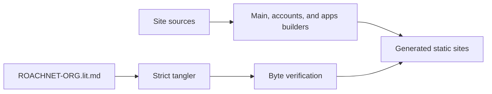

# RoachNet.org Site Code

This literate source records the current site roots. Run `node scripts/tangle.mjs --verify` before writing generated roots; `--output-dir` stages a checked output tree without changing the repository. Additive chunks use double-angle references; duplicate roots, missing references, cycles, and unsafe paths are rejected.



## 404.html

This root is reconciled byte-for-byte from the current production source.

```text {chunk="404-html" file="404.html"}
<!doctype html>
<html lang="en">
  <head>
    <meta charset="UTF-8" />
    <meta name="viewport" content="width=device-width, initial-scale=1.0" />
    <meta name="robots" content="noindex" />
    <title>Page not found | RoachNet</title>
    <link rel="stylesheet" href="/app.css" />
  </head>
  <body>
    <main class="page-shell">
      <section class="hero">
        <div class="hero-copy">
          <span class="eyebrow">404</span>
          <h1>That route is not on this machine.</h1>
          <p class="hero-body">The page may have moved, or the address may be wrong.</p>
          <div class="hero-actions"><a class="cta cta--primary" href="https://roachnet.org/">Return to RoachNet</a></div>
        </div>
      </section>
    </main>
  </body>
</html>
```

## account.js

This root is reconciled byte-for-byte from the current production source.

```text {chunk="account-js" file="account.js"}
import {
  clearCachedAuthState,
  getSiteAuthState,
  refreshSiteSession,
  sessionLabel,
} from './site-account.js'

const browserDeviceStorageKey = 'RoachNetAccountBrowserDeviceID'
const turnstileScriptId = 'roachnet-turnstile-script'

const statusTitle = document.querySelector('#account-status-title')
const statusBody = document.querySelector('#account-status-body')
const statusBadge = document.querySelector('#account-status-badge')
const feedback = document.querySelector('#account-feedback')
const refreshButton = document.querySelector('#account-refresh')
const signOutButton = document.querySelector('#account-signout')
const submitButton = document.querySelector('#account-submit')
const form = document.querySelector('#account-form')
const formNote = document.querySelector('#account-form-note')
const emailInput = document.querySelector('#account-email')
const passwordInput = document.querySelector('#account-password')
const displayNameInput = document.querySelector('#account-display-name')
const displayNameField = document.querySelector('#account-name-field')
const startedAtInput = document.querySelector('#account-started-at')
const honeypotInput = document.querySelector('#account-company')
const tabs = [...document.querySelectorAll('[data-account-mode]')]
const snapshotTitle = document.querySelector('#account-snapshot-title')
const snapshotBody = document.querySelector('#account-snapshot-body')
const deviceCount = document.querySelector('#account-device-count')
const appCount = document.querySelector('#account-app-count')
const settingsState = document.querySelector('#account-settings-state')
const turnstileShell = document.querySelector('#account-turnstile-shell')
const turnstileMount = document.querySelector('#account-turnstile')
const turnstileNote = document.querySelector('#account-turnstile-note')

let accountMode = 'signin'
let authState = null
let authSubscription = null
let activeRequest = null
let turnstileWidgetId = null
let captchaToken = ''

function setFeedback(message, tone = 'muted') {
  if (!feedback) return
  feedback.textContent = message || ''
  feedback.dataset.tone = tone
}

function setSnapshot({
  title,
  body,
  devices = '—',
  apps = '—',
  settings = '—',
}) {
  if (snapshotTitle) snapshotTitle.textContent = title
  if (snapshotBody) snapshotBody.textContent = body
  if (deviceCount) deviceCount.textContent = devices
  if (appCount) appCount.textContent = apps
  if (settingsState) settingsState.textContent = settings
}

function getBrowserDeviceID() {
  const existing = window.localStorage.getItem(browserDeviceStorageKey)
  if (existing) return existing
  const next = `account-web-${window.crypto.randomUUID()}`
  window.localStorage.setItem(browserDeviceStorageKey, next)
  return next
}

function inferPlatform() {
  const userAgent = window.navigator.userAgent.toLowerCase()
  if (userAgent.includes('iphone')) return 'ios-web'
  if (userAgent.includes('ipad')) return 'ipados-web'
  if (userAgent.includes('mac os')) return 'macos-web'
  if (userAgent.includes('windows')) return 'windows-web'
  if (userAgent.includes('linux')) return 'linux-web'
  return 'web'
}

function displayNameFor(profile, session) {
  if (profile?.display_name && profile.display_name.trim()) {
    return profile.display_name.trim()
  }

  const email = session?.user?.email || ''
  return email ? email.split('@')[0] : 'RoachNet account'
}

function setFormBusy(isBusy) {
  activeRequest = isBusy
  const disabled = Boolean(isBusy)

  for (const field of [emailInput, passwordInput, displayNameInput, submitButton, refreshButton, signOutButton]) {
    if (field) field.disabled = disabled
  }
}

function resetTurnstileIfPresent() {
  if (typeof window.turnstile?.reset === 'function' && turnstileWidgetId !== null) {
    window.turnstile.reset(turnstileWidgetId)
  }
}

function setTurnstileState(message, tone = 'muted') {
  if (!turnstileNote) return
  turnstileNote.textContent = message
  turnstileNote.dataset.tone = tone
}

function setMode(nextMode) {
  accountMode = nextMode === 'signup' ? 'signup' : 'signin'

  tabs.forEach((tab) => {
    const isActive = tab.dataset.accountMode === accountMode
    tab.classList.toggle('is-active', isActive)
    tab.setAttribute('role', 'tab')
    tab.setAttribute('aria-selected', isActive ? 'true' : 'false')
    tab.tabIndex = isActive ? 0 : -1
  })

  if (displayNameField) {
    displayNameField.hidden = accountMode !== 'signup'
  }

  if (passwordInput) {
    passwordInput.autocomplete = accountMode === 'signup' ? 'new-password' : 'current-password'
  }

  if (submitButton) {
    submitButton.textContent = accountMode === 'signup' ? 'Create account' : 'Sign in'
  }

  if (formNote) {
    formNote.textContent =
      accountMode === 'signup'
        ? 'Create the account that holds web chat, app picks, and device links.'
        : 'Sign in when you want the website tied to your RoachNet account.'
  }

  if (turnstileShell) {
    turnstileShell.hidden = accountMode !== 'signup' || !authState?.config?.turnstile?.enabled
  }

  setFeedback('')
}

function renderStatus() {
  if (!authState) return

  const enabled = authState.enabled === true
  const session = authState.session

  if (!enabled) {
    statusTitle.textContent = 'Auth is staged, not armed.'
    statusBody.textContent = authState.reason
    statusBadge.textContent = 'Disabled'
    statusBadge.dataset.state = 'disabled'
    signOutButton.hidden = true
    form?.setAttribute('aria-disabled', 'true')
    setFormBusy(true)
    setSnapshot({
      title: 'Auth is disabled on this deploy.',
      body: 'The account system is staged, but this deploy is missing live auth keys.',
    })
    setFeedback('This deploy does not have live account auth configured yet.')
    return
  }

  form?.removeAttribute('aria-disabled')
  setFormBusy(false)

  if (session?.user) {
    statusTitle.textContent = 'Signed in.'
    statusBody.textContent = `Website account is linked to ${sessionLabel(session)}.`
    statusBadge.textContent = 'Live'
    statusBadge.dataset.state = 'live'
    signOutButton.hidden = false
    setFeedback('Account session is live.', 'live')
    return
  }

  statusTitle.textContent = 'Ready for sign-in.'
  statusBody.textContent = 'Use your account for web chat, saved app picks, and device metadata.'
  statusBadge.textContent = 'Ready'
  statusBadge.dataset.state = 'ready'
  signOutButton.hidden = true
  setSnapshot({
    title: 'Sign in to load account state.',
    body: 'Linked devices, saved app picks, and settings metadata will show up here once you sign in.',
  })
}

async function syncSnapshot() {
  if (!authState?.client || !authState?.session?.user) {
    return
  }

  const client = authState.client
  const browserDeviceID = getBrowserDeviceID()
  const currentOrigin = window.location.origin

  const [touchResult, profileResult, settingsResult, devicesResult, appsResult] = await Promise.all([
    client.rpc('touch_device_link', {
      p_device_id: browserDeviceID,
      p_device_name: 'Accounts Web',
      p_platform: inferPlatform(),
      p_runtime_lane: 'account-web',
      p_metadata: {
        surface: 'accounts',
        origin: currentOrigin,
      },
    }),
    client
      .from('profiles')
      .select('display_name, email, plan, account_state, last_seen_at')
      .eq('id', authState.session.user.id)
      .maybeSingle(),
    client
      .from('user_settings')
      .select('updated_at, favorite_apps, settings')
      .eq('user_id', authState.session.user.id)
      .maybeSingle(),
    client.from('device_links').select('id', { count: 'exact', head: true }),
    client.from('saved_apps').select('id', { count: 'exact', head: true }),
  ])

  const errors = [
    touchResult.error,
    profileResult.error,
    settingsResult.error,
    devicesResult.error,
    appsResult.error,
  ].filter(Boolean)

  if (errors.length > 0) {
    setFeedback(errors[0].message || 'Could not load the account snapshot.', 'error')
    setSnapshot({
      title: 'Account snapshot needs attention.',
      body: 'The account session is live, but this browser session could not finish loading its synced state.',
      settings: 'Error',
    })
    return
  }

  const profile = profileResult.data
  const settings = settingsResult.data
  const devices = devicesResult.count ?? 0
  const apps = appsResult.count ?? 0
  const settingsCount =
    (settings?.favorite_apps?.length || 0) + Object.keys(settings?.settings || {}).length

  setSnapshot({
    title: `${displayNameFor(profile, authState.session)} is linked.`,
    body:
      devices > 0
        ? 'RoachTail and RoachSync metadata can anchor themselves here without leaking local machine details.'
        : 'This is a fresh account. Pair devices or save installs to start building synced state.',
    devices: String(devices),
    apps: String(apps),
    settings: settingsCount > 0 ? 'Remembered' : 'Fresh',
  })
}

function loadTurnstileScript() {
  return new Promise((resolve, reject) => {
    if (window.turnstile) {
      resolve(window.turnstile)
      return
    }

    const existing = document.querySelector(`#${turnstileScriptId}`)
    if (existing) {
      existing.addEventListener('load', () => resolve(window.turnstile), { once: true })
      existing.addEventListener('error', reject, { once: true })
      return
    }

    const script = document.createElement('script')
    script.id = turnstileScriptId
    script.src = 'https://challenges.cloudflare.com/turnstile/v0/api.js?render=explicit'
    script.async = true
    script.defer = true
    script.addEventListener('load', () => resolve(window.turnstile), { once: true })
    script.addEventListener('error', reject, { once: true })
    document.head.append(script)
  })
}

async function ensureTurnstile() {
  const turnstileConfig = authState?.config?.turnstile
  if (!turnstileConfig?.enabled || !turnstileConfig?.siteKey || !turnstileMount || turnstileWidgetId !== null) {
    if (turnstileShell) {
      turnstileShell.hidden = accountMode !== 'signup' || !turnstileConfig?.enabled
    }
    return
  }

  setTurnstileState('Loading verification…')

  try {
    await loadTurnstileScript()
    turnstileWidgetId = window.turnstile.render(turnstileMount, {
      sitekey: turnstileConfig.siteKey,
      theme: 'dark',
      callback: (token) => {
        captchaToken = token
        setTurnstileState('Verification ready.', 'live')
      },
      'expired-callback': () => {
        captchaToken = ''
        setTurnstileState('Verification expired. Run it again.', 'error')
      },
      'error-callback': () => {
        captchaToken = ''
        setTurnstileState('Verification failed to load.', 'error')
      },
    })
    setTurnstileState('Finish the human check to create the account.')
  } catch {
    setTurnstileState('Verification could not load right now.', 'error')
  }
}

async function registerAccount({ email, password, displayName }) {
  const registerUrl =
    authState?.config?.auth?.registerUrl || 'https://roachnet.org/.netlify/functions/register-account'
  const response = await fetch(registerUrl, {
    method: 'POST',
    headers: {
      'content-type': 'application/json',
    },
    body: JSON.stringify({
      email,
      password,
      displayName,
      captchaToken,
      company: honeypotInput?.value || '',
      startedAt: startedAtInput?.value || '',
    }),
  })

  const result = await response.json().catch(() => ({
    ok: false,
    message: 'The account service returned unreadable data.',
  }))

  if (!response.ok || result.ok !== true) {
    throw new Error(result.message || 'Account creation failed.')
  }

  return result
}

async function loadAuthState() {
  authSubscription?.unsubscribe?.()
  authSubscription = null

  authState = await getSiteAuthState()
  renderStatus()

  if (authState?.client) {
    const { data } = authState.client.auth.onAuthStateChange((_event, session) => {
      authState = {
        ...authState,
        session,
      }
      renderStatus()
      void syncSnapshot()
    })
    authSubscription = data.subscription
  }

  await ensureTurnstile()
  await syncSnapshot()
}

tabs.forEach((tab) => {
  tab.addEventListener('click', () => {
    if (activeRequest) return
    setMode(tab.dataset.accountMode)
  })
})

refreshButton?.addEventListener('click', async () => {
  setFeedback('Refreshing account state…')
  const session = await refreshSiteSession()
  if (authState) {
    authState = {
      ...authState,
      session,
    }
  }
  renderStatus()
  await syncSnapshot()
})

signOutButton?.addEventListener('click', async () => {
  if (!authState?.client) return
  setFormBusy(true)
  setFeedback('Signing out…')
  await authState.client.auth.signOut()
  clearCachedAuthState()
  authState = null
  await loadAuthState()
})

form?.addEventListener('submit', async (event) => {
  event.preventDefault()

  if (!authState?.client) {
    setFeedback('Account auth is not armed on this deploy yet.', 'error')
    return
  }

  const email = emailInput?.value?.trim() || ''
  const password = passwordInput?.value || ''
  const displayName = displayNameInput?.value?.trim() || ''

  if (!email || !password) {
    setFeedback('Enter both email and password.', 'error')
    return
  }

  if (accountMode === 'signup' && authState?.config?.turnstile?.enabled && !captchaToken) {
    setFeedback('Finish the human check first.', 'error')
    return
  }

  setFormBusy(true)
  setFeedback(accountMode === 'signup' ? 'Creating account…' : 'Signing in…')

  try {
    if (accountMode === 'signup') {
      const registration = await registerAccount({ email, password, displayName })
      form.reset()
      startedAtInput.value = String(Date.now())
      captchaToken = ''
      resetTurnstileIfPresent()
      setMode('signin')
      setFeedback(
        registration.message || 'Check your email to confirm your account, then sign in.',
        'live'
      )
      return
    }

    const result = await authState.client.auth.signInWithPassword({ email, password })
    if (result.error) {
      throw result.error
    }

    authState = {
      ...authState,
      session: result.data?.session || authState.session,
    }

    renderStatus()
    await syncSnapshot()
    setFeedback('Signed in.', 'live')
  } catch (error) {
    setFeedback(error?.message || 'Account request failed.', 'error')
    captchaToken = ''
    resetTurnstileIfPresent()
  } finally {
    setFormBusy(false)
  }
})

startedAtInput.value = String(Date.now())
setMode(accountMode)
loadAuthState()
```

## account/index.html

This root is reconciled byte-for-byte from the current production source.

```text {chunk="account-index-html" file="account/index.html"}
<!doctype html>
<html lang="en">
  <head>
    <meta charset="UTF-8" />
    <meta name="viewport" content="width=device-width, initial-scale=1.0" />
    <title>RoachNet Account: The small stuff that should travel</title>
    <meta
      name="description"
      content="Your RoachNet account carries the small web stuff: RoachClaw threads, saved app picks, device links, and settings. The runtime, vault, models, and files stay local."
    />
    <meta name="theme-color" content="#0a1016" />
    <link rel="canonical" href="https://accounts.roachnet.org/" />
    <link rel="icon" href="/favicon.ico" sizes="any" />
    <link rel="icon" type="image/png" sizes="32x32" href="/favicon-32x32.png" />
    <link rel="icon" type="image/png" sizes="16x16" href="/favicon-16x16.png" />
    <link rel="apple-touch-icon" sizes="180x180" href="/apple-touch-icon.png" />
    <meta property="og:type" content="website" />
    <meta property="og:title" content="RoachNet Account: The small stuff that should travel" />
    <meta
      property="og:description"
      content="Threads, app picks, device links, and settings can travel. The vault, runtime, models, and files stay on your machine."
    />
    <meta property="og:url" content="https://accounts.roachnet.org/" />
    <meta property="og:image" content="https://roachnet.org/assets/screens/roachnet-native-roachclaw.webp" />
    <meta name="twitter:card" content="summary_large_image" />
    <meta name="twitter:title" content="RoachNet Account: The small stuff that should travel" />
    <meta
      name="twitter:description"
      content="Threads, app picks, device links, and settings can travel. The vault, runtime, models, and files stay on your machine."
    />
    <meta name="twitter:image" content="https://roachnet.org/assets/screens/roachnet-native-roachclaw.webp" />
    <link rel="stylesheet" href="/app.css" />
    <link rel="stylesheet" href="/app-polish.css?v=20260609-overflow" />
    <link rel="stylesheet" href="/roachclaw-web.css?v=20260609-auth-gate" />
  </head>
  <body data-page="account">
    <div class="bg-glow bg-glow--blue" aria-hidden="true"></div>
    <div class="bg-glow bg-glow--green" aria-hidden="true"></div>

    <!-- ═══════════════════════════════════════════════════════ -->
    <!-- ACCOUNT PAGE                                          -->
    <!-- ═══════════════════════════════════════════════════════ -->
    <div class="page-view page-view--account" id="view-account">
      <a class="rn-skip-link" href="#account-main">Skip to main content</a>
      <header class="site-header account-topbar">
        <a class="brand-lockup" href="https://roachnet.org/" aria-label="Back to RoachNet">
          
          <div class="brand-copy">
            <strong>RoachNet Account</strong>
            <span class="brand-kicker">sync the small stuff, keep the heavy stuff home</span>
          </div>
          <span class="site-header__status">Accounts</span>
        </a>

        <div class="site-header__panel">
          <nav class="site-nav site-nav--primary" aria-label="Primary">
            <a href="https://roachnet.org/">Mission</a>
            <a href="https://roachnet.org/home/">Home</a>
          <a href="https://apps.roachnet.org/">Apps</a>
            <a href="https://roachnet.org/roachclaw/">Claw</a>
            <a href="https://roachnet.org/brew/">Brew</a>
            <a href="https://roachnet.org/ios/">iOS</a>
          </nav>

          <div class="site-header__actions" aria-label="Utility links">
            <a class="site-action-pill is-current" href="#view-account">Account</a>
            <a class="site-action-pill site-action-pill--ghost" href="https://roachnet.org/api/">API</a>
            <a class="site-action-pill site-action-pill--ghost" href="https://github.com/RoachWares/RoachNet" target="_blank" rel="noreferrer">GitHub</a>
          </div>
        </div>
      </header>

      <main class="account-page" id="account-main" tabindex="-1">
        <section class="account-hero" data-reveal-group>
          <article class="account-poster">
            <span class="eyebrow">Account</span>
            <h1>Your machine stays yours. This account carries the small stuff.</h1>
            <p>
              Most of RoachNet belongs on your hardware. That is the point. This account holds what should travel: RoachClaw threads, app picks, device links, and settings.
            </p>

            <div class="account-chip-row" aria-label="Account features">
              <span class="account-chip">RoachClaw web chat</span>
              <span class="account-chip">Saved installs</span>
              <span class="account-chip">Device links</span>
              <span class="account-chip">Settings sync</span>
            </div>

            <div class="poster-actions">
              <a class="cta cta--primary" href="/roachclaw" data-route="roachclaw">Open RoachClaw</a>
              <a class="cta cta--ghost" href="https://roachnet.org/ios/">Get RoachNetiOS</a>
              <a class="cta cta--ghost" href="https://roachnet.org/api/">Read the API</a>
            </div>

            <div class="hero-signal-board hero-signal-board--compact">
              <article class="hero-signal-card" data-reveal>
                <span>Syncs</span>
                <strong>App picks, device links, and web settings. The metadata with a reason to leave the house.</strong>
              </article>
              <article class="hero-signal-card" data-reveal>
                <span>Stays home</span>
                <strong>Runtime, models, vault, and files. Your hardware, your rules, no cloud custody.</strong>
              </article>
            </div>

            <div class="account-poster__grid">
              <article class="account-mini-card" data-reveal>
                <span class="feature-card__eyebrow">What syncs</span>
                <strong>Threads, app picks, device links, web settings.</strong>
                <p>The useful metadata that keeps your devices in step. Nothing that belongs in the vault.</p>
              </article>

              <article class="account-mini-card" data-reveal>
                <span class="feature-card__eyebrow">What stays local</span>
                <strong>Runtime, models, vault, file paths.</strong>
                <p>Desktop data stays on your box. The internet is a convenience, not custody.</p>
              </article>

              <article class="account-mini-card" data-reveal>
                <span class="feature-card__eyebrow">What comes next</span>
                <strong>Web chat, RoachTail handoff, cleaner multi-device state.</strong>
                <p>The web side keeps account state in step. The heavy lifting still belongs on your hardware.</p>
              </article>
            </div>
          </article>

          <section class="account-auth-shell">
            <div class="account-inline-status">
              <div>
                <span class="feature-card__eyebrow">Account</span>
                <h2 id="account-status-title">Checking account…</h2>
                <p id="account-status-body">Looking up the current session for this browser.</p>
              </div>
              <div class="account-status-badge" id="account-status-badge">Loading</div>
            </div>

            <div class="account-actions-inline">
              <button class="cta cta--ghost" id="account-refresh" type="button">Refresh</button>
              <button class="cta cta--ghost" id="account-signout" type="button" hidden>Sign out</button>
            </div>

            <div class="account-auth-card__tabs" role="tablist" aria-label="Account mode">
              <button class="account-tab is-active" data-account-mode="signin" type="button">Sign in</button>
              <button class="account-tab" data-account-mode="signup" type="button">Create account</button>
            </div>

            <form class="account-form" id="account-form">
              <label class="account-field account-name-field" id="account-name-field" hidden>
                <span>Name</span>
                <input id="account-display-name" type="text" autocomplete="nickname" maxlength="60" placeholder="Studio name, handle, or whatever fits" />
              </label>

              <label class="account-field">
                <span>Email</span>
                <input id="account-email" type="email" autocomplete="email" placeholder="you@example.com" required />
              </label>

              <label class="account-field">
                <span>Password</span>
                <input id="account-password" type="password" autocomplete="current-password" placeholder="Strong password" required />
              </label>

              <input id="account-started-at" type="hidden" />
              <label class="account-honeypot" aria-hidden="true">
                <span>Leave this blank</span>
                <input id="account-company" type="text" tabindex="-1" autocomplete="off" />
              </label>

              <div class="account-turnstile" id="account-turnstile-shell" hidden>
                <div id="account-turnstile"></div>
                <p class="account-form__note" id="account-turnstile-note">Verifying this request.</p>
              </div>

              <button class="cta cta--primary" id="account-submit" type="submit">Sign in</button>
              <p class="account-form__note" id="account-form-note">Sign in when you want the website tied to your RoachNet account. The vault stays out of it.</p>
              <p class="account-form__feedback" id="account-feedback" aria-live="polite"></p>
            </form>
          </section>
        </section>

        <section class="account-dashboard" data-reveal-group>
          <article class="account-panel account-panel--snapshot" data-reveal>
            <span class="feature-card__eyebrow">Synced state</span>
            <h3 id="account-snapshot-title">Sign in to see what is in step.</h3>
            <p id="account-snapshot-body">Device links, saved installs, and settings metadata appear here once the session is live.</p>

            <div class="account-metrics">
              <div class="account-metric">
                <strong id="account-device-count">—</strong>
                <span>Linked devices</span>
              </div>

              <div class="account-metric">
                <strong id="account-app-count">—</strong>
                <span>Saved apps</span>
              </div>

              <div class="account-metric">
                <strong id="account-settings-state">—</strong>
                <span>Settings</span>
              </div>
            </div>
          </article>

          <article class="account-panel" data-reveal>
            <span class="feature-card__eyebrow">Desktop &amp; phone</span>
            <h3>The real work lives in the app.</h3>
            <p>This account handles identity and sync metadata. Runtime, vault, and local services stay on your hardware, where they belong. Quiet helper, not fake cloud runtime.</p>
            <div class="account-actions-inline">
              <a class="cta cta--ghost" href="https://roachnet.org/ios/">RoachNetiOS</a>
              <a class="cta cta--ghost" href="/roachclaw" data-route="roachclaw">RoachClaw web chat</a>
            </div>
          </article>

          <article class="account-panel" data-reveal>
            <span class="feature-card__eyebrow">Privacy</span>
            <h3>No local path dump. No fake cloud runtime.</h3>
            <p>The server stores what a server should: identity and sync metadata. File paths, runtime secrets, and vault content stay on your machine.</p>
            <div class="account-actions-inline">
              <a class="cta cta--ghost" href="https://roachnet.org/api/">API docs</a>
              <a class="cta cta--ghost" href="https://roachnet.org/">Back to RoachNet</a>
            </div>
          </article>
        </section>
      </main>

      <footer class="site-footer">
        <div class="site-footer__copy">
          <strong>RoachNet Account</strong>
          <span>RoachClaw threads, saved installs, linked devices, and settings. The heavy lifting stays on your machine.</span>
        </div>
        <nav class="site-footer__nav" aria-label="Footer">
          <a href="https://roachnet.org/">Home</a>
          <a href="/roachclaw" data-route="roachclaw">RoachClaw</a>
          <a href="https://apps.roachnet.org/">Apps</a>
          <a href="https://roachnet.org/api/">API</a>
          <a href="https://roachnet.org/sitemap/">Sitemap</a>
          <a href="https://www.roachwares.org/">RoachWares</a>
          <a href="https://github.com/RoachWares/RoachNet" target="_blank" rel="noreferrer">GitHub</a>
        </nav>
        <div class="site-footer__meta">
          <a
            class="netlify-badge"
            href="https://www.netlify.com"
            target="_blank"
            rel="noreferrer"
            aria-label="Proudly powered by Netlify"
          >
            <span>Proudly powered by Netlify</span>
            
          </a>
        </div>
      </footer>
    </div>

    <!-- ═══════════════════════════════════════════════════════ -->
    <!-- ROACHCLAW PAGE                                        -->
    <!-- ═══════════════════════════════════════════════════════ -->
    <div class="page-view page-view--roachclaw" id="view-roachclaw" hidden>
      <a class="rn-skip-link" href="#account-roachclaw-main">Skip to main content</a>
      <div class="rc-sidebar-overlay" aria-hidden="true"></div>
      <div class="rc-layout">
        <!-- Sidebar -->
        <aside class="rc-sidebar">
          <div class="rc-sidebar__head">
            <a class="rc-sidebar__brand" href="https://roachnet.org/" aria-label="Back to RoachNet">
              
              <div class="brand-copy">
                <strong>RoachClaw</strong>
                <span class="brand-kicker">one shortcut away</span>
              </div>
            </a>
            <button class="rc-sidebar__new-btn" id="roachclaw-new-thread" type="button" aria-label="New chat">
              <svg width="18" height="18" viewBox="0 0 18 18" fill="none" aria-hidden="true"><path d="M9 3v12M3 9h12" stroke="currentColor" stroke-width="1.6" stroke-linecap="round"/></svg>
            </button>
          </div>

          <nav class="rc-sidebar__nav" aria-label="RoachClaw navigation">
            <a href="/" data-route="account" class="rc-sidebar__link">
              <svg width="16" height="16" viewBox="0 0 16 16" fill="none" aria-hidden="true"><circle cx="8" cy="5.5" r="3" stroke="currentColor" stroke-width="1.4"/><path d="M2.5 14c0-3 2.5-4.5 5.5-4.5s5.5 1.5 5.5 4.5" stroke="currentColor" stroke-width="1.4" stroke-linecap="round"/></svg>
              Account
            </a>
            <a href="https://roachnet.org/" class="rc-sidebar__link">
              <svg width="16" height="16" viewBox="0 0 16 16" fill="none" aria-hidden="true"><path d="M2 8l6-5.5L14 8M3.5 7v5.5a1 1 0 001 1h7a1 1 0 001-1V7" stroke="currentColor" stroke-width="1.4" stroke-linecap="round" stroke-linejoin="round"/></svg>
              RoachNet
            </a>
            <a href="https://roachnet.org/api/" class="rc-sidebar__link">
              <svg width="16" height="16" viewBox="0 0 16 16" fill="none" aria-hidden="true"><rect x="2" y="3" width="12" height="10" rx="2" stroke="currentColor" stroke-width="1.4"/><path d="M5.5 7l2 2 2-2" stroke="currentColor" stroke-width="1.4" stroke-linecap="round" stroke-linejoin="round"/></svg>
              API
            </a>
          </nav>

          <div class="rc-sidebar__divider"></div>

          <div class="rc-sidebar__threads">
            <span class="rc-sidebar__section-label">Threads</span>
            <div class="rc-thread-list" id="roachclaw-thread-list">
              <div class="rc-thread-empty">
                <p>No threads yet. Sign in and give RoachClaw something to chew on.</p>
              </div>
            </div>
          </div>

          <div class="rc-sidebar__foot">
            <div class="rc-lane-status">
              <div class="rc-lane-dot rc-lane-dot--web" aria-label="Web lane active"></div>
              <span>Web lane active</span>
            </div>
            <div class="rc-lane-status rc-lane-status--dim">
              <div class="rc-lane-dot rc-lane-dot--local" aria-label="Local lane offline"></div>
              <span>Local lane — pair to enable</span>
            </div>
          </div>
        </aside>

        <!-- Main content -->
        <section class="rc-main" id="account-roachclaw-main" tabindex="-1">
          <header class="rc-main__topbar">
            <div class="rc-main__topbar-left">
              <button class="rc-sidebar-toggle" id="rc-sidebar-toggle" type="button" aria-label="Toggle sidebar">
                <svg width="20" height="20" viewBox="0 0 20 20" fill="none" aria-hidden="true"><path d="M3 5h14M3 10h14M3 15h14" stroke="currentColor" stroke-width="1.5" stroke-linecap="round"/></svg>
              </button>
              <span class="rc-main__thread-title">New conversation</span>
            </div>
            <div class="rc-main__topbar-right">
              <div class="rc-model-badge">
                <div class="rc-lane-dot rc-lane-dot--web"></div>
                <span>Hosted model</span>
              </div>
              <button class="rc-account-chip" id="roachclaw-account-chip" type="button">Sign in</button>
            </div>
          </header>

          <div class="rc-chat-area">
            <div class="rc-chat-scroll" id="roachclaw-log">
              <div class="rc-empty-state">
                <div class="rc-empty-state__icon" aria-hidden="true">
                  <svg width="48" height="48" viewBox="0 0 48 48" fill="none"><circle cx="24" cy="24" r="22" stroke="url(#rc-grad)" stroke-width="2" opacity="0.5"/><path d="M16 20c0-4.4 3.6-8 8-8s8 3.6 8 8" stroke="url(#rc-grad)" stroke-width="2" stroke-linecap="round"/><circle cx="18" cy="28" r="2" fill="var(--rn-cyan)"/><circle cx="24" cy="28" r="2" fill="var(--rn-blue)"/><circle cx="30" cy="28" r="2" fill="var(--rn-green)"/><defs><linearGradient id="rc-grad" x1="4" y1="4" x2="44" y2="44"><stop stop-color="var(--rn-blue)"/><stop offset="1" stop-color="var(--rn-cyan)"/></linearGradient></defs></svg>
                </div>
                <h1 class="rc-empty-state__heading">What are we fixing, building, or untangling today?</h1>
                <p class="rc-empty-state__sub">Your threads stay with your account, not this browser tab. Use the web lane anywhere. Pair RoachNet when the prompt needs private files, vault context, or the stuff you do not want wandering off.</p>

                <div class="rc-starter-grid">
                  <button class="rc-starter-card" type="button" data-starter="explain">
                    <div class="rc-starter-card__icon">
                      <svg width="20" height="20" viewBox="0 0 20 20" fill="none" aria-hidden="true"><circle cx="10" cy="10" r="7.5" stroke="currentColor" stroke-width="1.4"/><path d="M10 13v-3M10 7.5v0" stroke="currentColor" stroke-width="1.6" stroke-linecap="round"/></svg>
                    </div>
                    <strong>Explain something</strong>
                    <span>Break down a tool, idea, or workflow without turning it into a lecture.</span>
                  </button>
                  <button class="rc-starter-card" type="button" data-starter="draft">
                    <div class="rc-starter-card__icon">
                      <svg width="20" height="20" viewBox="0 0 20 20" fill="none" aria-hidden="true"><path d="M4 14.5V16h1.5L14 7.5 12.5 6 4 14.5z" stroke="currentColor" stroke-width="1.4" stroke-linejoin="round"/><path d="M11.5 5l3 3" stroke="currentColor" stroke-width="1.4"/></svg>
                    </div>
                    <strong>Draft a message</strong>
                    <span>Write an email, commit message, or quick reply that sounds human on purpose.</span>
                  </button>
                  <button class="rc-starter-card" type="button" data-starter="debug">
                    <div class="rc-starter-card__icon">
                      <svg width="20" height="20" viewBox="0 0 20 20" fill="none" aria-hidden="true"><rect x="3.5" y="5.5" width="13" height="9" rx="2" stroke="currentColor" stroke-width="1.4"/><path d="M7 9l2 2 4-4" stroke="currentColor" stroke-width="1.4" stroke-linecap="round" stroke-linejoin="round"/></svg>
                    </div>
                    <strong>Debug a problem</strong>
                    <span>Walk through an error, config issue, or surprise behavior without blaming the chair.</span>
                  </button>
                  <button class="rc-starter-card" type="button" data-starter="summarize">
                    <div class="rc-starter-card__icon">
                      <svg width="20" height="20" viewBox="0 0 20 20" fill="none" aria-hidden="true"><path d="M4 5h12M4 8.5h9M4 12h10M4 15.5h7" stroke="currentColor" stroke-width="1.4" stroke-linecap="round"/></svg>
                    </div>
                    <strong>Summarize content</strong>
                    <span>Condense a doc, thread, or page into the parts worth keeping.</span>
                  </button>
                  <button class="rc-starter-card rc-starter-card--accent" type="button" data-starter="cookbook">
                    <div class="rc-starter-card__icon">
                      <svg width="20" height="20" viewBox="0 0 20 20" fill="none" aria-hidden="true"><rect x="4" y="4" width="12" height="12" rx="2.5" stroke="currentColor" stroke-width="1.4"/><path d="M7 2.5v3M13 2.5v3M7 14.5v3M13 14.5v3M2.5 7h3M14.5 7h3M2.5 13h3M14.5 13h3" stroke="currentColor" stroke-width="1.2" stroke-linecap="round"/></svg>
                    </div>
                    <strong>RoachClaw Cookbook</strong>
                    <span>Pick the model lane that fits your machine, including quantized and MoE packs that lie about their weight.</span>
                  </button>
                  <button class="rc-starter-card rc-starter-card--accent" type="button" data-starter="research">
                    <div class="rc-starter-card__icon">
                      <svg width="20" height="20" viewBox="0 0 20 20" fill="none" aria-hidden="true"><path d="M4.5 3.5h7l4 4v9h-11v-13z" stroke="currentColor" stroke-width="1.4" stroke-linejoin="round"/><path d="M11.5 3.5v4h4M7 11h6M7 14h4" stroke="currentColor" stroke-width="1.4" stroke-linecap="round" stroke-linejoin="round"/></svg>
                    </div>
                    <strong>Deep research</strong>
                    <span>Gather sources, read them, and turn the mess into a vault-ready brief.</span>
                  </button>
                  <button class="rc-starter-card rc-starter-card--accent" type="button" data-starter="compare">
                    <div class="rc-starter-card__icon">
                      <svg width="20" height="20" viewBox="0 0 20 20" fill="none" aria-hidden="true"><rect x="3" y="4" width="6" height="12" rx="2" stroke="currentColor" stroke-width="1.4"/><rect x="11" y="4" width="6" height="12" rx="2" stroke="currentColor" stroke-width="1.4"/><path d="M9 10h2" stroke="currentColor" stroke-width="1.4" stroke-linecap="round"/></svg>
                    </div>
                    <strong>Compare models</strong>
                    <span>Blind-test two routes so the confident answer has to earn the crown.</span>
                  </button>
                  <button class="rc-starter-card rc-starter-card--accent" type="button" data-starter="memory">
                    <div class="rc-starter-card__icon">
                      <svg width="20" height="20" viewBox="0 0 20 20" fill="none" aria-hidden="true"><path d="M7 6.5a3 3 0 116 0v1h.5A2.5 2.5 0 0116 10v2.5A3.5 3.5 0 0112.5 16h-5A3.5 3.5 0 014 12.5V10a2.5 2.5 0 012.5-2.5H7v-1z" stroke="currentColor" stroke-width="1.4" stroke-linejoin="round"/><path d="M8 11h4M10 9v4" stroke="currentColor" stroke-width="1.4" stroke-linecap="round"/></svg>
                    </div>
                    <strong>RoachBrain audit</strong>
                    <span>Find useful context, stale habits, and saved procedures worth keeping.</span>
                  </button>
                  <button class="rc-starter-card" type="button" data-starter="diagnostics">
                    <div class="rc-starter-card__icon">
                      <svg width="20" height="20" viewBox="0 0 20 20" fill="none" aria-hidden="true"><path d="M5 4.5h10M6.5 8h7M8 11.5h4M9.5 15h1" stroke="currentColor" stroke-width="1.4" stroke-linecap="round"/><path d="M4 3h12v14H4V3z" stroke="currentColor" stroke-width="1.4" stroke-linejoin="round"/></svg>
                    </div>
                    <strong>Diagnostics</strong>
                    <span>Probe providers, scrub settings, and find the failure before it grows teeth.</span>
                  </button>
                  <button class="rc-starter-card" type="button" data-starter="integrations">
                    <div class="rc-starter-card__icon">
                      <svg width="20" height="20" viewBox="0 0 20 20" fill="none" aria-hidden="true"><circle cx="5" cy="10" r="2.5" stroke="currentColor" stroke-width="1.4"/><circle cx="15" cy="5" r="2.5" stroke="currentColor" stroke-width="1.4"/><circle cx="15" cy="15" r="2.5" stroke="currentColor" stroke-width="1.4"/><path d="M7.2 8.8l5.6-2.6M7.2 11.2l5.6 2.6" stroke="currentColor" stroke-width="1.4" stroke-linecap="round"/></svg>
                    </div>
                    <strong>Hooks and contacts</strong>
                    <span>Check recipients, webhooks, provider routes, and handoffs that should stay scoped.</span>
                  </button>
                </div>

                <div class="rc-info-strip">
                  <div class="rc-info-strip__item">
                    <svg width="14" height="14" viewBox="0 0 14 14" fill="none" aria-hidden="true"><path d="M7 1v12M1 7h12" stroke="currentColor" stroke-width="1.2" stroke-linecap="round"/></svg>
                    <span>Account-scoped threads</span>
                  </div>
                  <div class="rc-info-strip__item">
                    <svg width="14" height="14" viewBox="0 0 14 14" fill="none" aria-hidden="true"><circle cx="7" cy="7" r="5.5" stroke="currentColor" stroke-width="1.2"/><path d="M7 4v3l2 1.5" stroke="currentColor" stroke-width="1.2" stroke-linecap="round"/></svg>
                    <span>Web lane stays available when your machines are asleep</span>
                  </div>
                  <div class="rc-info-strip__item">
                    <svg width="14" height="14" viewBox="0 0 14 14" fill="none" aria-hidden="true"><path d="M2 7a5 5 0 0110 0 5 5 0 01-10 0z" stroke="currentColor" stroke-width="1.2"/><path d="M7 5v4" stroke="currentColor" stroke-width="1.2" stroke-linecap="round"/></svg>
                    <span>Private lane stays local when paired</span>
                  </div>
                </div>
              </div>
            </div>

            <div class="rc-composer">
              <div class="rc-composer__inner">
                <textarea id="roachclaw-input" class="rc-composer__textarea" placeholder="Ask RoachClaw. Debugs, drafts, maps, mixes, loose bolts..." rows="1"></textarea>
                <div class="rc-composer__controls">
                  <span class="rc-composer__hint" id="roachclaw-hint">Web lane · hosted models</span>
                  <button class="rc-composer__send" id="roachclaw-send" type="button" aria-label="Send message">
                    <svg width="18" height="18" viewBox="0 0 18 18" fill="none" aria-hidden="true"><path d="M3.5 9h11M10 4.5L14.5 9 10 13.5" stroke="currentColor" stroke-width="1.6" stroke-linecap="round" stroke-linejoin="round"/></svg>
                  </button>
                </div>
              </div>
              <p class="rc-composer__disclaimer">The web lane uses hosted models. Pair RoachNet when the prompt needs your vault, projects, or private files.</p>
            </div>
          </div>
        </section>
      </div>

      <div class="rc-auth-gate" id="roachclaw-auth-gate" hidden>
        <div class="rc-auth-gate__backdrop" aria-hidden="true"></div>
        <section class="rc-auth-gate__window" aria-labelledby="roachclaw-gate-title">
          <span class="rc-auth-gate__eyebrow">RoachClaw web lane</span>
          <h2 id="roachclaw-gate-title">Sign in and pick up the thread.</h2>
          <p id="roachclaw-gate-copy">
            Threads follow your account. Your machine state does not leave the Mac unless you deliberately pair RoachNet later.
          </p>

          <div class="account-auth-card__tabs" role="tablist" aria-label="RoachClaw account mode">
            <button class="account-tab is-active" data-roachclaw-auth-mode="signin" type="button">Sign in</button>
            <button class="account-tab" data-roachclaw-auth-mode="signup" type="button">Create account</button>
          </div>

          <form class="account-form" id="roachclaw-auth-form">
            <label class="account-field" id="roachclaw-auth-name-field" hidden>
              <span>Name</span>
              <input id="roachclaw-auth-name" type="text" autocomplete="nickname" maxlength="60" placeholder="Studio name, handle, or whatever fits" />
            </label>

            <label class="account-field">
              <span>Email</span>
              <input id="roachclaw-auth-email" type="email" autocomplete="email" placeholder="you@example.com" required />
            </label>

            <label class="account-field">
              <span>Password</span>
              <input id="roachclaw-auth-password" type="password" autocomplete="current-password" placeholder="Use your account password" required />
            </label>

            <div class="rc-auth-gate__actions">
              <button class="cta cta--primary" id="roachclaw-auth-submit" type="submit">Sign in</button>
              <a class="cta cta--ghost" href="/" data-route="account">Account</a>
            </div>
            <p class="account-form__note" id="roachclaw-auth-note">Use the same account that owns your RoachClaw threads.</p>
            <p class="account-form__feedback" id="roachclaw-auth-feedback" aria-live="polite"></p>
          </form>

          <div class="rc-auth-gate__meta" aria-hidden="true">
            <span class="rc-auth-gate__chip">Hosted threads from anywhere</span>
            <span class="rc-auth-gate__chip">Your runtime stays on your machine</span>
          </div>
        </section>
      </div>

      <footer class="site-footer rc-footer">
        <div class="site-footer__copy">
          <strong>RoachClaw</strong>
          <span>AI chat for drafts, debugging, summaries, and RoachNet context. Web lane anywhere. Local lane when it matters.</span>
        </div>
        <nav class="site-footer__nav" aria-label="Footer">
          <a href="/" data-route="account">Account</a>
          <a href="https://roachnet.org/">RoachNet</a>
          <a href="https://apps.roachnet.org/">Apps</a>
          <a href="https://roachnet.org/api/">API</a>
          <a href="https://roachnet.org/sitemap/">Sitemap</a>
          <a href="https://www.roachwares.org/">RoachWares</a>
          <a href="https://github.com/RoachWares/RoachNet" target="_blank" rel="noreferrer">GitHub</a>
        </nav>
        <div class="site-footer__meta">
          <a
            class="netlify-badge"
            href="https://www.netlify.com"
            target="_blank"
            rel="noreferrer"
            aria-label="Proudly powered by Netlify"
          >
            <span>Proudly powered by Netlify</span>
            
          </a>
        </div>
      </footer>
    </div>

    <script src="/site-config.js"></script>
    <script src="/router.js"></script>
    <script src="/account.js" type="module"></script>
    <script src="/roachclaw.js" type="module"></script>
    <script src="/site-polish.js" type="module"></script>
  </body>
</html>
```

## app-store.js

This root is reconciled byte-for-byte from the current production source.

```text {chunk="app-store-js" file="app-store.js"}
const owner = 'RoachWares'
const repo = 'RoachNet'
const releaseVersion = window.__ROACHNET_SITE_CONFIG__?.releaseVersion || '1.0.5'
const latestReleaseApi = `https://api.github.com/repos/${owner}/${repo}/releases/latest`
const latestReleasePage = `https://github.com/${owner}/${repo}/releases/latest`
const latestDownloadBase = `https://github.com/${owner}/${repo}/releases/latest/download`
const hostedDownloads = {
  mac: {
    url: `${latestDownloadBase}/RoachNet-Setup-macOS.dmg`,
    name: 'RoachNet-Setup-macOS.dmg',
    version: releaseVersion,
  },
}

const sectionDefinitions = [
  {
    key: 'Today',
    navLabel: 'Today',
    eyebrow: 'Today in RoachNet Apps',
    title: 'Apps and packs worth installing.',
    description:
      'Maps, shelves, guides, voice packs, and model packs that hand straight into the native app with a route attached.',
    icon: 'NOW',
    layout: 'today',
  },
  {
    key: 'Map Regions',
    navLabel: 'Map Regions',
    eyebrow: 'Offline atlas',
    title: 'Offline atlas packs by region.',
    description:
      'City detail, road networks, coastlines, and small-town coverage grouped into named installs for when the signal takes a walk.',
    icon: 'MAP',
    layout: 'map',
  },
  {
    key: 'Map Picks',
    navLabel: 'Map Picks',
    eyebrow: 'Single-file maps',
    title: 'Focused map installs for one region, one job, less shelf noise.',
    description:
      'Single-region PMTiles packs for users who need a place, not a geography dissertation.',
    icon: 'PIN',
    layout: 'map',
  },
  {
    key: 'Starter Stacks',
    navLabel: 'Stacks',
    eyebrow: 'One-tap stacks',
    title: 'Fresh RoachNet, fewer chores.',
    description:
      'Curated bundles that install through the same native desktop lane as the rest of the catalog.',
    icon: 'STK',
    layout: 'grid',
  },
  {
    key: 'Medicine',
    navLabel: 'Medicine',
    eyebrow: 'Care library',
    title: 'Medical shelves for actual pressure, not search-result roulette.',
    description:
      'Drug references, treatment steps, emergency guides, and deeper libraries that stay on your machine.',
    icon: 'MED',
    layout: 'grid',
  },
  {
    key: 'Survival & Preparedness',
    navLabel: 'Survival',
    eyebrow: 'Field guides',
    title: 'Planning, gear, food, routes, and bad-weather thinking in one place.',
    description:
      'Video series, manuals, route notes, and deep reading for people who want useful material on disk.',
    icon: 'SUR',
    layout: 'grid',
  },
  {
    key: 'Education & Reference',
    navLabel: 'Education',
    eyebrow: 'Reference shelf',
    title: 'Study packs and reference sets that make your RoachNet machine feel like a small campus.',
    description:
      'Open textbooks, course bundles, tutorials, and talk archives that turn the RoachNet vault into a real offline study shelf.',
    icon: 'EDU',
    layout: 'grid',
  },
  {
    key: 'Science & Simulations',
    navLabel: 'Science',
    eyebrow: 'Lab shelf',
    title: 'Science shelves for the curious machine.',
    description:
      'Physics, astronomy, chemistry, biology, and interactive science installs that feel like a compact lab bench inside RoachNet.',
    icon: 'LAB',
    layout: 'grid',
  },
  {
    key: 'Kids & Family',
    navLabel: 'Kids',
    eyebrow: 'Family shelf',
    title: 'Youth-friendly shelves, reading packs, and shared-machine installs.',
    description:
      'Story collections, lighter encyclopedias, and family-oriented shelves that make sense on a machine other people touch too.',
    icon: 'KID',
    layout: 'grid',
  },
  {
    key: 'Open Courses & Lectures',
    navLabel: 'Courses',
    eyebrow: 'Course shelf',
    title: 'Study installs for people who use the desktop as a campus.',
    description:
      'Lecture libraries, open courses, and structured study packs that install like real apps instead of random downloads.',
    icon: 'CRS',
    layout: 'grid',
  },
  {
    key: 'Math & Problem Solving',
    navLabel: 'Math',
    eyebrow: 'Problem shelf',
    title: 'Proofs, worked examples, and problem-solving shelves with real depth.',
    description:
      'Math shelves for drills, intuition, advanced reference, and the kind of long-form thinking that deserves its own place.',
    icon: 'MTH',
    layout: 'grid',
  },
  {
    key: 'Law, History & Society',
    navLabel: 'Society',
    eyebrow: 'Civic shelf',
    title: 'Law, history, philosophy, and public-life reference in one place.',
    description:
      'Useful context for policy, institutions, philosophy, and civic life without turning the machine into a browser graveyard.',
    icon: 'SOC',
    layout: 'grid',
  },
  {
    key: 'Language & Writing',
    navLabel: 'Words',
    eyebrow: 'Language shelf',
    title: 'Writing, language study, linguistics, and quote-heavy reference that stays close.',
    description:
      'Editing, reading, language learning, and language-design shelves that feel useful on a working machine.',
    icon: 'TXT',
    layout: 'grid',
  },
  {
    key: 'DIY & Repair',
    navLabel: 'DIY',
    eyebrow: 'Repair shelf',
    title: 'Fix guides, repair notes, and hands-on practical reference.',
    description:
      'DIY and repair installs keep workshop answers, teardown notes, and field fixes one click away inside the vault.',
    icon: 'FIX',
    layout: 'grid',
  },
  {
    key: 'Maker & Electronics',
    navLabel: 'Maker',
    eyebrow: 'Bench shelf',
    title: 'Boards, components, fabrication, and electronics learning with real mileage.',
    description:
      'Hardware-minded installs for people who solder, print, breadboard, repair, or just like understanding how the box actually works.',
    icon: 'PCB',
    layout: 'grid',
  },
  {
    key: 'Agriculture & Food',
    navLabel: 'Agriculture',
    eyebrow: 'Grow & cook',
    title: 'Food, gardening, and self-reliance packs with practical mileage.',
    description:
      'Cooking, pantry planning, gardening, and homesteading installs that feel useful on a real machine, not just aspirational.',
    icon: 'GRW',
    layout: 'grid',
  },
  {
    key: 'Homestead & Sustainability',
    navLabel: 'Homestead',
    eyebrow: 'Self-reliance',
    title: 'Energy, growing, repair, and practical build-it-yourself reference.',
    description:
      'Longer-lived shelves for self-reliance, field fixes, sustainability, and real-world making.',
    icon: 'HME',
    layout: 'grid',
  },
  {
    key: 'Finance & Crypto',
    navLabel: 'Finance',
    eyebrow: 'Money shelf',
    title: 'Money reference without the finance-influencer fog machine.',
    description:
      'Investing, accounting, economics, crypto, and money-management installs grouped for research, not hype.',
    icon: 'FIN',
    layout: 'grid',
  },
  {
    key: 'Software Development',
    navLabel: 'Dev',
    eyebrow: 'Dev shelf',
    title: 'Coding docs and dev shelves that stay local.',
    description:
      'Programming references, system docs, software engineering material, and local-first dev packs for the RoachNet workspace.',
    icon: 'DEV',
    layout: 'grid',
  },
  {
    key: 'Machine Learning & Data Science',
    navLabel: 'ML',
    eyebrow: 'ML shelf',
    title: 'Stats, data, and model-building references that stay local.',
    description:
      'Machine-learning and data-science packs that make RoachNet feel like a local lab instead of a tab farm.',
    icon: 'ML',
    layout: 'grid',
  },
  {
    key: 'Platforms & Systems',
    navLabel: 'Systems',
    eyebrow: 'Systems shelf',
    title: 'OS docs, package-manager lore, and platform reference for the long machine session.',
    description:
      'Platform-specific shelves for package managers, Linux docs, SBCs, and systems work that always seems to matter at 1 AM.',
    icon: 'SYS',
    layout: 'grid',
  },
  {
    key: 'Security & Privacy',
    navLabel: 'Security',
    eyebrow: 'Defense shelf',
    title: 'Privacy, defense, reverse-engineering, and security reference for the machine you actually trust.',
    description:
      'A tighter shelf for threat models, Tor, edge security, and defensive work that should not depend on a tab staying open.',
    icon: 'SEC',
    layout: 'grid',
  },
  {
    key: 'Music Production & Audio',
    navLabel: 'Audio',
    eyebrow: 'Audio craft',
    title: 'Theory, sound, and production references for studio days.',
    description:
      'Open music-theory tracks, sound-focused talk archives, and audio references that belong next to the music tools instead of somewhere in Downloads.',
    icon: 'AUD',
    layout: 'grid',
  },
  {
    key: 'Design & Visual Media',
    navLabel: 'Design',
    eyebrow: 'Visual craft',
    title: '3D, graphics, photography, and visual-thinking shelves that feel useful on a workstation.',
    description:
      'Design and media installs for visual reference, Blender work, production art, and the questions you only remember when you are already in the middle of the thing.',
    icon: 'DES',
    layout: 'grid',
  },
  {
    key: 'IT & Infrastructure',
    navLabel: 'Infra',
    eyebrow: 'Infra shelf',
    title: 'Networking, systems, and operations references for the long session.',
    description:
      'Docs and guides for operators, builders, and anyone who still expects their machine to keep moving when hosted tooling slows down.',
    icon: 'NET',
    layout: 'grid',
  },
  {
    key: 'Travel & Field Guides',
    navLabel: 'Travel',
    eyebrow: 'Route shelf',
    title: 'City guides, region notes, and practical travel reference sized like real installs.',
    description:
      'Travel packs that stay readable offline and slot into the same vault as the maps instead of disappearing behind a dead connection.',
    icon: 'TRV',
    layout: 'grid',
  },
  {
    key: 'Travel, Mobility & Outdoors',
    navLabel: 'Mobility',
    eyebrow: 'Move around',
    title: 'Travel problem-solving, route thinking, and moving-around reference.',
    description:
      'Outdoor, travel, bicycle, aviation, expat, and mobility shelves for life away from the desk.',
    icon: 'MOV',
    layout: 'grid',
  },
  {
    key: 'Games, Film & Pop Culture',
    navLabel: 'Culture',
    eyebrow: 'Culture shelf',
    title: 'Film, anime, games, genre reference, and media-brain installs.',
    description:
      'A deeper pop-culture shelf for fandom reference, worldbuilding, film trivia, and the weirdly useful side shelves.',
    icon: 'PLY',
    layout: 'grid',
  },
  {
    key: 'Dictionaries & Primary Sources',
    navLabel: 'Library',
    eyebrow: 'Deep reference',
    title: 'Dictionaries, source texts, and oversized public-domain shelves for the machine that keeps everything close.',
    description:
      'Wordbooks, source libraries, and enormous public-domain archives when you want the vault to feel more like a study room than a download folder.',
    icon: 'LIB',
    layout: 'grid',
  },
  {
    key: 'Wikipedia',
    navLabel: 'Wikipedia',
    eyebrow: 'Quick reference',
    title: 'Wikipedia installs sized like real choices, not one giant commitment.',
    description:
      'Pick the small quick-reference shelf or go all the way up to the full archive, depending on how much space you want to spend.',
    icon: 'WIK',
    layout: 'grid',
  },
  {
    key: 'Model Packs',
    navLabel: 'Models',
    eyebrow: 'RoachClaw models',
    title: 'Local model packs for RoachClaw.',
    description:
      'Starter models, coding packs, and general-purpose models queued straight into the contained local AI stack.',
    icon: 'AI',
    layout: 'grid',
  },
  {
    key: 'Voice Packs',
    navLabel: 'Voice',
    eyebrow: 'RoachSpeech packs',
    title: 'RoachSpeech and RoachVoice model packs.',
    description:
      'RoachVoice, RoachWhisper, transcripts, read-aloud, and cloning shelves staged as optional installs instead of surprise ballast.',
    icon: 'VOX',
    layout: 'grid',
  },
]

const sectionLookup = new Map(sectionDefinitions.map((section) => [section.key, section]))
const sectionSlugLookup = new Map(sectionDefinitions.map((section) => [slugify(section.navLabel), section.key]))
const sectionGlyphs = {
  Today: '✦',
  'Map Regions': '🌍',
  'Map Picks': '⌖',
  'Starter Stacks': '▦',
  Medicine: '🩺',
  'Survival & Preparedness': '🏕',
  'Education & Reference': '📖',
  'Science & Simulations': '🔬',
  'Kids & Family': '🧸',
  'Open Courses & Lectures': '🎓',
  'Math & Problem Solving': '🧮',
  'Law, History & Society': '⚖',
  'Language & Writing': '✍',
  'DIY & Repair': '🔧',
  'Maker & Electronics': '🔌',
  'Agriculture & Food': '🌱',
  'Homestead & Sustainability': '🏡',
  'Finance & Crypto': '📊',
  'Software Development': '⌨',
  'Machine Learning & Data Science': '🧠',
  'Platforms & Systems': '🖥',
  'Security & Privacy': '🔒',
  'Music Production & Audio': '🎵',
  'Design & Visual Media': '🎨',
  'IT & Infrastructure': '🌐',
  'Travel & Field Guides': '🧭',
  'Travel, Mobility & Outdoors': '🚴',
  'Games, Film & Pop Culture': '🎮',
  'Dictionaries & Primary Sources': '📚',
  Wikipedia: 'Ⓦ',
  'Model Packs': '⬡',
  'Voice Packs': '◉',
}

function getSectionGlyph(section) {
  return sectionGlyphs[section.key] || '•'
}

const todayFeaturedId = 'course-wikibooks_en_all_nopic'
const todayRows = [
  {
    title: 'Quick installs',
    note: 'Good first adds once the shell is in place.',
    sections: [
      'Map Regions',
      'Map Picks',
      'Starter Stacks',
      'Medicine',
      'Open Courses & Lectures',
      'Science & Simulations',
      'Software Development',
      'Agriculture & Food',
      'Model Packs',
      'Voice Packs',
    ],
  },
  {
    title: 'Editors’ picks',
    note: 'Field packs, study shelves, and RoachClaw picks worth adding next.',
    sections: [
      'Math & Problem Solving',
      'Law, History & Society',
      'Security & Privacy',
      'Music Production & Audio',
      'Platforms & Systems',
      'Games, Film & Pop Culture',
      'Dictionaries & Primary Sources',
      'Wikipedia',
      'Model Packs',
      'Voice Packs',
    ],
  },
]

const itemCopy = {
  'course-wikibooks_en_all_nopic': {
    blurb:
      'Open textbooks for math, science, computing, languages, and more, all pulled into one clean study shelf.',
    detail: [
      'Good for brushing up on core subjects or wandering into something new at 2 AM without ending up in a maze of tabs.',
      'Wikibooks installs as its own RoachNet course app, so it shows up in Education as a single named library instead of a mess of separate files.',
    ],
  },
  'course-wikiversity_en_all_maxi': {
    blurb:
      'Community-built courses and tutorials that feel more like guided paths than isolated articles.',
    detail: [
      'Wikiversity is good when you want the “walk me through it” version instead of a dry reference page.',
      'It lands in Education as a distinct study shelf with tutorials, course outlines, and practice-oriented material.',
    ],
  },
  'course-ted_mul_ted-ed': {
    blurb:
      'Short, tightly-produced lessons on specific ideas, from black holes to literary devices and historical weirdness.',
    detail: [
      'TED-Ed is the quick-hit study shelf: concise explainers, clean pacing, and just enough polish to keep the learning shelf lively.',
      'It works well as a lightweight watch-later install inside the RoachNet vault.',
    ],
  },
  'course-openmusictheory.com_en_all': {
    blurb:
      'Harmony, notation, rhythm, and ear-training in one clean music-theory shelf.',
    detail: [
      'Open Music Theory is useful for production, arranging, scoring, and the occasional “wait, what chord am I actually hearing?” moment.',
      'It installs as a real course app in the audio/education shelf instead of hiding in a generic provider bundle.',
    ],
  },
  'base-atlas': {
    blurb:
      'Shared basemap and renderer assets that every regional map install stacks on top of.',
    detail: [
      'Base Atlas is the first thing to install if you want Maps to behave like a real offline atlas instead of a partial shelf.',
      'It provides the shared renderer and baseline assets so every regional pack opens cleanly inside RoachNet Maps.',
    ],
  },
  'map-pacific': {
    blurb:
      'A full Pacific rim atlas: West Coast city grids, mountain passes, shoreline routes, and the big empty stretches between them.',
  },
  'map-mountain': {
    blurb:
      'Mountain West coverage from ski towns and canyon roads to high-desert connectors and all the strange mileage in between.',
  },
  'map-west-south-central': {
    blurb:
      'Highways, farm roads, oilfield routes, and Gulf corridors across Arkansas, Oklahoma, Louisiana, and Texas.',
  },
  'map-east-south-central': {
    blurb:
      'Backroads, river crossings, and hill-country routes for four linked states that often share the same drives and supply chains.',
  },
  'map-south-atlantic': {
    blurb:
      'Coastal sprawl, hurricane corridors, and inland connectors running from Delaware down through Florida.',
  },
  'map-west-north-central': {
    blurb:
      'A classic flyover pack: grain routes, rail towns, river cities, and a lot of straight lines done properly.',
  },
  'map-east-north-central': {
    blurb:
      'Lake shoreline cities, industrial belts, and the connector towns that hold the middle of the region together.',
  },
  'map-mid-atlantic': {
    blurb:
      'Dense Northeast corridors, upstate routes, and the weird stuff between exits from New Jersey through Pennsylvania.',
  },
  'map-new-england': {
    blurb:
      'Coastal towns, mountain roads, and small-state border crossings from Connecticut up through northern Maine.',
  },
  'course-zimgit-medicine_en': {
    blurb:
      'Field and emergency medicine books and guides: trauma care, assessment checklists, treatment steps, and reference tables in one package.',
  },
  'course-nhs.uk_en_medicines': {
    blurb:
      'Drug monographs laid out clearly: what each medicine does, when it is used, typical doses, side effects, and interaction notes.',
  },
  'course-fas-military-medicine_en': {
    blurb:
      'Tactical and field-medicine manuals covering bleeding control, shock, prolonged care, and treatment in improvised settings.',
  },
  'course-wwwnc.cdc.gov_en_all': {
    blurb:
      'Plain-language CDC material on disease prevention, travel advisories, vaccinations, outbreaks, and basic public-health guidance.',
  },
  'course-medlineplus.gov_en_all': {
    blurb:
      'NIH reference on conditions, symptoms, procedures, drugs, supplements, and wellness topics in one encyclopedia-style shelf.',
  },
  'course-wikipedia_en_medicine_maxi': {
    blurb:
      'Picked-through Wikipedia medical articles with images kept where they actually help: conditions, anatomy, procedures, and pathologies.',
  },
  'course-libretexts.org_en_med': {
    blurb:
      'Course-style medical textbooks on systems, pathophysiology, diagnostics, and treatment chapters laid out like a proper curriculum.',
  },
  'course-librepathology_en_all_maxi': {
    blurb:
      'Microscopic findings, disease patterns, differential tables, and pathology case write-ups in one tight specialist shelf.',
  },
  'course-canadian_prepper_winterprepping_en': {
    blurb:
      'A focused cold-weather shelf for layering systems, shelter choices, heating, vehicle prep, and what realistically fails first in deep winter.',
  },
  'course-canadian_prepper_bugoutroll_en': {
    blurb:
      'A gear-first shelf for packs, pouches, rolls, and how to build a setup where everything has a clear job.',
  },
  'course-canadian_prepper_bugoutconcepts_en': {
    blurb:
      'The thinking half of bug-out planning: trigger points, route planning, staging, family plans, and what you leave behind.',
  },
  'course-urban-prepper_en_all': {
    blurb:
      'City-focused scenarios: outages, supply shocks, protests, elevators that stop, and how to navigate dense environments when systems stutter.',
  },
  'course-canadian_prepper_preppingfood_en': {
    blurb:
      'Storage methods, staple choices, rotation systems, and actual meal ideas built around prep, not restaurant cooking.',
  },
  'course-gutenberg_en_lcc-u': {
    blurb:
      'Doctrine-era texts on tactics, campaigns, field craft, and command; more how armies move and think than quote-poster military history.',
  },
  'course-libretexts.org_en_math': {
    blurb:
      'A full math sequence in one shelf: algebra, trig, calculus, linear algebra, stats, and more, laid out like a real course track.',
  },
  'course-libretexts.org_en_phys': {
    blurb:
      'Mechanics, E&M, thermodynamics, and modern physics in lecture-style chapters with worked examples and problems.',
  },
  'course-libretexts.org_en_chem': {
    blurb:
      'General chemistry through organic and beyond: reactions, lab skills, problem sets, and exam-style questions.',
  },
  'course-libretexts.org_en_bio': {
    blurb:
      'Cell bio, genetics, ecology, human systems, and more for both formal study and “I actually want to understand this” reading.',
  },
  'course-wikibooks_en_all_maxi': {
    blurb:
      'The image-rich Wikibooks shelf, keeping diagrams, figures, and illustrations where they actually teach something.',
  },
  'course-ted_mul_ted-conference': {
    blurb:
      'Flagship TED talks across science, design, policy, culture, and human stories; a good ideas shelf for background watching.',
  },
  'course-libretexts.org_en_human': {
    blurb:
      'Literature, philosophy, history, political science, and sociology collections so the humanities are not an afterthought on a dev machine.',
  },
  'course-libretexts.org_en_geo': {
    blurb:
      'Earth systems, rocks, climate, natural hazards, and environmental impact in textbook-level detail.',
  },
  'course-libretexts.org_en_eng': {
    blurb:
      'Statics, circuits, fluids, materials, and other engineering fundamentals organized like a proper program track.',
  },
  'course-libretexts.org_en_business': {
    blurb:
      'Accounting, management, marketing, finance, and entrepreneurship texts useful for running a label, studio, or any small independent shop.',
  },
}

const root = document.documentElement
const sidebarNav = document.querySelector('#apps-sidebar-nav')
const sectionHead = document.querySelector('#apps-section-head')
const storeStage = document.querySelector('#apps-store-stage')
const viewKicker = document.querySelector('#apps-view-kicker')
const searchInput = document.querySelector('#apps-search')
const primaryDownloadButton = document.querySelector('#apps-primary-download')
const downloadMeta = document.querySelector('#apps-download-meta')
const detailOverlay = document.querySelector('#apps-detail-overlay')
const detailContent = document.querySelector('#apps-detail-content')
const detailClose = document.querySelector('#apps-detail-close')
const returnHomeButtons = [...document.querySelectorAll('[data-return-home]')]
const timeNode = document.querySelector('[data-store-time]')
const connectivityNode = document.querySelector('[data-store-connectivity]')
const storageNode = document.querySelector('[data-store-storage]')

const state = {
  latestRelease: null,
  catalog: null,
  activeSection: resolveInitialSection(),
  query: '',
  activePreviewId: todayFeaturedId,
}

let shouldScrollPreviewIntoView = false
let sidebarNavBound = false
let sidebarNavResizeObserver = null
let initialHashScrollHandled = false
let detailTrigger = null

function getSiteChromeOffset() {
  const siteHeader = document.querySelector('.site-header')
  const storeTopbar = document.querySelector('.apps-store-topbar')
  const headerHeight = siteHeader?.getBoundingClientRect().height || 0
  const topbarHeight = storeTopbar?.getBoundingClientRect().height || 0
  const baseline = window.matchMedia('(max-width: 760px)').matches ? 224 : 248
  return Math.ceil(Math.max(headerHeight, topbarHeight, baseline) + 18)
}

function scrollStoreMainIntoView({ behavior = 'smooth' } = {}) {
  const target = document.querySelector('.apps-store-main') || document.querySelector('#apps-store-stage')
  if (!target) return

  const top = Math.max(0, target.getBoundingClientRect().top + window.scrollY - getSiteChromeOffset())
  window.scrollTo({ top, behavior })
}

function syncSidebarNavOverflowState() {
  if (!sidebarNav) return

  const hasVerticalOverflow = sidebarNav.scrollHeight > sidebarNav.clientHeight + 8
  const hasHorizontalOverflow = sidebarNav.scrollWidth > sidebarNav.clientWidth + 8

  sidebarNav.classList.toggle('is-scrollable-y', hasVerticalOverflow)
  sidebarNav.classList.toggle('is-scrollable-x', hasHorizontalOverflow)
  sidebarNav.classList.toggle('is-scrolled-y', sidebarNav.scrollTop > 6)
  sidebarNav.classList.toggle(
    'is-at-end-y',
    !hasVerticalOverflow || sidebarNav.scrollTop + sidebarNav.clientHeight >= sidebarNav.scrollHeight - 6
  )
  sidebarNav.classList.toggle('is-scrolled-x', sidebarNav.scrollLeft > 6)
  sidebarNav.classList.toggle(
    'is-at-end-x',
    !hasHorizontalOverflow || sidebarNav.scrollLeft + sidebarNav.clientWidth >= sidebarNav.scrollWidth - 6
  )
}

function syncSidebarNavHighlight({ behavior = 'smooth' } = {}) {
  if (!sidebarNav) return

  const activeButton = sidebarNav.querySelector('.apps-nav-item--active')
  const highlight = sidebarNav.querySelector('.apps-nav-highlight')
  const compactLayout = window.matchMedia('(max-width: 760px)').matches

  syncSidebarNavOverflowState()

  if (!activeButton || !highlight) {
    sidebarNav.classList.remove('is-ready')
    return
  }

  if (compactLayout) {
    sidebarNav.classList.remove('is-ready')
    activeButton.scrollIntoView({
      behavior,
      block: 'nearest',
      inline: 'center',
    })
    return
  }

  sidebarNav.style.setProperty('--apps-nav-highlight-top', `${activeButton.offsetTop}px`)
  sidebarNav.style.setProperty('--apps-nav-highlight-height', `${activeButton.offsetHeight}px`)
  sidebarNav.classList.add('is-ready')

  activeButton.scrollIntoView({
    block: 'center',
    inline: 'nearest',
    behavior,
  })
}

function ensureSidebarNavBindings() {
  if (!sidebarNav || sidebarNavBound) return

  sidebarNavBound = true

  sidebarNav.addEventListener('scroll', syncSidebarNavOverflowState, { passive: true })

  sidebarNav.addEventListener('keydown', (event) => {
    const current = event.target.closest('[data-section]')
    if (!current) return

    const items = [...sidebarNav.querySelectorAll('[data-section]')]
    const index = items.indexOf(current)
    if (index === -1) return

    let nextIndex = null
    if (event.key === 'ArrowDown' || event.key === 'ArrowRight') {
      nextIndex = Math.min(items.length - 1, index + 1)
    } else if (event.key === 'ArrowUp' || event.key === 'ArrowLeft') {
      nextIndex = Math.max(0, index - 1)
    } else if (event.key === 'Home') {
      nextIndex = 0
    } else if (event.key === 'End') {
      nextIndex = items.length - 1
    }

    if (nextIndex === null || nextIndex === index) return

    event.preventDefault()
    const nextButton = items[nextIndex]
    nextButton?.focus()
    nextButton?.click()
  })

  const resizeHandler = () => syncSidebarNavHighlight({ behavior: 'auto' })
  window.addEventListener('resize', resizeHandler)

  if ('ResizeObserver' in window) {
    sidebarNavResizeObserver = new ResizeObserver(() => {
      syncSidebarNavHighlight({ behavior: 'auto' })
    })
    sidebarNavResizeObserver.observe(sidebarNav)
  }
}

function enhanceShelfScrollers() {
  storeStage?.querySelectorAll('.apps-row__scroller').forEach((scroller) => {
    if (scroller.dataset.scrollEnhanced === 'true') {
      return
    }

    scroller.dataset.scrollEnhanced = 'true'
    scroller.tabIndex = 0

    scroller.addEventListener(
      'wheel',
      (event) => {
        if (scroller.scrollWidth <= scroller.clientWidth + 8) {
          return
        }

        if (Math.abs(event.deltaY) <= Math.abs(event.deltaX)) {
          return
        }

        event.preventDefault()
        scroller.scrollBy({
          left: event.deltaY,
          behavior: 'auto',
        })
      },
      { passive: false }
    )

    let pointerState = null
    let velocity = 0
    let lastMoveTime = 0
    let animFrame = null

    scroller.addEventListener('pointerdown', (event) => {
      if (event.pointerType === 'mouse' && event.button !== 0) {
        return
      }

      if (
        event.target.closest(
          'a[href], button, input, textarea, select, [data-select-id], [data-preview-id]'
        )
      ) {
        return
      }

      if (animFrame) {
        cancelAnimationFrame(animFrame)
        animFrame = null
      }

      velocity = 0
      pointerState = {
        id: event.pointerId,
        startX: event.clientX,
        lastX: event.clientX,
        startScrollLeft: scroller.scrollLeft,
      }

      lastMoveTime = Date.now()
      scroller.setPointerCapture?.(event.pointerId)
      scroller.dataset.dragging = 'true'
    })

    scroller.addEventListener('pointermove', (event) => {
      if (!pointerState || pointerState.id !== event.pointerId) {
        return
      }

      const delta = event.clientX - pointerState.startX
      if (Math.abs(delta) < 2) {
        return
      }

      const now = Date.now()
      const dt = now - lastMoveTime
      if (dt > 0) {
        velocity = (event.clientX - pointerState.lastX) / dt
      }
      pointerState.lastX = event.clientX
      lastMoveTime = now

      scroller.scrollLeft = pointerState.startScrollLeft - delta
    })

    const clearPointerState = (event) => {
      if (pointerState && pointerState.id === event.pointerId) {
        scroller.releasePointerCapture?.(event.pointerId)

        const releaseVelocity = velocity * -1
        pointerState = null
        delete scroller.dataset.dragging

        if (Math.abs(releaseVelocity) > 0.15) {
          let momentum = releaseVelocity * 180
          const decelerate = () => {
            momentum *= 0.94
            if (Math.abs(momentum) < 0.5) return
            scroller.scrollLeft += momentum * 0.016
            animFrame = requestAnimationFrame(decelerate)
          }
          animFrame = requestAnimationFrame(decelerate)
        }
      }
    }

    scroller.addEventListener('pointerup', clearPointerState)
    scroller.addEventListener('pointercancel', clearPointerState)
    scroller.addEventListener('keydown', (event) => {
      if (event.key !== 'ArrowLeft' && event.key !== 'ArrowRight') {
        return
      }

      event.preventDefault()
      const direction = event.key === 'ArrowRight' ? 1 : -1
      scroller.scrollBy({
        left: direction * Math.max(280, Math.round(scroller.clientWidth * 0.7)),
        behavior: 'smooth',
      })
    })
  })
}

function slugify(value) {
  return String(value || '')
    .toLowerCase()
    .replace(/&/g, 'and')
    .replace(/[^a-z0-9]+/g, '-')
    .replace(/^-+|-+$/g, '')
}

function resolveInitialSection() {
  const hash = window.location.hash.replace(/^#/, '')
  return sectionSlugLookup.get(hash) || 'Today'
}

function detectPlatform() {
  const ua = navigator.userAgent.toLowerCase()
  const platform = navigator.platform.toLowerCase()

  if (platform.includes('mac') || ua.includes('mac os')) return 'mac'
  return 'mac'
}

function setDownloadButton() {
  if (!primaryDownloadButton) return

  const platformKey = detectPlatform()
  const asset = hostedDownloads[platformKey] || hostedDownloads.mac
  const label = 'macOS'

  primaryDownloadButton.textContent = `Download RoachNet ${asset.version} for ${label}`
  primaryDownloadButton.onclick = () => {
    window.location.href = asset.url
  }

  if (downloadMeta) {
    downloadMeta.textContent = `Starts with RoachNet Setup v${asset.version} · ${asset.name}`
  }
}

async function loadLatestRelease() {
  setDownloadButton()

  try {
    const response = await fetch(latestReleaseApi, {
      headers: {
        Accept: 'application/vnd.github+json',
      },
    })
    if (!response.ok) {
      throw new Error(`${response.status} ${response.statusText}`)
    }

    state.latestRelease = await response.json()
    const platformKey = detectPlatform()
    const asset =
      state.latestRelease.assets?.find((candidate) =>
        /RoachNet-Setup-macOS\.dmg/i.test(candidate.name)
      ) || null
    const version = state.latestRelease.tag_name?.replace(/^v/i, '') || releaseVersion
    const label = 'macOS'

    primaryDownloadButton.textContent = `Download RoachNet ${version} for ${label}`
    primaryDownloadButton.onclick = () => {
      window.location.href = asset?.browser_download_url || (hostedDownloads[platformKey] || hostedDownloads.mac).url
    }

    if (downloadMeta) {
      const fallbackAsset = hostedDownloads[platformKey] || hostedDownloads.mac
      downloadMeta.textContent = `Starts with RoachNet Setup v${version} · ${asset?.name || fallbackAsset.name}`
    }
  } catch (error) {
    primaryDownloadButton.onclick = () => {
      window.open(latestReleasePage, '_blank', 'noopener,noreferrer')
    }
    console.error(error)
  }
}

function formatCompactBytes(bytes) {
  if (!Number.isFinite(bytes) || bytes <= 0) return '0 GB'

  const units = ['B', 'KB', 'MB', 'GB', 'TB']
  let value = bytes
  let unitIndex = 0

  while (value >= 1024 && unitIndex < units.length - 1) {
    value /= 1024
    unitIndex += 1
  }

  const precision = value >= 10 || unitIndex === 0 ? 0 : 1
  return `${value.toFixed(precision)} ${units[unitIndex]}`
}

function updateStoreTime() {
  if (!timeNode) return

  timeNode.textContent = new Intl.DateTimeFormat(undefined, {
    hour: 'numeric',
    minute: '2-digit',
  }).format(new Date())
}

function updateConnectivity() {
  if (!connectivityNode) return

  const isOnline = navigator.onLine
  connectivityNode.dataset.state = isOnline ? 'online' : 'offline'
  connectivityNode.textContent = isOnline ? 'Online now' : 'Offline ready'
}

async function updateStorageEstimate() {
  if (!storageNode) return

  if (!navigator.storage?.estimate) {
    storageNode.textContent = 'Storage estimate unavailable'
    return
  }

  try {
    const { quota = 0, usage = 0 } = await navigator.storage.estimate()
    const available = Math.max(0, quota - usage)
    storageNode.textContent = available ? `${formatCompactBytes(available)} storage est.` : 'Storage estimate unavailable'
  } catch (error) {
    storageNode.textContent = 'Storage estimate unavailable'
    console.error(error)
  }
}

function startTelemetry() {
  updateStoreTime()
  updateConnectivity()
  updateStorageEstimate()
  window.setInterval(updateStoreTime, 30_000)
  window.addEventListener('online', updateConnectivity)
  window.addEventListener('offline', updateConnectivity)
}

function normalizeValue(value) {
  return String(value || '')
    .toLowerCase()
    .replace(/[^a-z0-9]+/g, ' ')
    .trim()
}

function escapeHtml(value) {
  return String(value ?? '')
    .replace(/&/g, '&amp;')
    .replace(/</g, '&lt;')
    .replace(/>/g, '&gt;')
    .replace(/"/g, '&quot;')
    .replace(/'/g, '&#39;')
}

function deriveTier(status = '') {
  const normalized = status.toLowerCase()

  if (
    normalized.includes('deep archive') ||
    normalized.includes('largest install') ||
    normalized.includes('heavy') ||
    normalized.includes('full')
  ) {
    return { label: 'Comprehensive', tone: 'comprehensive' }
  }

  if (
    normalized.includes('recommended next install') ||
    normalized.includes('balanced') ||
    normalized.includes('popular') ||
    normalized.includes('ready')
  ) {
    return { label: 'Standard', tone: 'standard' }
  }

  return { label: 'Essential', tone: 'essential' }
}

function deriveIconMonogram(item) {
  if (item.iconMonogram) return item.iconMonogram

  const segments = String(item.title || 'RN')
    .split(/[\s:/-]+/)
    .filter(Boolean)

  if (segments.length >= 2) {
    return segments
      .slice(0, 3)
      .map((segment) => segment[0].toUpperCase())
      .join('')
      .slice(0, 4)
  }

  return segments.join('').replace(/[^a-z0-9]/gi, '').slice(0, 4).toUpperCase() || 'RN'
}

function deriveIconFamily(item) {
  if (item.iconFamily) return item.iconFamily

  const haystack = normalizeValue([item.section, item.category, item.title].join(' '))

  if (haystack.includes('map')) return 'maps'
  if (haystack.includes('medicine')) return 'medicine'
  if (haystack.includes('survival') || haystack.includes('preparedness')) return 'survival'
  if (haystack.includes('education') || haystack.includes('reference')) return 'education'
  if (
    haystack.includes('science') ||
    haystack.includes('simulation') ||
    haystack.includes('astronomy') ||
    haystack.includes('physics') ||
    haystack.includes('chemistry') ||
    haystack.includes('biology') ||
    haystack.includes('bioinformatics')
  ) {
    return 'science'
  }
  if (haystack.includes('kids') || haystack.includes('family') || haystack.includes('story')) return 'kids'
  if (haystack.includes('course') || haystack.includes('lecture')) return 'courses'
  if (haystack.includes('math') || haystack.includes('problem solving')) return 'math'
  if (haystack.includes('law') || haystack.includes('history') || haystack.includes('society')) return 'civic'
  if (haystack.includes('language') || haystack.includes('writing') || haystack.includes('linguistics')) return 'language'
  if (haystack.includes('repair') || haystack.includes('diy')) return 'repair'
  if (
    haystack.includes('maker') ||
    haystack.includes('electronics') ||
    haystack.includes('arduino') ||
    haystack.includes('semiconductor') ||
    haystack.includes('3d printing')
  ) {
    return 'maker'
  }
  if (haystack.includes('homestead') || haystack.includes('sustainability')) return 'homestead'
  if (haystack.includes('finance') || haystack.includes('crypto')) return 'finance'
  if (haystack.includes('agriculture') || haystack.includes('food')) return 'agriculture'
  if (haystack.includes('software') || haystack.includes('dev')) return 'development'
  if (haystack.includes('machine learning') || haystack.includes('data science')) return 'ml'
  if (haystack.includes('platform') || haystack.includes('systems')) return 'systems'
  if (haystack.includes('security') || haystack.includes('privacy') || haystack.includes('tor')) return 'security'
  if (haystack.includes('audio') || haystack.includes('music')) return 'audio'
  if (
    haystack.includes('design') ||
    haystack.includes('blender') ||
    haystack.includes('graphic') ||
    haystack.includes('photo')
  ) {
    return 'design'
  }
  if (haystack.includes('infrastructure') || haystack.includes('it')) return 'infrastructure'
  if (haystack.includes('travel') || haystack.includes('voyage') || haystack.includes('guide')) return 'travel'
  if (haystack.includes('culture') || haystack.includes('games') || haystack.includes('film')) return 'culture'
  if (
    haystack.includes('dictionary') ||
    haystack.includes('primary sources') ||
    haystack.includes('wiktionary') ||
    haystack.includes('wikisource') ||
    haystack.includes('gutenberg')
  ) {
    return 'library'
  }
  if (haystack.includes('wikipedia')) return 'wikipedia'
  if (
    haystack.includes('voice') ||
    haystack.includes('speech') ||
    haystack.includes('whisper') ||
    haystack.includes('transcript') ||
    haystack.includes('listener')
  ) {
    return 'voice'
  }
  if (haystack.includes('model')) return 'models'
  return 'general'
}

function deriveIconGlyph(item, family = deriveIconFamily(item)) {
  switch (family) {
    case 'maps':
      return 'GRID'
    case 'medicine':
      return 'MED'
    case 'survival':
      return 'FIELD'
    case 'education':
      return 'READ'
    case 'science':
      return 'LAB'
    case 'kids':
      return 'KIDS'
    case 'courses':
      return 'COURSE'
    case 'math':
      return 'MATH'
    case 'civic':
      return 'CIVIC'
    case 'language':
      return 'WORDS'
    case 'repair':
      return 'FIX'
    case 'maker':
      return 'MKR'
    case 'agriculture':
      return 'ROOT'
    case 'finance':
      return 'FIN'
    case 'development':
      return 'DEV'
    case 'ml':
      return 'ML'
    case 'systems':
      return 'SYS'
    case 'security':
      return 'SEC'
    case 'audio':
      return 'AUDIO'
    case 'design':
      return 'VIS'
    case 'infrastructure':
      return 'NET'
    case 'travel':
      return 'TRVL'
    case 'culture':
      return 'PLAY'
    case 'homestead':
      return 'HOME'
    case 'library':
      return 'LIB'
    case 'wikipedia':
      return 'WIKI'
    case 'models':
      return 'AI'
    default:
      return 'RN'
  }
}

function renderStoreIcon(item, variant = 'card') {
  if (item.iconAsset) {
    return `
      <div
        class="store-generated-icon store-generated-icon--${variant} store-generated-icon--asset"
        data-icon-family="${escapeHtml(deriveIconFamily(item))}"
        data-accent="${item.accent || 'blue'}"
        role="img"
        aria-label="${escapeHtml(item.title)} icon"
      >
        
      </div>
    `
  }

  const family = deriveIconFamily(item)
  const glyph = deriveIconGlyph(item, family)
  const band = item.iconBand || item.category || 'RoachNet'

  return `
    <div
      class="store-generated-icon store-generated-icon--${variant}"
      data-icon-family="${family}"
      data-accent="${item.accent || 'blue'}"
      role="img"
      aria-label="${escapeHtml(item.title)} icon"
    >
      <span class="store-generated-icon__mesh" aria-hidden="true"></span>
      <span class="store-generated-icon__glyph" aria-hidden="true">${escapeHtml(glyph)}</span>
      <span class="store-generated-icon__band">${escapeHtml(band)}</span>
      <strong class="store-generated-icon__mono">${escapeHtml(deriveIconMonogram(item))}</strong>
    </div>
  `
}

function buildInstallUrl(item) {
  if (!item?.installIntent) return ''

  const params = new URLSearchParams()
  const installMetadata = {
    id: item.id,
    title: item.title,
    category: item.section || item.category,
  }

  Object.entries(installMetadata).forEach(([key, value]) => {
    if (value !== null && value !== undefined && value !== '') {
      params.set(key, value)
    }
  })

  Object.entries(item.installIntent).forEach(([key, value]) => {
    if (value !== null && value !== undefined && value !== '') {
      params.set(key, value)
    }
  })

  const query = params.toString()
  return query ? `roachnet://install-content?${query}` : 'roachnet://install-content'
}

function attemptNativeInstall(url) {
  if (!url) return

  let completed = false
  let fallbackTimer = null

  const clearFallback = () => {
    completed = true
    if (fallbackTimer) {
      window.clearTimeout(fallbackTimer)
      fallbackTimer = null
    }
    document.removeEventListener('visibilitychange', handleVisibilityChange)
    window.removeEventListener('pagehide', clearFallback)
    window.removeEventListener('blur', handleBlur)
  }

  const handleVisibilityChange = () => {
    if (document.visibilityState === 'hidden') {
      clearFallback()
    }
  }

  const handleBlur = () => {
    window.setTimeout(() => {
      if (document.visibilityState === 'hidden') {
        clearFallback()
      }
    }, 120)
  }

  document.addEventListener('visibilitychange', handleVisibilityChange)
  window.addEventListener('pagehide', clearFallback)
  window.addEventListener('blur', handleBlur)

  fallbackTimer = window.setTimeout(() => {
    if (completed) return
    clearFallback()
    window.location.href = 'https://roachnet.org/#downloads'
  }, 1400)

  window.location.href = url
}

function getCatalogItems() {
  return Array.isArray(state.catalog?.items) ? state.catalog.items : []
}

function buildFallbackBlurb(item, section) {
  const subtitle = String(item.subtitle || '').trim()
  const summary = String(item.summary || '').trim()

  if (subtitle && subtitle.length <= 140) {
    return subtitle.replace(/\.$/, '')
  }

  if (summary) {
    const firstSentence = summary.split(/(?<=[.!?])\s+/)[0]?.trim()
    if (firstSentence) {
      return firstSentence.replace(/\.$/, '')
    }
  }

  return `${item.title} installs cleanly into ${section.navLabel} instead of vanishing into Downloads.`
}

function buildFallbackDetail(item, section, blurb) {
  const sourceLine = item.source ? `${item.source} stays grouped under ${section.navLabel}.` : `${section.title}.`
  return [
    `${blurb}.`,
    `${item.title} stays named, grouped, and install-ready inside RoachNet.`,
    sourceLine,
  ]
}

function getArtifactLabel(item) {
  const artifact = item.artifact || {}

  if (artifact.provider === 'Apps.RoachNet.org') {
    if (artifact.status === 'published' || artifact.status === 'descriptor-backed') {
      return 'Apps descriptor'
    }

    if (artifact.status === 'manifest-backed') {
      return 'Catalog manifest'
    }

    return 'Source descriptor'
  }

  if (artifact.status === 'runtime-pull') {
    return 'Runtime pull'
  }

  return 'Catalog handoff'
}

function getArtifactTone(item) {
  const status = item.artifact?.status || ''

  if (status === 'published' || status === 'descriptor-backed') return 'green'
  if (status === 'runtime-pull') return 'violet'
  if (status.includes('mirror')) return 'cyan'
  return 'blue'
}

function enrichItem(item) {
  const copy = itemCopy[item.id] || {}
  const section = sectionLookup.get(item.section) || sectionLookup.get('Today')
  const tier = deriveTier(item.status)
  const blurb = copy.blurb || buildFallbackBlurb(item, section)
  const detail = copy.detail || buildFallbackDetail(item, section, blurb)

  return {
    ...item,
    tier,
    blurb,
    detail,
    sectionMeta: section,
    codeLabel: `${item.iconBand || section.navLabel} · ${deriveIconMonogram(item)}`,
    installUrl: buildInstallUrl(item),
    artifactLabel: getArtifactLabel(item),
    artifactTone: getArtifactTone(item),
    metaRow: [section.navLabel, tier.label, item.size, getArtifactLabel(item)].filter(Boolean),
  }
}

function matchesQuery(item, query) {
  if (!query) return true

  const haystack = normalizeValue([
    item.title,
    item.subtitle,
    item.category,
    item.section,
    item.status,
    item.source,
    item.summary,
    item.blurb,
    item.machineFit,
    item.artifactLabel,
    item.artifact?.provider,
    item.artifact?.status,
    item.artifact?.key,
    item.artifact?.url,
    item.installIntent?.artifactProvider,
    item.installIntent?.artifactKey,
    ...(item.includes || []),
    ...(item.detail || []),
  ].join(' '))

  return haystack.includes(query)
}

function getEnrichedItems() {
  return getCatalogItems().map(enrichItem)
}

function getSectionItems(sectionKey, query = state.query.trim()) {
  const normalizedQuery = normalizeValue(query)
  const items = getEnrichedItems()

  return items.filter((item) => {
    const matchesSection = sectionKey === 'Today' ? true : item.section === sectionKey
    return matchesSection && matchesQuery(item, normalizedQuery)
  })
}

function findItemById(id) {
  return getEnrichedItems().find((item) => item.id === id)
}

function byIds(ids) {
  return ids.map(findItemById).filter(Boolean)
}

function bySections(sectionKeys, limit = sectionKeys.length) {
  const picks = []
  const seen = new Set()

  for (const section of sectionKeys) {
    const candidate = getSectionItems(section).find((item) => {
      if (seen.has(item.id)) return false
      return item.id !== todayFeaturedId
    })

    if (!candidate) continue
    seen.add(candidate.id)
    picks.push(candidate)

    if (picks.length >= limit) break
  }

  return picks
}

function renderSidebarNav() {
  if (!sidebarNav) return

  const items = getEnrichedItems()
  const counts = items.reduce((map, item) => {
    map.set(item.section, (map.get(item.section) || 0) + 1)
    return map
  }, new Map())

  sidebarNav.innerHTML = `
    <div class="apps-nav-highlight" aria-hidden="true"></div>
    ${sectionDefinitions
      .map((section, index) => {
      const count = section.key === 'Today' ? items.length : counts.get(section.key) || 0
      const active = state.activeSection === section.key

      return `
        <button
          class="apps-nav-item${active ? ' apps-nav-item--active' : ''}"
          type="button"
          data-section="${section.key}"
          aria-current="${active ? 'page' : 'false'}"
          style="--apps-nav-index:${index};"
        >
          <span class="apps-nav-item__icon" data-icon="${slugify(section.navLabel)}" aria-hidden="true">
            <span class="apps-nav-item__glyph">${escapeHtml(getSectionGlyph(section))}</span>
            <span class="apps-nav-item__code">${escapeHtml(section.icon)}</span>
          </span>
          <span class="apps-nav-item__label">${escapeHtml(section.navLabel)}</span>
          <span class="apps-nav-item__count">${count}</span>
        </button>
      `
      })
      .join('')}
  `

  ensureSidebarNavBindings()
  requestAnimationFrame(() => {
    syncSidebarNavHighlight({
      behavior: state.catalog ? 'smooth' : 'auto',
    })
  })
}

function renderSectionHead(content = '') {
  if (!sectionHead) return

  if (!content) {
    sectionHead.hidden = true
    sectionHead.innerHTML = ''
    return
  }

  sectionHead.hidden = false
  sectionHead.innerHTML = content
}

function renderBadgeRow(item) {
  return `
    <div class="apps-badge-row">
      <span class="apps-pill apps-pill--${item.tier.tone}">${item.tier.label}</span>
      <span class="apps-pill">${escapeHtml(item.status)}</span>
      <span class="apps-pill">${escapeHtml(item.size)}</span>
      <span class="apps-pill apps-pill--artifact apps-pill--artifact-${item.artifactTone}">${escapeHtml(item.artifactLabel)}</span>
    </div>
  `
}

function renderCard(item) {
  const isSelected = item.id === state.activePreviewId

  return `
    <article
      class="apps-card ${isSelected ? 'is-selected' : ''}"
      data-accent="${item.accent || 'blue'}"
      data-tier="${item.tier.tone}"
    >
      <button
        class="apps-card__focus"
        type="button"
        data-select-id="${item.id}"
        aria-pressed="${isSelected ? 'true' : 'false'}"
      >
        <div class="apps-card__head">
          <div class="apps-card__copy">
            <div class="apps-card__title-row">
              <div class="apps-card__icon">${renderStoreIcon(item, 'compact')}</div>
              <div class="apps-card__title-copy">
                <span class="apps-card__code">${escapeHtml(item.codeLabel)}</span>
                <h3>${escapeHtml(item.title)}</h3>
              </div>
            </div>
            <p>${escapeHtml(item.blurb)}</p>
          </div>
        </div>
        <div class="apps-card__meta">
          ${item.metaRow.map((value) => `<span>${escapeHtml(value)}</span>`).join('')}
        </div>
      </button>
      <div class="apps-card__actions">
        ${
          item.installUrl
            ? `<a class="apps-card__install" href="${item.installUrl}" aria-label="${escapeHtml(`Install ${item.title} to RoachNet`)}">${escapeHtml(item.installLabel || 'Install to RoachNet')}</a>`
            : ''
        }
        <button class="apps-card__more" type="button" data-preview-id="${item.id}" aria-label="${escapeHtml(`Open details for ${item.title}`)}">Open details</button>
      </div>
    </article>
  `
}

function resolvePreviewItem(items, fallbackId = state.activePreviewId || todayFeaturedId) {
  const preview =
    items.find((item) => item.id === fallbackId) ||
    items.find((item) => item.id === state.activePreviewId) ||
    items[0] ||
    null

  if (preview) {
    state.activePreviewId = preview.id
  }

  return preview
}

function trimPreviewLine(value, fallback = 'Contained RoachNet install') {
  const text = String(value || '')
    .replace(/\s+/g, ' ')
    .replace(/\.$/, '')
    .trim()

  if (!text) {
    return fallback
  }

  return text.length > 82 ? `${text.slice(0, 79).trimEnd()}…` : text
}

function normalizedPreviewPool(item) {
  return [...(item.includes || []), ...(item.detail || []), item.machineFit, item.summary]
    .map((entry) => trimPreviewLine(entry, ''))
    .filter(Boolean)
    .filter((entry) => !/^Version\s/i.test(entry))
}

function previewTitle(item, fallback) {
  const subtitle = trimPreviewLine(item.subtitle, '')
  if (!subtitle) return fallback
  return subtitle.length > 48 ? fallback : subtitle
}

const fieldPreviewSections = new Set([
  'Survival & Preparedness',
  'Travel & Field Guides',
  'Travel, Mobility & Outdoors',
  'Homestead & Sustainability',
  'Agriculture & Food',
])

const studyPreviewSections = new Set([
  'Education & Reference',
  'Open Courses & Lectures',
  'Law, History & Society',
  'Language & Writing',
  'Dictionaries & Primary Sources',
  'Wikipedia',
  'Kids & Family',
  'Games, Film & Pop Culture',
])

const technicalPreviewSections = new Set([
  'Science & Simulations',
  'Math & Problem Solving',
  'DIY & Repair',
  'Maker & Electronics',
  'Finance & Crypto',
  'Software Development',
  'Machine Learning & Data Science',
  'Platforms & Systems',
  'Security & Privacy',
  'IT & Infrastructure',
  'Design & Visual Media',
])

function buildPanel(label, title, lines) {
  return {
    label,
    title,
    lines: lines.map((line) => trimPreviewLine(line)).filter(Boolean).slice(0, 3),
  }
}

function buildPreviewPanels(item) {
  const pool = normalizedPreviewPool(item)
  const fallbackLines = pool.slice(0, 3)

  if (item.section === 'Map Regions' || item.category === 'Maps' || item.id.startsWith('map-') || item.id === 'base-atlas') {
    const coverage = pool
      .filter((entry) => !/native maps lane|install-ready|best/i.test(entry))
      .slice(0, 3)

    return [
      {
        label: 'Coverage',
        title: previewTitle(item, item.title),
        lines: coverage.length ? coverage : ['Roads and routes', 'City detail', 'Offline lookup'],
      },
      {
        label: 'Inside Maps',
        title: 'Layers that stay close',
        lines: ['Offline basemap handoff', 'Fast zoom and route context', 'Native RoachNet Maps shelf'],
      },
      {
        label: 'Use it for',
        title: 'Field-ready map lane',
        lines: [
          trimPreviewLine(item.machineFit, 'Good when one region matters'),
          'Works without a browser session',
          'Snaps straight into the Maps lane',
        ],
      },
    ]
  }

  if (item.section === 'Model Packs') {
    const promptSet = /coder/i.test(`${item.title} ${item.subtitle}`)
      ? ['Refactor this SwiftUI view', 'Explain this crash log', 'Write the install script']
      : /analyst|research/i.test(`${item.title} ${item.subtitle}`)
        ? ['Summarize this doc set', 'Pull the action items', 'Compare these notes']
        : ['Draft this reply', 'Organize this plan', 'Answer locally first']

    return [
      {
        label: 'Prompt starter',
        title: 'RoachClaw opens here',
        lines: promptSet,
      },
      {
        label: 'What it does',
        title: previewTitle(item, 'Local model lane'),
        lines: (item.includes || []).slice(0, 3).map((entry) => trimPreviewLine(entry)),
      },
      {
        label: 'Machine fit',
        title: 'Contained model queue',
        lines: [
          trimPreviewLine(item.machineFit, 'Fits the contained local lane'),
          'Cloud lane stays optional',
          'Drops into RoachClaw directly',
        ],
      },
    ]
  }

  if (item.section === 'Voice Packs') {
    const isWhisper = /whisper|listener|transcript|stt/i.test(`${item.title} ${item.subtitle} ${item.summary}`)
    const isCloner = /clone|cloning|chatterbox/i.test(`${item.title} ${item.subtitle} ${item.summary}`)
    const promptSet = isWhisper
      ? ['Transcribe this vault audio', 'Extract lyrics from this track', 'Make a transcript sidecar']
      : isCloner
        ? ['Train from this reference', 'Preview my RoachClaw voice', 'Keep the voice pack local']
        : ['Read this book aloud', 'Narrate this document', 'Give RoachClaw a voice']

    return [
      {
        label: 'Voice lane',
        title: isWhisper ? 'RoachWhisper listens here' : isCloner ? 'RoachVoice cloning shelf' : 'RoachVoice reads here',
        lines: promptSet,
      },
      {
        label: 'What it adds',
        title: previewTitle(item, 'Native speech pack'),
        lines: (item.includes || []).slice(0, 3).map((entry) => trimPreviewLine(entry)),
      },
      {
        label: 'Machine fit',
        title: 'Optional local speech shelf',
        lines: [
          trimPreviewLine(item.machineFit, 'Fits the Apple Silicon speech lane'),
          'No cloud ears required',
          'Drops into RoachSpeech directly',
        ],
      },
    ]
  }

  if (item.section === 'Medicine') {
    return [
      {
        label: 'Quick lookup',
        title: 'Care shelf preview',
        lines: ['Symptoms and conditions', 'Drug and dose reference', 'Triage and treatment notes'],
      },
      {
        label: 'Inside this pack',
        title: previewTitle(item, 'Field-ready reference'),
        lines: fallbackLines.length ? fallbackLines : ['Field guides', 'Reference tables', 'Care workflows'],
      },
      {
        label: 'Why install it',
        title: 'Useful under pressure',
        lines: [
          trimPreviewLine(item.detail?.[0], 'Built for the quick answer first'),
          'Native shelf, not a browser maze',
          'Fast handoff into RoachNet care lanes',
        ],
      },
    ]
  }

  if (item.section === 'Music Production & Audio') {
    return [
      {
        label: 'Inside the shelf',
        title: 'Audio study lane',
        lines: ['Harmony and chord movement', 'Rhythm, notation, and timing', 'Listening and production context'],
      },
      {
        label: 'Open first',
        title: previewTitle(item, 'Course-style audio reference'),
        lines: fallbackLines.length ? fallbackLines : ['Theory notes', 'Worked examples', 'Long-form reading'],
      },
      {
        label: 'Studio use',
        title: 'Keeps the session moving',
        lines: [
          trimPreviewLine(item.detail?.[0], 'Useful during writing or mix sessions'),
          'Lives next to the rest of the stack',
          'No tab hunt in the middle of the session',
        ],
      },
    ]
  }

  if (item.section === 'Education & Reference' || item.section === 'Open Courses & Lectures') {
    return [
      {
        label: 'Shelf contents',
        title: 'Study lane preview',
        lines: ['Course paths and chapters', 'Reference shelf search', 'Long-form reading that stays local'],
      },
      {
        label: 'Inside this pack',
        title: previewTitle(item, 'Reference shelf'),
        lines: fallbackLines.length ? fallbackLines : ['Tutorials', 'Open textbooks', 'Reference material'],
      },
      {
        label: 'Best for',
        title: 'Useful when you stay in flow',
        lines: [
          trimPreviewLine(item.detail?.[0], 'Good when you need the answer without the tab pile'),
          'Downloads into the named shelf',
          'Works cleanly when the network is bad',
        ],
      },
    ]
  }

  if (fieldPreviewSections.has(item.section)) {
    return [
      buildPanel('Field view', previewTitle(item, 'Go-bag reference'), [
        item.detail?.[0] || 'Practical field notes without the browser mess',
        item.includes?.[0] || 'Offline reading built for bad connections',
        item.includes?.[1] || 'Reference that stays local when you leave the desk',
      ]),
      buildPanel('Inside the pack', 'What lands in RoachNet', [
        item.includes?.[0] || 'Checklists and working notes',
        item.includes?.[1] || 'Long-form reading and guides',
        item.includes?.[2] || 'Named shelf with direct native handoff',
      ]),
      buildPanel('Use it when', 'Useful away from the desk', [
        item.machineFit || 'Good on a field machine or travel laptop',
        item.detail?.[1] || 'Built for the quick answer first',
        'Snaps into the right shelf automatically',
      ]),
    ]
  }

  if (studyPreviewSections.has(item.section)) {
    return [
      buildPanel('Shelf preview', previewTitle(item, 'Contained study shelf'), [
        item.detail?.[0] || 'Long-form reading without the tab pile',
        item.includes?.[0] || 'Structured chapters and reference paths',
        item.includes?.[1] || 'Searchable locally inside RoachNet',
      ]),
      buildPanel('Inside the pack', 'What you open first', [
        item.includes?.[0] || 'Primary texts and course chapters',
        item.includes?.[1] || 'Reference lookups and side reading',
        item.includes?.[2] || 'Fast shelf handoff into the vault',
      ]),
      buildPanel('Why install it', 'Useful when the signal drops', [
        item.machineFit || 'Good for keeping core reading close',
        item.detail?.[1] || 'Stays readable offline',
        'Feels like a shelf, not a downloads folder',
      ]),
    ]
  }

  if (technicalPreviewSections.has(item.section)) {
    return [
      buildPanel('Workbench view', previewTitle(item, 'Technical reference lane'), [
        item.detail?.[0] || 'Answers that stay on the machine instead of in old tabs',
        item.includes?.[0] || 'Command-ready notes and references',
        item.includes?.[1] || 'Local shelf search when the session gets long',
      ]),
      buildPanel('Inside the pack', 'What lands in the shelf', [
        item.includes?.[0] || 'Guides and primary docs',
        item.includes?.[1] || 'Worked examples and deeper notes',
        item.includes?.[2] || 'Named install with clean native placement',
      ]),
      buildPanel('Machine fit', 'Built for long sessions', [
        item.machineFit || 'Useful on the builder machine',
        item.detail?.[1] || 'Good when you need the answer without breaking flow',
        'Shows up in the right RoachNet lane automatically',
      ]),
    ]
  }

  return [
    {
      label: 'Inside this pack',
      title: previewTitle(item, item.section),
      lines: fallbackLines.length ? fallbackLines : ['Contained install', 'Named shelf in RoachNet', 'Ready on demand'],
    },
    {
      label: 'What it feels like',
      title: 'Preview surface',
      lines: [
        trimPreviewLine(item.detail?.[0], 'Useful content first'),
        trimPreviewLine(item.detail?.[1], 'The shelf stays grouped and named'),
        'Native handoff instead of another download pile',
      ],
    },
    {
      label: 'Machine fit',
      title: 'Install notes',
      lines: [
        trimPreviewLine(item.machineFit, 'Works on supported RoachNet installs'),
        trimPreviewLine(item.source, 'RoachNet mirror'),
        'Shows up in the right shelf automatically',
      ],
    },
  ]
}

function renderPreviewPanels(item) {
  const panels = buildPreviewPanels(item)

  return `
    <div class="apps-preview-stage__surface">
      <div class="apps-preview-stage__surface-bar">
        <span>Preview</span>
        <strong>${escapeHtml(item.section)}</strong>
      </div>
      <div class="apps-preview-stage__surface-grid">
        ${panels
          .map(
            (panel) => `
              <section class="apps-preview-stage__panel">
                <span class="apps-preview-stage__panel-kicker">${escapeHtml(panel.label)}</span>
                <h2>${escapeHtml(panel.title)}</h2>
                <ul>
                  ${panel.lines.map((line) => `<li>${escapeHtml(trimPreviewLine(line))}</li>`).join('')}
                </ul>
              </section>
            `
          )
          .join('')}
      </div>
    </div>
  `
}

function renderPreviewStage(item, options = {}) {
  if (!item) {
    return ''
  }

  const eyebrow = options.eyebrow || item.section || 'Selected app'
  const lead = options.lead || item.blurb
  const body = item.detail?.[0] || item.summary || ''
  const secondary = item.detail?.[1] || item.machineFit || item.source || ''
  const previewTopics = (item.includes?.slice(0, 3) || [item.section, item.category, item.machineFit].filter(Boolean)).slice(0, 3)
  const detailUrl = item.detailUrl || item.primaryUrl

  return `
    <section class="apps-preview-stage apps-hero-panel" data-accent="${item.accent || 'blue'}">
      <div class="apps-hero-panel__copy">
        <p class="apps-hero-panel__eyebrow">${escapeHtml(eyebrow)}</p>
        <span class="apps-card__code apps-card__code--hero">${escapeHtml(item.codeLabel)}</span>
        <h2>${escapeHtml(item.title)}</h2>
        <p class="apps-hero-panel__lead">${escapeHtml(lead)}</p>
        <p class="apps-hero-panel__body">${escapeHtml(body)}</p>
        ${secondary ? `<p class="apps-preview-stage__secondary">${escapeHtml(secondary)}</p>` : ''}
        ${renderBadgeRow(item)}
        <div class="apps-hero-panel__actions">
          ${
            item.installUrl
              ? `<a class="apps-card__install apps-card__install--hero" href="${item.installUrl}" aria-label="${escapeHtml(`Install ${item.title} to RoachNet`)}">${escapeHtml(item.installLabel || 'Install to RoachNet')}</a>`
              : ''
          }
          <button class="apps-card__more apps-card__more--hero" type="button" data-preview-id="${item.id}" aria-label="${escapeHtml(`Open details for ${item.title}`)}">Open details</button>
          ${
            detailUrl
              ? `<a class="apps-card__secondary" href="${detailUrl}">${escapeHtml(item.detailLabel || 'Open manifest')}</a>`
              : ''
          }
        </div>
      </div>

      <div class="apps-hero-panel__art apps-preview-stage__art" aria-hidden="true">
        <div class="apps-hero-panel__icon apps-preview-stage__icon">
          ${renderStoreIcon(item, 'hero')}
        </div>
        <div class="apps-hero-panel__strip">
          <span>${escapeHtml(item.section)}</span>
          <strong>${escapeHtml(item.machineFit || 'Install-ready')}</strong>
        </div>
        <div class="apps-hero-panel__stack apps-preview-stage__stack">
          ${previewTopics.map((topic) => `<span>${escapeHtml(topic)}</span>`).join('')}
        </div>
        ${renderPreviewPanels(item)}
      </div>
    </section>
  `
}

function renderShelfRow(title, note, items) {
  if (!items.length) return ''

  return `
    <section class="apps-row">
      <div class="apps-row__head">
        <div>
          <p class="apps-row__eyebrow">${escapeHtml(title)}</p>
          <h2>${escapeHtml(note)}</h2>
        </div>
      </div>
      <div class="apps-row__scroller">
        ${items.map((item) => renderCard(item)).join('')}
      </div>
    </section>
  `
}

function renderTodayView() {
  const featured = resolvePreviewItem(getEnrichedItems(), state.activePreviewId || todayFeaturedId)
  const quickRows = todayRows
    .map((row) => renderShelfRow(row.title, row.note, row.ids ? byIds(row.ids) : bySections(row.sections || [])))
    .join('')

  renderSectionHead('')

  storeStage.innerHTML = `
    ${renderPreviewStage(featured, { eyebrow: 'Today in RoachNet Apps' })}
    ${quickRows}
  `
}

function renderCategoryView() {
  const activeSection = sectionLookup.get(state.activeSection) || sectionLookup.get('Today')
  const items = getSectionItems(state.activeSection)
  const isSearch = Boolean(state.query.trim())
  const countLabel = `${items.length} app${items.length === 1 ? '' : 's'}`

  renderSectionHead(`
    <div class="apps-section-head__copy">
      <p class="apps-section-head__eyebrow">${escapeHtml(isSearch ? 'Search results' : activeSection.eyebrow)}</p>
      <h2>${escapeHtml(isSearch ? `Results in ${activeSection.navLabel}` : activeSection.title)}</h2>
      <p>${escapeHtml(isSearch ? `Showing ${countLabel} in ${activeSection.navLabel} matching “${state.query.trim()}”.` : activeSection.description)}</p>
    </div>
    <div class="apps-section-head__meta">
      <span>${countLabel}</span>
      <span>${escapeHtml(activeSection.navLabel)}</span>
    </div>
  `)

  if (!items.length) {
    storeStage.innerHTML = `
      <section class="apps-empty-state">
        <strong>No apps matched this view.</strong>
        <p>Try a broader search or switch to another section.</p>
      </section>
    `
    return
  }

  const layoutClass =
    activeSection.layout === 'map'
      ? 'apps-card-grid--map'
      : activeSection.layout === 'grid'
        ? 'apps-card-grid--standard'
        : 'apps-card-grid--standard'

  const previewId = state.activePreviewId || items[0]?.id
  const previewItem = resolvePreviewItem(items, previewId) || resolvePreviewItem(getEnrichedItems(), previewId) || resolvePreviewItem(items, items[0]?.id)

  storeStage.innerHTML = `
    ${renderPreviewStage(previewItem, { eyebrow: activeSection.eyebrow })}
    <section class="apps-card-grid ${layoutClass}">
      ${items.map((item) => renderCard(item)).join('')}
    </section>
  `
}

function renderStore() {
  renderSidebarNav()

  const activeSection = sectionLookup.get(state.activeSection) || sectionLookup.get('Today')
  if (viewKicker) {
    viewKicker.textContent = state.query.trim() ? `${activeSection.navLabel} Search` : activeSection.navLabel
  }

  root.style.setProperty('--apps-accent-name', activeSection.key)

  if (state.activeSection === 'Today' && !state.query.trim()) {
    renderTodayView()
    enhanceShelfScrollers()
    if (shouldScrollPreviewIntoView) {
      shouldScrollPreviewIntoView = false
      requestAnimationFrame(() => {
        document.querySelector('.apps-preview-stage')?.scrollIntoView({ behavior: 'smooth', block: 'start' })
      })
    }
    return
  }

  renderCategoryView()
  enhanceShelfScrollers()
  if (!initialHashScrollHandled && window.location.hash && state.activeSection !== 'Today') {
    initialHashScrollHandled = true
    requestAnimationFrame(() => {
      scrollStoreMainIntoView({ behavior: 'auto' })
    })
  }
  if (shouldScrollPreviewIntoView) {
    shouldScrollPreviewIntoView = false
    requestAnimationFrame(() => {
      document.querySelector('.apps-preview-stage')?.scrollIntoView({ behavior: 'smooth', block: 'start' })
    })
  }
}

function renderDetail(item) {
  const detailUrl = item.detailUrl || item.primaryUrl
  const artifact = item.artifact || {}
  const artifactUrl = artifact.url || item.installIntent?.mirrorUrl || item.installIntent?.url || ''
  const artifactRows = [
    ['Artifact lane', item.artifactLabel],
    ['Provider', artifact.provider || item.installIntent?.artifactProvider || 'RoachNet catalog'],
    ['Object key', artifact.key || item.installIntent?.artifactKey],
    ['Download URL', artifactUrl],
    ['Source fallback', artifact.sourceUrl],
  ].filter(([, value]) => Boolean(value))

  return `
    <article class="apps-detail">
      <div class="apps-detail__hero" data-accent="${item.accent || 'blue'}">
        <div class="apps-detail__icon">
          ${renderStoreIcon(item, 'detail')}
        </div>
        <div class="apps-detail__copy">
          <span class="apps-card__code apps-card__code--hero">${escapeHtml(item.codeLabel)}</span>
          <h2 id="apps-detail-title">${escapeHtml(item.title)}</h2>
          <p class="apps-detail__subtitle">${escapeHtml(item.subtitle || item.source || item.section)}</p>
          ${renderBadgeRow(item)}
          <div class="apps-detail__actions">
            ${
              item.installUrl
                ? `<a class="apps-card__install apps-card__install--hero" href="${item.installUrl}" aria-label="${escapeHtml(`Install ${item.title} to RoachNet`)}">${escapeHtml(item.installLabel || 'Install to RoachNet')}</a>`
                : ''
            }
            ${
              detailUrl
                ? `<a class="apps-card__secondary" href="${detailUrl}">${escapeHtml(item.detailLabel || 'Open manifest')}</a>`
                : ''
            }
          </div>
        </div>
      </div>

      <div class="apps-detail__body">
        <section class="apps-detail__story">
          <h3>What’s inside</h3>
          ${item.detail.map((paragraph) => `<p>${escapeHtml(paragraph)}</p>`).join('')}
        </section>

        <aside class="apps-detail__meta">
          <section>
            <h3>Install notes</h3>
            <dl>
              <div><dt>Shelf</dt><dd>${escapeHtml(item.section)}</dd></div>
              <div><dt>Tier</dt><dd>${escapeHtml(item.tier.label)}</dd></div>
              <div><dt>Size</dt><dd>${escapeHtml(item.size || 'Unknown')}</dd></div>
              <div><dt>Source</dt><dd>${escapeHtml(item.source || 'RoachNet mirror')}</dd></div>
              ${artifactRows
                .map(
                  ([label, value]) =>
                    `<div><dt>${escapeHtml(label)}</dt><dd>${escapeHtml(value)}</dd></div>`
                )
                .join('')}
            </dl>
          </section>
          <section>
            <h3>Included topics</h3>
            <ul>
              ${(item.includes || ['Direct native install handoff into the right RoachNet section.'])
                .map((entry) => `<li>${escapeHtml(entry)}</li>`)
                .join('')}
            </ul>
          </section>
        </aside>
      </div>
    </article>
  `
}

function openDetail(id, trigger) {
  const item = findItemById(id)
  if (!item || !detailOverlay || !detailContent) return

  detailTrigger = trigger instanceof HTMLElement ? trigger : document.activeElement instanceof HTMLElement ? document.activeElement : null
  detailContent.innerHTML = renderDetail(item)
  detailOverlay.hidden = false
  document.body.classList.add('app-detail-open')
  requestAnimationFrame(() => {
    if (!detailOverlay.hidden) detailClose?.focus()
  })
}

function closeDetail() {
  if (!detailOverlay || !detailContent) return

  detailOverlay.hidden = true
  detailContent.innerHTML = ''
  document.body.classList.remove('app-detail-open')
  const trigger = detailTrigger
  detailTrigger = null
  if (trigger?.isConnected) trigger.focus()
}

function returnToRoachNetHome(event) {
  event?.preventDefault()
  window.location.href = 'https://roachnet.org/home/'
}

async function loadCatalog() {
  storeStage.innerHTML = `
    <section class="apps-empty-state apps-empty-state--loading">
      <strong>Loading the catalog…</strong>
      <p>Pulling the current RoachNet Apps shelves and the install handoff for each pack.</p>
    </section>
  `

  const loadingFallbackTimer = window.setTimeout(() => {
    if (state.catalog) {
      return
    }

    storeStage.innerHTML = `
      <section class="apps-empty-state">
        <strong>RoachNet does not seem to be running.</strong>
        <p>Open RoachNet if it is already installed. If not, download it first and come back for the packs.</p>
        <div class="apps-empty-state__actions">
          <a class="apps-card__install apps-card__install--hero" href="${hostedDownloads.mac.url}">Download RoachNet</a>
          <a class="apps-card__secondary" href="roachnet://open">Open RoachNet</a>
        </div>
      </section>
    `
  }, 4000)

  try {
    const response = await fetch('./app-store-catalog.json', {
      headers: {
        Accept: 'application/json',
      },
    })

    if (!response.ok) {
      throw new Error(`${response.status} ${response.statusText}`)
    }

    state.catalog = await response.json()
    window.clearTimeout(loadingFallbackTimer)
    renderStore()
  } catch (error) {
    window.clearTimeout(loadingFallbackTimer)
    console.error(error)
    storeStage.innerHTML = `
      <section class="apps-empty-state">
        <strong>Catalog unavailable right now.</strong>
        <p>The App Store manifest could not be loaded. Try again in a moment.</p>
      </section>
    `
  }
}

function setActiveSection(sectionKey) {
  state.activeSection = sectionKey
  if (sectionKey === 'Today') {
    state.activePreviewId = todayFeaturedId
  } else {
    const sectionItems = getSectionItems(sectionKey)
    state.activePreviewId = sectionItems[0]?.id || ''
  }
  if (sectionKey !== 'Today') {
    window.location.hash = slugify(sectionLookup.get(sectionKey)?.navLabel || sectionKey)
  } else {
    history.replaceState(null, '', window.location.pathname)
  }
  renderStore()
  requestAnimationFrame(() => {
    scrollStoreMainIntoView({ behavior: 'smooth' })
  })
}

sidebarNav?.addEventListener('click', (event) => {
  const button = event.target.closest('[data-section]')
  if (!button) return

  setActiveSection(button.dataset.section || 'Today')
})

document.querySelectorAll('[data-apps-section-jump]').forEach((link) => {
  link.addEventListener('click', (event) => {
    const section = link.getAttribute('data-apps-section-jump') || 'Today'
    if (!sectionLookup.has(section)) {
      return
    }

    event.preventDefault()
    setActiveSection(section)
  })
})

searchInput?.addEventListener('input', (event) => {
  state.query = event.currentTarget.value || ''
  renderStore()
})

storeStage?.addEventListener('click', (event) => {
  const previewButton = event.target.closest('[data-preview-id]')
  if (previewButton) {
    const previewId = previewButton.dataset.previewId || state.activePreviewId
    if (previewId && previewId !== state.activePreviewId) {
      state.activePreviewId = previewId
      shouldScrollPreviewIntoView = true
      renderStore()
    }
    event.preventDefault()
    const currentTrigger = storeStage?.querySelector(`[data-preview-id="${previewId}"]`) || previewButton
    openDetail(previewId, currentTrigger)
    return
  }

  const previewCard = event.target.closest('[data-select-id]')
  if (previewCard) {
    const previewId = previewCard.dataset.selectId || state.activePreviewId
    const actionLink = event.target.closest('a[href]')
    if (actionLink) {
      return
    }

    if (previewId && previewId !== state.activePreviewId) {
      state.activePreviewId = previewId
      shouldScrollPreviewIntoView = true
      event.preventDefault()
      renderStore()
    }
  }
})

storeStage?.addEventListener('keydown', (event) => {
  const previewCard = event.target.closest('[data-select-id]')
  if (!previewCard) {
    return
  }

  if (event.key === 'Enter' || event.key === ' ') {
    event.preventDefault()
    state.activePreviewId = previewCard.dataset.selectId || state.activePreviewId
    shouldScrollPreviewIntoView = true
    renderStore()
  }
})

detailClose?.addEventListener('click', closeDetail)

detailOverlay?.addEventListener('click', (event) => {
  if (event.target === detailOverlay) {
    closeDetail()
  }
})

document.addEventListener('keydown', (event) => {
  if (event.key === 'Tab' && detailOverlay && !detailOverlay.hidden) {
    const focusable = [...detailOverlay.querySelectorAll('a[href], button:not([disabled]), input:not([disabled]), select:not([disabled]), textarea:not([disabled]), [tabindex]:not([tabindex="-1"])')]
      .filter((element) => element instanceof HTMLElement && element.getClientRects().length > 0)
    if (!focusable.length) return
    const activeIndex = focusable.indexOf(document.activeElement)
    const nextIndex = event.shiftKey
      ? (activeIndex <= 0 ? focusable.length - 1 : activeIndex - 1)
      : (activeIndex < 0 || activeIndex >= focusable.length - 1 ? 0 : activeIndex + 1)
    event.preventDefault()
    focusable[nextIndex].focus()
    return
  }

  if (event.key === 'Escape' && detailOverlay && !detailOverlay.hidden) {
    event.preventDefault()
    closeDetail()
  }
})

document.addEventListener('click', (event) => {
  const installLink = event.target.closest('a[href^="roachnet://install-content"]')
  if (!installLink) return

  event.preventDefault()
  attemptNativeInstall(installLink.getAttribute('href') || '')
})

returnHomeButtons.forEach((button) => {
  button.addEventListener('click', returnToRoachNetHome)
})

startTelemetry()
loadLatestRelease()
loadCatalog()
```

## html-validate.json

This root is reconciled byte-for-byte from the current production source.

```text {chunk="html-validate-json" file="html-validate.json"}
{
  "elements": ["html5"],
  "rules": {
    "no-dup-attr": "error",
    "no-dup-id": "error",
    "no-unknown-elements": "error",
    "valid-id": "error",
    "void-content": "error"
  }
}
```

## index.html

This root is reconciled byte-for-byte from the current production source.

```text {chunk="index-html" file="index.html"}
<!doctype html>
<html lang="en">
  <head>
    <meta charset="UTF-8" />
    <meta name="viewport" content="width=device-width, initial-scale=1.0" />
    <title>RoachNet – Offline-first AI, Archiving & Dev Stack</title>
    <meta
      name="description"
      content="You weren't crazy. The cloud got loud. RoachNet brings your AI, code, maps, and archive back to one place: your own machine."
    />
    <meta name="theme-color" content="#05060a" />
    <link rel="canonical" href="https://roachnet.org/" />
    <link rel="icon" href="/favicon.ico" sizes="any" />
    <link rel="icon" type="image/png" sizes="32x32" href="/favicon-32x32.png" />
    <link rel="icon" type="image/png" sizes="16x16" href="/favicon-16x16.png" />
    <link rel="apple-touch-icon" sizes="180x180" href="/apple-touch-icon.png" />
    <meta property="og:type" content="website" />
    <meta property="og:title" content="RoachNet" />
    <meta
      property="og:description"
      content="The cloud got loud. RoachNet brings your AI, code, maps, and archive back to one place: your own machine."
    />
    <meta property="og:url" content="https://roachnet.org/" />
    <meta property="og:image" content="https://roachnet.org/assets/screens/roachnet-native-home.webp" />
    <meta name="twitter:card" content="summary_large_image" />
    <meta name="twitter:title" content="RoachNet" />
    <meta
      name="twitter:description"
      content="Bring the important stuff home. RoachNet keeps your AI, code, maps, and archive on the machine in front of you."
    />
    <meta name="twitter:image" content="https://roachnet.org/assets/screens/roachnet-native-home.webp" />
    <link
      rel="stylesheet"
      href="https://fonts.googleapis.com/css2?family=Inter:wght@400;500;600;700;800&family=JetBrains+Mono:wght@400;600&display=swap"
    />
    <link rel="stylesheet" href="./app.css" />
    <link rel="stylesheet" href="./app-polish.css" />
    <link rel="stylesheet" href="./motion-layer.css" />
    <link rel="stylesheet" href="./landing.css" />
  </head>
  <body class="rn-body" data-page="landing">
    <a class="rn-skip-link" href="#top">Skip to main content</a>

    <!-- Dithered parallax background -->
    <div class="dither-bg" aria-hidden="true">
      <canvas id="dither-canvas"></canvas>
    </div>

    <!-- Navigation -->
    <header class="rn-nav">
      <div class="rn-nav-inner">
        <a href="https://roachnet.org/" class="rn-logo" aria-label="RoachNet landing page">
          
          <span class="rn-logo-text">RoachNet</span>
        </a>
        <nav class="rn-nav-links" aria-label="Primary">
          <a href="#top" class="rn-nav-link is-current">Mission</a>
          <a href="https://roachnet.org/home/" class="rn-nav-link">Home</a>
          <a href="https://apps.roachnet.org" class="rn-nav-link">Apps</a>
          <a href="https://roachnet.org/roachclaw/" class="rn-nav-link">Claw</a>
          <a href="https://roachnet.org/brew/" class="rn-nav-link">Brew</a>
          <a href="https://roachnet.org/ios/" class="rn-nav-link">iOS</a>
        </nav>
        <div class="rn-nav-cta">
          <a class="rn-nav-ghost" href="https://accounts.roachnet.org/">Account</a>
          <a class="rn-nav-ghost" href="https://roachnet.org/api/">API</a>
          <a class="rn-nav-primary" href="https://github.com/RoachWares/RoachNet" target="_blank" rel="noreferrer">GitHub</a>
        </div>
      </div>
    </header>

    <div class="landing-scroll-progress" aria-hidden="true"></div>

    <!-- Main content -->
    <main id="top" class="rn-main" tabindex="-1">

      <!-- Hero: single-column, centered, editorial -->
      <section class="why-hero">
        <div class="why-hero__inner">
          <h1 class="why-hero__title">
            You weren't crazy.<br />
            The&nbsp;cloud got&nbsp;loud.
          </h1>
          <div class="why-hero__signal" aria-hidden="true">
            <div class="why-hero__signal-core">
              <span class="why-hero__signal-core-ring"></span>
              <span class="why-hero__signal-core-ring"></span>
              <span class="why-hero__signal-core-dot"></span>
            </div>
            <div class="why-hero__signal-rails">
              <span></span>
              <span></span>
              <span></span>
            </div>
          </div>
          <p class="why-hero__lede">
            You used to sit down, open your laptop, and just build. Hours would
            disappear into code, writing, research &mdash; not into debugging your
            setup, chasing logins, or nursing along some &ldquo;smart&rdquo; cloud tool
            that keeps trying to help by getting in your way.
          </p>
        </div>
      </section>

      <!-- Flow: the problem -->
      <section class="why-section" data-reveal>
        <div class="why-section__inner">
          <p class="why-prose">
            Now your work lives in a dozen tabs, three different logins, and
            however many dashboards decided to redesign themselves this
            quarter. Your setup stopped feeling like a system and started
            feeling like a pile.
          </p>
        </div>
      </section>

      <!-- Blockquote: the turn -->
      <section class="why-section why-section--quote" data-reveal>
        <div class="why-section__inner">
          <blockquote class="why-blockquote">
            <p class="why-blockquote__intro">
              And yet, for the work that actually matters, you still crave
              something simple:
            </p>
            <div class="why-blockquote__lines" aria-hidden="true">
              <span>A machine that&rsquo;s yours.</span>
              <span>Tools that don&rsquo;t move.</span>
              <span>A setup that keeps working, even when the internet doesn&rsquo;t.</span>
            </div>
            <p class="why-blockquote__outro">That&rsquo;s where RoachNet comes in.</p>
          </blockquote>
        </div>
      </section>

      <!-- What RoachNet is -->
      <section class="why-section" data-reveal>
        <div class="why-section__inner">
          <h2 class="why-heading">Meet RoachNet.</h2>
          <p class="why-prose">
            Meet RoachNet &mdash; an offline-first suite for AI, archiving, and
            development that actually lives on your machines.
          </p>
          <p class="why-prose">
            RoachNet treats your computer like a computer again. Your models,
            your tools, and your files run right here, sync when you say so,
            and refuse to vanish because a login expired or a product manager
            got bored.
          </p>
          <p class="why-prose">
            Instead of asking &ldquo;which service holds this?&rdquo;, you always
            know: <strong>it&rsquo;s in RoachNet.</strong>
          </p>
        </div>
      </section>

      <!-- What you can do -->
      <section class="why-section" data-reveal>
        <div class="why-section__inner">
          <h2 class="why-heading">Bring the important stuff home.</h2>
          <p class="why-prose">
            Start local AI with RoachClaw. Keep the web pages, docs, and
            projects you care about somewhere they&rsquo;ll still be in five
            years. Write code in a setup that looks identical on your desktop,
            your laptop, and that machine in the closet.
          </p>
        </div>
      </section>

      <!-- Capability cards -->
      <section class="why-section" data-reveal>
        <div class="why-capabilities">
          <article class="why-cap-card" data-reveal>
            <span class="why-cap-card__icon" aria-hidden="true"><svg viewBox="0 0 24 24" width="26" height="26" fill="none" stroke="currentColor" stroke-width="1.6" stroke-linecap="round" stroke-linejoin="round"><rect x="6" y="6" width="12" height="12" rx="2.5"/><path d="M9.5 9.5h5v5h-5z"/><path d="M9 2.5v3M15 2.5v3M9 18.5v3M15 18.5v3M2.5 9h3M2.5 15h3M18.5 9h3M18.5 15h3"/></svg></span>
            <h3>Local AI</h3>
            <p>Real models, running on your own Mac. No API keys, no monthly meter, no asking anyone's permission.</p>
          </article>
          <article class="why-cap-card" data-reveal>
            <span class="why-cap-card__icon" aria-hidden="true"><svg viewBox="0 0 24 24" width="26" height="26" fill="none" stroke="currentColor" stroke-width="1.6" stroke-linecap="round" stroke-linejoin="round"><rect x="3" y="4" width="18" height="5" rx="1.5"/><path d="M5 9v9.5A1.5 1.5 0 0 0 6.5 20h11a1.5 1.5 0 0 0 1.5-1.5V9"/><path d="M10 13h4"/></svg></span>
            <h3>Your own archive</h3>
            <p>Park the pages, docs, playlists, and projects you care about somewhere they'll still be in five years.</p>
          </article>
          <article class="why-cap-card" data-reveal>
            <span class="why-cap-card__icon" aria-hidden="true"><svg viewBox="0 0 24 24" width="26" height="26" fill="none" stroke="currentColor" stroke-width="1.6" stroke-linecap="round" stroke-linejoin="round"><rect x="3" y="4" width="18" height="16" rx="2.5"/><path d="M7 9.5l3 2.5-3 2.5"/><path d="M12.5 15h4.5"/></svg></span>
            <h3>A place to build</h3>
            <p>The same setup on your desktop, your laptop, and that machine in the closet. No browser required.</p>
          </article>
        </div>
      </section>

      <!-- Accent statement -->
      <section class="why-section why-section--accent" data-reveal>
        <div class="why-section__inner">
          <p class="why-accent-line">
            No surprise upgrades. No forced migrations. No "we've updated our
            terms" emails between you and your work.
          </p>
        </div>
      </section>

      <!-- A different relationship -->
      <section class="why-section" data-reveal>
        <div class="why-section__inner">
          <h2 class="why-heading">A different relationship with computing</h2>
          <p class="why-prose">
            Once you stop assuming everything has to be hosted elsewhere, your
            whole relationship with computing shifts.
          </p>
          <ul class="why-list">
            <li>Keep your favourite tools close instead of chasing the next dashboard.</li>
            <li>Treat the internet as a bonus round, not a requirement.</li>
            <li>Build the kind of setup nobody else can switch off from a control panel.</li>
          </ul>
        </div>
      </section>

      <!-- Closing -->
      <section class="why-section" data-reveal>
        <div class="why-section__inner">
          <p class="why-prose">
            RoachNet is built for that mindset. For people who like owning the
            tools they lean on, even if they still use plenty of cloud on top.
          </p>
          <p class="why-prose">
            It's not nostalgia. It's a quieter, saner place to work &mdash; one
            where your AI, your archive, and your editor travel with you and
            answer to you.
          </p>
        </div>
      </section>

      <!-- The choice -->
      <section class="why-section why-section--final" data-reveal>
        <div class="why-section__inner">
          <p class="why-final-line">
            You can keep clicking through other people&rsquo;s platforms.<br />
            Or you can bring the important stuff home.
          </p>
        </div>
      </section>

      <!-- Download CTA -->
      <section class="why-section why-section--cta" id="download-section" data-reveal>
        <div class="why-cta">
          <div class="why-cta__keys" data-landing-shortcut aria-label="Download shortcut">
            <span class="why-cta__key" data-shortcut-key="shift">Shift</span>
            <span class="why-cta__key" data-shortcut-key="meta">&#x2318;</span>
            <span class="why-cta__key" data-shortcut-key="r">R</span>
          </div>
          <p class="why-cta__text">
            Press <span class="why-cta__kbd">&#x21E7;</span><span class="why-cta__kbd">&#x2318;</span><span class="why-cta__kbd">R</span> to download RoachNet and take your environment back.
          </p>
          <p class="why-cta__status" data-landing-download-status>
            Hit the shortcut and the macOS download starts. We&rsquo;ll drop you at Home right after.
          </p>
          <p class="why-cta__status why-cta__status--fine">RoachNet v1.0.5 is not Apple-notarized; macOS may ask you to approve it on first launch.</p>
          <div class="why-cta__buttons">
            <button class="rn-btn rn-btn-primary" data-landing-download-button type="button">Download now</button>
            <a class="rn-btn rn-btn-ghost" href="https://roachnet.org/home/">Skip to Home</a>
          </div>
        </div>
      </section>

      <!-- Bottom wordmark -->
      <div class="why-bottom-mark" aria-hidden="true">
        <span class="why-bottom-wordmark">RoachNet</span>
        <span class="why-bottom-tag">offline on purpose</span>
      </div>
    </main>

    <!-- Footer -->
    <footer class="rn-footer">
      <div class="rn-footer-inner">
        <div class="rn-footer-copy">
          <strong>RoachNet</strong>
          <span>RoachNet &middot; offline on purpose.</span>
        </div>
        <nav class="rn-footer-nav" aria-label="Footer">
          <a href="#top">Mission</a>
          <a href="https://roachnet.org/home/">Home</a>
          <a href="https://apps.roachnet.org/">Apps</a>
          <a href="https://roachnet.org/roachclaw/">RoachClaw</a>
          <a href="https://roachnet.org/ios/">iOS</a>
          <a href="https://roachnet.org/api/">API</a>
          <a href="https://roachnet.org/sitemap/">Sitemap</a>
          <a href="https://www.roachwares.org/">RoachWares</a>
          <a href="https://github.com/RoachWares/RoachNet" target="_blank" rel="noreferrer">GitHub</a>
        </nav>
        <div class="rn-footer-meta">
          <div class="rn-footer-brand" aria-hidden="true">
            <span>RoachNet</span>
          </div>
          <a
            class="rn-release-chip"
            id="footer-release-badge"
            href="https://github.com/RoachWares/RoachNet/releases/latest"
            target="_blank"
            rel="noreferrer"
            aria-label="Latest RoachNet release v1.0.5"
          >v1.0.5</a>
          <a
            class="rn-netlify-badge"
            href="https://www.netlify.com"
            target="_blank"
            rel="noreferrer"
            aria-label="Proudly powered by Netlify"
          >
            <span>Proudly powered by Netlify</span>
            
          </a>
        </div>
      </div>
    </footer>

    <script src="./site-config.js"></script>
    <script src="./app.js" type="module"></script>
    <script src="./landing-script.js"></script>
    <script src="./site-polish.js" type="module"></script>
    <script src="./motion-layer.js" type="module"></script>
    <script src="./landing-dither.js"></script>
</body>
</html>
```

## landing.css

This root is reconciled byte-for-byte from the current production source.

```text {chunk="landing-css" file="landing.css"}
/* =========================================================
   landing.css
   Raycast /why–inspired editorial layout for the RoachNet
   Mission page. Single-column, centered, vertical scroll,
   large typography, generous whitespace.
   ========================================================= */

/* 0) Variables */
:root {
  --rn-font-sans: "Inter", system-ui, -apple-system, BlinkMacSystemFont,
    "SF Pro Text", "Segoe UI", sans-serif;
  --rn-font-mono: "JetBrains Mono", ui-monospace, SFMono-Regular, Menlo,
    Monaco, Consolas, "Liberation Mono", "Courier New", monospace;

  --why-bg: #000000;
  --why-text: #f0f0f0;
  --why-text-muted: #999999;
  --why-text-soft: #666666;
  --why-accent: #9138D8;
  --why-accent-soft: rgba(145, 56, 216, 0.18);
  --why-border: rgba(255, 255, 255, 0.08);
  --why-content-width: 720px;
  --why-wide-width: 1080px;
}

/* 1) Body reset */
body.rn-body {
  min-height: 100vh;
  margin: 0;
  padding: 0;
  font-family: var(--rn-font-sans);
  background: var(--why-bg);
  color: var(--why-text);
  -webkit-font-smoothing: antialiased;
  -moz-osx-font-smoothing: grayscale;
  opacity: 1;
  animation: none;
}

body.rn-body::before,
body.rn-body::after {
  display: none;
}

/* Hide old site-level layout artifacts */
body.rn-body .bg-glow { display: none; }
body.rn-body .site-header { display: none; }
body.rn-body .site-footer { display: none; }

/* 2) Navigation */
.rn-nav {
  position: sticky;
  top: 0;
  z-index: 50;
  backdrop-filter: blur(24px) saturate(1.35);
  -webkit-backdrop-filter: blur(24px) saturate(1.35);
  background:
    radial-gradient(circle at var(--rn-hover-x, 50%) 0%, rgba(145, 56, 216, 0.1), transparent 38%),
    rgba(0, 0, 0, 0.72);
  border-bottom: 1px solid rgba(255, 255, 255, 0.09);
  box-shadow: 0 16px 44px rgba(0, 0, 0, 0.22);
}

.rn-nav-inner {
  max-width: var(--why-wide-width);
  margin: 0 auto;
  height: 56px;
  display: flex;
  align-items: center;
  justify-content: space-between;
  padding: 0 24px;
}

.rn-logo {
  display: inline-flex;
  align-items: center;
  gap: 8px;
  color: var(--why-text);
  text-decoration: none;
}

.rn-logo-img {
  width: 26px;
  height: 26px;
  object-fit: contain;
  border-radius: 6px;
}

.rn-logo-text {
  font-weight: 600;
  font-size: 14px;
  letter-spacing: -0.01em;
}

.rn-nav-links {
  display: flex;
  gap: 5px;
  max-width: 42vw;
  padding: 4px;
  overflow-x: auto;
  overflow-y: hidden;
  border: 1px solid rgba(255, 255, 255, 0.075);
  border-radius: 999px;
  background: rgba(255, 255, 255, 0.035);
  scrollbar-width: none;
  font-size: 13px;
}

.rn-nav-links::-webkit-scrollbar {
  display: none;
}

.rn-nav-link {
  flex: 0 0 auto;
  min-height: 30px;
  display: inline-flex;
  align-items: center;
  padding: 0 12px;
  color: var(--why-text-muted);
  text-decoration: none;
  border: 1px solid transparent;
  border-radius: 999px;
  transition:
    color 160ms ease,
    background 160ms ease,
    border-color 160ms ease,
    transform 180ms cubic-bezier(0.22, 1, 0.36, 1);
}

.rn-nav-link:hover,
.rn-nav-link:focus-visible,
.rn-nav-link.is-current,
.rn-nav-link[aria-current="page"] {
  color: var(--why-text);
  border-color: rgba(145, 56, 216, 0.28);
  background:
    radial-gradient(circle at var(--rn-hover-x, 50%) 0%, rgba(145, 56, 216, 0.22), transparent 72%),
    rgba(255, 255, 255, 0.065);
}

.rn-nav-link:hover {
  transform: translateY(-1px);
}

.rn-nav-cta {
  display: inline-flex;
  gap: 8px;
  overflow-x: auto;
  scrollbar-width: none;
}

.rn-nav-cta::-webkit-scrollbar {
  display: none;
}

.rn-nav-ghost,
.rn-nav-primary {
  font-size: 13px;
  padding: 6px 14px;
  border-radius: 8px;
  text-decoration: none;
  border: 1px solid rgba(255, 255, 255, 0.12);
  color: var(--why-text-muted);
  background: transparent;
  display: inline-flex;
  align-items: center;
  white-space: nowrap;
  transition:
    color 150ms ease,
    background 150ms ease,
    border-color 150ms ease,
    transform 180ms cubic-bezier(0.22, 1, 0.36, 1);
}

.rn-nav-ghost:hover {
  color: var(--why-text);
  background: rgba(255, 255, 255, 0.06);
  border-color: rgba(255, 255, 255, 0.2);
}

.rn-nav-primary {
  border-color: transparent;
  background: var(--why-accent);
  color: #fff;
}

.rn-nav-primary:hover {
  filter: brightness(1.15);
}

/* 3) Main container */
.rn-main {
  padding: 0 24px 80px;
}

/* 4) Hero: large, centered, editorial */
.why-hero {
  max-width: var(--why-content-width);
  margin: 0 auto;
  padding: 120px 0 80px;
  text-align: center;
}

.why-hero__inner {
  display: flex;
  flex-direction: column;
  align-items: center;
}

.why-hero__kicker {
  display: inline-block;
  margin: 0 0 28px;
  padding: 6px 16px;
  border-radius: 999px;
  border: 1px solid rgba(255, 255, 255, 0.12);
  background: rgba(255, 255, 255, 0.04);
  color: var(--why-text-muted);
  font-size: 13px;
  font-weight: 500;
  letter-spacing: 0.04em;
  animation: why-fade-up 800ms cubic-bezier(0.22, 1, 0.36, 1) both;
}

.why-hero__title {
  margin: 0 0 32px;
  font-size: clamp(40px, 7vw, 72px);
  font-weight: 800;
  line-height: 1.0;
  letter-spacing: -0.045em;
  color: var(--why-text);
  animation: why-fade-up 800ms cubic-bezier(0.22, 1, 0.36, 1) 100ms both;
}

.why-hero__lede {
  margin: 0;
  max-width: 560px;
  font-size: clamp(16px, 2vw, 19px);
  line-height: 1.6;
  color: var(--why-text-muted);
  animation: why-fade-up 800ms cubic-bezier(0.22, 1, 0.36, 1) 200ms both;
}

.why-hero__signal {
  width: min(100%, 840px);
  margin-top: 52px;
  display: flex;
  flex-direction: column;
  align-items: center;
  gap: 18px;
  min-height: 184px;
  justify-content: center;
  border-radius: 999px;
  background:
    radial-gradient(ellipse at 50% 46%, rgba(145, 56, 216, 0.24), rgba(145, 56, 216, 0.07) 44%, transparent 72%),
    radial-gradient(ellipse at 50% 82%, rgba(50, 255, 126, 0.12), transparent 64%);
  opacity: 1;
  animation: why-signal-mobile-breathe 6.2s ease-in-out infinite;
  --hero-scroll-shift: 0px;
  position: relative;
  isolation: isolate;
}

.why-hero__signal::before {
  content: "";
  position: absolute;
  inset: 8% 14% 18%;
  z-index: -1;
  border-radius: 999px;
  background:
    radial-gradient(circle at 50% 45%, rgba(145, 56, 216, 0.26), transparent 48%),
    radial-gradient(circle at 32% 62%, rgba(50, 255, 126, 0.1), transparent 46%);
  filter: blur(18px);
  opacity: 0.9;
  transform: translate3d(0, calc(var(--hero-scroll-shift, 0px) * 0.35), 0);
  animation: why-signal-halo 7.8s ease-in-out infinite;
}

.why-hero__signal-core {
  --hero-core-x: 0px;
  --hero-core-y: 0px;
  --hero-scroll-y: 0px;
  position: relative;
  width: min(100%, 320px);
  aspect-ratio: 16 / 9;
  display: grid;
  place-items: center;
  transform: translate3d(var(--hero-core-x), calc(var(--hero-core-y) + var(--hero-scroll-y)), 0);
  transition: transform 260ms cubic-bezier(0.22, 1, 0.36, 1);
}

.why-hero__signal-core::before {
  content: "";
  position: absolute;
  inset: 18% 10%;
  border-radius: 999px;
  background:
    radial-gradient(circle at center, rgba(145, 56, 216, 0.34), rgba(145, 56, 216, 0) 62%),
    radial-gradient(circle at 70% 32%, rgba(92, 141, 255, 0.2), rgba(92, 141, 255, 0) 58%);
  filter: blur(26px);
  opacity: 0.94;
  animation: why-core-haze 9s ease-in-out infinite;
}

.why-hero__signal-core-ring,
.why-hero__signal-core-dot {
  position: absolute;
  pointer-events: none;
}

.why-hero__signal-core-ring {
  top: 50%;
  left: 50%;
  border-radius: 999px;
  border: 1px solid rgba(255, 255, 255, 0.16);
  background: linear-gradient(90deg, rgba(145, 56, 216, 0.08), rgba(92, 141, 255, 0.04));
  box-shadow:
    0 0 0 1px rgba(145, 56, 216, 0.08),
    0 0 38px rgba(145, 56, 216, 0.16);
  transform: translate(-50%, -50%);
}

.why-hero__signal-core-ring:nth-child(1) {
  width: min(100%, 268px);
  height: 84px;
  animation: why-core-breathe 8.8s ease-in-out infinite;
}

.why-hero__signal-core-ring:nth-child(2) {
  width: min(74%, 196px);
  height: 48px;
  border-color: rgba(92, 141, 255, 0.24);
  box-shadow:
    0 0 0 1px rgba(92, 141, 255, 0.08),
    0 0 32px rgba(92, 141, 255, 0.18);
  animation: why-core-breathe 7.1s ease-in-out infinite reverse;
}

.why-hero__signal-core-dot {
  width: 22px;
  height: 22px;
  border-radius: 999px;
  background:
    radial-gradient(circle at 35% 35%, rgba(249, 252, 255, 0.98), rgba(249, 252, 255, 0.22) 45%, rgba(145, 56, 216, 0.08) 100%),
    rgba(145, 56, 216, 0.94);
  box-shadow:
    0 0 0 6px rgba(145, 56, 216, 0.08),
    0 0 20px rgba(145, 56, 216, 0.48),
    0 0 44px rgba(92, 141, 255, 0.2);
  animation: why-core-pulse 4.6s ease-in-out infinite;
}

.why-hero__signal.is-bursting,
.why-bottom-mark.is-bursting {
  animation: glitch-flicker 300ms steps(2, end) 1;
}

.why-hero__signal.is-bursting .why-hero__signal-core-ring:nth-child(1),
.why-bottom-mark.is-bursting .why-bottom-wordmark::before {
  animation: glitch-shift-1 260ms steps(2, end) 1;
}

.why-hero__signal.is-bursting .why-hero__signal-core-ring:nth-child(2),
.why-bottom-mark.is-bursting .why-bottom-wordmark::after {
  animation: glitch-shift-2 260ms steps(2, end) 1;
}

.why-hero__signal-rails {
  width: min(100%, 620px);
  display: grid;
  gap: 8px;
}

.why-hero__signal-rails span {
  display: block;
  height: 2px;
  border-radius: 999px;
  background-size: 180% 100%;
  background:
    linear-gradient(
      90deg,
      rgba(145, 56, 216, 0) 0%,
      rgba(145, 56, 216, 0.22) 12%,
      rgba(92, 141, 255, 0.7) 44%,
      rgba(50, 255, 126, 0.46) 68%,
      rgba(145, 56, 216, 0) 100%
    );
  opacity: 0.72;
  transform: translateX(calc(var(--hero-rail-shift, 0px) + var(--hero-scroll-shift, 0px)));
  transform-origin: center;
  animation:
    why-rail-shift 7s cubic-bezier(0.22, 1, 0.36, 1) infinite,
    why-rail-glow 4.8s ease-in-out infinite;
}

.why-hero__signal-rails span:nth-child(2) {
  width: 88%;
  justify-self: center;
  animation-delay: -2.1s;
}

.why-hero__signal-rails span:nth-child(3) {
  width: 72%;
  justify-self: center;
  animation-delay: -4.2s;
}

/* 5) Content sections */
.why-section {
  max-width: var(--why-content-width);
  margin: 0 auto;
  padding: 60px 0;
}

.why-section__inner {
  /* no special styling — just structure */
}

/* Prose text */
.why-prose {
  margin: 0 0 20px;
  font-size: clamp(16px, 1.8vw, 18px);
  line-height: 1.7;
  color: var(--why-text-muted);
}

.why-prose:last-child {
  margin-bottom: 0;
}

.why-prose em {
  font-style: normal;
  color: var(--why-text);
}

.why-prose strong {
  color: var(--why-text);
  font-weight: 600;
}

/* Section headings */
.why-heading {
  margin: 0 0 24px;
  font-size: clamp(24px, 4vw, 36px);
  font-weight: 700;
  line-height: 1.15;
  letter-spacing: -0.03em;
  color: var(--why-text);
}

/* 6) Blockquote — the turn */
.why-section--quote {
  padding: 80px 0;
}

.why-blockquote {
  margin: 0;
  padding: 0;
  border: none;
  text-align: center;
  display: grid;
  gap: 20px;
}

.why-blockquote__intro,
.why-blockquote__outro {
  margin: 0;
  font-size: clamp(20px, 3vw, 28px);
  font-weight: 600;
  line-height: 1.25;
  letter-spacing: -0.04em;
  color: var(--why-text);
}

.why-blockquote__intro {
  max-width: 26ch;
  margin-inline: auto;
}

.why-blockquote__lines {
  display: grid;
  gap: 10px;
  justify-items: center;
}

.why-blockquote__lines span {
  font-size: clamp(30px, 5vw, 54px);
  font-weight: 700;
  line-height: 1;
  letter-spacing: -0.06em;
  color: var(--why-text);
  text-wrap: balance;
}

.why-blockquote__lines span:nth-child(2) {
  color: rgba(247, 250, 255, 0.9);
}

.why-blockquote__lines span:nth-child(3) {
  max-width: 16ch;
  color: rgba(229, 235, 242, 0.78);
}

.why-blockquote__outro {
  color: var(--why-accent);
  text-shadow:
    0 0 18px rgba(145, 56, 216, 0.24),
    0 0 36px rgba(145, 56, 216, 0.12);
}

/* 7) Capability cards */
.why-capabilities {
  display: grid;
  grid-template-columns: repeat(3, 1fr);
  gap: 16px;
  max-width: var(--why-wide-width);
  margin: 0 auto;
}

.why-cap-card {
  padding: 32px 28px;
  border-radius: 16px;
  border: 1px solid var(--why-border);
  background: rgba(255, 255, 255, 0.02);
  transition: border-color 250ms ease, transform 250ms cubic-bezier(0.22, 1, 0.36, 1);
}

.why-cap-card:hover {
  border-color: rgba(145, 56, 216, 0.25);
  transform: translateY(-2px);
}

.why-cap-card__icon {
  display: inline-grid;
  place-items: center;
  width: 46px;
  height: 46px;
  margin-bottom: 16px;
  border-radius: 14px;
  color: #b06cf0;
  background: radial-gradient(circle at 30% 25%, rgba(145, 56, 216, 0.28), rgba(145, 56, 216, 0.06) 70%);
  border: 1px solid rgba(176, 108, 240, 0.22);
  box-shadow: inset 0 1px 0 rgba(255, 255, 255, 0.06), 0 10px 30px rgba(145, 56, 216, 0.12);
}

.why-cap-card__icon svg {
  display: block;
}

.why-cta__status--fine {
  font-size: 12px;
  opacity: 0.72;
}

/* Keyboard bypass: hidden until focused, high contrast when it shows. */
body.rn-body .rn-skip-link {
  color: #fff;
  background: #000;
}

.why-cap-card h3 {
  margin: 0 0 8px;
  font-size: 16px;
  font-weight: 700;
  letter-spacing: -0.02em;
  color: var(--why-text);
}

.why-cap-card p {
  margin: 0;
  font-size: 14px;
  line-height: 1.6;
  color: var(--why-text-soft);
}

.company-hero {
  padding-bottom: 54px;
}

.company-signal {
  margin-top: 42px;
}

.company-hero__actions {
  display: flex;
  flex-wrap: wrap;
  justify-content: center;
  gap: 12px;
  margin: 26px auto 0;
}

.company-status,
.company-proof {
  width: min(100%, var(--why-wide-width));
  margin: 0 auto;
  padding: 30px;
  border: 1px solid var(--why-border);
  border-radius: 22px;
  background: rgba(255, 255, 255, 0.025);
  box-shadow: 0 28px 90px rgba(0, 0, 0, 0.3);
}

.company-status__label {
  margin-bottom: 10px;
  font-family: "JetBrains Mono", ui-monospace, SFMono-Regular, Menlo, monospace;
  font-size: 0.76rem;
  letter-spacing: 0.16em;
  text-transform: uppercase;
}

.company-status__grid {
  display: grid;
  grid-template-columns: repeat(4, minmax(0, 1fr));
  gap: 12px;
  margin-top: 26px;
}

.company-status__grid a {
  min-height: 160px;
  padding: 18px;
  border: 1px solid var(--why-border);
  border-radius: 16px;
  color: inherit;
  text-decoration: none;
  background: rgba(0, 0, 0, 0.22);
  transition: border-color 220ms ease, transform 220ms ease, background 220ms ease;
}

.company-status__grid a:hover {
  border-color: rgba(88, 255, 168, 0.35);
  background: rgba(255, 255, 255, 0.045);
  transform: translateY(-2px);
}

.company-status__grid span,
.company-card span {
  font-family: "JetBrains Mono", ui-monospace, SFMono-Regular, Menlo, monospace;
}

.company-status__grid span {
  display: block;
  margin-bottom: 12px;
  color: var(--why-text-soft);
  font-size: 0.7rem;
  font-weight: 700;
  letter-spacing: 0.14em;
  text-transform: uppercase;
}

.company-status__grid strong {
  display: block;
  color: var(--why-text);
  font-size: 1rem;
  line-height: 1.25;
}

.company-status__grid small {
  display: block;
  margin-top: 10px;
  color: var(--why-text-muted);
  font-size: 0.84rem;
  line-height: 1.55;
}

.company-grid {
  max-width: var(--why-wide-width);
  margin: 0 auto;
  display: grid;
  grid-template-columns: repeat(3, minmax(0, 1fr));
  gap: 18px;
}

.company-card {
  min-height: 210px;
  padding: 28px;
  border: 1px solid var(--why-border);
  border-radius: 18px;
  background: rgba(255, 255, 255, 0.035);
  box-shadow: 0 22px 70px rgba(0, 0, 0, 0.28);
}

.company-card span {
  display: block;
  margin-bottom: 18px;
  color: var(--why-text-soft);
  font-size: 12px;
  font-weight: 700;
  letter-spacing: 0.11em;
  text-transform: uppercase;
}

.company-card h3 {
  margin: 0 0 12px;
  color: var(--why-text);
  font-size: 1.28rem;
  line-height: 1.16;
}

.company-card p {
  margin: 0;
  color: var(--why-text-muted);
  font-size: 0.98rem;
  line-height: 1.58;
}

.company-list {
  margin-top: 28px;
}

.company-cta {
  max-width: 720px;
}

/* 8) Accent statement */
.why-section--accent {
  padding: 40px 0;
}

.why-accent-line {
  margin: 0;
  font-size: clamp(20px, 3vw, 28px);
  font-weight: 600;
  line-height: 1.35;
  letter-spacing: -0.03em;
  color: var(--why-text);
  padding-left: 28px;
  border-left: 3px solid var(--why-accent);
}

/* 9) List */
.why-list {
  display: grid;
  gap: 14px;
  margin: 20px 0 0;
  padding: 0;
  list-style: none;
}

.why-list li {
  padding-left: 24px;
  position: relative;
  font-size: clamp(16px, 1.8vw, 18px);
  line-height: 1.6;
  color: var(--why-text-muted);
}

.why-list li::before {
  content: "";
  position: absolute;
  left: 0;
  top: 11px;
  width: 6px;
  height: 6px;
  border-radius: 50%;
  background: var(--why-accent);
}

/* 10) Final line */
.why-section--final {
  padding: 80px 0 40px;
  text-align: center;
}

.why-final-line {
  margin: 0;
  font-size: clamp(24px, 4.5vw, 44px);
  font-weight: 700;
  line-height: 1.15;
  letter-spacing: -0.04em;
  color: var(--why-text);
}

@keyframes why-core-haze {
  0%,
  100% {
    opacity: 0.84;
    transform: scale(0.96);
  }
  50% {
    opacity: 1;
    transform: scale(1.04);
  }
}

@keyframes why-core-breathe {
  0%,
  100% {
    transform: translate(-50%, -50%) scale(0.985);
    opacity: 0.8;
  }
  50% {
    transform: translate(-50%, -50%) scale(1.04);
    opacity: 1;
  }
}

@keyframes why-core-pulse {
  0%,
  100% {
    transform: scale(0.95);
    box-shadow:
      0 0 0 6px rgba(145, 56, 216, 0.08),
      0 0 20px rgba(145, 56, 216, 0.48),
      0 0 44px rgba(92, 141, 255, 0.2);
  }
  50% {
    transform: scale(1.12);
    box-shadow:
      0 0 0 10px rgba(145, 56, 216, 0.12),
      0 0 28px rgba(145, 56, 216, 0.58),
      0 0 54px rgba(92, 141, 255, 0.28);
  }
}

@keyframes why-rail-glow {
  0%,
  100% {
    opacity: 0.58;
    filter: blur(0);
  }
  50% {
    opacity: 0.86;
    filter: blur(0.6px);
  }
}

@keyframes why-signal-halo {
  0%,
  100% {
    opacity: 0.66;
    transform: translate3d(0, calc(var(--hero-scroll-shift, 0px) * 0.35), 0) scaleX(0.9);
  }

  50% {
    opacity: 1;
    transform: translate3d(0, calc(var(--hero-scroll-shift, 0px) * 0.35), 0) scaleX(1.04);
  }
}

@keyframes why-signal-mobile-pop {
  from {
    opacity: 0;
    transform: translate3d(0, 18px, 0) scale(0.96);
    filter: blur(8px) saturate(0.8);
  }

  to {
    opacity: 1;
    transform: translate3d(0, 0, 0) scale(1);
    filter: blur(0) saturate(1);
  }
}

@keyframes why-signal-mobile-breathe {
  0%,
  100% {
    opacity: 0.92;
    filter: saturate(1) brightness(1);
  }

  50% {
    opacity: 1;
    filter: saturate(1.24) brightness(1.08);
  }
}

/* 11) Download CTA */
.why-section--cta {
  padding: 60px 0 0;
  max-width: 560px;
  text-align: center;
}

.why-cta {
  display: flex;
  flex-direction: column;
  align-items: center;
  gap: 20px;
}

.why-cta__keys {
  display: flex;
  gap: 8px;
}

.why-cta__key {
  display: inline-flex;
  align-items: center;
  justify-content: center;
  min-width: 52px;
  min-height: 48px;
  padding: 8px 16px;
  border-radius: 12px;
  border: 1px solid rgba(255, 255, 255, 0.12);
  background: rgba(255, 255, 255, 0.04);
  color: var(--why-text-muted);
  font-size: 14px;
  font-weight: 600;
  font-family: var(--rn-font-mono);
  transition: border-color 180ms ease, background 180ms ease, color 180ms ease, transform 180ms ease;
}

.why-cta__key[data-active="true"] {
  border-color: rgba(145, 56, 216, 0.6);
  background: var(--why-accent-soft);
  color: var(--why-text);
  transform: translateY(-2px);
}

.why-cta__text {
  margin: 0;
  font-size: clamp(16px, 2vw, 20px);
  font-weight: 600;
  letter-spacing: -0.02em;
  color: var(--why-text);
}

.why-cta__kbd {
  display: inline-block;
  padding: 1px 6px;
  margin: 0 1px;
  border-radius: 5px;
  border: 1px solid rgba(255, 255, 255, 0.15);
  background: rgba(255, 255, 255, 0.06);
  font-size: 0.85em;
  vertical-align: baseline;
}

.why-cta__status {
  margin: 0;
  font-size: 13px;
  color: var(--why-text-soft);
  font-family: var(--rn-font-mono);
}

.why-cta__buttons {
  display: flex;
  gap: 12px;
  flex-wrap: wrap;
  justify-content: center;
}

/* Buttons */
.rn-btn {
  border-radius: 10px;
  border: 1px solid transparent;
  font-size: 14px;
  padding: 10px 20px;
  display: inline-flex;
  align-items: center;
  justify-content: center;
  gap: 6px;
  font-weight: 500;
  cursor: pointer;
  background: none;
  color: inherit;
  text-decoration: none;
  transition: transform 150ms ease, box-shadow 150ms ease, background 200ms ease, border-color 200ms ease, color 200ms ease;
}

.rn-btn-primary {
  background: var(--why-accent);
  color: #fff;
  box-shadow: 0 12px 32px rgba(145, 56, 216, 0.35);
}

.rn-btn-primary:hover {
  transform: translateY(-1px);
  box-shadow: 0 16px 40px rgba(145, 56, 216, 0.5);
  filter: brightness(1.1);
}

.rn-btn-ghost {
  border-color: rgba(255, 255, 255, 0.15);
  color: var(--why-text-muted);
  background: transparent;
}

.rn-btn-ghost:hover {
  color: var(--why-text);
  background: rgba(255, 255, 255, 0.06);
  border-color: rgba(255, 255, 255, 0.25);
}

/* 12) Bottom wordmark */
.why-bottom-mark {
  max-width: var(--why-wide-width);
  margin: 80px auto 0;
  text-align: center;
}

.why-bottom-wordmark {
  display: block;
  font-size: clamp(4rem, 14vw, 12rem);
  line-height: 0.84;
  letter-spacing: -0.08em;
  color: var(--why-accent);
  font-weight: 800;
  position: relative;
  animation: glitch-flicker 5s infinite;
  text-shadow:
    0 0 20px rgba(145, 56, 216, 0.26),
    0 0 56px rgba(145, 56, 216, 0.14),
    0 0 92px rgba(92, 141, 255, 0.08);
}

.why-bottom-wordmark::before,
.why-bottom-wordmark::after {
  content: "RoachNet";
  position: absolute;
  top: 0;
  left: 0;
  right: 0;
}

.why-bottom-wordmark::before {
  animation: glitch-shift-1 5s infinite;
  clip-path: inset(0 0 60% 0);
  color: #b06aff;
}

.why-bottom-wordmark::after {
  animation: glitch-shift-2 5s infinite;
  clip-path: inset(55% 0 0 0);
  color: #7b2fba;
}

.why-bottom-tag {
  display: block;
  margin-top: 12px;
  color: rgba(240, 240, 240, 0.84);
  opacity: 0.92;
  font-size: 13px;
  font-weight: 600;
  letter-spacing: 0.2em;
  text-transform: uppercase;
  animation: glitch-flicker 6s infinite 1s;
  text-shadow: 0 0 18px rgba(145, 56, 216, 0.16);
}

/* 13) Footer */
.rn-footer {
  margin-top: 48px;
  padding: 24px 0 32px;
  border-top: 1px solid var(--why-border);
}

.rn-footer-inner {
  max-width: var(--why-wide-width);
  margin: 0 auto;
  padding: 0 24px;
  display: flex;
  flex-wrap: wrap;
  align-items: center;
  gap: 18px;
}

.rn-footer-copy {
  display: flex;
  gap: 12px;
  align-items: center;
  font-size: 13px;
  color: var(--why-text-soft);
}

.rn-footer-copy strong {
  color: var(--why-text);
}

.rn-footer-nav {
  display: flex;
  flex-wrap: wrap;
  gap: 14px;
  font-size: 13px;
  margin-left: auto;
}

.rn-footer-nav a {
  color: var(--why-text-soft);
  text-decoration: none;
  transition: color 150ms ease;
}

.rn-footer-nav a:hover {
  color: var(--why-text);
}

.rn-footer-meta {
  display: flex;
  align-items: center;
  flex-wrap: wrap;
  gap: 12px;
  width: 100%;
  justify-content: center;
  padding-top: 12px;
}

.rn-footer-brand {
  flex-basis: 100%;
  display: flex;
  justify-content: center;
  margin-bottom: 6px;
}

.rn-footer-brand span {
  position: relative;
  display: inline-block;
  font-size: clamp(1.75rem, 6vw, 3.2rem);
  line-height: 0.92;
  letter-spacing: -0.08em;
  font-weight: 800;
  color: rgba(145, 56, 216, 0.88);
  text-shadow:
    0 0 12px rgba(145, 56, 216, 0.26),
    0 0 28px rgba(92, 141, 255, 0.12);
}

.rn-footer-brand span::before,
.rn-footer-brand span::after {
  content: "RoachNet";
  position: absolute;
  inset: 0;
  pointer-events: none;
  opacity: 0.64;
}

.rn-footer-brand span::before {
  color: rgba(92, 141, 255, 0.72);
  clip-path: polygon(0 0, 100% 0, 100% 42%, 0 54%);
}

.rn-footer-brand span::after {
  color: rgba(50, 255, 126, 0.58);
  clip-path: polygon(0 58%, 100% 46%, 100% 100%, 0 100%);
}

.rn-release-chip {
  display: inline-flex;
  align-items: center;
  padding: 3px 10px;
  border-radius: 999px;
  border: 1px solid rgba(255, 255, 255, 0.1);
  background: transparent;
  color: var(--why-text-soft);
  font-size: 12px;
  font-family: var(--rn-font-mono);
  text-decoration: none;
  transition: border-color 150ms ease, color 150ms ease;
}

.rn-release-chip:hover {
  border-color: rgba(145, 56, 216, 0.4);
  color: var(--why-text);
}

.rn-netlify-badge {
  display: inline-flex;
  align-items: center;
  gap: 6px;
  text-decoration: none;
  color: var(--why-text-soft);
  font-size: 12px;
  transition: color 150ms ease;
}

.rn-netlify-badge:hover {
  color: var(--why-text);
}

.rn-netlify-badge img {
  height: 18px;
  width: auto;
}

/* 14) Scroll progress bar */
.landing-scroll-progress {
  position: fixed;
  top: 0;
  left: 0;
  width: 0%;
  height: 2px;
  background: linear-gradient(90deg, var(--why-accent), #c084fc);
  z-index: 9999;
  transition: width 60ms linear;
  will-change: width;
}

/* 14b) Shared chrome polish: compact, reactive, less SaaS dashboard. */
.rn-nav {
  isolation: isolate;
  transition:
    background 220ms ease,
    border-color 220ms ease,
    box-shadow 260ms ease,
    transform 260ms cubic-bezier(0.22, 1, 0.36, 1);
}

.rn-nav::before,
.rn-nav::after {
  content: "";
  position: absolute;
  inset: 0;
  z-index: -1;
  pointer-events: none;
}

.rn-nav::before {
  background:
    radial-gradient(circle at var(--landing-pointer-x, 50%) 0%, rgba(145, 56, 216, 0.22), transparent 32%),
    linear-gradient(90deg, transparent 0 8%, rgba(255, 255, 255, 0.06) 48%, transparent 90%);
  opacity: 0.52;
  transform: translateX(calc((var(--landing-scroll-ratio, 0) - 0.5) * 18px));
  transition: opacity 180ms ease;
}

.rn-nav::after {
  top: auto;
  height: 1px;
  background:
    linear-gradient(
      90deg,
      transparent,
      rgba(145, 56, 216, 0.46),
      rgba(92, 141, 255, 0.42),
      rgba(50, 255, 126, 0.32),
      transparent
    );
  opacity: 0.68;
  transform: scaleX(calc(0.22 + (var(--landing-scroll-ratio, 0) * 0.78)));
  transform-origin: left center;
}

.rn-nav.is-scrolled {
  background:
    radial-gradient(circle at var(--landing-pointer-x, 50%) 0%, rgba(145, 56, 216, 0.13), transparent 34%),
    rgba(0, 0, 0, 0.88);
  border-bottom-color: rgba(145, 56, 216, 0.22);
  box-shadow:
    0 18px 64px rgba(0, 0, 0, 0.42),
    0 0 34px rgba(145, 56, 216, 0.08);
}

.rn-logo {
  position: relative;
  padding: 4px 6px 4px 4px;
  border-radius: 12px;
  transition:
    background 180ms ease,
    transform 220ms cubic-bezier(0.22, 1, 0.36, 1),
    box-shadow 220ms ease;
}

.rn-logo::after {
  content: "";
  position: absolute;
  inset: -1px;
  z-index: -1;
  border-radius: inherit;
  background:
    radial-gradient(circle at var(--rn-hover-x, 50%) var(--rn-hover-y, 50%), rgba(145, 56, 216, 0.24), transparent 62%),
    rgba(255, 255, 255, 0.025);
  border: 1px solid rgba(255, 255, 255, 0.06);
  opacity: 0;
  transition: opacity 180ms ease;
}

.rn-logo:hover,
.rn-logo:focus-visible {
  transform: translateY(-1px);
  box-shadow: 0 14px 34px rgba(0, 0, 0, 0.24);
}

.rn-logo:hover::after,
.rn-logo:focus-visible::after {
  opacity: 1;
}

.rn-nav-links,
.rn-nav-cta {
  position: relative;
  isolation: isolate;
}

.rn-nav-links {
  background:
    radial-gradient(circle at var(--landing-pointer-x, 50%) 0%, rgba(145, 56, 216, 0.16), transparent 70%),
    rgba(255, 255, 255, 0.036);
  box-shadow:
    inset 0 1px 0 rgba(255, 255, 255, 0.055),
    0 14px 44px rgba(0, 0, 0, 0.22);
}

.rn-nav-link {
  position: relative;
  isolation: isolate;
  overflow: hidden;
  font-weight: 650;
}

.rn-nav .rn-nav-indicator {
  background:
    radial-gradient(circle at 50% 0%, rgba(255, 255, 255, 0.22), transparent 58%),
    linear-gradient(135deg, rgba(145, 56, 216, 0.34), rgba(92, 141, 255, 0.18) 52%, rgba(50, 255, 126, 0.18));
  border-color: rgba(183, 117, 255, 0.28);
  box-shadow:
    0 0 0 1px rgba(145, 56, 216, 0.09),
    0 0 28px rgba(145, 56, 216, 0.18),
    inset 0 1px 0 rgba(255, 255, 255, 0.16);
}

.rn-nav-link::before,
.rn-nav-link::after,
.rn-nav-primary::before,
.rn-nav-ghost::before,
.rn-btn::before {
  content: "";
  position: absolute;
  inset: 3px;
  z-index: -1;
  border-radius: inherit;
  pointer-events: none;
}

.rn-nav-link::before,
.rn-nav-primary::before,
.rn-nav-ghost::before,
.rn-btn::before {
  background:
    radial-gradient(circle at var(--rn-hover-x, 50%) var(--rn-hover-y, 0%), rgba(255, 255, 255, 0.16), transparent 58%),
    linear-gradient(180deg, rgba(145, 56, 216, 0.26), rgba(45, 18, 71, 0.1));
  opacity: 0;
  transform: scaleX(0.7);
  transition:
    opacity 170ms ease,
    transform 230ms cubic-bezier(0.22, 1, 0.36, 1);
}

.rn-nav-link::after {
  inset: auto 12px 5px;
  height: 1px;
  border-radius: 999px;
  background:
    linear-gradient(90deg, transparent, rgba(50, 255, 126, 0.58), rgba(145, 56, 216, 0.66), transparent);
  opacity: 0;
  transform: scaleX(0.34);
  transition:
    opacity 180ms ease,
    transform 240ms cubic-bezier(0.22, 1, 0.36, 1);
}

.rn-nav-link:hover::before,
.rn-nav-link:focus-visible::before,
.rn-nav-link.is-current::before,
.rn-nav-link[aria-current="page"]::before,
.rn-nav-primary:hover::before,
.rn-nav-primary:focus-visible::before,
.rn-nav-ghost:hover::before,
.rn-nav-ghost:focus-visible::before,
.rn-btn:hover::before,
.rn-btn:focus-visible::before {
  opacity: 1;
  transform: scaleX(1);
}

.rn-nav-link:hover::after,
.rn-nav-link:focus-visible::after,
.rn-nav-link.is-current::after,
.rn-nav-link[aria-current="page"]::after {
  opacity: 1;
  transform: scaleX(1);
}

.rn-nav-primary,
.rn-nav-ghost,
.rn-btn {
  position: relative;
  isolation: isolate;
  overflow: hidden;
}

.rn-nav-primary {
  background:
    radial-gradient(circle at var(--rn-hover-x, 50%) var(--rn-hover-y, 50%), rgba(255, 255, 255, 0.26), transparent 52%),
    linear-gradient(180deg, #a64dff, #6d20ac);
  box-shadow:
    0 14px 34px rgba(145, 56, 216, 0.26),
    inset 0 1px 0 rgba(255, 255, 255, 0.18);
}

.rn-nav-primary:hover,
.rn-nav-ghost:hover,
.rn-btn:hover {
  transform: translateY(-2px);
}

.rn-click-ripple--landing {
  position: fixed;
  z-index: 9999;
  width: 14px;
  aspect-ratio: 1;
  margin: -7px 0 0 -7px;
  border-radius: 999px;
  pointer-events: none;
  border: 1px solid rgba(183, 117, 255, 0.7);
  box-shadow:
    0 0 24px rgba(145, 56, 216, 0.38),
    inset 0 0 16px rgba(50, 255, 126, 0.16);
  animation: landing-click-ripple 600ms ease-out forwards;
}

@keyframes landing-click-ripple {
  0% {
    opacity: 0.94;
    transform: scale(0.32);
  }

  100% {
    opacity: 0;
    transform: scale(9);
  }
}

body.rn-body [data-reveal] {
  will-change: opacity, transform, filter;
}

body.rn-body [data-reveal]:not(.is-visible) {
  filter: blur(10px) saturate(0.72);
  transform: translateY(38px) scale(0.985);
}

body.rn-body [data-reveal].is-visible {
  filter: blur(0) saturate(1);
  transform: translateY(0) scale(1);
}

body.rn-body.is-scrolling .dither-bg {
  filter: saturate(1.28) contrast(1.14);
  opacity: 0.98;
}

.dither-bg::before,
.dither-bg::after {
  content: "";
  position: absolute;
  inset: -18%;
  pointer-events: none;
}

.dither-bg::before {
  background:
    radial-gradient(circle at var(--landing-pointer-x, 50%) var(--landing-pointer-y, 30%), rgba(145, 56, 216, 0.28), transparent 26%),
    radial-gradient(circle at calc(100% - var(--landing-pointer-x, 50%)) 82%, rgba(50, 255, 126, 0.12), transparent 28%);
  mix-blend-mode: screen;
  opacity: 0.74;
  transform:
    translate3d(0, calc(var(--landing-scroll-ratio, 0) * -46px), 0)
    rotate(calc((var(--landing-scroll-ratio, 0) - 0.5) * 5deg));
}

.dither-bg::after {
  background:
    repeating-linear-gradient(0deg, rgba(255, 255, 255, 0.045) 0 1px, transparent 1px 5px),
    repeating-linear-gradient(90deg, rgba(145, 56, 216, 0.08) 0 1px, transparent 1px 13px);
  opacity: 0.16;
  animation: landing-scan-drift 12s linear infinite;
}

@keyframes landing-scan-drift {
  from { transform: translate3d(0, -3%, 0); }
  to { transform: translate3d(0, 3%, 0); }
}

/* 15) Pixelated-glitch keyframes */
@keyframes glitch-flicker {
  0%, 90%, 100% { opacity: 1; filter: none; }
  91% { opacity: 0.85; filter: brightness(1.3); }
  92% { opacity: 1; filter: none; }
  93% { opacity: 0.9; filter: brightness(1.1) saturate(1.4); }
  94% { opacity: 1; filter: none; }
  95% { opacity: 0.7; filter: brightness(1.5); }
  96% { opacity: 1; filter: none; }
}

@keyframes glitch-shift-1 {
  0%, 89%, 100% { transform: translate(0); }
  90% { transform: translate(-3px, -1px); }
  91% { transform: translate(2px, 1px); }
  92% { transform: translate(0); }
  95% { transform: translate(-2px, -2px); }
  96% { transform: translate(0); }
}

@keyframes glitch-shift-2 {
  0%, 88%, 100% { transform: translate(0); }
  89% { transform: translate(3px, 1px); }
  90% { transform: translate(-1px, -1px); }
  91% { transform: translate(0); }
  94% { transform: translate(2px, 2px); }
  95% { transform: translate(-3px, 1px); }
  96% { transform: translate(0); }
}

@keyframes why-rail-shift {
  0%, 100% {
    transform: translateX(-1.5%) scaleX(0.98);
    opacity: 0.48;
  }
  35% {
    transform: translateX(1.25%) scaleX(1);
    opacity: 0.86;
  }
  65% {
    transform: translateX(-0.75%) scaleX(0.94);
    opacity: 0.66;
  }
}

/* 15b) Dithered parallax background */
.dither-bg {
  position: fixed;
  inset: -8vh -4vw;
  z-index: -1;
  overflow: hidden;
  pointer-events: none;
  opacity: 0.92;
  filter: saturate(1.16) contrast(1.08);
  mask-image: radial-gradient(ellipse at 50% 36%, #000 0 60%, rgba(0, 0, 0, 0.68) 78%, transparent 100%);
}

.dither-bg canvas {
  display: block;
  width: 100%;
  height: 100%;
  image-rendering: pixelated;
  image-rendering: -moz-crisp-edges;
  image-rendering: crisp-edges;
  opacity: 0.9;
}

/* 16) Reveal animations */
@keyframes why-fade-up {
  from {
    opacity: 0;
    transform: translateY(24px);
  }
  to {
    opacity: 1;
    transform: translateY(0);
  }
}

body.rn-body [data-reveal] {
  opacity: 0;
  transform: translateY(32px);
  transition:
    opacity 700ms cubic-bezier(0.22, 1, 0.36, 1),
    transform 700ms cubic-bezier(0.22, 1, 0.36, 1);
}

body.rn-body [data-reveal].is-visible {
  opacity: 1;
  transform: translateY(0);
}

/* Stagger for capability cards */
body.rn-body .why-cap-card[data-reveal]:nth-child(1) { transition-delay: 0ms; }
body.rn-body .why-cap-card[data-reveal]:nth-child(2) { transition-delay: 120ms; }
body.rn-body .why-cap-card[data-reveal]:nth-child(3) { transition-delay: 240ms; }

/* 16) Responsiveness */
@media (max-width: 920px) {
  .rn-nav-links {
    max-width: none;
    order: 3;
    flex-basis: 100%;
    margin-top: 8px;
  }

  .rn-nav {
    background: rgba(0, 0, 0, 0.84);
  }

  .rn-nav-inner {
    height: auto;
    min-height: 56px;
    flex-wrap: wrap;
    gap: 8px 12px;
    padding-block: 8px;
  }

  .rn-nav-cta {
    max-width: calc(100vw - 146px);
  }

  .why-hero {
    padding: 104px 0 70px;
  }

  .why-hero__title {
    max-width: 10ch;
  }

  .why-capabilities {
    grid-template-columns: 1fr;
    max-width: var(--why-content-width);
  }

  .company-grid {
    grid-template-columns: 1fr;
    max-width: var(--why-content-width);
  }

  .company-status__grid {
    grid-template-columns: repeat(2, minmax(0, 1fr));
  }
}

@media (max-width: 640px) {
  .rn-nav-inner {
    padding: 0 16px;
    padding-block: 8px;
    min-width: 0;
    width: 100%;
    max-width: 100vw;
    justify-content: flex-start;
    box-sizing: border-box;
  }

  .rn-logo-text {
    max-width: 82px;
    overflow: hidden;
    text-overflow: ellipsis;
  }

  .rn-nav-cta {
    order: 2;
    flex-basis: 100%;
    flex: 1 1 auto;
    min-width: 0;
    max-width: 100%;
    margin-left: 0;
    justify-content: flex-start;
    overflow-x: auto;
    overflow-y: hidden;
    -webkit-mask-image: linear-gradient(90deg, transparent 0, #000 12px, #000 calc(100% - 12px), transparent 100%);
    mask-image: linear-gradient(90deg, transparent 0, #000 12px, #000 calc(100% - 12px), transparent 100%);
  }

  .rn-nav-links {
    order: 3;
    width: 100%;
    max-width: 100%;
  }

  .rn-nav-ghost,
  .rn-nav-primary {
    min-height: 32px;
    padding-inline: 10px;
    font-size: 12px;
  }

  .rn-main {
    padding: 0 16px 60px;
  }

  .why-hero {
    padding: 80px 0 60px;
  }

  .why-hero__title {
    margin-bottom: 24px;
    width: 100%;
    max-width: min(100%, 9.5ch);
    font-size: clamp(2.25rem, 10.4vw, 2.58rem);
    line-height: 1.05;
    letter-spacing: -0.045em;
    text-wrap: balance;
    opacity: 1 !important;
    color: rgba(246, 246, 246, 0.96);
    animation: why-title-mobile-glow 6s ease-in-out infinite;
  }

  .why-hero__lede {
    max-width: none;
    font-size: 1rem;
    line-height: 1.62;
  }

  .company-status,
  .company-proof {
    padding: 22px;
    border-radius: 18px;
  }

  .company-status__grid {
    grid-template-columns: 1fr;
  }

  .why-hero__signal {
    margin-top: 34px;
    gap: 12px;
    min-height: 146px;
    justify-content: center;
    opacity: 1 !important;
    transform: translate3d(0, 0, 0) !important;
    background:
      radial-gradient(ellipse at 50% 45%, rgba(145, 56, 216, 0.34), rgba(145, 56, 216, 0.08) 42%, transparent 72%),
      radial-gradient(ellipse at 50% 76%, rgba(50, 255, 126, 0.16), transparent 68%);
    box-shadow:
      inset 0 0 44px rgba(145, 56, 216, 0.08),
      0 0 38px rgba(145, 56, 216, 0.1);
    animation: why-signal-mobile-breathe 5.4s ease-in-out infinite;
  }

  .why-hero__signal-core {
    width: min(100%, 280px);
  }

  .why-hero__signal-core::before {
    inset: 12% 5%;
    opacity: 1;
    filter: blur(18px);
    background:
      radial-gradient(circle at center, rgba(145, 56, 216, 0.48), rgba(145, 56, 216, 0.08) 54%, transparent 72%),
      radial-gradient(circle at 70% 32%, rgba(92, 141, 255, 0.28), transparent 62%),
      radial-gradient(circle at 28% 72%, rgba(50, 255, 126, 0.2), transparent 58%);
  }

  .why-hero__signal-core-ring {
    border-color: rgba(255, 255, 255, 0.22);
    box-shadow:
      0 0 0 1px rgba(145, 56, 216, 0.16),
      0 0 38px rgba(145, 56, 216, 0.24);
  }

  .why-hero__signal-core-dot {
    box-shadow:
      0 0 0 8px rgba(145, 56, 216, 0.12),
      0 0 26px rgba(145, 56, 216, 0.68),
      0 0 58px rgba(92, 141, 255, 0.32);
  }

  .why-hero__signal-rails span {
    opacity: 0.9;
    height: 2px;
  }

  .why-hero__signal-rails {
    width: 100%;
    gap: 6px;
  }

  .why-section {
    padding: 40px 0;
  }

  .why-section--quote {
    padding: 50px 0;
  }

  .why-section--final {
    padding: 50px 0 30px;
  }

  .why-heading {
    font-size: clamp(2rem, 10vw, 3rem);
  }

  .why-blockquote__lines span {
    font-size: clamp(2.2rem, 11.5vw, 3.3rem);
  }

  .why-accent-line {
    padding-left: 20px;
  }

  .why-cta__key {
    min-width: 44px;
    min-height: 40px;
    padding: 6px 12px;
    font-size: 13px;
  }

  .rn-footer-inner {
    flex-direction: column;
    align-items: flex-start;
  }

  .rn-footer-nav {
    margin-left: 0;
  }
}

/* Reduced motion: disable glitch and dithered background */
@media (prefers-reduced-motion: reduce) {
  .why-bottom-wordmark,
  .why-bottom-wordmark::before,
  .why-bottom-wordmark::after,
  .rn-footer-brand span::before,
  .rn-footer-brand span::after,
  .why-bottom-tag {
    animation: none !important;
  }

  .dither-bg::after,
  .rn-click-ripple--landing {
    animation: none !important;
  }

  .rn-nav,
  .rn-logo,
  .rn-nav-link,
  .rn-nav-primary,
  .rn-nav-ghost,
  .rn-btn,
  body.rn-body [data-reveal],
  body.rn-body [data-reveal].is-visible {
    transition: none !important;
  }

  .dither-bg {
    opacity: 0.34;
    filter: saturate(0.9) contrast(0.9);
  }
}

/* Final Mission chrome pass: black-first with animated signal accents. */
.rn-nav {
  background:
    radial-gradient(circle at var(--landing-pointer-x, 50%) 0%, rgba(145, 56, 216, 0.11), transparent 32%),
    rgba(0, 0, 0, 0.86);
  border-bottom-color: rgba(255, 255, 255, 0.085);
}

.rn-nav-links,
.rn-nav-cta {
  background:
    radial-gradient(circle at var(--landing-pointer-x, 50%) 0%, rgba(145, 56, 216, 0.1), transparent 64%),
    rgba(0, 0, 0, 0.42);
  border-color: rgba(255, 255, 255, 0.078);
}

.rn-nav-link,
.rn-nav-ghost {
  color: rgba(238, 244, 239, 0.76);
  background: rgba(255, 255, 255, 0.018);
  border-color: rgba(255, 255, 255, 0.052);
}

.rn-nav-primary {
  border-color: rgba(183, 117, 255, 0.24);
  background:
    radial-gradient(circle at var(--rn-hover-x, 50%) var(--rn-hover-y, 50%), rgba(255, 255, 255, 0.18), transparent 52%),
    linear-gradient(180deg, #a54aff, #6f22b0);
}

.rn-nav-link:hover,
.rn-nav-link:focus-visible,
.rn-nav-link.is-current,
.rn-nav-link[aria-current="page"],
.rn-nav-link.is-hovered,
.rn-nav-ghost:hover,
.rn-nav-primary:hover {
  color: rgba(250, 255, 251, 0.98);
  border-color: rgba(50, 255, 126, 0.2);
  background:
    radial-gradient(circle at var(--rn-hover-x, 50%) 0%, rgba(50, 255, 126, 0.14), transparent 68%),
    rgba(255, 255, 255, 0.045);
  box-shadow:
    0 0 0 1px rgba(50, 255, 126, 0.06),
    0 14px 36px rgba(0, 0, 0, 0.28),
    0 0 26px rgba(145, 56, 216, 0.1);
}

.dither-bg {
  opacity: 0.72;
  filter: saturate(1.04) contrast(1.06);
}

.dither-bg canvas {
  opacity: 0.66;
}

.dither-bg::before {
  opacity: 0.5;
  background:
    radial-gradient(circle at var(--landing-pointer-x, 50%) var(--landing-pointer-y, 30%), rgba(145, 56, 216, 0.18), transparent 24%),
    radial-gradient(circle at calc(100% - var(--landing-pointer-x, 50%)) 82%, rgba(50, 255, 126, 0.09), transparent 28%);
}

body.rn-body.is-scrolling .dither-bg,
body.rn-body:hover .dither-bg {
  opacity: 0.86;
  filter: saturate(1.18) contrast(1.1);
}

@keyframes why-title-mobile-glow {
  0%,
  100% {
    text-shadow: 0 0 0 rgba(145, 56, 216, 0);
  }

  50% {
    text-shadow:
      0 0 18px rgba(145, 56, 216, 0.12),
      0 0 28px rgba(50, 255, 126, 0.06);
  }
}

/* 2026-05 Mission signal-field rewrite: same black-first system as the rest of the site. */
.rn-nav {
  background:
    radial-gradient(circle at var(--landing-pointer-x, 50%) 0%, rgba(145, 56, 216, 0.16), transparent 30%),
    linear-gradient(180deg, rgba(4, 5, 7, 0.94), rgba(0, 0, 0, 0.9));
  border-bottom-color: rgba(255, 255, 255, 0.09);
  box-shadow:
    0 18px 70px rgba(0, 0, 0, 0.42),
    inset 0 -1px 0 rgba(255, 255, 255, 0.035);
}

.rn-nav-inner {
  max-width: min(1180px, calc(100vw - 36px));
  gap: clamp(8px, 1.4vw, 16px);
}

.rn-logo {
  min-height: 40px;
  padding: 5px 9px 5px 5px;
  border: 1px solid rgba(255, 255, 255, 0.055);
  background:
    radial-gradient(circle at var(--rn-hover-x, 50%) var(--rn-hover-y, 50%), rgba(50, 255, 126, 0.1), transparent 56%),
    rgba(255, 255, 255, 0.014);
}

.rn-logo-img {
  filter:
    drop-shadow(0 0 18px rgba(50, 255, 126, 0.2))
    drop-shadow(0 0 22px rgba(145, 56, 216, 0.16));
}

.rn-nav-links,
.rn-nav-cta {
  min-height: 42px;
  padding: 4px;
  gap: 4px;
  border-color: rgba(255, 255, 255, 0.075);
  background:
    radial-gradient(circle at var(--landing-pointer-x, 50%) 0%, rgba(145, 56, 216, 0.12), transparent 62%),
    rgba(0, 0, 0, 0.45);
  box-shadow:
    inset 0 1px 0 rgba(255, 255, 255, 0.045),
    0 14px 34px rgba(0, 0, 0, 0.24);
}

.rn-nav-link,
.rn-nav-ghost,
.rn-nav-primary {
  min-height: 34px;
  padding-inline: 13px;
  border-color: rgba(255, 255, 255, 0.052);
  background:
    radial-gradient(circle at var(--rn-hover-x, 50%) var(--rn-hover-y, 50%), rgba(255, 255, 255, 0.052), transparent 60%),
    rgba(255, 255, 255, 0.014);
  color: rgba(240, 245, 242, 0.76);
}

.rn-nav-primary {
  border-color: rgba(183, 117, 255, 0.28);
  background:
    radial-gradient(circle at var(--rn-hover-x, 50%) var(--rn-hover-y, 50%), rgba(255, 255, 255, 0.18), transparent 52%),
    linear-gradient(180deg, #a64dff, #6820a6);
}

.rn-nav-link:hover,
.rn-nav-link:focus-visible,
.rn-nav-link.is-current,
.rn-nav-link[aria-current="page"],
.rn-nav-link.is-hovered,
.rn-nav-ghost:hover,
.rn-nav-ghost:focus-visible,
.rn-nav-ghost.is-hovered,
.rn-nav-primary:hover,
.rn-nav-primary:focus-visible,
.rn-nav-primary.is-hovered {
  color: rgba(252, 255, 252, 0.98);
  border-color: rgba(50, 255, 126, 0.23);
  background:
    radial-gradient(circle at var(--rn-hover-x, 50%) 0%, rgba(50, 255, 126, 0.16), transparent 72%),
    radial-gradient(circle at 70% 100%, rgba(145, 56, 216, 0.14), transparent 68%),
    rgba(255, 255, 255, 0.046);
}

.rn-nav .rn-nav-indicator {
  border-color: rgba(50, 255, 126, 0.22);
  background:
    radial-gradient(circle at 50% 0%, rgba(255, 255, 255, 0.22), transparent 58%),
    linear-gradient(135deg, rgba(50, 255, 126, 0.2), rgba(8, 12, 16, 0.82) 48%, rgba(145, 56, 216, 0.28));
  box-shadow:
    0 0 0 1px rgba(50, 255, 126, 0.055),
    0 0 26px rgba(50, 255, 126, 0.1),
    0 0 34px rgba(145, 56, 216, 0.14),
    inset 0 1px 0 rgba(255, 255, 255, 0.12);
}

.dither-bg {
  inset: -12vh -8vw;
  opacity: 0.58;
  filter: saturate(1.08) contrast(1.14);
  mask-image: radial-gradient(ellipse at 50% 20%, #000 0 30%, rgba(0, 0, 0, 0.64) 54%, transparent 90%);
}

.dither-bg canvas {
  opacity: 0.52;
}

.dither-bg::before {
  opacity: 0.62;
  background:
    radial-gradient(circle at var(--landing-pointer-x, 50%) var(--landing-pointer-y, 30%), rgba(145, 56, 216, 0.2), transparent 20rem),
    radial-gradient(circle at calc(100% - var(--landing-pointer-x, 50%)) 82%, rgba(50, 255, 126, 0.1), transparent 22rem),
    linear-gradient(115deg, transparent 0 18%, rgba(50, 255, 126, 0.025) 42%, transparent 58%, rgba(145, 56, 216, 0.03) 78%, transparent 100%);
  animation: landing-signal-field-breathe 12s ease-in-out infinite alternate;
}

.dither-bg::after {
  opacity: 0.18;
  background:
    repeating-linear-gradient(0deg, transparent 0 8px, rgba(255, 255, 255, 0.018) 9px, transparent 10px),
    repeating-linear-gradient(90deg, rgba(145, 56, 216, 0.036) 0 1px, transparent 1px 18px);
  animation: landing-scan-drift 12s linear infinite;
}

body.rn-body.is-scrolling .dither-bg,
body.rn-body:hover .dither-bg {
  opacity: 0.74;
  filter: saturate(1.22) contrast(1.18);
}

@media (max-width: 760px) {
  .rn-nav-inner {
    max-width: 100%;
  }

  .rn-nav-links,
  .rn-nav-cta {
    min-height: 40px;
  }

  .rn-nav-cta {
    display: grid;
    grid-template-columns: repeat(3, minmax(0, 1fr));
  }

  .rn-nav-ghost,
  .rn-nav-primary {
    justify-content: center;
  }

  .dither-bg {
    opacity: 0.44;
    mask-image: radial-gradient(ellipse at 50% 18%, #000 0 30%, rgba(0, 0, 0, 0.58) 56%, transparent 92%);
  }
}

@keyframes landing-signal-field-breathe {
  0% {
    opacity: 0.42;
    filter: saturate(0.92);
  }

  100% {
    opacity: 0.74;
    filter: saturate(1.22);
  }
}

/* 2026-05 Mission nav/background final pass: same signal language, cleaner scroll. */
html {
  scroll-behavior: auto;
  overscroll-behavior-y: auto;
}

.rn-nav {
  background:
    radial-gradient(circle at var(--landing-pointer-x, 50%) 0%, rgba(145, 56, 216, 0.13), transparent 34%),
    radial-gradient(circle at calc(100% - var(--landing-pointer-x, 50%)) 0%, rgba(50, 255, 126, 0.07), transparent 44%),
    linear-gradient(180deg, rgba(2, 3, 4, 0.92), rgba(0, 0, 0, 0.82));
  border-bottom-color: rgba(255, 255, 255, 0.075);
  backdrop-filter: blur(24px) saturate(1.16);
  -webkit-backdrop-filter: blur(24px) saturate(1.16);
}

.rn-nav-inner {
  max-width: min(1200px, calc(100vw - 32px));
  align-items: center;
}

.rn-logo,
.rn-nav-links,
.rn-nav-cta {
  backdrop-filter: blur(20px) saturate(1.14);
  -webkit-backdrop-filter: blur(20px) saturate(1.14);
}

.rn-logo {
  border-color: rgba(255, 255, 255, 0.07);
  background:
    radial-gradient(circle at var(--rn-hover-x, 50%) var(--rn-hover-y, 50%), rgba(50, 255, 126, 0.09), transparent 58%),
    rgba(0, 0, 0, 0.4);
  box-shadow:
    0 14px 36px rgba(0, 0, 0, 0.26),
    inset 0 1px 0 rgba(255, 255, 255, 0.045);
}

.rn-nav-links,
.rn-nav-cta {
  scroll-snap-type: none !important;
  scroll-behavior: auto !important;
  overscroll-behavior: auto !important;
  overscroll-behavior-inline: auto !important;
  touch-action: pan-x pan-y;
  border-color: rgba(255, 255, 255, 0.085);
  background:
    radial-gradient(circle at var(--landing-pointer-x, 50%) 0%, rgba(145, 56, 216, 0.105), transparent 58%),
    linear-gradient(180deg, rgba(4, 6, 7, 0.86), rgba(0, 0, 0, 0.66));
}

.rn-nav-link,
.rn-nav-ghost,
.rn-nav-primary {
  letter-spacing: 0;
  transition:
    color 180ms ease,
    border-color 180ms ease,
    background 180ms ease,
    box-shadow 180ms ease,
    transform 180ms ease;
}

.rn-nav-link:hover,
.rn-nav-link:focus-visible,
.rn-nav-ghost:hover,
.rn-nav-ghost:focus-visible,
.rn-nav-primary:hover,
.rn-nav-primary:focus-visible {
  transform: translate3d(var(--rn-magnet-x, 0px), var(--rn-magnet-y, 0px), 0);
}

.dither-bg {
  opacity: 0.54;
  filter: saturate(1.12) contrast(1.18) brightness(0.96);
  will-change: opacity, filter, transform;
  background:
    radial-gradient(circle at calc(16% + (var(--landing-scroll-ratio, 0) * 18%)) -10%, rgba(50, 255, 126, 0.07), transparent 34rem),
    radial-gradient(circle at calc(96% - (var(--landing-scroll-ratio, 0) * 12%)) 10%, rgba(145, 56, 216, 0.1), transparent 32rem),
    linear-gradient(180deg, #000 0%, #010202 50%, #000 100%);
}

.dither-bg canvas {
  opacity: 0.46;
  image-rendering: pixelated;
}

.dither-bg::before {
  opacity: 0.66;
  transform:
    translate3d(0, calc(var(--landing-scroll-ratio, 0) * -48px), 0)
    rotate(calc((var(--landing-scroll-ratio, 0) - 0.5) * 4deg));
}

.dither-bg::after {
  opacity: 0.2;
}

body.rn-body.is-scrolling .dither-bg,
body.rn-body:hover .dither-bg {
  opacity: 0.68;
  filter: saturate(1.22) contrast(1.2) brightness(1);
}

@media (max-width: 760px) {
  .rn-nav {
    background:
      radial-gradient(circle at var(--landing-pointer-x, 50%) 0%, rgba(145, 56, 216, 0.1), transparent 42%),
      linear-gradient(180deg, rgba(2, 3, 4, 0.94), rgba(0, 0, 0, 0.9));
  }

  .rn-nav-inner {
    max-width: calc(100vw - 20px);
  }

  .rn-nav-links,
  .rn-nav-cta {
    overflow-x: auto;
    -webkit-overflow-scrolling: touch;
  }

  .dither-bg {
    opacity: 0.42;
  }
}

@media (prefers-reduced-motion: reduce) {
  .dither-bg,
  .dither-bg::before,
  .dither-bg::after {
    animation: none !important;
    transition: none !important;
  }
}

/* 2026-05 worker pass: Mission chrome aligned with the black-first site system. */
html {
  scroll-behavior: auto !important;
  overscroll-behavior-y: auto !important;
  background: #000;
}

body.rn-body {
  background:
    radial-gradient(circle at calc(10% + (var(--landing-scroll-ratio, 0) * 15%)) -15%, rgba(54, 255, 132, 0.03), transparent 31rem),
    radial-gradient(circle at calc(96% - (var(--landing-scroll-ratio, 0) * 12%)) 5%, rgba(150, 74, 255, 0.048), transparent 32rem),
    linear-gradient(180deg, #000 0%, #010101 52%, #000 100%) !important;
}

.rn-nav {
  background:
    radial-gradient(circle at var(--landing-pointer-x, 50%) 0%, rgba(150, 74, 255, 0.12), transparent 36%),
    radial-gradient(circle at calc(100% - var(--landing-pointer-x, 50%)) 0%, rgba(54, 255, 132, 0.062), transparent 44%),
    linear-gradient(180deg, rgba(3, 4, 5, 0.92), rgba(0, 0, 0, 0.78)) !important;
  border-bottom-color: rgba(255, 255, 255, 0.075) !important;
  box-shadow:
    0 18px 60px rgba(0, 0, 0, 0.36),
    inset 0 -1px 0 rgba(255, 255, 255, 0.034) !important;
}

.rn-nav-inner {
  height: 54px;
  max-width: min(1200px, calc(100vw - 34px));
  gap: clamp(8px, 1.3vw, 14px);
}

.rn-logo,
.rn-nav-links,
.rn-nav-cta {
  backdrop-filter: blur(22px) saturate(1.16);
  -webkit-backdrop-filter: blur(22px) saturate(1.16);
}

.rn-logo {
  min-height: 38px;
  padding: 4px 9px 4px 5px;
  border-color: rgba(255, 255, 255, 0.075) !important;
  background:
    radial-gradient(circle at var(--rn-hover-x, 50%) var(--rn-hover-y, 50%), rgba(54, 255, 132, 0.09), transparent 58%),
    rgba(0, 0, 0, 0.42) !important;
  box-shadow:
    0 14px 34px rgba(0, 0, 0, 0.24),
    inset 0 1px 0 rgba(255, 255, 255, 0.045) !important;
}

.rn-nav-links,
.rn-nav-cta {
  min-height: 42px;
  padding: 4px;
  gap: 4px;
  scroll-snap-type: none !important;
  scroll-behavior: auto !important;
  overscroll-behavior: auto !important;
  overscroll-behavior-inline: auto !important;
  touch-action: pan-x pan-y;
  border-color: rgba(255, 255, 255, 0.09) !important;
  background:
    radial-gradient(circle at var(--landing-pointer-x, 50%) 0%, rgba(150, 74, 255, 0.1), transparent 58%),
    linear-gradient(180deg, rgba(4, 6, 7, 0.86), rgba(0, 0, 0, 0.66)) !important;
  box-shadow:
    0 18px 44px rgba(0, 0, 0, 0.3),
    inset 0 1px 0 rgba(255, 255, 255, 0.048) !important;
}

.rn-nav-link,
.rn-nav-ghost,
.rn-nav-primary {
  min-height: 32px;
  padding-inline: 12px;
  letter-spacing: 0;
  color: rgba(238, 245, 241, 0.75);
  border-color: rgba(255, 255, 255, 0.052) !important;
  background:
    radial-gradient(circle at var(--rn-hover-x, 50%) var(--rn-hover-y, 50%), rgba(255, 255, 255, 0.052), transparent 62%),
    rgba(255, 255, 255, 0.012) !important;
  transform: translate3d(var(--rn-magnet-x, 0px), var(--rn-magnet-y, 0px), 0);
  transition:
    color 170ms ease,
    border-color 170ms ease,
    background 170ms ease,
    box-shadow 170ms ease,
    transform 170ms ease;
}

.rn-nav-primary {
  color: rgba(255, 255, 255, 0.95);
  border-color: rgba(183, 117, 255, 0.3) !important;
  background:
    radial-gradient(circle at var(--rn-hover-x, 50%) var(--rn-hover-y, 50%), rgba(255, 255, 255, 0.18), transparent 52%),
    linear-gradient(180deg, #9d3cff, #5f1c99) !important;
}

.rn-nav-link:hover,
.rn-nav-link:focus-visible,
.rn-nav-link.is-current,
.rn-nav-link[aria-current="page"],
.rn-nav-link.is-hovered,
.rn-nav-ghost:hover,
.rn-nav-ghost:focus-visible,
.rn-nav-ghost.is-hovered,
.rn-nav-primary:hover,
.rn-nav-primary:focus-visible,
.rn-nav-primary.is-hovered {
  color: rgba(252, 255, 252, 0.98) !important;
  border-color: rgba(54, 255, 132, 0.24) !important;
  background:
    radial-gradient(circle at var(--rn-hover-x, 50%) 0%, rgba(54, 255, 132, 0.15), transparent 72%),
    radial-gradient(circle at 74% 100%, rgba(150, 74, 255, 0.15), transparent 68%),
    rgba(255, 255, 255, 0.045) !important;
  box-shadow:
    0 0 0 1px rgba(54, 255, 132, 0.065),
    0 16px 34px rgba(0, 0, 0, 0.28),
    0 0 28px rgba(150, 74, 255, 0.12) !important;
}

.rn-nav .rn-nav-indicator {
  border-color: rgba(54, 255, 132, 0.22) !important;
  background:
    radial-gradient(circle at 50% 0%, rgba(255, 255, 255, 0.24), transparent 58%),
    linear-gradient(135deg, rgba(54, 255, 132, 0.22), rgba(7, 10, 13, 0.84) 48%, rgba(150, 74, 255, 0.28)) !important;
  box-shadow:
    0 0 0 1px rgba(54, 255, 132, 0.055),
    0 0 26px rgba(54, 255, 132, 0.105),
    0 0 34px rgba(150, 74, 255, 0.13),
    inset 0 1px 0 rgba(255, 255, 255, 0.12) !important;
}

.dither-bg {
  inset: -16vh -12vw;
  opacity: 0.56;
  filter: saturate(1.18) contrast(1.2) brightness(0.94);
  will-change: opacity, filter, transform;
  mask-image: radial-gradient(ellipse at 50% 18%, #000 0 28%, rgba(0, 0, 0, 0.62) 54%, transparent 91%);
  background:
    radial-gradient(circle at calc(12% + (var(--landing-scroll-ratio, 0) * 16%)) -12%, rgba(54, 255, 132, 0.06), transparent 34rem),
    radial-gradient(circle at calc(96% - (var(--landing-scroll-ratio, 0) * 12%)) 10%, rgba(150, 74, 255, 0.095), transparent 32rem),
    linear-gradient(180deg, #000 0%, #010101 50%, #000 100%);
}

.dither-bg canvas {
  opacity: 0.48;
  image-rendering: pixelated;
}

.dither-bg::before {
  opacity: 0.68;
  background:
    radial-gradient(circle at var(--landing-pointer-x, 50%) var(--landing-pointer-y, 30%), rgba(150, 74, 255, 0.19), transparent 20rem),
    radial-gradient(circle at calc(100% - var(--landing-pointer-x, 50%)) 82%, rgba(54, 255, 132, 0.1), transparent 22rem),
    radial-gradient(circle at 52% calc(12% + (var(--landing-scroll-ratio, 0) * 24%)), rgba(255, 255, 255, 0.028), transparent 18rem),
    linear-gradient(118deg, transparent 0 18%, rgba(54, 255, 132, 0.024) 42%, transparent 58%, rgba(150, 74, 255, 0.034) 80%, transparent 100%);
  transform:
    translate3d(0, calc(var(--landing-scroll-ratio, 0) * -58px), 0)
    rotate(calc((var(--landing-scroll-ratio, 0) - 0.5) * 4deg));
  animation: landing-signal-field-breathe 12s ease-in-out infinite alternate;
}

.dither-bg::after {
  opacity: 0.24;
  background:
    linear-gradient(180deg, rgba(0, 0, 0, 0.72), transparent 18%, transparent 72%, rgba(0, 0, 0, 0.74)),
    repeating-linear-gradient(0deg, transparent 0 7px, rgba(255, 255, 255, 0.019) 8px, transparent 9px),
    repeating-linear-gradient(90deg, rgba(150, 74, 255, 0.033) 0 1px, transparent 1px 17px);
  animation: landing-worker-scan-crawl 13s linear infinite;
}

body.rn-body.is-scrolling .dither-bg,
body.rn-body.is-pointer-live .dither-bg {
  opacity: 0.7;
  filter: saturate(1.28) contrast(1.22) brightness(1);
}

@media (max-width: 760px) {
  .rn-nav {
    background:
      radial-gradient(circle at var(--landing-pointer-x, 50%) 0%, rgba(150, 74, 255, 0.1), transparent 42%),
      linear-gradient(180deg, rgba(2, 3, 4, 0.94), rgba(0, 0, 0, 0.88)) !important;
  }

  .rn-nav-inner {
    height: auto;
    max-width: calc(100vw - 20px);
    padding-block: 5px;
    gap: 5px;
  }

  .rn-logo {
    min-height: 32px;
    border-radius: 22px;
  }

  .rn-nav-links,
  .rn-nav-cta {
    min-height: 34px;
    padding: 3px;
    gap: 3px;
    overflow-x: auto;
    overflow-y: hidden;
    scrollbar-width: none;
    -webkit-overflow-scrolling: touch;
  }

  .rn-nav-links::-webkit-scrollbar,
  .rn-nav-cta::-webkit-scrollbar {
    display: none;
  }

  .rn-nav-link,
  .rn-nav-ghost,
  .rn-nav-primary {
    min-height: 28px;
    padding-inline: 9px;
    font-size: 0.72rem;
  }

  .dither-bg {
    opacity: 0.44;
    mask-image: radial-gradient(ellipse at 50% 16%, #000 0 31%, rgba(0, 0, 0, 0.56) 58%, transparent 94%);
  }
}

@keyframes landing-worker-scan-crawl {
  from {
    background-position: 0 0, 0 0, 0 0;
  }

  to {
    background-position: 0 18px, 0 36px, 28px 0;
  }
}

@media (prefers-reduced-motion: reduce) {
  .dither-bg::before,
  .dither-bg::after {
    animation: none !important;
  }
}

/* Final decorative containment guard: keep the animated field vivid without
   letting its fixed canvas create a horizontal scroll lane on small screens. */
.dither-bg {
  inset: 0 !important;
  width: auto !important;
  max-width: 100vw !important;
  overflow: clip !important;
  contain: paint !important;
}

.dither-bg canvas {
  max-width: 100vw !important;
}

/* 2026-05 worker pass B: Mission shares the same black signal chrome as the app pages. */
:root {
  --rn-site-green: 54, 255, 132;
  --rn-site-purple: 150, 74, 255;
  --rn-site-blue: 92, 141, 255;
}

html {
  scroll-behavior: auto !important;
  overscroll-behavior-y: auto !important;
  background: #000 !important;
}

body.rn-body {
  background:
    radial-gradient(circle at calc(8% + (var(--landing-scroll-ratio, 0) * 12%)) -18%, rgba(var(--rn-site-green), 0.026), transparent 32rem),
    radial-gradient(circle at calc(100% - (var(--landing-scroll-ratio, 0) * 10%)) 4%, rgba(var(--rn-site-purple), 0.05), transparent 32rem),
    linear-gradient(180deg, #000 0%, #010101 48%, #000 100%) !important;
}

.rn-nav {
  min-height: 58px;
  background:
    radial-gradient(circle at var(--landing-pointer-x, 50%) 0%, rgba(var(--rn-site-purple), 0.12), transparent 38%),
    radial-gradient(circle at calc(100% - var(--landing-pointer-x, 50%)) 0%, rgba(var(--rn-site-green), 0.058), transparent 42%),
    linear-gradient(180deg, rgba(3, 4, 5, 0.92), rgba(0, 0, 0, 0.8)) !important;
  border-bottom-color: rgba(255, 255, 255, 0.072) !important;
  box-shadow:
    0 18px 58px rgba(0, 0, 0, 0.36),
    inset 0 -1px 0 rgba(255, 255, 255, 0.032) !important;
}

.rn-nav-inner {
  height: 54px;
  max-width: min(1180px, calc(100vw - 32px));
  gap: clamp(8px, 1.2vw, 14px);
}

.rn-logo,
.rn-nav-links,
.rn-nav-cta {
  border: 1px solid rgba(255, 255, 255, 0.105) !important;
  background:
    radial-gradient(circle at var(--rn-hover-x, 50%) 0%, rgba(var(--rn-site-purple), 0.105), transparent 42%),
    linear-gradient(180deg, rgba(6, 8, 8, 0.9), rgba(0, 0, 0, 0.76)) !important;
  box-shadow:
    0 18px 50px rgba(0, 0, 0, 0.34),
    inset 0 1px 0 rgba(255, 255, 255, 0.05) !important;
  backdrop-filter: blur(22px) saturate(1.14);
  -webkit-backdrop-filter: blur(22px) saturate(1.14);
}

.rn-logo {
  min-height: 38px;
  padding: 4px 9px 4px 5px;
}

.rn-nav-links,
.rn-nav-cta {
  min-height: 42px;
  padding: 4px;
  gap: 4px;
  border-radius: 999px;
  scroll-snap-type: none !important;
  scroll-behavior: auto !important;
  overscroll-behavior: auto !important;
  overscroll-behavior-inline: auto !important;
  touch-action: pan-x pan-y;
}

.rn-nav-link,
.rn-nav-ghost,
.rn-nav-primary {
  min-height: 32px;
  padding-inline: 12px;
  border-radius: 999px;
  letter-spacing: 0;
  color: rgba(238, 245, 241, 0.76) !important;
  border-color: rgba(255, 255, 255, 0.052) !important;
  background:
    radial-gradient(circle at var(--rn-hover-x, 50%) var(--rn-hover-y, 50%), rgba(255, 255, 255, 0.055), transparent 62%),
    rgba(255, 255, 255, 0.012) !important;
  transform:
    translate3d(var(--rn-magnet-x, 0px), var(--rn-magnet-y, 0px), 0)
    scale(var(--rn-nav-scale, 1));
  transition:
    color 160ms ease,
    border-color 160ms ease,
    background 160ms ease,
    box-shadow 180ms ease,
    transform 180ms cubic-bezier(0.22, 1, 0.36, 1);
}

.rn-nav-primary {
  color: rgba(255, 255, 255, 0.96) !important;
  border-color: rgba(var(--rn-site-purple), 0.34) !important;
  background:
    radial-gradient(circle at var(--rn-hover-x, 50%) var(--rn-hover-y, 50%), rgba(255, 255, 255, 0.18), transparent 52%),
    linear-gradient(180deg, #9d3cff, #5f1c99) !important;
}

.rn-nav-link:hover,
.rn-nav-link:focus-visible,
.rn-nav-link.is-current,
.rn-nav-link[aria-current="page"],
.rn-nav-link.is-hovered,
.rn-nav-ghost:hover,
.rn-nav-ghost:focus-visible,
.rn-nav-ghost.is-hovered,
.rn-nav-primary:hover,
.rn-nav-primary:focus-visible,
.rn-nav-primary.is-hovered {
  --rn-nav-scale: 1.025;
  color: rgba(252, 255, 252, 0.98) !important;
  border-color: rgba(var(--rn-site-green), 0.24) !important;
  background:
    radial-gradient(circle at var(--rn-hover-x, 50%) 0%, rgba(var(--rn-site-green), 0.16), transparent 72%),
    radial-gradient(circle at 78% 100%, rgba(var(--rn-site-purple), 0.16), transparent 68%),
    rgba(255, 255, 255, 0.046) !important;
  box-shadow:
    0 0 0 1px rgba(var(--rn-site-green), 0.07),
    0 15px 32px rgba(0, 0, 0, 0.29),
    0 0 28px rgba(var(--rn-site-purple), 0.13) !important;
}

.rn-nav .rn-nav-indicator {
  border-color: rgba(var(--rn-site-green), 0.22) !important;
  background:
    radial-gradient(circle at 50% 0%, rgba(255, 255, 255, 0.24), transparent 58%),
    linear-gradient(135deg, rgba(var(--rn-site-green), 0.22), rgba(7, 10, 13, 0.84) 48%, rgba(var(--rn-site-purple), 0.28)) !important;
  box-shadow:
    0 0 0 1px rgba(var(--rn-site-green), 0.055),
    0 0 24px rgba(var(--rn-site-green), 0.11),
    0 0 34px rgba(var(--rn-site-purple), 0.13),
    inset 0 1px 0 rgba(255, 255, 255, 0.12) !important;
}

.dither-bg {
  inset: -15vh -11vw;
  opacity: 0.5 !important;
  filter: saturate(1.1) contrast(1.18) brightness(0.9);
  will-change: opacity, filter, transform;
  mask-image: radial-gradient(ellipse at 50% 18%, #000 0 30%, rgba(0, 0, 0, 0.56) 58%, transparent 92%) !important;
  background:
    radial-gradient(circle at calc(10% + (var(--landing-scroll-ratio, 0) * 12%)) -12%, rgba(var(--rn-site-green), 0.06), transparent 34rem),
    radial-gradient(circle at calc(96% - (var(--landing-scroll-ratio, 0) * 10%)) 10%, rgba(var(--rn-site-purple), 0.096), transparent 32rem),
    linear-gradient(180deg, #000 0%, #010101 50%, #000 100%) !important;
}

.dither-bg canvas {
  opacity: 0.56 !important;
  image-rendering: pixelated;
}

.dither-bg::before {
  opacity: 0.5 !important;
  background:
    radial-gradient(circle at var(--landing-pointer-x, 50%) var(--landing-pointer-y, 30%), rgba(var(--rn-site-purple), 0.2), transparent 22rem),
    radial-gradient(circle at calc(100% - var(--landing-pointer-x, 50%)) 82%, rgba(var(--rn-site-green), 0.105), transparent 24rem),
    conic-gradient(from calc(var(--landing-scroll-ratio, 0) * 1turn) at 50% 50%, rgba(var(--rn-site-green), 0.024), transparent 20%, rgba(var(--rn-site-blue), 0.028), transparent 54%, rgba(var(--rn-site-purple), 0.035), transparent 78%, rgba(var(--rn-site-green), 0.018)) !important;
  transform:
    translate3d(0, calc(var(--landing-scroll-ratio, 0) * -64px), 0)
    rotate(calc((var(--landing-scroll-ratio, 0) - 0.5) * 4deg));
}

.dither-bg::after {
  opacity: 0.23 !important;
  background:
    linear-gradient(180deg, rgba(0, 0, 0, 0.76), transparent 18%, transparent 72%, rgba(0, 0, 0, 0.78)),
    repeating-linear-gradient(0deg, transparent 0 8px, rgba(255, 255, 255, 0.022) 9px, transparent 10px),
    repeating-linear-gradient(90deg, rgba(var(--rn-site-purple), 0.03) 0 1px, transparent 1px 19px) !important;
}

body.rn-body.is-scrolling .dither-bg,
body.rn-body.is-pointer-live .dither-bg {
  opacity: 0.64 !important;
  filter: saturate(1.24) contrast(1.2) brightness(0.98);
}

@media (max-width: 760px) {
  .rn-nav {
    min-height: 0;
    background:
      radial-gradient(circle at var(--landing-pointer-x, 50%) 0%, rgba(var(--rn-site-purple), 0.1), transparent 42%),
      linear-gradient(180deg, rgba(2, 3, 4, 0.94), rgba(0, 0, 0, 0.88)) !important;
  }

  .rn-nav-inner {
    height: auto;
    max-width: calc(100vw - 20px);
    padding-block: 6px;
    gap: 6px;
  }

  .rn-logo {
    min-height: 34px;
  }

  .rn-nav-links,
  .rn-nav-cta {
    min-height: 38px;
    overflow-x: auto;
    overflow-y: hidden;
    scrollbar-width: none;
    -webkit-overflow-scrolling: touch;
  }

  .rn-nav-links::-webkit-scrollbar,
  .rn-nav-cta::-webkit-scrollbar {
    display: none;
  }

  .rn-nav-link,
  .rn-nav-ghost,
  .rn-nav-primary {
    min-height: 30px;
    padding-inline: 10px;
  }

  .dither-bg {
    opacity: 0.42 !important;
    mask-image: radial-gradient(ellipse at 50% 16%, #000 0 33%, rgba(0, 0, 0, 0.54) 62%, transparent 94%) !important;
  }
}

@media (prefers-reduced-motion: reduce) {
  .dither-bg,
  .dither-bg::before,
  .dither-bg::after,
  .rn-nav-link,
  .rn-nav-ghost,
  .rn-nav-primary {
    animation: none !important;
    transform: none !important;
  }
}

/* 2026-05 worker pass C: Mission gets the same black-first signal field as the site pages. */
:root {
  --rn-site-green: 54, 255, 132;
  --rn-site-purple: 145, 56, 216;
  --rn-site-blue: 70, 116, 190;
}

html,
body {
  scroll-behavior: auto !important;
  overscroll-behavior-y: auto !important;
  background: #000 !important;
}

body.rn-body {
  overflow-x: clip;
  background:
    radial-gradient(circle at calc(8% + (var(--landing-scroll-ratio, 0) * 16%)) -16%, rgba(var(--rn-site-green), 0.034), transparent 35rem),
    radial-gradient(circle at calc(94% - (var(--landing-scroll-ratio, 0) * 18%)) 7%, rgba(var(--rn-site-purple), 0.062), transparent 34rem),
    radial-gradient(circle at 50% 118%, rgba(var(--rn-site-blue), 0.02), transparent 46rem),
    linear-gradient(180deg, #000 0%, #010202 44%, #000 100%) !important;
}

body.rn-body::before,
body.rn-body::after {
  content: "" !important;
  display: block !important;
  position: fixed;
  inset: 0;
  z-index: -2;
  pointer-events: none;
}

body.rn-body::after {
  z-index: -1;
}

.dither-bg {
  inset: -18vh -12vw !important;
  opacity: 0.56 !important;
  filter: saturate(1.18) contrast(1.22) brightness(0.88);
  mix-blend-mode: screen;
  mask-image: radial-gradient(ellipse at 50% 16%, #000 0 33%, rgba(0, 0, 0, 0.68) 60%, transparent 95%) !important;
  will-change: opacity, filter, transform;
}

.dither-bg canvas {
  opacity: 0.84 !important;
  image-rendering: pixelated;
  transform:
    translate3d(calc(var(--landing-scroll-ratio, 0) * -10px), calc(var(--landing-dither-scroll, 0) * -22px), 0)
    scale(1.016);
}

.dither-bg::before {
  opacity: 0.62 !important;
  background:
    radial-gradient(circle at var(--landing-pointer-x, 50%) var(--landing-pointer-y, 24%), rgba(var(--rn-site-purple), 0.19), transparent 21rem),
    radial-gradient(circle at calc(100% - var(--landing-pointer-x, 50%)) 84%, rgba(var(--rn-site-green), 0.1), transparent 27rem),
    conic-gradient(from calc(var(--landing-scroll-ratio, 0) * 1.15turn) at 50% 48%, rgba(var(--rn-site-green), 0.03), transparent 15%, rgba(var(--rn-site-blue), 0.022), transparent 38%, rgba(var(--rn-site-purple), 0.045), transparent 66%, rgba(var(--rn-site-green), 0.02), transparent 86%),
    repeating-radial-gradient(circle at 50% 30%, transparent 0 28px, rgba(var(--rn-site-purple), 0.026) 29px, transparent 30px 58px) !important;
  transform:
    translate3d(calc((var(--landing-scroll-ratio, 0) - 0.5) * -20px), calc(var(--landing-scroll-ratio, 0) * -64px), 0)
    rotate(calc((var(--landing-scroll-ratio, 0) - 0.5) * 4deg));
  animation: landing-signal-vault-breathe 13s ease-in-out infinite alternate;
}

.dither-bg::after {
  opacity: 0.24 !important;
  background:
    linear-gradient(180deg, rgba(0, 0, 0, 0.82), transparent 16%, transparent 72%, rgba(0, 0, 0, 0.86)),
    repeating-linear-gradient(0deg, transparent 0 7px, rgba(255, 255, 255, 0.026) 8px, transparent 9px),
    repeating-linear-gradient(90deg, rgba(var(--rn-site-purple), 0.035) 0 1px, transparent 1px 17px),
    repeating-linear-gradient(45deg, transparent 0 34px, rgba(var(--rn-site-green), 0.018) 35px, transparent 36px 78px) !important;
  animation: landing-signal-scan-crawl 12s linear infinite;
}

body.rn-body::before {
  opacity: 0.48 !important;
  background:
    radial-gradient(circle at var(--landing-pointer-x, 50%) var(--landing-pointer-y, 22%), rgba(var(--rn-site-purple), 0.088), transparent 22rem),
    radial-gradient(circle at calc(100% - var(--landing-pointer-x, 50%)) calc(100% - var(--landing-pointer-y, 22%)), rgba(var(--rn-site-green), 0.052), transparent 27rem),
    linear-gradient(115deg, transparent 0 18%, rgba(var(--rn-site-green), 0.026) 19%, transparent 20% 46%, rgba(var(--rn-site-purple), 0.032) 47%, transparent 48% 100%),
    repeating-linear-gradient(90deg, transparent 0 34px, rgba(255, 255, 255, 0.018) 35px, transparent 36px 78px),
    repeating-linear-gradient(0deg, transparent 0 42px, rgba(var(--rn-site-green), 0.018) 43px, transparent 44px 96px) !important;
  mix-blend-mode: screen;
  transform:
    translate3d(0, calc(var(--landing-scroll-ratio, 0) * -52px), 0)
    rotate(calc((var(--landing-scroll-ratio, 0) - 0.5) * 1.6deg));
  animation: landing-signal-depth-field 24s linear infinite;
}

body.rn-body::after {
  opacity: 0.26 !important;
  background:
    linear-gradient(180deg, rgba(0, 0, 0, 0.86), transparent 17%, transparent 76%, rgba(0, 0, 0, 0.9)),
    repeating-linear-gradient(0deg, rgba(255, 255, 255, 0.03) 0 1px, transparent 1px 7px),
    radial-gradient(ellipse at 50% calc(14% + (var(--landing-scroll-ratio, 0) * 42%)), rgba(var(--rn-site-green), 0.03), transparent 38%) !important;
  animation: landing-signal-scan-crawl 15s linear infinite;
}

body.rn-body.is-scrolling .dither-bg,
body.rn-body.is-pointer-live .dither-bg {
  opacity: 0.64 !important;
  filter: saturate(1.32) contrast(1.26) brightness(0.94);
}

@keyframes landing-signal-depth-field {
  from {
    background-position: 0 0, 0 0, 0 0, 0 0, 0 0;
  }

  to {
    background-position: 0 0, 0 0, 48px -32px, -78px 0, 0 96px;
  }
}

@keyframes landing-signal-scan-crawl {
  from {
    background-position: 0 0, 0 0, 0 0, 0 0;
  }

  to {
    background-position: 0 0, 0 42px, 34px 0, 64px -64px;
  }
}

@keyframes landing-signal-vault-breathe {
  0% {
    opacity: 0.46;
    filter: saturate(1) contrast(1.06);
  }

  100% {
    opacity: 0.68;
    filter: saturate(1.22) contrast(1.22);
  }
}

@media (max-width: 760px) {
  body.rn-body::before {
    opacity: 0.34 !important;
  }

  body.rn-body::after {
    opacity: 0.2 !important;
  }

  .dither-bg {
    inset: -12vh -16vw !important;
    opacity: 0.38 !important;
    filter: saturate(1.12) contrast(1.15) brightness(0.86);
  }

  body.rn-body.is-scrolling .dither-bg,
  body.rn-body.is-pointer-live .dither-bg {
    opacity: 0.48 !important;
  }
}

@media (prefers-reduced-motion: reduce) {
  body.rn-body::before,
  body.rn-body::after,
  .dither-bg,
  .dither-bg canvas,
  .dither-bg::before,
  .dither-bg::after {
    animation: none !important;
    transform: none !important;
  }
}

/* VISUAL-CLAW EOF priority: these repeat the landing chrome guards after all earlier polish layers. */
body[data-page="landing"] {
  background: #000 !important;
  overflow-x: clip !important;
}

body[data-page="landing"] .dither-bg {
  background:
    radial-gradient(circle at var(--landing-pointer-x, 50%) var(--landing-pointer-y, 20%), rgba(63, 255, 139, 0.05), transparent 22rem),
    radial-gradient(circle at calc(100% - var(--landing-pointer-x, 50%)) 14%, rgba(145, 56, 216, 0.07), transparent 28rem),
    #000 !important;
}

body[data-page="landing"] .rn-nav-inner {
  width: min(1240px, calc(100vw - 24px)) !important;
  max-width: min(1240px, calc(100vw - 24px)) !important;
  border: 1px solid rgba(255, 255, 255, 0.086) !important;
  background:
    radial-gradient(circle at var(--landing-pointer-x, 50%) 0, rgba(63, 255, 139, 0.082), transparent 21rem),
    radial-gradient(circle at 100% 100%, rgba(145, 56, 216, 0.09), transparent 24rem),
    linear-gradient(180deg, rgba(10, 14, 14, 0.86), rgba(0, 0, 0, 0.74)) !important;
  box-shadow:
    0 20px 58px rgba(0, 0, 0, 0.5),
    inset 0 1px 0 rgba(255, 255, 255, 0.09),
    inset 0 -1px 0 rgba(63, 255, 139, 0.06) !important;
}

body[data-page="landing"] .rn-nav-links,
body[data-page="landing"] .rn-nav-cta {
  background:
    linear-gradient(180deg, rgba(8, 11, 10, 0.88), rgba(0, 0, 0, 0.78)),
    repeating-linear-gradient(90deg, rgba(63, 255, 139, 0.026) 0 1px, transparent 1px 10px) !important;
}

body[data-page="landing"] .rn-footer {
  width: min(1240px, calc(100vw - 24px)) !important;
  max-width: min(1240px, calc(100vw - 24px)) !important;
  margin-inline: auto !important;
  padding-bottom: max(24px, env(safe-area-inset-bottom)) !important;
  background:
    radial-gradient(circle at 18% 0%, rgba(63, 255, 139, 0.075), transparent 24rem),
    radial-gradient(circle at 84% 0%, rgba(145, 56, 216, 0.066), transparent 22rem),
    linear-gradient(180deg, rgba(1, 2, 2, 0.94), #000) !important;
}

@media (max-width: 760px) {
  body[data-page="landing"] .rn-nav-inner,
  body[data-page="landing"] .rn-footer {
    width: min(calc(100vw - 16px), 100%) !important;
    max-width: min(calc(100vw - 16px), 100%) !important;
  }

  body[data-page="landing"] .rn-nav-links,
  body[data-page="landing"] .rn-nav-cta {
    min-height: 44px !important;
    scroll-padding-inline: 0.75rem !important;
  }

  body[data-page="landing"] :where(.rn-nav-link, .rn-nav-ghost, .rn-nav-primary) {
    display: inline-flex !important;
    align-items: center !important;
    min-height: 40px !important;
    touch-action: manipulation;
  }

  body[data-page="landing"] .rn-logo,
  body[data-page="landing"] .rn-footer a {
    display: inline-flex !important;
    align-items: center !important;
    min-height: 40px !important;
    touch-action: manipulation;
  }

  body[data-page="landing"] .why-hero__signal {
    overflow: clip !important;
  }
}

@media (max-width: 360px) {
  body[data-page="landing"] :where(.rn-nav-link, .rn-nav-ghost, .rn-nav-primary) {
    padding-inline: 0.58rem !important;
  }

  body[data-page="landing"] .why-hero__signal-core-ring {
    max-width: calc(100% - 8px) !important;
    max-height: calc(100% - 8px) !important;
  }
}

/* MOBILE-CLAW-B: landing-specific mobile touch and signal containment. */
@media (max-width: 760px) {
  body[data-page="landing"] .rn-nav-links,
  body[data-page="landing"] .rn-nav-cta {
    min-height: 44px !important;
    scroll-padding-inline: 0.75rem !important;
  }

  body[data-page="landing"] :where(.rn-nav-link, .rn-nav-ghost, .rn-nav-primary) {
    min-height: 40px !important;
    touch-action: manipulation;
  }

  body[data-page="landing"] .why-hero__signal {
    overflow: clip !important;
  }
}

@media (max-width: 360px) {
  body[data-page="landing"] :where(.rn-nav-link, .rn-nav-ghost, .rn-nav-primary) {
    padding-inline: 0.58rem !important;
  }

  body[data-page="landing"] .why-hero__signal-core-ring {
    max-width: calc(100% - 8px) !important;
    max-height: calc(100% - 8px) !important;
  }
}

/* MOBILE-CLAW EOF guard: repeat after the visual EOF block so phones do not inherit wide bleed. */
body[data-page="landing"] .dither-bg {
  inset-inline: 0 !important;
  left: 0 !important;
  right: 0 !important;
  width: auto !important;
  max-width: 100% !important;
  contain: paint !important;
}

@media (max-width: 640px) {
  body[data-page="landing"],
  body[data-page="landing"] .rn-main,
  body[data-page="landing"] .why-hero,
  body[data-page="landing"] .why-hero__inner {
    max-width: 100% !important;
    overflow-x: clip !important;
  }

  body[data-page="landing"] .rn-nav-links,
  body[data-page="landing"] .rn-nav-cta {
    contain: paint !important;
    max-width: 100% !important;
    scroll-padding-inline: 0.85rem !important;
  }

  body[data-page="landing"] :where(.rn-nav-link, .rn-nav-ghost, .rn-nav-primary) {
    min-height: 40px !important;
    touch-action: manipulation;
  }

  body[data-page="landing"] .why-hero__signal {
    width: min(100%, calc(100vw - 32px)) !important;
    max-width: calc(100vw - 32px) !important;
    overflow: hidden !important;
    contain: paint !important;
  }

  body[data-page="landing"] .why-hero__signal-core {
    width: min(100%, 232px) !important;
  }

  body[data-page="landing"] .why-hero__signal-core-ring:nth-child(1) {
    width: min(92%, 220px) !important;
  }

  body[data-page="landing"] .why-hero__signal-core-ring:nth-child(2) {
    width: min(68%, 160px) !important;
  }
}

@media (max-width: 360px) {
  body[data-page="landing"] .why-hero__signal {
    max-width: calc(100vw - 24px) !important;
  }

  body[data-page="landing"] .why-hero__signal-core {
    width: min(100%, 208px) !important;
  }

  body[data-page="landing"] .why-hero__signal-core-ring:nth-child(1) {
    width: min(90%, 196px) !important;
  }

  body[data-page="landing"] .why-hero__signal-core-ring:nth-child(2) {
    width: min(64%, 142px) !important;
  }
}

/* 2026-05-21 VISUAL-CLAW landing finish: keep the mission page black, dense, and overflow-safe. */
body[data-page="landing"] {
  --landing-claw-green: 63, 255, 139;
  --landing-claw-purple: 145, 56, 216;
  --landing-claw-cyan: 80, 222, 210;
  background: #000 !important;
  overflow-x: clip !important;
}

@supports not (overflow: clip) {
  body[data-page="landing"] {
    overflow-x: hidden !important;
  }
}

body[data-page="landing"] .dither-bg {
  background:
    radial-gradient(circle at var(--landing-pointer-x, 50%) var(--landing-pointer-y, 20%), rgba(var(--landing-claw-green), 0.05), transparent 22rem),
    radial-gradient(circle at calc(100% - var(--landing-pointer-x, 50%)) 14%, rgba(var(--landing-claw-purple), 0.07), transparent 28rem),
    #000 !important;
}

body[data-page="landing"] .dither-bg::before {
  background:
    radial-gradient(circle at calc(18% + var(--landing-scroll-ratio, 0) * 20%) 16%, rgba(var(--landing-claw-green), 0.13), transparent 18rem),
    radial-gradient(circle at calc(84% - var(--landing-scroll-ratio, 0) * 16%) 18%, rgba(var(--landing-claw-purple), 0.14), transparent 22rem),
    conic-gradient(from calc(var(--landing-scroll-ratio, 0) * 1.35turn) at 52% 40%, transparent 0 15%, rgba(var(--landing-claw-green), 0.08) 20%, transparent 31%, rgba(var(--landing-claw-purple), 0.09) 45%, transparent 59%, rgba(var(--landing-claw-cyan), 0.048) 72%, transparent 90%),
    repeating-linear-gradient(118deg, transparent 0 48px, rgba(var(--landing-claw-green), 0.036) 49px, transparent 50px 104px),
    repeating-linear-gradient(42deg, transparent 0 64px, rgba(var(--landing-claw-purple), 0.03) 65px, transparent 66px 124px) !important;
}

body[data-page="landing"] .rn-nav-inner {
  width: min(1240px, calc(100vw - 24px)) !important;
  max-width: min(1240px, calc(100vw - 24px)) !important;
  border: 1px solid rgba(255, 255, 255, 0.086) !important;
  background:
    radial-gradient(circle at var(--landing-pointer-x, 50%) 0, rgba(var(--landing-claw-green), 0.082), transparent 21rem),
    radial-gradient(circle at 100% 100%, rgba(var(--landing-claw-purple), 0.09), transparent 24rem),
    linear-gradient(180deg, rgba(10, 14, 14, 0.86), rgba(0, 0, 0, 0.74)) !important;
  box-shadow:
    0 20px 58px rgba(0, 0, 0, 0.5),
    inset 0 1px 0 rgba(255, 255, 255, 0.09),
    inset 0 -1px 0 rgba(var(--landing-claw-green), 0.06) !important;
}

body[data-page="landing"] .rn-nav-links,
body[data-page="landing"] .rn-nav-cta {
  background:
    linear-gradient(180deg, rgba(8, 11, 10, 0.88), rgba(0, 0, 0, 0.78)),
    repeating-linear-gradient(90deg, rgba(var(--landing-claw-green), 0.026) 0 1px, transparent 1px 10px) !important;
}

body[data-page="landing"] .why-cap-card,
body[data-page="landing"] .why-cta {
  position: relative;
  overflow: hidden;
  background:
    radial-gradient(circle at var(--rn-hover-x, 50%) var(--rn-hover-y, 0%), rgba(var(--landing-claw-green), 0.08), transparent 42%),
    linear-gradient(180deg, rgba(8, 12, 11, 0.72), rgba(0, 0, 0, 0.66)) !important;
}

body[data-page="landing"] .why-cap-card::after,
body[data-page="landing"] .why-cta::after {
  content: "";
  position: absolute;
  inset: 0;
  pointer-events: none;
  background:
    linear-gradient(112deg, transparent 0 34%, rgba(255, 255, 255, 0.07) 48%, transparent 62%),
    repeating-linear-gradient(0deg, rgba(var(--landing-claw-green), 0.018) 0 1px, transparent 1px 9px);
  opacity: 0;
  transform: translateX(-18%);
  transition:
    opacity 180ms ease,
    transform 420ms cubic-bezier(0.16, 1, 0.3, 1);
}

body[data-page="landing"] .why-cap-card:hover::after,
body[data-page="landing"] .why-cap-card:focus-within::after,
body[data-page="landing"] .why-cta:hover::after,
body[data-page="landing"] .why-cta:focus-within::after {
  opacity: 1;
  transform: translateX(0);
}

body[data-page="landing"] .rn-footer {
  width: min(1240px, calc(100vw - 24px)) !important;
  max-width: min(1240px, calc(100vw - 24px)) !important;
  margin-inline: auto !important;
  padding-bottom: max(24px, env(safe-area-inset-bottom)) !important;
  background:
    radial-gradient(circle at 18% 0%, rgba(var(--landing-claw-green), 0.075), transparent 24rem),
    radial-gradient(circle at 84% 0%, rgba(var(--landing-claw-purple), 0.066), transparent 22rem),
    linear-gradient(180deg, rgba(1, 2, 2, 0.94), #000) !important;
}

@media (max-width: 760px) {
  body[data-page="landing"] .rn-nav-inner,
  body[data-page="landing"] .rn-footer {
    width: min(calc(100vw - 16px), 100%) !important;
    max-width: min(calc(100vw - 16px), 100%) !important;
  }
}

@media (prefers-reduced-motion: reduce) {
  body[data-page="landing"] .why-cap-card::after,
  body[data-page="landing"] .why-cta::after {
    transition: none !important;
    transform: none !important;
  }
}

/* 2026-05-21 Mission nav reconciliation: match the RoachNet page chrome without changing the Mission copy. */
:root {
  --rn-mission-nav-max: min(1240px, calc(100vw - 24px));
  --rn-mission-nav-rail: rgba(255, 255, 255, 0.085);
}

.rn-nav {
  padding-inline: 0 !important;
  background:
    linear-gradient(180deg, rgba(0, 0, 0, 0.9), rgba(0, 0, 0, 0.52) 72%, transparent) !important;
  backdrop-filter: blur(20px) saturate(1.24) !important;
  -webkit-backdrop-filter: blur(20px) saturate(1.24) !important;
}

.rn-nav-inner {
  display: grid !important;
  grid-template-columns: minmax(178px, auto) minmax(0, 1fr) auto !important;
  align-items: center !important;
  width: var(--rn-mission-nav-max) !important;
  max-width: var(--rn-mission-nav-max) !important;
  min-height: 66px !important;
  gap: 6px !important;
  padding: 5px !important;
  border: 1px solid rgba(255, 255, 255, 0.085) !important;
  border-radius: 999px !important;
  background:
    radial-gradient(circle at var(--landing-pointer-x, 50%) 0%, rgba(var(--rn-site-green), 0.075), transparent 22rem),
    linear-gradient(180deg, rgba(12, 16, 17, 0.86), rgba(0, 0, 0, 0.72)) !important;
  box-shadow:
    0 22px 58px rgba(0, 0, 0, 0.42),
    0 0 0 1px rgba(var(--rn-site-purple), 0.03),
    inset 0 1px 0 rgba(255, 255, 255, 0.085),
    inset 0 -1px 0 rgba(var(--rn-site-green), 0.055) !important;
  overflow: hidden !important;
}

.rn-logo {
  min-width: 0 !important;
  padding-inline: 0.55rem 0.78rem !important;
}

.rn-logo-text {
  max-width: 14ch !important;
  overflow: hidden !important;
  text-overflow: ellipsis !important;
}

.rn-nav-links,
.rn-nav-cta {
  display: inline-flex !important;
  align-items: center !important;
  flex-wrap: nowrap !important;
  gap: 3px !important;
  min-width: 0 !important;
  min-height: 44px !important;
  padding: 3px !important;
  border: 1px solid var(--rn-mission-nav-rail) !important;
  border-radius: 999px !important;
  background:
    linear-gradient(180deg, rgba(7, 10, 11, 0.88), rgba(0, 0, 0, 0.78)),
    rgba(0, 0, 0, 0.58) !important;
  box-shadow:
    inset 0 1px 0 rgba(255, 255, 255, 0.055),
    inset 0 -1px 0 rgba(var(--rn-site-green), 0.04) !important;
  overflow-x: auto !important;
  overflow-y: hidden !important;
  scrollbar-width: none !important;
}

.rn-nav-links {
  justify-self: center !important;
}

.rn-nav-cta {
  justify-self: end !important;
}

.rn-nav-links::-webkit-scrollbar,
.rn-nav-cta::-webkit-scrollbar {
  display: none !important;
}

.rn-nav-link,
.rn-nav-ghost,
.rn-nav-primary {
  z-index: 1 !important;
  min-height: 38px !important;
  padding: 0 clamp(0.62rem, 1vw, 0.86rem) !important;
  font-size: clamp(0.7rem, 0.78vw, 0.76rem) !important;
  font-weight: 800 !important;
  line-height: 1 !important;
  white-space: nowrap !important;
}

.rn-nav-primary {
  background:
    radial-gradient(circle at var(--rn-hover-x, 50%) var(--rn-hover-y, 50%), rgba(255, 255, 255, 0.18), transparent 54%),
    linear-gradient(180deg, #9138d8, #5d1994) !important;
}

.rn-nav .rn-nav-indicator {
  z-index: 0 !important;
  opacity: 0.72 !important;
  inset: 3px auto auto 3px !important;
  width: max(0px, calc(var(--rn-nav-indicator-w, 0px) - 6px)) !important;
  height: max(0px, calc(var(--rn-nav-indicator-h, 0px) - 6px)) !important;
  transform:
    translate3d(
      calc(var(--rn-nav-indicator-x, 0px) - 3px),
      calc(var(--rn-nav-indicator-y, 0px) - 3px),
      0
    ) !important;
}

@media (max-width: 980px) {
  .rn-nav-inner {
    grid-template-columns: auto minmax(0, 1fr) !important;
    border-radius: 22px !important;
    width: min(calc(100vw - 18px), 100%) !important;
    max-width: min(calc(100vw - 18px), 100%) !important;
  }

  .rn-nav-cta {
    grid-column: 2 !important;
    grid-row: 1 !important;
  }

  .rn-nav-links {
    grid-column: 1 / -1 !important;
    grid-row: 2 !important;
    width: 100% !important;
    justify-self: stretch !important;
    justify-content: flex-start !important;
    mask-image: linear-gradient(90deg, transparent 0, #000 14px, #000 calc(100% - 14px), transparent 100%) !important;
    -webkit-mask-image: linear-gradient(90deg, transparent 0, #000 14px, #000 calc(100% - 14px), transparent 100%) !important;
  }
}

@media (max-width: 640px) {
  .rn-nav-inner {
    gap: 5px !important;
    min-height: 0 !important;
    padding: 5px !important;
  }

  .rn-logo {
    padding-inline: 0.42rem !important;
  }

  .rn-logo-text {
    max-width: 8ch !important;
  }

  .rn-nav-cta {
    width: 100% !important;
    justify-content: flex-end !important;
    mask-image: linear-gradient(90deg, transparent 0, #000 14px, #000 calc(100% - 14px), transparent 100%) !important;
    -webkit-mask-image: linear-gradient(90deg, transparent 0, #000 14px, #000 calc(100% - 14px), transparent 100%) !important;
  }

  .rn-nav-link,
  .rn-nav-ghost,
  .rn-nav-primary {
    min-height: 32px !important;
    padding-inline: 0.52rem !important;
    font-size: 0.67rem !important;
  }
}

/* MOBILE-CLAW final guard: keep the mission hero signal inside the phone viewport. */
body[data-page="landing"] .dither-bg {
  inset-inline: 0 !important;
  left: 0 !important;
  right: 0 !important;
  width: auto !important;
  max-width: 100% !important;
  contain: paint !important;
}

@media (max-width: 640px) {
  body[data-page="landing"],
  body[data-page="landing"] .rn-main,
  body[data-page="landing"] .why-hero,
  body[data-page="landing"] .why-hero__inner {
    max-width: 100% !important;
    overflow-x: clip !important;
  }

  body[data-page="landing"] .rn-nav-links,
  body[data-page="landing"] .rn-nav-cta {
    contain: paint !important;
    max-width: 100% !important;
    scroll-padding-inline: 0.85rem !important;
  }

  body[data-page="landing"] :where(.rn-nav-link, .rn-nav-ghost, .rn-nav-primary) {
    min-height: 40px !important;
    touch-action: manipulation;
  }

  body[data-page="landing"] .why-hero__signal {
    width: min(100%, calc(100vw - 32px)) !important;
    max-width: calc(100vw - 32px) !important;
    overflow: hidden !important;
    contain: paint !important;
  }

  body[data-page="landing"] .why-hero__signal-core {
    width: min(100%, 232px) !important;
  }

  body[data-page="landing"] .why-hero__signal-core-ring:nth-child(1) {
    width: min(92%, 220px) !important;
  }

  body[data-page="landing"] .why-hero__signal-core-ring:nth-child(2) {
    width: min(68%, 160px) !important;
  }
}

@media (max-width: 360px) {
  body[data-page="landing"] .why-hero__signal {
    max-width: calc(100vw - 24px) !important;
  }

  body[data-page="landing"] .why-hero__signal-core {
    width: min(100%, 208px) !important;
  }

  body[data-page="landing"] .why-hero__signal-core-ring:nth-child(1) {
    width: min(90%, 196px) !important;
  }

  body[data-page="landing"] .why-hero__signal-core-ring:nth-child(2) {
    width: min(64%, 142px) !important;
  }
}

/* 2026-05 worker pass D: Mission chrome and field match the black-first RoachNet site system. */
:root {
  --rn-site-green: 54, 255, 132;
  --rn-site-purple: 145, 56, 216;
  --rn-site-blue: 70, 116, 190;
  --rn-nav-surface:
    linear-gradient(180deg, rgba(9, 12, 12, 0.78), rgba(0, 0, 0, 0.58)),
    radial-gradient(circle at var(--landing-pointer-x, 50%) 0%, rgba(var(--rn-site-green), 0.08), transparent 62%),
    radial-gradient(circle at 100% 100%, rgba(var(--rn-site-purple), 0.1), transparent 70%);
  --rn-nav-border: rgba(255, 255, 255, 0.11);
}

html,
body {
  scroll-behavior: auto !important;
  overscroll-behavior-y: auto !important;
  background: #000 !important;
}

body.rn-body {
  background:
    radial-gradient(circle at calc(8% + (var(--landing-scroll-ratio, 0) * 12%)) -10%, rgba(var(--rn-site-green), 0.027), transparent 34rem),
    radial-gradient(circle at calc(92% - (var(--landing-scroll-ratio, 0) * 14%)) 3%, rgba(var(--rn-site-purple), 0.054), transparent 34rem),
    radial-gradient(ellipse at 50% 112%, rgba(8, 18, 14, 0.34), transparent 54rem),
    linear-gradient(180deg, #000 0%, #010202 38%, #000 100%) !important;
}

body.rn-body::before {
  opacity: 0.52 !important;
  background:
    radial-gradient(circle at var(--landing-pointer-x, 54%) var(--landing-pointer-y, 22%), rgba(var(--rn-site-purple), 0.11), transparent 20rem),
    radial-gradient(circle at calc(100% - var(--landing-pointer-x, 54%)) calc(100% - var(--landing-pointer-y, 22%)), rgba(var(--rn-site-green), 0.062), transparent 27rem),
    linear-gradient(118deg, transparent 0 17%, rgba(var(--rn-site-green), 0.026) 18%, transparent 19% 45%, rgba(var(--rn-site-purple), 0.034) 46%, transparent 47% 100%),
    linear-gradient(60deg, transparent 0 47%, rgba(var(--rn-site-green), 0.018) 48%, transparent 49% 100%),
    linear-gradient(-60deg, transparent 0 49%, rgba(var(--rn-site-purple), 0.018) 50%, transparent 51% 100%),
    repeating-linear-gradient(90deg, transparent 0 42px, rgba(255, 255, 255, 0.016) 43px, transparent 44px 92px) !important;
  background-size: auto, auto, auto, 72px 72px, 72px 72px, auto;
  mix-blend-mode: screen;
  transform:
    translate3d(0, calc(var(--landing-scroll-ratio, 0) * -58px), 0)
    rotate(calc((var(--landing-scroll-ratio, 0) - 0.5) * 1.45deg));
  animation: landing-code-therapy-field-drift 28s linear infinite;
}

body.rn-body::after {
  opacity: 0.3 !important;
  background:
    linear-gradient(180deg, rgba(0, 0, 0, 0.9), transparent 18%, transparent 73%, rgba(0, 0, 0, 0.92)),
    repeating-linear-gradient(0deg, rgba(255, 255, 255, 0.032) 0 1px, transparent 1px 7px),
    repeating-linear-gradient(90deg, rgba(var(--rn-site-purple), 0.026) 0 1px, transparent 1px 19px),
    radial-gradient(ellipse at 50% calc(12% + (var(--landing-scroll-ratio, 0) * 46%)), rgba(var(--rn-site-green), 0.033), transparent 36%) !important;
  animation: landing-code-therapy-vhs-scan 14s linear infinite;
}

.dither-bg {
  inset: -20vh -14vw !important;
  opacity: 0.58 !important;
  filter: saturate(1.24) contrast(1.28) brightness(0.88);
  mask-image: radial-gradient(ellipse at 50% 14%, #000 0 34%, rgba(0, 0, 0, 0.68) 58%, transparent 94%) !important;
}

.dither-bg canvas {
  opacity: 0.9 !important;
  transform:
    translate3d(calc(var(--landing-scroll-ratio, 0) * -12px), calc(var(--landing-dither-scroll, 0) * -26px), 0)
    scale(1.02);
}

.dither-bg::before {
  opacity: 0.68 !important;
  background:
    radial-gradient(circle at var(--landing-pointer-x, 50%) var(--landing-pointer-y, 24%), rgba(var(--rn-site-purple), 0.2), transparent 21rem),
    radial-gradient(circle at calc(100% - var(--landing-pointer-x, 50%)) 83%, rgba(var(--rn-site-green), 0.11), transparent 28rem),
    conic-gradient(from calc(var(--landing-scroll-ratio, 0) * 1.2turn) at 50% 45%, rgba(var(--rn-site-green), 0.035), transparent 14%, rgba(var(--rn-site-blue), 0.024), transparent 36%, rgba(var(--rn-site-purple), 0.055), transparent 64%, rgba(var(--rn-site-green), 0.02), transparent 88%),
    repeating-radial-gradient(circle at 52% 24%, transparent 0 26px, rgba(var(--rn-site-purple), 0.028) 27px, transparent 28px 56px),
    linear-gradient(60deg, transparent 0 47%, rgba(var(--rn-site-green), 0.022) 48%, transparent 49% 100%),
    linear-gradient(-60deg, transparent 0 49%, rgba(var(--rn-site-purple), 0.024) 50%, transparent 51% 100%) !important;
  background-size: auto, auto, auto, auto, 92px 92px, 92px 92px;
  animation: landing-code-therapy-vault-pulse 12s ease-in-out infinite alternate;
}

.dither-bg::after {
  opacity: 0.27 !important;
  background:
    linear-gradient(180deg, rgba(0, 0, 0, 0.86), transparent 15%, transparent 72%, rgba(0, 0, 0, 0.88)),
    repeating-linear-gradient(0deg, transparent 0 6px, rgba(255, 255, 255, 0.03) 7px, transparent 8px),
    repeating-linear-gradient(90deg, rgba(var(--rn-site-purple), 0.038) 0 1px, transparent 1px 17px),
    repeating-linear-gradient(45deg, transparent 0 32px, rgba(var(--rn-site-green), 0.021) 33px, transparent 34px 76px) !important;
  animation: landing-code-therapy-vhs-scan 10s linear infinite;
}

body.rn-body.is-scrolling .dither-bg,
body.rn-body.is-pointer-live .dither-bg {
  opacity: 0.68 !important;
  filter: saturate(1.38) contrast(1.32) brightness(0.94);
}

.rn-nav {
  overscroll-behavior: auto !important;
  overscroll-behavior-y: auto !important;
  background:
    linear-gradient(180deg, rgba(0, 0, 0, 0.76), rgba(0, 0, 0, 0.46)) !important;
  border-bottom-color: rgba(255, 255, 255, 0.075) !important;
}

.rn-nav-inner {
  max-width: min(1180px, calc(100vw - 24px));
  min-height: 58px;
  gap: 10px;
}

.rn-nav-links,
.rn-nav-cta {
  min-height: 40px;
  padding: 4px !important;
  border: 1px solid var(--rn-nav-border) !important;
  border-radius: 999px !important;
  background: var(--rn-nav-surface) !important;
  box-shadow:
    0 18px 44px rgba(0, 0, 0, 0.34),
    0 0 0 1px rgba(var(--rn-site-green), 0.025),
    inset 0 1px 0 rgba(255, 255, 255, 0.07) !important;
  backdrop-filter: blur(20px) saturate(1.2);
  -webkit-backdrop-filter: blur(20px) saturate(1.2);
  scroll-snap-type: none !important;
  scroll-behavior: auto !important;
  overscroll-behavior: auto !important;
  overscroll-behavior-inline: auto !important;
}

.rn-nav-link,
.rn-nav-ghost,
.rn-nav-primary {
  min-height: 30px;
  padding: 0 12px;
  border: 1px solid transparent !important;
  border-radius: 999px !important;
  color: rgba(232, 239, 226, 0.78) !important;
  letter-spacing: 0 !important;
  transform:
    translate3d(var(--rn-magnet-x, 0), var(--rn-magnet-y, 0), 0)
    scale(var(--rn-nav-scale, 1));
}

.rn-nav-primary {
  color: rgba(255, 255, 255, 0.97) !important;
  background:
    radial-gradient(circle at var(--rn-hover-x, 50%) var(--rn-hover-y, 50%), rgba(255, 255, 255, 0.18), transparent 54%),
    linear-gradient(180deg, #9138D8, #5d1994) !important;
  box-shadow: 0 14px 32px rgba(var(--rn-site-purple), 0.22) !important;
}

.rn-nav-link:hover,
.rn-nav-link:focus-visible,
.rn-nav-link.is-current,
.rn-nav-link[aria-current="page"],
.rn-nav-link.is-hovered,
.rn-nav-ghost:hover,
.rn-nav-ghost:focus-visible,
.rn-nav-ghost.is-hovered,
.rn-nav-primary:hover,
.rn-nav-primary:focus-visible,
.rn-nav-primary.is-hovered {
  --rn-nav-scale: 1.035;
  color: rgba(252, 255, 248, 0.98) !important;
  border-color: rgba(var(--rn-site-green), 0.22) !important;
  background:
    radial-gradient(circle at var(--rn-hover-x, 50%) 0%, rgba(var(--rn-site-green), 0.16), transparent 62%),
    radial-gradient(circle at 100% 100%, rgba(var(--rn-site-purple), 0.17), transparent 65%),
    rgba(255, 255, 255, 0.045) !important;
  box-shadow:
    0 0 0 1px rgba(var(--rn-site-green), 0.045),
    0 0 24px rgba(var(--rn-site-purple), 0.12),
    0 10px 22px rgba(0, 0, 0, 0.28) !important;
}

.rn-nav .rn-nav-indicator {
  border: 1px solid rgba(var(--rn-site-green), 0.22) !important;
  border-radius: 999px;
  background:
    radial-gradient(circle at 45% 0%, rgba(255, 255, 255, 0.22), transparent 55%),
    linear-gradient(135deg, rgba(var(--rn-site-green), 0.2), rgba(2, 4, 5, 0.84) 50%, rgba(var(--rn-site-purple), 0.28)) !important;
  box-shadow:
    0 0 28px rgba(var(--rn-site-green), 0.12),
    0 0 34px rgba(var(--rn-site-purple), 0.16),
    inset 0 1px 0 rgba(255, 255, 255, 0.13) !important;
}

@keyframes landing-code-therapy-field-drift {
  from {
    background-position: 0 0, 0 0, 0 0, 0 0, 0 0, 0 0;
  }

  to {
    background-position: 0 0, 0 0, 56px -38px, 72px 72px, -72px 72px, -96px 0;
  }
}

@keyframes landing-code-therapy-vhs-scan {
  from {
    background-position: 0 0, 0 0, 0 0, 0 0;
  }

  to {
    background-position: 0 0, 0 42px, 36px 0, 76px -76px;
  }
}

@keyframes landing-code-therapy-vault-pulse {
  0% {
    opacity: 0.52;
    filter: saturate(1.04) contrast(1.08);
  }

  100% {
    opacity: 0.72;
    filter: saturate(1.26) contrast(1.24);
  }
}

@media (max-width: 760px) {
  .rn-nav {
    background:
      radial-gradient(circle at var(--landing-pointer-x, 50%) 0%, rgba(var(--rn-site-purple), 0.12), transparent 44%),
      rgba(0, 0, 0, 0.82) !important;
  }

  .rn-nav-inner {
    max-width: calc(100vw - 20px);
    min-height: 0;
    padding-block: 6px;
    gap: 6px;
  }

  .rn-nav-links,
  .rn-nav-cta {
    min-height: 36px;
    overflow-x: auto;
    overflow-y: hidden;
    scrollbar-width: none;
    -webkit-overflow-scrolling: touch;
  }

  .rn-nav-links::-webkit-scrollbar,
  .rn-nav-cta::-webkit-scrollbar {
    display: none;
  }

  .rn-nav-link,
  .rn-nav-ghost,
  .rn-nav-primary {
    min-height: 28px;
    padding-inline: 9px;
    font-size: 0.72rem;
  }

  .dither-bg {
    opacity: 0.42 !important;
  }
}

@media (prefers-reduced-motion: reduce) {
  body.rn-body::before,
  body.rn-body::after,
  .dither-bg,
  .dither-bg canvas,
  .dither-bg::before,
  .dither-bg::after,
  .rn-nav-link,
  .rn-nav-ghost,
  .rn-nav-primary {
    animation: none !important;
    transform: none !important;
  }
}

/* VISUAL-CLAW EOF priority: these repeat the landing chrome guards after all earlier polish layers. */
body[data-page="landing"] {
  background: #000 !important;
  overflow-x: clip !important;
}

body[data-page="landing"] .dither-bg {
  background:
    radial-gradient(circle at var(--landing-pointer-x, 50%) var(--landing-pointer-y, 20%), rgba(63, 255, 139, 0.05), transparent 22rem),
    radial-gradient(circle at calc(100% - var(--landing-pointer-x, 50%)) 14%, rgba(145, 56, 216, 0.07), transparent 28rem),
    #000 !important;
}

body[data-page="landing"] .rn-nav-inner {
  width: min(1240px, calc(100vw - 24px)) !important;
  max-width: min(1240px, calc(100vw - 24px)) !important;
  border: 1px solid rgba(255, 255, 255, 0.086) !important;
  background:
    radial-gradient(circle at var(--landing-pointer-x, 50%) 0, rgba(63, 255, 139, 0.082), transparent 21rem),
    radial-gradient(circle at 100% 100%, rgba(145, 56, 216, 0.09), transparent 24rem),
    linear-gradient(180deg, rgba(10, 14, 14, 0.86), rgba(0, 0, 0, 0.74)) !important;
  box-shadow:
    0 20px 58px rgba(0, 0, 0, 0.5),
    inset 0 1px 0 rgba(255, 255, 255, 0.09),
    inset 0 -1px 0 rgba(63, 255, 139, 0.06) !important;
}

body[data-page="landing"] .rn-nav-links,
body[data-page="landing"] .rn-nav-cta {
  background:
    linear-gradient(180deg, rgba(8, 11, 10, 0.88), rgba(0, 0, 0, 0.78)),
    repeating-linear-gradient(90deg, rgba(63, 255, 139, 0.026) 0 1px, transparent 1px 10px) !important;
}

body[data-page="landing"] .rn-footer {
  width: min(1240px, calc(100vw - 24px)) !important;
  max-width: min(1240px, calc(100vw - 24px)) !important;
  margin-inline: auto !important;
  padding-bottom: max(24px, env(safe-area-inset-bottom)) !important;
  background:
    radial-gradient(circle at 18% 0%, rgba(63, 255, 139, 0.075), transparent 24rem),
    radial-gradient(circle at 84% 0%, rgba(145, 56, 216, 0.066), transparent 22rem),
    linear-gradient(180deg, rgba(1, 2, 2, 0.94), #000) !important;
}

@media (max-width: 760px) {
  body[data-page="landing"] .rn-nav-inner,
  body[data-page="landing"] .rn-footer {
    width: min(calc(100vw - 16px), 100%) !important;
    max-width: min(calc(100vw - 16px), 100%) !important;
  }
}

/* MOBILE-CLAW-B EOF: keep the landing chrome tactile after all landing layers. */
@media (max-width: 760px) {
  body[data-page="landing"] .rn-nav-links,
  body[data-page="landing"] .rn-nav-cta {
    min-height: 44px !important;
    scroll-padding-inline: 0.75rem !important;
  }

  body[data-page="landing"] :where(.rn-nav-link, .rn-nav-ghost, .rn-nav-primary) {
    display: inline-flex !important;
    align-items: center !important;
    min-height: 40px !important;
    touch-action: manipulation;
  }

  body[data-page="landing"] .why-hero__signal {
    overflow: clip !important;
  }
}

@media (max-width: 360px) {
  body[data-page="landing"] :where(.rn-nav-link, .rn-nav-ghost, .rn-nav-primary) {
    padding-inline: 0.58rem !important;
  }

  body[data-page="landing"] .why-hero__signal-core-ring {
    max-width: calc(100% - 8px) !important;
    max-height: calc(100% - 8px) !important;
  }
}

@media (max-width: 820px) {
  body[data-page="landing"] :where(.rn-nav-link, .rn-nav-ghost, .rn-nav-primary),
  body[data-page="landing"] .rn-logo,
  body[data-page="landing"] .rn-footer a {
    display: inline-flex !important;
    align-items: center !important;
    min-height: 40px !important;
    touch-action: manipulation;
  }
}
```

## landing-script.js

This root is reconciled byte-for-byte from the current production source.

```text {chunk="landing-script-js" file="landing-script.js"}
/* ===========================
   landing-script.js
   Scroll progress bar and reveal observer for the
   RoachNet Mission landing page.
   =========================== */

// Scroll progress bar
const progressBar = document.querySelector(".landing-scroll-progress");
const heroSignal = document.querySelector(".why-hero__signal");
const heroSignalCore = document.querySelector(".why-hero__signal-core");
const bottomMark = document.querySelector(".why-bottom-mark");
const root = document.documentElement;
// Decorative motion is opt-out: reduced motion turns it off, coarse pointers skip
// the pointer effects, and nothing loops while the tab is hidden.
const calmMotion = window.matchMedia("(prefers-reduced-motion: reduce)");
const finePointer = window.matchMedia("(pointer: fine)");
const decorativeMotion = () => !calmMotion.matches;
const pointerMotion = () => decorativeMotion() && finePointer.matches;
let landingScrollTimer = 0;
let lastScrollY = window.scrollY;

function syncScrollProgress() {
  const scrollable = Math.max(1, document.documentElement.scrollHeight - window.innerHeight);
  const ratio = Math.min(1, Math.max(0, window.scrollY / scrollable));
  const pct = ratio * 100;

  root.style.setProperty("--landing-scroll-ratio", ratio.toFixed(4));
  root.style.setProperty("--landing-scroll-px", window.scrollY.toFixed(2));

  if (progressBar) {
    progressBar.style.width = pct.toFixed(2) + "%";
  }
}

function syncHeroScrollMotion() {
  if (!heroSignal) return;

  const rect = heroSignal.getBoundingClientRect();
  const viewport = Math.max(window.innerHeight, 1);
  const offset = ((rect.top + rect.height * 0.45) - viewport * 0.5) / viewport;
  const clamped = Math.max(-1, Math.min(1, offset));

  heroSignal.style.setProperty("--hero-scroll-shift", `${(-clamped * 18).toFixed(2)}px`);

  if (heroSignalCore) {
    heroSignalCore.style.setProperty("--hero-scroll-y", `${(-clamped * 10).toFixed(2)}px`);
  }
}

window.addEventListener("scroll", () => {
  const currentY = window.scrollY;
  const direction = currentY >= lastScrollY ? "down" : "up";
  document.body.classList.add("is-scrolling", `is-scrolling-${direction}`);
  document.body.classList.toggle("is-scrolling-down", direction === "down");
  document.body.classList.toggle("is-scrolling-up", direction === "up");
  lastScrollY = currentY;

  window.clearTimeout(landingScrollTimer);
  landingScrollTimer = window.setTimeout(() => {
    document.body.classList.remove("is-scrolling", "is-scrolling-down", "is-scrolling-up");
  }, 180);

  syncScrollProgress();
  syncHeroScrollMotion();
}, { passive: true });
window.addEventListener("resize", syncHeroScrollMotion, { passive: true });
syncScrollProgress();
syncHeroScrollMotion();

function burstGlitch(target) {
  if (!target) return;
  target.classList.remove("is-bursting");
  void target.offsetWidth;
  target.classList.add("is-bursting");
  window.setTimeout(() => target.classList.remove("is-bursting"), 320);
}

if (heroSignal && heroSignalCore && decorativeMotion()) {
  let heroX = 0;
  let heroY = 0;
  let rafId = 0;

  const syncHeroDrift = () => {
    rafId = 0;
    heroSignalCore.style.setProperty("--hero-core-x", `${heroX.toFixed(2)}px`);
    heroSignalCore.style.setProperty("--hero-core-y", `${heroY.toFixed(2)}px`);
    heroSignal.style.setProperty("--hero-rail-shift", `${(heroX * 0.45).toFixed(2)}px`);
  };

  const queueHeroDrift = () => {
    if (!rafId) {
      rafId = window.requestAnimationFrame(syncHeroDrift);
    }
  };

  heroSignal.addEventListener("pointermove", (event) => {
    const rect = heroSignal.getBoundingClientRect();
    const x = ((event.clientX - rect.left) / Math.max(rect.width, 1)) * 2 - 1;
    const y = ((event.clientY - rect.top) / Math.max(rect.height, 1)) * 2 - 1;
    heroX = x * 6;
    heroY = y * 3;
    queueHeroDrift();
  });

  heroSignal.addEventListener("pointerleave", () => {
    heroX = 0;
    heroY = 0;
    queueHeroDrift();
  });

  const queueBurst = () => {
    if (!document.hidden && decorativeMotion()) {
      burstGlitch(heroSignal);
      if (bottomMark) {
        burstGlitch(bottomMark);
      }
    }
    const nextDelay = 2600 + Math.round(Math.random() * 2800);
    window.setTimeout(queueBurst, nextDelay);
  };

  window.setTimeout(queueBurst, 1400);
}

// Reveal observer for data-reveal elements
const revealTargets = document.querySelectorAll("[data-reveal]");

if (revealTargets.length && "IntersectionObserver" in window) {
  const revealObserver = new IntersectionObserver(
    (entries) => {
      entries.forEach((entry) => {
        if (entry.isIntersecting) {
          entry.target.classList.add("is-visible");
          revealObserver.unobserve(entry.target);
        }
      });
    },
    { threshold: 0.12, rootMargin: "0px 0px -40px 0px" }
  );

  revealTargets.forEach((el) => revealObserver.observe(el));
} else {
  revealTargets.forEach((el) => el.classList.add("is-visible"));
}

const navShell = document.querySelector(".site-nav, .rn-nav");

function syncNavShell() {
  if (!navShell) return;
  navShell.classList.toggle("is-scrolled", window.scrollY > 14);
}

window.addEventListener("scroll", syncNavShell, { passive: true });
syncNavShell();

function initLandingPointerField() {
  if (!pointerMotion()) return;
  let rafId = 0;
  let pointerLiveTimer = 0;
  let pointerX = 0.5;
  let pointerY = 0.24;

  const syncPointer = () => {
    rafId = 0;
    root.style.setProperty("--landing-pointer-x", `${(pointerX * 100).toFixed(2)}%`);
    root.style.setProperty("--landing-pointer-y", `${(pointerY * 100).toFixed(2)}%`);
  };

  window.addEventListener("pointermove", (event) => {
    pointerX = Math.max(0, Math.min(1, event.clientX / Math.max(window.innerWidth, 1)));
    pointerY = Math.max(0, Math.min(1, event.clientY / Math.max(window.innerHeight, 1)));
    document.body.classList.add("is-pointer-live");
    window.clearTimeout(pointerLiveTimer);
    pointerLiveTimer = window.setTimeout(() => {
      document.body.classList.remove("is-pointer-live");
    }, 900);
    if (!rafId) {
      rafId = window.requestAnimationFrame(syncPointer);
    }
  }, { passive: true });

  syncPointer();
}

function initLandingClickRipples() {
  if (!decorativeMotion()) return;
  const selector = [
    ".rn-nav a",
    ".rn-btn",
    ".why-cap-card",
    ".company-status__grid a",
    ".company-card",
    ".rn-release-chip",
  ].join(", ");

  document.addEventListener("pointerdown", (event) => {
    if (event.button !== 0) return;
    const target = event.target.closest(selector);
    if (!target) return;

    const ripple = document.createElement("span");
    ripple.className = "rn-click-ripple rn-click-ripple--landing";
    ripple.style.left = `${event.clientX}px`;
    ripple.style.top = `${event.clientY}px`;
    document.body.appendChild(ripple);

    window.setTimeout(() => ripple.remove(), 620);
  }, { passive: true });
}

const microTargets = document.querySelectorAll(
  [
    ".cta",
    ".rn-btn",
    ".rn-nav-primary",
    ".rn-nav-ghost",
    ".rn-logo",
    ".site-header__action",
    ".app-store-card__action",
    ".app-detail-sheet__primary",
    ".app-detail-sheet__secondary",
    ".app-detail-sheet__close",
    ".feature-card",
    ".support-card",
    ".account-mini-card",
    ".app-store-card",
    ".app-store-featured",
    ".apps-toolbar",
    ".app-detail-sheet",
    ".apps-return-strip",
    ".feature-ledger__row",
    ".apps-hero-ledger__item",
    ".api-route-card",
    ".api-docs-hero__meta article",
    ".brew-card",
    ".ios-card",
  ].join(", ")
);

if (pointerMotion()) microTargets.forEach((target) => {
  target.addEventListener("pointermove", (event) => {
    const rect = target.getBoundingClientRect();
    const x = Math.max(0, Math.min(1, (event.clientX - rect.left) / Math.max(rect.width, 1)));
    const y = Math.max(0, Math.min(1, (event.clientY - rect.top) / Math.max(rect.height, 1)));
    target.style.setProperty("--rn-hover-x", `${(x * 100).toFixed(2)}%`);
    target.style.setProperty("--rn-hover-y", `${(y * 100).toFixed(2)}%`);
  });

  target.addEventListener("pointerleave", () => {
    target.style.setProperty("--rn-hover-x", "50%");
    target.style.setProperty("--rn-hover-y", "50%");
  });
});

initLandingPointerField();
initLandingClickRipples();

// Footer release chip: show the latest GitHub release tag when the API answers.
;(async () => {
  const badge = document.getElementById('footer-release-badge')
  if (!badge) return
  try {
    const r = await fetch('https://api.github.com/repos/RoachWares/RoachNet/releases/latest', {
      headers: { Accept: 'application/vnd.github+json' }
    })
    if (!r.ok) return
    const d = await r.json()
    if (d.tag_name) {
      badge.textContent = d.tag_name
      badge.setAttribute('aria-label', `Latest RoachNet release ${d.tag_name}`)
    }
  } catch (_) {}
})()
```

## landing-dither.js

This root is reconciled byte-for-byte from the current production source.

```text {chunk="landing-dither-js" file="landing-dither.js"}
// Mission page dithered parallax background (moved out of index.html for the CSP).
/* Dithered parallax background */
;(function () {
  const canvas = document.getElementById('dither-canvas');
  if (!canvas) return;
  const reducedMotion = window.matchMedia('(prefers-reduced-motion: reduce)');
  const ctx = canvas.getContext('2d', { alpha: true, desynchronized: true });
  if (!ctx) return;
  let w, h, cols, rows;
  let scrollY = 0;
  let pointerX = 0.5;
  let pointerY = 0.28;
  let smoothX = pointerX;
  let smoothY = pointerY;
  let start = performance.now();
  let lastDraw = 0;
  let raf;

  function resize() {
    w = window.innerWidth;
    h = window.innerHeight;
    const scale = w < 720 ? 9 : w > 1680 ? 8 : 7;
    canvas.width = Math.ceil(w / scale);
    canvas.height = Math.ceil(h / scale);
    cols = canvas.width;
    rows = canvas.height;
  }

  // Bayer 4x4 dither matrix (normalized 0-1)
  const bayer = [
    [ 0/16,  8/16,  2/16, 10/16],
    [12/16,  4/16, 14/16,  6/16],
    [ 3/16, 11/16,  1/16,  9/16],
    [15/16,  7/16, 13/16,  5/16]
  ];

  function hash(x, y) {
    const value = Math.sin(x * 127.1 + y * 311.7) * 43758.5453123;
    return value - Math.floor(value);
  }

  function clamp01(value) {
    return Math.max(0, Math.min(1, value));
  }

  function smoothstep(edge0, edge1, value) {
    const t = clamp01((value - edge0) / Math.max(0.0001, edge1 - edge0));
    return t * t * (3 - 2 * t);
  }

  function valueNoise(x, y) {
    const ix = Math.floor(x);
    const iy = Math.floor(y);
    const fx = x - ix;
    const fy = y - iy;
    const ux = fx * fx * (3 - 2 * fx);
    const uy = fy * fy * (3 - 2 * fy);
    const a = hash(ix, iy);
    const b = hash(ix + 1, iy);
    const c = hash(ix, iy + 1);
    const d = hash(ix + 1, iy + 1);
    const ab = a + (b - a) * ux;
    const cd = c + (d - c) * ux;
    return ab + (cd - ab) * uy;
  }

  function fbm(x, y) {
    let value = 0;
    let amplitude = 0.5;
    let frequency = 1;
    for (let octave = 0; octave < 4; octave++) {
      value += valueNoise(x * frequency, y * frequency) * amplitude;
      frequency *= 2.04;
      amplitude *= 0.52;
    }
    return value;
  }

  function draw(now) {
    if (document.visibilityState === 'hidden') {
      raf = 0;
      return;
    }

    if (!reducedMotion.matches && lastDraw && now - lastDraw < 50) {
      raf = requestAnimationFrame(draw);
      return;
    }

    lastDraw = now;
    const time = reducedMotion.matches ? 0 : (now - start) / 1000;
    const imgData = ctx.createImageData(cols, rows);
    const data = imgData.data;
    const scrollable = Math.max(1, document.documentElement.scrollHeight - window.innerHeight);
    const scroll = Math.min(1, Math.max(0, scrollY / scrollable));
    smoothX += (pointerX - smoothX) * 0.075;
	          smoothY += (pointerY - smoothY) * 0.075;
	          const centerX = smoothX * 0.58 + 0.21;
	          const centerY = smoothY * 0.48 + 0.12 + scroll * 0.05;
	          const aspect = w / Math.max(h, 1);
	          const rayOriginX = 0.5 + (smoothX - 0.5) * 0.18;
	          const rayOriginY = -0.16 + smoothY * 0.16;

    const beacons = [
      [0.14, 0.18, 0.62, 0],
      [0.48, 0.25, 1.0, 1],
      [0.78, 0.16, 0.66, 1],
      [0.18, 0.58, 0.5, 0],
      [0.82, 0.7, 0.42, 2],
    ];

    for (let y = 0; y < rows; y++) {
      for (let x = 0; x < cols; x++) {
	              const px = x / cols;
	              const py = y / rows;
	              const ax = (px - 0.5) * aspect + 0.5;
	              const dx = px - centerX;
	              const dy = py - centerY;
	              const radius = Math.sqrt(dx * dx + dy * dy);
	              const horizon = Math.max(0, 1 - Math.abs(py - 0.32 - scroll * 0.08) * 2.72);
	              const vanishing = Math.max(0, 1 - Math.abs(px - 0.5) * 1.44);
	              const noiseA = fbm(px * 3.15 + time * 0.035 + scroll * 0.72, py * 3.8 - time * 0.028 + smoothY * 0.62);
	              const noiseB = fbm(px * 7.2 - time * 0.055 + smoothX, py * 5.4 + time * 0.04 + scroll * 0.9);
	              const layer1 = Math.sin(radius * 58 - time * 1.64 + scroll * 10.5 + noiseA * 2.1);
	              const layer2 = Math.sin(px * 15 + py * 8.6 + time * 0.44 + scroll * 4.8 + noiseB * 2.6);
	              const layer3 = Math.cos((px - py) * 28 - time * 0.32 + smoothX * 1.2);
	              const lattice = Math.sin((px + smoothX * 0.22) * 43) * Math.cos((py - smoothY * 0.16) * 29);
	              const rayDx = (ax - rayOriginX) * 1.12;
	              const rayDy = py - rayOriginY;
	              const rayDistance = Math.sqrt(rayDx * rayDx + rayDy * rayDy);
	              const rayAngle = Math.atan2(rayDy, rayDx);
	              const rayNoise = fbm(rayAngle * 2.1 + time * 0.05, rayDistance * 5.8 - time * 0.12 + scroll);
	              const rayStripe = Math.max(0, Math.sin(rayAngle * 17 + rayNoise * 5.2 + time * 0.34 + scroll * 2.2));
	              const godRay = smoothstep(0.46, 0.96, rayStripe + rayNoise * 0.42) * Math.pow(Math.max(0, 1 - rayDistance * 0.8), 2.1);
	              const hexA = Math.abs(Math.sin((ax * 9.1 + py * 3.35 + scroll * 0.8 + time * 0.05) * Math.PI));
	              const hexB = Math.abs(Math.sin((ax * -4.55 + py * 8.55 - scroll * 0.55 + time * 0.04) * Math.PI));
	              const hexC = Math.abs(Math.sin((ax * 4.55 + py * 8.55 + smoothX * 0.5 - time * 0.045) * Math.PI));
	              const hexGrid = Math.max(0, 1 - Math.min(hexA, hexB, hexC) * 15) * (0.42 + noiseB * 0.74);
	              const plasma = Math.sin((noiseA * 5.8 + noiseB * 3.4 + px * 3.1 - py * 2.6 + time * 0.21 + scroll * 1.5) * Math.PI);
	              const wireA = Math.max(0, 1 - Math.abs(Math.sin((px * 2.22 + py * 1.48 + scroll * 0.7) * Math.PI * 8 + time * 0.26)) * 13);
	              const wireB = Math.max(0, 1 - Math.abs(Math.sin((px * -1.2 + py * 2.08 + scroll * 0.42) * Math.PI * 7 - time * 0.22)) * 17);
	              const scanBand = Math.max(0, 1 - Math.abs(py - (0.15 + scroll * 0.36)) * 7.5);
	              const corridor = Math.max(0, 1 - Math.abs(py - (0.77 - Math.abs(px - 0.5) * 0.48 + scroll * 0.05)) * 11);
	              const dustSeed = hash(x, y);
	              const dust = dustSeed > 0.938 ? (dustSeed - 0.938) * 1.55 : 0;
	              const starSeed = hash(Math.floor(px * 116 + scroll * 11), Math.floor(py * 92 - time * 2.2));
	              const star = starSeed > 0.991 ? (starSeed - 0.991) * 42 : 0;
	              const vhsTear = Math.max(0, 1 - Math.abs(Math.sin((py + noiseA * 0.08 + time * 0.035) * 122)) * 28) * (0.26 + noiseB * 0.6);
	              let beacon = 0;
	              let beaconTone = 0;

        for (const [bx, by, power, tone] of beacons) {
          const driftX = bx + Math.sin(time * 0.13 + tone * 1.8 + scroll * 2) * 0.024;
          const driftY = by + Math.cos(time * 0.11 + tone * 1.4 + scroll * 1.6) * 0.018;
          const bdx = px - driftX;
          const bdy = py - driftY;
          const beamCore = Math.max(0, 1 - Math.sqrt(bdx * bdx + bdy * bdy) * 3.9) * power;
	                const beamSweep = Math.max(0, 1 - Math.abs(Math.atan2(bdy, bdx) - Math.sin(time * 0.17 + tone + noiseA) * 0.9) * 0.5) * beamCore;
	                const beam = beamCore + beamSweep * 0.2;
          if (beam > beacon) {
            beacon = beam;
            beaconTone = tone;
          }
        }

	              const combined = 0.045 + layer1 * 0.18 + layer2 * 0.17 + layer3 * 0.12 + lattice * 0.13 + (noiseA - 0.5) * 0.24 + (noiseB - 0.5) * 0.12 + plasma * 0.08 + horizon * 0.12 + vanishing * corridor * 0.12 + scanBand * 0.18 + wireA * 0.19 + wireB * 0.12 + godRay * 0.5 + hexGrid * 0.22 + dust * 0.16 + star * 0.16 + vhsTear * 0.08 + beacon * 0.5;
	              const vignette = Math.max(0, 1 - radius * 1.55);
	              const threshold = bayer[y % 4][x % 4] + 0.24 - vignette * 0.055 - beacon * 0.32 - scanBand * 0.085 - wireA * 0.075 - godRay * 0.16 - hexGrid * 0.05;
	              const on = combined > threshold ? 1 : 0;
	              const idx = (y * cols + x) * 4;
	              const tonePhase = Math.sin(px * 7 - py * 10 + time * 0.44 + scroll * 3.6 + noiseB);
	              const purple = beaconTone === 1 || tonePhase > 0.28 || godRay > 0.34;
	              const blue = beaconTone === 2 && tonePhase < -0.18;
	              data[idx] = on ? (purple ? 125 + Math.round(vignette * 48 + beacon * 22 + godRay * 16) : blue ? 28 : 18 + Math.round(scanBand * 10 + star * 10)) : 2;
	              data[idx + 1] = on ? (purple ? 46 + Math.round(horizon * 28 + beacon * 12) : blue ? 82 : 84 + Math.round(vignette * 74 + horizon * 38 + hexGrid * 18)) : 2;
	              data[idx + 2] = on ? (purple ? 188 + Math.round(vignette * 34 + beacon * 18 + godRay * 18) : blue ? 138 + Math.round(horizon * 46) : 82 + Math.round((vignette + horizon) * 23)) : 8;
	              data[idx + 3] = on ? 9 + Math.round(vignette * 20 + horizon * 10 + scanBand * 14 + beacon * 38 + wireA * 11 + godRay * 22 + hexGrid * 9 + star * 18) : Math.round(godRay * 2);
      }
    }

    ctx.putImageData(imgData, 0, 0);
    canvas.parentElement?.style.setProperty('--landing-dither-scroll', scroll.toFixed(4));
    if (!reducedMotion.matches) {
      raf = requestAnimationFrame(draw);
    }
  }

  window.addEventListener('scroll', function () {
    scrollY = window.scrollY;
  }, { passive: true });

  window.addEventListener('pointermove', function (event) {
    pointerX = Math.max(0, Math.min(1, event.clientX / Math.max(1, w)));
    pointerY = Math.max(0, Math.min(1, event.clientY / Math.max(1, h)));
  }, { passive: true });

  window.addEventListener('resize', function () {
    resize();
    draw(performance.now());
  });

  resize();
  draw(performance.now());
  reducedMotion.addEventListener?.('change', function () {
    if (raf) cancelAnimationFrame(raf);
    raf = 0;
    start = performance.now();
    draw(performance.now());
  });

  document.addEventListener('visibilitychange', function () {
    if (document.visibilityState === 'visible' && !raf) {
      start = performance.now();
      raf = requestAnimationFrame(draw);
    }
  });
})();
```

## motion-layer.css

This root is reconciled byte-for-byte from the current production source.

```text {chunk="motion-layer-css" file="motion-layer.css"}
/* ==========================================================================
   RoachNet motion layer
   Loads after app.css / app-polish.css / landing.css and layers a second
   generation of micro-interactions on top of site-polish.js.

   Naming: everything here is prefixed `rnm-` (RoachNet Motion) and every
   custom property is `--rnm-*`, so nothing collides with the existing
   `--rn-*` variables that site-polish.js already writes.

   Every effect is opt-in via a class or data attribute added by
   motion-layer.js, and everything switches off under
   `prefers-reduced-motion: reduce`.
   ========================================================================== */

:root {
  --rnm-ease-out: cubic-bezier(0.16, 1, 0.3, 1);
  --rnm-ease-spring: cubic-bezier(0.34, 1.56, 0.64, 1);
  --rnm-ease-swift: cubic-bezier(0.4, 0, 0.2, 1);

  --rnm-cyan: var(--rn-cyan, #48e6ff);
  --rnm-blue: var(--rn-blue, #4d8dff);
  --rnm-green: var(--rn-green, #4bffa5);

  /* Written every frame by motion-layer.js */
  --rnm-vel: 0;
  --rnm-vel-abs: 0;
  --rnm-progress: 0;
  --rnm-px: 50%;
  --rnm-py: 50%;
}

/* --------------------------------------------------------------------------
   1. Aurora field — a slow drifting gradient wash behind everything.
   Cheap: three blurred radial blobs on a single composited layer.
   -------------------------------------------------------------------------- */

.rnm-aurora {
  position: fixed;
  inset: -20vmax;
  z-index: 0;
  pointer-events: none;
  opacity: 0;
  contain: strict;
  will-change: opacity, transform;
  transition: opacity 1.6s var(--rnm-ease-out);
  mix-blend-mode: screen;
}

.rnm-aurora.is-rnm-lit {
  opacity: 0.5;
}

.rnm-aurora__blob {
  position: absolute;
  width: 62vmax;
  height: 62vmax;
  border-radius: 50%;
  filter: blur(90px);
  opacity: 0.34;
  will-change: transform;
  transform: translate3d(0, 0, 0);
}

.rnm-aurora__blob--a {
  left: 4%;
  top: 2%;
  background: radial-gradient(circle at 40% 40%, rgba(77, 141, 255, 0.72), transparent 68%);
  animation: rnm-drift-a 34s var(--rnm-ease-swift) infinite alternate;
}

.rnm-aurora__blob--b {
  right: 2%;
  top: 24%;
  background: radial-gradient(circle at 55% 45%, rgba(72, 230, 255, 0.6), transparent 66%);
  animation: rnm-drift-b 43s var(--rnm-ease-swift) infinite alternate;
}

.rnm-aurora__blob--c {
  left: 26%;
  bottom: 0%;
  background: radial-gradient(circle at 50% 60%, rgba(75, 255, 165, 0.42), transparent 64%);
  animation: rnm-drift-c 51s var(--rnm-ease-swift) infinite alternate;
}

@keyframes rnm-drift-a {
  0% { transform: translate3d(0, 0, 0) scale(1); }
  50% { transform: translate3d(14vmax, 8vmax, 0) scale(1.14); }
  100% { transform: translate3d(-6vmax, 16vmax, 0) scale(0.94); }
}

@keyframes rnm-drift-b {
  0% { transform: translate3d(0, 0, 0) scale(1.06); }
  50% { transform: translate3d(-16vmax, 12vmax, 0) scale(0.9); }
  100% { transform: translate3d(8vmax, -10vmax, 0) scale(1.18); }
}

@keyframes rnm-drift-c {
  0% { transform: translate3d(0, 0, 0) scale(0.95); }
  50% { transform: translate3d(12vmax, -14vmax, 0) scale(1.2); }
  100% { transform: translate3d(-14vmax, -4vmax, 0) scale(1.02); }
}

/* Scan sweep — a single faint horizontal light bar crossing the viewport. */
.rnm-scan {
  position: fixed;
  inset-inline: 0;
  top: 0;
  height: 34vh;
  z-index: 0;
  pointer-events: none;
  opacity: 0;
  background: linear-gradient(
    180deg,
    transparent,
    rgba(72, 230, 255, 0.05) 44%,
    rgba(140, 210, 255, 0.09) 50%,
    rgba(72, 230, 255, 0.05) 56%,
    transparent
  );
  animation: rnm-scan-pass 18s linear infinite;
}

.rnm-scan.is-rnm-lit {
  opacity: 1;
}

@keyframes rnm-scan-pass {
  0% { transform: translate3d(0, -40vh, 0); }
  100% { transform: translate3d(0, 120vh, 0); }
}

/* Keep page content above the atmospherics. */
body > header,
body > main,
body > footer,
body > .page-shell,
body > .apps-store-shell,
body > .api-docs-shell,
body > .page-view {
  position: relative;
  z-index: 1;
}

/* --------------------------------------------------------------------------
   2. Cursor companion — a spring-lagged ring that swells over targets.
   Complements (does not replace) the `.rn-cursor-light` glow.
   -------------------------------------------------------------------------- */

.rnm-cursor {
  position: fixed;
  left: 0;
  top: 0;
  width: 34px;
  height: 34px;
  margin: -17px 0 0 -17px;
  border-radius: 50%;
  border: 1px solid rgba(140, 220, 255, 0.55);
  pointer-events: none;
  z-index: 9998;
  opacity: 0;
  will-change: transform, opacity;
  transition: opacity 0.35s var(--rnm-ease-out), width 0.3s var(--rnm-ease-spring),
    height 0.3s var(--rnm-ease-spring), border-color 0.3s var(--rnm-ease-out),
    background-color 0.3s var(--rnm-ease-out), margin 0.3s var(--rnm-ease-spring);
}

body[data-rnm-pointer='fine'] .rnm-cursor.is-rnm-lit {
  opacity: 0.85;
}

.rnm-cursor.is-rnm-target {
  width: 62px;
  height: 62px;
  margin: -31px 0 0 -31px;
  border-color: rgba(75, 255, 165, 0.7);
  background: rgba(72, 230, 255, 0.07);
}

.rnm-cursor.is-rnm-press {
  width: 24px;
  height: 24px;
  margin: -12px 0 0 -12px;
  border-color: rgba(255, 255, 255, 0.85);
}

.rnm-cursor__dot {
  position: absolute;
  left: 50%;
  top: 50%;
  width: 4px;
  height: 4px;
  margin: -2px 0 0 -2px;
  border-radius: 50%;
  background: rgba(190, 240, 255, 0.9);
  transition: transform 0.3s var(--rnm-ease-spring);
}

.rnm-cursor.is-rnm-target .rnm-cursor__dot {
  transform: scale(0.4);
}

/* --------------------------------------------------------------------------
   3. Reveal choreography — staggered, direction-aware entrances.
   `--rnm-i` is the stagger index inside a group, written by JS.
   -------------------------------------------------------------------------- */

[data-rnm-reveal] {
  opacity: 0;
  transform: translate3d(0, 26px, 0) scale(0.985);
  filter: blur(6px);
  transition:
    opacity 0.78s var(--rnm-ease-out),
    transform 0.86s var(--rnm-ease-out),
    filter 0.6s var(--rnm-ease-out);
  transition-delay: calc(var(--rnm-i, 0) * 68ms);
  will-change: opacity, transform, filter;
}

[data-rnm-reveal='left'] {
  transform: translate3d(-34px, 12px, 0) scale(0.985);
}

[data-rnm-reveal='right'] {
  transform: translate3d(34px, 12px, 0) scale(0.985);
}

[data-rnm-reveal='tilt'] {
  transform: perspective(1100px) translate3d(0, 40px, -40px) rotateX(9deg);
  transform-origin: 50% 100%;
}

[data-rnm-reveal].is-rnm-in {
  opacity: 1;
  transform: none;
  filter: none;
}

/* Once the entrance has played, drop the hints so hover transforms are free. */
[data-rnm-reveal].is-rnm-settled {
  will-change: auto;
  transition-delay: 0ms;
}

/* --------------------------------------------------------------------------
   4. Headline cascade — per-character rise on first view.
   -------------------------------------------------------------------------- */

.rnm-split {
  display: inline-block;
}

/* Depth lives on the heading so every character shares one vanishing point. */
.rnm-split-host {
  perspective: 620px;
}

.rnm-split__char {
  display: inline-block;
  opacity: 0;
  transform: translate3d(0, 0.55em, 0) rotateX(-58deg);
  transform-origin: 50% 100%;
  will-change: opacity, transform;
  transition:
    opacity 0.5s var(--rnm-ease-out),
    transform 0.72s var(--rnm-ease-spring);
  transition-delay: calc(var(--rnm-i, 0) * 22ms);
}

.rnm-split__word {
  display: inline-block;
  white-space: nowrap;
}

.is-rnm-in .rnm-split__char,
.rnm-split.is-rnm-in .rnm-split__char {
  opacity: 1;
  transform: none;
}

/* --------------------------------------------------------------------------
   5. Tilt cards — pointer-tracked 3D with a specular sheen.
   Two-class selectors so these land after the single-class hover rules
   already defined in app-polish.css / landing.css.
   -------------------------------------------------------------------------- */

.rnm-tilt {
  transform-style: preserve-3d;
  transition: transform 0.5s var(--rnm-ease-out), box-shadow 0.5s var(--rnm-ease-out);
}

.rnm-tilt.is-rnm-tracking {
  transition: transform 0.12s linear, box-shadow 0.4s var(--rnm-ease-out);
  transform:
    perspective(var(--rnm-depth, 900px))
    translate3d(var(--rn-magnet-x, 0px), calc(var(--rn-magnet-y, 0px) - 4px), 0)
    rotateX(var(--rnm-rx, 0deg))
    rotateY(var(--rnm-ry, 0deg))
    scale(1.012);
  box-shadow:
    0 24px 60px -28px rgba(6, 12, 20, 0.85),
    0 0 0 1px rgba(120, 200, 255, 0.14);
}

.rnm-tilt::after {
  content: '';
  position: absolute;
  inset: 0;
  border-radius: inherit;
  pointer-events: none;
  opacity: 0;
  transition: opacity 0.4s var(--rnm-ease-out);
  background: radial-gradient(
    420px circle at var(--rnm-px) var(--rnm-py),
    rgba(160, 225, 255, 0.16),
    rgba(160, 225, 255, 0.05) 38%,
    transparent 62%
  );
  z-index: 2;
}

.rnm-tilt.is-rnm-tracking::after {
  opacity: 1;
}

/* Edge light that traces the pointer around the card border. */
.rnm-tilt::before {
  content: '';
  position: absolute;
  inset: -1px;
  border-radius: inherit;
  pointer-events: none;
  opacity: 0;
  transition: opacity 0.45s var(--rnm-ease-out);
  padding: 1px;
  background: radial-gradient(
    260px circle at var(--rnm-px) var(--rnm-py),
    rgba(120, 220, 255, 0.75),
    transparent 70%
  );
  -webkit-mask:
    linear-gradient(#000 0 0) content-box,
    linear-gradient(#000 0 0);
  -webkit-mask-composite: xor;
  mask:
    linear-gradient(#000 0 0) content-box,
    linear-gradient(#000 0 0);
  mask-composite: exclude;
  z-index: 3;
}

.rnm-tilt.is-rnm-tracking::before {
  opacity: 1;
}

/* --------------------------------------------------------------------------
   6. Buttons — shine sweep, spring press, spark burst.
   -------------------------------------------------------------------------- */

.rnm-shine {
  position: relative;
  overflow: hidden;
  transition: transform 0.32s var(--rnm-ease-spring), box-shadow 0.32s var(--rnm-ease-out),
    filter 0.32s var(--rnm-ease-out);
}

.rnm-shine > * {
  position: relative;
  z-index: 1;
}

.rnm-shine::after {
  content: '';
  position: absolute;
  top: -60%;
  bottom: -60%;
  left: -40%;
  width: 34%;
  pointer-events: none;
  z-index: 0;
  transform: translate3d(-260%, 0, 0) rotate(18deg);
  background: linear-gradient(
    100deg,
    transparent,
    rgba(255, 255, 255, 0.34),
    transparent
  );
  opacity: 0;
}

.rnm-shine.is-rnm-hover::after {
  animation: rnm-sweep 0.85s var(--rnm-ease-swift) forwards;
}

@keyframes rnm-sweep {
  0% { transform: translate3d(-260%, 0, 0) rotate(18deg); opacity: 0; }
  16% { opacity: 1; }
  100% { transform: translate3d(560%, 0, 0) rotate(18deg); opacity: 0; }
}

.rnm-shine.is-rnm-hover {
  transform: translate3d(0, -2px, 0);
  filter: brightness(1.06);
}

.rnm-shine.is-rnm-press {
  transform: translate3d(0, 1px, 0) scale(0.972);
  filter: brightness(0.97);
}

/* Spark burst fired from the click point. */
.rnm-spark {
  position: fixed;
  left: 0;
  top: 0;
  width: 6px;
  height: 6px;
  margin: -3px 0 0 -3px;
  border-radius: 50%;
  pointer-events: none;
  z-index: 9997;
  will-change: transform, opacity;
  animation: rnm-spark-fly var(--rnm-spark-life, 620ms) var(--rnm-ease-out) forwards;
}

@keyframes rnm-spark-fly {
  0% {
    transform: translate3d(var(--rnm-sx0, 0px), var(--rnm-sy0, 0px), 0) scale(1);
    opacity: 1;
  }
  100% {
    transform: translate3d(var(--rnm-sx1, 0px), var(--rnm-sy1, 0px), 0) scale(0.2);
    opacity: 0;
  }
}

/* --------------------------------------------------------------------------
   7. Media reveal — a clip wipe plus a light streak across screenshots.
   -------------------------------------------------------------------------- */

.rnm-wipe {
  position: relative;
  overflow: hidden;
  clip-path: inset(0 0 100% 0);
  transition: clip-path 1.05s var(--rnm-ease-out);
}

.rnm-wipe.is-rnm-in {
  clip-path: inset(0 0 0 0);
}

.rnm-wipe img {
  transform: scale(1.08);
  transition: transform 1.4s var(--rnm-ease-out);
}

.rnm-wipe.is-rnm-in img {
  transform: scale(1);
}

.rnm-wipe::after {
  content: '';
  position: absolute;
  inset: 0;
  pointer-events: none;
  z-index: 2;
  background: linear-gradient(
    104deg,
    transparent 38%,
    rgba(180, 235, 255, 0.3) 50%,
    transparent 62%
  );
  transform: translate3d(-120%, 0, 0);
  opacity: 0;
}

.rnm-wipe.is-rnm-in::after {
  animation: rnm-streak 1.25s 0.28s var(--rnm-ease-swift) forwards;
}

@keyframes rnm-streak {
  0% { transform: translate3d(-120%, 0, 0); opacity: 0; }
  22% { opacity: 1; }
  100% { transform: translate3d(120%, 0, 0); opacity: 0; }
}

/* Idle float for hero art, nudged by scroll velocity. */
.rnm-float {
  animation: rnm-bob 9s ease-in-out infinite alternate;
}

@keyframes rnm-bob {
  from { transform: translate3d(0, -6px, 0) rotate(-0.25deg); }
  to { transform: translate3d(0, 8px, 0) rotate(0.25deg); }
}

/* --------------------------------------------------------------------------
   8. Chips, pills and nav — spring pop and travelling underline.
   -------------------------------------------------------------------------- */

.rnm-pop {
  transition: transform 0.34s var(--rnm-ease-spring), color 0.28s var(--rnm-ease-out),
    border-color 0.28s var(--rnm-ease-out), background-color 0.28s var(--rnm-ease-out);
}

.rnm-pop.is-rnm-hover {
  transform: translate3d(0, -2px, 0) scale(1.045);
}

.rnm-underline {
  position: relative;
}

.rnm-underline::after {
  content: '';
  position: absolute;
  left: 0;
  right: 0;
  bottom: -3px;
  height: 2px;
  border-radius: 2px;
  background: linear-gradient(90deg, var(--rnm-blue), var(--rnm-cyan), var(--rnm-green));
  transform: scaleX(0);
  transform-origin: var(--rnm-origin, 0%) 50%;
  transition: transform 0.42s var(--rnm-ease-out);
}

.rnm-underline.is-rnm-hover::after,
.rnm-underline.is-current::after {
  transform: scaleX(1);
}

/* Breathing status dots. */
.rnm-pulse {
  position: relative;
}

.rnm-pulse::after {
  content: '';
  position: absolute;
  inset: -4px;
  border-radius: inherit;
  border: 1px solid currentColor;
  opacity: 0;
  animation: rnm-halo 2.8s var(--rnm-ease-out) infinite;
  pointer-events: none;
}

@keyframes rnm-halo {
  0% { transform: scale(0.9); opacity: 0.5; }
  70% { transform: scale(1.5); opacity: 0; }
  100% { transform: scale(1.5); opacity: 0; }
}

/* --------------------------------------------------------------------------
   9. Scroll-reactive section skew — very small, keyed off scroll velocity.
   -------------------------------------------------------------------------- */

.rnm-kinetic {
  transform: skewY(calc(var(--rnm-vel, 0) * 0.32deg));
  transition: transform 0.5s var(--rnm-ease-out);
  will-change: transform;
}

/* Section headings get a gradient sweep as you scroll past them. */
.rnm-gradient-text {
  background: linear-gradient(
    92deg,
    currentColor 0%,
    currentColor 30%,
    var(--rnm-cyan) 48%,
    var(--rnm-green) 56%,
    currentColor 74%,
    currentColor 100%
  );
  background-size: 260% 100%;
  background-position: calc(120% - var(--rnm-sweep, 0) * 140%) 0;
  -webkit-background-clip: text;
  background-clip: text;
  -webkit-text-fill-color: transparent;
  color: transparent;
}

/* --------------------------------------------------------------------------
   10. Page veil — a soft curtain on load and on internal navigation.
   -------------------------------------------------------------------------- */

.rnm-veil {
  position: fixed;
  inset: 0;
  z-index: 9999;
  pointer-events: none;
  opacity: 1;
  background:
    radial-gradient(120% 80% at 50% 0%, rgba(24, 44, 68, 0.9), transparent 70%),
    var(--rn-bg, #070b10);
  transition: opacity 0.62s var(--rnm-ease-out);
}

.rnm-veil.is-rnm-clear {
  opacity: 0;
}

.rnm-veil.is-rnm-leaving {
  opacity: 1;
  transition-duration: 0.3s;
}

.rnm-veil__mark {
  position: absolute;
  left: 50%;
  top: 50%;
  width: 46px;
  height: 46px;
  margin: -23px 0 0 -23px;
  border-radius: 50%;
  border: 1px solid rgba(120, 210, 255, 0.5);
  border-top-color: rgba(75, 255, 165, 0.95);
  animation: rnm-spin 1.1s linear infinite;
  opacity: 0.85;
}

.rnm-veil.is-rnm-clear .rnm-veil__mark {
  opacity: 0;
  transition: opacity 0.3s var(--rnm-ease-out);
}

@keyframes rnm-spin {
  to { transform: rotate(360deg); }
}

/* --------------------------------------------------------------------------
   11. Focus — keyboard users get the same flourish, without the pointer work.
   -------------------------------------------------------------------------- */

body[data-rn-modality='keyboard'] .rnm-shine:focus-visible,
body[data-rn-modality='keyboard'] .rnm-pop:focus-visible {
  transform: translate3d(0, -2px, 0) scale(1.03);
  outline-offset: 4px;
}

body[data-rn-modality='keyboard'] .rnm-cursor {
  opacity: 0 !important;
}

/* --------------------------------------------------------------------------
   12. Reduced motion — everything above collapses to a plain, static site.
   -------------------------------------------------------------------------- */

@media (prefers-reduced-motion: reduce) {
  .rnm-aurora,
  .rnm-scan,
  .rnm-cursor,
  .rnm-veil,
  .rnm-spark {
    display: none !important;
  }

  [data-rnm-reveal],
  [data-rnm-reveal].is-rnm-in,
  .rnm-split__char,
  .rnm-wipe,
  .rnm-wipe img,
  .rnm-tilt,
  .rnm-tilt.is-rnm-tracking,
  .rnm-shine,
  .rnm-pop,
  .rnm-kinetic,
  .rnm-float {
    opacity: 1 !important;
    transform: none !important;
    filter: none !important;
    clip-path: none !important;
    animation: none !important;
    transition: none !important;
  }

  .rnm-tilt::before,
  .rnm-tilt::after,
  .rnm-shine::after,
  .rnm-wipe::after,
  .rnm-pulse::after {
    display: none !important;
  }

  .rnm-gradient-text {
    background: none;
    -webkit-text-fill-color: currentColor;
    color: inherit;
  }
}

/* Small screens: keep the atmosphere, drop the per-pointer work. */
@media (max-width: 720px) {
  .rnm-aurora.is-rnm-lit { opacity: 0.34; }
  .rnm-scan { display: none; }
  .rnm-tilt.is-rnm-tracking { transform: none; }
  .rnm-tilt::before { display: none; }
}
```

## motion-layer.js

This root is reconciled byte-for-byte from the current production source.

```text {chunk="motion-layer-js" file="motion-layer.js"}
/* ==========================================================================
   RoachNet motion layer
   A second pass of micro-interactions layered on top of site-polish.js.

   Ground rules this file follows:
   - Never touch anything site-polish.js already owns (`.rn-cursor-light`,
     `.rn-click-ripple`, `[data-reveal]`, the nav indicator, scroll meter).
   - Everything is additive and opt-in: elements are tagged from here, so a
     failure in one module can't take the page down with it.
   - `prefers-reduced-motion: reduce` disables the whole layer.
   ========================================================================== */

const reduceMotion = window.matchMedia('(prefers-reduced-motion: reduce)')
const finePointer = window.matchMedia('(pointer: fine)')
const smallScreen = window.matchMedia('(max-width: 720px)')

const root = document.documentElement
const body = document.body
const page = body?.dataset?.page || ''

/** Run a module in isolation — one broken effect shouldn't kill the rest. */
function safely(name, fn) {
  try {
    fn()
  } catch (error) {
    console.warn(`[motion-layer] ${name} skipped:`, error)
  }
}

function prefersReduced() {
  return reduceMotion.matches
}

const clamp = (value, min, max) => Math.min(max, Math.max(min, value))

/* --------------------------------------------------------------------------
   Atmosphere: aurora wash + slow scan sweep
   -------------------------------------------------------------------------- */

function mountAtmosphere() {
  if (prefersReduced()) return

  const aurora = document.createElement('div')
  aurora.className = 'rnm-aurora'
  aurora.setAttribute('aria-hidden', 'true')
  aurora.innerHTML =
    '<span class="rnm-aurora__blob rnm-aurora__blob--a"></span>' +
    '<span class="rnm-aurora__blob rnm-aurora__blob--b"></span>' +
    '<span class="rnm-aurora__blob rnm-aurora__blob--c"></span>'
  body.prepend(aurora)

  if (!smallScreen.matches) {
    const scan = document.createElement('div')
    scan.className = 'rnm-scan'
    scan.setAttribute('aria-hidden', 'true')
    body.prepend(scan)
    requestAnimationFrame(() => scan.classList.add('is-rnm-lit'))
  }

  requestAnimationFrame(() => aurora.classList.add('is-rnm-lit'))
}

/* --------------------------------------------------------------------------
   Cursor companion — a spring-lagged ring that swells over anything clickable
   -------------------------------------------------------------------------- */

const TARGET_SELECTOR =
  'a, button, [role="button"], input, select, textarea, summary, [data-platform], [data-homebrew-install], [data-homebrew-copy]'

function mountCursor() {
  if (prefersReduced() || !finePointer.matches) return

  const ring = document.createElement('div')
  ring.className = 'rnm-cursor'
  ring.setAttribute('aria-hidden', 'true')
  ring.innerHTML = '<span class="rnm-cursor__dot"></span>'
  body.appendChild(ring)

  body.dataset.rnmPointer = 'fine'

  let targetX = window.innerWidth / 2
  let targetY = window.innerHeight / 2
  let x = targetX
  let y = targetY
  let running = false

  function frame() {
    // Critically-ish damped follow: fast enough to feel attached, slow
    // enough to read as a separate object.
    x += (targetX - x) * 0.18
    y += (targetY - y) * 0.18
    ring.style.transform = `translate3d(${x.toFixed(2)}px, ${y.toFixed(2)}px, 0)`

    if (Math.abs(targetX - x) > 0.1 || Math.abs(targetY - y) > 0.1) {
      requestAnimationFrame(frame)
    } else {
      running = false
    }
  }

  function kick() {
    if (running) return
    running = true
    requestAnimationFrame(frame)
  }

  window.addEventListener(
    'pointermove',
    (event) => {
      if (event.pointerType !== 'mouse') return
      targetX = event.clientX
      targetY = event.clientY
      ring.classList.add('is-rnm-lit')
      ring.classList.toggle('is-rnm-target', Boolean(event.target?.closest?.(TARGET_SELECTOR)))
      kick()
    },
    { passive: true }
  )

  window.addEventListener('pointerdown', () => ring.classList.add('is-rnm-press'), { passive: true })
  window.addEventListener('pointerup', () => ring.classList.remove('is-rnm-press'), { passive: true })
  document.addEventListener('mouseleave', () => ring.classList.remove('is-rnm-lit'))
  document.addEventListener('mouseenter', () => ring.classList.add('is-rnm-lit'))
}

/* --------------------------------------------------------------------------
   Reveal choreography
   Only elements WITHOUT the existing `data-reveal` attribute get tagged, so
   the two systems never fight over the same transform.
   -------------------------------------------------------------------------- */

const REVEAL_TARGETS = [
  ['.hero-copy > *', 'up'],
  ['.section-head > *', 'up'],
  ['.sitemap-card li', 'up'],
  ['.hero-signal-card', 'tilt'],
  ['.screen-chip', 'up'],
  ['.hero-links a', 'up'],
  ['.download-layout > *', 'tilt'],
  ['.downloads-actions > *', 'up'],
  ['.rc-starter-card', 'tilt'],
  ['.rc-info-strip__item', 'up'],
  ['.apps-store-sidebar__card > *', 'left'],
  ['.api-docs-sidebar__intro > *', 'left'],
  ['.site-footer__copy > *', 'up'],
]

function tagReveals() {
  const groups = new Map()

  REVEAL_TARGETS.forEach(([selector, direction]) => {
    document.querySelectorAll(selector).forEach((node) => {
      if (node.hasAttribute('data-reveal') || node.hasAttribute('data-rnm-reveal')) return
      node.setAttribute('data-rnm-reveal', direction)

      const parent = node.parentElement || body
      const index = groups.get(parent) ?? 0
      node.style.setProperty('--rnm-i', String(Math.min(index, 9)))
      groups.set(parent, index + 1)
    })
  })
}

function observeReveals() {
  const nodes = Array.from(
    document.querySelectorAll('[data-rnm-reveal], .rnm-wipe, .rnm-split')
  ).filter((node) => node.dataset.rnmObserved !== 'on')

  if (!nodes.length) return
  nodes.forEach((node) => {
    node.dataset.rnmObserved = 'on'
  })

  if (prefersReduced() || typeof IntersectionObserver !== 'function') {
    nodes.forEach((node) => node.classList.add('is-rnm-in', 'is-rnm-settled'))
    return
  }

  const observer = new IntersectionObserver(
    (entries) => {
      entries.forEach((entry) => {
        if (!entry.isIntersecting) return
        const node = entry.target
        node.classList.add('is-rnm-in')
        window.setTimeout(() => node.classList.add('is-rnm-settled'), 1400)
        observer.unobserve(node)
      })
    },
    { rootMargin: '0px 0px -8% 0px', threshold: 0.08 }
  )

  nodes.forEach((node) => observer.observe(node))
}

/* --------------------------------------------------------------------------
   Headline cascade
   Split only headings that are a single plain text node, wrap words so lines
   still break correctly, and hand screen readers the original string.
   -------------------------------------------------------------------------- */

const SPLIT_SELECTOR = '.hero-copy h1, .section-head h2, .sitemap-hero h1, .rc-empty-state__heading'

function splitHeadings() {
  if (prefersReduced() || smallScreen.matches) return

  document.querySelectorAll(SPLIT_SELECTOR).forEach((heading) => {
    if (heading.dataset.rnmSplit === 'done') return
    if (heading.childNodes.length !== 1 || heading.firstChild.nodeType !== Node.TEXT_NODE) return

    const text = heading.textContent.trim()
    if (!text || text.length > 90) return

    const wrapper = document.createElement('span')
    wrapper.className = 'rnm-split'
    wrapper.setAttribute('aria-hidden', 'true')

    let charIndex = 0
    text.split(' ').forEach((word, wordIndex, words) => {
      const wordSpan = document.createElement('span')
      wordSpan.className = 'rnm-split__word'

      Array.from(word).forEach((char) => {
        const charSpan = document.createElement('span')
        charSpan.className = 'rnm-split__char'
        charSpan.style.setProperty('--rnm-i', String(charIndex))
        charSpan.textContent = char
        wordSpan.appendChild(charSpan)
        charIndex += 1
      })

      wrapper.appendChild(wordSpan)

      if (wordIndex < words.length - 1) {
        wrapper.appendChild(document.createTextNode(' '))
        charIndex += 1
      }
    })

    heading.setAttribute('aria-label', text)
    heading.textContent = ''
    heading.appendChild(wrapper)
    heading.dataset.rnmSplit = 'done'
    heading.classList.add('rnm-split-host')
  })
}

/* --------------------------------------------------------------------------
   Tilt cards — pointer-tracked 3D with a specular sheen and a traced edge
   -------------------------------------------------------------------------- */

const TILT_SELECTOR = [
  '.support-card',
  '.runtime-card',
  '.usecase-card',
  '.shelf-card',
  '.surface-card',
  '.feature-card',
  '.sitemap-card',
  '.ios-shot-card',
  '.ios-story-card',
  '.hero-signal-card',
  '.download-hero-card',
  '.download-side-card',
  '.apps-card',
  '.rc-starter-card',
  '.why-cap-card',
  '.landing-why__capability',
].join(', ')

function mountTilt() {
  if (prefersReduced() || !finePointer.matches || smallScreen.matches) return

  const cards = Array.from(document.querySelectorAll(TILT_SELECTOR))
  if (!cards.length) return

  cards.forEach((card) => {
    if (card.dataset.rnmTilt === 'on') return
    card.dataset.rnmTilt = 'on'
    card.classList.add('rnm-tilt')

    // The sheen and edge light are absolutely positioned pseudo-elements.
    if (getComputedStyle(card).position === 'static') {
      card.style.position = 'relative'
    }

    let frame = 0
    let rect = null

    function track(event) {
      if (frame) return
      frame = requestAnimationFrame(() => {
        frame = 0
        if (!rect) rect = card.getBoundingClientRect()
        if (!rect.width || !rect.height) return

        const px = (event.clientX - rect.left) / rect.width
        const py = (event.clientY - rect.top) / rect.height

        // Bigger cards get a shallower tilt so nothing looks warped.
        const strength = clamp(9 - rect.width / 260, 3.5, 9)

        card.style.setProperty('--rnm-ry', `${((px - 0.5) * strength).toFixed(2)}deg`)
        card.style.setProperty('--rnm-rx', `${((0.5 - py) * strength).toFixed(2)}deg`)
        card.style.setProperty('--rnm-px', `${(px * 100).toFixed(1)}%`)
        card.style.setProperty('--rnm-py', `${(py * 100).toFixed(1)}%`)
      })
    }

    card.addEventListener(
      'pointerenter',
      (event) => {
        if (event.pointerType !== 'mouse') return
        rect = card.getBoundingClientRect()
        card.classList.add('is-rnm-tracking')
        track(event)
      },
      { passive: true }
    )

    card.addEventListener('pointermove', track, { passive: true })

    card.addEventListener(
      'pointerleave',
      () => {
        rect = null
        if (frame) {
          cancelAnimationFrame(frame)
          frame = 0
        }
        card.classList.remove('is-rnm-tracking')
        card.style.removeProperty('--rnm-rx')
        card.style.removeProperty('--rnm-ry')
      },
      { passive: true }
    )
  })

  // Cached rects go stale the moment the layout moves.
  window.addEventListener(
    'scroll',
    () => {
      document.querySelectorAll('.rnm-tilt.is-rnm-tracking').forEach((card) => {
        card.classList.remove('is-rnm-tracking')
      })
    },
    { passive: true }
  )
}

/* --------------------------------------------------------------------------
   Buttons — shine sweep on hover, spring press, spark burst on click
   -------------------------------------------------------------------------- */

const SHINE_SELECTOR = '.cta, .apps-card__install, .rc-composer__send, .apps-store-sidebar__download'
const POP_SELECTOR =
  '.site-action-pill, .screen-chip, .apps-store-status-chip, .rc-auth-gate__chip, .site-header__status, .screen-version-chip'

const SPARK_COLORS = ['rgba(120, 220, 255, 0.95)', 'rgba(75, 255, 165, 0.9)', 'rgba(160, 190, 255, 0.9)']

function mountButtons() {
  if (prefersReduced()) return

  document.querySelectorAll(SHINE_SELECTOR).forEach((el) => {
    if (el.dataset.rnmShine === 'on') return
    el.dataset.rnmShine = 'on'
    el.classList.add('rnm-shine')

    el.addEventListener('pointerenter', () => el.classList.add('is-rnm-hover'), { passive: true })
    el.addEventListener(
      'pointerleave',
      () => el.classList.remove('is-rnm-hover', 'is-rnm-press'),
      { passive: true }
    )
    el.addEventListener('pointerdown', () => el.classList.add('is-rnm-press'), { passive: true })
    el.addEventListener('pointerup', () => el.classList.remove('is-rnm-press'), { passive: true })
  })

  document.querySelectorAll(POP_SELECTOR).forEach((el) => {
    if (el.dataset.rnmPop === 'on') return
    el.dataset.rnmPop = 'on'
    el.classList.add('rnm-pop')
    el.addEventListener('pointerenter', () => el.classList.add('is-rnm-hover'), { passive: true })
    el.addEventListener('pointerleave', () => el.classList.remove('is-rnm-hover'), { passive: true })
  })

  document.querySelectorAll('.site-footer__nav a, .hero-links a').forEach((el) => {
    if (el.dataset.rnmUnderline === 'on') return
    el.dataset.rnmUnderline = 'on'
    el.classList.add('rnm-underline')

    el.addEventListener(
      'pointerenter',
      (event) => {
        const rect = el.getBoundingClientRect()
        const origin = rect.width ? ((event.clientX - rect.left) / rect.width) * 100 : 0
        el.style.setProperty('--rnm-origin', `${clamp(origin, 0, 100).toFixed(0)}%`)
        el.classList.add('is-rnm-hover')
      },
      { passive: true }
    )
    el.addEventListener('pointerleave', () => el.classList.remove('is-rnm-hover'), { passive: true })
  })

  document.addEventListener(
    'pointerdown',
    (event) => {
      if (prefersReduced()) return
      const trigger = event.target?.closest?.(SHINE_SELECTOR)
      if (!trigger) return
      burst(event.clientX, event.clientY)
    },
    { passive: true }
  )
}

function burst(clientX, clientY) {
  const count = smallScreen.matches ? 6 : 12
  const fragment = document.createDocumentFragment()

  for (let i = 0; i < count; i += 1) {
    const spark = document.createElement('span')
    spark.className = 'rnm-spark'

    const angle = (Math.PI * 2 * i) / count + Math.random() * 0.5
    const distance = 26 + Math.random() * 52

    spark.style.left = `${clientX}px`
    spark.style.top = `${clientY}px`
    spark.style.background = SPARK_COLORS[i % SPARK_COLORS.length]
    spark.style.setProperty('--rnm-sx1', `${(Math.cos(angle) * distance).toFixed(1)}px`)
    spark.style.setProperty('--rnm-sy1', `${(Math.sin(angle) * distance).toFixed(1)}px`)
    spark.style.setProperty('--rnm-spark-life', `${520 + Math.random() * 320}ms`)

    spark.addEventListener('animationend', () => spark.remove(), { once: true })
    fragment.appendChild(spark)
  }

  body.appendChild(fragment)
}

/* --------------------------------------------------------------------------
   Media — clip wipe on entry, gentle float on hero art
   -------------------------------------------------------------------------- */

const WIPE_SELECTOR = '.screen-frame, .app-screen-shot, .ios-hero-shot'

function mountMedia() {
  if (prefersReduced()) return

  document.querySelectorAll(WIPE_SELECTOR).forEach((frame) => {
    if (frame.dataset.rnmWipe === 'on') return
    frame.dataset.rnmWipe = 'on'
    frame.classList.add('rnm-wipe')
  })

  if (!smallScreen.matches) {
    document.querySelectorAll('.hero-visual .screen-frame--hero, .ios-hero-visual .ios-hero-shot').forEach((el) => {
      el.classList.add('rnm-float')
    })
  }
}

/* --------------------------------------------------------------------------
   Status dots — a slow halo so "live" actually reads as live
   -------------------------------------------------------------------------- */

function mountPulses() {
  if (prefersReduced()) return
  document
    .querySelectorAll('.rc-lane-dot--web, .hero-status__pill[data-state="online"]')
    .forEach((el) => el.classList.add('rnm-pulse'))
}

/* --------------------------------------------------------------------------
   Scroll kinetics — velocity variable, heading gradient sweep, section skew
   -------------------------------------------------------------------------- */

function mountScrollKinetics() {
  if (prefersReduced()) return

  const sweepTargets = Array.from(document.querySelectorAll('.section-head h2')).filter((el) => {
    // Never hijack a heading that already paints itself with a gradient.
    const styles = getComputedStyle(el)
    return styles.backgroundImage === 'none' && styles.webkitTextFillColor !== 'rgba(0, 0, 0, 0)'
  })

  sweepTargets.forEach((el) => el.classList.add('rnm-gradient-text'))

  document.querySelectorAll('.card-grid, .runtime-grid, .usecase-grid, .shelf-grid, .sitemap-grid').forEach((el) => {
    el.classList.add('rnm-kinetic')
  })

  let lastY = window.scrollY
  let velocity = 0
  let ticking = false

  function update() {
    ticking = false

    const y = window.scrollY
    const delta = y - lastY
    lastY = y
    velocity += (delta - velocity) * 0.25
    const clamped = clamp(velocity / 26, -1, 1)

    root.style.setProperty('--rnm-vel', clamped.toFixed(3))
    root.style.setProperty('--rnm-vel-abs', Math.abs(clamped).toFixed(3))

    const viewport = window.innerHeight || 1
    sweepTargets.forEach((el) => {
      const rect = el.getBoundingClientRect()
      if (rect.bottom < -200 || rect.top > viewport + 200) return
      const progress = clamp(1 - (rect.top + rect.height / 2) / viewport, 0, 1)
      el.style.setProperty('--rnm-sweep', progress.toFixed(3))
    })
  }

  window.addEventListener(
    'scroll',
    () => {
      if (ticking) return
      ticking = true
      requestAnimationFrame(update)
    },
    { passive: true }
  )

  update()
}

/* --------------------------------------------------------------------------
   Page veil — a short curtain when leaving for another RoachNet page
   -------------------------------------------------------------------------- */

const ROACHNET_HOSTS = new Set([
  'roachnet.org',
  'www.roachnet.org',
  'apps.roachnet.org',
  'accounts.roachnet.org',
  window.location.host,
])

const FILE_LIKE = /\.(dmg|ipa|zip|pkg|json|png|jpg|jpeg|webp|svg|txt|xml|ico)$/i

function mountVeil() {
  if (prefersReduced()) return

  const veil = document.createElement('div')
  veil.className = 'rnm-veil is-rnm-clear'
  veil.setAttribute('aria-hidden', 'true')
  veil.innerHTML = '<span class="rnm-veil__mark"></span>'
  body.appendChild(veil)

  // Coming back through the bfcache must never leave the curtain drawn.
  window.addEventListener('pageshow', () => {
    veil.classList.add('is-rnm-clear')
    veil.classList.remove('is-rnm-leaving')
  })

  document.addEventListener('click', (event) => {
    if (event.defaultPrevented || event.button !== 0) return
    if (event.metaKey || event.ctrlKey || event.shiftKey || event.altKey) return

    const link = event.target?.closest?.('a[href]')
    if (!link) return
    if (link.target && link.target !== '_self') return
    if (link.hasAttribute('download')) return

    let url
    try {
      url = new URL(link.getAttribute('href'), window.location.href)
    } catch {
      return
    }

    if (url.protocol !== 'http:' && url.protocol !== 'https:') return
    if (!ROACHNET_HOSTS.has(url.host)) return
    if (FILE_LIKE.test(url.pathname)) return
    // In-page anchors are not navigations.
    if (url.pathname === window.location.pathname && url.hash) return

    event.preventDefault()
    veil.classList.remove('is-rnm-clear')
    veil.classList.add('is-rnm-leaving')

    // Navigate on the animation, with a hard fallback if it never fires.
    let navigated = false
    const go = () => {
      if (navigated) return
      navigated = true
      window.location.href = url.href
    }

    veil.addEventListener('transitionend', (transition) => {
      // Child transitions bubble; only the curtain itself means "covered".
      if (transition.target === veil) go()
    })
    window.setTimeout(go, 420)
  })
}

/* --------------------------------------------------------------------------
   Late arrivals — the Apps and API pages render their content from JS,
   so re-tag whenever the main stage changes.
   -------------------------------------------------------------------------- */

function watchDynamicContent() {
  const stages = ['#apps-store-stage', '#api-route-list', '#api-detail-pane', '#roachclaw-log']
    .map((selector) => document.querySelector(selector))
    .filter(Boolean)

  if (!stages.length || typeof MutationObserver !== 'function') return

  let pending = 0
  const observer = new MutationObserver(() => {
    if (pending) return
    pending = window.setTimeout(() => {
      pending = 0
      safely('tilt:rescan', mountTilt)
      safely('buttons:rescan', mountButtons)
      safely('media:rescan', mountMedia)
      safely('reveal:rescan', () => {
        tagReveals()
        observeReveals()
      })
    }, 140)
  })

  stages.forEach((stage) => observer.observe(stage, { childList: true, subtree: true }))
}

/* --------------------------------------------------------------------------
   Boot
   -------------------------------------------------------------------------- */

function boot() {
  if (!body) return

  body.dataset.rnmMotion = prefersReduced() ? 'reduced' : 'full'

  safely('atmosphere', mountAtmosphere)
  safely('cursor', mountCursor)
  safely('headings', splitHeadings)
  safely('reveal', () => {
    tagReveals()
    observeReveals()
  })
  safely('tilt', mountTilt)
  safely('buttons', mountButtons)
  safely('media', mountMedia)
  safely('pulses', mountPulses)
  safely('scroll', mountScrollKinetics)
  safely('veil', mountVeil)
  safely('dynamic', watchDynamicContent)
}

if (document.readyState === 'loading') {
  document.addEventListener('DOMContentLoaded', boot, { once: true })
} else {
  boot()
}

// Someone flipping the OS motion switch mid-session should see it take effect.
reduceMotion.addEventListener?.('change', () => {
  if (!prefersReduced()) return
  document.querySelectorAll('.rnm-aurora, .rnm-scan, .rnm-cursor, .rnm-veil, .rnm-spark').forEach((el) => el.remove())
  document.querySelectorAll('[data-rnm-reveal], .rnm-wipe, .rnm-split').forEach((el) => {
    el.classList.add('is-rnm-in', 'is-rnm-settled')
  })
  body.dataset.rnmMotion = 'reduced'
})

// The landing page keeps its own bespoke canvas work; this flag lets that
// script know a second motion layer is present if it ever needs to back off.
window.__ROACHNET_MOTION_LAYER__ = { version: 1, page, reduced: prefersReduced() }
```

## netlify.toml

This root is reconciled byte-for-byte from the current production source.

```text {chunk="netlify-toml" file="netlify.toml"}
[build]
publish = "website-main-dist"
command = "npm run build:main:deploy"

[functions]
directory = "netlify/functions"

[[redirects]]
from = "/apps"
to = "https://apps.roachnet.org/"
status = 301
force = true

[[redirects]]
from = "/apps/*"
to = "https://apps.roachnet.org/:splat"
status = 301
force = true

[[redirects]]
from = "/iOS"
to = "/ios/"
status = 301
force = true

[[redirects]]
from = "/iOS/*"
to = "/ios/:splat"
status = 301
force = true

[[redirects]]
from = "/brew"
to = "/brew/"
status = 301
force = true

[[redirects]]
from = "/brew/*"
to = "/brew/:splat"
status = 301
force = true

[[redirects]]
from = "/sitemap"
to = "/sitemap/"
status = 301
force = true

[[redirects]]
from = "/sitemap.html"
to = "/sitemap/"
status = 301
force = true

[[redirects]]
from = "/roachwares"
to = "https://www.roachwares.org/"
status = 301
force = true

[[redirects]]
from = "/roachwares/*"
to = "https://www.roachwares.org/:splat"
status = 301
force = true

[[redirects]]
from = "/account"
to = "https://accounts.roachnet.org/"
status = 301
force = true

[[redirects]]
from = "/account/*"
to = "https://accounts.roachnet.org/:splat"
status = 301
force = true

[[headers]]
for = "/*"

  [headers.values]
  Content-Security-Policy = "default-src 'self'; base-uri 'none'; connect-src 'self' https://api.github.com https://challenges.cloudflare.com https://*.supabase.co wss://*.supabase.co; font-src 'self' data: https://fonts.gstatic.com; form-action 'self'; frame-ancestors 'none'; frame-src https://challenges.cloudflare.com; img-src 'self' data: https:; manifest-src 'self'; media-src 'self'; object-src 'none'; script-src 'self' https://challenges.cloudflare.com https://cdn.jsdelivr.net 'sha256-QiHqwLZuL/pVgJffI8ko4lWWbhUgm8d98y+2YTSbnBU=' 'sha256-qLy8IxmePVj8e3iEGcT8WZulBFGCcodug2V4DgZ6pFw='; script-src-attr 'none'; style-src 'self' 'unsafe-inline' https://fonts.googleapis.com; worker-src 'self' blob:; upgrade-insecure-requests"
  X-Frame-Options = "DENY"
  X-Content-Type-Options = "nosniff"
  Referrer-Policy = "strict-origin-when-cross-origin"
  Strict-Transport-Security = "max-age=31536000; includeSubDomains"
  Permissions-Policy = "camera=(), geolocation=(), microphone=(), payment=(), usb=()"
```

## package-lock.json

This root is reconciled byte-for-byte from the current production source.

```text {chunk="package-lock-json" file="package-lock.json"}
{
  "name": "roachnet-org",
  "version": "1.0.5",
  "lockfileVersion": 3,
  "requires": true,
  "packages": {
    "": {
      "name": "roachnet-org",
      "version": "1.0.5",
      "dependencies": {
        "@huggingface/transformers": "^3.8.1",
        "@netlify/blobs": "11.0.1",
        "sharp": "file:./vendor/sharp-stub"
      },
      "devDependencies": {
        "html-validate": "10.9.0",
        "puppeteer-core": "25.8.0"
      },
      "optionalDependencies": {
        "@img/sharp-linux-x64": "^0.34.5"
      }
    },
    "node_modules/@envelop/instrumentation": {
      "version": "1.0.0",
      "resolved": "https://registry.npmjs.org/@envelop/instrumentation/-/instrumentation-1.0.0.tgz",
      "integrity": "sha512-cxgkB66RQB95H3X27jlnxCRNTmPuSTgmBAq6/4n2Dtv4hsk4yz8FadA1ggmd0uZzvKqWD6CR+WFgTjhDqg7eyw==",
      "license": "MIT",
      "dependencies": {
        "@whatwg-node/promise-helpers": "^1.2.1",
        "tslib": "^2.5.0"
      },
      "engines": {
        "node": ">=18.0.0"
      }
    },
    "node_modules/@fastify/busboy": {
      "version": "3.2.2",
      "resolved": "https://registry.npmjs.org/@fastify/busboy/-/busboy-3.2.2.tgz",
      "integrity": "sha512-yXSS27qPExaXeuLvMRMXOLtpipzfQYNjG3FkunDWKGfMYjKuhFXko9CVzqxm8jcF+lmtS9Fd89QNdh9XDjnbNg==",
      "license": "MIT"
    },
    "node_modules/@html-validate/stylish": {
      "version": "4.3.0",
      "resolved": "https://registry.npmjs.org/@html-validate/stylish/-/stylish-4.3.0.tgz",
      "integrity": "sha512-eUfvKpRJg5TvzSfTf2EovrQoTKjkRnPUOUnXVJ2cQ4GbC/bQw98oxN+DdSf+HxOBK00YOhsP52xWdJPV1o4n5w==",
      "dev": true,
      "license": "MIT",
      "dependencies": {
        "kleur": "^4.0.0"
      },
      "engines": {
        "node": ">= 18"
      }
    },
    "node_modules/@huggingface/jinja": {
      "version": "0.5.6",
      "resolved": "https://registry.npmjs.org/@huggingface/jinja/-/jinja-0.5.6.tgz",
      "integrity": "sha512-MyMWyLnjqo+KRJYSH7oWNbsOn5onuIvfXYPcc0WOGxU0eHUV7oAYUoQTl2BMdu7ml+ea/bu11UM+EshbeHwtIA==",
      "license": "MIT",
      "engines": {
        "node": ">=18"
      }
    },
    "node_modules/@huggingface/transformers": {
      "version": "3.8.1",
      "resolved": "https://registry.npmjs.org/@huggingface/transformers/-/transformers-3.8.1.tgz",
      "integrity": "sha512-tsTk4zVjImqdqjS8/AOZg2yNLd1z9S5v+7oUPpXaasDRwEDhB+xnglK1k5cad26lL5/ZIaeREgWWy0bs9y9pPA==",
      "license": "Apache-2.0",
      "dependencies": {
        "@huggingface/jinja": "^0.5.3",
        "onnxruntime-node": "1.21.0",
        "onnxruntime-web": "1.22.0-dev.20250409-89f8206ba4",
        "sharp": "^0.34.1"
      }
    },
    "node_modules/@img/sharp-libvips-linux-x64": {
      "version": "1.2.4",
      "resolved": "https://registry.npmjs.org/@img/sharp-libvips-linux-x64/-/sharp-libvips-linux-x64-1.2.4.tgz",
      "integrity": "sha512-tJxiiLsmHc9Ax1bz3oaOYBURTXGIRDODBqhveVHonrHJ9/+k89qbLl0bcJns+e4t4rvaNBxaEZsFtSfAdquPrw==",
      "cpu": [
        "x64"
      ],
      "libc": [
        "glibc"
      ],
      "license": "LGPL-3.0-or-later",
      "optional": true,
      "os": [
        "linux"
      ],
      "funding": {
        "url": "https://opencollective.com/libvips"
      }
    },
    "node_modules/@img/sharp-linux-x64": {
      "version": "0.34.5",
      "resolved": "https://registry.npmjs.org/@img/sharp-linux-x64/-/sharp-linux-x64-0.34.5.tgz",
      "integrity": "sha512-MEzd8HPKxVxVenwAa+JRPwEC7QFjoPWuS5NZnBt6B3pu7EG2Ge0id1oLHZpPJdn3OQK+BQDiw9zStiHBTJQQQQ==",
      "cpu": [
        "x64"
      ],
      "libc": [
        "glibc"
      ],
      "license": "Apache-2.0",
      "optional": true,
      "os": [
        "linux"
      ],
      "engines": {
        "node": "^18.17.0 || ^20.3.0 || >=21.0.0"
      },
      "funding": {
        "url": "https://opencollective.com/libvips"
      },
      "optionalDependencies": {
        "@img/sharp-libvips-linux-x64": "1.2.4"
      }
    },
    "node_modules/@isaacs/fs-minipass": {
      "version": "4.0.1",
      "resolved": "https://registry.npmjs.org/@isaacs/fs-minipass/-/fs-minipass-4.0.1.tgz",
      "integrity": "sha512-wgm9Ehl2jpeqP3zw/7mo3kRHFp5MEDhqAdwy1fTGkHAwnkGOVsgpvQhL8B5n1qlb01jV3n/bI0ZfZp5lWA1k4w==",
      "license": "ISC",
      "dependencies": {
        "minipass": "^7.0.4"
      },
      "engines": {
        "node": ">=18.0.0"
      }
    },
    "node_modules/@netlify/blobs": {
      "version": "11.0.1",
      "resolved": "https://registry.npmjs.org/@netlify/blobs/-/blobs-11.0.1.tgz",
      "integrity": "sha512-ohmcoesUSdIU6FSZhq4EwDu6sYBWrfywRQdyUOYo/a7Rnc1VLot8w2d0npQzr/YuRgJFqV50OZ0Eg3GOCnRUcQ==",
      "license": "MIT",
      "dependencies": {
        "@netlify/dev-utils": "6.0.1",
        "@netlify/otel": "^7.0.1",
        "@netlify/runtime-utils": "3.0.0"
      },
      "engines": {
        "node": ">=22.12.0"
      }
    },
    "node_modules/@netlify/dev-utils": {
      "version": "6.0.1",
      "resolved": "https://registry.npmjs.org/@netlify/dev-utils/-/dev-utils-6.0.1.tgz",
      "integrity": "sha512-q5g70dO3q/M/XTBQz7uIECJxVlJoS8UBlzpjf22DV6q61UzXa8EONTPXPmvisrFcUi1I3AUKplPcHGQYZZj+Vw==",
      "license": "MIT",
      "dependencies": {
        "@whatwg-node/server": "^0.11.0",
        "ansis": "^4.1.0",
        "atomically": "^2.0.3",
        "chokidar": "^5.0.0",
        "decache": "^4.6.2",
        "dettle": "^1.0.5",
        "dot-prop": "9.0.0",
        "empathic": "^2.0.0",
        "env-paths": "^3.0.0",
        "parse-gitignore": "^2.0.0",
        "semver": "^7.7.2"
      },
      "engines": {
        "node": ">=22.12.0"
      }
    },
    "node_modules/@netlify/otel": {
      "version": "7.0.1",
      "resolved": "https://registry.npmjs.org/@netlify/otel/-/otel-7.0.1.tgz",
      "integrity": "sha512-9GVV5b/Fb1nfXbooy46YcR6YrzTV0wjTC70y4Em6xgcckpvgi5F9hWQssl7UGIMp0abx9WxTAz2LPITTCnarKQ==",
      "license": "MIT",
      "dependencies": {
        "@opentelemetry/api": "1.9.1",
        "@opentelemetry/core": "2.8.0",
        "@opentelemetry/instrumentation": "^0.220.0",
        "@opentelemetry/resources": "2.9.0",
        "@opentelemetry/sdk-trace-node": "2.9.0"
      },
      "engines": {
        "node": ">=22.12.0"
      }
    },
    "node_modules/@netlify/runtime-utils": {
      "version": "3.0.0",
      "resolved": "https://registry.npmjs.org/@netlify/runtime-utils/-/runtime-utils-3.0.0.tgz",
      "integrity": "sha512-OHo40+V3QZkR+UrDjqhN+LekrAby/dSSJxsvyYs9i88E/mSl3goB/ysoL+VYROm190egxmQyRYlHK7vL4GeHBQ==",
      "license": "MIT",
      "engines": {
        "node": ">=22.12.0"
      }
    },
    "node_modules/@opentelemetry/api": {
      "version": "1.9.1",
      "resolved": "https://registry.npmjs.org/@opentelemetry/api/-/api-1.9.1.tgz",
      "integrity": "sha512-gLyJlPHPZYdAk1JENA9LeHejZe1Ti77/pTeFm/nMXmQH/HFZlcS/O2XJB+L8fkbrNSqhdtlvjBVjxwUYanNH5Q==",
      "license": "Apache-2.0",
      "engines": {
        "node": ">=8.0.0"
      }
    },
    "node_modules/@opentelemetry/api-logs": {
      "version": "0.220.0",
      "resolved": "https://registry.npmjs.org/@opentelemetry/api-logs/-/api-logs-0.220.0.tgz",
      "integrity": "sha512-CmVa4ImJ+ynfrPMNaAXHET6Bhb44SwzmfyVJFq9ni2jgXJR/l7C6gfVFddNmHP+ZOkP9cf4f9DBe68qVLTHc9w==",
      "license": "Apache-2.0",
      "dependencies": {
        "@opentelemetry/api": "^1.3.0"
      },
      "engines": {
        "node": ">=8.0.0"
      }
    },
    "node_modules/@opentelemetry/context-async-hooks": {
      "version": "2.9.0",
      "resolved": "https://registry.npmjs.org/@opentelemetry/context-async-hooks/-/context-async-hooks-2.9.0.tgz",
      "integrity": "sha512-OQ0vzvbZBiUhjqLnUaoNfYmP8553Crr3aggB4y0ZUi815mZ7idpdJXQmoKdeBKJelYttoBlLSSHubmyw3wvX4w==",
      "license": "Apache-2.0",
      "engines": {
        "node": "^18.19.0 || >=20.6.0"
      },
      "peerDependencies": {
        "@opentelemetry/api": ">=1.0.0 <1.10.0"
      }
    },
    "node_modules/@opentelemetry/core": {
      "version": "2.8.0",
      "resolved": "https://registry.npmjs.org/@opentelemetry/core/-/core-2.8.0.tgz",
      "integrity": "sha512-hd1Lfh8p545nNz+jq1Ejfz+Mn1hyLuxYn1YzTfFNrxr8urEWMNQLPf1Th8kjOH+HxwawCrtgBp8JpBUR4ZSgww==",
      "license": "Apache-2.0",
      "dependencies": {
        "@opentelemetry/semantic-conventions": "^1.29.0"
      },
      "engines": {
        "node": "^18.19.0 || >=20.6.0"
      },
      "peerDependencies": {
        "@opentelemetry/api": ">=1.0.0 <1.10.0"
      }
    },
    "node_modules/@opentelemetry/instrumentation": {
      "version": "0.220.0",
      "resolved": "https://registry.npmjs.org/@opentelemetry/instrumentation/-/instrumentation-0.220.0.tgz",
      "integrity": "sha512-xQx3E2WxP1mDvKzxLxX+CTCtNLa560YJZ3087qYHerl2YmiKpv7AH+dAy7vmx+eVrZ5BwhfWUAVoKOoxCNHcpw==",
      "license": "Apache-2.0",
      "dependencies": {
        "@opentelemetry/api-logs": "0.220.0",
        "import-in-the-middle": "^3.0.0",
        "require-in-the-middle": "^8.0.0"
      },
      "engines": {
        "node": "^18.19.0 || >=20.6.0"
      },
      "peerDependencies": {
        "@opentelemetry/api": "^1.3.0"
      }
    },
    "node_modules/@opentelemetry/resources": {
      "version": "2.9.0",
      "resolved": "https://registry.npmjs.org/@opentelemetry/resources/-/resources-2.9.0.tgz",
      "integrity": "sha512-jyA5MBLQ+Dkl3+JsZkUoUvL7yHvU64kLsvpXKarWm6347Sl1t1bXFTFykUePNpT5WH5pm9a2Qtt03iIYQhZ1Fg==",
      "license": "Apache-2.0",
      "dependencies": {
        "@opentelemetry/core": "2.9.0",
        "@opentelemetry/semantic-conventions": "^1.29.0"
      },
      "engines": {
        "node": "^18.19.0 || >=20.6.0"
      },
      "peerDependencies": {
        "@opentelemetry/api": ">=1.3.0 <1.10.0"
      }
    },
    "node_modules/@opentelemetry/resources/node_modules/@opentelemetry/core": {
      "version": "2.9.0",
      "resolved": "https://registry.npmjs.org/@opentelemetry/core/-/core-2.9.0.tgz",
      "integrity": "sha512-m2nckMT80NnmjTYSPjJQObBJ+8dgkoajEOUbznL8AHZ3T3yHRk2P7gI1PhEBc1+lOnrYE9UWrWHqJDsmqjmNbw==",
      "license": "Apache-2.0",
      "dependencies": {
        "@opentelemetry/semantic-conventions": "^1.29.0"
      },
      "engines": {
        "node": "^18.19.0 || >=20.6.0"
      },
      "peerDependencies": {
        "@opentelemetry/api": ">=1.0.0 <1.10.0"
      }
    },
    "node_modules/@opentelemetry/sdk-trace": {
      "version": "2.9.0",
      "resolved": "https://registry.npmjs.org/@opentelemetry/sdk-trace/-/sdk-trace-2.9.0.tgz",
      "integrity": "sha512-sGA19HvtrrSKYsseHphluH6j3p6Xa3fqc7c7y8f/7mYWejc1lyDFcpSdD1kYa50HCLUeEo4zA5bW0pniaPszuw==",
      "license": "Apache-2.0",
      "dependencies": {
        "@opentelemetry/core": "2.9.0",
        "@opentelemetry/resources": "2.9.0",
        "@opentelemetry/semantic-conventions": "^1.29.0"
      },
      "engines": {
        "node": "^18.19.0 || >=20.6.0"
      },
      "peerDependencies": {
        "@opentelemetry/api": ">=1.3.0 <1.10.0"
      }
    },
    "node_modules/@opentelemetry/sdk-trace-base": {
      "version": "2.9.0",
      "resolved": "https://registry.npmjs.org/@opentelemetry/sdk-trace-base/-/sdk-trace-base-2.9.0.tgz",
      "integrity": "sha512-cp9zmTl62R8PJrpvFcmc8N2JQU/xfa0S+61q511Nji+QxCfZ8Ifvg7H27G8cANe4crg4RTrWsVvanHiXjSp6ag==",
      "license": "Apache-2.0",
      "dependencies": {
        "@opentelemetry/core": "2.9.0",
        "@opentelemetry/resources": "2.9.0",
        "@opentelemetry/sdk-trace": "2.9.0",
        "@opentelemetry/semantic-conventions": "^1.29.0"
      },
      "engines": {
        "node": "^18.19.0 || >=20.6.0"
      },
      "peerDependencies": {
        "@opentelemetry/api": ">=1.3.0 <1.10.0"
      }
    },
    "node_modules/@opentelemetry/sdk-trace-base/node_modules/@opentelemetry/core": {
      "version": "2.9.0",
      "resolved": "https://registry.npmjs.org/@opentelemetry/core/-/core-2.9.0.tgz",
      "integrity": "sha512-m2nckMT80NnmjTYSPjJQObBJ+8dgkoajEOUbznL8AHZ3T3yHRk2P7gI1PhEBc1+lOnrYE9UWrWHqJDsmqjmNbw==",
      "license": "Apache-2.0",
      "dependencies": {
        "@opentelemetry/semantic-conventions": "^1.29.0"
      },
      "engines": {
        "node": "^18.19.0 || >=20.6.0"
      },
      "peerDependencies": {
        "@opentelemetry/api": ">=1.0.0 <1.10.0"
      }
    },
    "node_modules/@opentelemetry/sdk-trace-node": {
      "version": "2.9.0",
      "resolved": "https://registry.npmjs.org/@opentelemetry/sdk-trace-node/-/sdk-trace-node-2.9.0.tgz",
      "integrity": "sha512-ec9a7ps37huy5itYk0MalaZdSLlM6AXWp/FhtEjgMpp5leEGojBDvAl/UWttQnkMZOvFHKzRESn8TD3yKTF5nQ==",
      "license": "Apache-2.0",
      "dependencies": {
        "@opentelemetry/context-async-hooks": "2.9.0",
        "@opentelemetry/core": "2.9.0",
        "@opentelemetry/sdk-trace-base": "2.9.0"
      },
      "engines": {
        "node": "^18.19.0 || >=20.6.0"
      },
      "peerDependencies": {
        "@opentelemetry/api": ">=1.0.0 <1.10.0"
      }
    },
    "node_modules/@opentelemetry/sdk-trace-node/node_modules/@opentelemetry/core": {
      "version": "2.9.0",
      "resolved": "https://registry.npmjs.org/@opentelemetry/core/-/core-2.9.0.tgz",
      "integrity": "sha512-m2nckMT80NnmjTYSPjJQObBJ+8dgkoajEOUbznL8AHZ3T3yHRk2P7gI1PhEBc1+lOnrYE9UWrWHqJDsmqjmNbw==",
      "license": "Apache-2.0",
      "dependencies": {
        "@opentelemetry/semantic-conventions": "^1.29.0"
      },
      "engines": {
        "node": "^18.19.0 || >=20.6.0"
      },
      "peerDependencies": {
        "@opentelemetry/api": ">=1.0.0 <1.10.0"
      }
    },
    "node_modules/@opentelemetry/sdk-trace/node_modules/@opentelemetry/core": {
      "version": "2.9.0",
      "resolved": "https://registry.npmjs.org/@opentelemetry/core/-/core-2.9.0.tgz",
      "integrity": "sha512-m2nckMT80NnmjTYSPjJQObBJ+8dgkoajEOUbznL8AHZ3T3yHRk2P7gI1PhEBc1+lOnrYE9UWrWHqJDsmqjmNbw==",
      "license": "Apache-2.0",
      "dependencies": {
        "@opentelemetry/semantic-conventions": "^1.29.0"
      },
      "engines": {
        "node": "^18.19.0 || >=20.6.0"
      },
      "peerDependencies": {
        "@opentelemetry/api": ">=1.0.0 <1.10.0"
      }
    },
    "node_modules/@opentelemetry/semantic-conventions": {
      "version": "1.43.0",
      "resolved": "https://registry.npmjs.org/@opentelemetry/semantic-conventions/-/semantic-conventions-1.43.0.tgz",
      "integrity": "sha512-eSYWTm620tTk45EKSedaUL8MFYI8hW164hIXsgIHyxu3VobUB3fFCu5t0hQby6OoWRPsG1KkKUG2M5UadiLiVg==",
      "license": "Apache-2.0",
      "engines": {
        "node": ">=14"
      }
    },
    "node_modules/@protobufjs/aspromise": {
      "version": "1.1.2",
      "resolved": "https://registry.npmjs.org/@protobufjs/aspromise/-/aspromise-1.1.2.tgz",
      "integrity": "sha512-j+gKExEuLmKwvz3OgROXtrJ2UG2x8Ch2YZUxahh+s1F2HZ+wAceUNLkvy6zKCPVRkU++ZWQrdxsUeQXmcg4uoQ==",
      "license": "BSD-3-Clause"
    },
    "node_modules/@protobufjs/base64": {
      "version": "1.1.2",
      "resolved": "https://registry.npmjs.org/@protobufjs/base64/-/base64-1.1.2.tgz",
      "integrity": "sha512-AZkcAA5vnN/v4PDqKyMR5lx7hZttPDgClv83E//FMNhR2TMcLUhfRUBHCmSl0oi9zMgDDqRUJkSxO3wm85+XLg==",
      "license": "BSD-3-Clause"
    },
    "node_modules/@protobufjs/codegen": {
      "version": "2.0.5",
      "resolved": "https://registry.npmjs.org/@protobufjs/codegen/-/codegen-2.0.5.tgz",
      "integrity": "sha512-zgXFLzW3Ap33e6d0Wlj4MGIm6Ce8O89n/apUaGNB/jx+hw+ruWEp7EwGUshdLKVRCxZW12fp9r40E1mQrf/34g==",
      "license": "BSD-3-Clause"
    },
    "node_modules/@protobufjs/eventemitter": {
      "version": "1.1.1",
      "resolved": "https://registry.npmjs.org/@protobufjs/eventemitter/-/eventemitter-1.1.1.tgz",
      "integrity": "sha512-vW1GmwMZNnL+gMRaovlh9yZX74kc+TTU3FObkkurpMaRtBfLP3ldjS9KQWlwZgraRE0+dheEEoAxdzcJQ8eXZg==",
      "license": "BSD-3-Clause"
    },
    "node_modules/@protobufjs/fetch": {
      "version": "1.1.1",
      "resolved": "https://registry.npmjs.org/@protobufjs/fetch/-/fetch-1.1.1.tgz",
      "integrity": "sha512-GpptLrs57adMSuHi3VNj0mAF8dwh36LMaYF6XyJ6JMWlVsc+t42tm1HSEDmOs3A8fC9yyeisgLhsTVQokOZ0zw==",
      "license": "BSD-3-Clause",
      "dependencies": {
        "@protobufjs/aspromise": "^1.1.1"
      }
    },
    "node_modules/@protobufjs/float": {
      "version": "1.0.2",
      "resolved": "https://registry.npmjs.org/@protobufjs/float/-/float-1.0.2.tgz",
      "integrity": "sha512-Ddb+kVXlXst9d+R9PfTIxh1EdNkgoRe5tOX6t01f1lYWOvJnSPDBlG241QLzcyPdoNTsblLUdujGSE4RzrTZGQ==",
      "license": "BSD-3-Clause"
    },
    "node_modules/@protobufjs/path": {
      "version": "1.1.2",
      "resolved": "https://registry.npmjs.org/@protobufjs/path/-/path-1.1.2.tgz",
      "integrity": "sha512-6JOcJ5Tm08dOHAbdR3GrvP+yUUfkjG5ePsHYczMFLq3ZmMkAD98cDgcT2iA1lJ9NVwFd4tH/iSSoe44YWkltEA==",
      "license": "BSD-3-Clause"
    },
    "node_modules/@protobufjs/pool": {
      "version": "1.1.0",
      "resolved": "https://registry.npmjs.org/@protobufjs/pool/-/pool-1.1.0.tgz",
      "integrity": "sha512-0kELaGSIDBKvcgS4zkjz1PeddatrjYcmMWOlAuAPwAeccUrPHdUqo/J6LiymHHEiJT5NrF1UVwxY14f+fy4WQw==",
      "license": "BSD-3-Clause"
    },
    "node_modules/@protobufjs/utf8": {
      "version": "1.1.1",
      "resolved": "https://registry.npmjs.org/@protobufjs/utf8/-/utf8-1.1.1.tgz",
      "integrity": "sha512-oOAWABowe8EAbMyWKM0tYDKi8Yaox52D+HWZhAIJqQXbqe0xI/GV7FhLWqlEKreMkfDjshR5FKgi3mnle0h6Eg==",
      "license": "BSD-3-Clause"
    },
    "node_modules/@puppeteer/browsers": {
      "version": "3.2.1",
      "resolved": "https://registry.npmjs.org/@puppeteer/browsers/-/browsers-3.2.1.tgz",
      "integrity": "sha512-KDz+3qDRdBAlRlMjmKyj6dEs33YHTk/xRHEENSXq6TNnhgoU15ruSHtEBeVF6OZ9tBDY55Se4P0nFMNsipzU9A==",
      "dev": true,
      "license": "Apache-2.0",
      "dependencies": {
        "modern-tar": "^0.8.0",
        "yargs": "^18.0.0"
      },
      "bin": {
        "browsers": "lib/main-cli.js"
      },
      "engines": {
        "node": ">=22.12.0"
      },
      "peerDependencies": {
        "proxy-agent": ">=8.0.1",
        "yauzl": "^2.10.0 || ^3.4.0"
      },
      "peerDependenciesMeta": {
        "proxy-agent": {
          "optional": true
        },
        "yauzl": {
          "optional": true
        }
      }
    },
    "node_modules/@sidvind/better-ajv-errors": {
      "version": "4.0.1",
      "resolved": "https://registry.npmjs.org/@sidvind/better-ajv-errors/-/better-ajv-errors-4.0.1.tgz",
      "integrity": "sha512-6arF1ssKxItxgitPYXafUoLmsVBA6K7m9+ZGj6hLDoBl7nWpJ33EInwQUdHTle2METeWGxgQiqSex20KZRykew==",
      "dev": true,
      "license": "Apache-2.0",
      "dependencies": {
        "kleur": "^4.1.0"
      },
      "engines": {
        "node": ">= 18"
      },
      "peerDependencies": {
        "ajv": "^7.0.0 || ^8.0.0"
      }
    },
    "node_modules/@types/node": {
      "version": "25.5.2",
      "resolved": "https://registry.npmjs.org/@types/node/-/node-25.5.2.tgz",
      "integrity": "sha512-tO4ZIRKNC+MDWV4qKVZe3Ql/woTnmHDr5JD8UI5hn2pwBrHEwOEMZK7WlNb5RKB6EoJ02gwmQS9OrjuFnZYdpg==",
      "license": "MIT",
      "dependencies": {
        "undici-types": "~7.18.0"
      }
    },
    "node_modules/@whatwg-node/disposablestack": {
      "version": "0.0.6",
      "resolved": "https://registry.npmjs.org/@whatwg-node/disposablestack/-/disposablestack-0.0.6.tgz",
      "integrity": "sha512-LOtTn+JgJvX8WfBVJtF08TGrdjuFzGJc4mkP8EdDI8ADbvO7kiexYep1o8dwnt0okb0jYclCDXF13xU7Ge4zSw==",
      "license": "MIT",
      "dependencies": {
        "@whatwg-node/promise-helpers": "^1.0.0",
        "tslib": "^2.6.3"
      },
      "engines": {
        "node": ">=18.0.0"
      }
    },
    "node_modules/@whatwg-node/fetch": {
      "version": "0.10.13",
      "resolved": "https://registry.npmjs.org/@whatwg-node/fetch/-/fetch-0.10.13.tgz",
      "integrity": "sha512-b4PhJ+zYj4357zwk4TTuF2nEe0vVtOrwdsrNo5hL+u1ojXNhh1FgJ6pg1jzDlwlT4oBdzfSwaBwMCtFCsIWg8Q==",
      "license": "MIT",
      "dependencies": {
        "@whatwg-node/node-fetch": "^0.8.3",
        "urlpattern-polyfill": "^10.0.0"
      },
      "engines": {
        "node": ">=18.0.0"
      }
    },
    "node_modules/@whatwg-node/node-fetch": {
      "version": "0.8.6",
      "resolved": "https://registry.npmjs.org/@whatwg-node/node-fetch/-/node-fetch-0.8.6.tgz",
      "integrity": "sha512-BDMdYFcerLQkwA2RTldxOqRCs6ZQD1S7UgP3pUdGUkcbgTrP/V5ko77ZkCww9DHmC4lpoYuwigGfQYj285gMvA==",
      "license": "MIT",
      "dependencies": {
        "@fastify/busboy": "^3.1.1",
        "@whatwg-node/disposablestack": "^0.0.6",
        "@whatwg-node/promise-helpers": "^1.3.2",
        "tslib": "^2.6.3"
      },
      "engines": {
        "node": ">=18.0.0"
      }
    },
    "node_modules/@whatwg-node/promise-helpers": {
      "version": "1.3.2",
      "resolved": "https://registry.npmjs.org/@whatwg-node/promise-helpers/-/promise-helpers-1.3.2.tgz",
      "integrity": "sha512-Nst5JdK47VIl9UcGwtv2Rcgyn5lWtZ0/mhRQ4G8NN2isxpq2TO30iqHzmwoJycjWuyUfg3GFXqP/gFHXeV57IA==",
      "license": "MIT",
      "dependencies": {
        "tslib": "^2.6.3"
      },
      "engines": {
        "node": ">=16.0.0"
      }
    },
    "node_modules/@whatwg-node/server": {
      "version": "0.11.0",
      "resolved": "https://registry.npmjs.org/@whatwg-node/server/-/server-0.11.0.tgz",
      "integrity": "sha512-VSdkwnJRr8Yv9UgB2aXB3VUPWwd6Oqnn0hycFwhg9pZgWxJXb7JmhsiXe9tmpMwjHFxli12PGcz9aI63YYloGQ==",
      "license": "MIT",
      "dependencies": {
        "@envelop/instrumentation": "^1.0.0",
        "@whatwg-node/disposablestack": "^0.0.6",
        "@whatwg-node/fetch": "^0.10.13",
        "@whatwg-node/promise-helpers": "^1.3.2",
        "tslib": "^2.6.3"
      },
      "engines": {
        "node": ">=18.0.0"
      }
    },
    "node_modules/ajv": {
      "version": "8.20.0",
      "resolved": "https://registry.npmjs.org/ajv/-/ajv-8.20.0.tgz",
      "integrity": "sha512-Thbli+OlOj+iMPYFBVBfJ3OmCAnaSyNn4M1vz9T6Gka5Jt9ba/HIR56joy65tY6kx/FCF5VXNB819Y7/GUrBGA==",
      "dev": true,
      "license": "MIT",
      "dependencies": {
        "fast-deep-equal": "^3.1.3",
        "fast-uri": "^3.0.1",
        "json-schema-traverse": "^1.0.0",
        "require-from-string": "^2.0.2"
      },
      "funding": {
        "type": "github",
        "url": "https://github.com/sponsors/epoberezkin"
      }
    },
    "node_modules/ansi-regex": {
      "version": "6.3.0",
      "resolved": "https://registry.npmjs.org/ansi-regex/-/ansi-regex-6.3.0.tgz",
      "integrity": "sha512-WpDfL7NO6j7tH88IDBNVdUJxDh9nmCteAVW9dsep846XdwF4naCBK+/tGLX3KJgcpgMRXCFlTM2hKGoK9FsdrQ==",
      "dev": true,
      "license": "MIT",
      "engines": {
        "node": ">=12"
      },
      "funding": {
        "url": "https://github.com/chalk/ansi-regex?sponsor=1"
      }
    },
    "node_modules/ansi-styles": {
      "version": "6.2.3",
      "resolved": "https://registry.npmjs.org/ansi-styles/-/ansi-styles-6.2.3.tgz",
      "integrity": "sha512-4Dj6M28JB+oAH8kFkTLUo+a2jwOFkuqb3yucU0CANcRRUbxS0cP0nZYCGjcc3BNXwRIsUVmDGgzawme7zvJHvg==",
      "dev": true,
      "license": "MIT",
      "engines": {
        "node": ">=12"
      },
      "funding": {
        "url": "https://github.com/chalk/ansi-styles?sponsor=1"
      }
    },
    "node_modules/ansis": {
      "version": "4.3.1",
      "resolved": "https://registry.npmjs.org/ansis/-/ansis-4.3.1.tgz",
      "integrity": "sha512-BJ8/l4R5LRE7hW9WdSuGYrLSHi2ynxeFpDFbH0K/CgNeY/tyhk+vO6TYxXC5r5CpUhNVX310xzPsN/H9lCdfOA==",
      "license": "ISC",
      "engines": {
        "node": ">=14"
      }
    },
    "node_modules/atomically": {
      "version": "2.1.1",
      "resolved": "https://registry.npmjs.org/atomically/-/atomically-2.1.1.tgz",
      "integrity": "sha512-P4w9o2dqARji6P7MHprklbfiArZAWvo07yW7qs3pdljb3BWr12FIB7W+p0zJiuiVsUpRO0iZn1kFFcpPegg0tQ==",
      "license": "MIT",
      "dependencies": {
        "stubborn-fs": "^2.0.0",
        "when-exit": "^2.1.4"
      }
    },
    "node_modules/balanced-match": {
      "version": "4.0.4",
      "resolved": "https://registry.npmjs.org/balanced-match/-/balanced-match-4.0.4.tgz",
      "integrity": "sha512-BLrgEcRTwX2o6gGxGOCNyMvGSp35YofuYzw9h1IMTRmKqttAZZVU67bdb9Pr2vUHA8+j3i2tJfjO6C6+4myGTA==",
      "dev": true,
      "license": "MIT",
      "engines": {
        "node": "18 || 20 || >=22"
      }
    },
    "node_modules/boolean": {
      "version": "3.2.0",
      "resolved": "https://registry.npmjs.org/boolean/-/boolean-3.2.0.tgz",
      "integrity": "sha512-d0II/GO9uf9lfUHH2BQsjxzRJZBdsjgsBiW4BvhWk/3qoKwQFjIDVN19PfX8F2D/r9PCMTtLWjYVCFrpeYUzsw==",
      "deprecated": "Package no longer supported. Contact Support at https://www.npmjs.com/support for more info.",
      "license": "MIT"
    },
    "node_modules/brace-expansion": {
      "version": "5.0.9",
      "resolved": "https://registry.npmjs.org/brace-expansion/-/brace-expansion-5.0.9.tgz",
      "integrity": "sha512-ScQ4IuvIEF1TMlP7Zt+vjJ//9zlPb2SDcxWxM3bk8s6t6GGdJ7KO1dCcTidOPJKePW30LE/2cT7wCyPho9/Wxg==",
      "dev": true,
      "license": "MIT",
      "dependencies": {
        "balanced-match": "^4.0.2"
      },
      "engines": {
        "node": "20 || >=22"
      }
    },
    "node_modules/callsite": {
      "version": "1.0.0",
      "resolved": "https://registry.npmjs.org/callsite/-/callsite-1.0.0.tgz",
      "integrity": "sha512-0vdNRFXn5q+dtOqjfFtmtlI9N2eVZ7LMyEV2iKC5mEEFvSg/69Ml6b/WU2qF8W1nLRa0wiSrDT3Y5jOHZCwKPQ==",
      "engines": {
        "node": "*"
      }
    },
    "node_modules/chokidar": {
      "version": "5.0.0",
      "resolved": "https://registry.npmjs.org/chokidar/-/chokidar-5.0.0.tgz",
      "integrity": "sha512-TQMmc3w+5AxjpL8iIiwebF73dRDF4fBIieAqGn9RGCWaEVwQ6Fb2cGe31Yns0RRIzii5goJ1Y7xbMwo1TxMplw==",
      "license": "MIT",
      "dependencies": {
        "readdirp": "^5.0.0"
      },
      "engines": {
        "node": ">= 20.19.0"
      },
      "funding": {
        "url": "https://paulmillr.com/funding/"
      }
    },
    "node_modules/chownr": {
      "version": "3.0.0",
      "resolved": "https://registry.npmjs.org/chownr/-/chownr-3.0.0.tgz",
      "integrity": "sha512-+IxzY9BZOQd/XuYPRmrvEVjF/nqj5kgT4kEq7VofrDoM1MxoRjEWkrCC3EtLi59TVawxTAn+orJwFQcrqEN1+g==",
      "license": "BlueOak-1.0.0",
      "engines": {
        "node": ">=18"
      }
    },
    "node_modules/chromium-bidi": {
      "version": "17.0.2",
      "resolved": "https://registry.npmjs.org/chromium-bidi/-/chromium-bidi-17.0.2.tgz",
      "integrity": "sha512-5v9GQFhTktFvotn/OFNJBmKLKRAb6n9r0bVCwf7sHgWc3/JryK0bj1nn93L3pHFrfgcsu6Be6EWsDi+1XHTGDg==",
      "dev": true,
      "license": "Apache-2.0",
      "dependencies": {
        "mitt": "^3.0.1",
        "zod": "^3.24.1"
      },
      "engines": {
        "node": ">=20.19.0 <22.0.0 || >=22.12.0"
      },
      "peerDependencies": {
        "devtools-protocol": "*"
      }
    },
    "node_modules/cjs-module-lexer": {
      "version": "2.2.1",
      "resolved": "https://registry.npmjs.org/cjs-module-lexer/-/cjs-module-lexer-2.2.1.tgz",
      "integrity": "sha512-Ca8swihM+/4yKecYHY52kgJd300hi2lADU/a1RxNTRe+RJ9jvqQlESpbz9DnG9mowez8qwXHB8qYdIUw9e+F5Q==",
      "license": "MIT"
    },
    "node_modules/cliui": {
      "version": "9.0.1",
      "resolved": "https://registry.npmjs.org/cliui/-/cliui-9.0.1.tgz",
      "integrity": "sha512-k7ndgKhwoQveBL+/1tqGJYNz097I7WOvwbmmU2AR5+magtbjPWQTS1C5vzGkBC8Ym8UWRzfKUzUUqFLypY4Q+w==",
      "dev": true,
      "license": "ISC",
      "dependencies": {
        "string-width": "^7.2.0",
        "strip-ansi": "^7.1.0",
        "wrap-ansi": "^9.0.0"
      },
      "engines": {
        "node": ">=20"
      }
    },
    "node_modules/cliui/node_modules/string-width": {
      "version": "7.2.0",
      "resolved": "https://registry.npmjs.org/string-width/-/string-width-7.2.0.tgz",
      "integrity": "sha512-tsaTIkKW9b4N+AEj+SVA+WhJzV7/zMhcSu78mLKWSk7cXMOSHsBKFWUs0fWwq8QyK3MgJBQRX6Gbi4kYbdvGkQ==",
      "dev": true,
      "license": "MIT",
      "dependencies": {
        "emoji-regex": "^10.3.0",
        "get-east-asian-width": "^1.0.0",
        "strip-ansi": "^7.1.0"
      },
      "engines": {
        "node": ">=18"
      },
      "funding": {
        "url": "https://github.com/sponsors/sindresorhus"
      }
    },
    "node_modules/debug": {
      "version": "4.4.3",
      "resolved": "https://registry.npmjs.org/debug/-/debug-4.4.3.tgz",
      "integrity": "sha512-RGwwWnwQvkVfavKVt22FGLw+xYSdzARwm0ru6DhTVA3umU5hZc28V3kO4stgYryrTlLpuvgI9GiijltAjNbcqA==",
      "license": "MIT",
      "dependencies": {
        "ms": "^2.1.3"
      },
      "engines": {
        "node": ">=6.0"
      },
      "peerDependenciesMeta": {
        "supports-color": {
          "optional": true
        }
      }
    },
    "node_modules/decache": {
      "version": "4.6.2",
      "resolved": "https://registry.npmjs.org/decache/-/decache-4.6.2.tgz",
      "integrity": "sha512-2LPqkLeu8XWHU8qNCS3kcF6sCcb5zIzvWaAHYSvPfwhdd7mHuah29NssMzrTYyHN4F5oFy2ko9OBYxegtU0FEw==",
      "license": "MIT",
      "dependencies": {
        "callsite": "^1.0.0"
      }
    },
    "node_modules/define-data-property": {
      "version": "1.1.4",
      "resolved": "https://registry.npmjs.org/define-data-property/-/define-data-property-1.1.4.tgz",
      "integrity": "sha512-rBMvIzlpA8v6E+SJZoo++HAYqsLrkg7MSfIinMPFhmkorw7X+dOXVJQs+QT69zGkzMyfDnIMN2Wid1+NbL3T+A==",
      "license": "MIT",
      "dependencies": {
        "es-define-property": "^1.0.0",
        "es-errors": "^1.3.0",
        "gopd": "^1.0.1"
      },
      "engines": {
        "node": ">= 0.4"
      },
      "funding": {
        "url": "https://github.com/sponsors/ljharb"
      }
    },
    "node_modules/define-properties": {
      "version": "1.2.1",
      "resolved": "https://registry.npmjs.org/define-properties/-/define-properties-1.2.1.tgz",
      "integrity": "sha512-8QmQKqEASLd5nx0U1B1okLElbUuuttJ/AnYmRXbbbGDWh6uS208EjD4Xqq/I9wK7u0v6O08XhTWnt5XtEbR6Dg==",
      "license": "MIT",
      "dependencies": {
        "define-data-property": "^1.0.1",
        "has-property-descriptors": "^1.0.0",
        "object-keys": "^1.1.1"
      },
      "engines": {
        "node": ">= 0.4"
      },
      "funding": {
        "url": "https://github.com/sponsors/ljharb"
      }
    },
    "node_modules/detect-node": {
      "version": "2.1.0",
      "resolved": "https://registry.npmjs.org/detect-node/-/detect-node-2.1.0.tgz",
      "integrity": "sha512-T0NIuQpnTvFDATNuHN5roPwSBG83rFsuO+MXXH9/3N1eFbn4wcPjttvjMLEPWJ0RGUYgQE7cGgS3tNxbqCGM7g==",
      "license": "MIT"
    },
    "node_modules/dettle": {
      "version": "1.0.5",
      "resolved": "https://registry.npmjs.org/dettle/-/dettle-1.0.5.tgz",
      "integrity": "sha512-ZVyjhAJ7sCe1PNXEGveObOH9AC8QvMga3HJIghHawtG7mE4K5pW9nz/vDGAr/U7a3LWgdOzEE7ac9MURnyfaTA==",
      "license": "MIT"
    },
    "node_modules/devtools-protocol": {
      "version": "0.0.1666840",
      "resolved": "https://registry.npmjs.org/devtools-protocol/-/devtools-protocol-0.0.1666840.tgz",
      "integrity": "sha512-gCcO42XCHKEs7Ag0S7aGYsnJ7hlgrO3qderYqeiY0Eqk+0GFfuvT13IA0hHreJTa2KCdDVyGMeOhdMNmrrTjVg==",
      "dev": true,
      "license": "BSD-3-Clause"
    },
    "node_modules/dot-prop": {
      "version": "9.0.0",
      "resolved": "https://registry.npmjs.org/dot-prop/-/dot-prop-9.0.0.tgz",
      "integrity": "sha512-1gxPBJpI/pcjQhKgIU91II6Wkay+dLcN3M6rf2uwP8hRur3HtQXjVrdAK3sjC0piaEuxzMwjXChcETiJl47lAQ==",
      "license": "MIT",
      "dependencies": {
        "type-fest": "^4.18.2"
      },
      "engines": {
        "node": ">=18"
      },
      "funding": {
        "url": "https://github.com/sponsors/sindresorhus"
      }
    },
    "node_modules/dot-prop/node_modules/type-fest": {
      "version": "4.41.0",
      "resolved": "https://registry.npmjs.org/type-fest/-/type-fest-4.41.0.tgz",
      "integrity": "sha512-TeTSQ6H5YHvpqVwBRcnLDCBnDOHWYu7IvGbHT6N8AOymcr9PJGjc1GTtiWZTYg0NCgYwvnYWEkVChQAr9bjfwA==",
      "license": "(MIT OR CC0-1.0)",
      "engines": {
        "node": ">=16"
      },
      "funding": {
        "url": "https://github.com/sponsors/sindresorhus"
      }
    },
    "node_modules/emoji-regex": {
      "version": "10.6.0",
      "resolved": "https://registry.npmjs.org/emoji-regex/-/emoji-regex-10.6.0.tgz",
      "integrity": "sha512-toUI84YS5YmxW219erniWD0CIVOo46xGKColeNQRgOzDorgBi1v4D71/OFzgD9GO2UGKIv1C3Sp8DAn0+j5w7A==",
      "dev": true,
      "license": "MIT"
    },
    "node_modules/empathic": {
      "version": "2.0.1",
      "resolved": "https://registry.npmjs.org/empathic/-/empathic-2.0.1.tgz",
      "integrity": "sha512-YGRs8knHhKHVShLkFET/rWAU8kmHbOV5LwN938RHI0pljAJ1Gf6SzXsSmRaEzcXTtOOmVqJ5+WtQPL5uigY50Q==",
      "license": "MIT",
      "engines": {
        "node": ">=14"
      }
    },
    "node_modules/env-paths": {
      "version": "3.0.0",
      "resolved": "https://registry.npmjs.org/env-paths/-/env-paths-3.0.0.tgz",
      "integrity": "sha512-dtJUTepzMW3Lm/NPxRf3wP4642UWhjL2sQxc+ym2YMj1m/H2zDNQOlezafzkHwn6sMstjHTwG6iQQsctDW/b1A==",
      "license": "MIT",
      "engines": {
        "node": "^12.20.0 || ^14.13.1 || >=16.0.0"
      },
      "funding": {
        "url": "https://github.com/sponsors/sindresorhus"
      }
    },
    "node_modules/es-define-property": {
      "version": "1.0.1",
      "resolved": "https://registry.npmjs.org/es-define-property/-/es-define-property-1.0.1.tgz",
      "integrity": "sha512-e3nRfgfUZ4rNGL232gUgX06QNyyez04KdjFrF+LTRoOXmrOgFKDg4BCdsjW8EnT69eqdYGmRpJwiPVYNrCaW3g==",
      "license": "MIT",
      "engines": {
        "node": ">= 0.4"
      }
    },
    "node_modules/es-errors": {
      "version": "1.3.0",
      "resolved": "https://registry.npmjs.org/es-errors/-/es-errors-1.3.0.tgz",
      "integrity": "sha512-Zf5H2Kxt2xjTvbJvP2ZWLEICxA6j+hAmMzIlypy4xcBg1vKVnx89Wy0GbS+kf5cwCVFFzdCFh2XSCFNULS6csw==",
      "license": "MIT",
      "engines": {
        "node": ">= 0.4"
      }
    },
    "node_modules/es-module-lexer": {
      "version": "2.3.2",
      "resolved": "https://registry.npmjs.org/es-module-lexer/-/es-module-lexer-2.3.2.tgz",
      "integrity": "sha512-poHGpORABojJJucnV9KbOavETW8lBVnphkW77ER5/BQ5Fz7oXSoCNek7IH3vR5nRjdsEz926ibFYX8KtLQmdyw==",
      "license": "MIT"
    },
    "node_modules/es6-error": {
      "version": "4.1.1",
      "resolved": "https://registry.npmjs.org/es6-error/-/es6-error-4.1.1.tgz",
      "integrity": "sha512-Um/+FxMr9CISWh0bi5Zv0iOD+4cFh5qLeks1qhAopKVAJw3drgKbKySikp7wGhDL0HPeaja0P5ULZrxLkniUVg==",
      "license": "MIT"
    },
    "node_modules/escalade": {
      "version": "3.2.0",
      "resolved": "https://registry.npmjs.org/escalade/-/escalade-3.2.0.tgz",
      "integrity": "sha512-WUj2qlxaQtO4g6Pq5c29GTcWGDyd8itL8zTlipgECz3JesAiiOKotd8JU6otB3PACgG6xkJUyVhboMS+bje/jA==",
      "dev": true,
      "license": "MIT",
      "engines": {
        "node": ">=6"
      }
    },
    "node_modules/escape-string-regexp": {
      "version": "4.0.0",
      "resolved": "https://registry.npmjs.org/escape-string-regexp/-/escape-string-regexp-4.0.0.tgz",
      "integrity": "sha512-TtpcNJ3XAzx3Gq8sWRzJaVajRs0uVxA2YAkdb1jm2YkPz4G6egUFAyA3n5vtEIZefPk5Wa4UXbKuS5fKkJWdgA==",
      "license": "MIT",
      "engines": {
        "node": ">=10"
      },
      "funding": {
        "url": "https://github.com/sponsors/sindresorhus"
      }
    },
    "node_modules/fast-deep-equal": {
      "version": "3.1.3",
      "resolved": "https://registry.npmjs.org/fast-deep-equal/-/fast-deep-equal-3.1.3.tgz",
      "integrity": "sha512-f3qQ9oQy9j2AhBe/H9VC91wLmKBCCU/gDOnKNAYG5hswO7BLKj09Hc5HYNz9cGI++xlpDCIgDaitVs03ATR84Q==",
      "dev": true,
      "license": "MIT"
    },
    "node_modules/fast-uri": {
      "version": "3.1.5",
      "resolved": "https://registry.npmjs.org/fast-uri/-/fast-uri-3.1.5.tgz",
      "integrity": "sha512-gHwA1O9LDIcKunMKhObS/HimwtehO1nPUECKAu5TpKgaO19fcWEl4bliWe1jWxVFvIXztJjjQ4L8XQ1EU9f7Jw==",
      "dev": true,
      "funding": [
        {
          "type": "github",
          "url": "https://github.com/sponsors/fastify"
        },
        {
          "type": "opencollective",
          "url": "https://opencollective.com/fastify"
        }
      ],
      "license": "BSD-3-Clause"
    },
    "node_modules/flatbuffers": {
      "version": "25.9.23",
      "resolved": "https://registry.npmjs.org/flatbuffers/-/flatbuffers-25.9.23.tgz",
      "integrity": "sha512-MI1qs7Lo4Syw0EOzUl0xjs2lsoeqFku44KpngfIduHBYvzm8h2+7K8YMQh1JtVVVrUvhLpNwqVi4DERegUJhPQ==",
      "license": "Apache-2.0"
    },
    "node_modules/get-caller-file": {
      "version": "2.0.5",
      "resolved": "https://registry.npmjs.org/get-caller-file/-/get-caller-file-2.0.5.tgz",
      "integrity": "sha512-DyFP3BM/3YHTQOCUL/w0OZHR0lpKeGrxotcHWcqNEdnltqFwXVfhEBQ94eIo34AfQpo0rGki4cyIiftY06h2Fg==",
      "dev": true,
      "license": "ISC",
      "engines": {
        "node": "6.* || 8.* || >= 10.*"
      }
    },
    "node_modules/get-east-asian-width": {
      "version": "1.6.0",
      "resolved": "https://registry.npmjs.org/get-east-asian-width/-/get-east-asian-width-1.6.0.tgz",
      "integrity": "sha512-QRbvDIbx6YklUe6RxeTeleMR0yv3cYH6PsPZHcnVn7xv7zO1BHN8r0XETu8n6Ye3Q+ahtSarc3WgtNWmehIBfA==",
      "dev": true,
      "license": "MIT",
      "engines": {
        "node": ">=18"
      },
      "funding": {
        "url": "https://github.com/sponsors/sindresorhus"
      }
    },
    "node_modules/glob": {
      "version": "13.0.6",
      "resolved": "https://registry.npmjs.org/glob/-/glob-13.0.6.tgz",
      "integrity": "sha512-Wjlyrolmm8uDpm/ogGyXZXb1Z+Ca2B8NbJwqBVg0axK9GbBeoS7yGV6vjXnYdGm6X53iehEuxxbyiKp8QmN4Vw==",
      "dev": true,
      "license": "BlueOak-1.0.0",
      "dependencies": {
        "minimatch": "^10.2.2",
        "minipass": "^7.1.3",
        "path-scurry": "^2.0.2"
      },
      "engines": {
        "node": "18 || 20 || >=22"
      },
      "funding": {
        "url": "https://github.com/sponsors/isaacs"
      }
    },
    "node_modules/global-agent": {
      "version": "3.0.0",
      "resolved": "https://registry.npmjs.org/global-agent/-/global-agent-3.0.0.tgz",
      "integrity": "sha512-PT6XReJ+D07JvGoxQMkT6qji/jVNfX/h364XHZOWeRzy64sSFr+xJ5OX7LI3b4MPQzdL4H8Y8M0xzPpsVMwA8Q==",
      "license": "BSD-3-Clause",
      "dependencies": {
        "boolean": "^3.0.1",
        "es6-error": "^4.1.1",
        "matcher": "^3.0.0",
        "roarr": "^2.15.3",
        "semver": "^7.3.2",
        "serialize-error": "^7.0.1"
      },
      "engines": {
        "node": ">=10.0"
      }
    },
    "node_modules/globalthis": {
      "version": "1.0.4",
      "resolved": "https://registry.npmjs.org/globalthis/-/globalthis-1.0.4.tgz",
      "integrity": "sha512-DpLKbNU4WylpxJykQujfCcwYWiV/Jhm50Goo0wrVILAv5jOr9d+H+UR3PhSCD2rCCEIg0uc+G+muBTwD54JhDQ==",
      "license": "MIT",
      "dependencies": {
        "define-properties": "^1.2.1",
        "gopd": "^1.0.1"
      },
      "engines": {
        "node": ">= 0.4"
      },
      "funding": {
        "url": "https://github.com/sponsors/ljharb"
      }
    },
    "node_modules/gopd": {
      "version": "1.2.0",
      "resolved": "https://registry.npmjs.org/gopd/-/gopd-1.2.0.tgz",
      "integrity": "sha512-ZUKRh6/kUFoAiTAtTYPZJ3hw9wNxx+BIBOijnlG9PnrJsCcSjs1wyyD6vJpaYtgnzDrKYRSqf3OO6Rfa93xsRg==",
      "license": "MIT",
      "engines": {
        "node": ">= 0.4"
      },
      "funding": {
        "url": "https://github.com/sponsors/ljharb"
      }
    },
    "node_modules/guid-typescript": {
      "version": "1.0.9",
      "resolved": "https://registry.npmjs.org/guid-typescript/-/guid-typescript-1.0.9.tgz",
      "integrity": "sha512-Y8T4vYhEfwJOTbouREvG+3XDsjr8E3kIr7uf+JZ0BYloFsttiHU0WfvANVsR7TxNUJa/WpCnw/Ino/p+DeBhBQ==",
      "license": "ISC"
    },
    "node_modules/has-property-descriptors": {
      "version": "1.0.3",
      "resolved": "https://registry.npmjs.org/has-property-descriptors/-/has-property-descriptors-1.0.3.tgz",
      "integrity": "sha512-55JNKuIW+vq4Ke1BjOTjM2YctQIvCT7GFzHwmfZPGo5wnrgkid0YQtnAleFSqumZm4az3n2BS+erby5ipJdgrg==",
      "license": "MIT",
      "dependencies": {
        "es-define-property": "^1.0.0"
      },
      "funding": {
        "url": "https://github.com/sponsors/ljharb"
      }
    },
    "node_modules/html-validate": {
      "version": "10.9.0",
      "resolved": "https://registry.npmjs.org/html-validate/-/html-validate-10.9.0.tgz",
      "integrity": "sha512-UILbVSkPEqhnG8ud+cgTtzepGEWyiSBHYp6A51viIm2tAFi6dZrmAXo2Z4W7EZ5qqqMa8Rkk6cTJcDG9Zo8nUg==",
      "dev": true,
      "funding": [
        {
          "type": "github",
          "url": "https://github.com/sponsors/html-validate"
        }
      ],
      "license": "MIT",
      "dependencies": {
        "@html-validate/stylish": "^4.1.0",
        "@sidvind/better-ajv-errors": "4.0.1",
        "ajv": "^8.0.0",
        "glob": "^13.0.0",
        "kleur": "^4.1.0",
        "minimist": "^1.2.0",
        "prompts": "^2.0.0",
        "semver": "^7.0.0"
      },
      "bin": {
        "html-validate": "bin/html-validate.mjs"
      },
      "engines": {
        "node": "^20.19.0 || >= 22.12.0"
      },
      "peerDependencies": {
        "jest": "^28.1.3 || ^29.0.3 || ^30.0.0",
        "jest-diff": "^28.1.3 || ^29.0.3 || ^30.0.0",
        "jest-snapshot": "^28.1.3 || ^29.0.3 || ^30.0.0",
        "vitest": "^1.0.0 || ^2.0.0 || ^3.0.0 || ^4.0.1"
      },
      "peerDependenciesMeta": {
        "jest": {
          "optional": true
        },
        "jest-diff": {
          "optional": true
        },
        "jest-snapshot": {
          "optional": true
        },
        "vitest": {
          "optional": true
        }
      }
    },
    "node_modules/import-in-the-middle": {
      "version": "3.3.3",
      "resolved": "https://registry.npmjs.org/import-in-the-middle/-/import-in-the-middle-3.3.3.tgz",
      "integrity": "sha512-AiohS3H80sXO6owEltjGX+glb7qXaDhBoJb9XcQVH4UI207xu/bDLUcadVKp7Qe576reg9yr/PXZjV5qx8gfbA==",
      "license": "Apache-2.0",
      "dependencies": {
        "cjs-module-lexer": "^2.2.0",
        "es-module-lexer": "^2.2.0",
        "module-details-from-path": "^1.0.4"
      },
      "engines": {
        "node": ">=18"
      }
    },
    "node_modules/json-schema-traverse": {
      "version": "1.0.0",
      "resolved": "https://registry.npmjs.org/json-schema-traverse/-/json-schema-traverse-1.0.0.tgz",
      "integrity": "sha512-NM8/P9n3XjXhIZn1lLhkFaACTOURQXjWhV4BA/RnOv8xvgqtqpAX9IO4mRQxSx1Rlo4tqzeqb0sOlruaOy3dug==",
      "dev": true,
      "license": "MIT"
    },
    "node_modules/json-stringify-safe": {
      "version": "5.0.1",
      "resolved": "https://registry.npmjs.org/json-stringify-safe/-/json-stringify-safe-5.0.1.tgz",
      "integrity": "sha512-ZClg6AaYvamvYEE82d3Iyd3vSSIjQ+odgjaTzRuO3s7toCdFKczob2i0zCh7JE8kWn17yvAWhUVxvqGwUalsRA==",
      "license": "ISC"
    },
    "node_modules/kleur": {
      "version": "4.1.5",
      "resolved": "https://registry.npmjs.org/kleur/-/kleur-4.1.5.tgz",
      "integrity": "sha512-o+NO+8WrRiQEE4/7nwRJhN1HWpVmJm511pBHUxPLtp0BUISzlBplORYSmTclCnJvQq2tKu/sgl3xVpkc7ZWuQQ==",
      "dev": true,
      "license": "MIT",
      "engines": {
        "node": ">=6"
      }
    },
    "node_modules/long": {
      "version": "5.3.2",
      "resolved": "https://registry.npmjs.org/long/-/long-5.3.2.tgz",
      "integrity": "sha512-mNAgZ1GmyNhD7AuqnTG3/VQ26o760+ZYBPKjPvugO8+nLbYfX6TVpJPseBvopbdY+qpZ/lKUnmEc1LeZYS3QAA==",
      "license": "Apache-2.0"
    },
    "node_modules/lru-cache": {
      "version": "11.5.2",
      "resolved": "https://registry.npmjs.org/lru-cache/-/lru-cache-11.5.2.tgz",
      "integrity": "sha512-4pfM1Ff0x50o0tQwb5ucw/RzNyD0/YJME6IVcStalZuMWxdt3sR3huStTtxz4PUmvZfRguvDejasvQ2kifR11g==",
      "dev": true,
      "license": "BlueOak-1.0.0",
      "engines": {
        "node": "20 || >=22"
      }
    },
    "node_modules/matcher": {
      "version": "3.0.0",
      "resolved": "https://registry.npmjs.org/matcher/-/matcher-3.0.0.tgz",
      "integrity": "sha512-OkeDaAZ/bQCxeFAozM55PKcKU0yJMPGifLwV4Qgjitu+5MoAfSQN4lsLJeXZ1b8w0x+/Emda6MZgXS1jvsapng==",
      "license": "MIT",
      "dependencies": {
        "escape-string-regexp": "^4.0.0"
      },
      "engines": {
        "node": ">=10"
      }
    },
    "node_modules/minimatch": {
      "version": "10.2.6",
      "resolved": "https://registry.npmjs.org/minimatch/-/minimatch-10.2.6.tgz",
      "integrity": "sha512-vpLQEs+VLCr1nU0BXS07maYoFwlDAH0gngQuuttxIwutDFEMHq2blX+8vpgxDdK3J1PwjCJiep77OitTZ4Ll1A==",
      "dev": true,
      "license": "BlueOak-1.0.0",
      "dependencies": {
        "brace-expansion": "^5.0.8"
      },
      "engines": {
        "node": "18 || 20 || >=22"
      },
      "funding": {
        "url": "https://github.com/sponsors/isaacs"
      }
    },
    "node_modules/minimist": {
      "version": "1.2.8",
      "resolved": "https://registry.npmjs.org/minimist/-/minimist-1.2.8.tgz",
      "integrity": "sha512-2yyAR8qBkN3YuheJanUpWC5U3bb5osDywNB8RzDVlDwDHbocAJveqqj1u8+SVD7jkWT4yvsHCpWqqWqAxb0zCA==",
      "dev": true,
      "license": "MIT",
      "funding": {
        "url": "https://github.com/sponsors/ljharb"
      }
    },
    "node_modules/minipass": {
      "version": "7.1.3",
      "resolved": "https://registry.npmjs.org/minipass/-/minipass-7.1.3.tgz",
      "integrity": "sha512-tEBHqDnIoM/1rXME1zgka9g6Q2lcoCkxHLuc7ODJ5BxbP5d4c2Z5cGgtXAku59200Cx7diuHTOYfSBD8n6mm8A==",
      "license": "BlueOak-1.0.0",
      "engines": {
        "node": ">=16 || 14 >=14.17"
      }
    },
    "node_modules/minizlib": {
      "version": "3.1.0",
      "resolved": "https://registry.npmjs.org/minizlib/-/minizlib-3.1.0.tgz",
      "integrity": "sha512-KZxYo1BUkWD2TVFLr0MQoM8vUUigWD3LlD83a/75BqC+4qE0Hb1Vo5v1FgcfaNXvfXzr+5EhQ6ing/CaBijTlw==",
      "license": "MIT",
      "dependencies": {
        "minipass": "^7.1.2"
      },
      "engines": {
        "node": ">= 18"
      }
    },
    "node_modules/mitt": {
      "version": "3.0.1",
      "resolved": "https://registry.npmjs.org/mitt/-/mitt-3.0.1.tgz",
      "integrity": "sha512-vKivATfr97l2/QBCYAkXYDbrIWPM2IIKEl7YPhjCvKlG3kE2gm+uBo6nEXK3M5/Ffh/FLpKExzOQ3JJoJGFKBw==",
      "dev": true,
      "license": "MIT"
    },
    "node_modules/modern-tar": {
      "version": "0.8.4",
      "resolved": "https://registry.npmjs.org/modern-tar/-/modern-tar-0.8.4.tgz",
      "integrity": "sha512-gN54ddmyzEg10orwZ2u4OOv+bjpMWdIl5jIkodK97bMq8QBSL5c0D7YX0lT1Ooz+99S7+PvFbnxzdjgHo1r41g==",
      "dev": true,
      "license": "MIT",
      "engines": {
        "node": ">=18.0.0"
      }
    },
    "node_modules/module-details-from-path": {
      "version": "1.0.4",
      "resolved": "https://registry.npmjs.org/module-details-from-path/-/module-details-from-path-1.0.4.tgz",
      "integrity": "sha512-EGWKgxALGMgzvxYF1UyGTy0HXX/2vHLkw6+NvDKW2jypWbHpjQuj4UMcqQWXHERJhVGKikolT06G3bcKe4fi7w==",
      "license": "MIT"
    },
    "node_modules/ms": {
      "version": "2.1.3",
      "resolved": "https://registry.npmjs.org/ms/-/ms-2.1.3.tgz",
      "integrity": "sha512-6FlzubTLZG3J2a/NVCAleEhjzq5oxgHyaCU9yYXvcLsvoVaHJq/s5xXI6/XXP6tz7R9xAOtHnSO/tXtF3WRTlA==",
      "license": "MIT"
    },
    "node_modules/object-keys": {
      "version": "1.1.1",
      "resolved": "https://registry.npmjs.org/object-keys/-/object-keys-1.1.1.tgz",
      "integrity": "sha512-NuAESUOUMrlIXOfHKzD6bpPu3tYt3xvjNdRIQ+FeT0lNb4K8WR70CaDxhuNguS2XG+GjkyMwOzsN5ZktImfhLA==",
      "license": "MIT",
      "engines": {
        "node": ">= 0.4"
      }
    },
    "node_modules/onnxruntime-common": {
      "version": "1.21.0",
      "resolved": "https://registry.npmjs.org/onnxruntime-common/-/onnxruntime-common-1.21.0.tgz",
      "integrity": "sha512-Q632iLLrtCAVOTO65dh2+mNbQir/QNTVBG3h/QdZBpns7mZ0RYbLRBgGABPbpU9351AgYy7SJf1WaeVwMrBFPQ==",
      "license": "MIT"
    },
    "node_modules/onnxruntime-node": {
      "version": "1.21.0",
      "resolved": "https://registry.npmjs.org/onnxruntime-node/-/onnxruntime-node-1.21.0.tgz",
      "integrity": "sha512-NeaCX6WW2L8cRCSqy3bInlo5ojjQqu2fD3D+9W5qb5irwxhEyWKXeH2vZ8W9r6VxaMPUan+4/7NDwZMtouZxEw==",
      "hasInstallScript": true,
      "license": "MIT",
      "os": [
        "win32",
        "darwin",
        "linux"
      ],
      "dependencies": {
        "global-agent": "^3.0.0",
        "onnxruntime-common": "1.21.0",
        "tar": "^7.0.1"
      }
    },
    "node_modules/onnxruntime-web": {
      "version": "1.22.0-dev.20250409-89f8206ba4",
      "resolved": "https://registry.npmjs.org/onnxruntime-web/-/onnxruntime-web-1.22.0-dev.20250409-89f8206ba4.tgz",
      "integrity": "sha512-0uS76OPgH0hWCPrFKlL8kYVV7ckM7t/36HfbgoFw6Nd0CZVVbQC4PkrR8mBX8LtNUFZO25IQBqV2Hx2ho3FlbQ==",
      "license": "MIT",
      "dependencies": {
        "flatbuffers": "^25.1.24",
        "guid-typescript": "^1.0.9",
        "long": "^5.2.3",
        "onnxruntime-common": "1.22.0-dev.20250409-89f8206ba4",
        "platform": "^1.3.6",
        "protobufjs": "^7.2.4"
      }
    },
    "node_modules/onnxruntime-web/node_modules/onnxruntime-common": {
      "version": "1.22.0-dev.20250409-89f8206ba4",
      "resolved": "https://registry.npmjs.org/onnxruntime-common/-/onnxruntime-common-1.22.0-dev.20250409-89f8206ba4.tgz",
      "integrity": "sha512-vDJMkfCfb0b1A836rgHj+ORuZf4B4+cc2bASQtpeoJLueuFc5DuYwjIZUBrSvx/fO5IrLjLz+oTrB3pcGlhovQ==",
      "license": "MIT"
    },
    "node_modules/parse-gitignore": {
      "version": "2.0.0",
      "resolved": "https://registry.npmjs.org/parse-gitignore/-/parse-gitignore-2.0.0.tgz",
      "integrity": "sha512-RmVuCHWsfu0QPNW+mraxh/xjQVw/lhUCUru8Zni3Ctq3AoMhpDTq0OVdKS6iesd6Kqb7viCV3isAL43dciOSog==",
      "license": "MIT",
      "engines": {
        "node": ">=14"
      }
    },
    "node_modules/path-scurry": {
      "version": "2.0.2",
      "resolved": "https://registry.npmjs.org/path-scurry/-/path-scurry-2.0.2.tgz",
      "integrity": "sha512-3O/iVVsJAPsOnpwWIeD+d6z/7PmqApyQePUtCndjatj/9I5LylHvt5qluFaBT3I5h3r1ejfR056c+FCv+NnNXg==",
      "dev": true,
      "license": "BlueOak-1.0.0",
      "dependencies": {
        "lru-cache": "^11.0.0",
        "minipass": "^7.1.2"
      },
      "engines": {
        "node": "18 || 20 || >=22"
      },
      "funding": {
        "url": "https://github.com/sponsors/isaacs"
      }
    },
    "node_modules/platform": {
      "version": "1.3.6",
      "resolved": "https://registry.npmjs.org/platform/-/platform-1.3.6.tgz",
      "integrity": "sha512-fnWVljUchTro6RiCFvCXBbNhJc2NijN7oIQxbwsyL0buWJPG85v81ehlHI9fXrJsMNgTofEoWIQeClKpgxFLrg==",
      "license": "MIT"
    },
    "node_modules/prompts": {
      "version": "2.4.2",
      "resolved": "https://registry.npmjs.org/prompts/-/prompts-2.4.2.tgz",
      "integrity": "sha512-NxNv/kLguCA7p3jE8oL2aEBsrJWgAakBpgmgK6lpPWV+WuOmY6r2/zbAVnP+T8bQlA0nzHXSJSJW0Hq7ylaD2Q==",
      "dev": true,
      "license": "MIT",
      "dependencies": {
        "kleur": "^3.0.3",
        "sisteransi": "^1.0.5"
      },
      "engines": {
        "node": ">= 6"
      }
    },
    "node_modules/prompts/node_modules/kleur": {
      "version": "3.0.3",
      "resolved": "https://registry.npmjs.org/kleur/-/kleur-3.0.3.tgz",
      "integrity": "sha512-eTIzlVOSUR+JxdDFepEYcBMtZ9Qqdef+rnzWdRZuMbOywu5tO2w2N7rqjoANZ5k9vywhL6Br1VRjUIgTQx4E8w==",
      "dev": true,
      "license": "MIT",
      "engines": {
        "node": ">=6"
      }
    },
    "node_modules/protobufjs": {
      "version": "7.6.5",
      "resolved": "https://registry.npmjs.org/protobufjs/-/protobufjs-7.6.5.tgz",
      "integrity": "sha512-/FPD0nUc9jH6rfFjji9IBqOz4pcSE3CsT1m7Ep6Mdb0LxSUMj8hgl6GomOvZzpNpAqqGaXA0P3VSrZLFzIhQrw==",
      "hasInstallScript": true,
      "license": "BSD-3-Clause",
      "dependencies": {
        "@protobufjs/aspromise": "^1.1.2",
        "@protobufjs/base64": "^1.1.2",
        "@protobufjs/codegen": "^2.0.5",
        "@protobufjs/eventemitter": "^1.1.1",
        "@protobufjs/fetch": "^1.1.1",
        "@protobufjs/float": "^1.0.2",
        "@protobufjs/path": "^1.1.2",
        "@protobufjs/pool": "^1.1.0",
        "@protobufjs/utf8": "^1.1.1",
        "@types/node": ">=13.7.0",
        "long": "^5.3.2"
      },
      "engines": {
        "node": ">=12.0.0"
      }
    },
    "node_modules/puppeteer-core": {
      "version": "25.8.0",
      "resolved": "https://registry.npmjs.org/puppeteer-core/-/puppeteer-core-25.8.0.tgz",
      "integrity": "sha512-LDOrawV8vfCVk+yLj2ozvajNP4Sv3OV9y3Tpiyy2g2Z+aQlbcozP6KJfI4iSBq7YQER+86ihEtPa5ioiZyWxMQ==",
      "dev": true,
      "license": "Apache-2.0",
      "dependencies": {
        "@puppeteer/browsers": "3.2.1",
        "chromium-bidi": "17.0.2",
        "devtools-protocol": "0.0.1666840",
        "typed-query-selector": "^2.12.2",
        "webdriver-bidi-protocol": "0.4.2",
        "ws": "^8.21.1"
      },
      "engines": {
        "node": ">=22.12.0"
      }
    },
    "node_modules/readdirp": {
      "version": "5.1.1",
      "resolved": "https://registry.npmjs.org/readdirp/-/readdirp-5.1.1.tgz",
      "integrity": "sha512-Kko+Y5XQ6fM+Ce3dq3m9YGxnacYZYl9cA1wZjaF3Vbry2L3i1qVg8+CAgNPsXRArPMUMCaOR7oa9Nqntc43JKA==",
      "license": "MIT",
      "engines": {
        "node": ">= 20.19.0"
      },
      "funding": {
        "type": "individual",
        "url": "https://paulmillr.com/funding/"
      }
    },
    "node_modules/require-from-string": {
      "version": "2.0.2",
      "resolved": "https://registry.npmjs.org/require-from-string/-/require-from-string-2.0.2.tgz",
      "integrity": "sha512-Xf0nWe6RseziFMu+Ap9biiUbmplq6S9/p+7w7YXP/JBHhrUDDUhwa+vANyubuqfZWTveU//DYVGsDG7RKL/vEw==",
      "dev": true,
      "license": "MIT",
      "engines": {
        "node": ">=0.10.0"
      }
    },
    "node_modules/require-in-the-middle": {
      "version": "8.0.1",
      "resolved": "https://registry.npmjs.org/require-in-the-middle/-/require-in-the-middle-8.0.1.tgz",
      "integrity": "sha512-QT7FVMXfWOYFbeRBF6nu+I6tr2Tf3u0q8RIEjNob/heKY/nh7drD/k7eeMFmSQgnTtCzLDcCu/XEnpW2wk4xCQ==",
      "license": "MIT",
      "dependencies": {
        "debug": "^4.3.5",
        "module-details-from-path": "^1.0.3"
      },
      "engines": {
        "node": ">=9.3.0 || >=8.10.0 <9.0.0"
      }
    },
    "node_modules/roarr": {
      "version": "2.15.4",
      "resolved": "https://registry.npmjs.org/roarr/-/roarr-2.15.4.tgz",
      "integrity": "sha512-CHhPh+UNHD2GTXNYhPWLnU8ONHdI+5DI+4EYIAOaiD63rHeYlZvyh8P+in5999TTSFgUYuKUAjzRI4mdh/p+2A==",
      "license": "BSD-3-Clause",
      "dependencies": {
        "boolean": "^3.0.1",
        "detect-node": "^2.0.4",
        "globalthis": "^1.0.1",
        "json-stringify-safe": "^5.0.1",
        "semver-compare": "^1.0.0",
        "sprintf-js": "^1.1.2"
      },
      "engines": {
        "node": ">=8.0"
      }
    },
    "node_modules/semver": {
      "version": "7.7.4",
      "resolved": "https://registry.npmjs.org/semver/-/semver-7.7.4.tgz",
      "integrity": "sha512-vFKC2IEtQnVhpT78h1Yp8wzwrf8CM+MzKMHGJZfBtzhZNycRFnXsHk6E5TxIkkMsgNS7mdX3AGB7x2QM2di4lA==",
      "license": "ISC",
      "bin": {
        "semver": "bin/semver.js"
      },
      "engines": {
        "node": ">=10"
      }
    },
    "node_modules/semver-compare": {
      "version": "1.0.0",
      "resolved": "https://registry.npmjs.org/semver-compare/-/semver-compare-1.0.0.tgz",
      "integrity": "sha512-YM3/ITh2MJ5MtzaM429anh+x2jiLVjqILF4m4oyQB18W7Ggea7BfqdH/wGMK7dDiMghv/6WG7znWMwUDzJiXow==",
      "license": "MIT"
    },
    "node_modules/serialize-error": {
      "version": "7.0.1",
      "resolved": "https://registry.npmjs.org/serialize-error/-/serialize-error-7.0.1.tgz",
      "integrity": "sha512-8I8TjW5KMOKsZQTvoxjuSIa7foAwPWGOts+6o7sgjz41/qMD9VQHEDxi6PBvK2l0MXUmqZyNpUK+T2tQaaElvw==",
      "license": "MIT",
      "dependencies": {
        "type-fest": "^0.13.1"
      },
      "engines": {
        "node": ">=10"
      },
      "funding": {
        "url": "https://github.com/sponsors/sindresorhus"
      }
    },
    "node_modules/sharp": {
      "resolved": "vendor/sharp-stub",
      "link": true
    },
    "node_modules/sisteransi": {
      "version": "1.0.5",
      "resolved": "https://registry.npmjs.org/sisteransi/-/sisteransi-1.0.5.tgz",
      "integrity": "sha512-bLGGlR1QxBcynn2d5YmDX4MGjlZvy2MRBDRNHLJ8VI6l6+9FUiyTFNJ0IveOSP0bcXgVDPRcfGqA0pjaqUpfVg==",
      "dev": true,
      "license": "MIT"
    },
    "node_modules/sprintf-js": {
      "version": "1.1.3",
      "resolved": "https://registry.npmjs.org/sprintf-js/-/sprintf-js-1.1.3.tgz",
      "integrity": "sha512-Oo+0REFV59/rz3gfJNKQiBlwfHaSESl1pcGyABQsnnIfWOFt6JNj5gCog2U6MLZ//IGYD+nA8nI+mTShREReaA==",
      "license": "BSD-3-Clause"
    },
    "node_modules/string-width": {
      "version": "8.2.2",
      "resolved": "https://registry.npmjs.org/string-width/-/string-width-8.2.2.tgz",
      "integrity": "sha512-GaPUh5gfdrYzqeVNZvUfT23vYYxXzKYidUcnMtJg/3rxRV63EFZy3k6xfKlmfeJD0176lnUV/Usr3XcwSvFzpg==",
      "dev": true,
      "license": "MIT",
      "dependencies": {
        "get-east-asian-width": "^1.5.0",
        "strip-ansi": "^7.1.2"
      },
      "engines": {
        "node": ">=20"
      },
      "funding": {
        "url": "https://github.com/sponsors/sindresorhus"
      }
    },
    "node_modules/strip-ansi": {
      "version": "7.2.0",
      "resolved": "https://registry.npmjs.org/strip-ansi/-/strip-ansi-7.2.0.tgz",
      "integrity": "sha512-yDPMNjp4WyfYBkHnjIRLfca1i6KMyGCtsVgoKe/z1+6vukgaENdgGBZt+ZmKPc4gavvEZ5OgHfHdrazhgNyG7w==",
      "dev": true,
      "license": "MIT",
      "dependencies": {
        "ansi-regex": "^6.2.2"
      },
      "engines": {
        "node": ">=12"
      },
      "funding": {
        "url": "https://github.com/chalk/strip-ansi?sponsor=1"
      }
    },
    "node_modules/stubborn-fs": {
      "version": "2.0.0",
      "resolved": "https://registry.npmjs.org/stubborn-fs/-/stubborn-fs-2.0.0.tgz",
      "integrity": "sha512-Y0AvSwDw8y+nlSNFXMm2g6L51rBGdAQT20J3YSOqxC53Lo3bjWRtr2BKcfYoAf352WYpsZSTURrA0tqhfgudPA==",
      "license": "MIT",
      "dependencies": {
        "stubborn-utils": "^1.0.1"
      }
    },
    "node_modules/stubborn-utils": {
      "version": "1.0.2",
      "resolved": "https://registry.npmjs.org/stubborn-utils/-/stubborn-utils-1.0.2.tgz",
      "integrity": "sha512-zOh9jPYI+xrNOyisSelgym4tolKTJCQd5GBhK0+0xJvcYDcwlOoxF/rnFKQ2KRZknXSG9jWAp66fwP6AxN9STg==",
      "license": "MIT"
    },
    "node_modules/tar": {
      "version": "7.5.22",
      "resolved": "https://registry.npmjs.org/tar/-/tar-7.5.22.tgz",
      "integrity": "sha512-MFO/QzvtAOmJbkhOaCTvbGcFN9L9b+JunIsDwaKljSOdcLMea3NJ1k9Usz/rjdfSXTq4dfzfeS7W4p4YOAAHeA==",
      "license": "BlueOak-1.0.0",
      "dependencies": {
        "@isaacs/fs-minipass": "^4.0.0",
        "chownr": "^3.0.0",
        "minipass": "^7.1.2",
        "minizlib": "^3.1.0",
        "yallist": "^5.0.0"
      },
      "engines": {
        "node": ">=18"
      }
    },
    "node_modules/tslib": {
      "version": "2.8.1",
      "resolved": "https://registry.npmjs.org/tslib/-/tslib-2.8.1.tgz",
      "integrity": "sha512-oJFu94HQb+KVduSUQL7wnpmqnfmLsOA/nAh6b6EH0wCEoK0/mPeXU6c3wKDV83MkOuHPRHtSXKKU99IBazS/2w==",
      "license": "0BSD"
    },
    "node_modules/type-fest": {
      "version": "0.13.1",
      "resolved": "https://registry.npmjs.org/type-fest/-/type-fest-0.13.1.tgz",
      "integrity": "sha512-34R7HTnG0XIJcBSn5XhDd7nNFPRcXYRZrBB2O2jdKqYODldSzBAqzsWoZYYvduky73toYS/ESqxPvkDf/F0XMg==",
      "license": "(MIT OR CC0-1.0)",
      "engines": {
        "node": ">=10"
      },
      "funding": {
        "url": "https://github.com/sponsors/sindresorhus"
      }
    },
    "node_modules/typed-query-selector": {
      "version": "2.12.2",
      "resolved": "https://registry.npmjs.org/typed-query-selector/-/typed-query-selector-2.12.2.tgz",
      "integrity": "sha512-EOPFbyIub4ngnEdqi2yOcNeDLaX/0jcE1JoAXQDDMIthap7FoN795lc/SHfIq2d416VufXpM8z/lD+WRm2gfOQ==",
      "dev": true,
      "license": "MIT"
    },
    "node_modules/undici-types": {
      "version": "7.18.2",
      "resolved": "https://registry.npmjs.org/undici-types/-/undici-types-7.18.2.tgz",
      "integrity": "sha512-AsuCzffGHJybSaRrmr5eHr81mwJU3kjw6M+uprWvCXiNeN9SOGwQ3Jn8jb8m3Z6izVgknn1R0FTCEAP2QrLY/w==",
      "license": "MIT"
    },
    "node_modules/urlpattern-polyfill": {
      "version": "10.1.0",
      "resolved": "https://registry.npmjs.org/urlpattern-polyfill/-/urlpattern-polyfill-10.1.0.tgz",
      "integrity": "sha512-IGjKp/o0NL3Bso1PymYURCJxMPNAf/ILOpendP9f5B6e1rTJgdgiOvgfoT8VxCAdY+Wisb9uhGaJJf3yZ2V9nw==",
      "license": "MIT"
    },
    "node_modules/webdriver-bidi-protocol": {
      "version": "0.4.2",
      "resolved": "https://registry.npmjs.org/webdriver-bidi-protocol/-/webdriver-bidi-protocol-0.4.2.tgz",
      "integrity": "sha512-VSV+fzfChirL3e7jay2yUC7B4HQCGtEWEg/MSSQbK+qWbqeGlRLlXTzPpYr3XGUvbpDHumWZBJxgesg4N7dbtA==",
      "dev": true,
      "license": "Apache-2.0"
    },
    "node_modules/when-exit": {
      "version": "2.1.5",
      "resolved": "https://registry.npmjs.org/when-exit/-/when-exit-2.1.5.tgz",
      "integrity": "sha512-VGkKJ564kzt6Ms1dbgPP/yuIoQCrsFAnRbptpC5wOEsDaNsbCB2bnfnaA8i/vRs5tjUSEOtIuvl9/MyVsvQZCg==",
      "license": "MIT"
    },
    "node_modules/wrap-ansi": {
      "version": "9.0.2",
      "resolved": "https://registry.npmjs.org/wrap-ansi/-/wrap-ansi-9.0.2.tgz",
      "integrity": "sha512-42AtmgqjV+X1VpdOfyTGOYRi0/zsoLqtXQckTmqTeybT+BDIbM/Guxo7x3pE2vtpr1ok6xRqM9OpBe+Jyoqyww==",
      "dev": true,
      "license": "MIT",
      "dependencies": {
        "ansi-styles": "^6.2.1",
        "string-width": "^7.0.0",
        "strip-ansi": "^7.1.0"
      },
      "engines": {
        "node": ">=18"
      },
      "funding": {
        "url": "https://github.com/chalk/wrap-ansi?sponsor=1"
      }
    },
    "node_modules/wrap-ansi/node_modules/string-width": {
      "version": "7.2.0",
      "resolved": "https://registry.npmjs.org/string-width/-/string-width-7.2.0.tgz",
      "integrity": "sha512-tsaTIkKW9b4N+AEj+SVA+WhJzV7/zMhcSu78mLKWSk7cXMOSHsBKFWUs0fWwq8QyK3MgJBQRX6Gbi4kYbdvGkQ==",
      "dev": true,
      "license": "MIT",
      "dependencies": {
        "emoji-regex": "^10.3.0",
        "get-east-asian-width": "^1.0.0",
        "strip-ansi": "^7.1.0"
      },
      "engines": {
        "node": ">=18"
      },
      "funding": {
        "url": "https://github.com/sponsors/sindresorhus"
      }
    },
    "node_modules/ws": {
      "version": "8.21.3",
      "resolved": "https://registry.npmjs.org/ws/-/ws-8.21.3.tgz",
      "integrity": "sha512-201TZ/kPWxoPr/OKWjquZR1SWKXcvxdH+e1xrx89b3YbmzLMFCLfnaG1HFIgWzJOEWZ7MvpK++odZufgYR50Rw==",
      "dev": true,
      "license": "MIT",
      "engines": {
        "node": ">=10.0.0"
      },
      "peerDependencies": {
        "bufferutil": "^4.0.1",
        "utf-8-validate": ">=5.0.2"
      },
      "peerDependenciesMeta": {
        "bufferutil": {
          "optional": true
        },
        "utf-8-validate": {
          "optional": true
        }
      }
    },
    "node_modules/y18n": {
      "version": "5.0.8",
      "resolved": "https://registry.npmjs.org/y18n/-/y18n-5.0.8.tgz",
      "integrity": "sha512-0pfFzegeDWJHJIAmTLRP2DwHjdF5s7jo9tuztdQxAhINCdvS+3nGINqPd00AphqJR/0LhANUS6/+7SCb98YOfA==",
      "dev": true,
      "license": "ISC",
      "engines": {
        "node": ">=10"
      }
    },
    "node_modules/yallist": {
      "version": "5.0.0",
      "resolved": "https://registry.npmjs.org/yallist/-/yallist-5.0.0.tgz",
      "integrity": "sha512-YgvUTfwqyc7UXVMrB+SImsVYSmTS8X/tSrtdNZMImM+n7+QTriRXyXim0mBrTXNeqzVF0KWGgHPeiyViFFrNDw==",
      "license": "BlueOak-1.0.0",
      "engines": {
        "node": ">=18"
      }
    },
    "node_modules/yargs": {
      "version": "18.1.0",
      "resolved": "https://registry.npmjs.org/yargs/-/yargs-18.1.0.tgz",
      "integrity": "sha512-2rAgRKu54VsHkqI0/tYkmluGXHD4KW7yZoycuqDQ15QOTnc2VVfy0nN/1eMhnQLO00A+dwtK20xuCnc1YGeUyg==",
      "dev": true,
      "license": "MIT",
      "dependencies": {
        "cliui": "^9.0.1",
        "escalade": "^3.1.1",
        "get-caller-file": "^2.0.5",
        "string-width": "^8.2.1",
        "y18n": "^5.0.5",
        "yargs-parser": "^22.0.0"
      },
      "engines": {
        "node": "^20.19.0 || ^22.12.0 || >=23"
      }
    },
    "node_modules/yargs-parser": {
      "version": "22.0.0",
      "resolved": "https://registry.npmjs.org/yargs-parser/-/yargs-parser-22.0.0.tgz",
      "integrity": "sha512-rwu/ClNdSMpkSrUb+d6BRsSkLUq1fmfsY6TOpYzTwvwkg1/NRG85KBy3kq++A8LKQwX6lsu+aWad+2khvuXrqw==",
      "dev": true,
      "license": "ISC",
      "engines": {
        "node": "^20.19.0 || ^22.12.0 || >=23"
      }
    },
    "node_modules/zod": {
      "version": "3.25.76",
      "resolved": "https://registry.npmjs.org/zod/-/zod-3.25.76.tgz",
      "integrity": "sha512-gzUt/qt81nXsFGKIFcC3YnfEAx5NkunCfnDlvuBSSFS02bcXu4Lmea0AFIUwbLWxWPx3d9p8S5QoaujKcNQxcQ==",
      "dev": true,
      "license": "MIT",
      "funding": {
        "url": "https://github.com/sponsors/colinhacks"
      }
    },
    "vendor/sharp-stub": {
      "name": "sharp",
      "version": "0.34.5"
    }
  }
}
```

## package.json

This root is reconciled byte-for-byte from the current production source.

```text {chunk="package-json" file="package.json"}
{
  "name": "roachnet-org",
  "private": true,
  "version": "1.0.5",
  "type": "module",
  "dependencies": {
    "@huggingface/transformers": "^3.8.1",
    "@netlify/blobs": "11.0.1",
    "sharp": "file:./vendor/sharp-stub"
  },
  "overrides": {
    "sharp": "file:./vendor/sharp-stub"
  },
  "scripts": {
    "build": "npm run verify && npm run build:main && npm run build:accounts && npm run build:apps",
    "build:main": "node scripts/build-main-site.mjs",
    "build:main:deploy": "npm run verify && npm run build:main",
    "build:config": "node scripts/render-site-config.mjs",
    "build:catalog": "node scripts/build-app-store-catalog.mjs",
    "build:apps": "node scripts/build-apps-site.mjs",
    "stage:apps-model-packs": "node scripts/stage-apps-model-packs.mjs",
    "publish:apps-model-packs:ia": "node scripts/upload-apps-model-packs-ia.mjs",
    "build:accounts": "node scripts/build-accounts-site.mjs",
    "lint": "node --check app.js && node --check app-store.js && node --check account.js && node --check roachclaw.js && node --check scripts/build-main-site.mjs && node --check scripts/build-apps-site.mjs && node --check scripts/build-accounts-site.mjs && node --check netlify/functions/register-account.mjs && node --check netlify/functions/roachclaw-chat.mjs",
    "test": "node test/site-outcomes.mjs && node --test test/register-account.test.mjs",
    "verify": "npm run lint && npm run test && npm run tangle:verify",
    "validate:html": "node scripts/validate-html.mjs",
    "test:browser": "node scripts/site-browser-outcomes.mjs",
    "verify:local": "npm run build && npm run validate:html && npm run test:browser && node scripts/check-links.mjs && npm run tangle:verify && npm audit --omit=dev --audit-level=high",
    "tangle:verify": "node scripts/tangle.mjs --verify",
    "tangle:write": "node scripts/tangle.mjs --write && node scripts/tangle.mjs --verify"
  },
  "devDependencies": {
    "html-validate": "10.9.0",
    "puppeteer-core": "25.8.0"
  },
  "optionalDependencies": {
    "@img/sharp-linux-x64": "^0.34.5"
  }
}
```

## robots-accounts.txt

This root is reconciled byte-for-byte from the current production source.

```text {chunk="robots-accounts-txt" file="robots-accounts.txt"}
User-agent: *
Disallow: /
```

## robots-apps.txt

This root is reconciled byte-for-byte from the current production source.

```text {chunk="robots-apps-txt" file="robots-apps.txt"}
User-agent: *
Allow: /

Sitemap: https://apps.roachnet.org/sitemap.xml
```

## scripts/build-accounts-site.mjs

This root is reconciled byte-for-byte from the current production source.

```text {chunk="scripts-build-accounts-site-mjs" file="scripts/build-accounts-site.mjs"}
#!/usr/bin/env node

import { cp, mkdir, readFile, rm, writeFile } from 'node:fs/promises'
import path from 'node:path'
import { fileURLToPath } from 'node:url'

const __filename = fileURLToPath(import.meta.url)
const __dirname = path.dirname(__filename)
const repoRoot = path.resolve(__dirname, '..')
const outputRoot = path.join(repoRoot, 'website-accounts-dist')

async function main() {
  await rm(outputRoot, { recursive: true, force: true })
  await mkdir(outputRoot, { recursive: true })

  const copyTargets = [
    'app.css',
    'app-polish.css',
    'account.js',
    'roachclaw.js',
    'roachclaw-web.css',
    'router.js',
    'site-account.js',
    'site-polish.js',
    'site-config.js',
    'assets/roachnet-logo.webp',
    'assets/roachclaw-logo.webp',
    'favicon.ico',
    'favicon-16x16.png',
    'favicon-32x32.png',
    'apple-touch-icon.png',
  ]

  for (const target of copyTargets) {
    const destination = path.join(outputRoot, target)
    await mkdir(path.dirname(destination), { recursive: true })
    await cp(path.join(repoRoot, target), destination, {
      recursive: true,
      force: true,
    })
  }

  await cp(path.join(repoRoot, 'account/index.html'), path.join(outputRoot, 'index.html'), {
    force: true,
  })
  await cp(path.join(repoRoot, 'robots-accounts.txt'), path.join(outputRoot, 'robots.txt'))
  await cp(path.join(repoRoot, 'sitemap-accounts.xml'), path.join(outputRoot, 'sitemap.xml'))
  await cp(path.join(repoRoot, '404.html'), path.join(outputRoot, '404.html'))

  const accountPage = path.join(outputRoot, 'index.html')
  await writeFile(accountPage, (await readFile(accountPage, 'utf8'))
    .replace('class="site-header__actions" aria-label', 'class="site-header__actions" role="group" aria-label')
    .replace('class="account-chip-row" aria-label', 'class="account-chip-row" role="group" aria-label')
    .replace('<label class="account-honeypot" aria-hidden="true">', '<div class="account-honeypot" aria-hidden="true">')
    .replace('              </label>\n\n              <div class="account-turnstile"', '              </div>\n\n              <div class="account-turnstile"')
    .replaceAll('class="rc-lane-dot rc-lane-dot--web" aria-label', 'class="rc-lane-dot rc-lane-dot--web" role="img" aria-label')
    .replace('class="rc-lane-dot rc-lane-dot--local" aria-label', 'class="rc-lane-dot rc-lane-dot--local" role="img" aria-label')
    .replaceAll('<div class="rc-starter-card__icon">', '<span class="rc-starter-card__icon">')
    .replaceAll('</svg>\n                    </div>\n                    <strong>', '</svg>\n                    </span>\n                    <strong>'), 'utf8')

  await writeFile(
    path.join(outputRoot, '_redirects'),
    [
      '/account / 301',
      '/account/* /:splat 301',
      '/roachclaw /index.html 200',
      '/404.html /404.html 404',
    ].join('\n') + '\n',
    'utf8'
  )

  await writeFile(
    path.join(outputRoot, '_headers'),
    [
      '/*',
      "  Content-Security-Policy: default-src 'self'; base-uri 'self'; connect-src 'self' https://*.supabase.co wss://*.supabase.co; font-src 'self' data:; form-action 'self'; frame-ancestors 'none'; frame-src https://challenges.cloudflare.com; img-src 'self' data: https:; manifest-src 'self'; media-src 'self'; object-src 'none'; script-src 'self' https://challenges.cloudflare.com; style-src 'self'; worker-src 'self' blob:; upgrade-insecure-requests",
      '  X-Frame-Options: DENY',
      '  X-Content-Type-Options: nosniff',
      '  Referrer-Policy: strict-origin-when-cross-origin',
      '  Strict-Transport-Security: max-age=31536000; includeSubDomains',
      '  Permissions-Policy: camera=(), geolocation=(), microphone=(), payment=(), usb=()',
    ].join('\n') + '\n',
    'utf8'
  )

  console.log(`Built Accounts site into ${outputRoot}`)
}

main().catch((error) => {
  console.error(error)
  process.exitCode = 1
})
```

## scripts/build-apps-site.mjs

This root is reconciled byte-for-byte from the current production source.

```text {chunk="scripts-build-apps-site-mjs" file="scripts/build-apps-site.mjs"}
#!/usr/bin/env node

import { access, cp, mkdir, readFile, rm, writeFile } from 'node:fs/promises'
import path from 'node:path'
import { fileURLToPath } from 'node:url'

const __filename = fileURLToPath(import.meta.url)
const __dirname = path.dirname(__filename)
const repoRoot = path.resolve(__dirname, '..')
const outputRoot = path.join(repoRoot, 'website-apps-dist')

function assertInstallIntent(item, condition, message) {
  if (!condition) {
    throw new Error(`App Store install contract failed for ${item.id || item.title}: ${message}`)
  }
}

async function validateAppStoreInstallContract() {
  const catalog = JSON.parse(await readFile(path.join(repoRoot, 'app-store-catalog.json'), 'utf8'))
  const items = Array.isArray(catalog.items) ? catalog.items : []
  assertInstallIntent({ id: 'catalog' }, items.length > 0, 'catalog has no installable items')

  const supportedActions = new Set([
    'base-map-assets',
    'direct-download',
    'map-collection',
    'education-tier',
    'education-resource',
    'wikipedia-option',
    'roachclaw-model',
    'roachspeech-pack',
  ])

  for (const item of items) {
    const intent = item.installIntent || {}
    const action = intent.action
    assertInstallIntent(item, action, 'missing installIntent.action')
    assertInstallIntent(item, supportedActions.has(action), `unsupported install action "${action}"`)
    const params = new URLSearchParams()
    Object.entries({
      id: item.id,
      title: item.title,
      category: item.section || item.category,
      ...intent,
    }).forEach(([key, value]) => {
      if (value !== null && value !== undefined && value !== '') {
        params.set(key, String(value))
      }
    })
    const installURL = new URL(`roachnet://install-content?${params.toString()}`)
    assertInstallIntent(item, installURL.protocol === 'roachnet:', 'install URL must use the roachnet scheme')
    assertInstallIntent(item, installURL.host === 'install-content', 'install URL must target the native install-content route')

    if (action === 'direct-download') {
      assertInstallIntent(item, intent.url, 'direct downloads need a descriptor URL')
      assertInstallIntent(item, intent.filetype, 'direct downloads need a filetype')
    }
    if (action === 'map-collection') {
      assertInstallIntent(item, intent.slug, 'map collections need a slug')
    }
    if (action === 'education-tier') {
      assertInstallIntent(item, intent.category && intent.tier, 'education tiers need category and tier')
    }
    if (action === 'education-resource') {
      assertInstallIntent(item, intent.category && intent.resource, 'education resources need category and resource')
    }
    if (action === 'wikipedia-option') {
      assertInstallIntent(item, intent.option, 'Wikipedia options need an option id')
    }
    if (action === 'roachclaw-model') {
      assertInstallIntent(item, intent.model, 'RoachClaw installs need a model name')
    }
    if (action === 'roachspeech-pack') {
      assertInstallIntent(item, intent.url && intent.pack && intent.kind, 'RoachSpeech packs need url, pack, and kind')
    }

    assertInstallIntent(item, item.iconAsset, 'missing iconAsset')
    const iconPath = path.resolve(repoRoot, item.iconAsset.replace(/^\.\//, ''))
    try {
      await access(iconPath)
    } catch {
      throw new Error(`App Store icon missing for ${item.id || item.title}: ${item.iconAsset}`)
    }
  }

  const appStoreSource = await readFile(path.join(repoRoot, 'app-store.js'), 'utf8')
  assertInstallIntent({ id: 'app-store.js' }, appStoreSource.includes('roachnet://install-content'), 'install buttons must open native RoachNet deep links')
  assertInstallIntent({ id: 'app-store.js' }, appStoreSource.includes('attemptNativeInstall'), 'install buttons must use the native install handoff')
}

async function main() {
  await validateAppStoreInstallContract()
  await rm(outputRoot, { recursive: true, force: true })
  await mkdir(outputRoot, { recursive: true })

  const copyTargets = [
    'app.css',
    'app-polish.css',
    'app.js',
    'app-store.js',
    'app-store-catalog.json',
    'site-polish.js',
    'site-config.js',
    'collections',
    'downloads',
    'assets/app-icons',
    'assets/roachnet-logo.webp',
    'favicon.ico',
    'favicon-16x16.png',
    'favicon-32x32.png',
    'apple-touch-icon.png',
  ]

  for (const target of copyTargets) {
    const destination = path.join(outputRoot, target)
    await mkdir(path.dirname(destination), { recursive: true })
    await cp(path.join(repoRoot, target), destination, {
      recursive: true,
      force: true,
    })
  }

  await cp(path.join(repoRoot, 'app-store.html'), path.join(outputRoot, 'index.html'), {
    force: true,
  })
  await cp(path.join(repoRoot, 'robots-apps.txt'), path.join(outputRoot, 'robots.txt'))
  await cp(path.join(repoRoot, 'sitemap-apps.xml'), path.join(outputRoot, 'sitemap.xml'))
  await cp(path.join(repoRoot, '404.html'), path.join(outputRoot, '404.html'))

  const appStore = path.join(outputRoot, 'index.html')
  await writeFile(appStore, (await readFile(appStore, 'utf8'))
    .replace('class="apps-artifact-lane" aria-label', 'class="apps-artifact-lane" role="group" aria-label')
    .replace('class="apps-store-sidebar__quick" aria-label', 'class="apps-store-sidebar__quick" role="group" aria-label')
    .replace('class="apps-store-topbar__status" aria-label', 'class="apps-store-topbar__status" role="group" aria-label'), 'utf8')

  await writeFile(
    path.join(outputRoot, '_redirects'),
    [
      '/app-store.html / 301',
      '/downloads/* /downloads/:splat 200',
      '/404.html /404.html 404',
    ].join('\n') + '\n',
    'utf8'
  )

  await writeFile(
    path.join(outputRoot, '_headers'),
    [
      '/*',
      "  Content-Security-Policy: default-src 'self'; base-uri 'self'; connect-src 'self' https://api.github.com https://*.supabase.co wss://*.supabase.co; font-src 'self' data:; form-action 'self'; frame-ancestors 'none'; img-src 'self' data: https:; manifest-src 'self'; media-src 'self'; object-src 'none'; script-src 'self'; style-src 'self'; worker-src 'self' blob:; upgrade-insecure-requests",
      '  X-Frame-Options: DENY',
      '  X-Content-Type-Options: nosniff',
      '  Referrer-Policy: strict-origin-when-cross-origin',
      '  Strict-Transport-Security: max-age=31536000; includeSubDomains',
      '  Permissions-Policy: camera=(), geolocation=(), microphone=(), payment=(), usb=()',
    ].join('\n') + '\n',
    'utf8'
  )

  console.log(`Built Apps site into ${outputRoot}`)
}

main().catch((error) => {
  console.error(error)
  process.exitCode = 1
})
```

## scripts/build-main-site.mjs

This root is reconciled byte-for-byte from the current production source.

```text {chunk="scripts-build-main-site-mjs" file="scripts/build-main-site.mjs"}
import { randomUUID } from "node:crypto";
import { cp, mkdir, readFile, rename, rm, stat, writeFile } from "node:fs/promises";
import path from "node:path";
import { setTimeout as delay } from "node:timers/promises";
import { fileURLToPath } from "node:url";

const __dirname = path.dirname(fileURLToPath(import.meta.url));
const repoRoot = path.resolve(__dirname, "..");
const outDir = path.join(repoRoot, "website-main-dist");
const stagingDir = path.join(repoRoot, `.website-main-dist-${process.pid}-${randomUUID()}`);
const previousDir = path.join(repoRoot, `.website-main-dist-previous-${process.pid}-${randomUUID()}`);
const promotionLock = path.join(repoRoot, ".website-main-dist.lock");
const promotionLockOwner = path.join(promotionLock, "owner.json");

function processIsAlive(pid) {
  if (!Number.isSafeInteger(pid) || pid <= 0) return false;
  try {
    process.kill(pid, 0);
    return true;
  } catch (error) {
    if (error.code === "EPERM") return true;
    if (error.code === "ESRCH") return false;
    throw error;
  }
}

async function acquirePromotionLock() {
  const token = `${process.pid}:${randomUUID()}`;
  for (let attempt = 0; attempt < 200; attempt += 1) {
    try {
      await mkdir(promotionLock);
      await writeFile(promotionLockOwner, JSON.stringify({ pid: process.pid, token }), "utf8");
      return token;
    } catch (error) {
      if (error.code !== "EEXIST") throw error;

      let owner;
      try {
        owner = JSON.parse(await readFile(promotionLockOwner, "utf8"));
      } catch (ownerError) {
        if (ownerError.code !== "ENOENT" && !(ownerError instanceof SyntaxError)) throw ownerError;
        let age;
        try {
          age = Date.now() - (await stat(promotionLock)).mtimeMs;
        } catch (statError) {
          if (statError.code === "ENOENT") continue;
          throw statError;
        }
        if (age > 5_000) await rm(promotionLock, { recursive: true, force: true });
        await delay(25);
        continue;
      }

      if (!processIsAlive(owner.pid)) {
        await rm(promotionLock, { recursive: true, force: true });
        continue;
      }
      if (attempt === 199) throw new Error("Timed out waiting to publish website-main-dist");
      await delay(25);
    }
  }
  throw new Error("Unable to acquire website-main-dist promotion lock");
}

async function releasePromotionLock(token) {
  try {
    const owner = JSON.parse(await readFile(promotionLockOwner, "utf8"));
    if (owner.token === token) {
      await rm(promotionLock, { recursive: true, force: true, maxRetries: 20, retryDelay: 50 });
    }
  } catch (error) {
    if (error.code !== "ENOENT") throw error;
  }
}

async function promote(stagedDirectory) {
  const lockToken = await acquirePromotionLock();

  let hadPrevious = false
  try {
    try {
      await rename(outDir, previousDir);
      hadPrevious = true;
    } catch (error) {
      if (error.code !== "ENOENT") throw error;
    }

    try {
      await rename(stagedDirectory, outDir);
    } catch (error) {
      if (hadPrevious) await rename(previousDir, outDir);
      throw error;
    }

    if (hadPrevious) await rm(previousDir, { recursive: true, force: true, maxRetries: 20, retryDelay: 50 });
  } finally {
    await releasePromotionLock(lockToken);
  }
}

// The Mission landing shares the site shell (app.css, app.js, motion layer), so the build
// keeps its resources and only pins the Netlify badge size to avoid layout shift.
function optimizeLandingDocument(document) {
  // The Mission page shares the site shell (nav, motion layer), so it keeps every
  // stylesheet and script it links. The build only sizes the Netlify badge.
  return document.replace(
    'src="https://www.netlify.com/assets/badges/netlify-badge-color-accent.svg"',
    'src="https://www.netlify.com/assets/badges/netlify-badge-color-accent.svg" width="114" height="32"'
  );
}

const copyList = [
  "index.html",
  "404.html",
  "app.css",
  "app-polish.css",
  "app.js",
  "api.js",
  "app-store.html",
  "app-store.js",
  "app-store-catalog.json",
  "landing.css",
  "landing-script.js",
  "landing-dither.js",
  "motion-layer.css",
  "motion-layer.js",
  "roachclaw.js",
  "roachclaw-web.css",
  "router.js",
  "site-account.js",
  "site-config.js",
  "site-polish.js",
  "robots.txt",
  "sitemap.xml",
  "apple-touch-icon.png",
  "favicon.ico",
  "favicon-16x16.png",
  "favicon-32x32.png",
  "api",
  "assets",
  "brew",
  "collections",
  "downloads",
  "home",
  "ios",
  "roachclaw",
  "sitemap",
];

await rm(stagingDir, { recursive: true, force: true });
await mkdir(stagingDir, { recursive: true });

try {
  for (const entry of copyList) {
    const source = path.join(repoRoot, entry);
    const destination = path.join(stagingDir, entry);
    await cp(source, destination, { recursive: true });
  }

  const mainIndex = path.join(stagingDir, "index.html");
  await writeFile(mainIndex, optimizeLandingDocument((await readFile(mainIndex, "utf8"))
    .replace('data-landing-shortcut aria-label', 'data-landing-shortcut role="group" aria-label')), "utf8");

  await promote(stagingDir);
} catch (error) {
  await rm(stagingDir, { recursive: true, force: true });
  throw error;
}

console.log(`Built main site into ${outDir}`);
```

## scripts/check-links.mjs

This root is reconciled byte-for-byte from the current production source.

```text {chunk="scripts-check-links-mjs" file="scripts/check-links.mjs"}
#!/usr/bin/env node

import { readFile } from 'node:fs/promises'
import path from 'node:path'
import { fileURLToPath } from 'node:url'

const root = path.resolve(path.dirname(fileURLToPath(import.meta.url)), '..')
const pages = ['index.html', 'home/index.html', 'ios/index.html', 'api/index.html', 'brew/index.html', 'roachclaw/index.html', 'account/index.html', 'app-store.html']
const urls = new Set()

for (const page of pages) {
  const html = await readFile(path.join(root, page), 'utf8')
  for (const match of html.matchAll(/(?:href|src)="(https:\/\/[^"#?]+(?:\?[^"#]*)?)"/g)) {
    urls.add(match[1])
  }
}

const failures = []
for (const url of urls) {
  try {
    let response = await fetch(url, { method: 'HEAD', redirect: 'follow', signal: AbortSignal.timeout(15_000) })
    if (response.status === 405) response = await fetch(url, { method: 'GET', redirect: 'follow', signal: AbortSignal.timeout(15_000) })
    if (!response.ok) failures.push(`${response.status} ${url}`)
  } catch (error) {
    failures.push(`${error.message} ${url}`)
  }
}

if (failures.length) throw new Error(`External link check failed:\n${failures.join('\n')}`)
console.log(`Verified ${urls.size} external links`)
```

## scripts/site-browser-outcomes.mjs

This root is reconciled byte-for-byte from the current production source.

```text {chunk="scripts-site-browser-outcomes-mjs" file="scripts/site-browser-outcomes.mjs"}
#!/usr/bin/env node

import assert from 'node:assert/strict'
import { createReadStream } from 'node:fs'
import { access, readdir, stat } from 'node:fs/promises'
import http from 'node:http'
import path from 'node:path'
import { fileURLToPath } from 'node:url'
import puppeteer from 'puppeteer-core'

const root = path.resolve(path.dirname(fileURLToPath(import.meta.url)), '..')
const sites = [
  { name: 'main', directory: 'website-main-dist', pages: [['mission', '/'], ['home', '/home/'], ['ios', '/ios/'], ['api', '/api/'], ['brew', '/brew/'], ['sitemap', '/sitemap/'], ['roachclaw', '/roachclaw/']] },
  { name: 'accounts', directory: 'website-accounts-dist', pages: [['account', '/']] },
  { name: 'apps', directory: 'website-apps-dist', pages: [['catalog', '/']] },
]
const mime = new Map([
  ['.css', 'text/css; charset=utf-8'], ['.html', 'text/html; charset=utf-8'], ['.ico', 'image/x-icon'],
  ['.js', 'text/javascript; charset=utf-8'], ['.json', 'application/json; charset=utf-8'], ['.png', 'image/png'],
  ['.svg', 'image/svg+xml'], ['.txt', 'text/plain; charset=utf-8'], ['.webp', 'image/webp'], ['.xml', 'application/xml; charset=utf-8'],
])

async function findChromium() {
  const candidates = [process.env.PUPPETEER_EXECUTABLE_PATH].filter(Boolean)
  try {
    const entries = await readdir('/opt/data/pw-browsers', { withFileTypes: true })
    for (const entry of entries.filter((item) => item.isDirectory() && item.name.startsWith('chromium-')).sort((a, b) => b.name.localeCompare(a.name))) {
      candidates.push(path.join('/opt/data/pw-browsers', entry.name, 'chrome-linux', 'chrome'))
      candidates.push(path.join('/opt/data/pw-browsers', entry.name, 'chrome-linux64', 'chrome'))
    }
  } catch {
    // The shared browser cache is optional outside the verification image.
  }
  candidates.push('/usr/bin/chromium', '/usr/bin/chromium-browser', '/usr/bin/google-chrome')
  for (const candidate of candidates) {
    try {
      await access(candidate)
      return candidate
    } catch {
      // Try the next known browser location.
    }
  }
  throw new Error('No Chromium executable found. Set PUPPETEER_EXECUTABLE_PATH or install Chromium.')
}

async function localFile(directory, urlPath) {
  const requested = decodeURIComponent(urlPath).replace(/^\/+/, '')
  const resolved = path.resolve(directory, requested || 'index.html')
  if (!resolved.startsWith(`${directory}${path.sep}`)) return null
  try {
    return (await stat(resolved)).isDirectory() ? path.join(resolved, 'index.html') : resolved
  } catch {
    return null
  }
}

async function startServer(directory) {
  const server = http.createServer(async (request, response) => {
    const file = await localFile(directory, new URL(request.url, 'http://localhost').pathname)
    const target = file || path.join(directory, '404.html')
    response.writeHead(file ? 200 : 404, { 'content-type': mime.get(path.extname(target)) || 'application/octet-stream', 'cache-control': 'no-store' })
    createReadStream(target).pipe(response)
  })
  await new Promise((resolve) => server.listen(0, '127.0.0.1', resolve))
  return server
}

function close(server) {
  return new Promise((resolve, reject) => server.close((error) => error ? reject(error) : resolve()))
}

async function checkPage(browser, baseUrl, pathname, viewport, label) {
  const page = await browser.newPage()
  const failures = []
  await page.setViewport(viewport)
  page.on('console', (message) => {
    if (message.type() === 'error') failures.push(`console: ${message.text()}`)
  })
  page.on('requestfailed', (request) => failures.push(`request: ${request.url()} ${request.failure()?.errorText || ''}`))
  await page.setRequestInterception(true)
  page.on('request', (request) => {
    const url = new URL(request.url())
    if (url.origin === baseUrl) return request.continue()
    return request.respond({ status: 200, contentType: request.resourceType() === 'fetch' ? 'application/json' : 'text/javascript', headers: { 'access-control-allow-origin': '*' }, body: request.resourceType() === 'fetch' ? '{}' : 'export {}' })
  })
  try {
    const response = await page.goto(`${baseUrl}${pathname}`, { waitUntil: 'domcontentloaded', timeout: 15_000 })
    assert.equal(response?.status(), 200, `${label} response`)
    await page.waitForFunction(() => document.querySelector('h1'), { timeout: 10_000 })
    await page.waitForFunction(() => document.fonts.status === 'loaded', { timeout: 10_000 })
    const outcome = await page.evaluate(() => {
      const visible = (element) => {
        const style = getComputedStyle(element)
        const rect = element.getBoundingClientRect()
        return style.display !== 'none' && style.visibility !== 'hidden' && rect.width > 0 && rect.height > 0
      }
      const targets = [...document.querySelectorAll('a, button, input, select, textarea')].filter((target) => visible(target) && !target.closest('footer'))
      const strip = document.querySelector('.apps-hero-panel__strip')
      const stripItems = strip ? [...strip.children].map((child) => child.getBoundingClientRect()) : []
      const stripItemsOverlap = stripItems.some((rect, index) => stripItems.slice(index + 1).some((other) => !(
        rect.right <= other.left || other.right <= rect.left || rect.bottom <= other.top || other.bottom <= rect.top
      )))
      const shelfCardsFit = [...document.querySelectorAll('.apps-row__scroller')].every((scroller) => {
        const card = scroller.querySelector('.apps-card')
        return !card || card.getBoundingClientRect().width <= scroller.clientWidth + 1
      })
      const shelfCardsOverlap = [...document.querySelectorAll('.apps-row__scroller')].some((scroller) => {
        const cards = [...scroller.querySelectorAll('.apps-card')].map((card) => card.getBoundingClientRect()).sort((a, b) => a.left - b.left)
        return cards.some((card, index) => cards[index + 1] && card.right > cards[index + 1].left + 1)
      })
      return {
        bodySize: Number.parseFloat(getComputedStyle(document.body).fontSize),
        h1s: [...document.querySelectorAll('h1')].filter(visible).length,
        overflow: document.documentElement.scrollWidth > window.innerWidth,
        smallTargets: targets.filter((target) => {
          const rect = target.getBoundingClientRect()
          return rect.width < 24 && rect.height < 24
        }).map((target) => target.outerHTML.slice(0, 120)),
        hasSkip: Boolean(document.querySelector('.rn-skip-link')),
        shelfCardsFit,
        shelfCardsOverlap,
        stripItemsOverlap,
      }
    })
    assert.ok(outcome.bodySize >= 16, `${label} body font is below 16px`)
    assert.equal(outcome.h1s, 1, `${label} must expose one visible h1`)
    assert.equal(outcome.overflow, false, `${label} has horizontal overflow`)
    assert.deepEqual(outcome.smallTargets, [], `${label} has targets below 24px`)
    assert.equal(outcome.shelfCardsFit, true, `${label} clips shelf cards inside their horizontal scroller`)
    assert.equal(outcome.shelfCardsOverlap, false, `${label} overlaps adjacent shelf cards`)
    assert.equal(outcome.stripItemsOverlap, false, `${label} overlaps featured metadata`)
    if (outcome.hasSkip) {
      await page.evaluate(() => {
        const skip = document.querySelector('.rn-skip-link')
        if (!(skip instanceof HTMLElement)) throw new Error('Skip link disappeared')
        skip.focus()
      })
      assert.equal(await page.evaluate(() => document.activeElement?.matches('.rn-skip-link')), true, `${label} skip link cannot receive focus`)
      await page.evaluate(() => {
        const skip = document.querySelector('.rn-skip-link')
        if (!(skip instanceof HTMLElement)) throw new Error('Skip link disappeared')
        skip.click()
      })
      await page.waitForFunction(() => document.activeElement?.matches('main, [role="main"]'), { timeout: 5_000 })
    }
    assert.deepEqual(failures, [], `${label} browser failures`)
  } finally {
    await page.close()
  }
}

async function checkRuntimeMarkdownHeadingHierarchy(browser, baseUrl) {
  const page = await browser.newPage()
  const failures = []
  await page.evaluateOnNewDocument(() => {
    const thread = { id: 'markdown-heading-thread', title: 'Markdown heading regression', summary: '', last_message_at: '2026-08-22T00:00:00.000Z', created_at: '2026-08-22T00:00:00.000Z' }
    const message = { id: 'markdown-heading-message', role: 'assistant', content: '# Runtime **heading**\n\n## Nested \n\n### Deep heading', created_at: '2026-08-22T00:00:00.000Z', provider: 'fixture', model: 'fixture' }
    const queryFor = (table) => {
      const result = { data: table === 'chat_threads' ? [thread] : [message], error: null }
      const query = {
        select: () => query,
        eq: () => query,
        order: () => query,
        limit: () => Promise.resolve(result),
        then: (resolve, reject) => Promise.resolve(result).then(resolve, reject),
      }
      return query
    }
    const client = {
      auth: {
        getSession: async () => ({ data: { session: { access_token: 'fixture-token', user: { id: 'fixture-user', email: 'fixture@example.com' } } }, error: null }),
        onAuthStateChange: () => ({ data: { subscription: { unsubscribe() {} } } }),
      },
      from: queryFor,
    }
    window.__ROACHNET_SUPABASE_AUTH_CLIENT__ = {
      supabaseUrl: 'https://fixture.supabase.co',
      supabaseAnonKey: 'fixture-anon-key',
      client,
    }
  })
  page.on('console', (message) => {
    if (message.type() === 'error') failures.push(`console: ${message.text()}`)
  })
  page.on('requestfailed', (request) => failures.push(`request: ${request.url()} ${request.failure()?.errorText || ''}`))
  await page.setRequestInterception(true)
  page.on('request', (request) => {
    const url = new URL(request.url())
    if (url.origin === baseUrl && url.pathname === '/site-config.js') {
      return request.respond({
        status: 200,
        contentType: 'text/javascript',
        body: `window.__ROACHNET_SITE_CONFIG__ = { auth: { enabled: true, provider: 'supabase', supabaseUrl: 'https://fixture.supabase.co', supabaseAnonKey: 'fixture-anon-key' }, webChat: { enabled: true } }`,
      })
    }
    if (url.origin === baseUrl) return request.continue()
    return request.respond({ status: 200, contentType: request.resourceType() === 'fetch' ? 'application/json' : 'text/javascript', headers: { 'access-control-allow-origin': '*' }, body: request.resourceType() === 'fetch' ? '{}' : 'export {}' })
  })
  try {
    const response = await page.goto(`${baseUrl}/roachclaw/`, { waitUntil: 'domcontentloaded', timeout: 15_000 })
    assert.equal(response?.status(), 200, 'RoachClaw Markdown fixture response')
    await page.waitForSelector('.rc-message__content', { timeout: 10_000 })
    const outcome = await page.evaluate(() => {
      const content = document.querySelector('.rc-message__content')
      const headings = [...content.querySelectorAll('h1, h2, h3, h4, h5, h6')]
      return {
        headingTags: headings.map((heading) => heading.tagName),
        messageH1s: content.querySelectorAll('h1').length,
        unsafeElements: content.querySelectorAll('script, img, iframe, object, embed').length,
        nestedText: headings[1]?.textContent || '',
        headingStyles: headings.map((heading) => {
          const style = getComputedStyle(heading)
          return [style.fontSize, style.color, style.marginBlockStart, style.marginBlockEnd]
        }),
      }
    })
    assert.deepEqual(outcome.headingTags, ['H2', 'H3', 'H4'], 'runtime Markdown headings must start below the page h1')
    assert.equal(outcome.messageH1s, 0, 'runtime messages must not add a page-level h1')
    assert.equal(outcome.unsafeElements, 0, 'runtime Markdown headings must remain sanitized')
    assert.match(outcome.nestedText, //, 'escaped heading content must remain visible as text')
    assert.ok(outcome.headingStyles.every((style) => JSON.stringify(style) === JSON.stringify(outcome.headingStyles[0])), 'demoted runtime headings must preserve message heading styles')
    assert.deepEqual(failures, [], 'RoachClaw Markdown fixture browser failures')
  } finally {
    await page.close()
  }
}

async function checkAppDetailKeyboardFlow(browser, baseUrl) {
  const page = await browser.newPage()
  const failures = []
  page.on('console', (message) => {
    if (message.type() === 'error') failures.push(`console: ${message.text()}`)
  })
  try {
    const response = await page.goto(`${baseUrl}/`, { waitUntil: 'domcontentloaded', timeout: 15_000 })
    assert.equal(response?.status(), 200, 'Apps catalog response')
    await page.waitForSelector('[data-preview-id]', { timeout: 15_000 })
    const triggers = await page.$$('[data-preview-id]')
    const triggerCandidates = await Promise.all(triggers.map(async (candidate) => ({
      candidate,
      visible: await candidate.isVisible(),
      selected: await candidate.evaluate((element) => element.closest('.apps-card')?.classList.contains('is-selected') || false),
    })))
    const trigger = triggerCandidates.find(({ visible, selected }) => visible && !selected)?.candidate
      || triggerCandidates.find(({ visible }) => visible)?.candidate
    assert.ok(trigger, 'Apps catalog needs a visible preview trigger')
    const triggerId = await trigger.evaluate((element) => element.getAttribute('data-preview-id'))
    await trigger.focus()
    await trigger.evaluate((element) => element.click())
    await page.waitForSelector('#apps-detail-overlay:not([hidden])', { timeout: 5_000 })
    await page.waitForFunction(() => document.activeElement?.id === 'apps-detail-close', { timeout: 5_000 })
    assert.equal(await page.evaluate(() => document.activeElement?.id), 'apps-detail-close', 'Apps detail must move focus to its close control')
    await page.keyboard.down('Shift')
    await page.keyboard.press('Tab')
    await page.keyboard.up('Shift')
    assert.equal(await page.evaluate(() => {
      const overlay = document.querySelector('#apps-detail-overlay')
      const focusable = [...overlay.querySelectorAll('a[href], button:not([disabled]), input:not([disabled]), select:not([disabled]), textarea:not([disabled]), [tabindex]:not([tabindex="-1"])')]
        .filter((element) => element instanceof HTMLElement && element.getClientRects().length > 0)
      return document.activeElement === focusable.at(-1)
    }), true, 'Apps detail must reverse-tab to its final focusable control')
    await page.keyboard.press('Tab')
    assert.equal(await page.evaluate(() => document.activeElement?.id), 'apps-detail-close', 'Apps detail must cycle forward to its close control')
    await page.keyboard.press('Escape')
    await page.waitForSelector('#apps-detail-overlay[hidden]', { timeout: 5_000 })
    assert.equal(await page.evaluate(() => document.activeElement?.getAttribute('data-preview-id')), triggerId, 'Apps detail must return focus to its original trigger')
    assert.deepEqual(failures, [], 'Apps detail keyboard browser failures')
  } finally {
    await page.close()
  }
}

const browser = await puppeteer.launch({ executablePath: await findChromium(), headless: true, timeout: 60_000, args: ['--no-sandbox', '--disable-dev-shm-usage', '--disable-gpu'] })
try {
  for (const site of sites) {
    const server = await startServer(path.join(root, site.directory))
    const baseUrl = `http://127.0.0.1:${server.address().port}`
    try {
      for (const [pathname, expectedMime] of [['/robots.txt', 'text/plain'], ['/sitemap.xml', 'application/xml']]) {
        const response = await fetch(`${baseUrl}${pathname}`)
        assert.equal(response.status, 200, `${site.name}${pathname} status`)
        assert.match(response.headers.get('content-type') || '', new RegExp(`^${expectedMime}`), `${site.name}${pathname} MIME type`)
      }
      const unknown = await fetch(`${baseUrl}/this-route-does-not-exist`)
      assert.equal(unknown.status, 404, `${site.name} unknown route must be a 404`)
      assert.match(await unknown.text(), /<h1[ >]/i, `${site.name} 404 document has no h1`)
      for (const [name, pathname] of site.pages) {
        await checkPage(browser, baseUrl, pathname, { width: 1440, height: 900 }, `${site.name} ${name} desktop`)
        await checkPage(browser, baseUrl, pathname, { width: 390, height: 844, isMobile: true }, `${site.name} ${name} mobile`)
        if (site.name === 'apps') {
          await checkPage(browser, baseUrl, pathname, { width: 320, height: 720, isMobile: true }, `${site.name} ${name} compact`)
        }
      }
      if (site.name === 'main') {
        await checkRuntimeMarkdownHeadingHierarchy(browser, baseUrl)
      }
      if (site.name === 'apps') {
        await checkAppDetailKeyboardFlow(browser, baseUrl)
      }
    } finally {
      await close(server)
    }
  }
} finally {
  await browser.close()
}

console.log('Browser outcome checks passed for generated main, accounts, and apps sites')
```

## scripts/snapshot-live-sites.mjs

This root is reconciled byte-for-byte from the current production source.

```text {chunk="scripts-snapshot-live-sites-mjs" file="scripts/snapshot-live-sites.mjs"}
import { mkdir, rm, writeFile } from "node:fs/promises";
import path from "node:path";

const rootDir = new URL("..", import.meta.url);
const snapshotRoot = new URL("../live-site-snapshots/", import.meta.url);

const allowedHosts = new Set([
  "roachnet.org",
  "accounts.roachnet.org",
  "apps.roachnet.org",
]);

const seedUrls = [
  "https://roachnet.org/",
  "https://roachnet.org/home/",
  "https://roachnet.org/ios/",
  "https://roachnet.org/api/",
  "https://roachnet.org/brew/",
  "https://roachnet.org/roachclaw/",
  "https://accounts.roachnet.org/",
  "https://accounts.roachnet.org/roachclaw",
  "https://apps.roachnet.org/",
  "https://apps.roachnet.org/app-store-catalog.json",
];

const textTypes = [
  "text/html",
  "text/css",
  "application/javascript",
  "text/javascript",
  "application/json",
  "image/svg+xml",
];

const assetPattern =
  /(?:src|href)=["']([^"'#]+)["']|url\((?:'|")?([^)"']+)(?:'|")?\)|["'`]((?:\/|\.\/|\.\.\/)[^"'`?#]+\.(?:js|css|png|jpe?g|svg|gif|webp|ico|json|woff2?|ttf|otf|mp4))["'`]/g;

function normalizeUrl(candidate, baseUrl) {
  if (candidate.includes("${") || candidate.includes("%7B") || candidate.includes("{{")) {
    return null;
  }
  try {
    const url = new URL(candidate, baseUrl);
    url.hash = "";
    if (!allowedHosts.has(url.hostname)) {
      return null;
    }
    if (url.protocol !== "https:") {
      return null;
    }
    return url;
  } catch {
    return null;
  }
}

function filePathForUrl(url, contentType) {
  const cleanPath = url.pathname.replace(/\/+$/, "");
  const hasExtension = /\.[a-z0-9]+$/i.test(cleanPath);

  let relativePath;
  if (!cleanPath || cleanPath === "") {
    relativePath = "index.html";
  } else if (url.pathname.endsWith("/")) {
    relativePath = path.join(cleanPath.slice(1), "index.html");
  } else if (!hasExtension && contentType.startsWith("text/html")) {
    relativePath = path.join(cleanPath.slice(1), "index.html");
  } else {
    relativePath = cleanPath.slice(1);
  }

  return path.join(snapshotRoot.pathname, url.hostname, relativePath);
}

function extractAssetUrls(body, baseUrl) {
  const discovered = [];
  for (const match of body.matchAll(assetPattern)) {
    const candidate = match[1] || match[2] || match[3];
    if (!candidate) continue;
    const normalized = normalizeUrl(candidate, baseUrl);
    if (normalized) {
      discovered.push(normalized.toString());
    }
  }
  return discovered;
}

async function fetchOne(urlString) {
  const response = await fetch(urlString, {
    headers: {
      "user-agent": "RoachNetLiveSnapshot/1.0",
    },
  });

  if (!response.ok) {
    throw new Error(`${response.status} ${response.statusText}`);
  }

  const contentType = (response.headers.get("content-type") || "application/octet-stream")
    .split(";")[0]
    .trim()
    .toLowerCase();

  const arrayBuffer = await response.arrayBuffer();
  const buffer = Buffer.from(arrayBuffer);

  return { contentType, buffer };
}

async function main() {
  await rm(snapshotRoot, { recursive: true, force: true });
  await mkdir(snapshotRoot, { recursive: true });

  const queue = [...seedUrls];
  const seen = new Set();
  const manifest = [];

  while (queue.length) {
    const current = queue.shift();
    if (!current || seen.has(current)) continue;
    seen.add(current);

    const url = new URL(current);
    process.stdout.write(`snapshot ${url.hostname}${url.pathname}\n`);

    let result;
    try {
      result = await fetchOne(current);
    } catch (error) {
      manifest.push({
        url: current,
        error: error instanceof Error ? error.message : String(error),
      });
      continue;
    }

    const filePath = filePathForUrl(url, result.contentType);
    await mkdir(path.dirname(filePath), { recursive: true });
    await writeFile(filePath, result.buffer);

    manifest.push({
      url: current,
      contentType: result.contentType,
      bytes: result.buffer.length,
      file: path.relative(rootDir.pathname, filePath),
    });

    if (textTypes.some((type) => result.contentType.startsWith(type))) {
      const body = result.buffer.toString("utf8");
      const discovered = extractAssetUrls(body, current);
      for (const discoveredUrl of discovered) {
        if (!seen.has(discoveredUrl)) {
          queue.push(discoveredUrl);
        }
      }

      if (current.endsWith("/app-store-catalog.json")) {
        try {
          const catalog = JSON.parse(body);
          for (const item of catalog.items || []) {
            for (const key of ["icon", "iconPath", "iconAsset", "previewImage", "preview", "image", "detailUrl"]) {
              if (typeof item[key] === "string") {
                const normalized = normalizeUrl(item[key], current);
                if (normalized && !seen.has(normalized.toString())) {
                  queue.push(normalized.toString());
                }
              }
            }
          }
        } catch {
          // Ignore malformed JSON in the snapshot manifest path.
        }
      }
    }
  }

  const manifestPath = path.join(snapshotRoot.pathname, "manifest.json");
  await writeFile(manifestPath, JSON.stringify(manifest, null, 2) + "\n");
  process.stdout.write(`saved ${manifest.length} live files into ${snapshotRoot.pathname}\n`);
}

main().catch((error) => {
  console.error(error);
  process.exitCode = 1;
});
```

## scripts/tangle.mjs

This root is reconciled byte-for-byte from the current production source.

```text {chunk="scripts-tangle-mjs" file="scripts/tangle.mjs"}
#!/usr/bin/env node

import { mkdir, readFile, writeFile } from 'node:fs/promises'
import path from 'node:path'
import { fileURLToPath } from 'node:url'

const root = path.resolve(path.dirname(fileURLToPath(import.meta.url)), '..')
const arguments_ = process.argv.slice(2)
const reconcile = arguments_.includes('--reconcile')
const write = arguments_.includes('--write')
const verify = arguments_.includes('--verify')
const outputIndex = arguments_.indexOf('--output-dir')
const outputDirectory = outputIndex === -1 ? root : path.resolve(arguments_[outputIndex + 1] || '')
const allowed = new Set(['--reconcile', '--verify', '--write', '--output-dir'])
if ((!reconcile && !verify && !write) || arguments_.some((argument, index) => !allowed.has(argument) && arguments_[index - 1] !== '--output-dir') || (outputIndex !== -1 && !arguments_[outputIndex + 1])) {
  throw new Error('Usage: node scripts/tangle.mjs --verify [--write] [--output-dir directory] | --reconcile')
}

function safePath(value) {
  if (!value || path.isAbsolute(value) || value.includes('\\')) {
    throw new Error(`Unsafe chunk path: ${value || '(empty)'}`)
  }
  const resolved = path.resolve(root, value)
  if (!resolved.startsWith(`${root}${path.sep}`)) {
    throw new Error(`Chunk path escapes repository: ${value}`)
  }
  return resolved
}

function parse(document) {
  const chunks = new Map()
  const targets = new Set()
  const matcher = /(^|\n)```[^\n]*\{chunk="([A-Za-z0-9_-]+)"(?: file="([^"]+)")?\}\n([\s\S]*?)```(?=\n|$)/g
  let match
  while ((match = matcher.exec(document))) {
    const [, , name, target, content] = match
    if (chunks.has(name)) throw new Error(`Duplicate chunk: ${name}`)
    if (target && targets.has(target)) throw new Error(`Duplicate root: ${target}`)
    if (target) targets.add(target)
    chunks.set(name, { target, content })
  }
  if (!chunks.size) throw new Error('No chunks found')
  return chunks
}

function expand(name, chunks, stack = []) {
  if (stack.includes(name)) throw new Error(`Chunk cycle: ${[...stack, name].join(' -> ')}`)
  const chunk = chunks.get(name)
  if (!chunk) throw new Error(`Missing chunk: ${name}`)
  return chunk.content.replace(/<<([A-Za-z0-9_-]+)>>/g, (_, reference) => expand(reference, chunks, [...stack, name]))
}

const sourceFiles = [
  '404.html', 'account.js', 'account/index.html', 'app-store.js', 'html-validate.json', 'index.html', 'landing.css', 'landing-script.js', 'landing-dither.js', 'motion-layer.css', 'motion-layer.js', 'netlify.toml', 'package-lock.json', 'package.json', 'robots-accounts.txt', 'robots-apps.txt',
  'scripts/build-accounts-site.mjs', 'scripts/build-apps-site.mjs', 'scripts/build-main-site.mjs', 'scripts/check-links.mjs',
  'scripts/site-browser-outcomes.mjs', 'scripts/snapshot-live-sites.mjs', 'scripts/tangle.mjs', 'scripts/validate-html.mjs',
  'sitemap-accounts.xml', 'sitemap-apps.xml', 'test/register-account.test.mjs', 'test/site-outcomes.mjs', 'netlify/functions/register-account.mjs', 'netlify/functions/roachclaw-chat.mjs',
]

if (reconcile) {
  const blocks = await Promise.all(sourceFiles.map(async (file) => {
    const name = file.replace(/[^A-Za-z0-9]+/g, '-').replace(/^-|-$/g, '')
    return `## ${file}\n\nThis root is reconciled byte-for-byte from the current production source.\n\n\`\`\`text {chunk="${name}" file="${file}"}\n${await readFile(path.join(root, file), 'utf8')}\`\`\``
  }))
  const document = `# RoachNet.org Site Code\n\nThis literate source records the current site roots. Run \`node scripts/tangle.mjs --verify\` before writing generated roots; \`--output-dir\` stages a checked output tree without changing the repository. Additive chunks use double-angle references; duplicate roots, missing references, cycles, and unsafe paths are rejected.\n\n\`\`\`mermaid\nflowchart LR\n  Sources[Site sources] --> Builds[Main, accounts, and apps builders]\n  Builds --> Sites[Generated static sites]\n  Lit[ROACHNET-ORG.lit.md] --> Tangler[Strict tangler]\n  Tangler --> Verify[Byte verification]\n  Verify --> Sites\n\`\`\`\n\n${blocks.join('\n\n')}\n`
  await writeFile(path.join(root, 'ROACHNET-ORG.lit.md'), document, 'utf8')
  console.log(`Reconciled ${sourceFiles.length} literate roots`)
  process.exit(0)
}

const document = await readFile(path.join(root, 'ROACHNET-ORG.lit.md'), 'utf8')
const chunks = parse(document)
const roots = [...chunks.entries()].filter(([, chunk]) => chunk.target)
const outputs = roots.map(([name, chunk]) => ({ name, chunk, expected: expand(name, chunks) }))
for (const { chunk, expected } of outputs) {
  const target = path.resolve(outputDirectory, chunk.target)
  if (!target.startsWith(`${outputDirectory}${path.sep}`)) throw new Error(`Chunk path escapes output directory: ${chunk.target}`)
  let actual = null
  try {
    actual = await readFile(target, 'utf8')
  } catch (error) {
    if (error.code !== 'ENOENT') throw error
  }
  if (verify && actual !== expected) throw new Error(`Tangle mismatch: ${chunk.target}`)
}
if (write) {
  // All roots are compared before any write, preventing partial stale overwrites.
  for (const { chunk, expected } of outputs) {
    const target = path.resolve(outputDirectory, chunk.target)
    await mkdir(path.dirname(target), { recursive: true })
    let actual = null
    try {
      actual = await readFile(target, 'utf8')
    } catch (error) {
      if (error.code !== 'ENOENT') throw error
    }
    if (actual !== expected) await writeFile(target, expected, 'utf8')
  }
}

console.log(`${write ? 'Wrote' : 'Verified'} ${roots.length} literate roots`)
```

## scripts/validate-html.mjs

This root is reconciled byte-for-byte from the current production source.

```text {chunk="scripts-validate-html-mjs" file="scripts/validate-html.mjs"}
#!/usr/bin/env node

import { HtmlValidate } from 'html-validate'
import { readdir, readFile } from 'node:fs/promises'
import path from 'node:path'
import { fileURLToPath } from 'node:url'

const root = path.resolve(path.dirname(fileURLToPath(import.meta.url)), '..')
const outputRoots = ['website-main-dist', 'website-accounts-dist', 'website-apps-dist']

async function htmlFiles(directory) {
  const entries = await readdir(directory, { withFileTypes: true })
  const nested = await Promise.all(entries.map(async (entry) => {
    const target = path.join(directory, entry.name)
    if (entry.isDirectory()) return htmlFiles(target)
    return entry.isFile() && entry.name.endsWith('.html') ? [target] : []
  }))
  return nested.flat()
}

const validator = new HtmlValidate(JSON.parse(await readFile(path.join(root, 'html-validate.json'), 'utf8')))
const files = (await Promise.all(outputRoots.map((directory) => htmlFiles(path.join(root, directory))))).flat()
const reports = await Promise.all(files.map(async (file) => ({ file, report: await validator.validateString(await readFile(file, 'utf8'), file) })))
const errors = reports.flatMap(({ file, report }) => report.results.flatMap((result) => result.messages.map((message) => `${path.relative(root, file)}:${message.line}:${message.column} ${message.message} (${message.ruleId})`)))

if (errors.length) throw new Error(`HTML validation failed:\n${errors.join('\n')}`)
console.log(`Validated ${files.length} generated HTML5 documents`)
```

## sitemap-accounts.xml

This root is reconciled byte-for-byte from the current production source.

```text {chunk="sitemap-accounts-xml" file="sitemap-accounts.xml"}
<?xml version="1.0" encoding="UTF-8"?>
<urlset xmlns="http://www.sitemaps.org/schemas/sitemap/0.9"></urlset>
```

## sitemap-apps.xml

This root is reconciled byte-for-byte from the current production source.

```text {chunk="sitemap-apps-xml" file="sitemap-apps.xml"}
<?xml version="1.0" encoding="UTF-8"?>
<urlset xmlns="http://www.sitemaps.org/schemas/sitemap/0.9">
  <url><loc>https://apps.roachnet.org/</loc><lastmod>2026-08-21</lastmod></url>
</urlset>
```

## test/register-account.test.mjs

This root is reconciled byte-for-byte from the current production source.

```text {chunk="test-register-account-test-mjs" file="test/register-account.test.mjs"}
import assert from 'node:assert/strict'
import { test } from 'node:test'

import { createRegistrationHandler } from '../netlify/functions/register-account.mjs'

class MemoryRateLimitStore {
  constructor() {
    this.entries = new Map()
    this.version = 0
  }

  async getWithMetadata(key) {
    const entry = this.entries.get(key)
    return entry ? structuredClone(entry) : null
  }

  async setJSON(key, data, options = {}) {
    const existing = this.entries.get(key)
    const canWrite = options.onlyIfNew
      ? !existing
      : options.onlyIfMatch
        ? existing?.etag === options.onlyIfMatch
        : true

    if (!canWrite) return { modified: false }

    const etag = `etag-${++this.version}`
    this.entries.set(key, { data: structuredClone(data), etag, metadata: {} })
    return { modified: true, etag }
  }
}

const productionEnv = {
  ROACHNET_SUPABASE_URL: 'https://project.supabase.co',
  ROACHNET_SUPABASE_ANON_KEY: 'public-anon-key',
  ROACHNET_TURNSTILE_SECRET_KEY: 'turnstile-secret',
  ROACHNET_AUTH_REDIRECT_URL: 'https://accounts.roachnet.org/',
}

function registrationRequest({
  origin = 'https://accounts.roachnet.org',
  ip = '203.0.113.9',
  email = 'person@example.com',
  captchaToken = 'captcha-token',
} = {}) {
  const headers = { 'content-type': 'application/json' }
  if (origin !== null) headers.origin = origin
  if (ip !== null) headers['x-nf-client-connection-ip'] = ip

  return new Request('https://roachnet.org/.netlify/functions/register-account', {
    method: 'POST',
    headers,
    body: JSON.stringify({
      email,
      password: 'long-enough-password',
      displayName: 'Person',
      captchaToken,
      company: '',
      startedAt: '1',
    }),
  })
}

function createHarness({ env = productionEnv, store = new MemoryRateLimitStore(), fetchImpl } = {}) {
  const calls = []
  const fetchStub = fetchImpl || (async (url, options) => {
    calls.push({ url: String(url), options })
    if (String(url).includes('challenges.cloudflare.com')) {
      return Response.json({ success: true })
    }
    return Response.json({ id: 'user-1' })
  })

  return {
    calls,
    handler: createRegistrationHandler({
      env,
      fetchImpl: fetchStub,
      getRateLimitStore: () => store,
      now: () => Date.parse('2026-08-22T12:00:00.000Z'),
    }),
    store,
  }
}

async function body(response) {
  return response.json()
}

test('registration rejects a missing Origin before external work', async () => {
  const { calls, handler } = createHarness()
  const response = await handler(registrationRequest({ origin: null }))

  assert.equal(response.status, 403)
  assert.equal((await body(response)).message, 'Origin not allowed.')
  assert.equal(calls.length, 0)
})

test('production registration fails closed when Turnstile is not configured', async () => {
  const { calls, handler } = createHarness({
    env: {
      ROACHNET_SUPABASE_URL: productionEnv.ROACHNET_SUPABASE_URL,
      ROACHNET_SUPABASE_ANON_KEY: productionEnv.ROACHNET_SUPABASE_ANON_KEY,
    },
  })
  const response = await handler(registrationRequest())

  assert.equal(response.status, 503)
  assert.equal((await body(response)).code, 'captcha_unavailable')
  assert.equal(calls.length, 0)
})

test('production registration requires and verifies a Turnstile token', async () => {
  const missing = createHarness()
  const missingResponse = await missing.handler(registrationRequest({ captchaToken: '' }))
  assert.equal(missingResponse.status, 400)
  assert.equal((await body(missingResponse)).code, 'captcha_required')
  assert.equal(missing.calls.length, 0)

  const invalid = createHarness({
    fetchImpl: async () => Response.json({ success: false }),
  })
  const invalidResponse = await invalid.handler(registrationRequest())
  assert.equal(invalidResponse.status, 403)
  assert.equal((await body(invalidResponse)).code, 'captcha_failed')
})

test('local Turnstile bypass requires an exact local Origin and explicit Netlify dev opt-in', async () => {
  const env = {
    ROACHNET_SUPABASE_URL: productionEnv.ROACHNET_SUPABASE_URL,
    ROACHNET_SUPABASE_ANON_KEY: productionEnv.ROACHNET_SUPABASE_ANON_KEY,
    ROACHNET_ALLOW_LOCAL_REGISTRATION_BYPASS: '1',
    NETLIFY_DEV: 'true',
  }
  const local = createHarness({ env })
  const localResponse = await local.handler(
    registrationRequest({ origin: 'http://localhost:8888', ip: null, captchaToken: '' })
  )
  assert.equal(localResponse.status, 200)

  const deployed = createHarness({ env: { ...env, NETLIFY_DEV: 'false' } })
  const deployedResponse = await deployed.handler(
    registrationRequest({ origin: 'http://localhost:8888', ip: null, captchaToken: '' })
  )
  assert.equal(deployedResponse.status, 503)
  assert.equal((await body(deployedResponse)).code, 'captcha_unavailable')
})

test('registration fails closed without a trusted production client IP', async () => {
  const { calls, handler } = createHarness()
  const response = await handler(registrationRequest({ ip: null }))

  assert.equal(response.status, 503)
  assert.equal((await body(response)).code, 'rate_limit_unavailable')
  assert.equal(calls.filter(({ url }) => url.includes('/auth/v1/signup')).length, 0)
})

test('registration fails closed when the durable limiter is unavailable', async () => {
  const { calls, handler } = createHarness({
    store: {
      async getWithMetadata() {
        throw new Error('blob store unavailable')
      },
    },
  })
  const response = await handler(registrationRequest())

  assert.equal(response.status, 503)
  assert.equal((await body(response)).code, 'rate_limit_unavailable')
  assert.equal(calls.filter(({ url }) => url.includes('/auth/v1/signup')).length, 0)
})

test('durable limiter blocks the fourth hourly attempt for one email', async () => {
  const harness = createHarness()

  for (let attempt = 0; attempt < 3; attempt += 1) {
    const response = await harness.handler(registrationRequest({ captchaToken: `captcha-${attempt}` }))
    assert.equal(response.status, 200)
  }

  const blocked = await harness.handler(registrationRequest({ captchaToken: 'captcha-4' }))
  assert.equal(blocked.status, 429)
  assert.equal((await body(blocked)).code, 'rate_limited')
  assert.equal(harness.calls.filter(({ url }) => url.includes('/auth/v1/signup')).length, 3)
})

test('registration uses public Supabase signup and returns confirmation semantics', async () => {
  const { calls, handler } = createHarness()
  const response = await handler(registrationRequest())
  const result = await body(response)
  const signupCall = calls.find(({ url }) => url.includes('/auth/v1/signup'))

  assert.equal(response.status, 200)
  assert.equal(result.requiresConfirmation, true)
  assert.match(result.message, /confirm/i)
  assert.ok(signupCall)
  assert.equal(
    signupCall.url,
    'https://project.supabase.co/auth/v1/signup?redirect_to=https%3A%2F%2Faccounts.roachnet.org%2F'
  )
  assert.equal(signupCall.options.headers.apikey, 'public-anon-key')
  assert.equal(signupCall.options.headers.authorization, 'Bearer public-anon-key')
  assert.deepEqual(JSON.parse(signupCall.options.body), {
    email: 'person@example.com',
    password: 'long-enough-password',
    data: { display_name: 'Person' },
  })
  assert.equal(calls.some(({ url }) => url.includes('/auth/v1/admin/users')), false)
})
```

## test/site-outcomes.mjs

This root is reconciled byte-for-byte from the current production source.

```text {chunk="test-site-outcomes-mjs" file="test/site-outcomes.mjs"}
import assert from 'node:assert/strict'
import { execFile } from 'node:child_process'
import { readFile, stat } from 'node:fs/promises'
import { HtmlValidate } from 'html-validate'
import path from 'node:path'
import { promisify } from 'node:util'
import { fileURLToPath } from 'node:url'

const root = path.resolve(path.dirname(fileURLToPath(import.meta.url)), '..')
const run = promisify(execFile)

async function source(file) {
  return readFile(path.join(root, file), 'utf8')
}

const netlify = await source('netlify.toml')
assert.match(netlify, /\[build\]\s+publish = "website-main-dist"\s+command = "npm run build:main:deploy"/)
assert.match(netlify, /\[functions\]\s+directory = "netlify\/functions"/)
assert.match(netlify, /from = "\/apps"\s+to = "https:\/\/apps\.roachnet\.org\/"\s+status = 301/s)
assert.match(netlify, /Strict-Transport-Security/)
assert.match(netlify, /Permissions-Policy/)
assert.match(netlify, /Content-Security-Policy/)
assert.match(netlify, /frame-ancestors 'none'/)
assert.match(netlify, /script-src[^"\n]*https:\/\/cdn\.jsdelivr\.net/)
assert.match(netlify, /script-src[^"\n]*sha256-QiHqwLZuL\/pVgJffI8ko4lWWbhUgm8d98y\+2YTSbnBU=/)
assert.match(netlify, /script-src[^"\n]*sha256-qLy8IxmePVj8e3iEGcT8WZulBFGCcodug2V4DgZ6pFw=/)
assert.match(netlify, /script-src-attr 'none'/)
assert.doesNotMatch(await source('sitemap.xml'), /https:\/\/(apps|accounts)\.roachnet\.org|https:\/\/www\.roachwares\.org/)

const appsBuild = await source('scripts/build-apps-site.mjs')
const accountsBuild = await source('scripts/build-accounts-site.mjs')
for (const build of [appsBuild, accountsBuild]) {
  assert.match(build, /'\/404\.html \/404\.html 404'/)
  assert.doesNotMatch(build, /'\/\* \/index\.html 200'/)
  assert.match(build, /'robots\.txt'/)
  assert.match(build, /'sitemap\.xml'/)
  assert.match(build, /'_headers'/)
  assert.match(build, /X-Frame-Options: DENY/)
  assert.match(build, /Permissions-Policy:/)
  assert.match(build, /Content-Security-Policy:/)
  assert.match(build, /frame-ancestors 'none'/)
}
assert.doesNotMatch(accountsBuild, /^\s*'assets',$/m)
assert.doesNotMatch(appsBuild, /^\s*'assets',$/m)

await Promise.all([
  run(process.execPath, ['scripts/build-main-site.mjs'], { cwd: root }),
  run(process.execPath, ['scripts/build-main-site.mjs'], { cwd: root }),
])
assert.equal(
  await source('website-main-dist/404.html'),
  await source('404.html'),
  'build:main must stage canonical 404.html byte-for-byte'
)
const mainHtml = await source('website-main-dist/index.html')
assert.match(mainHtml, /<link rel="stylesheet" href="\.\/landing\.css" \/>/)
assert.match(mainHtml, /<link rel="stylesheet" href="\.\/motion-layer\.css" \/>/)
assert.match(mainHtml, /<script src="\.\/landing-script\.js"><\/script>/)
assert.match(mainHtml, /<script src="\.\/landing-dither\.js"><\/script>/)
assert.match(mainHtml, /<script src="\.\/motion-layer\.js" type="module"><\/script>/)
assert.match(mainHtml, /]+src="https:\/\/www\.netlify\.com\/assets\/badges\/netlify-badge-color-accent\.svg"[^>]+width="[^"]+"[^>]+height="[^"]+"/)

// Motion policy: the Mission page may animate, but every decorative effect has to
// stand down for reduced motion, skip coarse pointers where it follows the pointer,
// and stop looping while the tab is hidden. No inline scripts (the CSP has no
// 'unsafe-inline').
const landingHtml = await source('index.html')
const landingCss = await source('landing.css')
const landingScript = await source('landing-script.js')
const landingDither = await source('landing-dither.js')
const motionLayer = await source('motion-layer.js')
assert.doesNotMatch(landingHtml, /<script(?![^>]*\bsrc=)[^>]*>[\s\S]*?<\/script>/, 'landing must not ship inline executable scripts')
assert.doesNotMatch(landingHtml, /\/\.netlify\/scripts\/|cdn-cgi/, 'landing must not carry edge-injected scripts')
assert.match(landingHtml, /<div class="dither-bg" aria-hidden="true">/, 'decorative canvas must be hidden from assistive tech')
for (const [name, script] of [['landing-script.js', landingScript], ['landing-dither.js', landingDither], ['motion-layer.js', motionLayer]]) {
  assert.match(script, /prefers-reduced-motion: reduce/, `${name} must honor reduced motion`)
}
assert.match(landingScript, /pointer: fine/, 'pointer-following effects must skip coarse pointers')
assert.match(landingScript, /function initLandingPointerField\(\) \{\n  if \(!pointerMotion\(\)\) return;/, 'pointer field must be gated')
assert.match(landingScript, /function initLandingClickRipples\(\) \{\n  if \(!decorativeMotion\(\)\) return;/, 'click ripples must be gated')
assert.match(landingScript, /document\.hidden/, 'glitch bursts must pause in a hidden tab')
assert.match(landingDither, /visibilityState === 'hidden'/, 'dither loop must pause in a hidden tab')
assert.match(landingScript, /setAttribute\('aria-label', `Latest RoachNet release \$\{d\.tag_name\}`\)/, 'release chip accessible name must follow the live tag')
assert.doesNotMatch(landingHtml, /why-cap-card__icon" aria-hidden="true">&#xe2;/, 'capability icons must render (no mojibake glyphs)')
assert.match(landingCss, /body\.rn-body \.rn-skip-link\s*\{[^}]*color:\s*#fff;[^}]*background:\s*#000;/s, 'landing skip link needs an explicit high-contrast default style')
assert.match(landingHtml, /aria-label="Latest RoachNet release v1\.0\.5"/, 'release accessible name must include its visible version')
assert.match(landingHtml, /]+id="[^"]+"/, `${page} needs a skip-link main target`)
  const footers = [...html.matchAll(/<footer\b[\s\S]*?<\/footer>/gi)].map(([footer]) => footer)
  assert.ok(footers.length > 0, `${page} needs a footer`)
  for (const [index, footer] of footers.entries()) {
    const sitemapLinks = [...footer.matchAll(/<a\s+[^>]*href="https:\/\/roachnet\.org\/sitemap\/"[^>]*>\s*Sitemap\s*<\/a>/gi)]
    assert.equal(sitemapLinks.length, 1, `${page} footer ${index + 1} needs exactly one Sitemap link`)
  }
}
assert.match(await source('app-store.html'), /<h1[ >]/)
for (const page of ['index.html', 'home/index.html', 'brew/index.html', 'app-store.html']) {
  const html = await source(page)
  assert.match(html, /not Apple-notarized/i, `${page} needs release-notarization disclosure`)
  assert.doesNotMatch(html, /\b(?:is|which is) unsigned\b/i, `${page} must not claim the macOS release is unsigned`)
}
const packageManifest = await source('package.json')
assert.match(packageManifest, /"build:main:deploy": "npm run verify && npm run build:main"/)
assert.match(packageManifest, /"tangle:write": "node scripts\/tangle\.mjs --write && node scripts\/tangle\.mjs --verify"/)

const chat = await source('netlify/functions/roachclaw-chat.mjs')
assert.match(chat, /function isAllowedBridgeUrl/)
assert.match(chat, /function isAllowedRequestOrigin/)
assert.equal([...chat.matchAll(/!isAllowedBridgeUrl/g)].length, 2)
assert.match(chat, /redirect: 'error'/)
assert.match(chat, /signal: AbortSignal\.timeout/)

const registration = await source('netlify/functions/register-account.mjs')
assert.match(registration, /function isAllowedRequestOrigin/)
assert.match(registration, /ROACHNET_TURNSTILE_SECRET_KEY/)
assert.match(registration, /getStore\('roachnet-registration-rate-limits'\)/)
assert.match(registration, /\/auth\/v1\/signup/)
assert.doesNotMatch(registration, /\/auth\/v1\/admin\/users|SERVICE_ROLE|email_confirm/)

const accountClient = await source('account.js')
assert.match(
  accountClient,
  /if \(accountMode === 'signup'\) \{[\s\S]*await registerAccount\([\s\S]*return[\s\S]*\}\s*const result = await authState\.client\.auth\.signInWithPassword/,
  'signup must wait for confirmation instead of immediately attempting password sign-in'
)
assert.match(accountClient, /Check your email to confirm your account/)

process.env.ROACHNET_SUPABASE_URL = 'https://example.supabase.co'
process.env.ROACHNET_SUPABASE_ANON_KEY = 'public-key'
process.env.ROACHNET_WEB_CHAT_ENABLED = '1'
process.env.ROACHNET_ALLOWED_BRIDGE_ORIGINS = 'https://paired.example'
const { default: chatHandler } = await import('../netlify/functions/roachclaw-chat.mjs')
const { default: registerHandler } = await import('../netlify/functions/register-account.mjs')
globalThis.fetch = async () => new Response(JSON.stringify({ id: 'user-1' }), { status: 200 })
for (const handler of [chatHandler, registerHandler]) {
  const rejectedOrigin = await handler(
    new Request('https://roachnet.org/.netlify/functions/test', {
      method: 'POST',
      headers: { authorization: 'Bearer session', origin: 'https://evil.example' },
      body: JSON.stringify({ email: 'person@example.com', password: 'long-enough-password', message: 'hello' }),
    })
  )
  assert.equal(rejectedOrigin.status, 403)
}
const blockedBridge = await chatHandler(
  new Request('https://roachnet.org/.netlify/functions/roachclaw-chat', {
    method: 'POST',
    headers: { authorization: 'Bearer session', origin: 'https://roachnet.org' },
    body: JSON.stringify({ message: 'hello', bridgeUrl: 'http://127.0.0.1:8080' }),
  })
)
assert.equal(blockedBridge.status, 400)

console.log('site outcome checks passed')
```

## netlify/functions/register-account.mjs

This root is reconciled byte-for-byte from the current production source.

```text {chunk="netlify-functions-register-account-mjs" file="netlify/functions/register-account.mjs"}
import { createHmac } from 'node:crypto'
import { getStore } from '@netlify/blobs'

const allowedOrigins = new Set([
  'https://accounts.roachnet.org',
  'https://roachnet.org',
  'http://localhost:8888',
  'http://localhost:3000',
  'http://127.0.0.1:8888',
  'http://127.0.0.1:3000',
])

const localOrigins = new Set([
  'http://localhost:8888',
  'http://localhost:3000',
  'http://127.0.0.1:8888',
  'http://127.0.0.1:3000',
])

const rateLimitRules = [
  { scope: 'ip', limit: 5, windowMs: 15 * 60 * 1000 },
  { scope: 'email', limit: 3, windowMs: 60 * 60 * 1000 },
]

function requestOrigin(request) {
  return request.headers.get('origin') || ''
}

function isAllowedRequestOrigin(request) {
  return allowedOrigins.has(requestOrigin(request))
}

function isLocalBypassEnabled(origin, env) {
  return (
    localOrigins.has(origin) &&
    env.NETLIFY_DEV === 'true' &&
    env.ROACHNET_ALLOW_LOCAL_REGISTRATION_BYPASS === '1'
  )
}

function json(body, status = 200, extraHeaders = {}) {
  return new Response(JSON.stringify(body), {
    status,
    headers: {
      'content-type': 'application/json; charset=utf-8',
      'cache-control': 'no-store',
      ...extraHeaders,
    },
  })
}

function withCors(request, response) {
  const headers = new Headers(response.headers)
  headers.set('access-control-allow-origin', requestOrigin(request))
  headers.set('access-control-allow-methods', 'POST, OPTIONS')
  headers.set('access-control-allow-headers', 'content-type')
  headers.set('vary', 'origin')
  return new Response(response.body, {
    status: response.status,
    statusText: response.statusText,
    headers,
  })
}

function validateEmail(email) {
  return /^[^\s@]+@[^\s@]+\.[^\s@]+$/.test(email)
}

function clientIp(request, localBypass) {
  const netlifyIp = request.headers.get('x-nf-client-connection-ip')?.trim() || ''
  if (netlifyIp) return netlifyIp
  if (!localBypass) return ''
  return request.headers.get('x-forwarded-for')?.split(',')[0]?.trim() || 'local-development'
}

function rateLimitKey(secret, scope, value) {
  return `${scope}:${createHmac('sha256', secret).update(value).digest('hex')}`
}

async function consumeRateLimit({ store, key, limit, windowMs, now }) {
  for (let attempt = 0; attempt < 6; attempt += 1) {
    const entry = await store.getWithMetadata(key, {
      consistency: 'strong',
      type: 'json',
    })

    if (!entry) {
      const resetAt = now + windowMs
      const result = await store.setJSON(
        key,
        { count: 1, resetAt },
        { onlyIfNew: true }
      )
      if (result.modified) return { allowed: true, retryAfterSeconds: 0 }
      continue
    }

    const count = Number(entry.data?.count)
    const resetAt = Number(entry.data?.resetAt)
    if (!Number.isSafeInteger(count) || count < 0 || !Number.isFinite(resetAt)) {
      throw new Error('Invalid registration rate-limit state.')
    }

    if (now < resetAt && count >= limit) {
      return {
        allowed: false,
        retryAfterSeconds: Math.max(1, Math.ceil((resetAt - now) / 1000)),
      }
    }

    const nextState =
      now >= resetAt
        ? { count: 1, resetAt: now + windowMs }
        : { count: count + 1, resetAt }
    const result = await store.setJSON(key, nextState, { onlyIfMatch: entry.etag })
    if (result.modified) return { allowed: true, retryAfterSeconds: 0 }
  }

  throw new Error('Registration rate-limit contention did not settle.')
}

async function verifyTurnstile({ fetchImpl, secret, token, remoteip }) {
  const body = new URLSearchParams({
    secret,
    response: token,
  })

  if (remoteip) body.set('remoteip', remoteip)

  const response = await fetchImpl('https://challenges.cloudflare.com/turnstile/v0/siteverify', {
    method: 'POST',
    headers: {
      'content-type': 'application/x-www-form-urlencoded',
    },
    body,
  })

  if (!response.ok) {
    return { success: false, message: 'Captcha verification did not finish cleanly.' }
  }

  const result = await response.json()
  return {
    success: result.success === true,
    message: result.success === true ? '' : 'Captcha verification failed.',
  }
}

function confirmationRedirect(env) {
  const fallback = 'https://accounts.roachnet.org/'
  try {
    const configured = new URL(env.ROACHNET_AUTH_REDIRECT_URL || fallback)
    return allowedOrigins.has(configured.origin) ? configured.href : fallback
  } catch {
    return fallback
  }
}

export function createRegistrationHandler({
  env = process.env,
  fetchImpl = globalThis.fetch,
  getRateLimitStore = () => getStore('roachnet-registration-rate-limits'),
  now = Date.now,
} = {}) {
  return async (request) => {
    if (!isAllowedRequestOrigin(request)) {
      return json({ ok: false, message: 'Origin not allowed.' }, 403)
    }

    if (request.method === 'OPTIONS') {
      return withCors(request, json({ ok: true }))
    }

    if (request.method !== 'POST') {
      return withCors(request, json({ ok: false, message: 'Use POST for account creation.' }, 405))
    }

    const supabaseUrl = String(env.ROACHNET_SUPABASE_URL || '').replace(/\/$/, '')
    const anonKey = env.ROACHNET_SUPABASE_ANON_KEY || ''

    if (!supabaseUrl || !anonKey) {
      return withCors(
        request,
        json(
          {
            ok: false,
            message: 'The account lane is missing its secure auth configuration.',
          },
          503
        )
      )
    }

    let payload
    try {
      payload = await request.json()
    } catch {
      return withCors(request, json({ ok: false, message: 'Send valid JSON.' }, 400))
    }

    const email = String(payload?.email || '').trim().toLowerCase()
    const password = String(payload?.password || '')
    const displayName = String(payload?.displayName || '').trim()
    const honeypot = String(payload?.company || '').trim()
    const captchaToken = String(payload?.captchaToken || '').trim()
    const startedAt = Number(payload?.startedAt || 0)

    if (honeypot) {
      return withCors(request, json({ ok: false, message: 'Request rejected.' }, 400))
    }

    if (!validateEmail(email)) {
      return withCors(request, json({ ok: false, message: 'Enter a real email address.' }, 400))
    }

    if (password.length < 10) {
      return withCors(
        request,
        json({ ok: false, message: 'Use a password with at least 10 characters.' }, 400)
      )
    }

    if (displayName.length > 60) {
      return withCors(
        request,
        json({ ok: false, message: 'Keep the display name under 60 characters.' }, 400)
      )
    }

    if (startedAt && now() - startedAt < 900) {
      return withCors(
        request,
        json({ ok: false, message: 'Hold for a second and try again.' }, 429)
      )
    }

    const origin = requestOrigin(request)
    const localBypass = isLocalBypassEnabled(origin, env)
    const turnstileSecret = env.ROACHNET_TURNSTILE_SECRET_KEY || ''
    const remoteip = clientIp(request, localBypass)

    if (!localBypass) {
      if (!turnstileSecret) {
        return withCors(
          request,
          json(
            {
              ok: false,
              code: 'captcha_unavailable',
              message: 'Account creation is unavailable until human verification is configured.',
            },
            503
          )
        )
      }

      if (!captchaToken) {
        return withCors(
          request,
          json({ ok: false, code: 'captcha_required', message: 'Finish the human check first.' }, 400)
        )
      }

      let captcha
      try {
        captcha = await verifyTurnstile({
          fetchImpl,
          secret: turnstileSecret,
          token: captchaToken,
          remoteip,
        })
      } catch {
        return withCors(
          request,
          json(
            {
              ok: false,
              code: 'captcha_unavailable',
              message: 'Captcha verification is temporarily unavailable.',
            },
            503
          )
        )
      }

      if (!captcha.success) {
        return withCors(
          request,
          json({ ok: false, code: 'captcha_failed', message: captcha.message }, 403)
        )
      }
    }

    if (!remoteip) {
      return withCors(
        request,
        json(
          {
            ok: false,
            code: 'rate_limit_unavailable',
            message: 'Account creation could not establish abuse protection.',
          },
          503
        )
      )
    }

    try {
      const store = getRateLimitStore()
      const keySecret = turnstileSecret || 'local-development-only'
      const values = { ip: remoteip, email }
      for (const rule of rateLimitRules) {
        const result = await consumeRateLimit({
          store,
          key: rateLimitKey(keySecret, rule.scope, values[rule.scope]),
          limit: rule.limit,
          windowMs: rule.windowMs,
          now: now(),
        })
        if (!result.allowed) {
          return withCors(
            request,
            json(
              {
                ok: false,
                code: 'rate_limited',
                message: 'Too many account attempts. Wait and try again.',
              },
              429,
              { 'retry-after': String(result.retryAfterSeconds) }
            )
          )
        }
      }
    } catch {
      return withCors(
        request,
        json(
          {
            ok: false,
            code: 'rate_limit_unavailable',
            message: 'Account creation is temporarily unavailable.',
          },
          503
        )
      )
    }

    const signupUrl = new URL(`${supabaseUrl}/auth/v1/signup`)
    signupUrl.searchParams.set('redirect_to', confirmationRedirect(env))

    let createResponse
    try {
      createResponse = await fetchImpl(signupUrl, {
        method: 'POST',
        headers: {
          'content-type': 'application/json',
          apikey: anonKey,
          authorization: `Bearer ${anonKey}`,
        },
        body: JSON.stringify({
          email,
          password,
          data: {
            display_name: displayName || email.split('@')[0],
          },
        }),
      })
    } catch {
      return withCors(
        request,
        json({ ok: false, message: 'Account creation is temporarily unavailable.' }, 503)
      )
    }

    const responseBody = await createResponse.json().catch(() => ({}))

    if (!createResponse.ok) {
      const code = String(responseBody?.error_code || responseBody?.code || '')
      const message = String(responseBody?.msg || responseBody?.message || responseBody?.error || '')
      const lowered = `${code} ${message}`.toLowerCase()

      if (lowered.includes('user_already_exists') || lowered.includes('already registered')) {
        return withCors(
          request,
          json({ ok: false, code: 'user_exists', message: 'That email already has a RoachNet account. Sign in instead.' }, 409)
        )
      }

      return withCors(
        request,
        json(
          {
            ok: false,
            message: message || 'Account creation did not finish cleanly.',
          },
          createResponse.status
        )
      )
    }

    const requiresConfirmation = !responseBody?.access_token
    return withCors(
      request,
      json({
        ok: true,
        requiresConfirmation,
        message: requiresConfirmation
          ? 'Check your email to confirm your account, then sign in.'
          : 'Account created. Sign in to continue.',
        userId: responseBody?.user?.id || responseBody?.id || null,
      })
    )
  }
}

export default async (request) => createRegistrationHandler()(request)
```

## netlify/functions/roachclaw-chat.mjs

This root is reconciled byte-for-byte from the current production source.

```text {chunk="netlify-functions-roachclaw-chat-mjs" file="netlify/functions/roachclaw-chat.mjs"}
import { mkdir } from 'node:fs/promises'

const allowedOrigins = new Set([
  'https://roachnet.org',
  'https://accounts.roachnet.org',
  'http://localhost:8888',
  'http://localhost:3000',
  'http://127.0.0.1:8888',
  'http://127.0.0.1:3000',
])

function isAllowedRequestOrigin(request) {
  const origin = request.headers.get('origin') || ''
  return !origin || allowedOrigins.has(origin)
}

const defaultSystemPrompt =
  'You are RoachClaw on the RoachNet web lane. Answer clearly, keep user data isolated to the authenticated account lane, never claim access to a local machine you cannot see, and prefer practical help over filler.'
const roachBrainCacheDir = '/tmp/roachbrain-cloud-cache'
const roachBrainCandidates = [
  {
    id: 'onnx-community/SmolLM2-135M-Instruct-ONNX-MHA',
    label: 'SmolLM2 135M',
  },
  {
    id: 'onnx-community/gemma-3-270m-it-ONNX',
    label: 'Gemma 3 270M',
  },
]

let roachBrainPipelinePromise = null

function json(body, status = 200) {
  return new Response(JSON.stringify(body), {
    status,
    headers: {
      'content-type': 'application/json; charset=utf-8',
      'cache-control': 'no-store',
    },
  })
}

function normalizeOrigin(request) {
  const origin = request.headers.get('origin') || ''
  if (allowedOrigins.has(origin)) {
    return origin
  }

  return 'https://roachnet.org'
}

function withCors(request, response) {
  const headers = new Headers(response.headers)
  headers.set('access-control-allow-origin', normalizeOrigin(request))
  headers.set('access-control-allow-methods', 'POST, OPTIONS')
  headers.set('access-control-allow-headers', 'content-type, authorization')
  headers.set('vary', 'origin')
  return new Response(response.body, {
    status: response.status,
    statusText: response.statusText,
    headers,
  })
}

function bearerToken(request) {
  const header = request.headers.get('authorization') || ''
  const [scheme, token] = header.split(' ')
  if (scheme?.toLowerCase() !== 'bearer' || !token) {
    return ''
  }

  return token.trim()
}

function sanitizeMessageContent(value) {
  const text = String(value || '').trim()
  return text.slice(0, 12000)
}

function sanitizeLabel(value) {
  return String(value || '')
    .replace(/\s+/g, ' ')
    .trim()
    .slice(0, 120)
}

function normalizeBridgeUrl(value) {
  const raw = String(value || '').trim()
  if (!raw) {
    return ''
  }

  try {
    const url = new URL(raw)
    if (!['http:', 'https:'].includes(url.protocol)) {
      return ''
    }
    url.pathname = ''
    url.search = ''
    url.hash = ''
    return url.toString().replace(/\/$/, '')
  } catch {
    return ''
  }
}

function isAllowedBridgeUrl(bridgeUrl, allowedOrigins) {
  if (!bridgeUrl || !allowedOrigins.size) {
    return false
  }

  return allowedOrigins.has(bridgeUrl)
}

function summarizePrompt(prompt) {
  const flattened = prompt.replace(/\s+/g, ' ').trim()
  if (!flattened) {
    return 'New chat'
  }

  return flattened.length > 64 ? `${flattened.slice(0, 61)}...` : flattened
}

function summarizeReply(reply) {
  const flattened = reply.replace(/\s+/g, ' ').trim()
  return flattened.length > 180 ? `${flattened.slice(0, 177)}...` : flattened
}

async function verifyUserSession({ supabaseUrl, publishableKey, token }) {
  const response = await fetch(`${supabaseUrl}/auth/v1/user`, {
    headers: {
      apikey: publishableKey,
      authorization: `Bearer ${token}`,
    },
  })

  if (!response.ok) {
    return { user: null, error: 'This account session is not valid anymore.' }
  }

  const user = await response.json().catch(() => null)
  if (!user?.id) {
    return { user: null, error: 'Could not resolve the signed-in user.' }
  }

  return { user, error: '' }
}

function createDatabaseClient({ supabaseUrl, apiKey, authToken }) {
  function restUrl(table, query = '') {
    const suffix = query ? `?${query}` : ''
    return `${supabaseUrl}/rest/v1/${table}${suffix}`
  }

  async function request(table, { method = 'GET', query = '', body, prefer = 'return=representation' } = {}) {
    const response = await fetch(restUrl(table, query), {
      method,
      headers: {
        'content-type': 'application/json',
        apikey: apiKey,
        authorization: `Bearer ${authToken}`,
        prefer,
      },
      body: body ? JSON.stringify(body) : undefined,
    })

    const payload = await response.json().catch(() => null)
    if (!response.ok) {
      const message =
        payload?.message || payload?.hint || payload?.error || 'Database request did not finish cleanly.'
      throw new Error(message)
    }

    return payload
  }

  return { request }
}

async function sendRoachClawRelay({
  bridgeUrl,
  bridgeToken,
  model,
  content,
  remoteSessionId,
  messages,
}) {
  const requestUrl = `${bridgeUrl}/api/companion/chat/send`
  const response = await fetch(requestUrl, {
    method: 'POST',
    headers: {
      'content-type': 'application/json',
      'x-roachnet-companion-token': bridgeToken,
    },
    redirect: 'error',
    signal: AbortSignal.timeout(10_000),
    body: JSON.stringify({
      sessionId: remoteSessionId || undefined,
      content,
      model,
      messages: Array.isArray(messages) ? messages.slice(-20) : [],
    }),
  })

  const payload = await response.json().catch(() => ({}))
  if (!response.ok) {
    const message = payload?.error || payload?.message || 'RoachClaw could not get a clean reply from your device.'
    throw new Error(message)
  }

  const text = String(payload?.assistantMessage?.content || '').trim()
  if (!text) {
    throw new Error('RoachClaw returned an empty reply from the paired device.')
  }

  return {
    text,
    provider: 'RoachClaw local relay',
    model: String(payload?.session?.model || model || '').trim() || null,
    remoteSessionId: payload?.session?.id ? String(payload.session.id) : null,
    remoteSessionTitle: sanitizeLabel(payload?.session?.title || ''),
  }
}

function extractGeneratedReply(result) {
  const generated = Array.isArray(result) ? result[0]?.generated_text ?? result[0] : result

  if (Array.isArray(generated)) {
    const assistant = [...generated].reverse().find((entry) => entry?.role === 'assistant' && entry?.content)
    return String(assistant?.content || '').trim()
  }

  if (typeof generated === 'string') {
    return generated.trim()
  }

  return ''
}

async function getRoachBrainPipeline() {
  if (roachBrainPipelinePromise) {
    return roachBrainPipelinePromise
  }

  roachBrainPipelinePromise = (async () => {
    // Force the web runtime build so Netlify does not bundle the heavyweight
    // native ONNX binaries for every platform into this function artifact.
    const { env, pipeline } = await import('../../node_modules/@huggingface/transformers/dist/transformers.web.js')
    await mkdir(roachBrainCacheDir, { recursive: true })
    env.cacheDir = roachBrainCacheDir
    env.allowLocalModels = false
    env.allowRemoteModels = true
    env.useFSCache = true

    let lastError = null
    for (const candidate of roachBrainCandidates) {
      for (const dtype of ['q4', 'q8']) {
        try {
          const generator = await pipeline('text-generation', candidate.id, {
            dtype,
          })
          return {
            generator,
            modelLabel: candidate.label,
          }
        } catch (error) {
          lastError = error
          console.warn(`RoachBrain Cloud model attempt failed for ${candidate.label} (${dtype}).`, error)
        }
      }
    }

    throw lastError || new Error('RoachBrain Cloud could not load a usable model.')
  })().catch((error) => {
    roachBrainPipelinePromise = null
    throw error
  })

  return roachBrainPipelinePromise
}

async function generateRoachBrainReply({ history, prompt }) {
  const { generator, modelLabel } = await getRoachBrainPipeline()

  const conversation = [
    {
      role: 'system',
      content: defaultSystemPrompt,
    },
    ...history
      .map((item) => ({
        role: item.role === 'assistant' ? 'assistant' : 'user',
        content: sanitizeMessageContent(item.content),
      }))
      .filter((item) => item.content.length > 0)
      .slice(-10),
  ]

  const result = await generator(conversation, {
    max_new_tokens: 96,
    do_sample: false,
    repetition_penalty: 1.04,
  })

  const text = extractGeneratedReply(result)
  if (!text) {
    throw new Error('RoachBrain Cloud returned an empty reply.')
  }

  return {
    text,
    provider: 'RoachBrain Cloud',
    model: modelLabel,
    remoteSessionId: null,
    remoteSessionTitle: '',
  }
}

export default async (request) => {
  if (!isAllowedRequestOrigin(request)) {
    return json({ ok: false, message: 'Origin not allowed.' }, 403)
  }

  if (request.method === 'OPTIONS') {
    return withCors(request, json({ ok: true }))
  }

  if (request.method !== 'POST') {
    return withCors(request, json({ ok: false, message: 'Use POST for RoachClaw chat.' }, 405))
  }

  const supabaseUrl = process.env.ROACHNET_SUPABASE_URL || ''
  const publishableKey = process.env.ROACHNET_SUPABASE_ANON_KEY || ''
  const serviceRoleKey = process.env.ROACHNET_SUPABASE_SERVICE_ROLE_KEY || ''
  const chatEnabled = process.env.ROACHNET_WEB_CHAT_ENABLED === '1'
  const model = process.env.ROACHNET_WEB_CHAT_MODEL || 'RoachClaw relay'
  const allowedBridgeOrigins = new Set(
    (process.env.ROACHNET_ALLOWED_BRIDGE_ORIGINS || '')
      .split(',')
      .map(normalizeBridgeUrl)
      .filter(Boolean)
  )

  if (!supabaseUrl || !publishableKey) {
    return withCors(
      request,
      json({ ok: false, message: 'The hosted lane is missing its account backend configuration.' }, 503)
    )
  }

  if (!chatEnabled || !model) {
    return withCors(
      request,
      json(
        {
          ok: false,
          code: 'lane_not_armed',
          message: 'RoachClaw web is not armed on this deploy yet.',
        },
        503
      )
    )
  }

  const token = bearerToken(request)
  if (!token) {
    return withCors(request, json({ ok: false, message: 'Sign in first.' }, 401))
  }

  const { user, error: sessionError } = await verifyUserSession({
    supabaseUrl,
    publishableKey,
    token,
  })

  if (!user) {
    return withCors(request, json({ ok: false, message: sessionError }, 401))
  }

  let payload
  try {
    payload = await request.json()
  } catch {
    return withCors(request, json({ ok: false, message: 'Send valid JSON.' }, 400))
  }

  const prompt = sanitizeMessageContent(payload?.message)
  const threadId = String(payload?.threadId || '').trim()
  const requestedBridgeUrl = normalizeBridgeUrl(payload?.bridgeUrl)
  const bridgeToken = String(payload?.bridgeToken || '').trim()
  const bridgeLabel = sanitizeLabel(payload?.bridgeLabel || '')

  if (!prompt) {
    return withCors(request, json({ ok: false, message: 'Enter a message first.' }, 400))
  }

  if (requestedBridgeUrl && !isAllowedBridgeUrl(requestedBridgeUrl, allowedBridgeOrigins)) {
    return withCors(request, json({ ok: false, message: 'That paired-device address is not allowed.' }, 400))
  }

  const databaseClient = createDatabaseClient({
    supabaseUrl,
    apiKey: serviceRoleKey || publishableKey,
    authToken: serviceRoleKey || token,
  })

  try {
    let thread = null

    if (threadId) {
      const query = new URLSearchParams({
        select: '*',
        id: `eq.${threadId}`,
        user_id: `eq.${user.id}`,
        limit: '1',
      })
      const rows = await databaseClient.request('chat_threads', { query: query.toString() })
      thread = rows?.[0] || null
      if (!thread) {
        return withCors(request, json({ ok: false, message: 'That chat is not yours anymore.' }, 404))
      }
    } else {
      const inserted = await databaseClient.request('chat_threads', {
        method: 'POST',
        body: {
          user_id: user.id,
          title: summarizePrompt(prompt),
          summary: null,
          lane: 'roachclaw-web',
          source: 'roachnet.org/roachclaw',
          metadata: {
            createdBy: 'web',
          },
        },
      })
      thread = inserted?.[0] || null
    }

    const existingRelay = thread?.metadata?.relay && typeof thread.metadata.relay === 'object' ? thread.metadata.relay : {}
    const bridgeUrl = requestedBridgeUrl || normalizeBridgeUrl(existingRelay?.bridgeUrl)
    if (bridgeUrl && !isAllowedBridgeUrl(bridgeUrl, allowedBridgeOrigins)) {
      return withCors(request, json({ ok: false, message: 'That paired-device address is no longer allowed.' }, 400))
    }
    const useBridgeRelay = Boolean(bridgeUrl && bridgeToken)

    const userInsert = await databaseClient.request('chat_messages', {
      method: 'POST',
      body: {
        thread_id: thread.id,
        user_id: user.id,
        role: 'user',
        content: prompt,
        metadata: {
          source: 'roachnet.org/roachclaw',
        },
      },
    })

    const messageQuery = new URLSearchParams({
      select: 'role,content,created_at',
      thread_id: `eq.${thread.id}`,
      user_id: `eq.${user.id}`,
      order: 'created_at.asc',
      limit: '24',
    })
    const history = await databaseClient.request('chat_messages', { query: messageQuery.toString() })

    const relayMessages = history
      .map((item) => ({
        role: item.role,
        content: sanitizeMessageContent(item.content),
      }))
      .filter((item) => item.content.length > 0)

    const reply = useBridgeRelay
      ? await sendRoachClawRelay({
          bridgeUrl,
          bridgeToken,
          model,
          content: prompt,
          remoteSessionId: String(existingRelay?.remoteSessionId || '').trim(),
          messages: relayMessages,
        })
      : await generateRoachBrainReply({
          history: relayMessages,
          prompt,
        })

    const assistantInsert = await databaseClient.request('chat_messages', {
      method: 'POST',
      body: {
        thread_id: thread.id,
        user_id: user.id,
        role: 'assistant',
        content: reply.text,
        provider: reply.provider,
        model: reply.model,
        metadata: {
          source: 'roachnet.org/roachclaw',
          relay: useBridgeRelay
            ? {
                kind: 'local-device',
                bridgeUrl,
                label: bridgeLabel || sanitizeLabel(existingRelay?.label || ''),
              }
            : {
                kind: 'roachbrain-cloud',
                label: 'RoachBrain Cloud',
              },
        },
      },
    })

    const relayMetadata = useBridgeRelay
      ? {
          kind: 'local-device',
          bridgeUrl,
          label: bridgeLabel || sanitizeLabel(existingRelay?.label || ''),
          remoteSessionId: reply.remoteSessionId || String(existingRelay?.remoteSessionId || '').trim() || null,
          lastUsedAt: new Date().toISOString(),
        }
      : {
          kind: 'roachbrain-cloud',
          label: 'RoachBrain Cloud',
          lastUsedAt: new Date().toISOString(),
        }

    const shouldRefreshTitle =
      !thread.summary ||
      thread.title === 'New chat' ||
      thread.title === summarizePrompt(prompt)

    const updatedThreadRows = await databaseClient.request('chat_threads', {
      method: 'PATCH',
      query: new URLSearchParams({
        select: '*',
        id: `eq.${thread.id}`,
        user_id: `eq.${user.id}`,
      }).toString(),
      body: shouldRefreshTitle
        ? {
            title: sanitizeLabel(reply.remoteSessionTitle) || summarizePrompt(prompt),
            summary: summarizeReply(reply.text),
            metadata: {
              ...(thread.metadata && typeof thread.metadata === 'object' ? thread.metadata : {}),
              relay: relayMetadata,
            },
          }
        : {
            summary: thread.summary || summarizeReply(reply.text),
            metadata: {
              ...(thread.metadata && typeof thread.metadata === 'object' ? thread.metadata : {}),
              relay: relayMetadata,
            },
          },
    })

    return withCors(
      request,
      json({
        ok: true,
        thread: updatedThreadRows?.[0] || thread,
        userMessage: userInsert?.[0] || null,
        assistantMessage: assistantInsert?.[0] || null,
        provider: reply.provider,
        model: reply.model,
      })
    )
  } catch (error) {
    return withCors(
      request,
      json(
        {
          ok: false,
          message: error instanceof Error ? error.message : 'RoachClaw could not finish the request.',
        },
        500
      )
    )
  }
}
```
